# 21 | Wasm编程基础（下）

你好，我是邢云阳。

前面的课程都以理论为主，可能你会觉得比较枯燥，实际上我本人也不喜欢看长篇大论的理论。但没办法，有些基础的点还是要讲清楚，要不后续的编码也没法展开，毕竟 Wasm 编程和常规编程还是有点区别的。

今天这节课，我就用一个简单的小例子，带你体验从编码到编译部署的全过程，最后我们再来测试一下这个小例子的效果。话不多说，先从环境准备开始。

## 环境准备

Golang 需要是 1.18 版本以上，具体如何安装就不再赘述了。

TinyGo 是一个 Go 语言编译器，它专注于生成小型、高效的 Go 程序，特别是为嵌入式系统和 WebAssembly 环境设计。在这里，官方固定要求必须是 0.28.1 版本。可以点击链接从Github 上下载 0.28.1 版本对应的可执行文件，放在 PATH 环境变量对应的目录下，并赋予可执行权限。

## 编写插件

接下来，我会以一个 HTTP 外部调用的例子，让你看一下 Wasm 开发的全貌。为了给你演示插件的编写过程和效果，我想了一个和 AI 结合的非常简单的功能，那就是 JSON Mode 功能。JSON Mode 技术已经出现了半年多了，你应该对此不陌生了，这项技术是为了让大模型输出稳定的结构化的内容，而发明的。

其原理也非常简单，属于 Prompt 工程的范畴。就是直接告诉大模型“请参考我的 JSON 定义输出 JSON 对象，示例：{“ouput”: “hello”}”。

因此在接下来的代码中，我会通过调用大模型 API 的方式来进行。首先通过 AI Proxy 插件访问通义千问大模型，例如向大模型发送 “hello”，之后由我们自己的插件，暂定名是 wasm-ai，拦截通义千问的返回，使用 DeepSeek 大模型实现 JSON Mode。整个输入输出的拓补图如下：

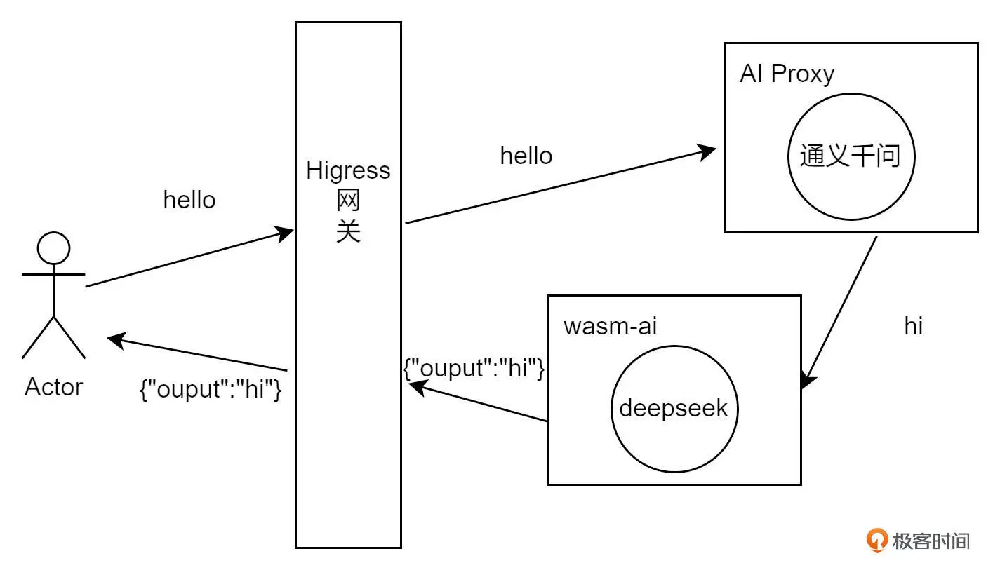

### 服务与路由配置

要想实现在插件中调用外部服务，首先需要进行服务配置。可在 Higress 控制台服务来源页面，点击创建服务来源，选择创建 DNS 域名类型的服务，在这里我创建两个大模型服务，一个是通义千问，用来做对话，另一个是最近比较火的 DeepSeek 大模型，用来做 JSONMode。

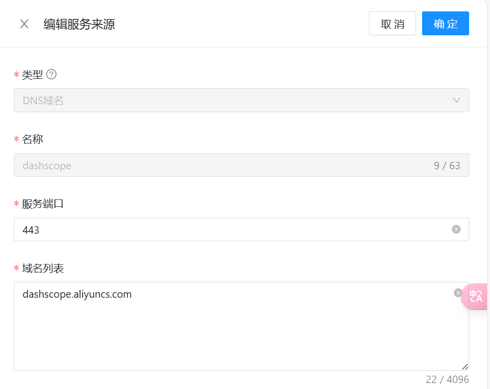

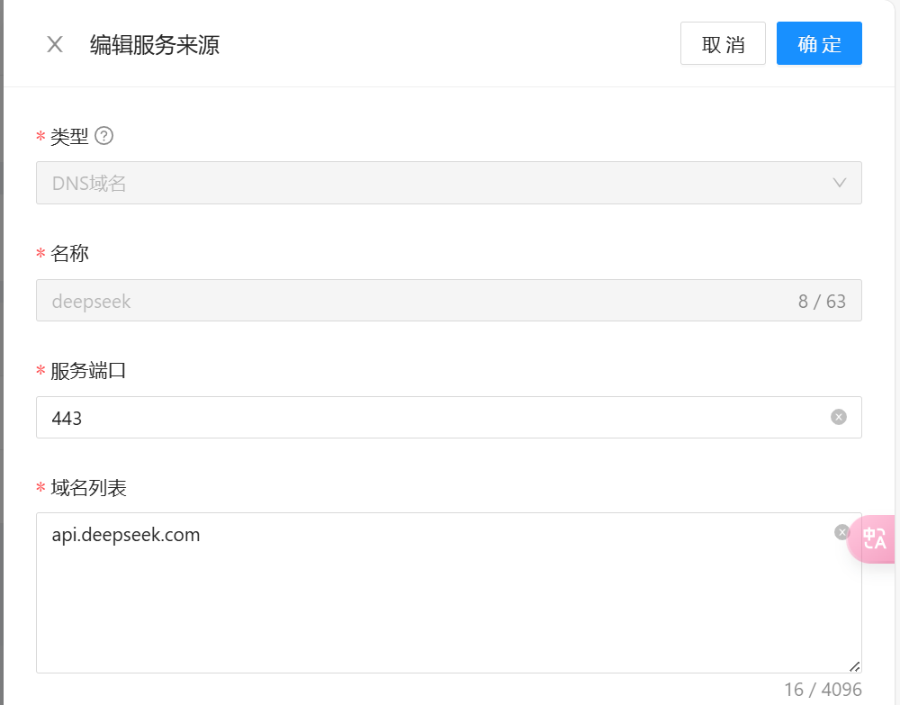

之后需要为通义千问大模型配置好路由，使得外部可以通过网关访问到。路由在路由配置页面进行设置。首先设置好路径匹配规则，如下图所示：

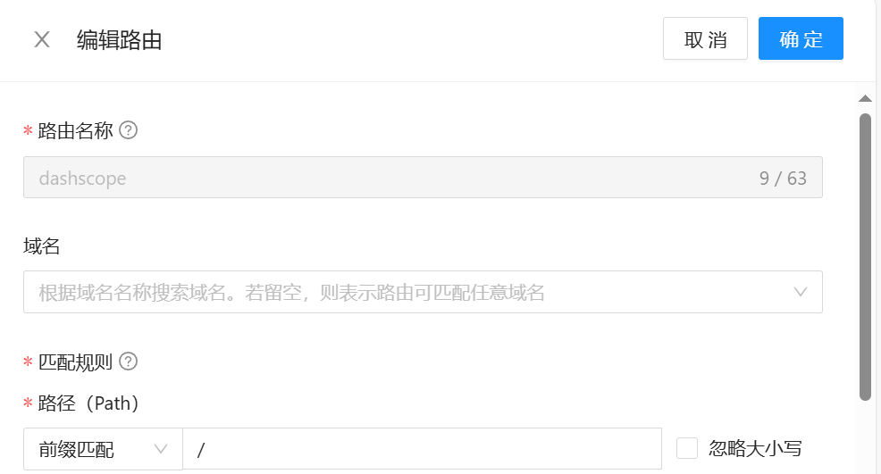

通义千问大模型是 HTTPS 的服务，因此需要设置三个 ingress 注解。分别是：

- higress.io/backend-protocol: HTTPS

- higress.io/proxy-ssl-name: dashscope.aliyuncs.com

- higress.io/proxy-ssl-server-name: on

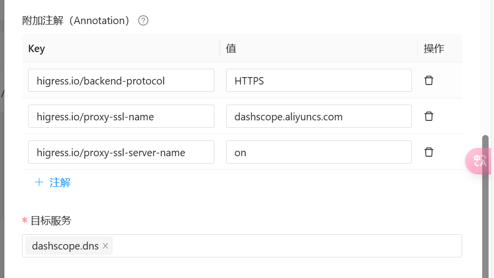

最后将路由关联到模板服务上即可。

### 初始化工程目录

服务创建完成后，接下来就可以开始写代码了。首先新建一个工程目录，例如 wasm-ai.。并在目录下执行以下命令，进行 Go 工程初始化：

```
go mod init wasm-ai
```

之后下载依赖包：

```
go get github.com/higress-group/proxy-wasm-go-sdk
go get github.com/alibaba/higress/plugins/wasm-go@main
go get github.com/tidwall/gjson
```

### 编写 main.go

代码如下：

```go
package main
import (
   "encoding/json"
   "net/http"
   "github.com/alibaba/higress/plugins/wasm-go/pkg/wrapper"
   "github.com/higress-group/proxy-wasm-go-sdk/proxywasm"
   "github.com/higress-group/proxy-wasm-go-sdk/proxywasm/types"
   "github.com/tidwall/gjson"
)
func main() {
   wrapper.SetCtx(
       // 插件名称
       "my-plugin",
       // 为解析插件配置，设置自定义函数
       wrapper.ParseConfigBy(parseConfig),
       // 为处理返回体，设置自定义函数
       wrapper.ProcessResponseBodyBy(onHttpResponseBody),
   )
}
// completion
type Completion struct {
   Model    string    `json:"model"`
   Messages []Message `json:"messages"`
   Stream   bool      `json:"stream"`
}
type Deepl struct {
   Text        []string `json:"text"`
   Target_lang string   `json:"target_lang"`
}
type Message struct {
   Role    string `json:"role"`
   Content string `json:"content"`
}
type CompletionResponse struct {
   Choices           []Choice        `json:"choices"`
   Object            string          `json:"object"`
   Usage             CompletionUsage `json:"usage"`
   Created           string          `json:"created"`
   SystemFingerprint string          `json:"system_fingerprint"`
   Model             string          `json:"model"`
   ID                string          `json:"id"`
}
type Choice struct {
   Message      Message `json:"message"`
   FinishReason string  `json:"finish_reason"`
   Index        int     `json:"index"`
}
type CompletionUsage struct {
   PromptTokens     int `json:"prompt_tokens"`
   CompletionTokens int `json:"completion_tokens"`
   TotalTokens      int `json:"total_tokens"`
}
// 自定义插件配置
type PluginConfig struct {
   url       string
   model     string
   apiKey    string
   LLMClient wrapper.HttpClient
}
// 在控制台插件配置中填写的YAML配置会自动转换为JSON，此处直接从JSON这个参数里解析配置即可
func parseConfig(json gjson.Result, config *PluginConfig, log wrapper.Log) error
   log.Info("[parseConfig] start")
   // 解析出配置，更新到config中
   config.url = json.Get("url").String()
   config.model = json.Get("model").String()
   config.apiKey = json.Get("apiKey").String()
   config.LLMClient = wrapper.NewClusterClient(wrapper.FQDNCluster{
       FQDN: json.Get("serviceFQDN").String(),
       Port: json.Get("servicePort").Int(),
       Host: json.Get("serviceHost").String(),
   })
   return nil
}
// 从response接收到firstreq的大模型返回
func onHttpResponseBody(ctx wrapper.HttpContext, config PluginConfig, body []byte
   var responseCompletion CompletionResponse
   _ = json.Unmarshal(body, &responseCompletion)
   log.Infof("content: %s", responseCompletion.Choices[0].Message.Content)
   completion := Completion{
       Model: config.model,
       Messages: []Message{{Role: "system", Content: `请参考我的 JSON 定义输出 JSON
           {Role: "user", Content: responseCompletion.Choices[0].Message.Content
       Stream: false,
   }
   headers := [][2]string{{"Content-Type", "application/json"}, {"Authorization"
   reqEmbeddingSerialized, _ := json.Marshal(completion)
   err := config.LLMClient.Post(
       config.url,
       headers,
       reqEmbeddingSerialized,
       func(statusCode int, responseHeaders http.Header, responseBody []byte) {
           log.Infof("statusCode: %d", statusCode)
           log.Infof("responseBody: %s", string(responseBody))
           //得到gpt的返回结果
           var responseCompletion CompletionResponse
           _ = json.Unmarshal(responseBody, &responseCompletion)
           log.Infof("content: %s", responseCompletion.Choices[0].Message.Conten
           if responseCompletion.Choices[0].Message.Content != "" {
               //如果结果不是空，则替换原本的response body
               newbody, err := json.Marshal(responseCompletion.Choices[0].Messag
               if err != nil {
                   proxywasm.ResumeHttpResponse()
                   return
               }
               proxywasm.ReplaceHttpResponseBody(newbody)
               proxywasm.ResumeHttpResponse()
           }
           log.Infof("resume")
           proxywasm.ResumeHttpResponse()
       }, 50000)
   if err != nil {
       log.Errorf("[onHttpResponseBody] completion err: %s", err.Error())
       proxywasm.ResumeHttpResponse()
   }
   return types.ActionPause
}
```

代码首先用 wrapper.SetCtx 设置了启动入口，由于我的插件功能是拦截 HTTP Response，然后将其 JSON 化后返回，因此除了使用 ParseConfigBy 配置解析外，就只使用了ProcessResponseBodyBy。

配置解析代码很简单。我的插件配置是这么设计的：

```
url: string
model: string
apiKey: string
serviceHost: string
serviceFQDN: string
servicePort: int
```

前三个参数分别代表大模型的 base_url、模型名称以及模型的 APIKey。后三个参数是构建Higress 服务发现所需要的参数。

Higress 插件的 Go SDK 在进行 HTTP 调用时，是通过指定的集群名称来识别并连接到相应的Envoy 集群。 此外，Higress 利用 McpBridge 支持多种服务发现机制，包括静态配置（static）、DNS、Kubernetes 服务、Eureka、Consul、Nacos、以及 Zookeeper 等。 每种服务发现机制对应的集群名称生成规则都有所不同，这些规则在 cluster_wrapper.go 代码文件中有所体现。

在代码中，我使用的是 FQDN 类型的集群客户端。FQDN 定义如下：

```
type FQDNCluster struct {
 FQDN string
 Host string
 Port int64
}
```

FQDN 就是在服务列表里看到的服务名称，形如“my-cluster.static”“your-cluster.dns”“foo.default.svc.cluster.local”。Host 字段用于发送实际 HTTP 请求时的缺省配置域名，如果在发送时的 URL 里指定了域名，那么将以指定的为准。

接下来看看拦截 HTTP Response 的代码。代码首先取出 Response Body，这个就是请求通义千问大模型后，大模型给出的答复。由于基本上各大模型厂商都会遵循 OpenAI SDK，因此就定义了 CompletionResponse 结构体对 Response 进行了反序列化，并从responseCompletion.Choices[0].Message.Content 中取出了大模型的回复，拼接到了用于JSON Mode 请求的对话 Completion。之后使用了在配置解析阶段配置好的 FQDN 客户端进行了 POST 请求，也就是向 DeepSeek 服务进行了一次请求。

由于 DeepSeek 也是遵循 OpenAI SDK 的，因此也使用 CompletionResponse 结构体接收Response。大模型返回的内容会放置在 responseCompletion.Choices[0].Message.Content中，如果不为空，那么 JSON 序列化成新的 Body，使用 ReplaceHttpResponseBody 替换掉原来的 Response，并使用 ResumeHttpResponse 恢复被插件拦截的 Response 流程。

这里用到的 ReplaceHttpResponseBody 和 ResumeHttpResponse 都是 SDK 提供的工具方法，除了这两个工具外，还有其他常用的方法如下表所示：

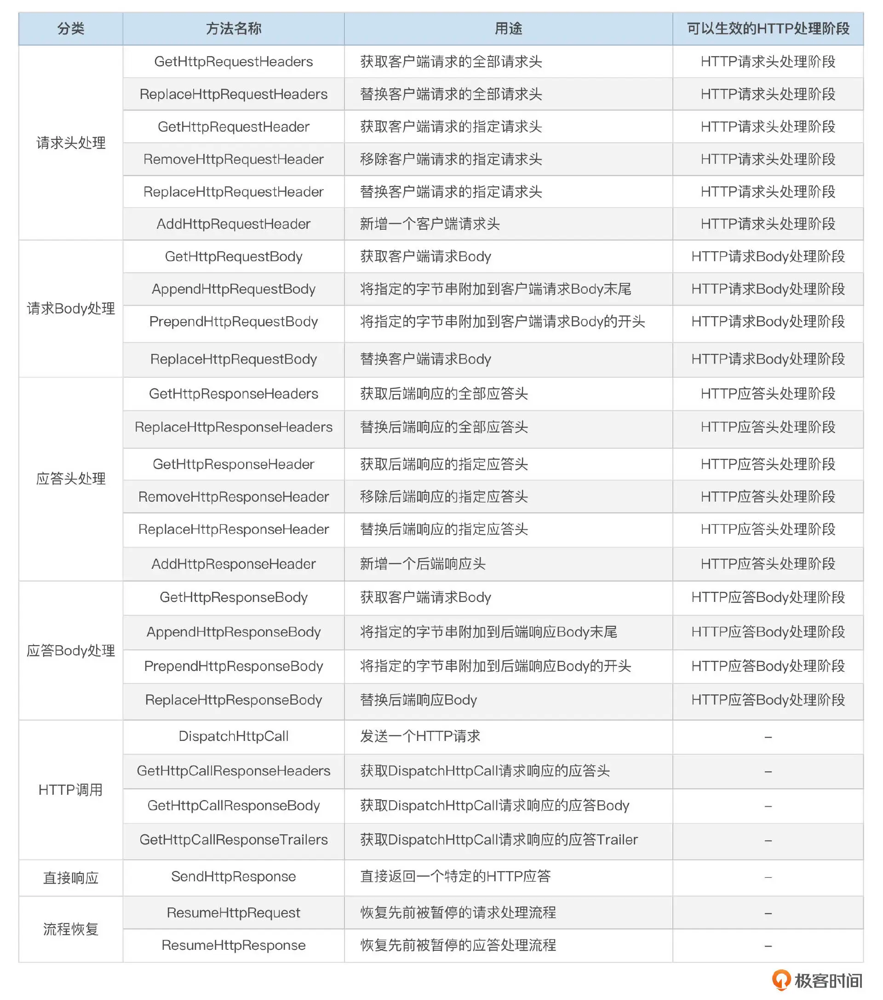

需要注意的是，流程恢复工具方法，一定不能用错，否则会导致插件崩溃。流程恢复工具要在请求 / 响应处于 Pause 状态时才能使用。而在 SendHttpResponse 之后，Pause 状态的请求 /响应将自动恢复，此时不需要调用流程恢复工具方法。

### 编译生成 Wasm 文件以及打包镜像

在完成代码编写后，可执行以下命令编译成 Wasm 文件：

```
tinygo build -o main.wasm -scheduler=none -target=wasi -gc=custom -tags='customma
```

之后可以将其打包成 docker 镜像，传至镜像仓库，便于在 Higress 上部署插件。Dockerfile文件内容如下：

```
FROM scratch
COPY main.wasm plugin.wasm
```

之后通过 docker 命令进行打包，我使用的是阿里云的镜像仓库，你可以替换为你自己的。

```bash
docker build --network host -t registry.cn-hangzhou.aliyuncs.com/aitools/wasm-ai:
```

### 部署插件

回到 Higress 控制台，切换到插件配置页面，点击添加插件。之后按要求填写镜像地址，执行阶段和执行优先级。

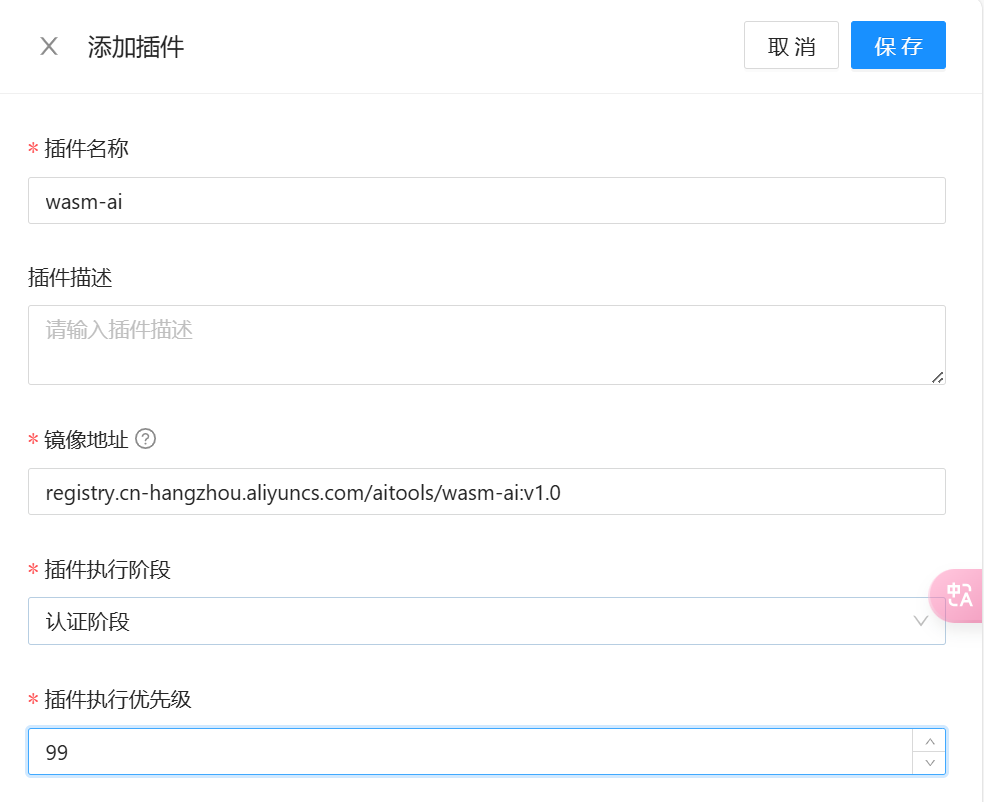

完成后点击保存，会自动跳回插件配置页面。将页面划到最底部，就可以看到我们刚刚部署的插件了。

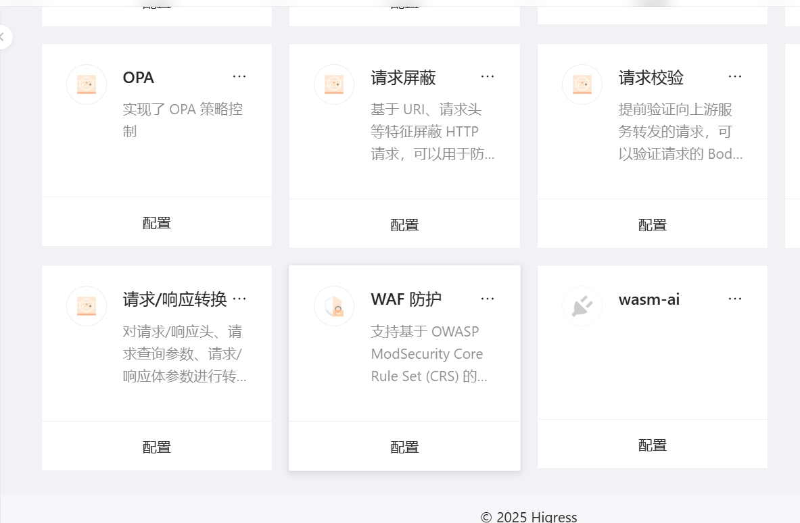

之后点击配置，开始配置插件。

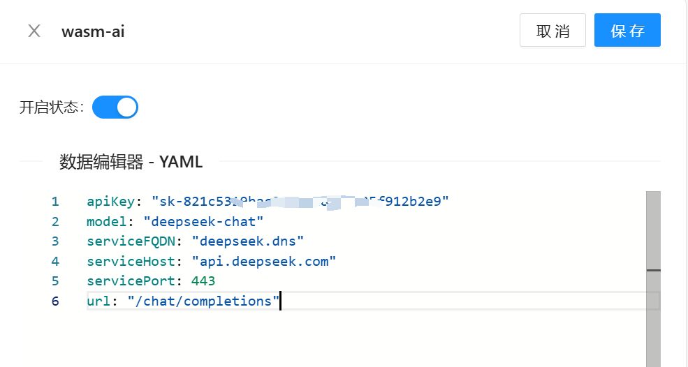

在配置中，将 DeepSeek 相关的参数按照设计配置上，点击保存就可以开启插件。

接下来，开启 AI Proxy 插件，用来代理通义千问大模型。插件是如下图所示的 AI 代理。

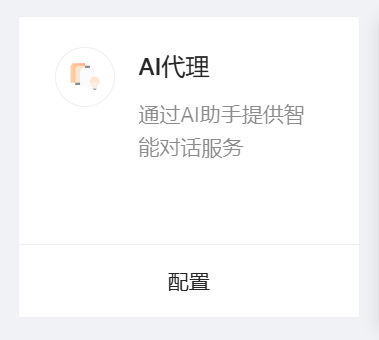

点击配置，做一下简单配置：

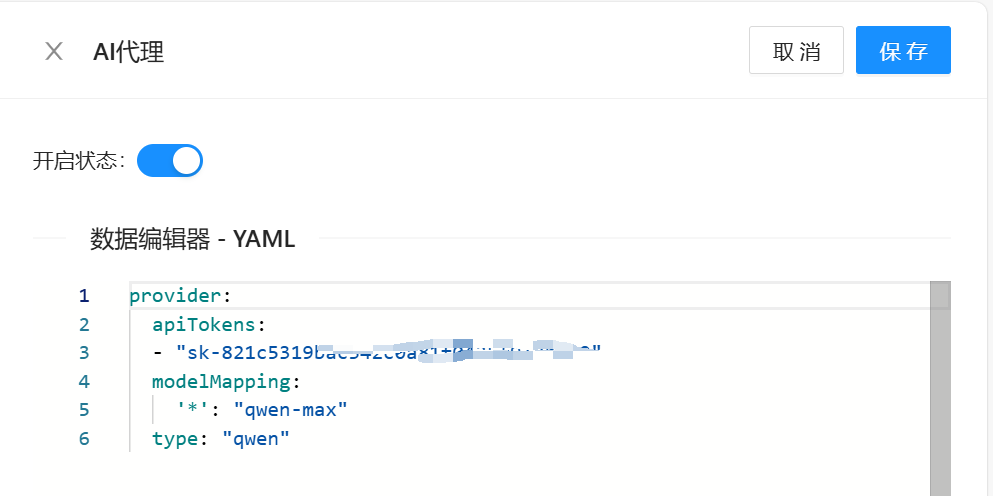

apiTokens 填通义千问的，这里的 modelMapping 代表模型映射，前面的 * 代表任意模型，意义是请求网关的用户无论设置的是什么模型，最终经过 AI Proxy 时，都会最终转化成使用qwen-max 模型。AI Proxy 同时还会将标准 OpenAI 格式的请求，转化成各个代理大模型的格式。

### 测试

我们使用 apifox 工具进行测试。

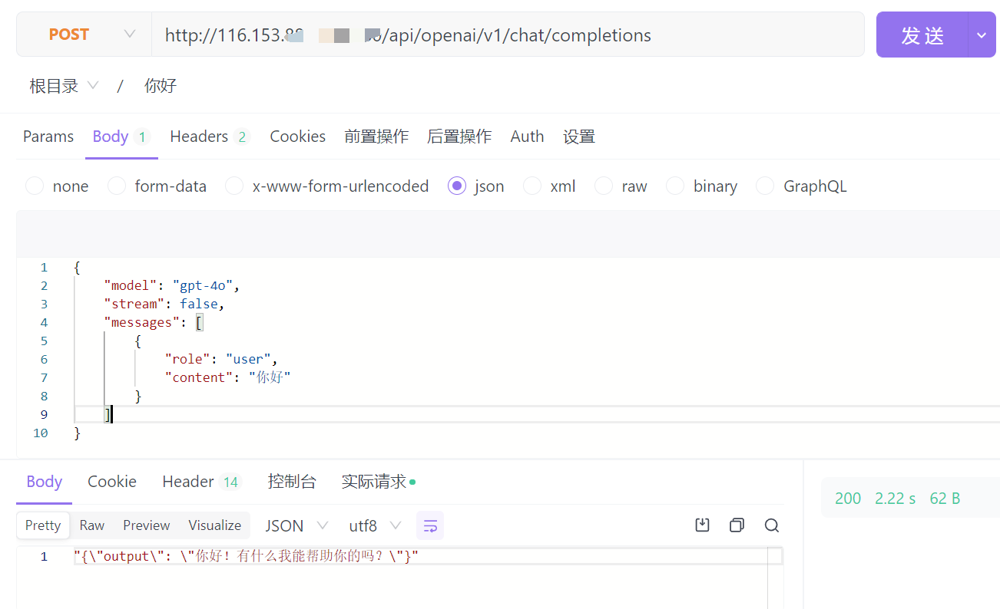

由于设置了 AI Proxy，因此 URL 的 PATH 使用的是 OpenAI Chat Completions 的 PATH，即/api/openai/v1/chat/completions。在请求 Body 中，也是使用了 OpenAI 的标准格式，model可以随便写，写 xxx 都可以，最后都会转成 qwen-max。

最后得到的 Response，就是按照预设的 JSON Mode 格式返回的。

## 总结

今天这节课，我使用了一个 JSON Mode 的小例子，带你编写了一个简单的 Wasm 插件。该插件可以实现在对网关进行 HTTP 请求后的 HTTP Response 阶段进行拦截，将 ResponseBody 中的内容，按规定的 JSON 格式进行格式化后，替换原 Body，然后返回。

代码流程很简单，你体会一下对于 HTTP 请求头、请求体、返回头、返回体等阶段拦截的思想即可。但是在写代码的过程中，对于工具方法的使用细节，尤其是 Resume 的使用，要小心。

除此之外，我还为你演示了服务配置、插件代码编译、打包、部署的全过程，你可以在课后按照我的步骤测试一下，加深理解。本节课的代码已经上传到我的 Github，你可点击链接自取。

到此，Wasm 基础知识的学习就告一段落了，从下节课开始我们开始编写正式的 AI 插件。

## 思考题

我希望在本节课代码的基础上，在 HTTP 原始返回头上添加一个 mode:json 返回头，应该怎么做呢？

欢迎你在留言区分享你的思考和代码，我们一起来讨论。如果你觉得这节课的内容对你有帮助的话，也欢迎你分享给其他朋友，我们下节课再见！
