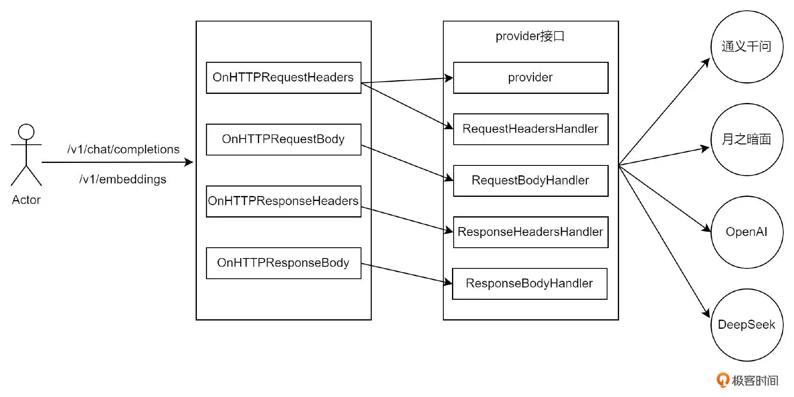
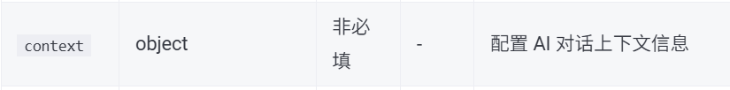
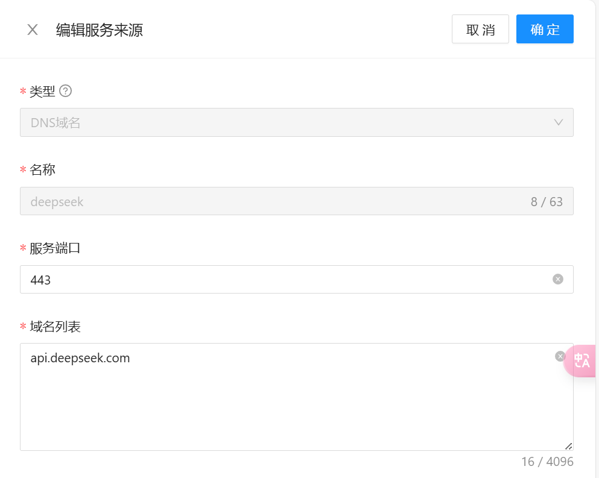
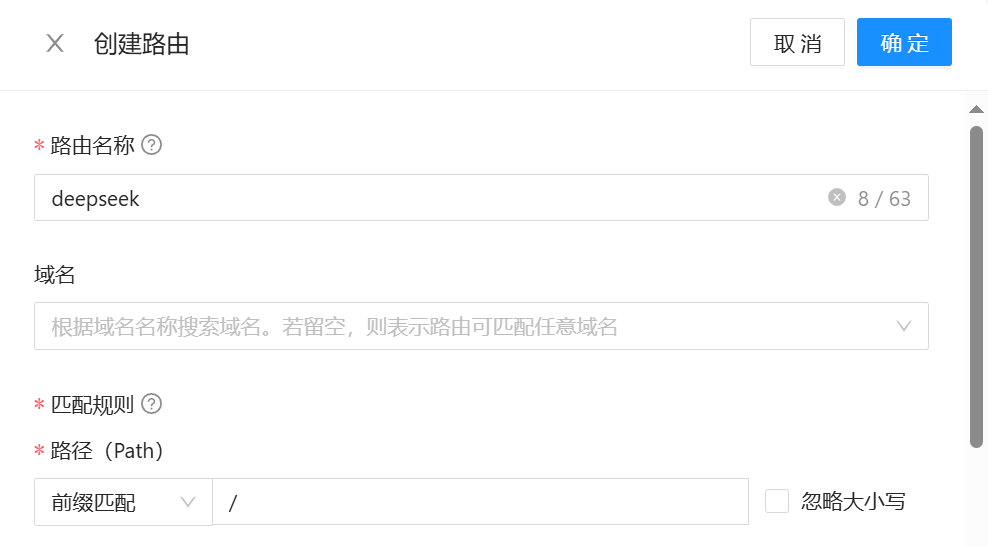
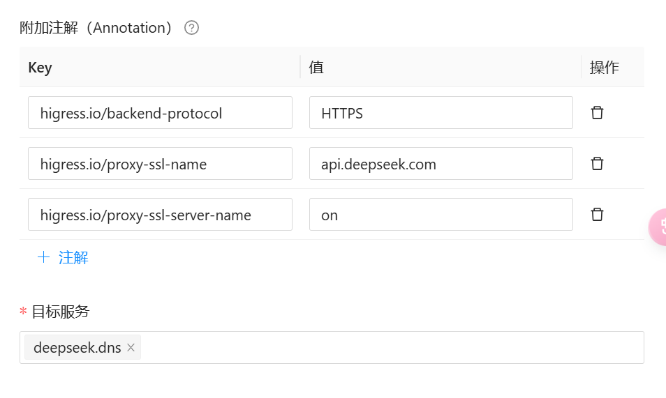
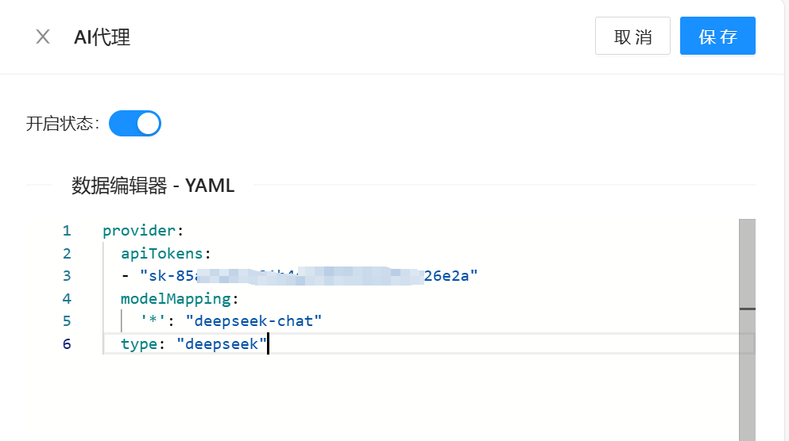
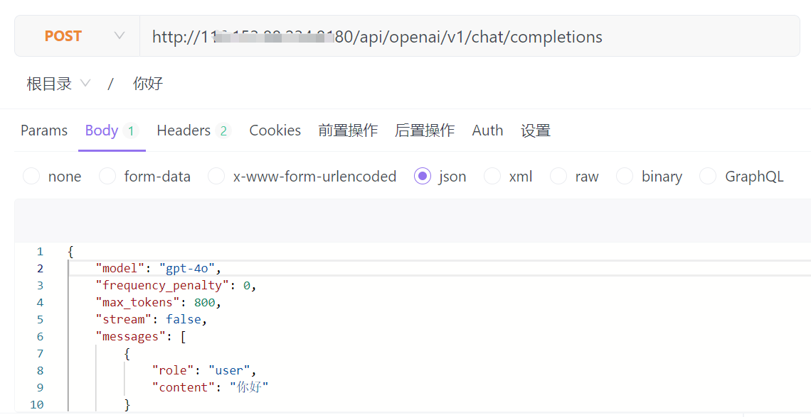
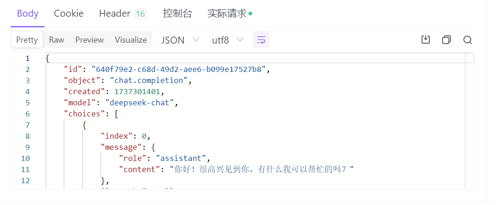

# 22 | 实践：用Wasm实现AIProxy

你好，我是邢云阳。

在前面的几节课中，我从 Wasm 的理论和实践两个角度，为你介绍了 Wasm。核心知识点实际上就是两块，一是 Wasm 的原理，二就是如何用 Wasm Go SDK 编写 Wasm 程序。对于原理，感兴趣的话你可以详细了解一下，而对于如何写 Wasm 程序，参考上节课的例子学会套路即可，后面用到哪个工具函数可以随时查文档。

在上节课的例子中，我们用到过 AI Proxy 这个插件，主要是为了能以网关 URL + OpenAI 协议的方式请求大模型。因为我们知道现在市面上无论是商业模型还是开源模型，基本大多都会遵循 OpenAI 标准，但每家厂商的 Base_Url 不一样，因此如果能有一个插件帮我们做好适配，让我们无论使用什么模型时，都可以以标准 OpenAI 格式请求，就会很方便。

因此本节课，我就用最近比较火的 DeepSeek 模型为例，带你写一下 AI Proxy 程序。

## 总体架构

我们先来了解一下 AI Proxy 的总体架构原理。



从前面的课程中，我们已经了解到，Wasm 插件是如何在一次完整的 HTTP 请求中起作用的。简单来说，它主要在四个阶段介入：RequestHeader、RequestBody、ResponseHeader和 ResponseBody。

AI Proxy 插件的原理也不例外，同样是在这四个阶段进行操作。如上图架构所示，当用户以标准的 OpenAI API 格式向网关发起请求时，请求会在这四个阶段被拦截。具体来说，在Request 阶段，AI Proxy 插件会将用户的 OpenAI 请求转换为对应的大模型供应商的 API 格式；而在 Response 阶段，插件则会将大模型供应商的响应转换回 OpenAI 格式。

那么，面对众多大模型厂商，AI Proxy 如何确定该转换为哪家厂商的格式呢？为了解决这个问题，AI Proxy 定义了一组接口，即图中的 provider 接口。这组接口通过多态的方式，由各个大模型厂商具体实现，从而完成 OpenAI 格式与各自协议之间的相互转换。

因此再有了这个框架后，以后再添加新的模型商就很简单了，只需要实现 provider 接口即可。接下来，我们就从参数解析开始，边阅读源码，边写新代码，最后完成 DeepSeek 大模型代理功能。

## 详细代码实现

### 参数配置

在 wrapper.SetCtx 入口函数中参数配置的方法使用的是：

```
wrapper.ParseOverrideConfigBy(parseGlobalConfig, parseOverrideRuleConfig)
```

而不是之前我们常见的：

```
wrapper.ParseConfigBy(parseConfig)
```

在第 22 节课中，我们曾探讨过一个关键概念：当全局配置与路由、域名或服务级别的配置规则存在差异时，必须采用 ParseOverrideConfigBy 方法。此方法要求我们分别设定全局规则解析的回调钩子函数 ParseGlobalConfig，以及路由级规则解析的回调钩子函数ParseRuleConfig。在处理 ParseRuleConfig 回调钩子函数时，必须将全局配置的内容复制到路由、域名或服务级别的配置中。这样做确保了在 HttpContext 中，我们能够获取到当前HTTP 请求下的插件配置，这些配置涵盖了全局配置以及路由、域名、服务级别的配置内容。因此，ParseOverrideConfigBy 的实现代码如下：

```go
func parseOverrideRuleConfig(json gjson.Result, global config.PluginConfig, plugi
   //log.Debugf("loading override rule config: %s", json.String())
   *pluginConfig = global
   pluginConfig.FromJson(json)
   if err := pluginConfig.Validate(); err != nil {
       return err
   }
   if err := pluginConfig.Complete(); err != nil {
       return err
   }
   return nil
}
```

在第四行代码中，全局配置参数被复制到了路由级别的 pluginConfig 中。这一步骤确保了路由级别的配置能够基于全局配置进行扩展或覆盖。接下来，系统会在这个基础上继续解析其他层级的配置（如域名级别或服务级别），从而逐步构建出最终的配置结果。这种分层解析的方式保证了配置的灵活性和优先级，同时也避免了配置冲突或遗漏的问题。

### onHttpRequestHeader

当一个 HTTP 请求抵达网关时，它首先会在本阶段被拦截。在深入探讨这一阶段的具体操作之前，我们必须先明确本次 HTTP 请求的结构，其格式如下：

```bash
curl 'http://<这里换成网关IP>/api/openai/v1/chat/completions' \
 -H 'Accept: application/json' \
 -H 'Content-Type: application/json' \
 --data-raw '{"model":"qwen-long","frequency_penalty":0,"max_tokens":800,"stream
```

那在 Header 阶段，我们是可以得到 Url 以及 Header 信息，当然如果抓包看的是实际请求报文的话，还可以看到 Host 信息。

再来看一下目标访问模型 DeepSeek 的 API 格式：

```bash
curl https://api.deepseek.com/chat/completions \
 -H "Content-Type: application/json" \
 -H "Authorization: Bearer <DeepSeek API Key>" \
 -d '{
       "model": "deepseek-chat",
       "messages": [
         {"role": "system", "content": "You are a helpful assistant."},
         {"role": "user", "content": "Hello!"}
       ],
       "stream": false
     }'
```

可以看到其 Url、Header，当然还有 Host 都与初始请求不一致，那怎么办呢？答案就是替换。因此本阶段的主要工作内容就是替换。有了这个思路后，代码就简单了，我们来看一下DeepSeek 实现 OnRequestHeaders 接口的代码：

```
func (m *deepseekProvider) OnRequestHeaders(ctx wrapper.HttpContext, apiName ApiN
   if apiName != ApiNameChatCompletion {
       return types.ActionContinue, errUnsupportedApiName
   }
   _ = util.OverwriteRequestPath("/v1/chat/completions")
   _ = util.OverwriteRequestHost("api.deepseek.com")
   _ = util.OverwriteRequestAuthorization("Bearer " + m.config.GetRandomToken())
   _ = proxywasm.RemoveHttpRequestHeader("Content-Length")
   return types.ActionContinue, nil
}
```

在代码中，利用 OverwriteRequestXXX 工具方法实现了对 Path, Host 等信息的替换。并添加上了 Authorization 信息。

之后看一下是如何通过多态的方式调用该函数的。

```go
activeProvider := pluginConfig.GetProvider()
...
if handler, ok := activeProvider.(provider.RequestHeadersHandler); ok {
   // Disable the route re-calculation since the plugin may modify some headers
   ctx.DisableReroute()
   hasRequestBody := wrapper.HasRequestBody()
   action, err := handler.OnRequestHeaders(ctx, apiName, log)
   if err == nil {
       if hasRequestBody {
           ctx.SetRequestBodyBufferLimit(defaultMaxBodyBytes)
           // Always return types.HeaderStopIteration to support fallback routin
           // as long as onHttpRequestBody can be called.
           return types.HeaderStopIteration
       }
       return action
   }
   _ = util.SendResponse(500, "ai-proxy.proc_req_headers_failed", util.MimeTypeT
   return types.ActionContinue
}
```

首先，通过 GetProvider() 获取到了具体是哪个模型供应商类，之后通过 activeProvider.(provider.RequestHeadersHandler) 断言该类是否实现了 RequestHeadersHandler 接口，如果实现了，则可以通过 handler.OnRequestHeaders 完成接口调用。具体调用哪个类的接口，取决于 activeProvider 的实际类型。

### onHttpRequestBody

这一阶段主要是处理体的内容，由于 DeepSeek 与 OpenAI 的请求体是完全兼容的，因此理论上，这一阶段格式无需变更，仅需把 model 替换一下即可。但是该插件还支持配置上下文的功能，如图所示：



因此，还需在代码中，遍历一下上下文，添加到请求体的 messages 中去。综合这两点需求，OnRequestBody 方法这样写：

```go
func (m *deepseekProvider) OnRequestBody(ctx wrapper.HttpContext, apiName ApiName
   if apiName != ApiNameChatCompletion {
       return types.ActionContinue, errUnsupportedApiName
   }
   if m.contextCache == nil {
       return types.ActionContinue, nil
   }
   request := &chatCompletionRequest{}
   if err := decodeChatCompletionRequest(body, request); err != nil {
       return types.ActionContinue, err
   }
   model := request.Model
   if model == "" {
       return types.ActionContinue, errors.New("missing model in chat completion
   }
   mappedModel := getMappedModel(model, m.config.modelMapping, log)
   if mappedModel == "" {
       return types.ActionContinue, errors.New("model becomes empty after applyi
   }
   request.Model = mappedModel
   err := m.contextCache.GetContent(func(content string, err error) {
       defer func() {
           _ = proxywasm.ResumeHttpRequest()
       }()
       if err != nil {
           log.Errorf("failed to load context file: %v", err)
           _ = util.SendResponse(500, "ai-proxy.deepseek.load_ctx_failed", util.
       }
       insertContextMessage(request, content)
       if err := replaceJsonRequestBody(request, log); err != nil {
           _ = util.SendResponse(500, "ai-proxy.deepseek.insert_ctx_failed", uti
       }
   }, log)
   if err == nil {
       return types.ActionPause, nil
   }
   return types.ActionContinue, err
}
```

### onHttpResponseHeaders

在这一阶段，通常情况下并不需要进行额外处理，除非返回的响应头中包含了 OpenAI 不支持的字段，这时才需要对这些字段进行移除或调整。由于 DeepSeek 的 Response 完全兼容OpenAI 的格式，因此在本阶段无需进行任何特殊处理。这种兼容性极大地简化了流程，避免了对响应内容的额外修改。

### onHttpResponseBody

在这一阶段，主要任务是将其他厂商模型的 API 响应格式转换为 OpenAI 格式。由于DeepSeek 的响应格式已经与 OpenAI 完全兼容，因此这一阶段对 DeepSeek 来说并不需要额外处理。不过，为了深入理解这一过程，我们可以以 Claude 为例，看看如何将一个与OpenAI 格式不同的模型响应转换为 OpenAI 格式。

以下是一个示例代码，展示了如何将 Claude 的响应格式转换为 OpenAI 格式：

```go
func (c *claudeProvider) OnResponseBody(ctx wrapper.HttpContext, apiName ApiName,
   claudeResponse := &claudeTextGenResponse{}
   if err := json.Unmarshal(body, claudeResponse); err != nil {
       return types.ActionContinue, fmt.Errorf("unable to unmarshal claude respo
   }
   if claudeResponse.Error != nil {
       return types.ActionContinue, fmt.Errorf("claude response error, error_typ
   }
   response := c.responseClaude2OpenAI(ctx, claudeResponse)
   return types.ActionContinue, replaceJsonResponseBody(response, log)
}
func (c *claudeProvider) responseClaude2OpenAI(ctx wrapper.HttpContext, origRespo
   choice := chatCompletionChoice{
       Index:        0,
       Message:      &chatMessage{Role: roleAssistant, Content: origResponse.Con
       FinishReason: stopReasonClaude2OpenAI(origResponse.StopReason),
   }
   return &chatCompletionResponse{
       Id:                origResponse.Id,
       Created:           time.Now().UnixMilli() / 1000,
       Model:             ctx.GetStringContext(ctxKeyFinalRequestModel, ""),
       SystemFingerprint: "",
       Object:            objectChatCompletion,
       Choices:           []chatCompletionChoice{choice},
       Usage: usage{
           PromptTokens:     origResponse.Usage.InputTokens,
           CompletionTokens: origResponse.Usage.OutputTokens,
           TotalTokens:      origResponse.Usage.InputTokens + origResponse.Usage
       },
   }
}
```

正如前面所述，代码的核心功能集中在 responseClaude2OpenAI 函数中，其主要任务是对字段进行转换，将 Claude 的响应格式适配为 OpenAI 的格式。除此之外，确实没有其他额外的工作需要处理。

至此，为 AI Proxy 添加 DeepSeek 大模型的适配工作已经基本完成。接下来，我们需要对实现的功能进行测试，以确保其正确性和稳定性。

## 测试

首先，需要打开 Higress 控制台，在服务来源页面添加上 DeepSeek 服务。



之后要为其添加路由，配置如下：



注意三个注解：



之后，配置 AI 代理插件：



接下来，用 ApiFox 测试一下。请求时，大模型写的是 gpt-4o。



在收到回复后，查看 model，显示的是 deepseek-chat，说明代理生效了。



## 总结

在本节课中，我为你详细介绍了 AI Proxy 这个在网关上最基础且必不可少的插件的核心原理，并通过为插件新增一个 DeepSeek 模型代理的实践，帮助你深入理解其工作机制和实现方式。本节课的代码，已经合入到 Higress 的 main 分支了，你可以通过链接访问，查看完整详情。

当 Higress 网关有了模型代理能力后，在商业化中实际上就可以配合前端做一些模型平台产品了。比如某公司希望为员工提供一个内部的模型平台，该公司员工，可以登录该平台使用大模型能力，进行一些文生文，文生图等应用。而公司管理员则可以对模型类型，用量等进行控制。

此时便可以开发一个模型对话前端，在配置 OpenAI 接入的地方，配置上 Higress 网关地址。管理员在网关上，通过修改插件配置即可完成控制。同时也可以通过配合其他的安全限流等插件，进行更多控制。

这个场景，我会在后续的课程中，为你详细演示。

## 思考题

AI Proxy 还支持 failover 这一特性，即我可以为大模型配置多个 APIToken，当其不可用时，会移出 APIToken 列表。感兴趣的话你可以测试并阅读一下源码实现。

欢迎你在留言区分享你的思考，我们一起来讨论。如果你觉得这节课的内容对你有帮助的话，也欢迎你分享给其他朋友，我们下节课再见！
