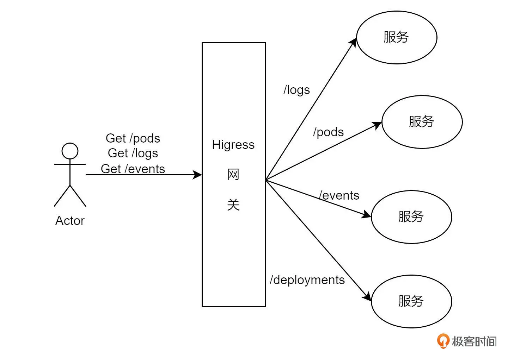
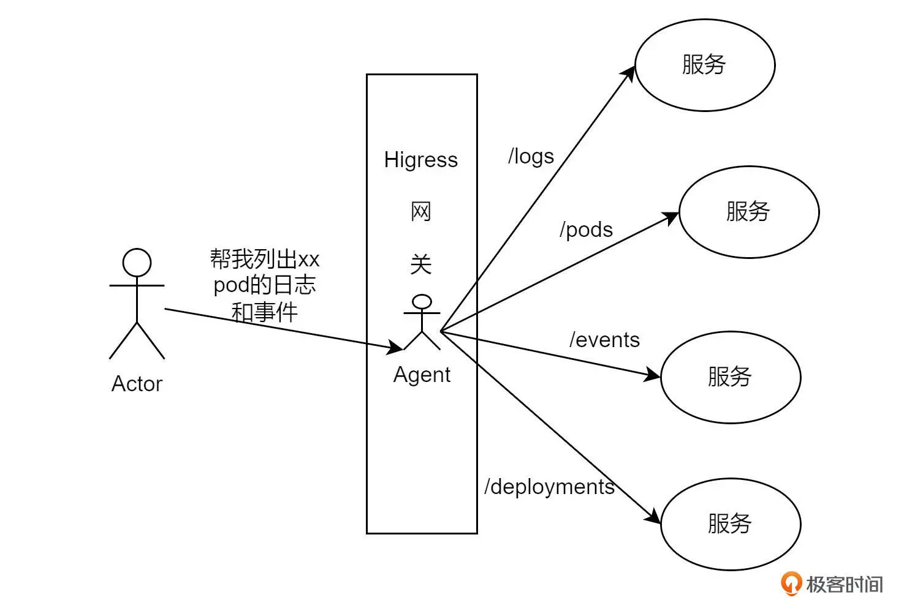
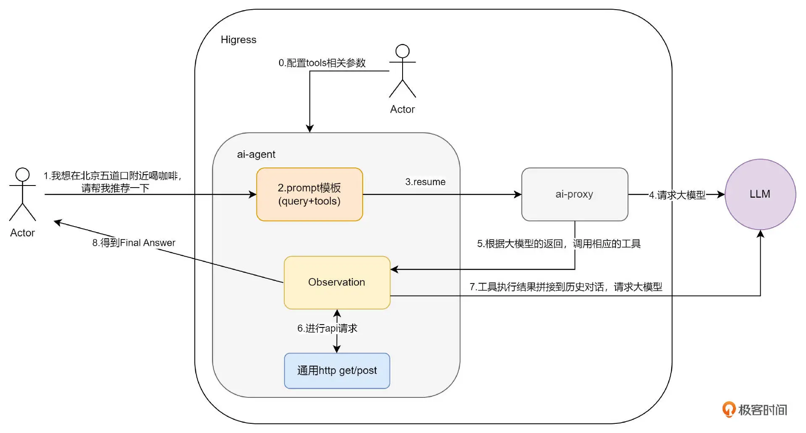
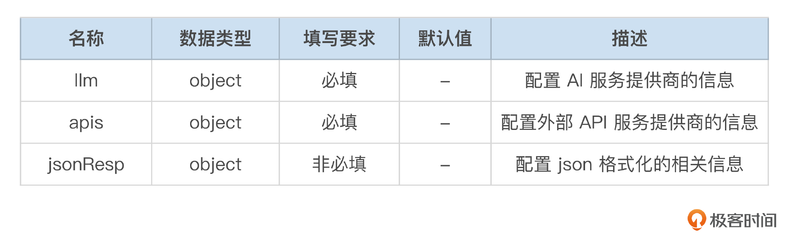
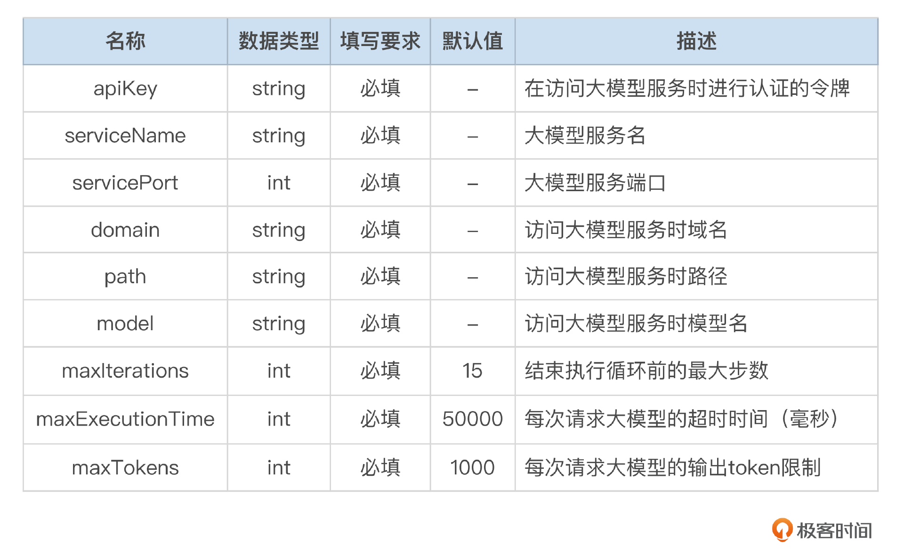
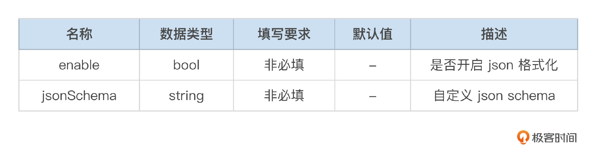

# 23 | 实践：用Wasm实现APIAgent

你好，我是邢云阳。

上节课我们探讨了 AI Proxy 插件，该插件为网关用户提供了便捷的统一 OpenAI 协议访问各类大模型的功能，是网关 AI 应用的基石。本节课我们将在这一基础之上使用 Wasm 技术来实现上一章节中讲解的 API Agent。

网关的核心功能如图所示，它为后端 API 提供统一的访问入口和路由转发规则。外部用户通过该入口访问各个 API，而非直接暴露所有后端服务 API，从而增强了系统的安全性和可管理性。



当需要请求多个服务时，通常需要发送多条 API 请求。然而，如果在网关上集成 AI Agent，相当于为网关赋予了“大脑”。该 Agent 能够统一管理后端的所有 API，用户只需通过自然语言与网关交互，网关便会自动调用相应的 API，并将结果以自然语言的形式返回。这一过程去除了技术复杂性，使交互变得流畅自然，充分展现了 AI 微服务的魅力。



接下来，我们将进入今天的代码实践环节。

## 代码实践

API Agent 的实现原理我们上一章节已经详细阐述过了，这节课不再重复。我将重点结合Wasm 的相关知识，讲解如何将上一章节的代码转换为 Wasm 版本。

### 总体架构

我们先来看一下总体架构设计。

在第 0 步，用户在开启插件时，需要配置 tools 等相关参数，这个在讲配置解析时再详细说明有哪些和之前不一样的参数。

插件开启后，就是第 1 步，用户使用 OpenAI 协议向网关发送 Request 请求，此时 Agent 插件会在 RequestBody 阶段进行拦截，取出 Request Body 中的 messages，之后在第 2 步填充 ReAct 模板，组成新的 messages 替换原有的 Request Body 。

之后就是通过 AI Proxy 插件将请求发送给大模型，并得到了大模型的反馈，也就是图中的第3、4、5 步。我们如何拦截大模型的反馈呢？没错，我们要在 ResponseBody 阶段拦截。

此时我们得到了大模型的第一次反馈，也就是是否要调用工具，还是已经得到了 FinalAnswer。此后就要循环思考了，如果要调用工具，就要使用同样的 HTTP 方法调用工具，并将结果反馈大模型，也就是图中的第 6、7 两步；如果得到了 Final Answer，就直接反馈给用户，也就是图中的第 8 步。

如果你已经对我们之前讲过的 ReAct Agent 的流程非常熟悉了，应该就能感受到，Agent 的核心思考阶段，都在 ResponseBody 阶段完成了。因此这一阶段非常重要。



这就是我们这个插件在网关上的整体架构流程和设计思路，理清思路后，代码就好说了。

### 配置解析

首先来看配置解析。在第 16 节课中，我曾设计过 API Agent 的配置，当时由于默认大模型使用的是通义千问，因此设计的结构如下：

```
instruction: xxxx
apis:
- apiProvider：
   apikey:
     name: key
     value: xxx
     in: header
 api: |
   openapi: 3.1.0
   info: xxx
```

结构中只包含 tools 供应商的信息以及 tools 的 OpenAPI 文档。

本次在插件中，就需要增加大模型相关的配置了，保证大模型是用户可选的。除此之外，我还增加了 JSON Mode 功能，这是为了满足部分用户希望按照规定的 JSON 格式返回内容，便于其在程序中做一些其他处理而设计的，因此也需要增加 JSON Mode 相关的配置。

配置就变成了如表格所示的样子：



llm 的定义如下：



jsonResp 的定义如下：



由于本插件不涉及全局配置与路由级配置不一致的问题，因此直接使用wrapper.ParseConfigBy 进行配置解析即可。配置解析的代码在 API Agent 章节都已经讲解过，主要复杂点在于 OpenAPI 文档的处理，其他参数直接使用 github.com/tidwall/gjson 包提供的 JSON 解析方法进行解析就好，注意参数的层级包含关系。

### onHttpRequestBody

在总体架构小节，讲了在 RequestBody 阶段，主要用来拦截用户基于 OpenAI 协议的请求，并替换 Body 中的 messages 部分。messages 是由两部分组成的，第一部分是用户在请求中携带的历史对话，这一部分需要拆解出来放到 ReAct 模板的 historic_messages 中；另一部分是用户 query，需要放到模板的 query 部分。例如一段 messages 如下：

```
"messages": [
   {
       "role": "user",
       "content": "济南的天气如何？"
   },
   {
       "role": "assistant",
       "content": "\"目前，济南市的天气为多云，气温为24℃，数据更新时间为2024年9月12日21时
   },
   {
       "role": "user",
       "content": "北京呢？"
   }
]
```

query 部分就是 messages[len(messages)-1] 的部分，其余部分都是历史对话。所以代码可以这么写：

```go
var query string
var history string
messageLength := len(rawRequest.Messages)
log.Debugf("[onHttpRequestBody] messageLength: %s", messageLength)
if messageLength > 0 {
   query = rawRequest.Messages[messageLength-1].Content
   log.Debugf("[onHttpRequestBody] query: %s", query)
   if messageLength >= 3 {
       for i := 0; i < messageLength-1; i += 2 {
           history += "human: " + rawRequest.Messages[i].Content + "\nAI: " + ra
       }
   } else {
       history = ""
   }
} else {
   return types.ActionContinue
}
```

之后，便是组装 ReAct 模板的过程，代码就不再展示。组装完成后，可以替换原始的 body，并恢复被拦截的请求。

```go
newbody, err := json.Marshal(rawRequest)
if err != nil {
   return types.ActionContinue
} else {
   log.Debugf("[onHttpRequestBody] newRequestBody: %s", string(newbody))
   err := proxywasm.ReplaceHttpRequestBody(newbody)
   if err != nil {
       log.Debugf("failed replace err: %s", err.Error())
       proxywasm.SendHttpResponse(200, [][2]string{{"content-type", "application
   }
   log.Debug("[onHttpRequestBody] replace request success")
   return types.ActionContinue
}
```

### onHttpResponseBody

Agent 多轮对话循环调用工具的代码就是在这一部分了。在之前的 Agent 代码中，我们一直都是通过一个 for{} 死循环来进行控制。但在 Wasm 中，所有的 HTTP 的外部调用，都是采用的回调的方式，因此应采用递归调用的方式来替代 for{} 死循环。

我设计了两个函数来实现递归，第一个函数是 toolsCall 函数，第二个是 toolsCallResult 函数。

toolsCall 的核心代码如下：

```go
func toolsCall(ctx wrapper.HttpContext, llmClient wrapper.HttpClient, llmInfo LLM
   dashscope.MessageStore.AddForAssistant(content)
   action, actionInput := outputParser(content, log)
   //得到最终答案
   if action == "Final Answer" {
       return types.ActionContinue, actionInput
   }
   count := ctx.GetContext(ToolCallsCount).(int)
   count++
   log.Debugf("toolCallsCount:%d, config.LLMInfo.MaxIterations=%d", count, llmIn
   //函数递归调用次数，达到了预设的循环次数，强制结束
   if int64(count) > llmInfo.MaxIterations {
       ctx.SetContext(ToolCallsCount, 0)
       return types.ActionContinue, ""
   } else {
       ctx.SetContext(ToolCallsCount, count)
   }
   ...
   if apiClient != nil {
       err := apiClient.Call(
           method,
           urlStr,
           headers,
           reqBody,
           func(statusCode int, responseHeaders http.Header, responseBody []byte
               toolsCallResult(ctx, llmClient, llmInfo, jsonResp, aPIsParam, aPI
           }, uint32(maxExecutionTime))
       if err != nil {
           log.Debugf("tool calls error: %s", err.Error())
           proxywasm.ResumeHttpRequest()
       }
   } else {
       return types.ActionContinue, ""
   }
   return types.ActionPause, ""
}
```

首先通过 outputParser 函数解析出大模型的返回，得到 Action 与 Action Input。然后判断Action 是否是 “Final Answer”，如果是，则直接返回 types.ActionContinue 以及 Action Input即可，代码会解析出 Action Input 的内容，替换原始 Body，返回给用户。如果不是，则开启组装 URL 和参数，调用工具的过程。调用工具是通过 apiClient.Call 实现的。调用工具的结果会通过回调函数得到，并进入 toolsCallResult 函数对结果进行处理。

toolsCallResult 的代码如下：

```go
func toolsCallResult(ctx wrapper.HttpContext, llmClient wrapper.HttpClient, llmIn
   if statusCode != http.StatusOK {
       log.Debugf("statusCode: %d", statusCode)
   }
   log.Info("========function result========")
   log.Infof(string(responseBody))
   observation := "Observation: " + string(responseBody)
   dashscope.MessageStore.AddForUser(observation)
   completion := dashscope.Completion{
       Model:     llmInfo.Model,
       Messages:  dashscope.MessageStore,
       MaxTokens: llmInfo.MaxTokens,
   }
   headers := [][2]string{{"Content-Type", "application/json"}, {"Authorization"
   completionSerialized, _ := json.Marshal(completion)
   err := llmClient.Post(
       llmInfo.Path,
       headers,
       completionSerialized,
       func(statusCode int, responseHeaders http.Header, responseBody []byte) {
           //得到gpt的返回结果
           var responseCompletion dashscope.CompletionResponse
           _ = json.Unmarshal(responseBody, &responseCompletion)
           log.Infof("[toolsCall] content: %s", responseCompletion.Choices[0].Me
           if responseCompletion.Choices[0].Message.Content != "" {
               retType, actionInput := toolsCall(ctx, llmClient, llmInfo, jsonRe
               if retType == types.ActionContinue {
                   //得到了Final Answer
                   var assistantMessage Message
                   var streamMode bool
                   if ctx.GetContext(StreamContextKey) == nil {
                       streamMode = false
                       if jsonResp.Enable {
                           jsonFormat(llmClient, llmInfo, jsonResp.JsonSchema, a
                       } else {
                           noneStream(assistantMessage, actionInput, rawResponse
                       }
                   } else {
                       streamMode = true
                       if jsonResp.Enable {
                           jsonFormat(llmClient, llmInfo, jsonResp.JsonSchema, a
                       } else {
                           stream(actionInput, rawResponse, log)
                       }
                   }
               }
           } else {
               proxywasm.ResumeHttpRequest()
           }
       }, uint32(llmInfo.MaxExecutionTime))
   if err != nil {
       log.Debugf("[onHttpRequestBody] completion err: %s", err.Error())
       proxywasm.ResumeHttpRequest()
   }
}
```

代码拼接了 Obervation，然后对大模型进行了请求，这个过程相信你已经很熟悉了。在得到大模型的回复后，又会继续调用 toolsCall 函数，这样无限递归。总之退出条件只有两个，要么遇到 “Final Answer”，要么迭代次数达到上限。

至此，代码的核心功能已经完成。在掌握了 Agent 和 Wasm 的编程方法后，编写本节课的插件相对轻松。这也正是我一直强调要重点学习编程套路的原因。本节课我们暂不进行测试，下一节课我们将结合之前开发的 K8s 运维助手工具，配合本插件，再进行全面的测试。

## 总结

本节课是对过去所学知识点的复习与进阶实战。在之前的章节中，我们从最简陋的 Agent 开始，逐步深入，最终学习了标准 API Agent 的实现方式。结合本章节前面几课时的 Wasm 理论与实践，我们在本节课中使用 Wasm 完成了 Agent 功能的实现。这一功能也是我今年参加阿里云天池云原生编程挑战赛附加题的作品，最终获得了 18 分（满分 20 分）的成绩，位列第一名。

本节课的代码已合并到 Higress 源码中，你可以点击链接查看源码详情。至此，编码实践环节即将告一段落。本章节的最后几课时我将以测试和方案介绍为主，和你一起开开思路，讨论应用落地方向等等。

## 思考题

我在配置解析模块，讲到该插件还支持 JSOM Mode 功能，你认为该功能应该如何实现呢？在下一节课，我会花一点小篇幅补充上这个知识点。

欢迎你在留言区分享你的代码设计思路，我们一起来讨论。如果你觉得这节课的内容对你有帮助的话，也欢迎你分享给其他朋友，我们下节课再见！
