# 24 | 实践：通过WasmAPIAgent操控与运维K8s

你好，我是邢云阳。

上一节课，我们留了一个小尾巴，也就是在 Agent 插件中，如何实现 JSON Mode 输出呢？本节课，我们先来解决掉这个小尾巴。

## JSON Mode

在第 21 讲中，我带你开发 JSON Mode 小插件时，详细讲解了 JSON Mode 的工作原理。其核心是通过 prompt 指示大模型按照指定的 JSON Schema 格式化输出结果。由于本插件的JSON Schema 支持自定义，因此我对之前的 JSON Mode prompt 进行了调整，修改后的形式如下：

```
Given the Json Schema: %s, please help me convert the following content to a pure
Do not respond other content except the pure json!!!!
```

- 第一个 %s 用于填充用户自定义的 JSON Schema 内容；

- 第二个 %s 用于填充需要格式化的原始数据。

在完成核心逻辑后，代码的实现就变得顺理成章了。具体流程如下：

1. 在获取到“Final Answer”时，首先判断是否开启了 JSON 输出设置。

2. 如果开启了 JSON 格式化功能，就先将结果按照指定的 JSON Schema 进行格式化；

3. 如果未开启，就直接返回结果，继续后续的 Body 替换操作。

JSON 格式化的核心代码如下：

```go
func jsonFormat(llmClient wrapper.HttpClient, llmInfo LLMInfo, jsonSchema map[str
   prompt := fmt.Sprintf(prompttpl.Json_Resp_Template, jsonSchema, actionInput)
   messages := []dashscope.Message{{Role: "user", Content: prompt}}
   completion := dashscope.Completion{
       Model:    llmInfo.Model,
       Messages: messages,
   }
   completionSerialized, _ := json.Marshal(completion)
   var content string
   err := llmClient.Post(
       llmInfo.Path,
       headers,
       completionSerialized,
       func(statusCode int, responseHeaders http.Header, responseBody []byte) {
           //得到gpt的返回结果
.                       ...
       }, uint32(llmInfo.MaxExecutionTime))
   if err != nil {
       log.Debugf("[onHttpRequestBody] completion err: %s", err.Error())
       proxywasm.ResumeHttpRequest()
   }
   return content
}
```

在代码实现中，我们首先拼接好了包含 JSON Schema 和待格式化数据的 prompt 模板，随后通过 HTTP 请求调用大模型，成功获取了 JSON 格式化后的结果。至此，上节课遗留的“小尾巴”问题就圆满解决了。

此外，我想补充一点关于编译命令的注意事项。之前我们使用的编译命令是：

```
tinygo build -o main.wasm -scheduler=none -target=wasi -gc=custom -tags='customma
```

这条命令仅适用于插件根目录下只有一个 main.go 文件的情况。如果根目录下还存在其他 Go文件（例如 config.go），那么该命令会报错。为了解决这个问题，我们需要将./main.go 替换为.，表示编译当前目录下的所有 Go 文件。完整的命令如下：

```
tinygo build -o agent.wasm -scheduler=none -target=wasi -gc=custom
-tags='custommalloc nottinygc_finalizer' .
```

## 测试

### 部署 ginTools 服务

接下来，我们将使用前面章节中介绍的 ginTools 工具来测试本插件的效果。首先，简单回顾一下 ginTools 的功能：它是一个基于 gin 框架和 client-go 库开发的服务器，主要用于与Kubernetes 集群进行交互。ginTools 提供了以下几个核心路由：

```sql
GET /:resource 获取指定资源列表
DELETE /:resource 删除指定资源
POST /:resource 创建指定资源
GET /pods/logs 获取指定pod的日志
GET /pods/events 获取指定pod的事件
```

为了将 ginTools 工具以 Pod 形式部署到 Higress 所在的 Kubernetes 集群中，我们需要解决一个关键问题：ginTools 如何在容器内操作容器外部的 K8s 资源？

在之前讲解 client-go 时，我曾简要提到过一种方法，即使用 InCluster 模式。这种模式允许运行在 K8s 集群中的 Pod 通过集群内部的认证机制访问外部的 K8s 资源。下面，我们来详细说明具体操作步骤。

首先，我们需要创建一个 K8s 服务账户（ServiceAccount，简称 sa），作为 ginTools 访问K8s 资源的凭证。该服务账户的权限决定了 ginTools 能够操作哪些 K8s 资源。

为了给服务账户赋予权限，通常使用 Role/RoleBinding 或 ClusterRole/ClusterRoleBinding：

- Role/RoleBinding：作用域限定在某个命名空间内。

- ClusterRole/ClusterRoleBinding：作用域覆盖整个集群。

由于 ginTools 可能需要操作集群级别的资源，我们选择使用 ClusterRole/ClusterRoleBinding来为服务账户赋权。以下是具体的 YAML 配置：

```sql
apiVersion: v1
kind: ServiceAccount
metadata:
 labels:
   app: example
 name: sa-example
 namespace: default
---
apiVersion: rbac.authorization.k8s.io/v1
kind: ClusterRoleBinding
metadata:
 labels:
   app: example
 name: sa-example
roleRef:
 apiGroup: rbac.authorization.k8s.io
 kind: ClusterRole
 name: sa-example
subjects:
 - kind: ServiceAccount
   name: sa-example
   namespace: default
---
apiVersion: rbac.authorization.k8s.io/v1
kind: ClusterRole
metadata:
 labels:
   app: example
 name: sa-example
rules:
 - apiGroups:
     - ""
   resources:
     - pods
     - pods/log
     - services
     - events
   verbs:
     - get
     - list
     - delete
     - create
 - apiGroups:
     - ""
   resources:
     - namespaces
   verbs:
     - get
     - list
```

在本测试中，我们仅对 Pod、Service 以及 Pod 的日志（logs）和事件（events）进行操作测试，其他资源暂不涉及。因此，在 ClusterRole 的 resources 字段中，我们只配置了 YAML 文件中 resources 所对应的几种类型。同时，我们为这些资源设置了增（create）、删（delete）、查（get）以及列表（list）四种操作权限。

接下来是 ginTools 的部署 YAML：

```bash
---
apiVersion: apps/v1
kind: Deployment
metadata:
 name: gintools
 namespace: default  # Deployment 所 在 的 命 名 空 间
spec:
 replicas: 1
 selector:
   matchLabels:
     app: gintools
 template:
   metadata:
     labels:
       app: gintools
   spec:
     serviceAccountName: sa-example  # 使 用 指 定 的  ServiceAccount
     containers:
     - name: gintools
       image: registry.cn-hangzhou.aliyuncs.com/aitools/gintools:v1.1
       ports:
       - containerPort: 8080
---
apiVersion: v1
kind: Service
metadata:
 name: gintools-service
 namespace: default  # Service 所 在 的 命 名 空 间
spec:
 type: ClusterIP
 ports:
 - port: 38880
   targetPort: 8080
 selector:
   app: gintools
```

整个 YAML 很简单，唯一需要注意的就是 serviceAccountName 字段，这里要填刚刚创建的sa 的名称。部署完成后，可以在 Higress 控制台的服务列表页面查看到该服务。

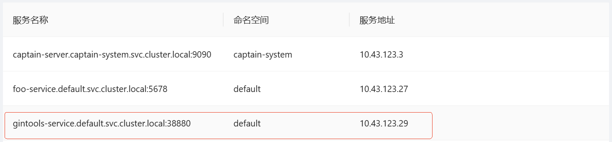

### 暴露 ginTools 服务

目前，我们已经接近在插件中访问 ginTools 服务的目标，但还差最后一步。由于 Kubernetes（K8s）集群中的服务数量可能非常多，如果所有服务都能被插件访问，会导致以下问题：

1. xds 推送时的计算开销增加：大量服务信息需要被计算和推送，影响性能。

2. 内存开销增加：过多的指标和服务信息会占用大量内存。

为了解决这些问题，Higress 在设计上默认只允许插件访问与路由关联的服务。如果需要放开这一限制，有以下两种方式：

方式一：修改 Helm 安装参数

在安装 Higress 时，可以通过修改 Helm 的 global.onlyPushRouteCluster 参数为 false，从而允许插件访问所有 K8s 服务。具体命令如下：

```
helm install higress ./higress-chart \
 --set global.onlyPushRouteCluster=false
```

这种方式虽然简单，但可能会带来额外的计算和内存开销，因此需要根据实际需求谨慎使用。

方式二：使用 DNS 域名暴露服务

我们可以通过 DNS 域名的方式将 K8s 服务暴露出来。该方式还是通过在 Higress 控制台的服务来源页面配置。如下图所示，服务端口需要填写服务的 service 暴露出的 pod，域名列表填写服务地址，这些信息在上文中的服务列表中都可以查到。

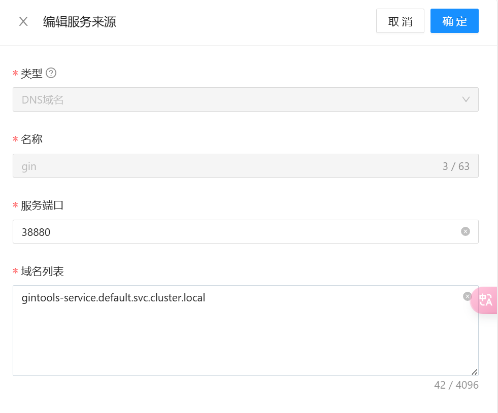

由于 ginTools 在部署时采用的是 ClusterIP 方式的服务暴露，这种方式只能在 Kubernetes 集群内部访问。为了在外部（例如浏览器）测试配置的 DNS 域名方式是否生效，我们需要为ginTools 添加一个路由规则，将其暴露到外部网络。

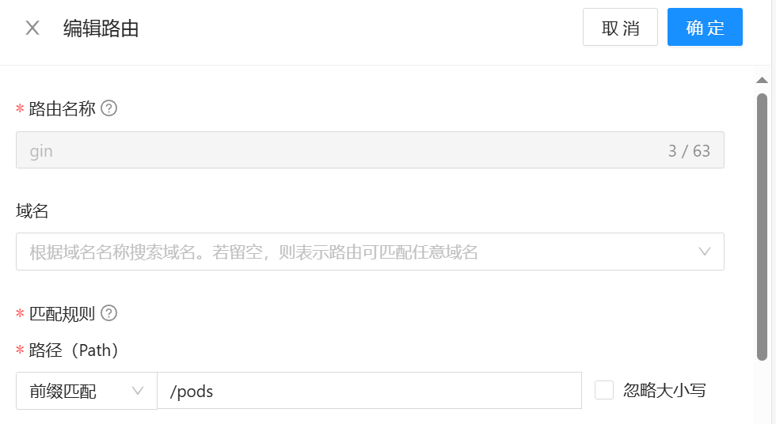

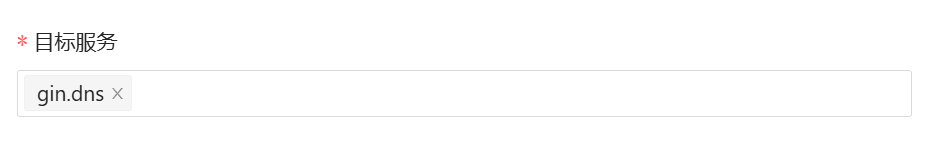

配置完成后，在浏览器输入 URL：

```
http://<你的网关IP>/pods/logs?podname=<你的ginTools pod名称>
```

得到下图效果，说明服务是可用的。

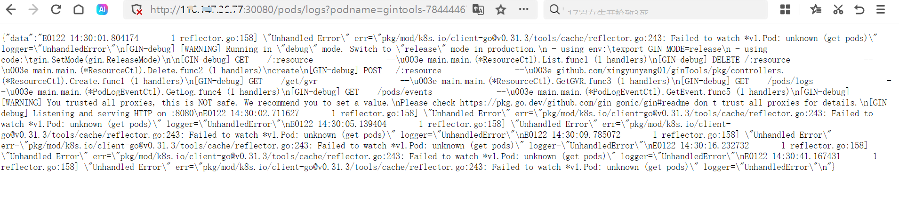

我们用肉眼看一下日志的最后一行，提示 watch pod 失败，这是由于上文在配置 sa 权限时，我们故意没有配置 watch 权限导致的。接下来就用该服务作为 Agent 的工具，让 agent 来分析一下这个日志。

### 配置与测试 Agent

Agent 的配置主要包含 API 和 LLM 两个部分，我先写一个示例，然后再讲解参数的含义：

```
apis:
- api: |-
   openapi: 3.1.0
   info:
     title: k8s资源管理系统
     description: 操作 k8s 资源
     version: v1.0.0
   servers:
     - url: http://gintools-service.default.svc.cluster.local:38880
   paths:
     /pods/logs:
       get:
         description: 根据pod名称和命名空间获取pod的日志
         operationId: get_pod_log
         parameters:
           - name: ns
             in: query
             description: 命名空间名称
             required: true
             schema:
               type: string
           - name: podname
             in: query
             description: pod名称
             required: true
             schema:
               type: string
         deprecated: false
     /{resource}:
       get:
         description: 根据k8s资源名称和指定命名空间获取资源列表
         operationId: get_resource_list
         parameters:
           - name: ns
             in: query
             description: 命名空间名称
             required: true
             schema:
               type: string
           - name: resource
             in: path
             description: k8s资源名称
             required: true
             schema:
               type: string
         deprecated: false
   components:
     schemas: {}
 apiProvider:
   domain: "gintools-service.default.svc.cluster.local"
   serviceName: "gin.dns"
   servicePort: 38880
llm:
 apiKey: "sk-85axxxxxxxxxxxxxxxx"
 domain: "api.deepseek.com"
 maxIterations: 10
 model: "deepseek-chat"
 path: "/v1/chat/completions"
 serviceName: "deepseek.dns"
 servicePort: 443
promptTemplate:
 language: "CH"
```

在 apis 部分，配置外部工具。此处可以配置多个服务商的工具，例如可以同时配置高德地图+ 心知天气的 API Tools。在这里我们就先配置本地的 ginTools 工具。在 OpenAPI 文档中，url 即为服务的 service 地址。在 apiProvider 部分，由于是本地服务，没有 APIKey，因此没有如下关于 apiKey 的配置：

```
apiKey:
 in: query
 name: key
 value: xxxxxxxxxxxxxxx
```

llm 部分就是 Agent 从第二轮对话开始所使用的大模型的服务商信息，按自己的实际情况填写即可，但是建议使用推理能力强的模型，否则可能幻觉会比较严重。

配置完成后，我们用 apifox 软件做一下测试：

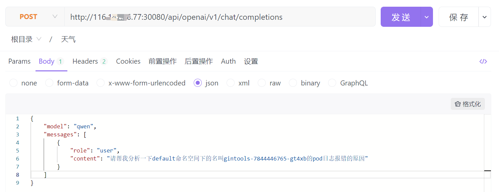

我让 Agent 帮我分析一下 gintools pod 的日志。得到的返回为：

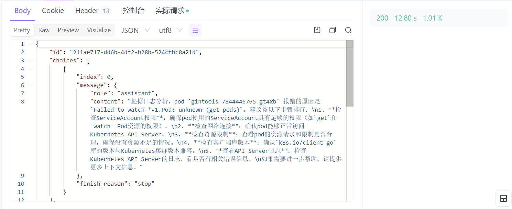

可以看到 deepseek 模型给出了正确的分析和排查方向。接下来，我们补充给 sa 补充上watch 权限后，再来测一个列出资源列表的用例。

补充完 watch 权限的 YAML 如下：

```sql
---
apiVersion: rbac.authorization.k8s.io/v1
kind: ClusterRole
metadata:
 labels:
   app: example
 name: sa-example
rules:
 - apiGroups:
     - ""
   resources:
     - pods
     - pods/log
     - services
     - events
   verbs:
     - get
     - list
     - delete
     - create
     - watch
 - apiGroups:
     - ""
   resources:
     - namespaces
   verbs:
     - get
     - list
```

需要重新执行以下 kubectl apply。配置完成后，我们来进行测试：

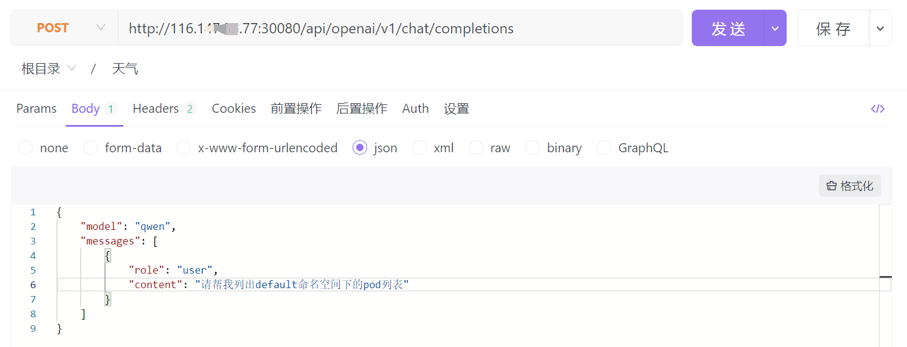

结果如下：

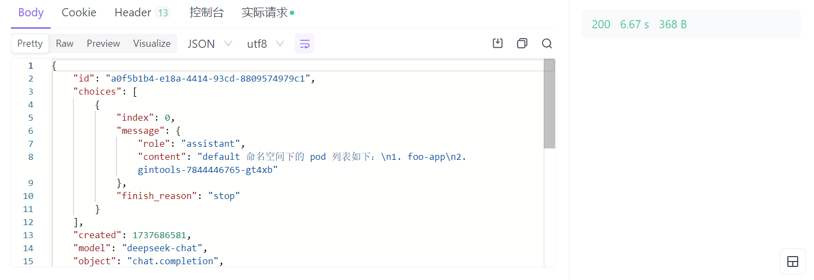

得到了预期的结果。

最后，我们测一下 JSON Mode 的效果，首先不自定义 JSON Schema。在 agent 配置中新增如下配置：

```
apis:
...
llm:
...
jsonResp:
 enable: true
```

开始测试：

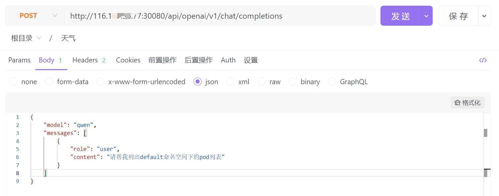

测试结果：

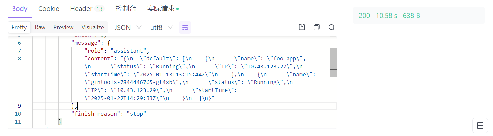

看起来是得到了一坨 JSON，我们让大模型给我们格式化一下，看得更清楚一点：

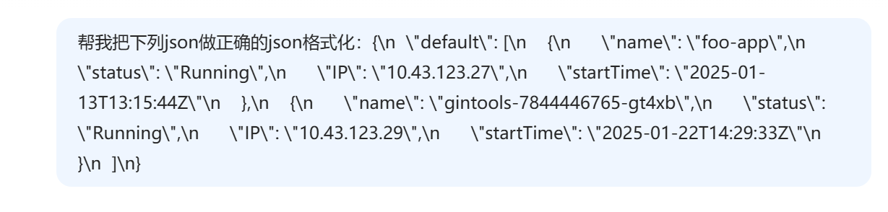

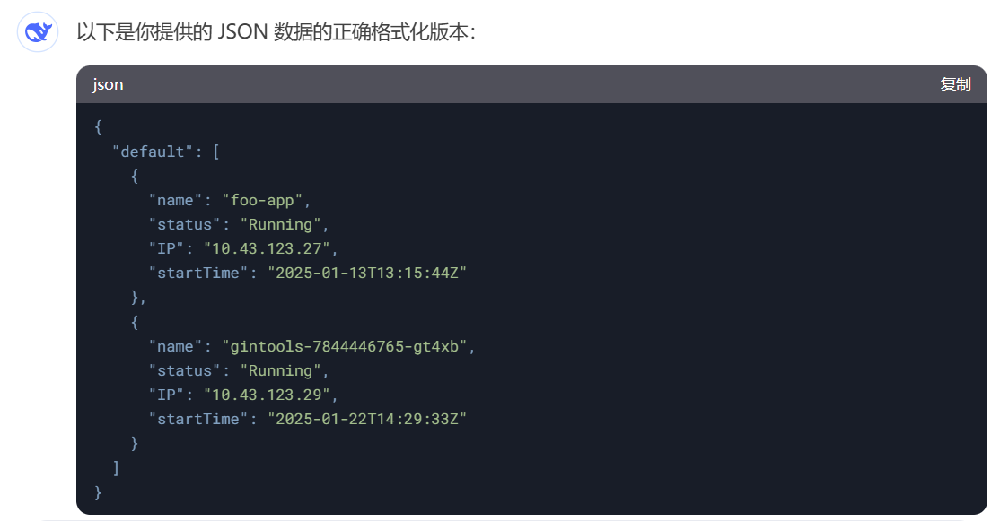

可以看到，效果非常惊艳，大模型是建立在读懂了 ginTools 返回的内容的基础上，才自动设计了 Schema，并做了 JSON 格式化。自定义 JSON Schema 的方式就留给你当作课后思考题自行测试吧。

## 总结

在本节课中，我们首先回顾并解答了上节课的思考题，探讨了 JSON Mode 代码在 AI Agent插件中的实现方法。接着，我们以第二章和第三章中使用的 ginTools 工具为例，详细介绍了将 Kubernetes 服务暴露给插件的两种方式。经过比较，我们最终选择了 DNS 方式，将ginTools 服务配置为 Agent Tool，并进行了实际测试。测试结果令人满意，完全符合我们的预期目标。

通过本节课的学习，相信你对 AI 微服务的特点有了更加直观和清晰的理解。让我们再次总结一下这些特点：

1. 网关具备 AI Agent 能力：能够自主调用后端 API，实现智能化服务。

2. 前端访问方式的革新：不再需要直接调用各种 API，而是通过自然语言的形式进行交互。

3. 后端输出的自然语言化：通过 JSON Mode 规范格式，使输出更加结构化和易于理解。

你可以通过测试更好地理解这几个特点。

## 思考题

在课上，我们测试了让大模型自动 JSON 格式化的效果，感兴趣的话你可以测试一下自定义JSON Schema 又是什么效果。

欢迎你在留言区分享你的测试效果，我们一起来讨论。如果你觉得这节课的内容对你有帮助的话，也欢迎你分享给其他朋友，我们下节课再见！
