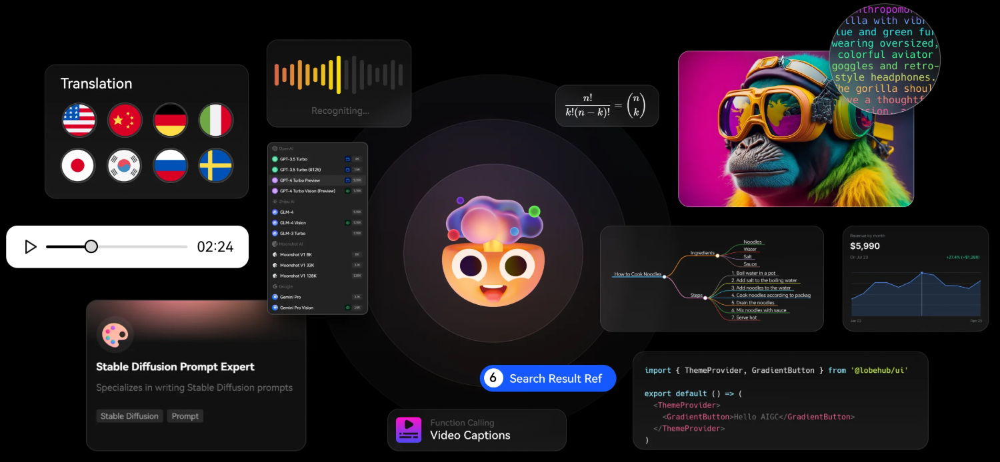
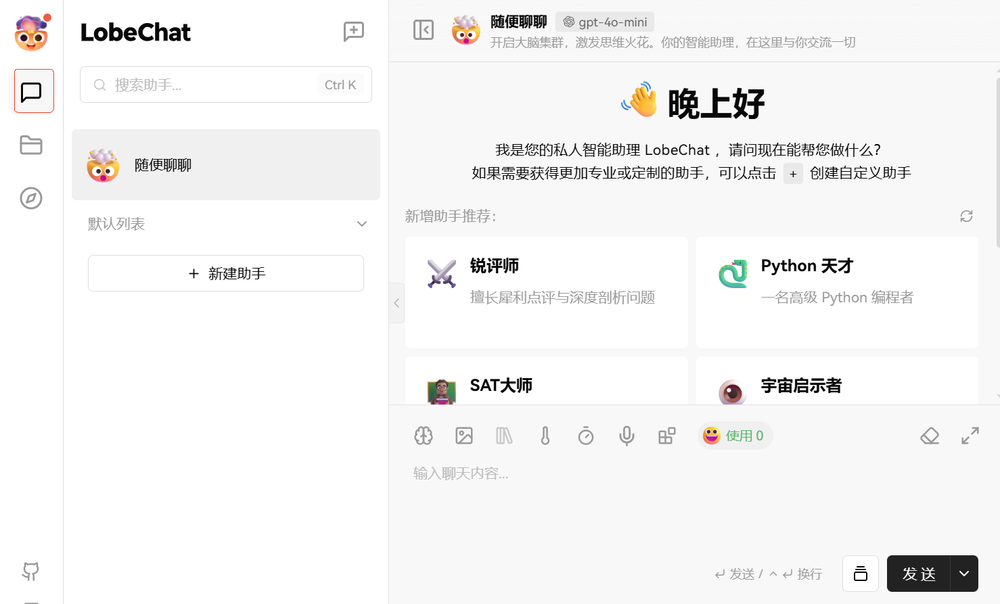
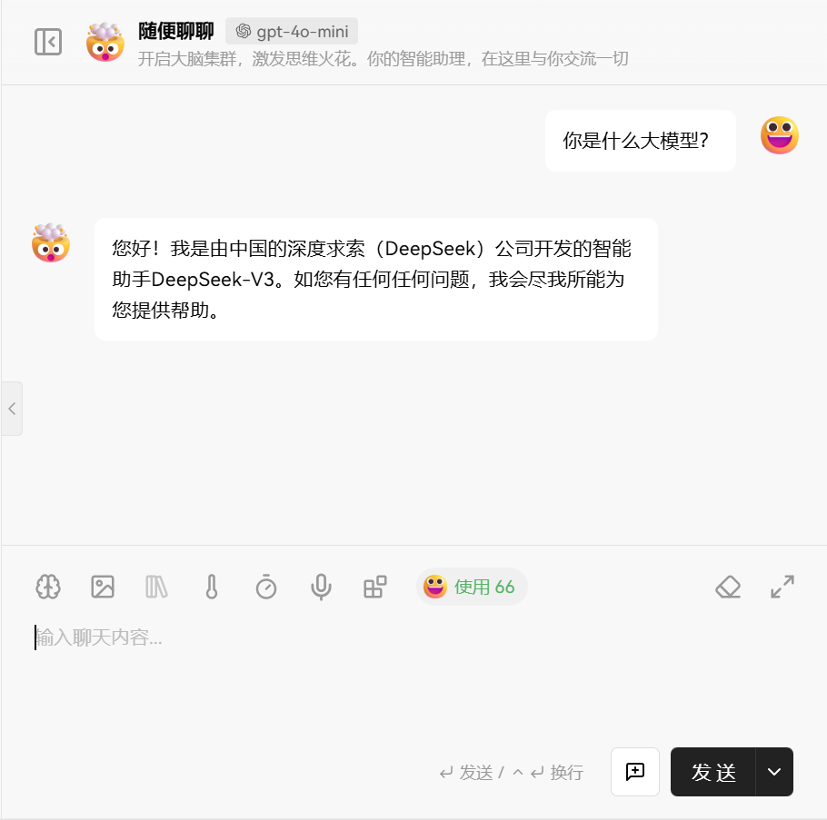
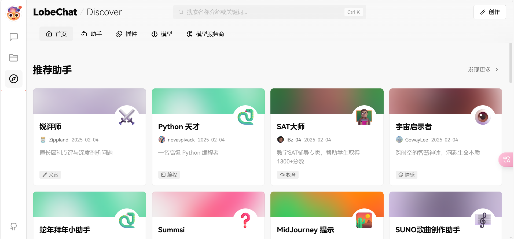
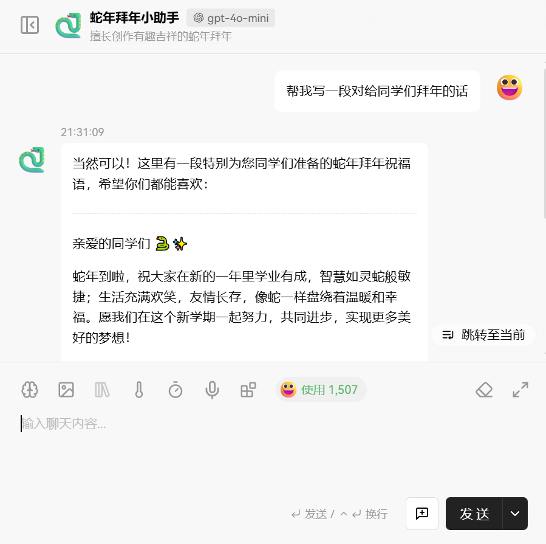
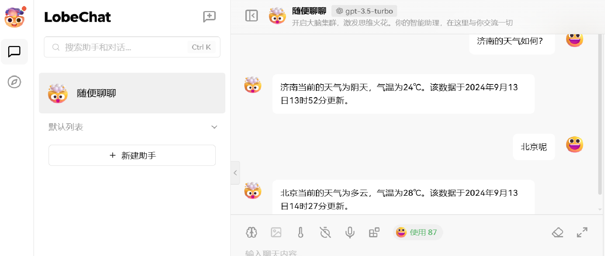

# 25 | 体验：使用LobeChat体验AI网关

你好，我是邢云阳。

在本章的前几节课程中，我们已经编写了大量的代码，涵盖了从基础的 WebAssembly（WASM）原理性代码，到更为复杂的 AI Proxy 和 AI Agent 插件代码。通过这些实践，相信你已经对如何为传统的云原生 API 网关赋予 AI 能力有了深刻的理解。

然而，在整个过程中，我们始终是从程序员的角度出发，专注于如何增强网关的 AI 能力。即使在测试环节，我们也主要使用 Apifox 这样的工具来验证插件的效果。但在实际的工作场景中，尤其是面对客户时，我们往往需要提供一套完整的解决方案来进行演示。因此，在本节课中，我们将引入一款优秀的开源 AI 助手——LobeChat，并将其与 Higress 网关的 AI 能力相结合，为你展示一个更为综合和实用的解决方案。

通过这种方式，我们不仅能够更好地理解如何在实际项目中集成和运用 AI 技术，还能为未来的客户展示提供更为直观和有力的支持。

## 什么是 LobeChat？



LobeChat 是一款开源的智能问答前端，以其高度灵活性和强大的扩展能力而著称。它支持多种部署方式，能够轻松适应不同的应用场景，无论是云端、本地还是边缘计算环境。LobeChat 的后端设计极具包容性，不仅支持接入多种商业大模型（如 OpenAI、Claude等），还能够与 Ollama 等私有化部署的模型无缝集成，满足企业对数据隐私和定制化的需求。

作为一款始终紧跟 AI 技术前沿的工具，LobeChat 不仅局限于文本交互，还提供了多模态的交互能力。例如，它支持语音交互、图像识别、文生图（Text-to-Image）、文生视频（Text-to-Video）等先进功能，极大地扩展了智能助手的应用场景。无论是语音助手、视觉分析，还是创意内容生成，LobeChat 都能为用户提供全面的支持。

此外，LobeChat 还开发了涵盖多领域的插件（工具）生态，进一步提升了助手的能力。这些插件可以轻松集成到现有的工作流中，例如日历管理、数据分析、自动化任务等，使LobeChat 成为一个功能强大且高度可定制的智能助手平台。

LobeChat 还支持本地 / 云端数据存储以及多用户管理，满足企业数据隐私以及不同用户层级权限的需求。

## 安装部署

接下来，我们将进入实际的部署和体验环节。LobeChat 的部署模式根据数据库是采用云端存储还是本地私有化部署，分为两种主要方式：客户端数据库部署模式和服务端数据库部署模式。每种模式都有其独特的优势和适用场景，下面我们将详细介绍这两种模式的特点以及如何选择适合的部署方式。

1. 客户端数据库部署模式

客户端数据库部署模式是 LobeChat 的一种轻量级部署方式，适合快速启动和体验。在这种模式下，所有数据（如聊天记录、配置信息等）都存储在云端，无需自己数据库服务。部署过程非常简单，只需拉起 LobeChat 客户端即可开始使用，非常适合个人开发者或小型团队快速搭建智能问答系统。

然而，这种模式的局限性在于功能上的限制。客户端数据库模式无法支持多用户管理、文件管理，知识库等功能。因此，如果你需要体验完整的 LobeChat 功能（如用户权限管理、数据持久化等），则需要选择服务端数据库部署模式。

2. 服务端数据库部署模式

服务端数据库部署模式是 LobeChat 的完整功能部署方式，适合企业级应用或需要多用户协作的场景。在这种模式下，LobeChat 需要依赖一个私有化部署的数据库服务（如 PostgreSQL）以及私有化部署的对象存储，例如 minio 来存储数据。虽然部署过程相对复杂，需要额外配置和启动数据库组件，但这种模式能够解锁 LobeChat 的全部功能。

在本节课中，我们就先使用客户端部署模式进行部署，有兴趣的话你可以课后阅读文档部署服务器版本进行体验。

使用如下 docker 命令，即可拉起 LobeChat 客户端：

```
$ docker run -d -p 3210:3210 \
 -e OPENAI_API_KEY=sk-xxxx \
 -e ACCESS_CODE=lobe66 \
 --name lobe-chat \
 lobehub/lobe-chat
```

其中 3210 端口为 LobeChat 网页客户端的访问端口。OPENAI_API_KEY 即为 OpenAI 大模型的 Key。

在本节课中，我们将 LobeChat 与 Higress 结合使用。在之前的 AI Proxy 小节中，我们提到，开启 AI Proxy 后，用户可以通过 OpenAI 协议访问任意已支持的模型。因此，在配置Docker 命令行时，我们需要额外填写 OpenAI 的代理地址。这个地址是通过 Higress 的 AIProxy 访问大模型的入口，具体命令如下：

```
$ docker run -d -p 3210:3210 \
 -e OPENAI_API_KEY=unused \
 -e OPENAI_PROXY_URL=http://higress:8080/v1 \
 -e ACCESS_CODE=lobe66 \
 --name lobe-chat \
 lobehub/lobe-chat
```

由于配置了 Higress 的地址，所以此时 OPENAI_API_KEY 就用不到了，直接填写 unused 即可。

启动后，在浏览器输入 http://< 你的服务器地址 >:3210 即可进入到客户端。点击左侧红框中的对话按钮，即可开始新对话。



## 体验测试

在已经在 Higress 上配置好 AI Proxy 的前提下，我们来尝试问一下：



可以看到最上方的模型选择的是 gpt-4o-mini，但是实际大模型回答是 DeepSeek-V3，这说明LobeChat 已经通过 AI Proxy 访问成功了大模型。

前面我们介绍过 LobeChat 有很多内置的插件和对话助手，我们来简单体验一下。



点击左侧侧边栏的第三个按钮，就可以进入到发现页面。该页面中列出了已经支持的助手以及插件，可以直接使用。例如，我使用蛇年拜年小助手：



感觉是个提示词工程。

我们回到 Higress，继续测试插件。在 Higress 上将 AI Agent 插件打开后，并配置上心知天气的 API，再来测试一下效果。



可以看到也得到了正确的返回。

测试到这，你对于这个解决方案，应该有了比较清晰的认识了。LobeChat 本身是一个支持多模型的对话前端，用户可以根据需求自行接入不同的模型进行对话。而现在，我们通过Higress 接管了用户对大模型的访问。这种方式不仅保证了模型访问的长连接稳定性，还能充分利用 Higress 上丰富的插件生态，进一步扩展功能并提升用户体验。

例如，在公司或团队中，采用该方案并结合 AI Proxy，可以实现员工无需 API Key 即可使用大模型的能力。具体使用哪个大模型，以及某个 API Key 因额度耗尽或其他原因无法使用时是否能自动切换到其他 API Key，这些都可以由管理员在网关层统一配置。此外，Higress 还提供了丰富的 AI 限流和安全插件，管理员可以通过这些插件控制大模型的使用量，设置敏感词拦截等功能，从而有效防止安全问题的发生。

## 总结

在本节课中，我们引入了 LobeChat 这一开源 AI 助手，并将其与 Higress 网关进行了结合，构建了一个综合性的解决方案。这一过程使我们从生硬地使用 Apifox 发送 API 请求，转变为通过更具交互性的对话前端进行自然流畅的对话。同时，这也为我们在实际业务中如何运用Higress AI 网关提供了极具价值的参考案例。

LobeChat 作为一款高度灵活且功能强大的智能问答前端，支持多模态交互和插件生态，能够满足从个人开发者到企业级用户的不同需求。通过将其与 Higress 网关的 AI Proxy 功能结合，我们实现了对大模型访问的统一管理和优化。这种集成方式不仅提升了系统的稳定性和扩展性，还为企业提供了更高效、安全的 AI 解决方案。

通过网关层的统一管理，企业可以更灵活地控制 AI 资源的使用，例如动态切换模型、自动处理 API Key 失效、实施限流和安全策略等。这种架构不仅降低了开发复杂度，还为企业提供了更高的可观测性和可维护性。

## 思考题

你感兴趣的话可以按照文档部署一个服务端数据库版本的 LobeChat，解锁全部功能，体验一下。也可以使用另一款同样很火的对话前端 OpenWebUI 对接 Higress 进行体验，对比一下两者哪个使用起来更友好。

欢迎你在留言区分享你的思考，我们一起来讨论。如果你觉得这节课的内容对你有帮助的话，也欢迎你分享给其他朋友，我们下节课再见！
