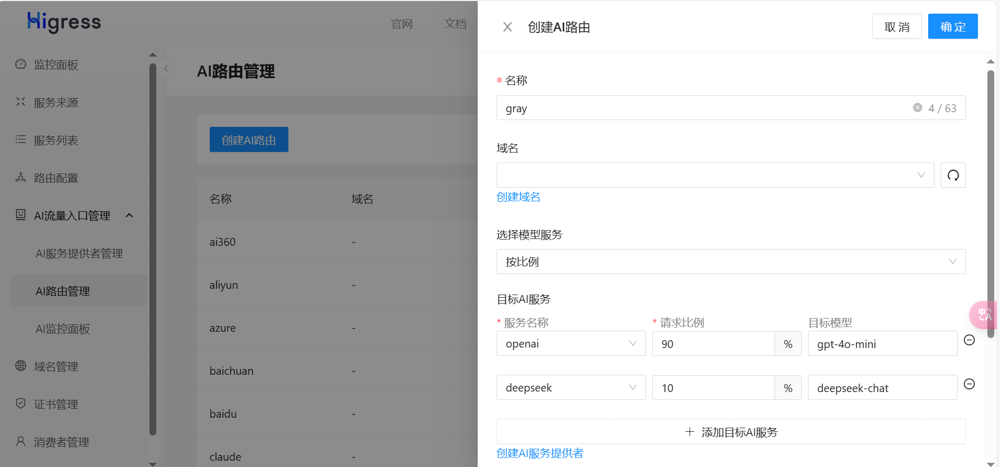
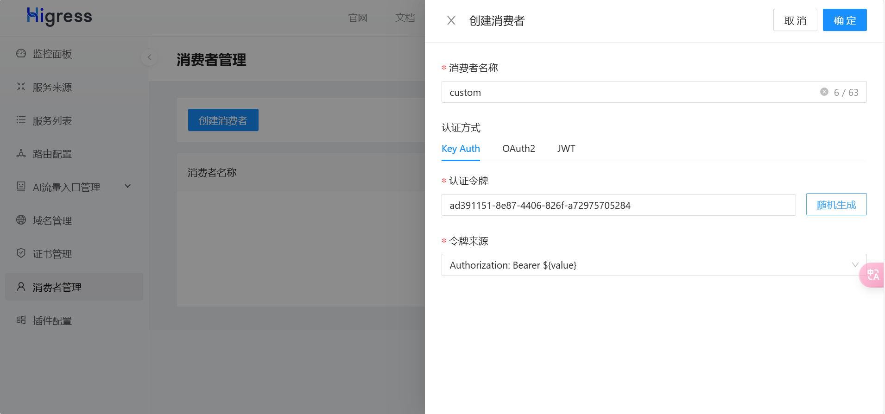
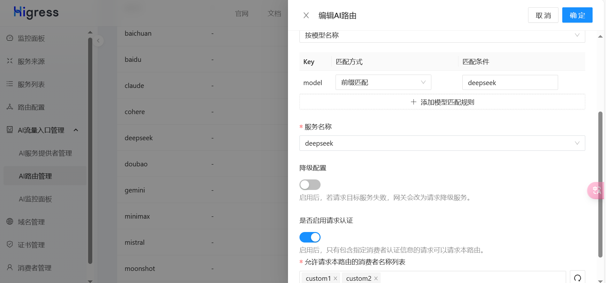
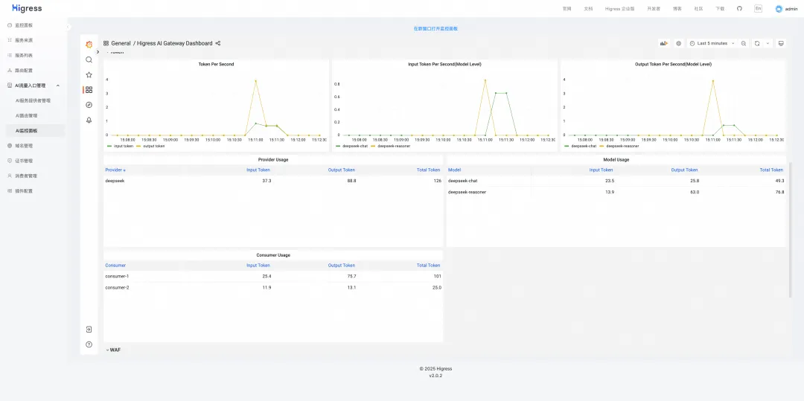
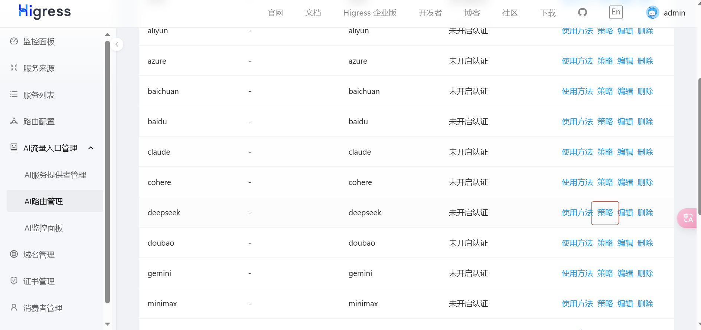
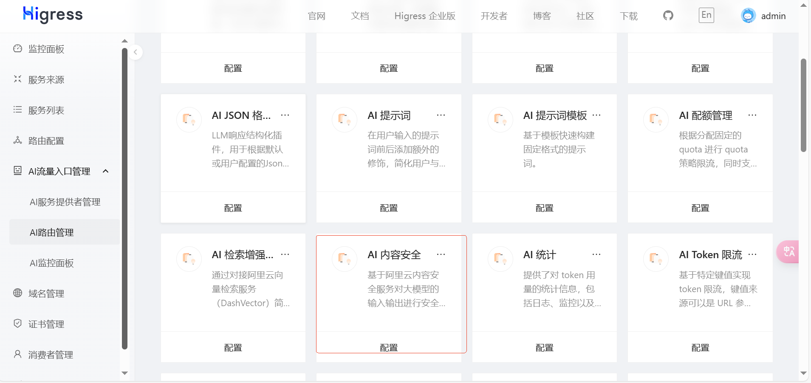

# 26 | 展望：云原生网关如何进化为AI网关？

你好，我是邢云阳。

时代的车轮滚滚向前，技术的浪潮一波接一波。几年前，我还专注于容器化大数据平台的构建，思考如何在云原生架构下优化资源调度、提升计算效率。而彼时的 AI，虽然已有深度学习的浪潮，但更多还停留在实验室和少数企业的探索阶段。没想到，短短一两年间，随着生成式 AI 崛起，大模型席卷全球，重塑了软件开发、云计算，甚至整个技术生态。曾经遥不可及的智能助手，如今已能与人流畅对话，甚至辅助编写代码、优化系统架构。

但真正让我深刻感受到全民 AI 时代即将到来的，是 DeepSeek 这一波的强势崛起。以往，AI虽然为人所知，但大多停留在技术圈内，远未达到全民热议的程度。而这次，DeepSeek 尤其是 DeepSeek-R1 的出现却像一场 AI 版的大牛市，引发了前所未有的关注——不仅技术社区在讨论，连圈外人士也争相探讨其潜力，丝毫不亚于上证指数涨到 5000 点，全民都在讨论买什么股票的热度。各大云厂商纷纷行动，我们公司也不例外，迅速跟进，在自家服务器上部署DeepSeek-R1，并开放租赁给云用户，力图在这一波热点中，抢占先机。

我周围有朋友一直在用大模型做股票的量化选股，之前用的是 OpenAI 的模型，每天都要消耗十几美金，但切换到 DeepSeek 后，充了 100 元，竟然用了接近一个月，且效果丝毫不逊色，让朋友大呼真爽。

所以，在本节课我想蹭一波热点，跟你聊一下如何利用 Higress 的灰度 + 观测的方案实现从OpenAI 平滑迁移到 DeepSeek。

## 从 OpenAI 迁移到 DeepSeek

### 配置灰度路由

灰度路由是 Higress 的重要功能之一，它允许开发者将请求流量按照一定比例分配到不同的模型。通过这种方式，开发者可以确保在迁移过程中不发生突发的服务中断或性能下降。以DeepSeek 的迁移为例，开发者可以如下图配置所示，将 90% 的请求流量继续路由到OpenAI，而将 10% 的流量切换到 DeepSeek，逐步验证新模型的效果，并根据实际情况调整流量比例，最终完成平滑过渡。



Higress 的灰度路由功能不仅限于流量分配，还能够根据模型的实时表现自动调整流量的比例。这种灵活性使得开发者可以根据实际情况动态调整模型切换的节奏，从而确保新旧模型的平稳过渡。这对于大规模、复杂的生产环境尤其重要，可以有效避免因技术过渡带来的潜在风险。

### API Key 二次分租

在 AI 服务的调用过程中，API Key 的管理是一项至关重要的任务。Higress 通过 API 网关的消费者鉴权功能，支持 API Key 的二次分租。通过这一功能，开发者可以为每个用户分配独立的 API Key，而不暴露底层模型提供商的 API Key。这不仅增强了系统的安全性，还能够帮助开发者更好地管理消费者的调用权限和使用额度。

例如，在从 OpenAI 迁移到 DeepSeek 的过程中，开发者可以如下图配置所示，使用 Higress的 API Key 二次分租功能，兼容历史调用方的 API Key，同时控制新的 API Key 的分配和调用额度。这一功能不仅支持灵活的权限管理，还能够配合 Higress 的可观测能力，实时监控每个消费者的 token 使用情况，及时发现潜在的性能瓶颈。





### 观测灰度过程

在灰度迁移过程中，持续的监控和评估至关重要。Higress 提供了丰富的监控功能，帮助开发者在迁移过程中及时了解每个模型的表现，包括 token 消耗、响应延迟等关键指标。通过这些数据，开发者可以实时评估模型迁移的效果，并在必要时进行调整。

例如，在 DeepSeek 的迁移过程中，开发者可以通过 Higress 的监控系统，实时查看 OpenAI和 DeepSeek 的 token 消耗和响应时间，帮助开发者评估迁移是否达到预期目标。如果DeepSeek 的表现符合预期，开发者可以进一步增加 DeepSeek 的流量比例，逐步完成整个迁移过程。



通过以上的操作，我们就完成了从 OpenAI 到 DeepSeek 的平滑迁移。接下来，我们再来聊聊AI 安全访问的问题。

## AI API 的安全调用

在 AI 技术快速发展的今天，如何保证 AI 服务的安全性已成为一个不可忽视的问题。尤其是在面对用户敏感信息时，如何确保数据的安全性和合规性至关重要。DeepSeek 的用户协议中明确指出，其服务虽然经过了严格的过滤审查，但仍然不能完全排除输入和输出中存在违规内容的风险。

为了应对这一挑战，Higress 接入了阿里云的内容安全服务。阿里云内容安全服务提供了实时处理和内容封禁功能，能够对大模型请求和响应的内容进行实时监控和过滤。这项功能在Higress 中得到了完美集成，确保了 AI 服务的安全性。开发者可以通过 Higress 实时监控每个请求的内容，如果请求内容存在违规或不合规的情况，Higress 会立即封禁这些内容，防止不合规内容对用户产生不良影响。

此外，阿里云的内容安全服务通过了信通院的认证，能够为 AI 服务提供强有力的内容安全保障。这一功能在保护用户隐私和合规性方面具有重要意义，尤其在 AI 模型生成内容的场景下，能够有效避免潜在的法律风险。





开启内容安全后，此时如果发送违规内容，将会得到如下响应：

```json
{
   "id": "chatcmpl-E45zRLc5hUCxhsda4ODEhjvkEycC9",
   "object": "chat.completion",
   "model": "from-security-guard",
   "choices": [
       {
           "index": 0,
           "message": {
               "role": "assistant",
               "content": "我不能处理隐私信息"
           },
           "logprobs": null,
           "finish_reason": "stop"
       }
   ],
   "usage": {
       "prompt_tokens": 0,
       "completion_tokens": 0,
       "total_tokens": 0
   }
}
```

以我们上节课的例子来说，企业可以通过该安全插件，控制员工对于大模型的违规使用，减少安全事件带来的风险。

## 总结

本节课是 AI 微服务章节的最后一课了，我们来简单回顾一下本章节的内容。

在本章中，我围绕 Higress 开源项目展开讲解，深入探讨了 Higress 如何应对 AI 时代所面临的长连接、大带宽和高延时等挑战。同时，通过讲解 Wasm 编程，我为你详细介绍了如何为网关编写 AI 插件，从而进一步增强网关在 AI 场景下的能力。

基于网关在 AI 场景下的新应用范式，我提出了 AI 微服务的概念。即网关不再仅仅是一个单纯的流量转发器，它通过结合 Agent 能力，具备了自主选择后端 API 并执行任务的能力。通过这种方式，网关能够根据自然语言输入的指令自动选择并调用相应的 API，与此同时整个用户与网关的交互过程也都转变为自然语言化的交互。，这是云原生网关进化为 AI 网关的一个重大意义。

回到本节课，我们追踪了 DeepSeek 这个热点，并利用 Higress 网关的灰度 + 观测的方案完成了从 OpenAI 到 DeepSeek 的平滑迁移。灰度的迁移方案，使得用户在大模型的迁移过程中，不会遭遇服务中断、性能下降等问题。丰富的观测手段，能帮助我们从 token 消耗、响应时间等关键指标进行实时跟踪，随时了解模型迁移的过程。

DeepSeek 只是起点，随着大模型能力的不断增强，AI 应用场景会不断拓宽，在这种背景下，像 Higress 这样的网关工具将扮演着更加重要的角色。最后，如果你有兴趣，欢迎参与到社区的建设中来，我们一起将 AI 网关做的越来越好。

## 思考题

感兴趣的同学，可以自己动手测试一下任意模型的灰度迁移过程。如果你目前还没有搭建好可用的 Higress 环境，可以使用 docker 构建 all-in-one 环境，命令如下：

```bash
curl -sS  https://higress.cn/ai-gateway/install.sh | bash
```

该环境会自带 Prometheus 和 Grafana，方便观测。

欢迎你在留言区分享你的测试过程，我们一起来讨论。如果你觉得这节课的内容对你有帮助的话，也欢迎你分享给其他朋友，我们下节课再见！
