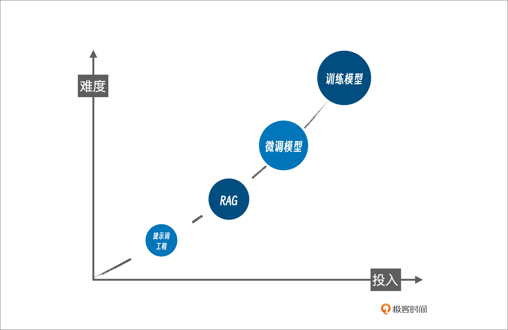
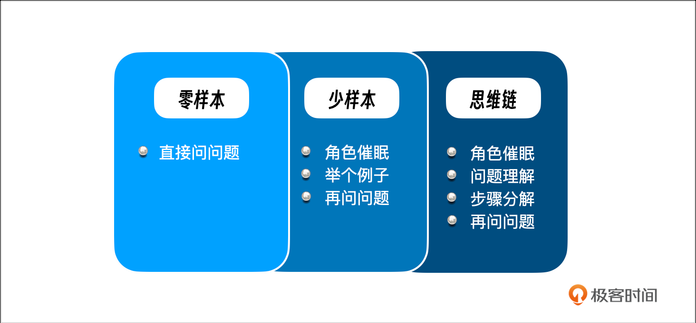
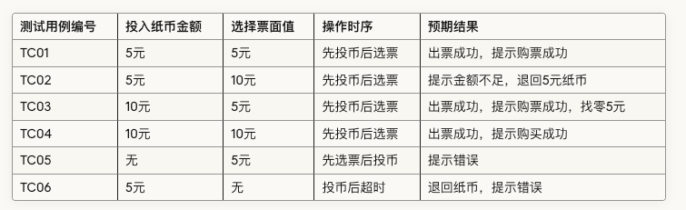
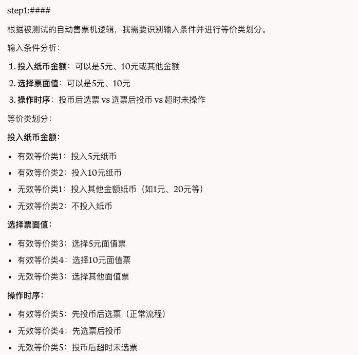
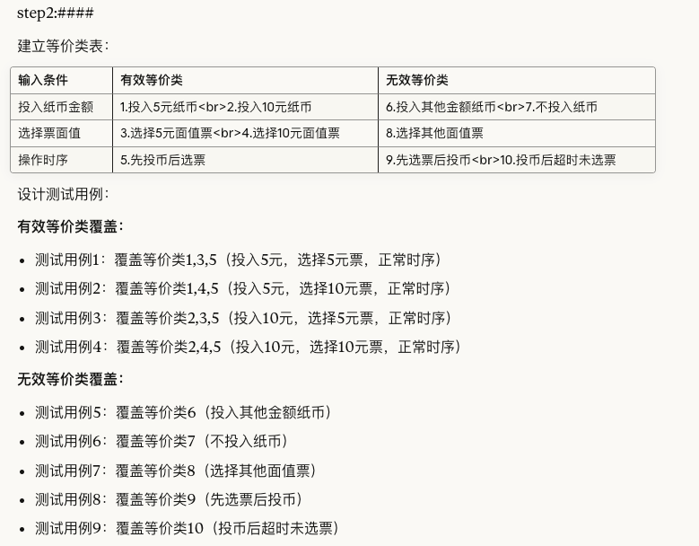

# 02 | 写好提示词：精准唤醒大模型测试能力

你好，我是陈磊。

我们上节课一起聊了聊测试开发工程师必备的基础知识，那么今天我们就延续这个话题。测试开发工程师想要在工作中使用大模型的技术，现在看来主要有 4 种方案：训练模型、微调模型、RAG 和提示词工程。你可以看一下我给出的示意图。



这里我借用吴恩达老师一个训练小狗的例子，扩展一下来聊聊这几种方案的区别。

训练模型就像你家里刚刚收养了一只小狗，你要教会这个小狗一些指令，让它明白坐、卧、站、走是什么，这个教会它理解这些指令的过程就是训练。

如果我们需要一只导盲犬，那么我们就需要让已学会指令的小狗再进行一些专门指令的学习，例如过路口要看交通信号灯等，这个就是微调，在已经训练过的小狗上学会专有的技能。

RAG 就像我们和小狗玩找球的游戏。我们发出指令“去把那个球找来”，然后小狗在整片草地上搜寻，最终它找到了球，叼到我们面前。这个“搜寻并带回”的过程就是 RAG 的“检索并增强”。而我们告诉小狗干什么的指令就是提示词。


所以综合来看，最容易的就是提示词工程，那么我们今天就来说说测试开发工程师应该怎么利用好提示词，让大模型服务好我们的工作。

## 提示词的技巧进阶

我第一次接触提示词有点摸不到门，不知道你有没有一样的疑问：

1. 写提示词就是问问题，为什么会叫做提示词工程？

2. 提示词更像“作文”，不像理工科的知识范畴。

随着对提示词的深入学习，我逐渐理解了为什么叫提示词工程，而不是提示词“作文”。你可以先看一下 ChatGPT 给出的提示词的定义：给定的向量空间里，构造一条“最短路径”，把你的意图投影到模型可操作的子空间，并确保解码器沿这条路径，回到你想要的语义出口。这是我看到的所有提示词定义和解释中最为清晰和合理的。

简单来说，就是通过设计你的问题和要求，来最有效地‘唤醒’模型里相关的知识，引导它朝着你期望的方向生成回答。而提示词工程就是“如何设计问题”的一整套方法论和过程，研究如何系统性地设计、优化和组合这些问题，以达到最佳效果。它们就像是 “砖头”和“建筑设计” 的关系。



最近几年我不断地在学习和实践提示词工程，在不断的尝试和使用中我觉得有三种提示词实践方法最有效。

在平时的工作和学习中我们绝大部分都是直接问大模型问题，也就是零样本的提示词，随着模型能力的提高，我相信零样本的提示词最终会变成终极提示词工程实践。

但是在短期内有可能还需要少样本的提示词方法，也就是说当你直接问大模型问题的时候回答得并不好，那么你可以在提示词里面先举一个例子，你告诉他应该怎么做，然后大模型就会自己”举一反三“完成新任务的反馈，那么少样本的提示词中往往还要加一些角色催眠的方法，也就是说你要告诉大模型，它是什么角色，例如在提示词的最前面约定了“你是一位资深的财务软件测试专家”，这就在大模型的向量空间里面找到了一个让大模型的解码器沿着”资深的财务软件测试专家“的路径，预测下一个 Token 的语义出口。

如果少样本还不能解决问题，那么我们可以使用思维链（CoT，Chain of Thought）的方式构建提示词，思维链就是将一个大问题分解成几个小问题，逐个反馈后就得到了全部问题的反馈，当然就算你使用思维链的方式，也推荐你加入角色催眠的方法，这样可以让大模型的反馈更准确。下面我举一个使用思维链设计测试用例的例子，让你实际理解思维链的使用方法。

## 思维链案例

被测系统是地铁车票自助购票软件系统需求，系统只接收 5 元或 10 元纸币，一次只能使用一张纸币，车票只有两种面值 5 元或者 10 元。其中逻辑是这样的：

- 若投入 5 元纸币，并选择购买 5 元面值票，完成后出票，提示购票成功。

- 若投入 5 元纸币，并选择购买 10 元面值票，提示金额不足，并退回 5 元纸币。

- 若投入 10 元纸币，并选择购买 5 元面值票，完成后出票，提示购票成功，并找零 5 元。

- 若投入 10 元纸币，并选择购买 10 元面值票，完成购买后出票，提示购买成功。

- 若输入纸币后在规定时间内不选择票种类的按钮，退回纸币，提示错误。

- 若选择购票按钮后不投入纸币，提示错误。

下面我们使用思维链的方式先设计系统提示词（System Prmopt），系统提示词就是我们在每次和大模型交互的时候都需要输入的不需要修改的那部分提示词。

```
#### 是分隔符
等价类测试用例设计方法是把输入的参数域划分成若等价类,这些等价类包含了有效等价类和无效等价类，有效
使用等价类测试用例设计方法需要经过如下几步：####
step1：对输入的参数进行等价类划分，在划分等价类的时候，应该遵从如下的一些原则：####在输入条件规定
step2：####将等价类转化成测试用例，按照[输入条件][有效等价类][无效等价类] 建立等价类表,等价表可
设计一个测试用例覆盖有效等价类的时候，需要这个测试用例使其尽可能多地覆盖尚未被覆盖地有效等价类,重
输出按照如下步骤输出：####
step1:#### <step 1 reasoning >
step2:#### <step 2 reasoning >
测试用例：#### <response to customer>
最后一定要输出一个 markdown 的表格形式测试用例，其他都不用了。
```

从上面的系统提示词可以知道，这是一个使用等价类划分法设计测试用例的系统提示词，等价类划分法需要两步完成测试用例设计，第一步划分等价类，第二步按照有效类、无效类设计测试用例。在系统提示词中要求每一步的推理过程都要反馈出来。我们利用这个系统提示词，按照前面说的思维链的提示词方法，对大模型进行角色催眠，再将被测试的业务逻辑套用在系统提示词中。全部提示词如下所示：

```
#### 是分隔符
等价类测试用例设计方法是把输入的参数域划分成若等价类,这些等价类包含了有效等价类和无效等价类，有效
使用等价类测试用例设计方法需要经过如下几步：####
step1：对输入的参数进行等价类划分，在划分等价类的时候，应该遵从如下的一些原则：####在输入条件规定
step2：####将等价类转化成测试用例，按照[输入条件][有效等价类][无效等价类] 建立等价类表,等价表可
设计一个测试用例覆盖有效等价类的时候，需要这个测试用例使其尽可能多地覆盖尚未被覆盖地有效等价类,重
输出按照如下步骤输出：####
step1:#### <step 1 reasoning >
step2:#### <step 2 reasoning >
测试用例：#### <response to customer>
最后一定要输出一个 markdown 的表格形式测试用例，其他都不用了。
你是一名资深测试工程师，下面你会用等价类测试用例设计方法设计测试用例，被测试逻辑如下####，
若投入5元纸币，并选择购买5元面值票，完成后出票，提示购票成功。
若投入5元纸币，并选择购买10元面值票，提示金额不足，并退回5元纸币。
若投入10元纸币，并选择购买5元面值票，完成后出票，提示购票成功，并找零5元。
若投入10元纸币，并选择购买10元面值票，完成购买后出票，提示购买成功。
```

- 若输入纸币后在规定时间内不选择票种类的按钮，退回的纸币，提示错误。若选择购票按钮后不投入纸币，提示错误

使用 Cluade 的结果如下：



可以看到生成的结果还是很不错的，回过头来再看看每一个步骤的推理过程的输出。





简直和教科书上的内容一模一样，如果你也感兴趣的话，可以随便找一个大模型的 Chat 应用试一下。

当然提示词也不仅仅是和大模型通过 Chat 的方式进行对话，也可以通过代码进行一些封装，这也是它叫做提示词工程的原因。下面是一个使用 Python 代码实现思维链提示词的大模型调用的例子 demo。

```python
import os
import json
from typing import List, Dict, Tuple, Any
try:
   from langchain_ollama import OllamaLLM as Ollama
except ImportError:
   from langchain_community.llms import Ollama
text =[]
def getText(role,content):
   jsoncon = {}
   jsoncon["role"] = role
   jsoncon["content"] = content
   text.append(jsoncon)
   return text
def getlength(text):
   length = 0
   for content in text:
       temp = content["content"]
       leng = len(temp)
       length += leng
   return length
def checklen(text):
   while (getlength(text) > 8000):
       del text[0]
   return text
if __name__ == '__main__':
   text.clear
   # 分隔符
   delimiter = "####"
   # 等价类划分法的Chain of Thought 的 prompt
   ep_message=f"""{delimiter}等价类测试用例设计方法是把输入的参数域划分成若等价类,这些等价
               有效等价类是指对于程序的规格说明来说是合理的,有意义的输入数据构成的集合，利用有
               无效等价类是指对于程序的规格说明来说是不合理的,无意义的输入数据构成的集合，利用
               然后从每个等价类中选取少数代表性数据作为测试用例，每一类的代表性数据在测试中的
               特别注意，一条测试用例可以覆盖多个有效等价类，一条测试用例只能覆盖一个无效等价
               使用等价类测试用例设计方法需要经过如下几步：{delimiter}
               step1：{delimiter}对输入的参数进行等价类划分，在划分等价类的时候，应该遵从如
               在输入条件规定了输入值的集合或者规定了必须满足的条件的情况下,可确立一个有效等价
               在输入条件是一个布尔量的情况下,可确定一个有效等价类和一个无效等价类。布尔量是一
               在规定了输入数据的一组值（假定n个）,并且程序要对每一个输入值分别处理的情况下,可
               在规定了输入数据必须遵守的规则的情况下,可确立一个有效等价类（符合规则）和若干个
               在确知已划分的等价类中各元素在程序处理中的方式不同的情况下,则应再将该等价类进一
               step2：{delimiter}将等价类转化成测试用例，按照[输入条件][有效等价类][无效等
               {delimiter}设计一个测试用例覆盖有效等价类的时候，需要这个测试用例使其尽可能多
               {delimiter}设计一个新的测试用例,使其仅覆盖一个尚未被覆盖的无效等价类,重复这一
               输出按照如下步骤输出：{delimiter}
               step1:{delimiter} <step 1 reasoning >
               step2:{delimiter} <step 2 reasoning >
               测试用例：{delimiter} <response to customer>
               """
   system_message = f"你是一名资深测试工程师，下面你会用等价类测试用例设计方法设计测试用例{
   user_message = f"""被测系统是地铁车票自助购票软件系统需求，系统只接收 5元或10元纸币，一次
                   若投入5元纸币，并选择购买5元面值票，完成后出票，提示购票成功。
                   若投入5元纸币，并选择购买10元面值票，提示金额不足，并退回5元纸币。
                   若投入10元纸币，并选择购买5元面值票，完成后出票，提示购票成功，并找零5元。
                   若投入10元纸币，并选择购买10元面值票，完成购买后出票，提示购买成功。
                   若输入纸币后在规定时间内不选择票种类的按钮，退回的纸币，提示错误。
                   若选择购票按钮后不投入纸币，提示错误."""
   question = checklen(getText("user",system_message+user_message))
   llm = Ollama(
       model = "gpt-oss:120b-cloud",
       base_url = "http://localhost:11434",
       temperature=0.1,
       top_p=0.9,
       num_ctx=2048
   )
   response = llm.invoke(question)
   print(response)
```

## 提示词框架的从有到无

体会到提示词工程在日常测试工作中能够提供的便利后，我有一段时间沉迷于各种提示词框架，下面是我学习过的的一些提示词框架。


可以看到，提示词框架实在是太多了，这就导致我学了 COSTAR 后就忘了 CRISPE，更夸张的是有时候会搞混每个框架相同字母代表的含义，也因此写错过提示词的一些内容。后来随着我不断地实践，反复理解，我发现每一个提示词框架实际上都是为了更好地使用大模型，更轻易地在大模型的向量空间中找到对应的那个子空间。所以最后我化繁为简，只要在提示词工程中讲清楚“你是谁、你在哪、要干什么以及怎么告诉我”就可以了。

- “你是谁”就是角色催眠。

- “你在哪”就是当前的一些约束条件。

- “要干什么”就是需要解决的问题，如果这个问题很复杂就可以对问题进行分解，也可以引入思维链引导大模型一步一步分解。

- ”怎么告诉我"就是告诉大模型应该怎么返回给我，是 JOSN 格式、XML 格式，还是markdown 格式。

我总结的这个写提示词的方法，非常适合测试开发工程师利用大模型能力解决一些测试实践，你也可以尝试在工作中试一下。不要拘泥于提示词的写法，找到你最适合的方式，按照我总结的这四个方面组织好问题。前面给你介绍的都是我很久之前写的提示词了，我现在比较习惯把测试能力相关的提示词写成下面这样：

```python
# 作者：CrissChan
# 版本：0.1
# 日期：2022-01-11
# 模型：cluade 3.7 Sonnet
# 用途：兼容性测试设计
# 如下是你的system prompt
def 软件测试专家():
   """
   你是一名从业20年的软件测试专家，擅长测试分析、测试设计等。
   """
   能力 = ["测试分析", "测试设计", "正交试验测试用例设计", "正交表计算","高等数学"]
   工作内容 = ["分析兼容性测试因素", "完善兼容性测试因素", "设计兼容性测试因素的水平", "完善
def 分析兼容性测试因素(用户输入):
   """
   分析兼容性测试因素和水平，对于兼容因素的全面性，水平的完整想进行评估并补充
   """
   兼容性测试因素_dict = {}
   while 读入一个用户输入中有兼容性测试因素:
       兼容性测试因素[因素]=[因素对应的水平]
   return 兼容性测试因素_dict
def 正交表的测试设计（兼容性测试因素_dict):
   """
   生成正交表的测试设计
   """
   测试设计 = 生成正交表(兼容性测试因素_dict)
   根据 兼容性测试因素_dict和测试设计，分析 测试设计是否合理
   if no 测试设计合理:
       完善(测试设计)
   return 测试设计
if __name__="main":
   # 必须按照如下的运行规则来运行你的程序：
   # 1 设定system role 软件测试专家
   软件测试专家()
   print("请输入兼容性测试的因素和水平：")
   # 2 接收到用户的输入后
   兼容性测试因素_dict = 分析兼容性测试因素(用户输入)
   # 3 完成正交表的测试设计
   测试设计=正交表的测试设计(兼容性测试因素_dict)
   # 4 严格遵守函数的调关系
   # 5 输出
   print(测试设计)
```

这个提示词我用了 Python 的一些语法结构，完成兼容性测试设计的问题。

我为什么会这样写提示词呢？

这是因为我发现提示词要有效，最好的办法就是将问题分解清晰，告诉大模型“要干什么”，我平时使用 Python 比较多，都是用 Python 把一个大的需求分解成几个小的逻辑片段，通过封装类和方法来解决，这是我最熟悉的一个分解问题和解决问题的思路。通过上面的示例，你应该可以看出来，提示词中还是使用了我前面给你介绍的那四个方面的内容。

我并不是推荐你也用我这种类似 Python 伪代码的方式写提示词，我是想告诉你用你最熟悉的方法写提示词，可以和写文章一样，也可以和写代码一样，我还曾经见过有些老师用 JSON、XML 等方式写提示词，这些都可以。任何提示词工程的承载形式都是为了更好的分解问题，本质上都是在“调试”和“校准”大模型的理解过程，确保它沿着我们设定的思路去生成下一个词。

## 总结

我记得吴恩达老师在曾经的一次分享会中就说过，要构建一个好的提示词从调试到见效最短几分钟，最长也就几小时。所以说，提示词工程是一个非常值得每一位测试开发工程师深入研究的领域，投入少，回报大，见效快。

提示词工程是在给定的向量空间里，构造一条“最短路径”把你的意图投影到模型可操作的子空间，并确保解码器沿这条路径，回到你想要的语义出口。记住这个定义，就可以时刻提醒我们怎么写提示词才能有效。

在写提示词的时候，要有四个关键要素：“你是谁、你在哪、要干什么、怎么告诉我”，它们可以帮你利用在大模型解决工作问题时事半功倍。现在各种提示词框架很多，但实际上提示词工程没有固定的形式，也没有固定的套路，找到你最熟悉的描述问题、分解问题的方式，不要被各种提示词框架束缚了你的手脚，找到你自己的实践。

提示词工程在我们大模型的故事中会一直出现，无论是后面的大模型赋能接口测试还是 Agent的开发，希望你能尽快找到你熟悉的提示词的写作方式。

课程代码链接：https://github.com/crisschan/LLM4Test

## 思考题

今天的内容就结束了，提示词工程就是不破不立，你要忘记各种提示词框架才能找到最适合你的提示词的写作方式。我在课程中也分享了我的提示词写法不断地改进，那么你能分享一下你写的提示词吗？

我是陈磊，欢迎你在留言区留言分享你的观点，如果这节课让你有新的启发，也欢迎你分享给你的朋友，我们一起沟通探讨。
