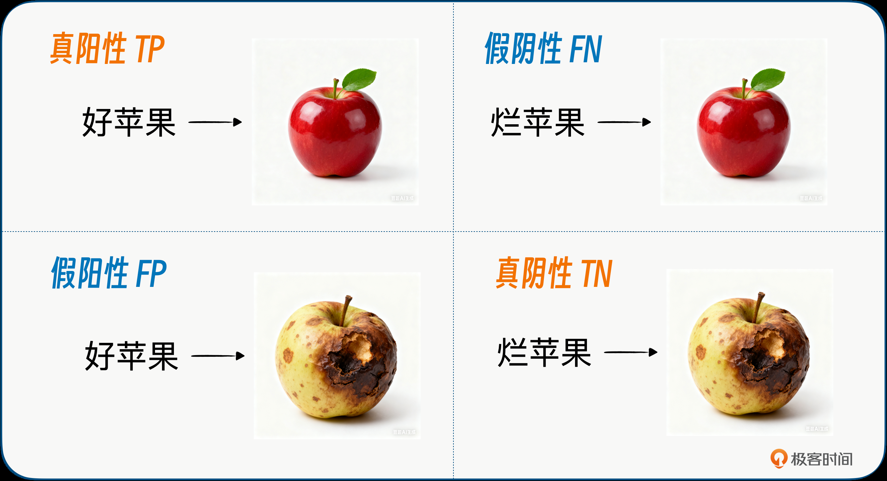
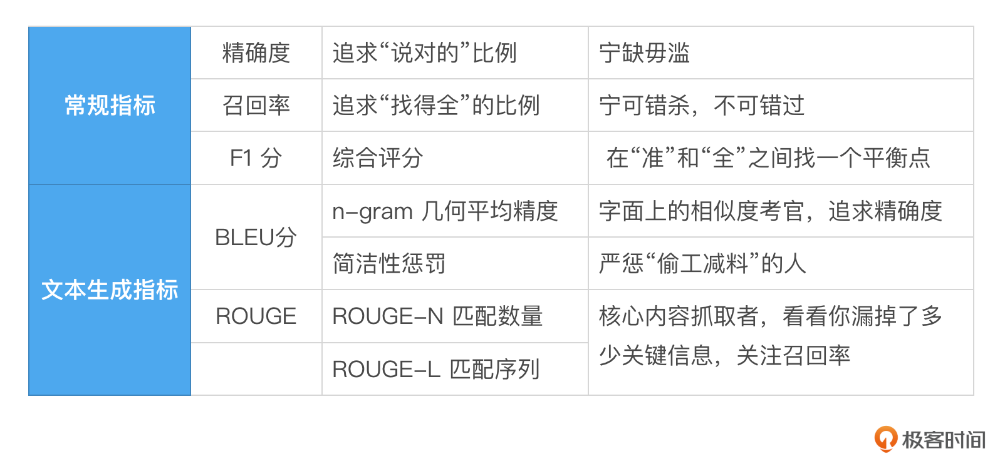

# 03 | 精准评估大模型：量化表现的关键指标

你好，我是陈磊。

上节课我们聊了提示词工程，如果你已经自己实验过了我的提示词，那么相信你应该对提示词工程有了一些感觉。如果你尝试用自己习惯的方式分析问题，分解问题来解决实际任务，那么我相信你已经逐渐喜欢上了提示词工程。但是无论有多么好的提示词工程实践技巧，如果大模型自身性能表现不好，都不会得到有效的反馈。

那么今天我们就一起聊一聊大模型相关的一些常用的性能指标，这些性能指标既有评价基础模型的，也有评价大模型应用的。在了解了相关的性能指标评价的内容、计算的方法后，我们就能够依据要解决的问题选择大模型的性能指标，帮助测试开发工程师提供优秀的大模型赋能测试的实践。

## 常规指标

评价一个大模型的性能，最常用的就是精确度、召回率和 F1 Score。为了更易理解，我们举一个苹果摊主的例子，来清楚地说清楚这三个指标的作用。

假设你是一个苹果摊主，你新进了一大批苹果，这些苹果有好有坏，当前的任务就是将全部好苹果（不烂、不坏）都挑出来。你有一个可以自主判断好苹果还是坏苹果的挑苹果机，型号是AppleM，可以自主判断好苹果（我们想要的不烂、不坏的苹果）、坏苹果（我们不想要的烂苹果、坏苹果）。好苹果就是正样本（Positive），坏苹果就是负样本（Negative)，那么对于AppleM 挑选的苹果可能出现四种情况：



- 挑对了，是好苹果，确实被挑出来了，真阳性（TP，True Positive）。

- 挑错了，烂苹果被误认为是好苹果，假阳性（FP, False Positive）。

- 没挑，烂苹果被正确忽略，真阴性（TN, True Negative）。

- 漏挑了，好苹果被误认为是烂苹果没被挑出来，假阴性（FN, False Negative）。

### 精确度：挑出来的苹果有多靠谱？

精确度（Precision），作为摊主你要关心 AppleM 挑出来的苹果里，有多少真的是好苹果？

## 精确度= TP/(TP + FP)

如果你让挑苹果机挑了 10 个苹果出来（机器说这些是好苹果）。结果检查发现，其中 8 个是好苹果（TP=8），2 个是烂苹果（FP=2）。

## 精确度= 8/(8 + 2) = 0.8

精确度高，说明 AppleM 挑出来的苹果大多是好的，就像你在网上买东西，希望收到的货品都是符合描述的优质货。这里其实还有一个值得思考的问题，如果 AppleM 只挑了 1 个苹果，这个苹果确实是好苹果，那么精确度是 100%，但是这用吗？答案肯定是没用，因为你可能错过了更多的好苹果，从而损失惨重。这就需要我们配合后面的指标来评价。

### 召回率：好苹果被挑出来的比例有多高？

召回率（Recall)，作为摊主的你，是不是也应该更关心有多少真正的好苹果被 AppleM 挑出来了。

## 召回率= TP/(TP + FN)

如果这一批苹果一共有 20 个好苹果，AppleM 挑出来了 10 个苹果，这 10 个中有 8 个是好苹果，但是还有 12 个好苹果没有被挑出来。

## 召回率= 8/(8 + 12）= 0.4

召回率高，说明 AppleM 能把大部分好苹果都找出来，你不会错过太多优质苹果。比如在医院筛查疾病，你希望尽可能找出所有病人（高召回率），避免漏诊。但是这有出现了一个问题，如果 AppleM 把全部的好苹果都挑出来，是不是召回率就是 100%，但是这是你想要的吗？

### F1 分：精确度和召回率的一个平衡

F1 分是精确度和召回率的调和平均数，用来综合评估挑苹果机的表现，特别是在精确度和召回率需要权衡时。

## F1分= 2 × (精确度× 召回率)/(精确度+ 召回率)

使用前面的精确度是 0.8，召回率是 0.4 的话，计算的 F1 分是 0.53。F1 分就像在挑苹果时，你既不希望买到烂苹果（高精确度），也不希望错过好苹果（高召回率）。F1 分高，说明AppleM 在两方面都表现不错，综合性能好。就像你在找工作，既想找到适合的岗位（精确），又不想错过任何好机会（召回），F1 分衡量的是两者的平衡。

如果 AppleM 精确度高但召回率低，可能只挑了几个好苹果，但漏了很多。如果召回率高但精确度低，可能挑了一堆苹果，但里面混了很多烂苹果。F1 分高的机器，能在挑出大部分好苹果的同时，保证挑出来的苹果大多是好的。

## 文本生成指标

BLEU 分数和 Rouge 分数主要用于评估文本生成任务（如机器翻译和文本摘要）的质量，对于测试开发工程师，这两个指标相对使用频率会更大，例如对于大模型应用的反馈和标注数据的相似性对比、对于 query 改写的质量评价等，这个后面我们专门来讨论，今天就介绍一下这两个指标的计算和评价。

### BLEU 分

假设你在教朋友如何做”经典西红柿炒蛋”。你口述了一份详细的菜谱，让朋友复述出来。你想知道朋友复述的菜谱跟你的原版有多接近，就可以用 BLEU Score 来评估朋友的复述质量。

- 你的原版菜谱：准备两个鸡蛋，打散后加入少许盐。切三个西红柿成小块。热锅倒油，先炒鸡蛋至金黄，再加入西红柿炒至出汁，加盐调味即可。

- 朋友复述的菜谱：准备两个鸡蛋，打散加盐。切西红柿成块。热锅放油，炒鸡蛋至熟，加入西红柿炒出汁，调味出锅。

BLEU Score 主要看朋友复述的句子中，有多少词或词组（n-gram）跟你的原版菜谱匹配。让我们拆解一下：

### 1-gram

- 你的菜谱单词：[“准备”, “两个”, “鸡蛋”, “打散”, “加入”, “少许”, “盐”, “切”, “三个”, “西红柿”,“成”, “小块”, “热锅”, “倒油”, “先”, “炒”, “鸡蛋”, “至”, “金黄”, “再”, “加入”, “西红柿”, “炒”, “至”,“出汁”, “加”, “盐”, “调味”, “即可”]

- 朋友复述的菜谱单词：[“准备”, “两只”, “鸡蛋”, “打散”, “加”, “盐”, “切”, “西红柿”, “成”, “块”, “热锅”, “放油”, “炒”, “鸡蛋”, “至”, “熟”, “加入”, “西红柿”, “炒”, “出汁”, “调味”, “出锅”]

- 匹配的 1-gram：[“准备”, “鸡蛋”, “打散”, “盐”, “切”, “西红柿”, “成”, “热锅”, “炒”, “鸡蛋”, “至”,“加入”, “西红柿”, “炒”, “出汁”, “调味”]

一共有 16 个匹配的单个词，计算的 1-gram 精度结果：

## 1 −gram精度= 匹配1 −gram数/复述1 −gram数= 16/22 ≈0.727

### 2-gram

- 你的菜谱单词：[‘准备 两个’, ‘两个 鸡蛋’, ‘鸡蛋 打散’, ‘打散 加入’, ‘加入 少许’, ‘少许 盐’, ‘盐切’, ‘切 三个’, ‘三个 西红柿’, ‘西红柿 成’, ‘成 小块’, ‘小块 热锅’, ‘热锅 倒油’, ‘倒油 先’, ‘先 炒’,‘炒 鸡蛋’, ‘鸡蛋 至’, ‘至 金黄’, ‘金黄 再’, ‘再 加入’, ‘加入 西红柿’, ‘西红柿 炒’, ‘炒 至’, ‘至 出汁’, ‘出汁 加’, ‘加 盐’, ‘盐 调味’, ‘调味 即可’]

- 朋友复述的菜谱单词：[‘准备 两只’, ‘两只 鸡蛋’, ‘鸡蛋 打散’, ‘打散 加’, ‘加 盐’, ‘盐 切’, ‘切 西红柿’, ‘西红柿 成’, ‘成 块’, ‘块 热锅’, ‘热锅 放油’, ‘放油 炒’, ‘炒 鸡蛋’, ‘鸡蛋 至’, ‘至 熟’, ‘熟 加入’, ‘加入 西红柿’, ‘西红柿 炒’, ‘炒 出汁’, ‘出汁 调味’, ‘调味 出锅’]

- 匹配的 2-gram：[“鸡蛋 打散”, “西红柿 成”, “炒 鸡蛋”, “加入 西红柿”, “炒 出汁”]

一共有 5 个匹配的两个词，计算 2-gram 精度结果：

## 2 −gram精度= 匹配2 −gram数/复述2 −gram数= 5/21 ≈0.238

### 几何平均精度和简洁性惩罚

和 1-gram 精度、2-gram 精度一样，我们可以算出 3-gram、4-gram 等，BLEU 分数会综合这些 n-gram 的精度来估算整体的相似度，通常使用 1-gram 到 4-gram。

## 几何平均精度= (1 −gram精度⋅2 −gram精度⋅3 −gram精度⋅4 −gram精度

BLEU 分还会检查朋友复述是不是太短，如果朋友只复述了“炒鸡蛋和西红柿，加盐”，漏掉很多步骤，BLEU 会通过简洁性惩罚降低分数。

- 你的菜谱长度：29 个词

- 朋友复述的菜谱长度：22 个词

- 简洁性惩罚公式：BP = min(1, 复述长度 / 参考长度) = min(1, 22/29) ≈ 0.759

如果复述太短（比如只有 10 个词），惩罚会更重。

### BLEU 分能说明什么？

BLEU 分就像一个“菜谱复述裁判”，它检查朋友复述的菜谱在用词和步骤顺序上跟你讲的有多像：

- 高 BLEU 分：朋友复述几乎跟你讲的一模一样，比如包含了“准备鸡蛋”“打散加盐”“炒至出汁”等关键步骤和词语，顺序也差不多。

- 低 BLEU 分：朋友复述漏了很多步骤（比如没提“热锅倒油”），或者用词差别大（比如把“金黄”说成“熟”），跟原版差异大。

- 简洁性惩罚：如果朋友只复述了“炒鸡蛋西红柿加盐”，虽然关键点对了，但漏了很多细节，分数会被惩罚降低。

假设“菜谱复述裁判”只看 1-gram 和 2-gram 的几何平均精确度，并加上简洁性惩罚：

- 1-gram 精度 = 0.727

- 2-gram 精度 = 0.238

- 几何平均精度 ≈ 0.416

- 简洁性惩罚 = 0.759

- BLEU 分 ≈ 0.416 × 0.759 ≈ 0.316（31.6%）

这个分数说明朋友的复述跟你的食谱有一定相似度，但漏了一些细节（比如“少许”“金黄”），或者词序、用词稍有不同（“两只” vs “两个”）。BLEU 分就是那位严格的裁判，检查了朋友复述的食谱在用词和步骤上跟你讲的有多吻合，但是这位裁判只关心词或者词组，并不关心语义和语法。

### ROUGE 分

ROUGE 分用于评估模型生成文本与参考文本相似度的指标。它主要关注生成文本与参考文本在词序列（n-gram）、最长公共子序列（LCS）或词对上的匹配度，侧重于召回率。同样我用一个比较容易理解的例子讲解一下 ROUGE 分。你参加了一个工作会议，讨论一个项目的计划，你记了一份详细的会议笔记。你请团队的小明帮你整理一份简要笔记，希望保留关键内容，你可以用 ROUGE Score 来评估小明的笔记跟你写的有多接近。

- 你记录的笔记：讨论新产品发布计划，确定时间表为六月，分配市场团队设计广告，技术团队开发功能，预算需审批。

- 小明记录的笔记：讨论产品发布，六月为时间表，市场团队做广告，技术团队负责功能开发。

你使用 ROUGE 分来检查两份笔记的都有多相似，ROUGE 分是一个集合 (包含了 ROUGE-N、ROUGE-L 等），你选择了使用 ROUGE-1 评价单词匹配，ROUGE-L 评价最长公共子序列。

### ROUGE-1

- 你的笔记：[“讨论”, “新”, “产品”, “发布”, “计划”, “确定”, “时间表”, “为”, “六月”, “分配”, “市场”,“团队”, “设计”, “广告”, “技术”, “团队”, “开发”, “功能”, “预算”, “需”, “审批”]

- 小明记录的笔记：[“讨论”, “产品”, “发布”, “六月”, “为”, “时间表”, “市场”, “团队”, “做”, “广告”,“技术”, “团队”, “负责”, “功能”, “开发”]

- 匹配的单词:[“讨论”, “产品”, “发布”, “六月”, “为”, “时间表”, “市场”, “团队”, “广告”, “技术”, “团队”, “功能”, “开发”]

计算 ROUGE-1 就是重点查看你笔记中的单词在小明记录的笔记中出现了多少，也就是匹配的单词有 12 个。

## ROUGE −1的召回率= 匹配的单词数/你的笔记单词数量= 13/21 = 0.619

## ROUGE −1的精确度= 匹配的单词数/小明记录的笔记单词数量= 13/15 =

## ROUGE −1的F1分= 2 ∗0.867 ∗0.619/（0.867 + 0.619) = 0.722

### ROUGE-L

ROUGE-L 关注生成文本和参考文本之间的最长公共子序列（LCS），不要求词连续出现，只要保持相同顺序即可，那么如上的例子的最长公共序列匹配如下：

- 最长公共子序列:[‘讨论’, ‘产品’, ‘发布’, ‘六月’, ‘市场’, ‘团队’, ‘广告’, ‘技术’, ‘团队’, ‘功能’]

计算 ROUGE-L 的结果如下：

## ROUGE −L的召回率= LCS长度/你的笔记单词数量= 10/21 = 0.476

## ROUGE −L的精确度= LCS长度/小明记录的笔记单词数量= 10/15 = 0.6

## ROUGE −L的F1分= 2 ∗0.476 ∗0.667/（0.477 + 0.667) = 0.556

### ROUGE 分能说明什么

例子中 ROUGE 分就是一个“会议笔记审核员”，检查小明的笔记是否覆盖率你的笔记的关键内容，所以我们更关心你的笔记中的内容有多少在小明的笔记中出现了，所以召回率是重点。ROUGE-1 召回率高说明小明的笔记中包含了你笔记中大部分关键词，但是顺序不一定相同。BLEU 分注重精确匹配和简洁性惩罚，ROUGE 更关注召回率。在这里，ROUGE 关心你的笔记要点是否被记录。

## 中文的特殊处理

上面的的这些指标现在都有各式各样的开源库支持，也不用自己从零开始实现，虽然自己实现起来也并不是非常难的事情，有开箱即用的还是能节省时间。如果你想引入一些，可以看看NLTK 自然语言工具包库、file2rouge、py-rouge、sumeval 等。

在你引入这些工具包的时候，很容易遇见的一个问题就是对于中文计算的指标都是 0，这其实是因为很多开源工具包都没有针对中文的分词做专门的处理，我们可以看出之前的一些例子中我们都默认完成了中文分词，所以才能计算各个指标。因此如果你要在项目中计算这些指标的时候，就需要先完成中文的分词处理。

下面的代码是一个完整的计算前面例子中 ROUGE-L 分数的程序。

```python
import jieba
def lcs_length(x, y):
   """计算两个序列的最长公共子序列长度"""
   m, n = len(x), len(y)
   dp = [[0] * (n + 1) for _ in range(m + 1)]
   for i in range(1, m + 1):
       for j in range(1, n + 1):
           if x[i-1] == y[j-1]:
               dp[i][j] = dp[i-1][j-1] + 1
           else:
               dp[i][j] = max(dp[i-1][j], dp[i][j-1])
   return dp[m][n]
# 输入文本
reference = "讨论新产品发布计划，确定时间表为六月，分配市场团队设计广告，技术团队开发功能，预算
hypothesis = "讨论产品发布，六月为时间表，市场团队制做广告，技术团队负责功能开发"
# 分词
ref_tokens = list(jieba.cut(reference.replace("，", ""), cut_all=False))
hyp_tokens = list(jieba.cut(hypothesis.replace("，", ""), cut_all=False))
# 调试：打印分词结果
print(f"Reference tokens: {ref_tokens}")
print(f"Hypothesis tokens: {hyp_tokens}")
# 计算 LCS 长度
lcs_len = lcs_length(ref_tokens, hyp_tokens)
print(lcs_len)
# 计算 ROUGE-L
m, n = len(ref_tokens), len(hyp_tokens)
precision = lcs_len / n if n > 0 else 0
recall = lcs_len / m if m > 0 else 0
f1 = (2 * precision * recall) / (precision + recall) if (precision + recall) > 0
# 输出结果
print(f"ROUGE-L Precision: {precision:.3f}")
print(f"ROUGE-L Recall: {recall:.3f}")
print(f"ROUGE-L F1: {f1:.3f}")
```

代码中我并没有使用任何计算 ROUGE-L 的开源库，但是我借用了分词库 jieba 完成了中文的分词，然后在计算了 ROUGE-L，运行后的结果如下：

```
Reference tokens: ['讨论', '新', '产品', '发布', '计划', '确定', '时间表', '为', '六月'
Hypothesis tokens: ['讨论', '产品', '发布', '六月', '为', '时间表', '市场', '团队', '制
10
ROUGE-L Precision: 0.667
ROUGE-L Recall: 0.476
ROUGE-L F1: 0.556
```

我还是很推荐你去试试，将上面的的代码放到你的 IDE 里面运行一下，真正体会一下ROUGE-L 的计算过程。

## 总结

今天的内容就到这里了，我们今天讲的内容不是那么容易理解，我希望你能在有时间的时候再多琢磨一下，充分理解每一个指标，把每一个指标的计算过程、评价内容都烂熟于心。



## 思考题

今天在课程后面我们一起看了一下 ROUGE-L 的 demo，你可以将中文的 ROUGE-L、BLEU分的代码都完成吗？我期待在评论区看到你的代码。

我是陈磊，欢迎你在留言区留言分享你的观点，如果这节课让你有新的启发，也欢迎你分享给你的朋友，我们一起沟通探讨。
