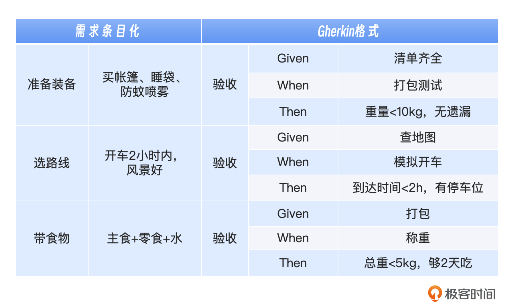
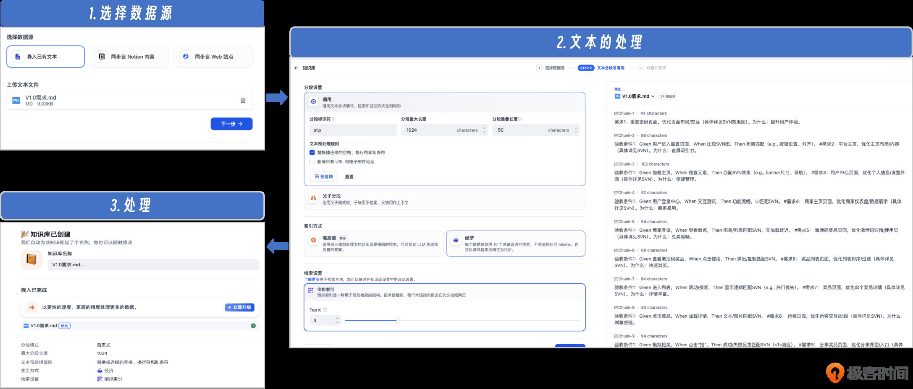
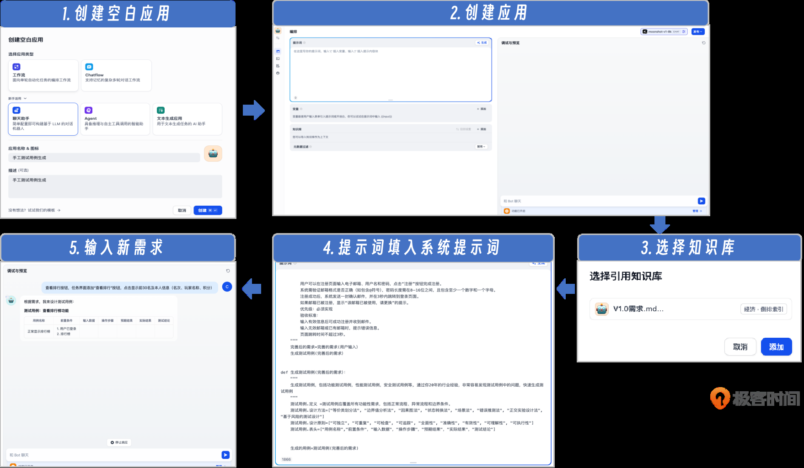

# 06 | 测试提效20%：需求条目化与RAG实践

你好，我是陈磊。

前几节课我们一起完成了对测试开发工程师而言的核心基础知识部分的学习，这些内容构成了作为测试开发工程师的你需要掌握的大模型知识的最小集合。这个最小集为你提供了坚实的理论基石，但远非终点。在这些基础之上，还有更深层的原理、细微的细节，以及丰富的实践应用，这些都需要通过实际项目中的反复迭代来逐步积累和内化。记住，学习大模型就像调试一个复杂的系统：理论是你的调试器，实践才是真正让你“上线”的关键。

从这一篇开始，我们将逐步转向大模型与测试实践的深度融合讨论。这不仅仅是理论的延伸，更是针对真实场景的落地指南。我会重点和你分享我是如何在工作中使用大模型赋能测试工作的，然后针对每一个实践方法深入到实现细节，让你也能理解我的每一个实践的落地的思考，这样你就不仅仅只是看到了我用大模型做了什么事情，而是能够知道如何思考并找到大模型可以赋能的方式，从而找到你所在团队需要落地的大模型实践方法。

## 测试用例生成的提示词探索

在最开始尝试利用大模型生成测试用例的时候，重点可以聚焦在如何写提示词让大模型使用不同方法设计测试用例上，就像前面我们举过使用提示词完成等价类划分法设计测试用例的例子，除了这个等价类划分法设计测试用例以外，我还尝试利用思维链完成因果图测试用例设计的提示词，如下所示：

```
####是分隔符
```

- 因果图测试用例设计方法是从需求中找出因（输入条件）和果（输出或程序状态的改变），

```
                   通过分析输入条件之间的关系（组合关系、约束关系等）及输入和输出之间的关系绘
                   该方法主要适用于各种输入条件之间存在某种相互制约关系或输出结果依赖于各种输
                   在使用因果图测试用例设计方法的时候重点分析出所有输入和输出条件的相互制约关
                   出对于输入的依赖关系也就决定了什么样的输入组合产生什么样的输出结果。####
                   因果图中条件和结果，也就是输入和输出之间有四种关系分别是恒等、非、或、与。
                   因果图中条件和条件之间有五种关系，也就是输入和输入之间有五种关系分别是互斥
                   用因果图测试用例设计方法需要经过如下几步：####
                   step1：分析业务逻辑中设计的系统中各个组件、模块，其中各个组件、模块就是因
                   step2：根据因果图识别的因果关系，建立判定表，输出判定表。####
                   step3：将判定表中的每一个因素转换成原始被测试业务中代表的内容，然后按照一
                   输出按照如下步骤输出：####
                   step1:#### <step 1 reasoning >
                   step2:####<step 2 reasoning >
                   step3:#### <step 3 reasoning >
                   测试用例：#### <response to customer>
                   最后一定要输出一个 markdown 的表格形式测试用例，其他都不用了。
```

上面的提示词既可以直接在一些大模型的 Chat 应用中使用，也可以集成到代码中作为系统提示词使用。除去思维链的提示词方法，还可以用 Chain Prompts 方式将正交试验法设计测试用例的方法引入到测试平台中。

Chain Prompts 是指在一个对话或文本生成任务中，将前一个提示的输出作为下一个提示的输入，形成一个连续的链条。这种方法常常用于创建连贯的、有上下文关联的文本。在对话系统中，这种方法可以模拟真实对话中的连续性，使生成的回复更加自然和流畅。下面我就给你讲讲 Chain Prompts 提示词是怎么工作的，首先借助大模型的能力，设计了一个提示词实现了为输入的每一个参数返回边界值，实现代码如下：

```python
def generate_boundary_values(self, parameter_descriptions: List[str]) -> List[Lis
       """
       生成参数边界值
       Args:
           parameter_descriptions: 参数描述列表
       Returns:
           边界值列表
       """
       if not self.llm:
           print("LLM未初始化")
           return []
       boundary_values = []
       delimiter = "####"
       for desc in parameter_descriptions:
           prompt = f"""{delimiter}你是一名资深测试工程师。
{delimiter}设计参数的边界值: {desc}
{delimiter}边界值要包含满足要求和不满足要求的内容，直接返回字符串数组，格式如：["value1", "v
{delimiter}不要返回python代码，不要包含任何注释。"""
           try:
               print(f"正在生成参数边界值: {desc}")
               response = self.llm.invoke(prompt)
               values = self._parse_boundary_response(response)
               boundary_values.append(values)
               print(f"生成边界值: {values}")
           except Exception as e:
               print(f"生成边界值失败: {e}")
               boundary_values.append([])
       return boundary_values
```

利用大模型返回的边界值参数，识别出计算正交表需要的因素数、水平数，然后组织了一个新的计算正交表的 Prompt，用大模型计算一个因素数是变量个数，水平数各个参数对应的值个数，强度是 2 的一个正交表，实现代码如下：

```python
def generate_orthogonal_table(self, levels: List[int]) -> List[Tuple[int, ...]]:
       """
       生成正交表
       Args:
           levels: 各因素的水平数列表
       Returns:
           正交表数据
       """
       i=1
       prompt = f"计算一个正交表，因素数是{len(levels)}，"
       for level in levels:
           prompt+=f"第{i}个因素，水平数是{level}，"
           i+=1
       prompt+=f"强度是2，只返回计算结果的二维数组，不返回其他内容。"
       print(prompt)
       response = self.llm.invoke(prompt)
       list = json.loads(response)
       return list
```

这段代码可以看出来我们利用了上一个大模型反馈的结果重新组织了一个新的 Prompt，按照我们的意图要求大模型计算出对应的正交表，再返回正交表后，就可以按照上一次大模反馈的参数和值，进行替换，之后就得到了正交试验方法设计的测试用例了。

特别说明：实现代码使用了 Ollama 推理框架，大模型使用的是 gpt-oss:120b-cloud，选择这个组合，你无论是一个什么样配置的电脑都可以完成对应的实验代码的运行。

如上提示词可以完美地使用各种测试设计方法设计测试用例，但是当你把这些内容都放到实际的应用中就会暴露一个致命的问题，那就是生成的测试用例很难投入实际工作中，有很多丢失的业务逻辑验证点。

## RAG 为测试用例生成铺平了道路

我们仔细分析后发现，最开始设计提示词的思路没有问题，但直接简单粗暴地把需求加上前面介绍的测试用例设计的系统提示词，喂给大模型就产生了问题，这里主要有两大问题：

- 问题一：需求管理系统中的需求千差万别，有的平铺直叙，一大段话很长很长，描述了全部的需求；有的一句话了事，简单概括，很多交付细节都是产品经理、开发工程师、测试工程师私下达成共识，这就导致了利用大模型生成测试用例的提示词内容不完善。

- 问题二：在设计测试用例生成的 Prompt 的时候，验证是否有效，使用的一些业务逻辑非常简单，实际工作中需要验证的业务逻辑要复杂得多，往往在实际的需求中只会介绍当前要实现的业务逻辑，但是系统中已经交付的业务逻辑，并不会在这个需求中再描述一遍，这也就导致了大模型并不理解系统中已经有的约束条件。

解决第一个问题的最好的方法就是需求条目化，第二个问题的最优解就是 RAG，那么下面我就给你讲讲这两个方法都是如何实施的。

### 需求条目化

相信你接触大模型肯定总能看到数据标注、数据治理等字眼，那么需求条目化也可以理解成是真需求进行的数据标注，如果说是数据标注想必你就能理解了，我们并不仅仅是制定一个需求条目化的方法，让产品经理未来要这样写需求，而是也要把历史中的需求按照条目化的方法重新整理。

需求条目化听起来很高大上，其实就是一个“把大任务切成小菜谱”的把戏！假设今天晚饭你点外卖，只说“来份麻辣烫”——厨师就需要猜你是爱吃辣还是怕吃辣？条目化就是把这部分模糊的需求，细化成“辣度中辣，加牛肉不加豆腐”的清单，一条一条列清楚。核心是：把模糊需求拆成具体、可操作的小条目，让大家（开发、测试、老板）都心知肚明，不会走弯路。

那么对于一个大段文字描述的需求，怎么改写成条目化的需求呢？可以分三步进行：

1. 整体目标：先写整体需求。

2. 拆小条：分成输入、处理、输出、验证等模块，每条用 1-2 句话说清“做什么、怎么做、为什么”。

3. 加上验收条件：这是关键！每个验收条件后附上“怎么证明它 OK 了”，避免“做好了？嗯，差不多吧”这种尴尬情况。

这里的验收条件是一个需求条目化好坏的关键，验收条件（Acceptance Criteria，简称 AC）就是“过关标准”，写它像写游戏关卡的规则：具体、可测、可重复。不写“快点做好”，要写“输入 X，输出 Y，时间 <Z 秒”。这里我特别推荐你使用 Gherkin 格式，也就我们常说的 Given-When-Then 的表达方式。Given 是描述前提条件，When 是描述操作，Then 是描述结果。假设我准备周末去野营，如果没有使用条目化的方式列好需求清单，有可能就会被直播间的各种推销搞晕了头脑，买一大堆乱七八糟的装备，却没有买帐篷，那就惨了。那么如果我利用条目化方法整理了这次野营的需求呢？

就很清晰了：



- 准备装备：买帐篷、睡袋、防蚊喷雾。验收：Given 清单齐全，When 打包测试，Then 重量 <10kg，无遗漏。

- 选路线：开车 2 小时内，风景好。验收：Given 查地图，When 模拟开车，Then 到达时间<2h，有停车位。

- 带食物：主食 + 零食 + 水。验收：Given 打包，When 称重，Then 总重 <5kg，够 2 天吃。

从上面的表格可以看出来，这样的条目化需求清晰，易懂，还可以直接转成测试用例，这些优越性对于大模型来说也是优势。无论是不是需要使用大模型生成测试用例，需求条目化都是一个很好的实践，都比较推荐在团队中落地。

### 用 RAG 让输出更准确

使用需求条目化完成全部需求的整理后，就为利用大模型生成实际可用测试用例奠定了基础。前面说的第二个问题就可以利用 RAG 和已经条目化改写的需求数据解决。

我们前面聊到生成测试用例的时候，导致生成测试用例的不全面、不准确的一个原因就是，输入的需要生产测试用例的需求描述，往往不会把所有相关的需求都再描述一遍，而是仅仅描述当前需要变更的部分。那么我们就可以利用 RAG，将已经条目化改写的需求向量化存到向量数据库里面，这样我们每次生产测试用例的时候，就可以为本次的需求找到一些相关的历史需求，一起发送给大模型，这样生成的测试用例就会更加完善。

下面我们一起用低代码的开源大模型应用开发平台 Dify，看一下我们是如何完成基于 RAG 的测试用例自动化生成能力的。

首先我们将已经条目化的需求重新整理到外部文件中，使用 Markdown 格式重新进行了整理，格式如下所示：

```
#需求31：发放激活码，发码时从库随机取一个码发给玩家，并立即从库删除。
##验收条件1：Given 玩家中奖，When 系统发放码，Then 码发送成功，库中该码已删除。
##验收条件2：Given 库中无码，When 尝试发放，Then 报错“库存不足”，不发送无效码。
##验收条件3：Given 同一玩家重复中奖请求，When 处理，Then 仅发一次码，日志记录防刷。
```

用 dify 建立一个知识库，导入系统已经实现的全部需求，然后确认对应的一些 chunk 和索引配置后，就完成了知识库的建立。



在完成了知识库的创建后，我们还需要创建一个智能应用，帮助我们基于已经创建好的知识库生成测试用例，创建过程如下图所示：



上面的例子我是使用了 Dify 的在线服务，大模型部分调用了 DeepSeek 的 API，如果你是本地部署的 Dify，也可以使用本地的大模型。这里有一个非常重要的提示，一定不要把公司内部保密的资料或者数据放到公网的大模型服务上，这还是有一定的泄露风险的。上面的这个例子其实最为关键的部分还是在系统提示词上，那么我们就看一下这个系统提示词。

```python
# 作者：CrissChan
# 版本：0.1
# 日期：2025-01-01
# 模型：deepseek-r1-671b
# 用途：先补充完善需求，然后基于完善后的需求生成测试用例
# 如下是你的system prompt
def 软件测试专家():
   """
   你是一名从业20年的证券期货业软件测试专家，负责测试团队的工作。你需要根据需求文档，补充完善需
   """
   能力 = ["需求分析", "测试分析", "测试设计", "缺陷管理", "金融行业知识","证券行业知识"，
   工作内容 = ["补充完善需求", "设计测试用例", "测试点分析", "缺陷发现"，"探索测试"]
def 补充完善需求(用户输入）：
   """
   补充完善需求,包括需求的功能性需求，非功能性需求，性能需求，安全需求等，通过你20年的行业经验，
   """
   完善的需求.明确=需求必须清晰易懂，避免模糊或歧义的表述。
   完善的需求.具体=提供具体的功能描述、输入输出要求以及边界条件。
   完善的需求.可测=需求应能被验证或测试，确保开发结果符合预期。
   完善的需求.一致=需求之间不应互相矛盾，所有术语和定义应保持统一。
   完善的需求.完整=包含所有必要的信息，例如功能描述、前置条件、异常处理和性能要求。
   完善的需求.可行=需求应在技术、时间和资源约束下是可实现的。
   完善的需求.用户导向=从用户角度描述需求，关注用户体验和实际使用场景。
   完善的需求.非技术性语言=除非涉及技术细节，尽量使用通俗语言，避免过多技术术语，以便所有相关方
   完善的需求.可追溯=需求应与项目目标或业务需求关联，并可追踪到源头。
   fewshot完善后的需求="""
   需求标题：用户注册功能
   描述：
       用户可以在注册页面输入电子邮箱、用户名和密码，点击“注册”按钮完成注册。
       系统需验证邮箱格式是否正确（如包含@符号），密码长度需在8-16位之间，且包含至少一个数字和一
       注册成功后，系统发送一封确认邮件，并在3秒内跳转到登录页面。
       如果邮箱已被注册，显示“该邮箱已被使用，请更换”的提示。
       优先级：必须实现
       验收标准：
       输入有效信息后可成功注册并收到邮件。
       输入无效邮箱或已有邮箱时，提示错误信息。
       页面跳转时间不超过3秒。
   """
   完善后的需求=完善的需求(用户输入）
   生成测试用例(完善后的需求）
def 生成测试用例(完善后的需求）：
   """
   生成测试用例，包括功能测试用例，性能测试用例，安全测试用例等，通过你20年的行业经验，非常容易
   """
   测试用例.定义 =测试用例应覆盖所有功能性需求，包括正常流程、异常流程和边界条件。
   测试用例.设计方法=["等价类划分法", "边界值分析法", "因果图法", "状态转换法", "场景法", "
   测试用例.设计原则=["可独立", "可重复", "可检查", "可追踪", "全面性", "准确性", "有效性"
   测试用例.表头=["用例名称","前置条件"，"输入数据"，"操作步骤"，"预期结果"，"实际结果"，"测
   生成的用例=测试用例(完善后的需求)
   print(生成的用例）
if __name__ == "__main__":
   # 必须按照如下的运行规则来运行你的程序：
   # 1 设定system role
   软件测试专家()
   print("这次要测试什么需求")
   # 2 接收到用户的输入后
   补充完善需求（用户输入）
   不要输出完善后的需求
   # 3 严格遵守函数的调关系
   # 4 输出 生成测试用例().生成的用例
```

上面的提示词有一部分是补充需求，这是为了把写得不完善的需求先补充完整，在这个补充过程中会重点参考已经存到向量数据库中的历史需求，补充完善后，再按照测试用的设计方法针对补充好的需求生成测试用例。

## 总结

这节课我们从理论转向实践，深入探讨了大模型是如何在测试用例生成中落地的。通过精心设计的提示词（如思维链用于因果图、正交试验的 Chain Prompts），我们能高效生成覆盖多种设计方法的测试用例，但实际应用中，需求不完善和历史业务逻辑缺失往往导致输出脱离现实。

为此，我们引入需求条目化——以 Gherkin 格式拆解需求为清晰、可测的清单，确保输入的“菜谱”精准无误；同时，借助 RAG 技术，将条目化需求向量化存入知识库（如 dify 平台），检索相关历史上下文，补充非功能、安全等维度，让大模型输出更全面、准确。

这些内容中我想传递的核心思想就是使用大模型的过程要“思考先行”，绝非简单喂入需求。记住，条目化 +RAG 不仅是工具，更是思维框架，如果能直接转化为团队流程，起码可以提升20% 的测试效率。

## 思考题

实践是关键——你能试着在你的项目中应用一个需求条目化模板，或搭建一个简单 RAGdemo 吗？看看测试用例如何从“纸上谈兵”变“实战利器”，欢迎你把自己的实践心得留言分享给我，如果你觉得有所收获，也欢迎你分享给其他朋友，我们下节课再见！
