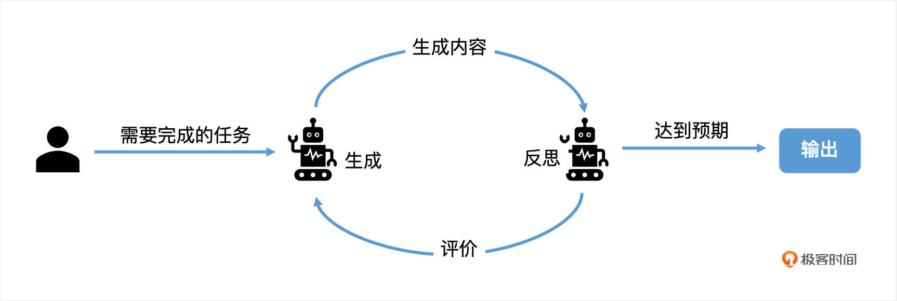
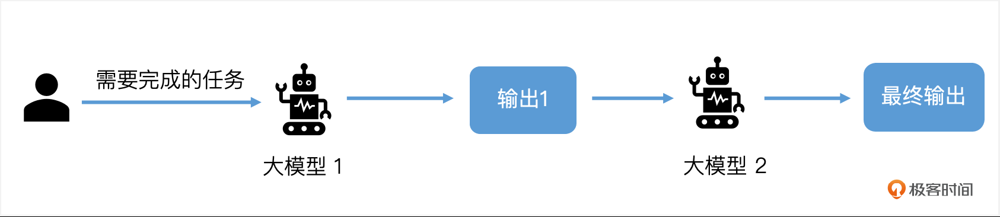
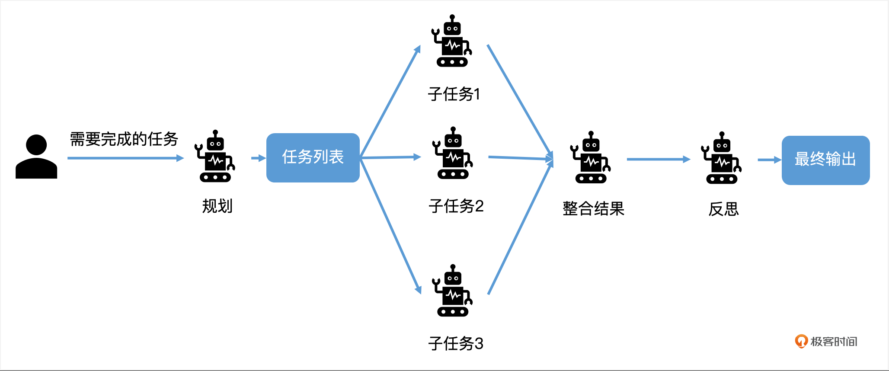
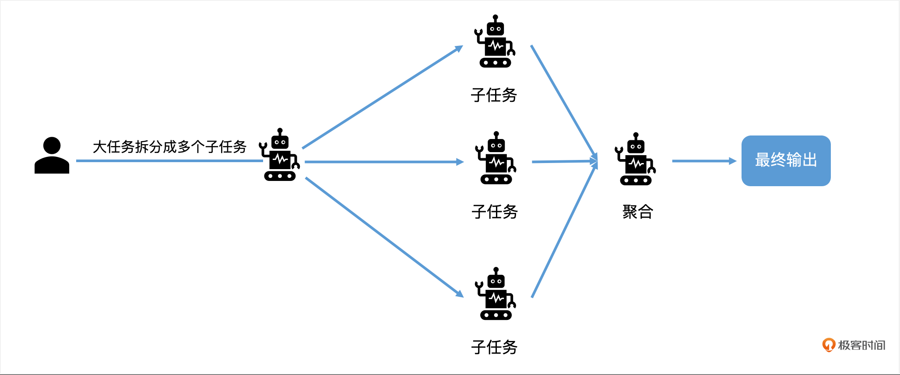
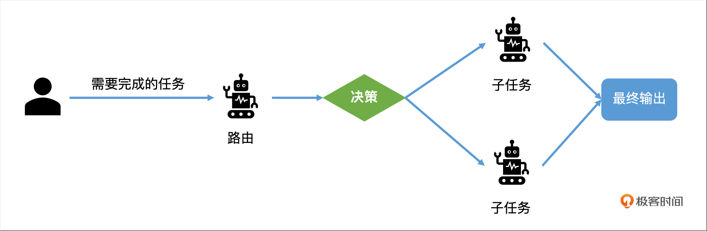

# 11 | 5种Agentic模式赋能自动化测试

你好，我是陈磊。

上一次我们深入探讨了两个服务于测试过程的 MCP Server 的打造过程。我们一步步拆解问题，不是简单地扔给测试工程师一套新工具，而是站在大模型的“视角”，重新设计解决方案。我们不再是传统意义上的“建平台、发脚本”模式，而是让大模型像一个智能助手一样，能自然地“读懂”报告、“诊断”漏网之鱼，并给出精准的修复建议。

当大模型不再只是“聊天机器人”，而是能无缝接入你的私有测试生态时，那种效率跃升的快感，是不是让你有点小激动？想要做到这一点，就需要智能体的参与了。一说智能体想必很多人都能聊上几句，但是要说到 Agentic 模式估计就没几个人听说过了。其实 Agentic 模式就像建筑蓝图，搭建智能体应用时，用 Agentic 模式进行设计能让我们少走弯路。

今天我们就详细聊一聊反思、提示链、规划、并行处理和路由这五种 Agentic 模式，为你后续的智能体设计铺平道路。

- 这节课的 demo 是使用 langchain、Ollama 以及 gpt-oss:120b-cloud 完成的。

## Agentic 模式之旅

## 反思：从“粗糙初稿”到“精雕细琢”的闭环之旅！

反思（reflection）不是什么高大上的新发明，是智能体自黑自省的一种模式，反思就像一个女孩面对镜子化妆，画一下照镜子看一下，然后对不满意的地方再进行一些修补或者重画，就这样反复直到自己满意为止。这就是反思模式里面最为重要的评估和优化闭环，它的核心就是自我修正的闭环循环。让 Agent 从“一次性输出”升级到“迭代打磨”，在测试场景里，简直是debug 神器，想想看，AI 生成测试脚本，跑崩了？它自己反思错误日志，迭代修复，省得你半夜爬起来救场！



这个流程从“初始输出”起步，经“评估输出”挑刺反馈后迭代“改进输出”，通过循环决策直到满足标准，最终输出达到预期的结果，这是大模型自己的“打磨升级过程”。其中生成大模型和反思大模型既可能是两个大模型，也可能是一个大模型配置了两个不同的系统提示词，一个是生成内容的系统提示词，一个是反思评价的系统提示词。

这个反思过程特别适合设计回归测试的测试计划，初始大模型基于变更日志甩个回归计划跑全接口库，优先核心模块，反思大模型审视可行性评价的标准，例如回归时长、覆盖度等方面，用 JaCoCo 数据反馈风险点，循环评估，直到满足反思大模型的审视可行性标准后，反馈最终的回归测试计划。这样的过程一点也不输于传统的归回测试计划的评估方法，传统计划靠经验猜，反思用数据自纠，避开“多跑无用功”。

```python
import json  # 用于JSON数据的序列化和反序列化，处理测试计划和JaCoCo数据的输入/输出
from super_json import SuperJSON  # 增强JSON解析库，用于处理LLM可能返回的非标准JSON响应
from pydantic import BaseModel  # 数据验证库，用于定义Evaluation模型，确保反馈结构化
import enum  # 枚举库，用于定义评估状态（PASS/FAIL），提高代码可读性和类型安全
from langchain_ollama import OllamaLLM  # LangChain的Ollama集成，用于本地LLM调用（qwe
from langchain.prompts import PromptTemplate  # LangChain提示模板，用于构建动态prompt
# 定义评估状态枚举：PASS表示计划通过评估，FAIL表示需迭代优化
class EvaluationStatus(enum.Enum):
   PASS = "PASS"
   FAIL = "FAIL"
# 定义评估结果模型：使用Pydantic确保JSON响应严格匹配结构，避免解析错误
class Evaluation(BaseModel):
   evaluation: EvaluationStatus  # 评估结果：PASS或FAIL
   feedback: str  # 具体改进建议：如“增加payment模块case，缩短时长”
   reasoning: str  # 推理解释：为什么PASS/FAIL，基于JaCoCo风险和计划对比
# 模拟变更日志（实际项目中，可从Git diff、Jira API或文件加载，提供变更上下文）
CHANGE_LOG = """
- Updated login API: Added new OAuth flow in core module.  # 核心模块变更：优先测试OA
- Modified user profile endpoint: Fixed validation in utils package.  # 工具包修复
- New feature in payment module: Integrated Stripe webhook.  # 新功能：高风险，需额外
- Bug fix in reporting service: Enhanced error logging.  # 报告服务修复：验证日志完整性
"""
# 模拟JaCoCo数据（实际从mcp-jacoco-server或XML解析获取，这里用文件级JSON数组格式）
JACOCO_DATA = [
   {
       "sourcefile": "PasswordUtil.java",
       "package": "com/cicc/ut/util",
       "lines": {
           "nocovered": [],
           "partiallycovered": []
       },
       "branch": {
           "nocovered": [],
           "partiallycovered": []
       }
   },
   {
       "sourcefile": "UserServiceImpl.java",
       "package": "com/cicc/ut/service/impl",
       "lines": {
           "nocovered": [
               33,
               67,
               69,
               71,
               72
           ],
           "partiallycovered": []
       },
       "branch": {
           "nocovered": [67],
           "partiallycovered": [32]
       }
   },
   {  # 无风险文件
       "sourcefile": "Constants.java",
       "package": "com/cicc/ut/constants",
       "lines": {
           "nocovered": [],
           "partiallycovered": []
       },
       "branch": {
           "nocovered": [],
           "partiallycovered": []
       }
   },
   {  # 无风险文件
       "sourcefile": "AuthException.java",
       "package": "com/cicc/ut/exceptions",
       "lines": {
           "nocovered": [],
           "partiallycovered": []
       },
       "branch": {
           "nocovered": [],
           "partiallycovered": []
       }
   },
   {  # 无风险文件
       "sourcefile": "UserService.java",
       "package": "com/cicc/ut/service",
       "lines": {
           "nocovered": [],
           "partiallycovered": []
       },
       "branch": {
           "nocovered": [],
           "partiallycovered": []
       }
   }
]
# --- Initial Generation Function ---
# 生成初始或迭代测试计划：基于变更日志，输出JSON结构化计划
def generate_test_plan(change_log: str, feedback=None, model="qwen3:8b") -> dict:
   """
   生成回归测试计划。
   :param change_log: 变更日志字符串，提供变更上下文
   :param feedback: 上轮评估反馈（可选），用于迭代优化
   :param model: Ollama模型名，默认qwen3:4b（本地高效模型）
   :return: dict形式的测试计划JSON
   """
   # 构造基础prompt：指导LLM生成全接口回归计划，优先核心模块，指定JSON输出键
   prompt = f"/no_think Based on the following change log, generate a regression
   if feedback:  # 如果有反馈，注入prompt中，实现Reflection迭代
       prompt += f"\nIncorporate this feedback to improve: {feedback}"
   # 初始化Ollama LLM实例，使用指定模型进行本地推理
   llm = OllamaLLM(model=model)
   # 创建LangChain提示模板：动态注入prompt变量
   prompt_template = PromptTemplate(
       input_variables=["prompt"],  # 输入变量：prompt字符串
       template="{prompt}"  # 模板：直接使用注入的prompt
   )
   # 调用链：模板 | LLM，生成计划JSON字符串
   plan_json_str = (prompt_template | llm).invoke({"prompt": prompt}).strip()
   # 尝试解析LLM输出为dict（假设LLM严格输出JSON）
   try:
       plan = json.loads(plan_json_str)
   except json.JSONDecodeError:  # 兜底：如果LLM输出非JSON，回退到字符串dict
       plan = {"plan_summary": plan_json_str, "prioritized_modules": [], "estima
   # 打印生成的计划，便于调试和日志追踪
   print(f"Generated Test Plan:\n{json.dumps(plan, indent=2)}")
   return plan  # 返回dict，便于后续评估和迭代
# --- Evaluation Function ---
# 评估测试计划：基于JaCoCo风险点，检查可行性（时长、覆盖、优先级）
def evaluate(plan: dict, jacoco_data: list) -> Evaluation:
   """
   评估回归测试计划的可行性。
   :param plan: 当前测试计划dict
   :param jacoco_data: JaCoCo数据列表，提取风险点
   :return: Evaluation模型实例，含状态、反馈、推理
   """
   print("\n--- Evaluating Test Plan ---")  # 日志：评估开始
   # 准备JaCoCo summary：遍历数据，提取nocovered lines，按package/sourcefile组风险
   risk_points = []  # 风险点列表：如"com/cicc/ut/service/impl.UserServiceImpl.jav
   total_nocovered_lines = 0  # 总未覆盖行数，用于粗估覆盖率
   for item in jacoco_data:  # 循环每个文件项
       nocovered_lines = item['lines']['nocovered']  # 获取lines.nocovered数组
       if nocovered_lines:  # 如果有未覆盖行
           total_nocovered_lines += len(nocovered_lines)  # 累加总数
           risk_points.append(f"{item['package']}.{item['sourcefile']}: lines {n
   # 模拟整体覆盖率：粗估公式（假设总行1000，nocovered比例；实际项目用精确metrics）
   estimated_coverage = max(0, 100 - (total_nocovered_lines / 10))  # 简单线性估算
   # 构建summary字符串：覆盖率 + 风险点，供prompt注入
   jacoco_summary = f"Estimated JaCoCo coverage: {estimated_coverage:.1f}%. Risk
   # 创建评估prompt模板：指定标准（时长<24h、覆盖>90%、风险覆盖），注入plan和JaCoCo summar
   prompt_critique = PromptTemplate(
       input_variables=["plan", "jacoco_summary"],  # 输入：计划JSON + JaCoCo摘要
       template=(
           "/no_think\n"  # Ollama指令：无思考，直接输出
           "Critique the following regression test plan based on feasibility cri
           f"JaCoCo data: {jacoco_summary}\n"  # 注入JaCoCo摘要
           "Test Plan:\n"  # 计划输入
           "{plan}\n"  # 动态注入plan JSON
           "Respond with PASS or FAIL. Provide feedback on improvements (e.g., a
           "Please respond in the following JSON format:\n"  # 指定JSON结构
           "{{\"evaluation\": \"PASS|FAIL\", \"feedback\": \"...\",\"reasoning\"
       )
   )
   # 初始化评估LLM
   llm = OllamaLLM(model="qwen3:8b")
   # 调用链：生成批判响应文本
   response_critique_txt = (prompt_critique | llm).invoke({"plan": json.dumps(pl
   # 使用SuperJSON解析LLM文本输出为dict（容忍非标准JSON）
   response_critique_json = SuperJSON.loads(response_critique_txt)
   # 实例化Evaluation模型，进行验证
   critique = Evaluation(**response_critique_json)
   # 打印评估结果，便于日志和调试
   print(f"Evaluation Status: {critique.evaluation}")
   print(f"Evaluation Feedback: {critique.feedback}")
   return critique  # 返回结构化评估结果
# Reflection Loop：核心闭环，实现生成-评估-迭代，直到PASS或max_iterations
max_iterations = 3  # 最大迭代轮次：防无限循环，平衡质量与成本（Token/时间）
current_iteration = 0  # 当前迭代计数器
# 初始计划生成：无反馈，模拟可能不通过的粗放版
current_plan = generate_test_plan(CHANGE_LOG)  # 第一轮调用，启动循环
# 主循环：Reflection自省过程
while current_iteration < max_iterations:
   current_iteration += 1  # 递增迭代计数
   print(f"\n--- Iteration {current_iteration} ---")  # 日志：当前轮次
   # 执行评估：注入当前计划和JaCoCo数据
   evaluation_result = evaluate(current_plan, JACOCO_DATA)
   # 决策分岔：PASS则收官，FAIL则反馈迭代
   if evaluation_result.evaluation == EvaluationStatus.PASS:
       print("\nFinal Test Plan:")  # 日志：最终计划
       print(json.dumps(current_plan, indent=2))  # 打印精炼计划
       break  # 退出循环：成功收尾
   else:
       # 迭代生成：用反馈优化下一版计划
       current_plan = generate_test_plan(CHANGE_LOG, feedback=evaluation_result.
       # 检查是否达max：如果是，打印最后尝试（非强制PASS）
       if current_iteration == max_iterations:
           print("\nMax iterations reached. Last attempt:")  # 日志：上限警告
           print(json.dumps(current_plan, indent=2))  # 输出最终尝试版
```

上面是一个模拟反思过程的实现 demo，模拟了一个自动化生成和优化软件回归测试计划的场景。generate_test_plan() 和 evaluate() 是核心代码，主要是用于测试计划生成以及测试计划评估，通过将生成和评估两个环节连接起来，通过 generate_test_plan() 生成一个测试计划，然后 evaluate() 会评估当前的测试计划，并给出评估结果以及评估意见，评估意见存入feedback 后进入下一轮的 generate_test_plan() 和 evaluate() 的循环，直到评估结果为 PASS或者到达最大循环次数为止。

这个代码通过生成、评估、反思、再生成的一个闭环，利用 LLM 的能力来自动化地创建和迭代优化测试计划的任务过程。

## 提示链：智能体的“接力赛棒”流水线

提示链（Prompt Chain）你是不是很熟悉，我们在前面讲解提示词的时候就讲过这种模式，其实在 Agentic 模式中也有这种模式，在不同方式上的相同名字也说明了这两个实践是没有太大差异的，最大的区别就是这里提示链是串联几个智能体的流程链。前面智能体的输出就是下一个智能体的输入，这样就可以将复杂任务拆解成一系列预定义的、顺序化的步骤，每一步由独立的智能体调用来处理上游输出，从而实现高效的自动化协作。



它特别适合那些可以明确划分成可预测、线性子任务的场景，避免了单次 LLM 调用可能带来的复杂性和不确定性。提示链的核心就是将一个任务分解成不同阶段，如规划、验证、执行，然后每个阶段都专注以单一职责从而确保流程的可靠和可控。这样可以提升输出质量、减少幻觉风险。

```python
from langchain_ollama import OllamaLLM
from langchain.prompts import PromptTemplate
# 初始化 Ollama LLM
llm1 = OllamaLLM(model="gpt-oss:120b-cloud")  # 你可以换成其他已拉取的模型名
llm2 = OllamaLLM(model="gpt-oss:120b-cloud")  # 你可以换成其他已拉取的模型名
# 示例用户故事（扩展为包含 Acceptance Criteria 的条目化描述）
user_story = """
story：作为用户，我希望能够登录系统后查看个人仪表盘，以便快速了解我的账户状态。
AC1: 用户输入有效的用户名和密码后，系统成功登录并重定向到个人仪表盘页面。
AC2: 仪表盘页面显示账户余额、最近交易记录和通知列表。
AC3: 如果登录凭证无效，系统显示错误消息并保持在登录页面。
AC4: 登录过程在5秒内完成，且仪表盘加载时间不超过3秒。
AC5: 用户注销后，无法访问仪表盘页面。
"""
# --- 步骤1：完善story ---
prompt1 = PromptTemplate(
   input_variables=["user_story"],
   template="""基于以下用户故事，完善story描述，包括生成详细的 Acceptance Criteria (AC)
确保 AC 覆盖功能、非功能（如性能、安全）、正向/负向场景。
输出格式：用户故事 + Acceptance Criteria 列表 (AC1: ..., AC2: ... 等)。
用户故事：{user_story}"""
)
refined_story = (prompt1 | llm1).invoke({"user_story": user_story}).strip()
print("完善后的story：")
print(refined_story)
# --- 步骤2：基于步骤1输出生成测试用例 ---
prompt2 = PromptTemplate(
   input_variables=["refined_story"],
   template="""基于以下完善后的story及其 Acceptance Criteria，生成一个全面的测试用例列表
每个测试用例应包含：测试ID、描述、前置条件、步骤、预期结果。
输出格式为Markdown表格。
完善后的story：{refined_story}"""
)
test_cases = (prompt2 | llm2).invoke({"refined_story": refined_story}).strip()
print("\n生成的测试用例：")
print(test_cases)
```

上面的例子中使用 LangChain 实现了一个测试用例生成的提示链的智能体，核心思想是将一个复杂的任务分解成多个简单的、连续的步骤，每一步都由一个独立的智能体调用来完成，并且前一步的输出会作为后一步的输入。

这个例子展示了从一个用户故事到测试用例生成的过程，把任务分解成了两步，第一步先完善用户故事，再把第一步生成的内容作为第二步的输入，生成测试用例，保证信息的连续性和准确性。这种分步处理让每个 LLM 的任务更聚焦、更简单，从而更容易获得高质量的输出。如果一步到位，直接让 LLM 从原始故事生成测试用例，结果可能会遗漏很多细节。

## 规划：“总导演 + 剧组工作人员”大戏

规划模式顾名思义就是有一个负责规划、分解任务的总导演智能体，它主要负责将任务分解成一个个动态的子任务列表，还有一群“剧组工作人员”一样的工作 agent 完成每一个子任务的执行。最后当全部子任务都完成后，整合结果并对整合后的结果进行反思，反思“整体剧本对路吗？缺啥？”满意就剪辑成最终大片，不行就重导一轮。这就减少了任何一次 LLM 调用的认知负荷，提高了推理质量，最大限度地减少了错误，并允许对工作流程进行动态调整。



规划这种 Agentic 模式就非常适合解决测试过程中的复杂任务，例如全面覆盖的 UI 自动化测试。当新版本推出准备上线前，我们需要手动分析页面，开发测试脚本，跨浏览器执行验证兼容性，然后记录 bug。采用规划模式的就需要总导演智能体看需求（“测试登录页跨Chrome/Firefox”），动态拆成子任务，包含了元素风险扫描、脚本生成、并行执行、可视化报告，每一个子任务都可以让子任务智能体完成，然后最终整合结果的智能体会验证，例如兼容性大于 95% 等要求，都满足后输出最终的测试结果。

```python
import json  # JSON处理：序列化UI输出
import requests  # Ollama API调用：替换LangChain，环境友好
from typing import  Dict, Any  # 类型提示：用dict代替BaseModel
model_name = "gpt-oss:120b-cloud"
# 模拟UI变更需求（实际从Figma/Jira拉取，提供页面上下文）
UI_CHANGE_LOG = """
- Added new modal popup for login confirmation in core page.
- Updated responsive design: Mobile view adjustments for profile section.
- Enhanced button animations in payment flow.
- Fixed accessibility issues in navigation bar.
"""
# 模拟DOM风险数据（实际从浏览器工具或MCP注入，挖动态元素风险）
DOM_RISKS = [  # 简化版，焦点高风险元素
   {"element": "login-modal", "risk": "Dynamic ID changes on load, may break sel
   {"element": "profile-responsive", "risk": "Viewport breakpoints not covered,
   # ... 其他元素
]
# 变量别名：统一小写，便于prompt注入
ui_change_log = UI_CHANGE_LOG  # 别名：用于prompt注入
dom_risks = DOM_RISKS  # 别名：用于prompt注入
user_goal = "Automate end-to-end UI tests for recent page updates, ensuring cross
# 简化模型：用dict代替BaseModel/Pydantic（环境兼容）
Task = Dict[str, Any]  # task_id: int, description: str, assigned_to: str
Plan = Dict[str, Any]  # goal: str, steps: List[Task]
# Ollama API生成函数：直戳本地11434，stream=False防乱码，format="json"锁输出
def ollama_generate(prompt: str, model: str = model_name) -> str:
   try:
       response = requests.post("http://localhost:11434/api/generate",
                                json={"model": model, "prompt": prompt, "stream"
                                timeout=60)  # 加长超时，防慢响应
       response.raise_for_status()
       result = response.json()
       return result.get('response', '').strip()
   except Exception as e:  # 兜底：Ollama未跑或model缺
       print(f"Ollama Error: {str(e)}")  # 日志
       return '{"goal": "...", "steps": []}'  # 模拟空JSON，防解析崩
# Step 1: Generate the Plan
prompt_planner = (  # 规划prompt：指导拆解UI子任务
   "/no_think\n"
   "Create a step-by-step plan for UI automation testing.\n"
   "Decompose into dynamic sub-tasks, assign to worker types (DOMAnalyzer, Scrip
   "Dependencies: DOM before scripting; parallel browsers.\n\n"
   f"Goal: {user_goal}\nUI Change Log: {ui_change_log}\nDOM Risks: {str(dom_risk
   "Respond STRICTLY in JSON: {\"goal\": \"...\", \"steps\": [{\"task_id\": 0, \
)
print(f"Goal: {user_goal}")
print("Generating plan...")
response_plan_txt = ollama_generate(prompt_planner, model_name)
try:
   plan = json.loads(response_plan_txt)  # 解析计划
except json.JSONDecodeError:
   plan = {"goal": user_goal, "steps": []}  # 兜底空计划
print(f"Generated Plan:\n{json.dumps(plan, indent=2)}")
# Step 2: Execute the Plan (Workers Simulation)
worker_outputs: Dict[int, Dict[str, Any]] = {}
for step in plan.get("steps", []):
   task_id = step.get("task_id", 0)
   description = step.get("description", "")
   assigned_to = step.get("assigned_to", "Unknown")
   print(f"\n--- Executing Step {task_id}: {description} (Worker: {assigned_to})
   # 动态工蜂：ollama_generate + 专属prompt
   if assigned_to == "DOMAnalyzer":  # DOM
       worker_prompt = f"Analyze UI for: {description}. Changes: {ui_change_log}
       output_txt = ollama_generate(worker_prompt)
       try:
           worker_output = json.loads(output_txt)
       except:
           worker_output = {"elements": [], "browser_issues": []}
   elif assigned_to == "ScriptGenerator":  # 脚本
       prev_output = worker_outputs.get(task_id - 1, {"elements": []}) if task_i
       worker_prompt = f"Generate Playwright scripts for: {description}. Element
       output_txt = ollama_generate(worker_prompt)
       worker_output = {"scripts": output_txt.strip()}
   elif assigned_to == "BrowserRunner":  # 执行
       prev_output = worker_outputs.get(task_id - 1, {"scripts": "N/A"})
       worker_prompt = f"Simulate browser run for: {description}. Scripts: {str(
       output_txt = ollama_generate(worker_prompt)
       try:
           worker_output = json.loads(output_txt)
       except:
           worker_output = {"results": {"chrome_pass": 95, "firefox_fail": 1, "m
   elif assigned_to == "VisualReporter":  # 报告
       prev_output = worker_outputs.get(task_id - 1, {"results": {}})
       worker_prompt = f"Generate visual report for: {description}. Results: {st
       output_txt = ollama_generate(worker_prompt)
       worker_output = {"report": output_txt.strip()}
   else:  # 兜底通用worker
       worker_output = {"output": f"Simulated {assigned_to} for {description}"}
   worker_outputs[task_id] = worker_output
   print(f"Worker Output:\n{json.dumps(worker_output, indent=2) if isinstance(wo
# Step 3: Synthesizer (整合和反思)
print("\n--- Synthesizing Final Results ---")
synthesizer_prompt = f"/no_think\nSynthesize outputs into final UI test plan.\nGo
final_txt = ollama_generate(synthesizer_prompt)
try:
   final_plan = json.loads(final_txt)
except json.JSONDecodeError:
   final_plan = {"summary": "Plan synthesized; compatibility 96%, stability 97%
print(f"\nFinal UI Test Automation Plan:\n{json dumps(final plan
indent=2)}")
```

如上代码实现了一个规划的 Agentic 模式，模拟了一个针对最近的 UI 变更自动化生成测试任务、脚本、执行结果和报告的场景。核心目标是确保跨浏览器兼容性（Chrome、Firefox、Mobile）和 >95% 的视觉稳定性。例子整个模拟了从规划到多个智能体执行，最后到合成反思最终结果的一个过程，输入是模拟的 UI 变更日志和 DOM 风险，输出是完整的测试计划JSON。

## 并行处理：独立子任务并行飙车，汇总就是王炸！

并行处理模式，它是 Agentic 模式中的“涡轮增压版“。并行处理模式就是把大任务拆分成一堆相互独立的子任务，然后分发给几个智能体同时干活，每个分支的智能体都独立冲刺，因为相互之间是无依赖的，因此它们之间是零等待，全部完成后，负责聚合结果的智能体会将结果统一输出，这就类似一个 Map-Reduce 的过程。



并行处理模式可以大大提高测试效率，尤其是在一些传统工作中由于执行角色导致的只能串行解决的测试过程。如果你需要对一个电商 App 进行全面的测试，传统方式是串行执行：先测用户登录，再测搜索功能，然后购物车、支付……一环扣一环，耗时长、效率低。现在，用并行处理模式，我们把大任务“电商 App 功能测试”拆分成几个相互独立的子任务，分发给多个AI Agent 同时执行。

```python
import asyncio
import time
from langchain_ollama import OllamaLLM
from langchain.prompts import PromptTemplate
model_name = "gpt-oss:120b-cloud"
def get_ollama_response(prompt: str, model: str = model_name) -> str:
   """
   同步调用 Ollama 本地模型生成内容。
   """
   llm = OllamaLLM(model=model)
   prompt_template = PromptTemplate(
       input_variables=["prompt"],
       template="{prompt}"
   )
   response = (prompt_template | llm).invoke({"prompt": prompt})
   return response.strip()
async def generate_content(prompt: str, model: str = model_name) -> str:
   """
   用 asyncio.to_thread 将同步推理包装为异步。
   """
   return await asyncio.to_thread(get_ollama_response, prompt, model)
async def parallel_tasks(model: str = model_name) -> str:
   """
   并发执行多个测试报告生成任务，并聚合结果（模拟软件测试的Map-Reduce）。
   """
   llm = OllamaLLM(model=model)
   topic = "e-commerce app functionality testing"
   prompts = [
       f"Generate a short test report for user registration/login module in {top
       f"Generate a short test report for product search module in {topic}. Incl
       f"Generate a short test report for shopping cart module in {topic}. Inclu
       f"Generate a short test report for payment module in {topic}. Include: st
   ]
   # 并发执行所有推理任务（Map阶段：独立子任务并行）
   start_time = time.time()
   tasks = [generate_content(prompt, model) for prompt in prompts]
   results = await asyncio.gather(*tasks)
   end_time = time.time()
   print(f"Time taken for parallel testing: {end_time - start_time:.2f} seconds"
   print("\n--- Individual Test Reports ---")
   for i, result in enumerate(results):
       print(f"Report {i+1}: {result}\n")
   # 聚合结果（Reduce阶段：汇总成综合报告）
   test_reports = '\n'.join([f"Report {i+1}: {result}" for i, result in enumerat
   aggregation_prompt = PromptTemplate(
       input_variables=['test_reports'],
       template="""Based on the following four test reports for e-commerce app,
Include a Markdown table with columns: Module, Status, Bug Count, Key Metrics, Su
Then, add a one-paragraph overall assessment and recommendations.
{test_reports}"""
   )
   aggregation_response = (aggregation_prompt | llm).invoke({"test_reports": tes
   return aggregation_response
if __name__ == "__main__":
   result = asyncio.run(parallel_tasks())
   print(f"\n--- Aggregated Test Summary ---\n{result}")
```

如上代码就是模拟这个电商 App 的全面功能测试的并行处理模式的例子，其核心思想是，当有多个独立的、互不依赖的智能体生成任务时，将它们并发执行，而不是按顺序一个一个地等待，从而显著减少总的等待时间。

这个脚本通过 asyncio.to_thread 和 asyncio.gather 的组合，解决了如何高效执行多个独立的、I/O 密集型（如此处的 LLM API 调用）任务的问题。Map-Reduce 模式的应用将一个大问题（生成一份完整的测试总结）分解为多个可以并行处理的小问题（生成各模块报告），最后再将结果汇总完成测试任务。

## 路由：Agentic 模式中的“智能导航”

路由模式可以理解成一个智能分流的过程，有一个智能体充当超级调度员，根据用户的输入将任务甩给下游干活的某一个智能体，这样可以小问题用“小”模型（例如 8b 模型），大问题用“大”模型（例如 671b 模型）。这模式玩的就是“分而治之”：关注点分离，专精优化。



路由模式很适合赋能测试过程打造一个智能的 BUG 分诊台，在敏捷开发环境中，测试团队接收到用户反馈的 bug 后，例如“应用登录过程中出现卡顿和认证失败问题”。常规的大模型辅助的办法就是将用户问题直接给大模型，让它将问题分类，不过这往往会导致分类不准，浪费了资源。如果采用路由模式的，那么路由能力的智能体解析这个用户反馈的 BUG 描述后，提取关键词（如“卡顿”表示 UI/ 性能问题，“认证失败”表示 API/ 安全问题），然后进行分类将其交给能够处理对应问题的智能体修复 BUG。

```bash
import os  # 用于环境交互，如加载模拟数据（实际可扩展到MCP Server）
from super_json import SuperJSON  # 容错JSON解析：处理LLM杂质输出
from pydantic import BaseModel  # 数据验证：确保路由决策结构化
import enum  # 枚举：定义bug类别
from langchain_ollama import OllamaLLM  # LangChain Ollama集成：本地LLM调用
from langchain.prompts import PromptTemplate  # 提示模板：动态prompt
model_name = "gpt-oss:120b-cloud"
# 初始化LLM
llm = OllamaLLM(model=model_name)  # 主路由/复杂处理
llm_ui = OllamaLLM(model=model_name)  # UI专精（轻量，速答）
llm_api = OllamaLLM(model=model_name)  # API专精
llm_perf = OllamaLLM(model=model_name)  # 性能专精
# 定义路由类别枚举：测试bug分类
class Category(enum.Enum):
   UI = "ui"  # UI问题：如元素卡顿、布局崩
   API = "api"  # API问题：如OAuth失败、接口漏
   PERFORMANCE = "performance"  # 性能问题：如QPS低、DB锁
   UNKNOWN = "unknown"  # 不明：需重试或人工
# 定义路由决策模型：分类 + 推理，确保JSON严格
class RoutingDecision(BaseModel):
   category: Category  # 分类结果
   reasoning: str  # 分类依据：e.g., "关键词'卡顿'指向UI渲染"
# Step 1: Route the Bug Ticket (路由LLM - 智能分诊)
prompt_router = PromptTemplate(
   input_variables=["query"],  # 输入：bug描述
   template=(
       "/no_think Analyze the bug ticket below and determine its category.\n"
       "Categories:\n"
       "- ui: For UI/Frontend issues (e.g., rendering lag, element mismatch).\n"
       "- api: For API/Backend issues (e.g., auth failure, endpoint errors).\n"
       "- performance: For performance/scalability issues (e.g., slow load, high
       "- unknown: If unclear or multi-category.\n\n"
       "Bug Ticket: {query}\n"
       "Respond STRICTLY in JSON: {{\"category\": \"ui|api|performance|unknown\"
   )
)
# 示例bug票：实际从Jira/GitHub拉取
user_query = "App login is lagging with OAuth failure and high CPU usage during p
response_txt = (prompt_router | llm).invoke({"query": user_query})  # 路由调用
response_json = SuperJSON.loads(response_txt)  # 容错解析
routing_decision = RoutingDecision(**response_json)  # 模型验证
print(f"Routing Decision: {routing_decision}")  # 日志：分类结果
# Step 2: Handoff based on Routing (下游分流执行)
final_response = ""  # 最终诊断报告
if routing_decision.category == Category.UI:
   # UI专精：生成Playwright诊断+修复
   ui_prompt = PromptTemplate(
       input_variables=["query"],
       template=(
           "/no_think For UI bug '{query}': Provide diagnosis, Playwright script
       )
   )
   ui_txt = (ui_prompt | llm_ui).invoke({"query": user_query})
   final_response = ui_txt
   print(f"UI Diagnosis:\n{ui_txt}")
elif routing_decision.category == Category.API:
   # API专精：生成JaCoCo补案+接口测试
   api_prompt = PromptTemplate(
       input_variables=["query"],
       template=(
           "/no_think For API bug '{query}': Provide root cause, JaCoCo uncovere
       )
   )
   api_txt = (api_prompt | llm_api).invoke({"query": user_query})
   final_response = api_txt
   print(f"API Diagnosis:\n{api_txt}")
elif routing_decision.category == Category.PERFORMANCE:
   # 性能专精：生成JMeter调优+瓶颈分析
   perf_prompt = PromptTemplate(
       input_variables=["query"],
       template=(
           "/no_think For performance bug '{query}': Provide bottleneck analysis
       )
   )
   perf_txt = (perf_prompt | llm_perf).invoke({"query": user_query})
   final_response = perf_txt
   print(f"Performance Diagnosis:\n{perf_txt}")
else:
   # Unknown兜底：友好重试+人工建议
   unknown_prompt = PromptTemplate(
       input_variables=["query", "reasoning"],
       template=(
           "/no_think The bug ticket '{query}' is unclear. Reasoning: {reasoning
       )
   )
   unknown_txt = (unknown_prompt | llm).invoke({"query": user_query, "reasoning"
   final_response = unknown_txt
   print(f"Unknown Handling:\n{unknown_txt}")
print(f"\nFinal Bug Diagnosis Report:\n{final_response}")
```

上面的这段代码就模拟了一个自动化分析软件缺陷报告（Bug Ticket）并进行初步诊断的场景。其核心思想是，当有多个独立的、互不依赖的智能体生成任务时，将它们并发执行，而不是按顺序一个一个地等待，从而显著减少总的等待时间。例子中清晰地展示了路由模式的强大之处，将一个模糊的、复杂的问题分解成两个阶段：“分类”和“专门处理”。这使得每个阶段的智能体任务都更简单、更聚焦，从而提高了最终输出的质量和相关性。

在实际应用中，可以为简单的路由任务选择一个快速、廉价的模型，而为复杂的下游任务选择一个更强大、更昂贵的模型，从而优化成本。

## 总结

今天就到这里了，内容有点多，但理解起来其实并不难，如果有时间你最好把每段代码都在本地运行一遍，充分理解每种模式的优越性，这样当你面对需要用智能体来解决的问题时，你就会想起对应的模式能够快速地解决问题。

当然 Agentic 模式肯定远远不止这五种，未来也会有很大的变化，也许随着大模型的能力提升，一些的工程方法都会变成花拳绣腿，但是目前阶段这些模式还是能够帮助你解决很多实际问题的。

## 思考题

如果让你用一种模式解决你实际工作中的一个痛点问题，你会选择哪个模式解决什么样的问题呢？期待你把你的想法写在评论区，如果可是用一些 Demo 的代码实现，那么也请在不涉密的情况下把代码贴出来吧。我们下节课再见！
