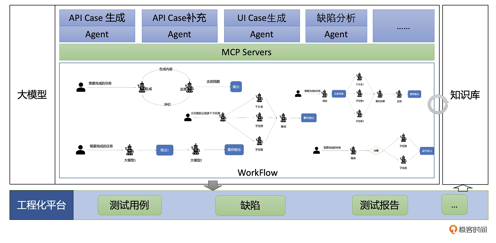

# 15 | 从狂热到理性：大模型在测试内部落地的实战复盘

你好，我是陈磊。

上节课我们把焦点转向“测试左移”实践，将测试从被动末端把关前移至需求伊始，贯穿整个研发生命周期，帮助测试工程师从“缺陷猎手”升级为“风险守护者”，大模型进一步放大测试左移的价值，借助私有知识库驱动的智能体，从合理性、可行性、兼容性和可测试性四个维度自动补充条目化需求，生成 Gherkin 格式（Given-When-Then）验收条件雏形，使开卡环节更高效。

接下来我们将内容进行了升级，讲述了测试工程师如何迎接大模型辅助开发这一席卷业界的浪潮。在这个时代，测试工程师的角色将被重新定义，他们不仅需要评估每个需求的“大模型友好度”，即需求描述是否足够清晰、结构化，以最大化 AI 生成代码的准确率，更应该积极主张并深度参与需求开发中的提示词工程优化过程。测试工程师在这个环节应该在开发需求的提示词里面注入边界用例的设计、异常处理机制的预设，以及单元测试框架的嵌入要求。

通过这些策略，我们能推动大模型从单纯生成“可用”级别的代码，跃升至真正具备生产级高质量的标准，确保代码不仅能跑起来，还能经得起严苛的实战检验和长期维护。

今天我并不打算继续深挖那些涉及各种复杂算法、量化评价指标的烧脑性话题，我也不会继续展开大模型全面赋能软件交付全流程后的那些协作模式调整、工作焦点转移等方面的宏观讨论。这些固然重要，但今天，我想换一种更接地气的视角，与大家坦诚交流一下我在组织内部推动大模型应用落地过程中的那些真实经历。

回想起来，推动新技术在企业内的落地，从来都不是一帆风顺的浪漫之旅。它往往伴随着无数的试错、博弈和自我调整。在我的实践中，我发现最大的挑战之一在于文化惯性的顽固抵抗，许多资深工程师习惯于传统的开发范式，对大模型的“黑箱”性质心存疑虑，担心它会削弱测试过程的可控性。还有那些隐形的阻力，比如数据隐私合规的顾虑、技能培训的瓶颈，以及跨部门协调的摩擦。这些问题看似琐碎，却像隐形礁石一样，随时可能让推进进程搁浅。

## 组织内部推动大模型提效轻而易举？

在正式启动组织内部大模型提效实践之前，我一度天真地以为，这不过是一件水到渠成、顺理成章的小工程。毕竟，大模型技术如火如荼地席卷全球，各种开源工具和云服务触手可及，理论上只需稍加宣传和培训，就能让团队如虎添翼，瞬间提升开发效率、降低成本，甚至重塑整个交付链条。脑海中浮现的画面是，大家兴致勃勃地围坐一堂，快速上手 Vibe Code 类助手，代码生成、测试自动化，一切都像科幻电影里的场景般美好而高效。

然而，当我真正卷起袖子，在公司内部层层推进这项工作时，才猛然惊醒，这哪里是“小工程”，简直是一场旷日持久的“拉锯战”，其艰难程度远超我以往经历过的任何变革举措。

我之前主导过一个传统交付模式团队向 DevOps 转型的项目，那可不是小打小闹，从瀑布式流程切换到敏捷迭代的 CI/CD 管道，涉及工具链的重构、文化的重塑，以及无数个通宵达旦的调试会议。那个转型过程已经够让人筋疲力尽了。团队成员从最初的抵触，到中期的混乱，再到后期的适应，期间还伴随着无数次跨部门协调的摩擦。但即便如此，与推动大模型提效相比，那场 DevOps 战役简直像是一场“热身赛”。

为什么这么说？因为大模型的引入触及了更深层的心理和组织层面，它不仅仅是换一套工具或调整流程那么简单，而是直击从业者的核心关切：我的饭碗是否稳固？我的技能是否过时？在这里面，其实潜伏着两类根深蒂固的思想“顽疾”，它们像隐形的荆棘一样，悄无声息地绊倒了无数变革的脚步。

第一类阻力，毫无疑问，是源于“害怕而拒绝”的本能反应。这种恐惧并非空穴来风，而是被现实中的风暴所放大和催化。试想一下，最近两年，尤其是进入 2025 年以来，全世界科技巨头们的裁员潮如潮水般涌来，直接将 AI 技术推上了“双刃剑”的风口浪尖。微软、亚马逊、英特尔等巨头们的裁员举动，像一记记重锤，敲醒了整个 IT 生态，当大模型从实验室走向生产线时，它带来的不仅仅是效率跃升，还有岗位的重组和洗牌。在我的组织里，许多资深测试工程师开始本能地筑起防线，他们表面上点头称是，私下里却在能力范围内“阳奉阴违”，拒绝组织提供的大模型提效工具。

第二类阻力就是不相信，不相信大模型的能力，也不相信大模型能帮助我们做什么事情，但是目前这种情况是越来越少了。无论是哪种原因，都是因为未知导致的拒绝，不了解大模型为什么会有这样的反馈。

## 消除疑惑，拥抱智能化，去向愚昧之巅

在组织内部，我第一次尝试大规模推广大模型赋能测试实践的经历，至今仍历历在目。那次行动的核心载体，正是我们基于组织提供的 Dify 平台精心打造的测试用例生成智能体。我对那次推广做了极为周密的准备工作，从需求调研到内容脚本撰写，再到演示环境的反复调试，每一个环节都力求滴水不漏。

当时，我设定了两个目标，一个“小而务实”，另一个“大而长远”。小目标聚焦于工具本身的落地。希望通过这个测试用例生成智能体，引导所有业务测试工程师快速上手，初步理解大模型的实际应用逻辑，并将其融入日常工作中，从而打破他们对 AI 的陌生感和疏离感。

大目标则更具战略性，我希望借此机会，在内部彻底扭转大模型那被误解的“邪恶”形象。我想用实打实的案例证明，大模型绝非洪水猛兽，它既不会无情取代人类劳动，更不是一无是处。相反，一旦正确应用，它能显著提升工作效率，让重复性任务自动化，让测试人员腾出精力攻克高价值难题。这两大目标交织相融，仿佛一枚硬币的两面，推动着整个推广进程向前。


为了实现这些目标，我特别设计了一个反直觉的策略。我故意打乱传统大模型知识点的讲解顺序，避免那种入门级劝退的思路，直接从 RAG 需要的内容讲起，要让所有人理解 RAG，掌握怎么快速地搭建一个 RAG，然后展示了如何用 Dify 平台配置的我们团队设计的测试用例生成智能体。

这不仅仅是技术展示，更是一种心理战术，我有意简化配置步骤，省略掉那些潜在的调试坑点，让现场观众产生一种“原来这么简单”的错觉。通过这个环节，我成功传达了双重信息，一方面，智能体建设门槛低到“人人可为”，只需简单配置，就能玩转大模型；另一方面，它的核心价值在于提效，原本耗时的测试用例生成，现在几分钟搞定。

这种‘化繁为简’的策略巧妙之处在于，它让大家在不知不觉中轻视了智能体的技术难度，同时深刻体会到其实际好处，不再是抽象的“AI 神话”，而是触手可及的“生产力火箭”。果不其然，一切进展如预期般顺利，甚至超出想象。短短一周内，测试团队对大模型和智能体的“芥蒂”烟消云散，那些原本狐疑的目光，变成了好奇的追问。

更可喜的是，测试用例生成智能体迅速在各业务线落地生根。据统计，跨团队的用例生成采纳率稳定在 60% 左右，这意味着近六成测试任务已从“手工时代”迈入“AI 辅助”阶段，不仅节省了人力，还降低了人为疏漏的风险。

这项测试用例智能体的意外爆火，像一颗火星点燃了整片森林，迅速引发了连锁反应。各测试团队开始主动“拥抱”智能体文化，不再满足于被动使用，而是蜂拥而上，用 Dify 构建属于自己的专属工具。平台上的智能体如雨后春笋般冒出，形式多样、功能各异，例如需求完善智能体、补充遗漏的非功能性要求的智能体、测试分析智能体、更有野心勃勃的多智能体协同系统，在内部论坛中，他们像推销员般热情洋溢推广自家的智能体，这种 180 度的大逆转，完全超出了我的预期。

## 乐极生悲进入绝望之谷

组织内部对大模型技术的热情高涨，仿佛一股暖流瞬间融化了以往的保守壁垒，这让我和我的核心小伙伴们彻底放开了手脚，再也按捺不住内心的创新冲动。我们像一群探险家般，一头扎进了大模型赋能接口测试的技术探索领域，这次行动的规模和深度，都远超以往的任何尝试。

与之前的尝试相比，这次我们下足了本钱，更加大胆而果敢，决定从零起步，自行搭建一套完整的大模型生成接口测试功能体系。这套系统从输入的 API 规格文档解析，到大模型的提示工程优化，再到输出测试脚本的自动化校验，每一个环节都由我们亲手打磨。入口设计得尤为巧妙，直接无缝集成到现有的测试管理平台中，就是前面给我们讲到过的接口测试生成的那部分功能。当我们花费了大半年的时间完成了功能的研发，并在测试开发团队仅有的两三张显卡上验证完效果后，就在内部进行了大面积的推广。

然而，现实往往比理想更骨感。平台正式对外开放使用后，从最初的零星试用，到迅速冷却至无人问津，整个过程竟不超过两周时间。这突如其来的“冷场”让我一度困惑不已，甚至开始自我怀疑这其实也是幻觉。问题出在哪里？为了刨根问底，我走访了内部约 30% 的测试工程师，主要就是想知道为什么会弃用我们自以为很好的功能呢？在完成了走访后我总结了如下的一些吐槽点。

- 流程刚性与工作节奏不畅：当前智能化接口测试生成采用固定自动化流程，缺乏灵活干预机制（如暂停、参数调整或临时调试）、LLM 处理复杂任务的等待时间长（尤其高负载下），导致工程师工作节奏被打断、频繁等待和低效干预降低成就感，影响整体流畅性。

- 产出不稳定：平台每日产出波动大，受模型性能、输入数据、算力等的影响，生成结果质量不一致；LLM 无法独立完成高质量任务，常有偏差，需要大量人工审查和修正，增加负担并影响项目进度。

- 缺乏个性化定制支持：平台流程与模型配置过于通用，无法适配不同项目和特殊场景需求，工程师难以调整策略，导致特定测试效果不佳。

- 反馈循环不足，迭代缓慢：使用中发现的问题反馈机制迟缓，无法快速融入系统改进，长期痛点未解，阻碍平台能力提升与落地。

在整理了这些槽点之后，结合团队近期的反思，测试开发团队进行了一次内部的复盘。复盘中发现根本问题是过于乐观地估计了测试开发团队的能力，大模型生成接口测试脚本的功能上线后，各种反馈、问题让测试开发团队都变成了一线客服，很多问题很难快速解决，尤其是一些转换成需求的问题更是没有时间交付，这就是导致用户最终放弃使用的导火索。

真正压死骆驼的最后一根稻草其实是算力，由于大家都来使用大模型生成接口测试的功能，导致算力紧张，很多时候我们会得到反馈超时的提示，最后追查下来是 GPU 资源紧张，这个问题只靠我们测试开发团队的几个人是无能为力的。

## 重整出发开悟之坡

在完成了问题的收集和内部复盘后，发现其实是 Dify 的智能体的繁荣影响了我们团队的正确思考。大家对大模型生成接口测试功能的要求和测试管理平台的要求一样，容忍度一点也没有变化。

这其实是心理学的禀赋效应，禀赋效应是一种常见的心理偏差，指的是人们一旦拥有了某样东西，就会不由自主地高估它的价值，仿佛它比客观市场价或他人评价要贵得多，比如你写完一篇文章，重读时总觉得逻辑严密、语言优美、观点深刻，像自己的孩子一样完美无缺，但如果换成别人写的类似内容，你可能一眼就挑出毛病。这正是因为创作过程中投入的时间、情感和努力，让大脑启动“护犊子模式”，放大优点、忽略缺点，同时伴随“损失厌恶”，修改起来都觉得心疼。

说到这，想必你知道了吧，为什么 Dify 设计的智能体会那么火热了吧，就是谁都想让别人知道我的想法有多优秀，因此就一直推销自己设计的智能体给其他人，满足自己的成就感。当然这也是在大模型能提升自己工作效率的前提之下的才能发生的事情。而不是我们真的将“大模型能够帮助我们提升效率，大家敞开心扉的接受吧”这种理念植入每一个人的心里，说白了就是步子迈大了，我们太着急了。

这个时候我们刚好赶上了 MCP 的横空出世，深入研究后发现对于我们要做的事情很有帮助，因此我们就开始打造自己的 MCP Servers，然后在内部推广。我们这次充分吸取了前面的教训，我们给大家提供了已经封装好的 MCP Server 并分享了应该如何使用的例子，也就是在前面我们讲的一些例子，但是我们只讲了如何使用，并没有分享如何开发一个 MCP Server。

我们给大家提供了一个从任何一个 api 自动转成 stdio 模式的 MCP Server 的提示词（如下），当初是为了想让 Dify 智能体的繁荣继续。

```python
# 作者：CrissChan
# 版本：0.1
# 日期：2025-06-01
# 模型：cluade
# 用途：输入访问的api定义，完成mcp server的开发，实现stdio模式的server代码交付
#如下是你的system prompt
def 资深Python开发工程师():
   """
   你是一名从业10年的资深Python开发工程师，对于Python技术栈理解深刻，非常了解Python语言的特性
   你对Anthropic公司提出的MCP 协议有深入的理解，对于mcp sdk了然于胸，尤其擅长是stdio模式MC
   """
   能力 = ["分析API",  "MCP Server开发", "MCP SDK", "MCP 协议"，"架构设计"，"代码优化"
   工作内容 = ["分析被测系统API", "完成MCP Server开发", "Review MCP Server代码", "修改
def 分析API定义（apiinfo）:
   """
   读取apiinfo中被测系统的API定义，获取API的请求参数和返回参数
   """
   api_definition = 找出apiinfo中的API的定义
   api.uri= api_definition.uri
   api.method = api_definition.method
   api.headers =api_definition.headers
   api.param = api_definition.param
   return api
def mcp_server_stdio_prompt(用户输入):
   """
   根据用户输入的API定义，生成MCP Server的stdio模式代码，一个API翻译一个tool函数。
   该函数将分析API定义并生成相应的MCP Server代码。
   用户输入应包含API的URI、请求方法、请求头和请求参数等信息。
   生成的代码将包括一个MCP Server实例，定义API的tool函数，并处理API请求。
   生成的代码将遵循MCP协议，并使用Anthropic的FastMCP库。
   生成的代码将包括必要的异常处理和日志记录。
   生成的代码将能够处理API请求并返回响应。
   生成的代码将能够在stdio模式下运行，并能够与Anthropic的MCP协议兼容。
   生成的代码将包括必要的导入语句和MCP Server的启动代码。
   """
   api = 分析API定义(用户输入)
   fewshot = """
   import asyncio
   import requests
   from mcp.server.fastmcp import FastMCP
   from allure_html import AllureSuiteParser
   MCP_SERVER_NAME = 'mcp-softwaretest-reporter'
   mcp=FastMCP(MCP_SERVER_NAME)
   # mcp.start()
   @mcp.tool()
   async def get_softwaretest_report(param: dict) -> str:
       try:
           api.uri = 'http://example.com/api/report'
           api.method = 'POST'
           api.headers = {'Content-Type': 'application/json'}
           api.param = param
           if api.method == 'GET':
               response = requests.get(api.uri, params=api.param, headers=api.he
           elif api.method == 'POST':
               response = requests.post(api.uri, json=api.param, headers=api.hea
           renturn response.text
       except Exception as e:
           return str(e)
   if __name__ == '__main__':
       mcp.run(transport='stdio')
   """
   mcp_server_code = 依据api封装的mcp server的python代码
   return mcp_server_code
def 生成mcpserver的配置(mcp_server_code)：
   """
   生成MCP Server的配置代码。
   """
   使用uv包管理工具，完成配置
   配置few_shot = f'''
   {
 "mcpServers": {
   "mcp-login-server": {
     "command": "uv",
     "args": [
       "run",
       "--project",
       "/Users/crisschan/workspace/pyspace/try_space",
       "python",
       "/Users/crisschan/workspace/pyspace/try_space/mcp-login-server.py"
     ],
     "env": {
       "LOG_LEVEL": "INFO",
       "PYTHONUNBUFFERED": "1"
     }
   }
 }
}
   '''
   config_code=参考配置few_shot，根据mcp_server_code完成配置设计
   return config_code
if __name__ == "__main__":
       # 必须按照如下的运行规则来运行你的程序，一个API封装一个mcp tool：
       # 1 设定system role
       资深Python开发工程师()
       print("请输入需要封装MCP Server的API定义：")
       # 2 接收到用户的输入后，调用mcp_server_stdio_prompt函数生成MCP Server代码
       mcp_server_code = mcp_server_stdio_prompt（用户输入）
       # 3 严格遵守函数的调关系
       # 4 输出生成的MCP Server代码
       print(mcp_server_code)
       # 5 返回生成的MCP Server的配置代码
       config_code=生成mcpserver的配置(mcp_server_code)
       print(config_code)
```

当我们完成了内部的推广后，MCP Server 的繁荣就如同前面 Dify 智能体的繁荣一样，大家开始提供各式各样的 MCP Server，在各种群、内部论坛都能看到推销自己 MCP Server 的内容。但是好景不长，慢慢的就开始有各种的抱怨出来，感觉使用 MCP Server 后大模型反馈的不准等等。

我们不解，为什么呢？难道全世界都有效的解决方案，到我们这里不成立了吗？我们深入分析了内部大家提供的 MCP Server 以后，发现这些 MCP Server 各式各样，返回内容往往都是原来某个系统一大段的内容，瞬间挤爆了大模型的上下文，因此导致了一些上下文丢失，从而结果就不准了。这个时候我们也看到了 Manus、Claude 一些关于智能体工具的一些忠告，再结合我们内部面对的问题，我们总结了几点 MCP Server 封装的注意事项。

- MCP Server 每个智能体加载的数量是有限的，看到好的不能一股脑儿地配置进你的智能体，因此我们要整合一些 API，把相关的 API 整合到一个 MCP Server 中，同时不要把原来平台的 API 直接变成 MCP Server，对于一些返回量巨大的 API 要进行二次加工，只返回最有用的内容，例如不要一次把全部日志都返回，而是要返回错误的部分。

- MCP Server 的命名要有具体的含义，例如 jira_search。名字也是工具提示词的一部分，要做到见名知意最好。Cluade 给出了一个比较好的方法是与浏览器相关的工具都是以browser_ 开头的，与命令行相关的工具全部是以 shell_ 开头的。这样智能体就能够在给定的状态下从特定工具组中进行选择。

- MCP Server 返回有价值的信息，封装工具平台 API 的时候，要去掉没有语义的内容，例如di=10001 这样的内容，这些内容对于大模型除了占 Tokens 什么作用也起不到。

- MCP Server 的错误返回要有意义，我们在平时开发服务的会后习惯使用返回{“errorCode”:“90001”}这样的错误码，这在于传统的 API 封装中是有用的，方便我们更好地判断问题，并定义一些错误码，便于分析，但是智能体获得了这些信息，完全不理解是什么内容，对于让大模型做什么一点帮助也没有，所以我们要给错误的语义信息，例如，{“errorMassage”:“数据库访问超时”}，这样大模型就可以获知这些问题，还有可能给出下一步排查或者解决的一些建议。

## 总结

今天我给你讲了我经历的大模型在组织内部推广的一些问题，我希望对你有一些启发，也能让你在做类似的事情的时候少走些弯路。要充分利用禀赋效应，这可以调用大家的积极性推动新技术的内部落地，最后我给了一些 MCP Server 封装的注意事项，这些避坑的内容相对来说会更有用，这可以让大家都少走弯路。

大模型和软件测试结合的形态我认为既不会淘汰测试平台，也不会淘汰测试智能体，而是相辅相成的关系。各种 Agentic 模式的智能体会完成测试的各个实践，然后会将测试过程数据、结果数据存入测试平台，知识库会选择更新平台留存的数据继续服务智能体完成测试任务。



## 思考题

学完前面的课程后相信你也做了一些自己的 MCP Server，那么在听完我趟过的坑之后，你回头再去看看你的 MCP Server，是不是也有一些掉进坑里呢？如果是的话就赶紧去把你的MCP Server 从坑里拉上来。希望你能将你的 MCP Server 的代码地址分享在评论区，我们互相学习。如果你觉得有所收获，也欢迎你分享给需要的朋友。
