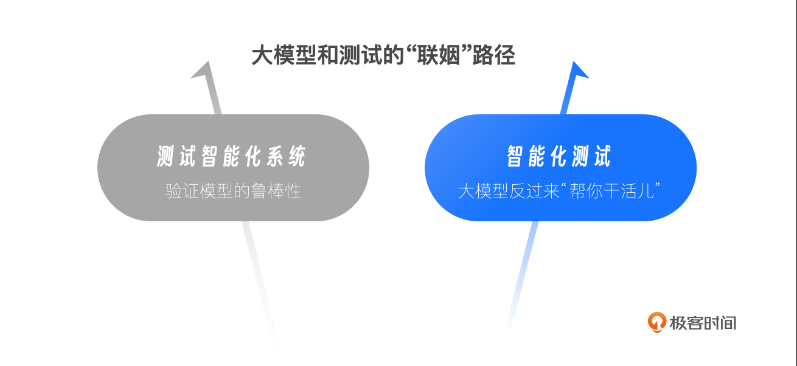
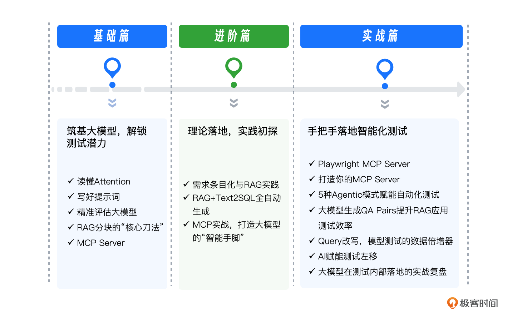

# 开篇词 | 大模型时代，测试工程师如何突围？

你好，我是陈磊，阿里云和华为云的 MVP，曾经在京东中台做测试架构师，这些年我一直沉浸在软件测试的浪潮里。欢迎你来到我的新专栏《AI 重塑测试开发系统实践》。

回想上一个极客时间专栏《接口测试入门课》，那已经是六年前的事儿了，转眼间，测试世界像坐了火箭一样，飞速迭代。尤其是最近两年，大模型的横空出世，不仅颠覆了代码生成和自然语言处理，还悄然渗透到我们测试的每个角落，剑指“手工活儿堆积如山”的痛点。这让我和极客时间的老师一拍即合，又一次敲开了极客时间的大门。这次我整理了一系列实战干货，想要专门和你聊聊大模型如何与软件测试“强强联手”，碰撞出火花四溅的创新实践。

说起大模型和测试的“联姻”，其实有两条主要的路径。第一条，是当你的被测系统本身就是个“聪明蛋”——比如那些嵌入 AI 决策的智能应用，这时候测试就得升级成“测试智能化系统”的模式：我们得验证模型的鲁棒性、边缘案例的覆盖，甚至是幻觉输出的把控，确保它在真实场景下不掉链子。

第二条路径，才是我们这个专栏的“主菜”——智能化测试。简单说，就是让大模型反过来“帮你干活儿”：自动化生成测试用例、预测高风险路径，甚至模拟用户行为，帮你把那些脑力密集的测试设计，变成一键触发的动作。想想看，以前测试工程师像侦探一样，凭经验和一系列测试实践方法挖掘 bug；现在，大模型能像你的“超级助手”，从海量历史数据中提炼洞见，让效率翻倍，质量直线上升。这不只是工具升级，更是思维的解放——测试从“被动守门员”，摇身变为了“主动进攻的前锋”。

我特别喜欢 MIT 的温斯顿教授对人工智能的定义：它本质上就是让机器接手那些过去只有人类才能搞定的智能化的事。这个思路放到测试上，就豁然开朗了——智能化测试，正是用计算机去攻克那些需要直觉、经验和创造力的测试挑战。比如，手动编写的复杂场景脚本，现在能让大模型从需求文档里“读懂”意图，一键生成参数化用例；那些难以量化的性能瓶颈，也能通过预测模型提前预警，避免线上事故的尴尬。

## 十年前和智能化测试结下了缘分

我大概从十年前就开始接触智能化测试了，那会儿是 2015 年左右，《Attention Is All YouNeed》论文还没问世，AI 在测试领域的浪潮还只是零星的涟漪，大家更多是在算法的深水区摸索着前进。比如，基于搜索和变异的最大覆盖算法生成单元测试用例，基于图像识别和变更保障的 UI 自动化测试框架等等，让测试不再是点来点去的手工活儿，而是像智能巡检一样，自动捕捉界面变化，确保变更不漏掉任何一个角落。

这些探索，放到现在对于大模型已经不是什么新鲜事了，但在那个时代，它们已经是测试圈的“前沿哨兵”了。

说起我的“入门记”，得感谢京东这个大舞台。那时候，公司正大步迈向中台转型，测试团队面临着海量接口和服务的验证压力——传统的脚本开发、脚本录制回放，已经跟不上节奏了。我有幸加入了中台的一个测试架构师团队，从需求调研到架构设计，一路亲身参与。回想起来，最让我骄傲的，是主导开发了一款基于抽象语法树的测试脚本生成算法。这可不是简单的模板填充，它能解析二进制包，生成可执行的测试脚本。这个算法直接解决了转型期“测试跟不上开发”的痛点，为此，我还拿下了京东 CMO 体系的优秀奖——那一刻，感觉所有熬夜讨论的方案、敲下的代码都是值得的。

当然，平台不是一夜之间建成的，那是一场“马拉松式的脑暴”。每天晚上，测试架构师、测试开发工程师挤在会议室里，围着一堆白板和代码，逐个击破低效环节。很多优秀的实践都是那个时候出现的，例如测试数据智能化推荐，测试环境的一键部署等等。这些实践，不是书本上的空谈，而是那一群优秀的人在一起碰撞出的火花，每一个都像一颗种子，悄然生根发芽。

从那以后，我就和智能化测试结下了不解之缘——十年光阴，弹指一挥，却让我从一个好奇的探索者，变成了一个躬身入局的实践者。它不只改变了我的测试思维，还让我看到，测试不再是“找 bug 的苦力活儿”，而是驱动产品卓越的智能引擎。

## 测试“将死”吗？

测试行业的“末日预言”每隔一段时间都会被提起，还记得 2017 年吗？那时候，智能化测试的浪潮刚起，各种技术大会上，休息间隙总能听到同行们低声议论：“测试要凉了？工程师们没活干了？”白驹过隙，眨眼就 2025 年了，我每天还在评审最新的测试设计方案，敲代码开发自动化平台新功能，顺手分析一波质量数据，看看覆盖率曲线是不是又上了一个台阶。

那些“测试将死”的标题党文章，还在朋友圈里刷屏，热议度不减当年。可笑的是，我发现自己非但没被取代，反而越战越勇——因为我选择了拥抱变化，而不是躲在角落里瑟瑟发抖。因为我明白，测试从来不是静态的“守株待兔”，它像一条活跃的河流，一直在技术洪流中蜕变。

如果你也正在纠结、迷茫之中，别慌，它其实是你成长的“催化剂”。我希望你能和我一样，紧跟测试技术的车轮，一步步学、一步步练。这个没捷径，只有实打实的行动：周末刷个大模型的入门视频，周中试着用它生成一个接口用例，周末再复盘优化。慢慢地，你会发现，那股不安像晨雾一样，渐渐散去，取而代之的是满满的掌控感——测试不死，它在进化，而你，就是这场进化中的一员。

说到这儿，就不得不提大模型这个“绕不开的拦路虎”了。它如今已经是 IT 圈的“全民话题”，从码农到产品，谁都得沾点边儿。不知道你使用大模型是不是还停留在 Chat 界面上，随口问“0.8 和 1.1 谁大？”，作为测试工程师、测试开发工程师，我们的野心可不止于此。我们需要深挖它的“内部密码”，为什么它能从海量数据中提炼模式，像老江湖一样预测 bug 路径？背后的 Transformer 架构、注意力机制，这些不是云里雾里的玄学，而是我们能上手拆解的“黑盒子”。

更重要的是，应用技术栈——怎么用 Prompt 工程让它吐出高质量的测试脚本？怎么让它帮我们分析 bug？这些技能，才是我们真正“降服”大模型的武器。想象一下，不再手动敲参数边界，而是让它从需求文档里“读心”，自动织出一张覆盖全景的测试网，不再凭感觉追性能瓶颈，而是用它模拟负载风暴，提前堵住隐患，你的工作就会从“苦力”变成“艺术”。

## 这个专栏是如何设计的？

在前期规划这个专栏的内容的时候，我也是很忐忑，忐忑的原因是怕内容把握不准，让你觉得太难了入门即放弃，要不就太简单了让你没什么兴趣。经过了多轮的打磨，终于过了我自己心里的那一关。

本专栏以测试开发工程师视角，层层递进，从基础理论到进阶实践，再到实战落地，带你系统掌握大模型的核心知识与应用技巧。无论你是测试新人还是资深从业者，都能在这里找到“知其然，亦知其所以然”的方法论，帮助你构建智能化测试体系，拥抱 AI 驱动的未来测试时代。

专栏分为基础篇（打牢理论根基）、进阶篇（桥接理论与实践）和实战篇（手把手落地），每节结合代码示例、工具 Demo 和场景验证，助你快速上手。

### 基础篇：筑基大模型，解锁测试潜力

虽然大模型已是热议焦点，但基础知识往往被忽略——这些基础正是我们利用大模型赋能好测试的关键。只有知其所以然，才能将大模型的强大能力发挥到极致，避免“黑箱”操作的陷阱。

这部分我们将从 Transformer 架构入手，一起聊聊 Transformer 的基础原理、Tokens 的计算方法以及关键超参数，同时深入当前火热的大模型应用技术：提示词工程、RAG 和 MCP 协议。通过这些内容，为后续使用大模型铺平道路，让你从测试开发工程师的角度了解如何将AI 融入需求分析、用例设计和缺陷预测中。

### 进阶篇：理论落地，实践初探

基础篇后，你已掌握大模型的“内功”；进阶篇则聚焦简单易行的实践思路，帮助你将这些知识转化为可操作的测试技能。我将讲解手工测试用例生成、接口测试生成以及 MCP 协议实战，清晰剖析基础篇中的超参数、提示词工程、RAG、MCP 等如何在真实场景中发挥作用。通过这些桥接内容，你将从根本上理解 AI 实现“少写多测”的高效转变，为实战篇的深度应用蓄力。

### 实战篇：手把手落地，智能化测试

理论与初探之后，实战篇直击痛点：从工具使用到自定义开发，再到团队推广，你将亲身经历AI 重塑测试的过程。先从微软开源的 MCP Playwright Server 入手，从使用角度理清 MCPServer 的核心作用，再探讨从哪个角度切入开发自己的 MCP Server。

我们还会算清 Agent workflow 的这笔账，感受不同 Agentic 设计模式的处理差异。既要掌握大模型，也要学会测试大模型——这部分也会将带你从零构建两个测试大模型的工具，最后专栏会以推广故事收尾，分享如何让团队从“愚昧之巅”跨越“绝望之谷”，登上“开悟之坡”，实现可持续的智能化工具的赋能。

朋友们，这个专栏不是高高在上的理论堆砌，而是以一些实践过程中踩过的坑、趟过的河，浓缩成的实战指南。我会从大模型的测试原理讲起，一路实战到落地案例，让你从“门外汉”变“内行高手”。焦虑，只是暂时的“热身”。准备好卷起袖子，一起冲刺智能化测试的快车道了吗？
