# 04 | 逆向五步法（上）：工业级Agent框架源码如何解码

你好，我是黄佳。

通过前面三讲，我们已经完成了范式觉醒模块的两块地基。

第 1 讲说清楚了为什么旧词汇不够用。GoF 假设结构性决策由人类工程师在设计期完成；Agent 系统把一部分决策搬到运行期、搬到模型手里，于是我们必须重新设计 Harness，让模型在不确定性里被约束地行动。

第 2、3 讲建立了双轴坐标系。纵轴是认知功能，横轴是执行拓扑。一个模式必须同时回答Agent 在做什么和数据怎么流。有了双轴，模式才有坐标、边界和失败模式。

今天这一讲要补上第三块地基：怎么看懂真实工业系统。

比如我们打开一个 50 万行的 Agent 工程仓库，还是不知道从哪里下手，那些概念就停留在白板上。工程师真正要练出来的能力，是把一个陌生系统拆成可验证的结构图。

这就是逆向五步法。其实也就是通过 5 个具体步骤来做逆向工程，剖析成熟的 Harness 框架。

- Detect / Classify / Filter / Map / Verify找主循环，分组件，滤噪声，落矩阵，源码验证。

你可以先浏览一下这张总图。后面还会详细解说。

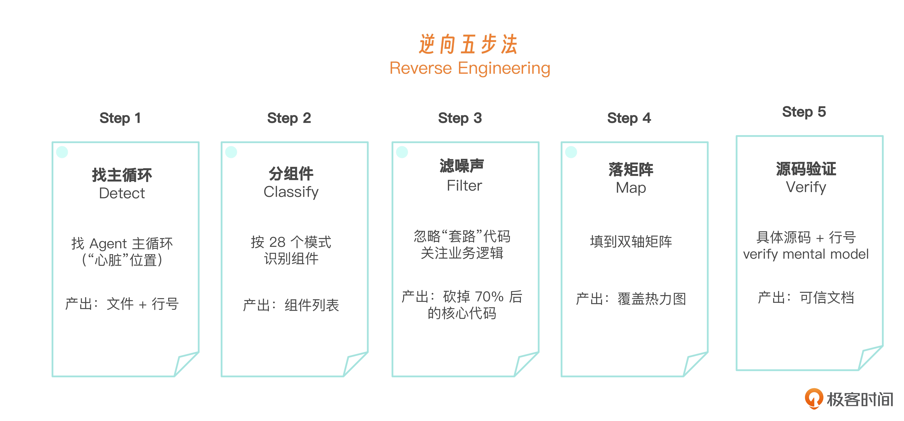

今天我会用 8 个 Agent Harness 当样本：Claude Code、Codex CLI、Aider、OpenCode、OpenClaw、Hermes Agent、DeerFlow、OpenHands。

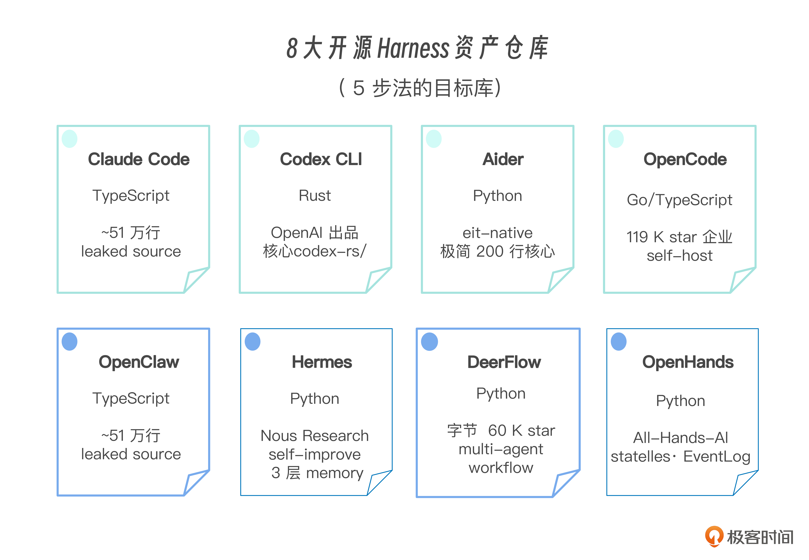

请注意，8 个框架只是素材。真正的主角是庖丁用来解牛的那把刀。我们是用这把刀来对市场上的各种 Harness 进行横切。

8 个框架会变，版本会变，目录结构也可能变。但只要 Agent 还需要感知、记忆、推理、行动、反思、协作和治理，逆向五步法就仍然适用。

## 为什么是这 8 个框架？

当然你肯定会问佳哥：为什么偏偏选这 8 个框架？选样本不能全按热度榜来，也不能把GitHub Trending 上的项目挨个讲一遍。我想为你呈现的是一张足够有代表性的工业横切面：从中既能看到 Agent Harness 的共同骨架，也能看到不同场景下的取舍。

一个好的横切面至少要覆盖三件事。

第一，要覆盖不同主战场。代码 Agent、个人助手、多 Agent 编排、沙箱执行，面对的问题完全不同。代码 Agent 最怕看错仓库、改错文件；个人助手最怕身份、权限和长期记忆失控；多Agent 最怕任务拆开以后收不回来；沙箱执行最怕“能做事“变成“乱做事”。如果只看其中一类，我们很容易把局部经验误当成通用规律。

第二，要覆盖不同工程姿态。闭源产品、商业公司主导的开源项目、社区驱动项目，背后的约束不一样。

大公司会把治理、权限、协议和可运维性做得更重；社区项目常常在一个关键不变量上打得很深。

比如 Aider 的关键价值，已经超出“它能帮你改代码”这层功能描述。它抓住了 Git 这个核心不变量：所有修改都可以通过 diff、commit、rollback 被审计和控制。OpenCode 也类似，它抓住了 LSP 这个核心不变量，Agent 可以借助 IDE 的语言理解能力，理解定义、引用、诊断和符号结构。

前者说明代码 Agent 必须进入版本控制系统，后者说明代码 Agent 必须进入开发环境本身。它们看起来是轻量社区项目，但各自在一个关键抽象上做得很深。

第三，要覆盖不同的“2026 变量”。2026 年的 Agent Harness 已经走过了工具调用演示阶段，开始呈现出更完整的系统工程形态。

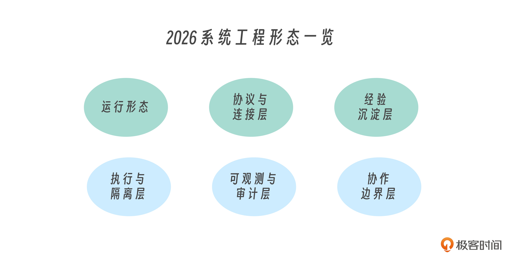

- 第一类是运行形态。Agent 不再只是一个网页聊天框，而是可以以本地可执行程序、CLI、IDE 插件、桌面应用、网页入口等多种形态出现。同一个 Agent 能力，正在被放进不同工作台里。

- 第二类是协议与连接层。JSON-RPC、LSP、local-first gateway 这类机制，本质上是在解决 Agent 如何和工具、编辑器、本地环境、远程服务稳定通信的问题。没有协议层，Agent就只能靠零散 API 拼接，很难变成可靠运行时。

- 第三类是经验沉淀层。procedural skills 把一次次任务中的做法、步骤和失败经验沉淀成可复用流程。Agent 的记忆不再只是“记住事实”，还要“记住怎么做事”。

- 第四类是执行与隔离层。sandbox、权限控制、本地确认机制，解决的是 Agent 能行动以后如何不失控。只要 Agent 能改文件、跑命令、调系统，就必须有隔离环境和边界控制。

- 第五类是可观测与审计层。event replay、trace、日志、状态账本，让 Agent 的行动过程可以回放、调试、审计和复盘。没有这层，Agent 一旦做错，工程师很难知道它到底错在哪里。

- 第六类是协作边界层。多 Agent 系统真正重要的，是每个子 Agent 的职责、权限、上下文范围和交接边界是否清楚。没有边界，多 Agent 就很容易变成角色扮演；有了边界，才可能成为工程系统。

也就是说，Agent 工程正在从“模型会不会调用工具”转向“模型如何被放进一个可靠运行时”。

所以咱们可以把这 8 个框架当成八块标本，你可以参考后面这张表。

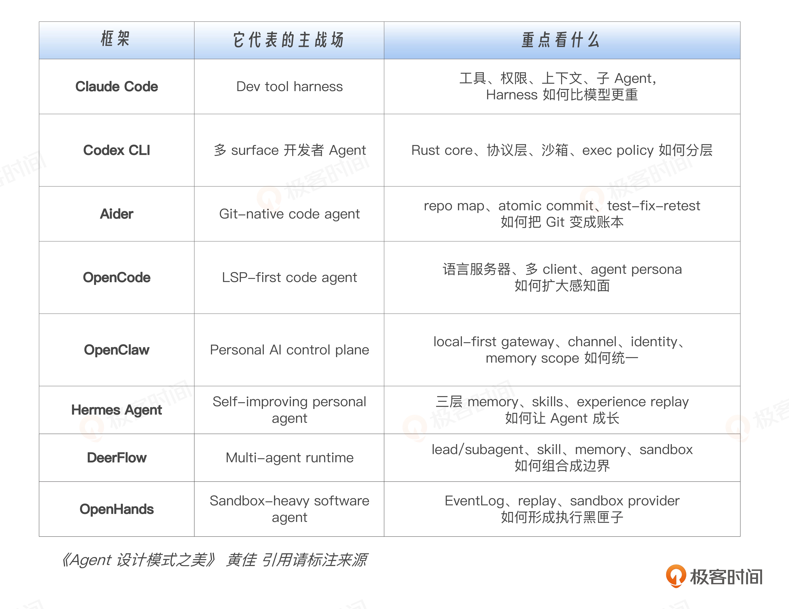

你会发现，这 8 个样本放在一起，刚好形成一个坐标系：左边是开发者工作流，右边是个人与组织工作流；整体上既包含感知和记忆，也有行动和治理，同时用协议、事件、沙箱、权限把模型的不确定性包起来。

我更愿意把它当成一次标本观察。产品很快过期，而标本背后的工程理念却能长存。我们真正要学的是它们为什么这样设计。

## 为什么需要“逆向五步法”？

那么我们为什么还需要一把刀，也就是佳哥所谓的“逆向五步法”呢？因为我们读 Agent 框架源码或许会掉进一些坑。

第一个坑，README 幻觉。README 通常告诉你这个项目“能做什么”，但很少告诉你它“为什么这样做”。你读完以后，可能知道它支持工具调用、支持多 Agent、支持沙箱执行，但你仍然不知道：主循环在哪里？状态怎么传？上下文怎么装配？权限在哪里被卡住？换句话说，我们看到了功能清单，却没有看清系统骨架。

```
第二个坑，关键词漫游。很多人一上来就开始 grep：agent、tool、memory、context。
```

结果跳出来几百个文件，每个文件看两眼，都像是重点。看了一圈以后，脑子里只剩下一堆碎片：这里有个工具注册，那里有个 memory class，那边还有个 planner。你以为自己在逆向架构，其实只是在源码景点观光打卡。

第三个坑，从入口函数一路钻到底。因为大型项目里，70% 的代码可能都是配置、日志、类

```
型定义、序列化、适配器、UI glue、兼容层。你从 main() 开始顺着调用栈往下钻，很容易
```

钻进一条很漫长但不关键的支路。费了半天劲，文件看了很多，却忘了自己最初到底想找什么。

所以，真正卡住大家的是缺少一个预期框架。逆向工程的第一原则是：先知道一个 AgentHarness 理论上应该长什么样，再去源码里验证它实际什么样。没有预期框架，源码阅读就是信马由缰；有了预期框架，源码阅读才能按图索骥。

那么，一个 Agent Harness 理论上应该长什么样？其实它的骨架很稳定。

1. 它一定有一个主循环，负责接收输入、装配上下文、调用模型、处理工具结果，并决定下一步怎么走。

2. 它一定有上下文管理，否则 token window 很快就会失控，模型也会不知道该记住什么、丢掉什么。

3. 它一定有工具注册和调度，否则模型的行动空间就没有边界，不知道哪些工具能用、怎么用、什么时候用。

4. 它一定有某种状态或事件记录，否则长任务无法恢复，出了问题也没法调试、回放和审计。

5. 它一定有治理边界，哪怕很弱，也会以权限、沙箱、确认、日志、策略等形式出现。因为只要 Agent 能行动，就必须回答一个问题：它被允许做到哪一步？

所谓逆向五步法，就是把这五个预期变成一套可执行流程：先找主循环，看 Agent 如何一轮一轮推进；再找上下文管理，看它如何控制模型看到什么；再找工具系统，看行动空间如何被注册、约束和调度；再找状态与事件记录，看系统如何支持恢复、调试和审计；最后找治理边界，看权限、沙箱、确认和日志在哪里真正生效。

这样读源码，就等于带着一张架构地图去定位。问题也从“这个项目有多少功能”，变成：它把模型放进了一个怎样的运行时？

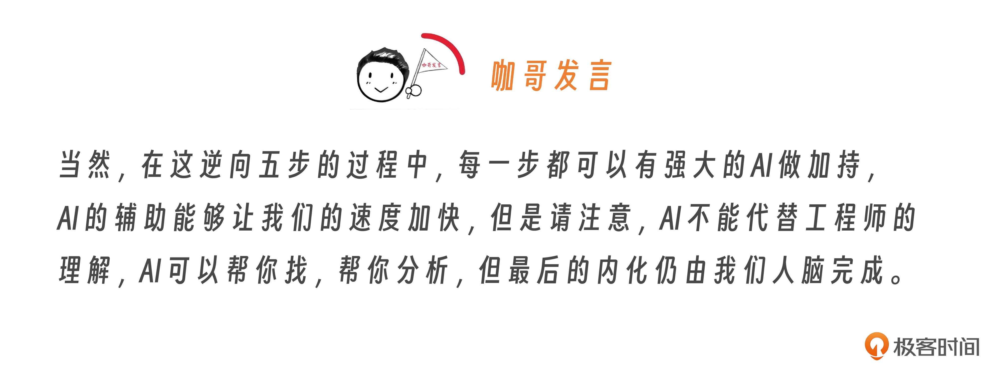

## 逆向工程五步法

好，接下来我们正式进入实操。

前面我们已经搭好了“认知功能 × 执行拓扑”这张矩阵。但矩阵本身只是工具。真正关键的是：我们能不能拿它去拆解真实的 Agent 框架源码？

我把这个过程提炼成五步。

1. 探测（Detect），先找主循环。

2. 归类（Classify），把组件归到七脉。

3. 降噪（Filter），主动丢掉 70% 噪声。

4. 映射（Map），落到双轴矩阵。

5. 验证（Verify），回到源码验证判断。

这五步做完，一个原本很复杂的 Agent 框架，就会从“一大堆文件”变成一张你能看懂、能比较、能讲清楚的结构图。

### Step 1 Detect：先找主循环

所有 Agent Harness 都有一个心脏。这个心脏通常藏在一段不断重复的运行循环里，未必是README 里最显眼的概念，也未必是项目里最有名的类。

这个循环大概长这样：

- 用户输入

```
 -> 构造上下文
 -> 调用模型
 -> 解析模型返回
 -> 分发工具 / 交给其他 Agent / 询问用户
 -> 收集执行结果
 -> 更新状态
 -> 继续下一轮，或者停止
```

英文是这样：

```sql
input
 -> build context
 -> call model
 -> parse response
 -> dispatch tools / handoff / ask user
 -> collect observations
 -> update state
 -> continue or stop
```

你找到这段循环，就等于抓住了系统的脊柱。找不到它，你看到的所有组件都是散的：这个文件像是工具，那个文件像是记忆，另一个文件像是权限，但它们到底怎么串起来，你心里没有图。

所以第一步的目标很朴素，先回答三个问题：

1. 用户输入从哪里进来？

2. LLM 调用在哪里发生？

3. 工具执行结果怎么回到下一轮上下文？

实操上，先 grep （搜索）这些词：

```
rg "tool_call|function_call|tool_use|ToolCall|Action|Observation" .
rg "while|loop|step|run|turn|conversation|session" .
rg "messages|context|history|state" .
```

然后你顺着两个方向交叉定位：

- 一个方向是入口：用户输入、session、conversation、turn。

- 另一个方向是模型调用：messages、model、completion、response、tool call。

真正的主循环，通常会同时碰到三件事：messages、model call、tool dispatch。只处理UI 的文件大概率可以排除；只处理配置的文件也先放一边；某个具体工具的实现，通常只是主循环调用的一环。主循环一定是那个把“用户输入、模型思考、工具行动、结果返回”串起来的地方。

这一阶段的产出物，不需要精细。你只需要画一张很粗的图，最好不要超过 10 个框，比如后面这样。

```
User Input -> Session -> Context Builder -> LLM -> Tool Dispatcher
              ^                                  |
              |                                  v
            Event Log <- Observation <- Runtime / Sandbox
```

想要找到主线，就得学会“抓大放小”。对于我们的 8 个框架，可以这样建立第一层锚点：

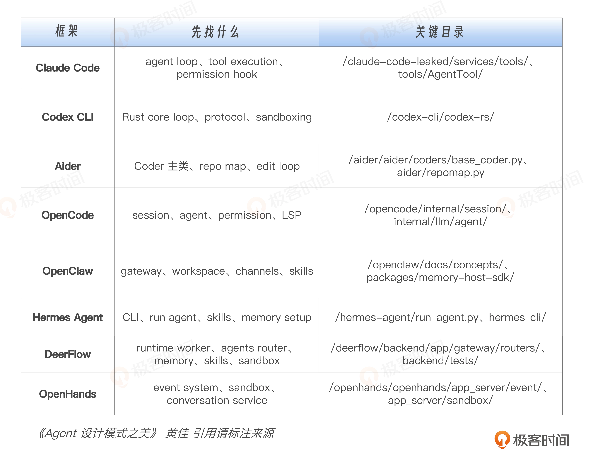

### Step 2  Classify：把组件归到七脉

找到主循环之后，不要急着继续往下钻。不要急于刚找到一点线索，马上顺着调用栈一路钻到底。那样做容易钻进了某个序列化函数、配置类、UI 组件，再也出不来了。

正确做法是：先停一下，用上一讲的“认知七脉”对号入座，给主循环周围的组件做归类。

- 这个组件到底在帮 Agent 管什么资源？它是在决定 Agent 看见什么？那就是 Perception。

- 它是在决定 Agent 记住什么？那就是 Memory。

- 它是在组织推理步骤？那就是 Reasoning。

- 它是在执行工具和外部动作？那就是 Action。

- 它是在检查、修正、重试？那就是 Reflection。

- 它是在拆分任务、调度子 Agent？那就是 Collaboration。

- 它是在管理权限、审计、沙箱和边界？那就是 Governance。

正如下表所示。

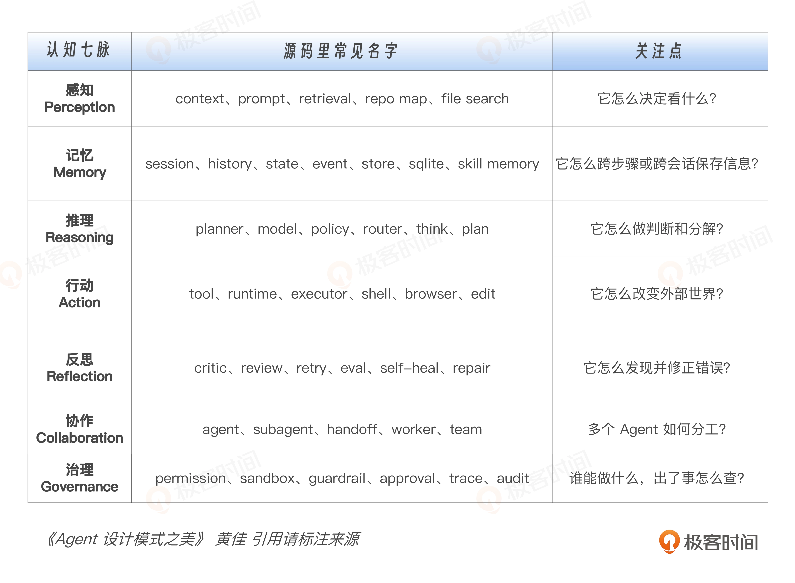

注意，这里不要只看组件名字，而要看它在系统里真正做什么。

比如 Aider 的 repo map，名字看起来像一个仓库索引，实际还决定哪些代码结构能进入 LLM上下文，所以它首先是 Perception。同时，它也让 Agent 对整个代码仓库形成一种压缩后的持续认识，所以它也带一点 Memory。

再比如 OpenHands 的 Event System，表面看是日志系统，实际承担的是事件账本。它把整个 Agent 的状态变成一串可追加、可回放的事件，所以它既是 Memory，也带有 Governance的意味，因为它让过程可以追踪、可以审计。

Claude Code 的 Subagent 也类似。它当然是 Collaboration，因为它把任务分给子 Agent。但它还有 Perception 的作用，因为每个子 Agent 有自己的上下文，相当于把不同任务的观察范围隔离开了。

一个组件可以跨多脉，但是第一遍不要太精细。先给每个组件找一个主脉，再在旁边标注副脉就可以。确定了这些之后，你就可以做一张类似这样的表，把源码从“文件堆”变成“认知结构”。

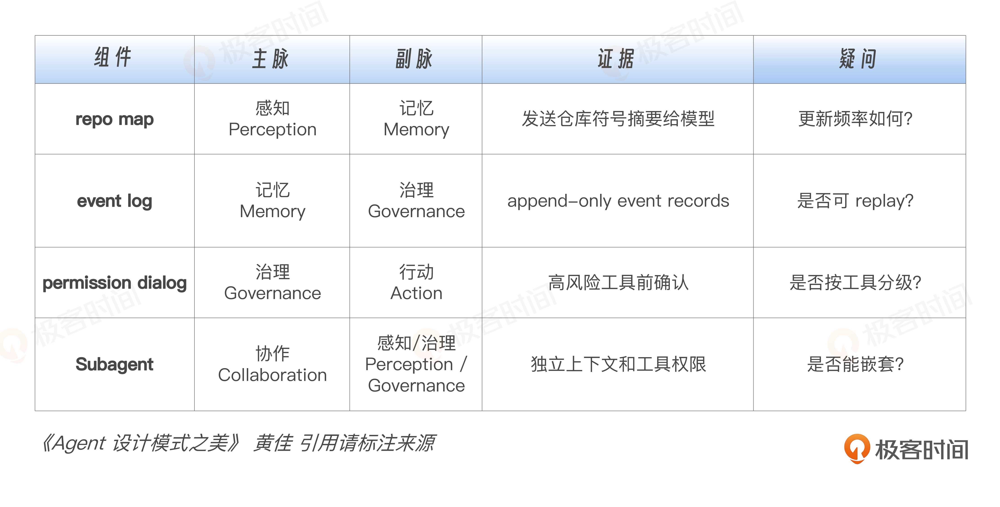

### Step 3  Filter：主动丢掉 70% 噪声

读大型工程最反直觉的能力，是敢于不读。

如果太老实的话，看到一个文件就想读懂，看到一个类就想追到底，看到一个参数就想查清楚，理解效率反而很低。大型 Agent Harness 里面，有大量代码很必要，但第一轮逆向不用先看。

比如 CLI 参数解析、UI 布局、错误文案、telemetry 上报适配、schema 类型定义、providerSDK 包装、serialization / deserialization、测试 fixture、平台兼容性分支等等，这些都有价值，这些东西可以后面再回来细看。整体理解大型工程时，不推荐第一轮考虑。第一轮你要抓模式结构，产品边角先放一边。

Filter 阶段有一个非常直接 的判断标准：这个文件会不会改变 Agent 的决策、上下文、状态、行动或权限？如果不会，先标成 boilerplate，暂时放一边。如果会，再继续问：它改变的是哪一类东西？

- 改变 Agent 看到什么，是 Perception。

- 改变 Agent 记住什么，是 Memory。

- 改变 Agent 怎么想，是 Reasoning。

- 改变 Agent 能做什么，是 Action。

- 改变 Agent 怎么纠错，是 Reflection。

- 改变任务由谁来做，是 Collaboration。

- 改变边界、权限和账本，是 Governance。

这一步做好之后，你读的对象会从源码本身转到控制面。此时你关心的是：这个系统到底在哪里控制上下文、控制行动、控制状态、控制权限。

以 8 个框架为例，第一轮可以这样过滤：

- Claude Code：先不要陷进 UI。优先看工具注册、工具执行、权限、AgentTool、context装配。

- Codex CLI：先不要陷进每个 crate。优先看 core、protocol、sandboxing、exec policy。

- Aider：先看 base_coder.py、repomap.py、repo.py，暂时跳过各种 prompt variant。

- OpenCode：先看 session、llm agent、permission、lsp，UI/TUI 只看它如何触发会话和权限。

- OpenClaw：先看 gateway、channels contract、workspace、memory-host-sdk、skills 文档。

- Hermes Agent：先看 run_agent.py、hermes_state.py、memory_setup、skills_hub、gateway，而不是每个 CLI 命令。

- DeerFlow：先看 agent router、skill router、memory router、sandbox tests、subagenttests。测试文件在这里很有价值，因为它们暴露了系统边界。

- OpenHands：先看 event service、sandbox service、conversation service、runtimeREADME。前端和集成模板先放后面。

这个丢弃噪声的 Filter 过程做得好，读源码速度会突然快很多。咱得知道哪些地方现在必须读，哪些地方以后再说。

### Step 4 Map：落到双轴矩阵

前三步之后，你已经知道主循环在哪里、组件属于哪几脉、哪些文件暂且放过。第四步开始进入这门课的核心——把组件落到 7 × 6 的正交模式矩阵。

这里要特别注意，Map 不能变成贴标签。看到一个功能就随手写一句“这是 Memory”，看到一个工具调用就写一句“这是 Action”，这还不够。真正的 Map，是把一个框架变成可以比较的工程对象。

比如下面的一些例子：

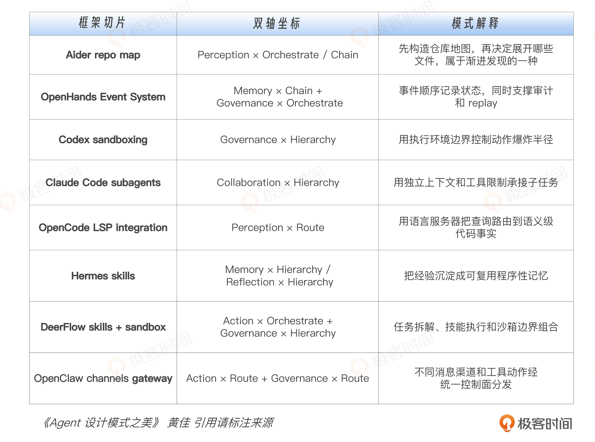

这一步你需要逼自己说清楚：一个功能到底是哪个功能，采用哪种拓扑，失败模式是什么。

比如 OpenHands 有 EventLog 只是一个事实。但如果把它落到矩阵里，它就变成了三个工程判断：

第一，它解决 Memory 问题，因为系统状态来自一串事件，不再散落在对象内存里。

第二，它也解决 Governance 问题，因为事件可以审计、可以回放。

第三，它采用的是 Chain / append-only 的拓扑，优点是错误不会被悄悄覆盖，缺点是日志会膨胀，replay 成本需要管理。

这样你对它的掌握程度，就从知道一个功能上升到了理解一个设计。

Map 阶段的最终产物，就是一张热力图。

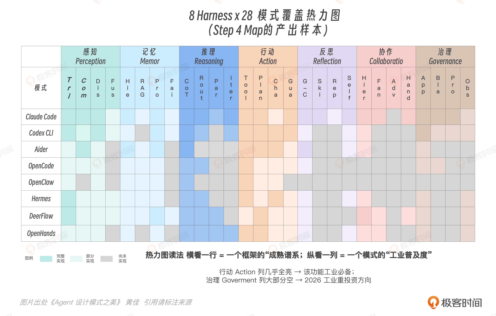

- 热力图预览 引用请标明出处 极客时间《Agent 设计模式之美》专栏

这张热力图不需要一开始就百分百精确。它的价值是帮你比较不同框架的工程性格。

- 横着看，你能看出一个框架的偏好。Aider 很专注，核心围绕代码上下文、编辑和提交。OpenHands 更重沙箱、事件和运行时。Hermes 更重记忆、技能和用户模型。DeerFlow 更重协作、路由和执行环境。

- 竖着看，你能看出某个模式的工业普及度。Tool Dispatch 几乎所有框架都有。 ExperienceReplay 不是每家都有。Blast Radius 在 sandbox-heavy 的系统里很强，在普通 dev tool 里可能比较弱。Subagent / delegation 在不同框架里的成熟度差异很大。

这就是矩阵的价值。它让你从我读过这个项目，变成我能比较这些项目。而我们专栏后面几十讲的主要工作之一，就是带着大家一起完成这张图。

### Step 5 Verify：每个判断都要能回到源码

没有 Verify，逆向工程就很容易变成讲故事。你说这个框架重治理，他说那个框架重记忆，听起来都很有道理，但如果不能回到源码、测试或官方文档，那就只是解释，不是论证。

Verify 的意思是，我们对一个框架做出的每个架构判断，都要有据可查。

证据大致分三层。

- 第一层是源码。这是最强证据。比如 permission 模块、sandbox manager、event store、repo map 实现、tool dispatcher，这些都能直接证明系统怎么工作。

- 第二层是测试。测试也是强力证据。很多时候，测试比实现更清楚地暴露设计边界。比如sandbox 怎么限制动作，Subagent 怎么传递上下文，memory 什么情况下写入，测试里往往写得特别明确。

- 第三层是官方文档。文档用来确认产品语义和公开承诺。比如某个框架官方说 subagent 有独立上下文，某个 sandbox provider 负责隔离执行环境，某个 repo map 用于压缩仓库结构，这些都可以作为辅助证据。

所以 Verify 阶段，你最好在热力图旁边再放一张引用表：

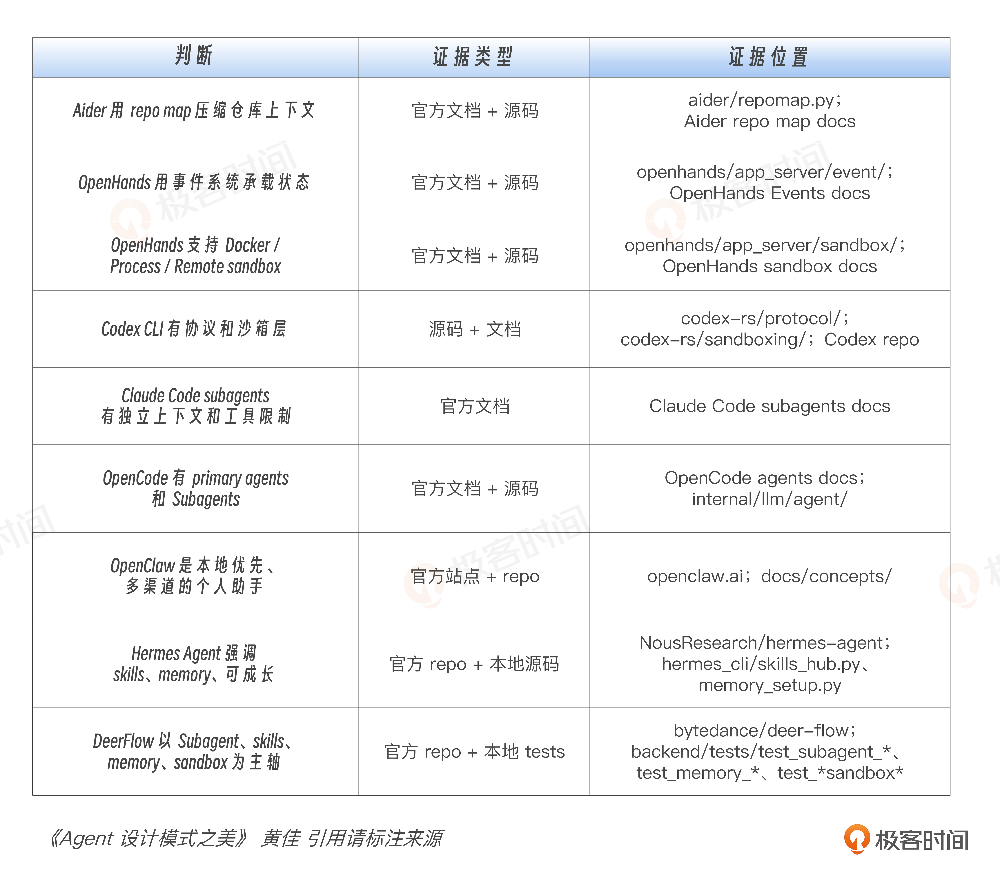

经过了最后这轮 Verify，我们就可以自信地说：这个框架很重治理，因为它在 sandboxprovider、permission policy、event store 三个位置都把治理做成运行时机制。这就是工程论证和产品解读的区别。产品解读可以停留在概念层， 工程论证必须回到代码层。

上面这 5 步，做起来要比“让 AI 去分析吧”繁琐得多，但更有价值。其实也就是佳哥经常说的，有意识地让我们的思维进行摩擦，通过做“具体的难事儿”来在 AI 时代继续点亮我们的思维火花。

## 总结

好，到这里，我们就把逆向 Agent Harness 的方法讲清楚了。读懂几十万行源码的快捷通道，是建立一套看系统的工程方法。

第一，读 Agent Harness，不能从 README 和热词开始，而要先找主循环。主循环是系统的心脏，它把用户输入、上下文装配、模型调用、工具执行、状态更新串在一起。抓住主循环，系统才不再是一堆散乱文件。

第二，找到主循环之后，要用“认知七脉”给组件归类。感知、记忆、推理、行动、反思、协作、治理，不是抽象概念，而是源码里真实存在的控制点。它们分别决定 Agent 看见什么、记住什么、怎么思考、怎么行动、怎么纠错、怎么协作、怎么被约束。

第三，读大型工程，要敢于过滤噪声。第一轮不需要读懂所有 CLI 参数、UI 组件、provider适配和序列化逻辑。真正要抓的是那些会改变 Agent 决策、上下文、状态、行动和权限的地方。

第四，Map 的价值，是把一个框架放进双轴矩阵，让它变成可比较的工程对象。我们不只是说“这个框架有 memory”“那个框架有 tool”，而是要说清楚：它解决的是哪个认知功能，采用的是哪种执行拓扑，带来的失败模式是什么。

第五，所有判断都要 Verify。没有源码、测试或官方文档支撑的架构解读，只是讲故事；能回到证据的解读，才是工程论证。

下一讲，我们就拿今天这把“解牛刀”，简单的切一切 8 个真实的 Agent Harness。敬请期待。

## 思考题

1. 选一个你熟悉的 Agent 框架，先不要看源码，先写出你预期它一定应该具备的五个地基：主循环、上下文管理、工具注册与执行、状态账本、治理边界。然后再去源码或文档里验证。

2. 拿 Claude Code、Aider、OpenHands、Hermes 任意一个框架，画一张不超过 10 个框的主循环图。重点标出：用户输入从哪里进来，模型在哪里被调用，工具结果如何回到下一轮上下文。

3. 找一个具体组件，比如 repo map、event log、sandbox、permission policy、Subagent、skills hub，把它归到“认知七脉”里，再进一步落到“双轴矩阵”里。注意说明：为什么它主要属于这个格子，而不是另一个格子。

欢迎你在留言区记录想法或者提出问题。如果这节课对你有启发，别忘了推荐给身边的朋友。
