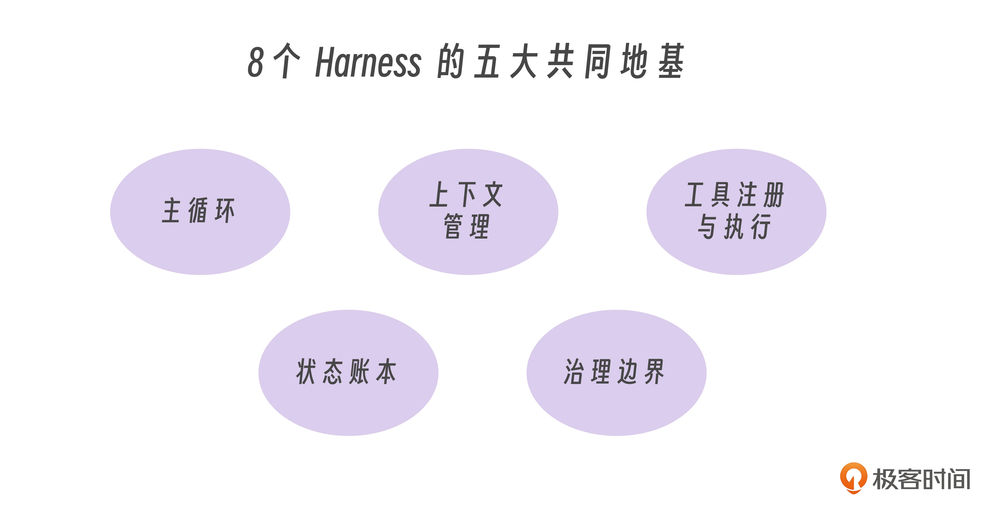
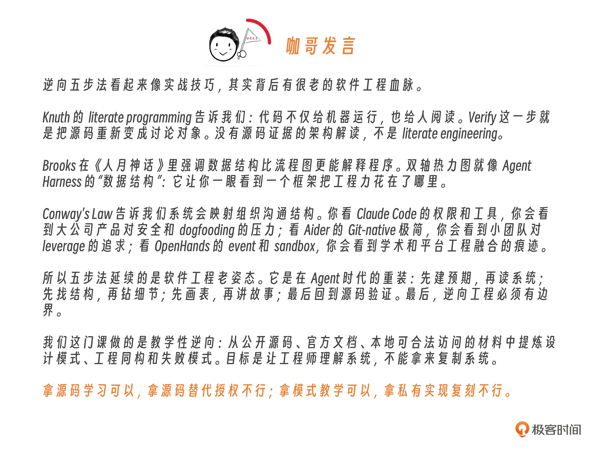
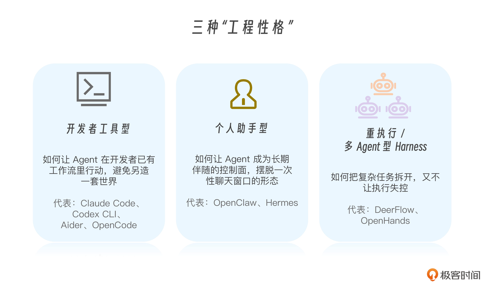

# 05 | 逆向五步法（下）：8个Harness产品拆成工程地图

你好，我是黄佳。

上一讲，我们正式拿起了逆向工程五步法这把“解牛刀”，学会了如何从主循环、组件归类、噪声过滤、矩阵映射和源码验证五个步骤，拆开一个成熟的 Agent Harness。这一讲，我们就用这把刀，真正切一切试一试。

## 8 个框架该怎么读

我们再快速回扫一遍 8 个真实的 Agent 框架。在正式用它们讲解 28 个模式之前，加深对他们的理解。

这里先说明一下：这部分不做产品评测，也不列功能大全。每个框架，我只问四个问题：

- 它主要解决什么问题？

- 它抓住了什么工程关键点？

- 放到 2026 年，它最值得观察的新变化是什么？

- 如果用五步法读它，第一步应该从哪里下手

这样读，我们就能从 8 个框架提炼出 8 种不同的工程性格。

### Claude Code：Harness 比模型更重要

Claude Code 代表的是最典型的开发者工具型 Agent。它面对的是工程师真实的工作台：代码仓库、终端、测试、Git、权限、上下文、编辑器习惯、失败恢复。

所以，Claude Code 最值得学的地方，是它怎么把开发过程工作流拆成一套可靠的基础设施。工具怎么注册？权限怎么控制？上下文怎么装配？子 Agent 怎么隔离？高风险命令怎么确认？执行结果怎么回到下一轮模型输入？

模型当然重要，但拆过 Claude Code 之后你会发现：聪明只是入场券。一个代码 Agent 能不能长期嵌进真实开发流程，更重要的是周围这套 Harness 是否稳。

用五步法读 Claude Code，不要上来就看 UI 和产品命令。先关注四条线：

- 工具如何注册和执行。

- 高风险工具如何进入权限流程。

- 子 Agent 如何拥有独立上下文和工具范围。

- 工具结果如何回到下一轮模型输入。

Claude Code 在双轴矩阵里的强项是：

- Action × Route

- Governance × Route

- Collaboration × Hierarchy

- Perception × Chain

2026 年，Claude Code 这类工具的趋势会越来越明显：代码 Agent 不会只停在 CLI。它会进入 IDE、远程开发环境、CI、团队规范和企业开发流程。入口越多，权限、上下文和工具协议就越重要。

Claude Code 给我们的核心启发是：Agent 产品的工程量，大部分都花在“让模型行动前后都有轨道”。也就是在模型行动之前控制它能看什么、能用什么；在模型行动之中控制它怎么执行、是否需要确认；在模型行动之后控制结果如何回流、错误如何修正、过程如何被审计。

### Codex CLI：协议层让 Agent 跨 surface

Codex CLI 代表的是另一种开发工具路线。它把 Agent 能力做成一个可复用的运行核心，然后让不同入口共用它。CLI 只是入口之一。更重要的是它背后的分层：core、protocol、sandboxing、exec policy、SDK、client。

和按目录逐个文件查看的方法不同，用五步法读 Codex CLI，应该先看两件事。

- 第一，看它的“通信规则”。也就是用户输入、模型回复、工具调用、执行结果，是怎么被组织成统一消息的。看懂这一层，就知道 Codex CLI 里面各个模块是怎么说话的。

- 第二，看它的“执行边界”。也就是 Agent 想执行命令、改文件、访问环境时，哪些动作允许，哪些动作要限制，哪些动作需要放进隔离环境里。看懂这一层，就知道它怎么防止Agent 乱动。

这两条线看清楚以后，再回头看核心主循环。这个时候你就能看明白：核心模块如何接收用户请求，如何调用模型，如何判断要不要执行工具，如何把动作交给隔离环境处理，最后又如何把结果带回下一轮对话。

Codex CLI 不是把所有代码混在一个大工程里，而是用 Cargo workspace 把不同职责拆成几个相对独立的模块。每个模块可以单独发展、单独替换、单独维护。这就像是把 Agent 系统拆成几块积木：大脑、语言、护栏、入口、执行器。大脑负责想，语言负责传消息，护栏负责限制风险，入口负责接用户，执行器负责真正干活。这样每块积木都能单独升级。

Codex CLI 在双轴矩阵里的强项是：

- Governance × Hierarchy

- Action × Route

- Memory × Chain

- Collaboration × Route

Agent runtime 正在从“应用里的一个功能”，变成平台级协议。同一个 Agent 可能要跑在终端、编辑器、桌面、Web、CI、远程 runner 里。同一套上下文约定、工具边界和执行策略，不能每个入口都重写一遍。当 Agent 不再只活在一个 CLI 里，协议层就会变成 Harness 的脊椎。

### Aider：Git 是最小可靠账本

Aider 是开源代码 Agent 里很难得的一种克制。

它没有试图造一个巨大的 Agent OS，而是紧紧抓住 Git-native workflow：编辑、diff、commit、回退。在 Aider 里，Git 已经进入 Agent 行动账本的位置。

Agent 改了什么？能不能看 diff？能不能 commit？能不能回退？能不能把责任边界留在 Git里？这些就是它的工程不变量。

另一个关键点是 repo map。Aider 先给了模型一张压缩地图，避免简单粗暴地把整个仓库塞给模型。模型先理解仓库结构，再决定要看哪些文件。这其实是感知功能（Perception）的工业化表达：先看结构，再看细节。

这些功能看起来分散，本质上都在服务同一件事：让一个轻量 Harness 在现有 Git 工作流里多跑几轮，同时不拿走工程师的控制权。

Aider 在双轴矩阵里的强项是：

- Perception × Orchestrate / Chain

- Action × Chain

- Governance × Chain

- Reflection × Loop

Aider 证明了一个好的 Agent Harness 不一定大，但必须抓住关键不变量。对代码修改来说，Git 就是那个不变量。

### OpenCode：把语言服务器接进 Agent 感知

OpenCode 也是代码 Agent，但它的工程姿态和 Aider 不一样。Aider 抓的是 Git；OpenCode更重视的是多 client、多 provider 和 LSP。

它更像一个现代 TypeScript / Bun monorepo 里的 Agent server：TUI、桌面、编辑器、Web都可以围绕一个中央会话系统转。

OpenCode 最值得学的是 LSP。很多代码 Agent 还停留在 grep 和文件读取：搜字符串、读文件、拼上下文。但 OpenCode 把 language server 当成一等公民，让 Agent 能看到更接近编译器的事实：definition、 reference、diagnostics、symbol、type information。

这件事很关键。因为 grep 告诉你字符串在哪里；而 LSP 告诉你符号真正指向哪里。对代码Agent 来说，这已经接近感知能力的升级。

用五步法读 OpenCode，我们的目光首先应该落在 session、Agent、internal/lsp、permission。这里要注意，LSP 更接近感知（Perception），因为它改变了模型看代码的方式；Permission 则属于治理（Governance）。

OpenCode 在双轴矩阵里的强项是：

- Perception × Route

- Action × Route

- Governance × Route

- Collaboration × Route

OpenCode 告诉我们，代码 Agent 的感知不应该只靠文本搜索。编译器、类型系统和语言服务器，本来就是现成的感知器官。

### OpenClaw：个人助手的核心是控制面

OpenClaw 和前面几个 dev tool 不一样。它面对的是一个人的日常系统：消息、日历、邮件、浏览器、本地文件、语音、各种 SaaS。代码 Agent 的边界通常是 repo；而个人助手的边界是身份、设备和 channel。

所以 OpenClaw 最值得学的是 Gateway 思路。不同渠道的输入输出，必须统一进入一个控制面。否则每接一个平台，都会把 Agent 主循环污染一次。

在这里，通道的集成是表面，背后的问题是会话绑定、身份、权限、记忆范围。这里最容易被误读的是“多通道”。如果只是能接 WhatsApp、Slack、Discord、Teams，那只是适配器多。

工程问题要继续追问：

- 同一个用户在不同 channel 里，是不是同一个身份？

- 某个 channel 里的记忆，能不能带到另一个 channel？

- 手机上的语音命令，能不能触发桌面文件操作？

- 哪些动作必须回到本机确认？

- 哪些记忆只能留在本地？

- 哪些权限只能在特定设备上使用？

这些问题本质上归记忆（Memory）和治理（Governance）。

OpenClaw 在双轴矩阵里的强项是：

Action × Route

Memory × Route

Governance × Route

Collaboration × Parallel

2026 年个人 AI 助手的竞争点，会从“回复更像人”转向统一控制面。Voice、Canvas、多设备、本地优先、私有记忆，这些能力背后都需要一个统一控制面。个人 AI 助手是一套跨channel、跨身份、跨权限域的本地控制面。这是 OpenClaw 工程设计带给我们的主要启发。

### Hermes：会成长的 Agent，靠的是程序性记忆

Hermes Agent 代表的是个人 Agent 的另一条路：沿着长期成长往深处做。它最值得学的是Memory 和 Skills。一个会成长的 Agent，不能只把历史对话塞进向量库，必须把反复出现的任务流程沉淀成可调用的程序性资产。

这就是 Hermes 的关键区别。它关心这一次任务怎么变成下一次的起点。Working memory 解决当下上下文，Search Memory 解决历史可检索，Procedural Skills 解决反复任务的封装。三层合起来，才像一个长期使用会变好的助手。

用五步法读 Hermes，先看 skills hub、memory setup、state、gateway，再看具体命令。它的重点落在长期使用后如何变得更贴近用户。

Hermes 在双轴矩阵里的强项是：

- Memory × Hierarchy

- Reflection × Hierarchy

- Action × Route

- Governance × Chain

Hermes 带来了 2026 年的另一个明显趋势，是 Agent 的“记忆”从向量检索往程序性资产演进。只记住事实还不够，还要记住做法；只保存聊天还不够，还要能把 trace 里的失败转成下一版 skill。

Hermes 带给我们的启发是，长期价值来自把经验压缩成技能，把技能变成下一次行动的起点。

### DeerFlow：多 Agent 的重点是边界

DeerFlow 代表的是 Multi-agent harness。很多人一听 multi-agent，就以为重点是有好几个Agent。 于是很快做成一堆角色互相聊天：规划师、研究员、执行员、审稿人，热热闹闹，但边界很虚。

DeerFlow 更值得学的地方，是 Subagent、skills、memory、sandbox 之间怎么组合。真正的问题其实是：任务怎么拆，技能怎么加载， 执行怎么隔离， 结果怎么收回来，记忆怎么回写， 失败怎么重试，以及沙箱怎么限制风险？

multi-agent 的难点从派工开始，更难的是派出去以后怎么收回来。Lead Agent 拆任务只是开始；Sub-Agent 执行、sandbox 隔离、结果聚合、memory 更新、失败重试，这些才决定它是工程系统，还是角色扮演。

```
用五步法读 DeerFlow，测试文件非常值得看。test_subagent_*、test_memory_*、
test_*sandbox* 这类测试直接暴露框架的边界意识：最多能派多少子 Agent，超时怎么处
```

理，sandbox 怎么审计，memory 如何过滤，失败如何返回，都写在测试文件中。

DeerFlow 在双轴矩阵里的强项是：

- Collaboration × Hierarchy

- Action × Orchestrate

- Governance × Hierarchy

- Memory × Route

DeerFlow 这类框架，把 Deep Research 的长链路经验推进到更通用的 Agent Runtime：组合skill、执行代码、调用沙箱、沉淀记忆。Multi-agent 的核心，是把任务、技能、上下文、执行环境切成可管理的边界。

### OpenHands：事件流是软件 Agent 的黑匣子

OpenHands 代表的是重度依赖沙箱的软件智能体（sandbox-heavy software agent）。它面对的问题很硬：Agent 要真的进入 workspace、执行命令、修改文件、跑测试、甚至长时间处理一个软件任务。

OpenHands 最值得学的是事件系统（Event System）和沙箱设计（Sandbox）。它把 Agent的行动、观察、状态变化变成事件，形成 append-only log。事件系统承担 replay、debug、审计、恢复和前端同步的共同骨架。换句话说，OpenHands 把状态摊成一条可回放的事件链。

OpenHands V1 文档里还把 sandbox provider 分成 Docker、Process、Remote。这说明它把执行环境做成可替换边界：开发时可以快，生产时可以隔离，远程部署可以托管。

它对应的双轴强项是：

- Memory × Chain

- Governance × Orchestrate

- Action × Hierarchy

- Collaboration × Parallel

执行型 Agent 的一个底线会越来越清楚：没有事件账本，就很难复盘；没有沙箱边界，就很难放心授权；没有 replay，就很难把失败变成工程知识。软件 Agent 一旦能执行代码，就必须有黑匣子。事件日志和沙箱已经接近基础生命维持系统。

## 五个共同地基

把这 8 个框架进行横切之后，我们会看到 5 个共同地基。



- 第一，主循环。各个框架名字不同，形态不同，但都要把用户输入、模型调用、工具结果、状态更新串起来。没有主循环，Agent 只是一次 LLM call。

- 第二，上下文管理。Claude Code 有上下文装配和子 Agent 隔离，Aider 有 repo map，OpenCode 有 LSP，Hermes 和 OpenClaw 有 memory，DeerFlow 有 skills 渐进加载。每个产品都围绕“有限 context 里放什么”给出了自己的答案。

- 第三，工具注册与执行。不管叫 tool、skill、runtime、action、provider，本质都是把模型意图翻译成可控外部动作。

- 第四，状态账本。Aider 是 Git，OpenHands 是 Event System，Hermes 是memory/state，Codex 是 protocol/history，OpenClaw 是 gateway/session。没有账本，长任务不可恢复，错误不可复盘。

- 第五，治理边界。Permission、sandbox、approval、tool restriction、channel policy、memory scope、audit log，都在做治理。治理是一层穿过工具、状态、协作和执行环境的横切机制。

这 5 个地基告诉我们：做 Agent Harness 的核心工作，是在模型周围搭一个可靠运行环境。

它也告诉我们选型时该问什么：

1. 这个框架主循环清楚吗？

2. 上下文管理是显式机制，还是靠 prompt 硬撑？

3. 工具调用有没有 schema、权限和失败处理？

4. 状态是否可恢复、可 replay、可审计？

5. 高风险动作的边界在哪里？

如果一个框架答不上这 5 个问题，那说明它还不具备进入生产系统的条件。



## 三种工程性格

前面我们看了 8 个框架。如果再往上抽一层，会发现它们大致可以分成三种工程性格。这三类没有高下之分；它们面对的问题不一样，工程取舍也不一样。



第一类是开发者工具型 Harness。

Claude Code、Codex CLI、Aider、OpenCode。它们面对的是代码仓库、终端、编辑器、测试、Git。它们最核心的工程矛盾是：如何让 Agent 在开发者已有工作流里行动，避免另造一套世界。这类框架最重 Perception、Action、Governance。因为代码任务的难点常常在于读错上下文、误用工具、改了不该改的文件、无法证明自己的 finding。

第二类是个人助手型 Harness。

OpenClaw、Hermes。它们面对的是人的生活流、消息流、长期偏好和跨设备状态。它们的核心张力是：如何让 Agent 成为长期伴随的控制面，摆脱一次性聊天窗口的形态。这类框架最重Memory、Action、Governance。它们必须知道用户是谁、在哪个 channel、有什么权限、哪些偏好可长期保存、哪些动作需要确认。

第三类是重执行 / 多 Agent 型 Harness。

DeerFlow、OpenHands。它们面对的是复杂任务、多步骤执行、沙箱、子 Agent、事件流。它们的核心张力是：如何把复杂任务拆开，又不让执行失控。这类框架最重 Collaboration、Action、Governance、Observability。它们需要把 Agent 从会回答问题的阶段，推进到“能执行，并且执行过程可控”的工程水平。

看完这三个分类，再次验证了没有“万能架构”，都是根据具体需要做取舍（trade-off）。

做代码助手，不一定要学 OpenClaw 的 channel gateway；做个人助手，那就必须认真学OpenClaw / Hermes 的 memory 和 identity；做云端执行 Agent，OpenHands / DeerFlow 的sandbox 和 event 体系就是绕不开的。

## 总结一下

好，到这里我们把 8 个优秀 Harness 产品快速拆解了一遍。这 8 个框架代表八种工程性格。

Claude Code 和 Codex CLI 教你 dev tool harness，Aider 教你 Git-native 账本，OpenCode教你 LSP 感知，OpenClaw 和 Hermes 教你个人 Agent 的控制面和记忆，DeerFlow 教你多Agent 边界，OpenHands 教你事件流和沙箱。

至此，范式觉醒模块的三件东西齐活儿了：

- 01：为什么 Agent 时代需要新模式。

- 02～03：新模式如何落到双轴坐标。

- 04～05：如何把真实框架逆向成工程地图。

手里有范式、有坐标、有“拆机”方法，我们就可以真正开始往下挖了。从下一讲开始，我们不再只是谈范式和坐标，而是要真正进入每一个认知功能内部，拆开具体模式，看它们如何在真实 Harness 中落地。

## 内容预告

感知是 Agent 的第一道门。一个 Agent 要看见什么？文件、历史、用户意图、外部信号……

也要学会不看见什么。就比如 200K 的上下文窗口看起来很大，但工程上真正的问题不止窗口长度，还包括这段有限注意力该花在哪里。

无论是 Claude Code 的 context 装配、Aider 的 repo map、OpenCode 的 LSP、Hermes 的memory、DeerFlow 的 skill loading，都会变成同一个问题的不同答案：Agent 到底怎样认识世界？

下一章，我们进入感知世界之美，仔细聊聊 Agent 的注意力管理。

## 思考题

1. 选一个你最熟的 Agent 框架，先不要读源码，先写出你预期它一定有的 5 个地基。再去源码里验证。

2. 拿 Aider、OpenHands、Hermes 任意一个，画它的主循环图。要求不超过 10 个框。

3. 选一个框架的一个组件，把它同时归到七脉和双轴矩阵。写清楚为什么不是另一个格子。

4. 如果你们团队已经在开展 Agent 项目，问它有没有状态账本。如果没有，失败后如何replay？

5. 跑一遍 Detect / Classify / Filter / Map / Verify，产出文档，看这篇文档能不能被同事复用。

## 参考资料

- Anthropic，Claude Code overview

- Anthropic，Claude Code subagents

- OpenAI，Codex CLI help center

- OpenAI，openai/codex GitHub repository

- Aider，Repository map docs

- OpenCode，Agents docs

- OpenClaw，official site

- OpenClaw，openclaw/openclaw GitHub repository

- Nous Research，hermes-agent GitHub repository

- ByteDance，deer-flow GitHub repository

- OpenHands，Events docs

- OpenHands，Sandbox overview

- OpenHands，OpenHands paper
