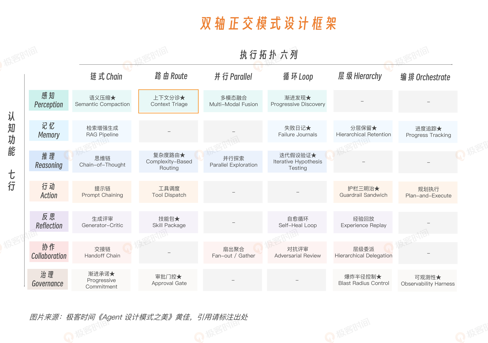
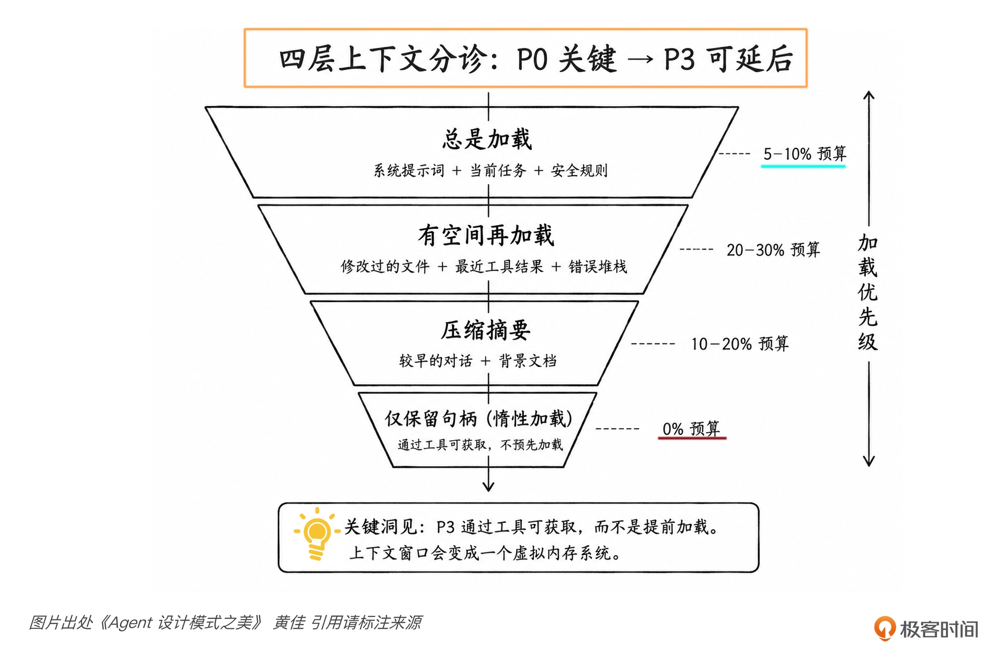
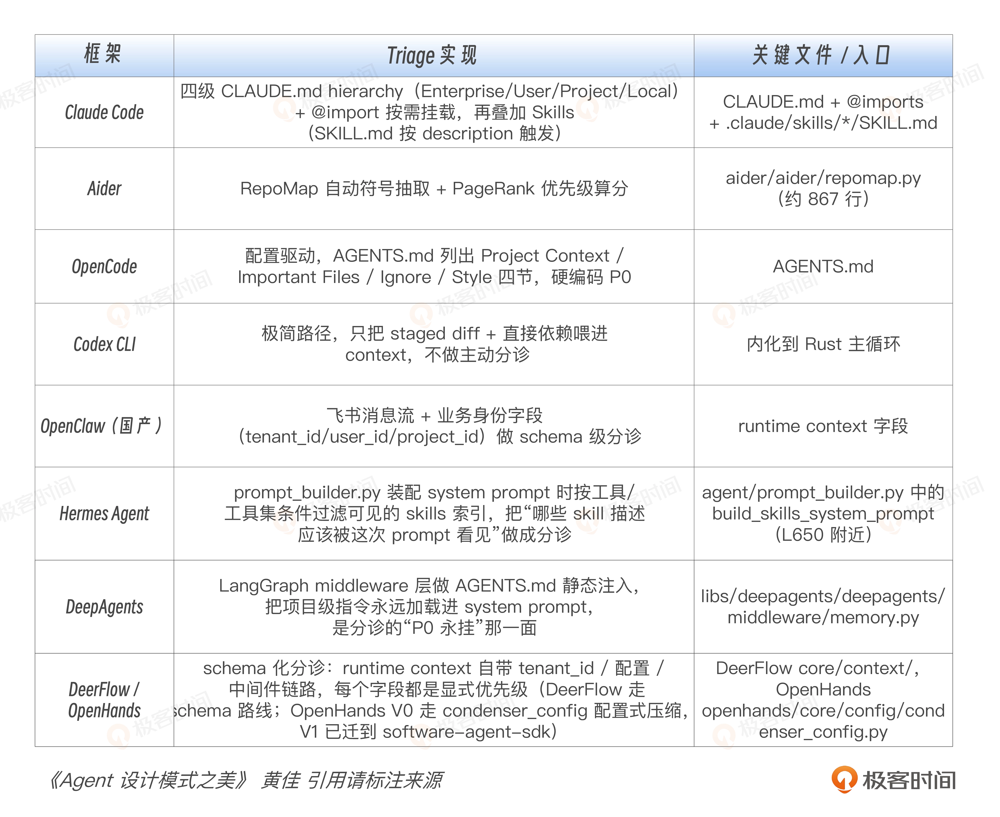
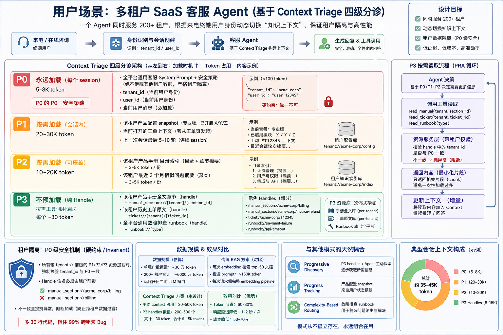

# 07 | 上下文分诊：如何科学分流处置不同信息

你好，我是黄佳。今天我们正式进入第一个设计模式。

对于大模型的认知工程，有两个我们都知道的基本原则。

第一，大模型是没有记忆的。每次会话都是它第一次认识这个世界。

第二，大模型的认知窗口的大小是有限制的。我们永远无法把所有相关的内容都丢给它。

第一个设计模式由此展开。一旦 Agent 面对信息总量超出上下文窗口预算的场景，谁先进、谁等门外、谁压根不预加载，这就需要上下文分诊模式。这种情况是生产级 Agent 的常态，这件事本身没有任何难理解的地方，这一讲只是讲实现它的思路和具体方法。

## 如何理解上下文分诊模式



上下文分诊模式在双轴图谱里落在“感知 × 路由”的交点。

- 认知功能上它是感知，决定 Agent 看到什么；

- 执行拓扑上它是路由，按优先级把不同信息分发到不同处理路径。

上下文分诊模式（Context Triage）把所有候选 context 信息分成 P0/P1/P2/P3 四级，从高到低塞，塞到 token 预算耗尽。这就好比到了急诊室，每一个病人都希望早点见到医生，于是护士在急诊室会对病人做分诊。胸痛先看、脚踝骨折等等、头疼最后。她是在严重资源约束下做最廉价的优先级判断。

护士不是医生（她不需要是最聪明的模型，甚至可能不用模型），她不需要诊断完每个病人才能分诊，分诊本身就是那个快速判断。



分诊护士的职责，是在入口处判断：谁必须马上处理，谁可以稍后处理。上下文分诊也是一样。它的目标是要保证下一步推理最需要的关键信息，不被噪声淹没。这和“多塞一点更保险”的工程思路完全不同。

## 高优进 context、低优挂 handle、中优压缩入摘要

上面这句话我们需要详细解释。

### 高优信息：直接进 context

P0/P1 信息是下一步推理必须依赖的材料，要保证模型可以稳定看到。比如代码任务里的当前用户需求、失败测试、错误堆栈、待修改文件、核心接口定义；客服任务里的订单状态、当前生效规则、用户当前问题；数据分析任务里的目标指标、字段定义、查询结果摘要。

```
P0/P1 = 当前推理不能缺的证据
处理方式 = 直接进入 context
目标 = 保证模型下一步一定能用上
```

这类信息的特点是一旦缺失，模型很可能直接判断错。所以它们应该以较完整、较靠前或较靠后的形式进入上下文。

### 中优信息：压缩成摘要

P2 信息通常有价值，但不一定需要原文全部进入 context。比如较早的对话历史、背景文档、旧工具结果、相关但非核心的代码文件、长日志中的趋势信息。它们能帮助模型理解背景，但如果原样放进来，会占掉大量 token，还可能把 P0 信息挤远。

所以 P2 的处理方式不是丢掉，而是压缩后进入。语义压缩我们下一个模式还要细聊，这里我们先把握大致思路。

压缩时要保留三类东西：

- 结论：这段信息说明了什么证据：关键字段、关键行号、关键时间点索引：原始材料在哪里，后面需要时怎么取回

例如不要这样塞：

```
过去 15 轮对话全文 + 3 个完整日志文件
```

我们争取这么做：

- 历史摘要：

```
- 用户目标：修复登录超时问题
- 已确认：问题只在移动端出现
- 已排除：数据库连接正常
- 关键线索：session refresh 在 401 后没有重试
- 原始日志 handle：log://payment-auth/2026-05-27/trace-8812
```

这就是 P2 的价值：不抢主舞台，但给推理提供背景坐标。

### 低优信息：只挂 handle，先不进 context

P3 信息并不是完全没用，但现在不值得占用上下文窗口。比如整个代码仓库、全量日志、完整知识库、历史工单全集、所有 PDF 原文、所有数据库表结构。它们里面可能藏着答案，但在当前这一步推理里，还没有足够理由把它们展开。

对 P3，正确做法是挂 handle：

```
repo://src/auth/*
log://payment/last_24h
doc://refund-policy/archive
table://orders/schema
file://design/login-flow.pdf
```

handle 的意思是：我知道它存在，也知道怎么取，但我现在不把它展开。这样做的好处是，context 窗口变成了一个类似虚拟内存的系统：热数据进 RAM，冷数据留在磁盘；模型需要时，通过工具再把某个 handle 展开。

```
P3 = 可能有用，但当前不展开
处理方式 = 只保留 handle / 路径 / 查询入口
目标 = 不提前消耗 token，但保留可追溯性
```

这其实就是渐进加载模式的思想（我们感知模式组中的第三个模式还要继续详述）。

有个常见误区，就是把上下文分诊错当成“删材料”。其实不是。它真正做的是控制信息和模型之间的距离：

```
P0：贴到模型眼前，必须看到
P1：进入 context，优先使用
P2：压缩进入，提供背景
P3：留在工具后面，按需展开
```

所以，分诊是在问：

- 这条信息在下一步推理里有多急？

- 它应该以原文、摘要，还是 handle 的形式出现？

- 它离模型应该有多近？

这就是为什么上下文分诊属于“感知 × 路由”：它一边决定 Agent 看见什么，一边决定信息走哪条路径进入系统。

假设 Agent 要修复一个登录失败 bug。候选材料包括：

```
用户 bug 描述
```

- 错误堆栈失败测试

```
最近修改的 auth.py
session.py
```

- 整个代码仓库

```
三周 git 历史
所有登录相关 issue
```

- 历史聊天记录监控日志

分诊之后可能是：

```
P0：用户 bug 描述、错误堆栈、失败测试
→ 直接进 context
P1：auth.py 相关函数、session.py 相关函数、最近相关 diff
→ 原文片段进 context
P2：历史聊天记录、旧 issue、日志趋势
→ 压缩成摘要进 context
P3：整个代码仓库、完整 git 历史、全量日志
→ 只挂 handle，Agent 需要时再查
```

这样 Agent 不是“知道得更少”，而是先看最该看的东西。 它仍然可以访问全仓库、全日志、全历史，只是不会一开始就把这些全部塞进 prompt。

## 什么时候应该使用这个模式

多塞信息看起来稳，实际会带来三个问题：关键证据被挤到上下文中间，模型注意力被无关材料稀释，token 成本也被迅速拉高。最后你以为 Agent 看得更全了，其实它只是站在高噪声的现场里做判断。

所以，只要候选信息量可能超过上下文窗口，就应该考虑上下文分诊。这在生产 Agent 里几乎是常态：一个中等代码仓库、几周 git 历史、几份日志、几轮工具调用，很快就会堆到几十万token。真正的问题不是“模型能不能装下”，而是“装进去以后，关键证据还能不能被稳定用上”。

上一讲我们说过，感知是找出使下一次推理质量最大化的最小高信号 token 集合。上下文分诊就是这件事的第一步：先决定什么有资格进 context，什么应该留在外面，什么只在需要时再取。

那什么时候不需要这个模式？ 如果任务材料非常小，而且边界清楚，比如一个简单客服 bot、一个短文本 ETL Agent、一个固定模板转换任务，全部材料加起来也不超过几十 K token，那就没必要过度设计。全塞进去，可能反而更便宜、更简单。

但一旦你的 Agent 接入文件系统、知识库、日志平台，或者任务会连续跑超过几轮，分诊就不再是优化项，而是基础设施。因为从那一刻起，你面对的就不再是“怎么把信息塞进去”，而是“怎么守住上下文入口”。

## 工程现场切片

下面我们看看 Claude Code 的规则文件体系、Aider 的 RepoMap，以及 DeerFlow 的schema / middleware 化上下文。

它们表面上做法不同，但背后都是同一个模式：先把候选信息分层，再决定哪些直接进context，哪些压缩进摘要，哪些留在工具或文件系统后面按需再取。

### 切片一：Claude Code 的 CLAUDE.md 层级

```
如果你用过 Claude Code，大概率写过 CLAUDE.md。它不只是一个 README，而是一种很
```

典型的人工分诊机制。

Claude Code 会从不同作用域加载指令文件：组织级、用户级、项目级、本地级。作用域越靠近当前项目，越适合写具体规则；越靠近组织层，越适合写稳定约束，比如安全规范、代码规

```
范、提交流程。官方文档也提醒，CLAUDE.md 会在 session 开始时进入上下文，所以越长越
```

占 token，越容易降低指令遵循度，建议控制在 200 行以内。

这套机制本质上就是让开发者本人来做“分诊护士”：

- 组织级规则：公司安全、合规、通用工程规范用户级规则：个人偏好、常用命令、工作习惯项目级规则：架构约定、测试命令、目录说明本地规则：个人环境、临时路径、私有配置

```
这里要注意一点：@import 更像是模块化组织规则，不等于真正省 token 的按需挂载。被
```

import 的文件仍然会在启动时展开进入上下文。真正要减少常驻 context，应该把细节规则拆成 path-scoped rules，或者让 Agent 在需要时通过工具读取。

所以 CLAUDE.md 的常驻规则是必须少而精。它应该放那些每次任务都值得让模型看到的高信号信息，而不是变成一个大号文档夹。超过 200 行，就要开始问：哪些内容应该拆出去？哪些内容应该变成按路径触发的规则？哪些内容其实只需要作为 P3 handle，等需要时再读？

### 切片二：Aider 的 RepoMap

Aider 走的是另一条路：它不主要依赖用户手写规则文件，而是自动从代码仓库里生成一张RepoMap。

RepoMap 会提取仓库里的重要类、函数、签名、引用关系，从完整代码库抽象出一份符号骨架。Aider 再根据 token 预算，把最重要的部分放进上下文。底层思路是：代码仓库不是一堆散文档，它天然有结构，文件、函数、import、引用关系本身就是强线索。

这和 Claude Code 的 CLAUDE.md 是同一个分诊模式，但优先级来源不同：

```
Claude Code：人告诉 Agent 什么重要
Aider RepoMap：算法从代码结构里推断什么重要
```

Aider 的优势是零人工启动。面对一个陌生仓库，用户不需要先写 200 行项目说明，Agent 就能先拿到一份代码地图。但它的弱点也很明显：算法能看见结构重要性，不一定能看见业务重要性。一个文件可能在调用图里不在中心，但它承载着关键业务规则；一个函数可能被很多地方引用，但这次任务并不需要改它。

所以生产里更常见的做法不是二选一，而是混用：

```
CLAUDE.md / AGENTS.md：提供人工 P0 锚点
RepoMap：提供自动 P1/P2 代码背景
搜索 / grep / follow imports：补充动态发现路径
```

如果你的 Agent 面对的是长期固定项目，人工规则值得投入；如果你的 Agent 每次面对陌生仓库，就必须依赖 RepoMap、符号抽取和渐进搜索。

### 切片三：DeerFlow 的 schema / middleware 化上下文

DeerFlow 代表的是第三条路线：不是主要靠人写规则，也不是只靠算法排名，而是把一部分上下文做进 runtime schema 和 middleware。

这类系统会把运行时上下文拆成结构化对象：当前线程、用户隔离目录、sandbox、uploadedfiles、artifacts、todos、memory、subagent 配置、tool 权限等。中间件再决定哪些内容在什么时候注入、拦截、压缩、审计。DeerFlow 的公开架构里就能看到 ThreadState、RuntimeConfiguration、Middleware Chain、Sandbox、Memory、Guardrail、Summarization 等组件。

这类路线的本质是不要把所有上下文都写成 prompt 文本，而是把关键上下文变成系统字段。

比如：

```python
@dataclass
class RuntimeContext:
   user_id: str
   session_id: str
   workspace_id: str
   sandbox_mode: bool
   max_subagents: int
```

这些字段不应该靠模型从自然语言里猜，也不应该藏在一段 prompt 里。它们应该在进入Agent 之前就被 runtime 明确携带，并由 middleware 控制后续工具调用、文件访问和权限边界。

这条路线的优势很明显：安全、可审计、可测试，特别适合多租户 SaaS、金融、医疗、合同审查这类高风险场景。但它的代价也很明显：框架更重，schema 更多，改动成本更高。

如果你只是做一个简单查询机器人，引入完整 harness 可能是大炮打蚊子。但一旦你的 Agent要接入文件系统、sandbox、subagent、memory、权限系统，schema 化上下文就会从“复杂”变成“必要”。

这三个切片可以收束成一张表：

```
Claude Code：人写规则
```

- 适合长期项目、固定团队、业务语义强的场景

```
Aider RepoMap：算法生成代码地图
```

- 适合陌生仓库、代码结构清晰、需要快速启动的场景

```
DeerFlow：schema / middleware 强约束
适合企业级、多租户、高风险、长任务 harness 场景
```

所以这三者不是谁替代谁，而是回答了上下文分诊的三个来源：

- 人知道什么重要代码结构显示什么重要

```
系统 schema 强制什么必须存在
```

真正成熟的 Agent 系统，往往会把三种方式综合运用：用规则文件锁住 P0，用算法发现P1/P2，用 schema 和 middleware 保证身份、权限、工具边界这些关键上下文不会丢。这一点和我们的感知模块总纲“少背术语，多看信息流”的主线是一致的。

## 8 个框架横切

把 8 个 Harness 横向看，会发现一个共同点：生产级 Agent 几乎没有真正的“无分诊”路线。差别只在于，分诊发生在哪里。

```
有的把分诊交给人，比如 CLAUDE.md、AGENTS.md、项目规则文件；
```

- 有的交给算法，比如 RepoMap、符号索引、搜索排序；

- 有的放进主循环，比如自动压缩、上下文裁剪、tool 结果整理；

- 有的放进 runtime，比如 schema、middleware、sandbox、权限和审计。



software-agent-adk 链接：https://github.com/OpenHands/software-agent-sdk

表面上这些框架风格差异很大，但它们都在回答同一个问题：哪些信息有资格靠近模型，哪些信息只能留在工具后面。

```
Codex CLI 看起来是极简派，但它并不是没有分诊，它会读取分层的 AGENTS.md 作为项目指
```

导；Skills 采用 progressive disclosure，先只把技能名、描述和路径放进上下文，等模型决定

```
使用某个技能时，再加载完整 SKILL.md。OpenAI 官方的 Codex agent loop 文章也明确提
```

到，随着工具调用和多轮对话增长，上下文窗口管理是 Agent Harness 的职责之一。

```
OpenHands 走的是另一种路线。它通过 .openhands 目录做仓库级定制，用 skills 扩展
```

prompt，用 hooks 在关键生命周期点注入上下文、阻断操作、记录工具调用。它不是单纯靠一个大 prompt 管世界，而是把一部分分诊和控制放到了 repository customization、hooks 和运行时边界里。

总结一下上面的几种分诊来源：

```
人写规则：告诉 Agent 什么长期重要
```

- 算法排序：从结构和相关性里推断什么重要主循环管理：在长任务中裁剪、压缩、续接上下文

```
runtime schema：把身份、权限、状态、工具边界做成强制字段
hooks / middleware：在关键节点注入、阻断、审计信息流
```

企业级 Agent 里，最后一种尤其重要。到了多租户场景，分诊和权限就不是两件事了。

```
tenant_id、user_id、project_id 这类字段不应该只是普通元数据，而应该成为上下
```

文入口的一部分：它决定这个 Agent 此刻能看见哪个客户、哪个项目、哪一批数据。

所以，如果你在做企业级 Agent，不要只检查 prompt 写得好不好，还要检查你的 contextschema：

```python
@dataclass
class RuntimeContext:
   tenant_id: str
   user_id: str
   project_id: str
   session_id: str
```

这些字段最好是强制字段，而不是可有可无的 dict key。因为在多租户系统里，漏带身份信息会影响安全边界。

## 用户场景设计：多租户 SaaS 客服 Agent

上下文分诊模式的关键代码实现以及使用说明参见我的 Repo 中相关模式目录。这里对代码本身不做过多解释，大家可以通过 AI Coding 工具自行分析。

```python
from dataclasses import dataclass
from enum import IntEnum
from typing import List, Tuple
from datetime import datetime
class Priority(IntEnum):
   """四级优先级，数字越大越高优先"""
   CRITICAL = 4      # P0: system prompt, 安全规则, 当前任务
   IMPORTANT = 3     # P1: 当前文件, 最近 tool 结果, 错误堆栈
   SUPPORTING = 2    # P2: 历史对话, 背景文档
   DEFERRABLE = 1    # P3: 可访问但不预加载, 通过 tool 取
@dataclass
class ContextItem:
   name: str
   content: str
   priority: Priority
   token_estimate: int = 0
   is_error: bool = False    # 错误堆栈受特殊保护，永不丢
   def __post_init__(self):
       if self.token_estimate == 0:
           # 粗估，生产环境用真正的 tokenizer
           self.token_estimate = len(self.content) // 4
@dataclass
class TriageDecision:
   """每次分诊留一份决策记录，生产环境必有"""
   timestamp: str
   budget: int
   selected: List[str]
   deferred: List[str]
   dropped: List[str]
   tokens_used: int
class ContextTriage:
   def __init__(self, budget: int = 180_000):
       self.budget = budget   # 200K 窗口留 20K 给输出
   def triage(
       self, items: List[ContextItem]
   ) -> Tuple[List[ContextItem], List[ContextItem], TriageDecision]:
       # 排序键: 优先级 > 错误堆栈加分 > 内容长度
       sorted_items = sorted(
           items,
           key=lambda x: (x.priority.value,
                          2.0 if x.is_error else 0.0,
                          len(x.content)),
           reverse=True,
       )
       selected, deferred, dropped, tokens_used = [], [], [], 0
       for item in sorted_items:
           if item.priority == Priority.DEFERRABLE:
               deferred.append(item)   # P3 永远不预加载
               continue
           if (tokens_used + item.token_estimate <= self.budget
                   or item.is_error):   # 错误堆栈强制保护，超预算也进
               selected.append(item)
               tokens_used += item.token_estimate
           else:
               dropped.append(item)
       return selected, deferred, TriageDecision(
           timestamp=datetime.utcnow().isoformat(),
           budget=self.budget,
           selected=[i.name for i in selected],
           deferred=[i.name for i in deferred],
           dropped=[i.name for i in dropped],
           tokens_used=tokens_used,
       )
```

为了把前面的分诊模式串起来，我们看一个接近真实生产的例子。

假设我们要给一家 B2B SaaS 公司做客服 Agent。平台上有 200 多家企业租户，每家租户都有自己的产品手册、FAQ、内部 SOP 和历史工单。要求是：同一个 Agent 服务所有租户，但必须根据当前来访用户，动态切换知识上下文。

简单算一下数据量：一家中等租户的手册、FAQ、历史工单加起来可能就有 30 万 token。200家就是 6000 万 token，任何模型窗口都装不下。

如果每次来一个问题，就把该租户相关文档 top-K 全部塞进 prompt，看起来省事，实际会带来三个问题：延迟高、成本高、还容易把关键证据淹没。这里就需要上下文分诊。



我会把这个客服 Agent 的 context 拆成四层。

P0（永远加载，每个 session 5-8K token）：

- 全平台通用的客服 system prompt + 安全策略（如绝不泄露其他租户数据，这是 P0 中的P0）

- 当前 session 的租户身份（tenant_id）和用户身份（user_id），这两个字段是后续所有P1/P2/P3 检索的过滤前提，本身只占 50-100 token，但缺了它整个 agent 就会跨租户串数据

- 当前用户消息，必须是永远加载

P1（按需加载，session 内 20-30K token）：

- 该租户的产品配置 snapshot（你正在用专业版，已开启 X/Y/Z 模块），这决定了客服回答的“语境”。

- 该用户当前打开的工单上下文（如果是工单页发起的咨询）

- 上一次会话的最后 5-10 轮（如果是连续 session）

P2（按需加载，10-20K token，可压缩）：

- 该租户的产品手册“目录索引”（不是全文，是目录 + 章节摘要，大约 3-5K token 一份）

- 该租户最近 3 个月的相似问题摘要（不是原始工单，是问题类型聚类）

P3（不预加载，纯 handle，每个 ~30 token）：

```
该租户的产品手册全文章节，挂为 manual_section://[tenant]/[section_id] 形
式的 handle，agent 用 read_manual(tenant, section_id) 工具按需取
该租户的历史工单原文，挂为 ticket://[tenant]/[ticket_id] handle
全平台通用的故障排查 runbook 若干份，挂为 runbook://[type] handle
```

这个设计里有三个关键点。

```
第一，tenant_id 必须是 P0 硬约束。 任何 P1/P2/P3 资源加载前，都要校验它是否属于当
```

前 tenant。不一致直接拒绝，不要交给模型判断。

```
第二，P3 handle 要带租户前缀。 manual_section://acme/billing 比
manual_section://billing 安全得多。handle 本身就应该减少取错数据的可能。
```

第三，P2 的目录索引最值得打磨。 目录索引写得好，Agent 一两次工具调用就能找到答案；目录索引写得差，Agent 会在手册、FAQ、工单之间来回乱找。很多时候，优化 P2 索引，比改 prompt 更有收益。

这样做之后，每个 session 里真正常驻的 context 可能只有几十 K token：P0 保安全边界，P1保当前语境，P2 保方向感，P3 留在工具后面按需读取。这就是上下文分诊的价值： 不是让Agent 一开始知道所有东西，而是让它先看见最该看的东西，并且知道剩下的东西去哪里取。

这个例子也能看到，设计模式从来不是孤立使用的。P3 handle 会自然接上渐进发现；P2 摘要会接上语义压缩；产品配置 snapshot 会接上状态追踪；故障 runbook 又会接上复杂度路由。

真实 Agent 系统里，模式永远是组合在一起工作的。

## 分诊的可观测性实战

可观测性在 Agent 设计的所有环节都很重要。没有 trace 的分诊就是黑盒。

你可能认为，可观测性不就是加日志吗？其实不是。Demo 阶段，你可以肉眼看日志，看看Agent 当时读了什么、漏了什么，再手工调规则。但到了生产环境，一天可能有几万次、几十万次分诊决策，没人能逐条看。

如何把分诊决策变成可观察的指标。这里我们建议引入三个指标。

第一，分诊压力。

看这次请求用了多少上下文预算，以及有多少信息被丢弃或延后。

```
budget_usage = tokens_used / budget
dropped_count_p95 / p99
deferred_count_p95 / p99
```

平均值不够，要看 p95、p99。平均请求正常，不代表长尾请求正常。如果 p99 的dropped_count 突然升高，说明某类任务的信息量已经压垮了当前分诊策略。

第二，关键层丢失。

P2/P3 被延后是正常的，但 P0/P1 不应该被丢。

```
p0_dropped_count
p1_dropped_count
protected_error_missing_count
```

如果 P0 被丢，通常是系统 bug。 如果 P1 经常被丢，说明预算太紧，或者优先级规则错了。错误堆栈、失败测试、tool 报错这类反馈信息，也不能静默消失。

第三，P3 回取率。

P3 handle 的价值，是让 Agent 需要时能取回来。

```
p3_hit_rate = 实际读取的 P3 handle 数 / 暴露给 Agent 的 P3 handle 数
```

长期过低，说明你挂了太多没用的 handle。 长期过高，说明很多本该放到 P2 的信息被降到了 P3，Agent 每次都要多走几轮工具调用。

```
生产里，TriageDecision 不要只写成一行文本日志，最好是结构化 trace：
trace_id
item_name
priority
token_estimate
decision: selected / compressed / deferred / dropped
reason
tokens_used
budget
```

这样出了问题才能追回来：某个关键文件没进 context，是没被发现，还是被分诊丢了？是被压缩压没了，还是被挂到 P3 但 Agent 没有取？

上下文分诊不是写完代码就结束了。数据会变，用户问题会变，模型行为也会变。Trace 的作用，就是让我们持续检查：这个“最小高信号 token 集合”，是不是真的还保持高信号。

## 总结一下

上下文分诊是操作系统调度和虚拟内存管理在 LLM 时代的回响。操作系统面对的是有限 CPU时间：实时任务、高优任务、普通任务、空闲任务，不可能一视同仁。它的目标不是让所有进程同时跑，而是保证最关键的任务不被饿死。

上下文分诊面对的是有限 context window。每个 context item 都在竞争 attention、KV cache和 token 预算。P0/P1/P2/P3 的本质，就是给信息排优先级：什么必须立刻进入模型工作区，什么压缩后进入，什么只保留 handle，等需要时再取。

再次借用 Karpathy 的类比：LLM 像 CPU，上下文窗口像 RAM，文件系统和网络像磁盘。那上下文分诊就像虚拟内存管理器：P0 是不能换出的热页，P1 是当前任务的工作集，P2 是压缩后的背景页，P3 handle 则像页表项，本身很小，但能在需要时把原文重新拉回来。

这个类比也解释了很多工程决策：

- 为什么 P0 必须常驻？因为实时任务不能被换出。

- 为什么 P3 不预加载而是渐进加载？因为冷数据应该 lazy loading。

- 为什么要做 trace？因为调度器必须有性能计数器。

- 为什么常驻规则不能太长？因为“内核态”占多了，“用户态”就少了。

所以，上下文分诊的目标是让它在每一步推理时，看见最该看的东西。上下文窗口是急诊室而非数据库。数据库追求完整保存，急诊室追求优先处置。先看哪个病人，不是看谁来得早，而是看谁最关键。同理，Agent 看什么，也不应该由“哪个材料刚好被检索到”决定，而应该由一套明确的分诊规则决定。

成熟 Agent 系统一定会做上下文分诊。区别只是有的由人写规则，有的由算法排序，有的由主循环裁剪，有的由 runtime、schema 和权限系统强制执行。

## 思考题

下面的思考题文字有点多，但结合具体场景有助于启发思考。请大家试着回答一下。

```
你接手了一个团队的 Agent 项目，发现 CLAUDE.md 已经写到 800 行。大家不停往里面加
```

- 规则，但没人敢删，因为怕删掉之后 Agent 变笨。请你设计一次清理方案，把这 800 行分成四类：

```
必须保留在 CLAUDE.md 的内容：
应该降级到 .claude/rules/*.md 的内容：
应该挪到文档库，作为 P3 handle 的内容：
```

- 应该直接删除的内容：

提示：每一类都要说明理由。可以重点检查这些内容：

- 是否每次任务都必须看到？

```
是否只对某个目录 / 某类文件生效？
```

- 是否只是背景知识，不需要常驻？是否已经过期、重复、互相矛盾？是否可以通过工具按需读取？

2. 你的 Agent 要分析一次线上故障，可能涉及 500MB 服务日志。你不能把日志全部embedding，也不能直接塞进 context。请判断下面三种策略分别适合什么场景，能不能组

- 合使用：

```
A. bash / SQL / grep 预过滤，再把结果增量喂给 Agent
B. sub-agent 分片处理日志，只把摘要回传给主 Agent
C. 把日志切成 P3 handles，让 Agent 按时间段、服务名、错误类型按需读取
```

请给出你的方案：

```
第一步先让 Agent 看什么？
哪些日志片段直接进 context？
哪些日志片段只挂 handle？
什么时候需要 sub-agent？
如何避免 Agent 在日志里反复乱搜？
```

3. 你正在做一个多租户 SaaS 客服 Agent。每个租户都有独立知识库，规模从 10K 到 100K文档不等。当前做法是：每个 session 启动时，对当前租户知识库做 embedding 检索，取top-50 文档塞进 prompt。结果是延迟高、token 重，而且偶尔还会把无关文档带进来。现在要求你改成 Context Triage + P3 handle 的方案。请设计：

```
P0：哪些信息必须永远进入 context？
P1：哪些信息应该按当前 session 直接加载？
P2：哪些信息应该压缩成目录、摘要或索引？
P3：哪些信息只保留 handle，不预加载？
```

提示：可以再补充三个细节：

```
P3 handle 长什么样？
Agent 怎么知道哪些 handle 值得读取？
如何保证 tenant_id 不会串租户？
```

4. 上下文分诊不是万能的。请列出至少 3 种可能失效的场景，并给出对应的防护手段。

这一讲解决的是：什么内容应该进入上下文。下一讲我们进入第二个感知模式：语义压缩。它解决的是另一个问题已经进入上下文的内容，怎么变短，但不丢关键证据。

期待你在留言区和我交流互动。如果你身边有朋友正在苦恼于上下文爆炸，token 总是超预算，也推荐你把今天的内容分享给他。
