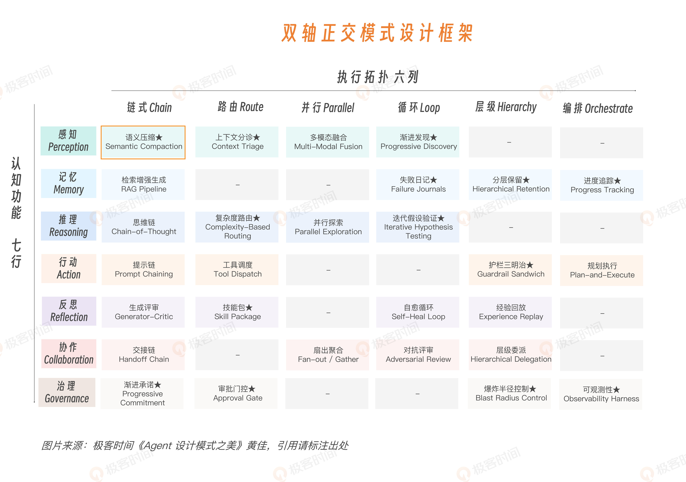
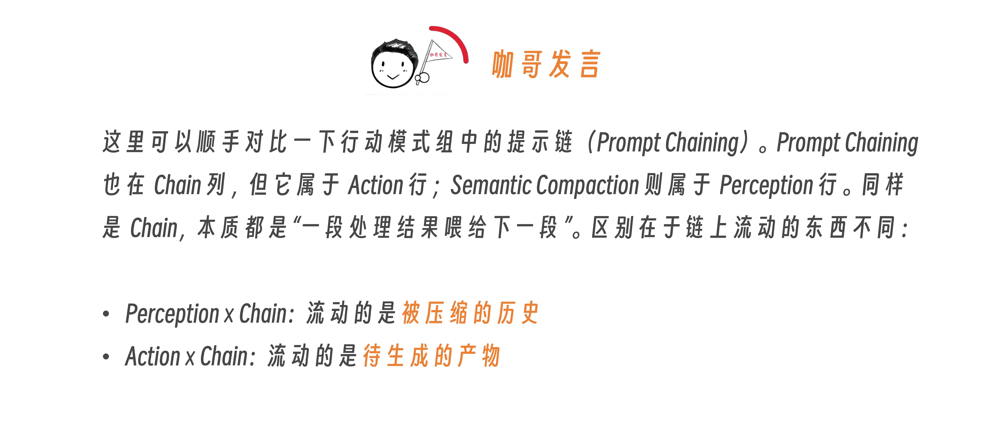
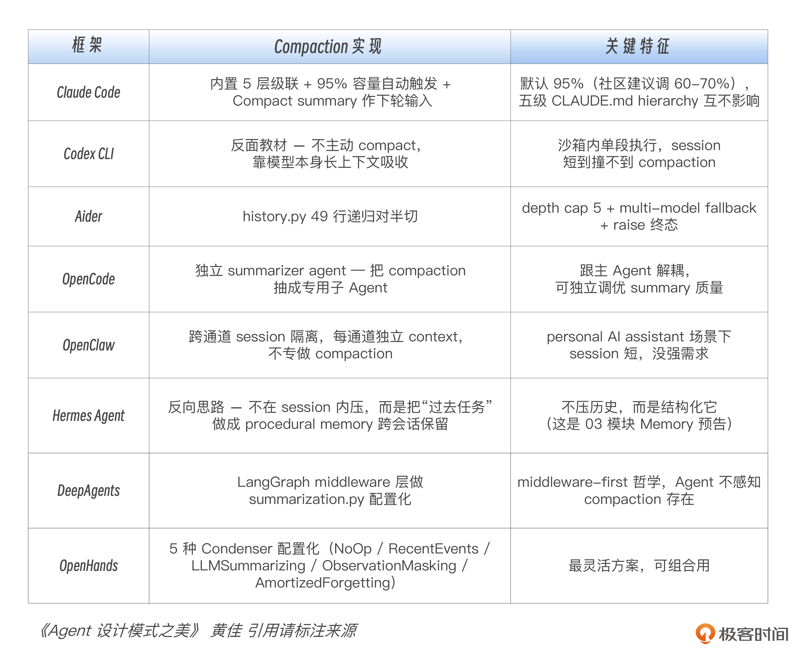

# 08 | 语义压缩：让200K装下1M的日志

你好，我是黄佳。

上一讲我们讲了上下文分诊：候选信息太多时，先决定什么进 Context，什么留在外面，什么只挂资源句柄（handle）。

但信息进来了只是个良好开端，后续的挑战是：Agent 只要跑得足够久，上下文一定会膨胀。对话历史、tool 返回、错误日志、代码 diff、测试结果，会一轮一轮堆起来。到了某个时刻，系统必须压缩历史，否则不是撞上 context limit，就是让模型淹在旧信息里。

这就是第二个感知模式——语义压缩（Semantic Compaction）的入场时机。压缩当然能够省 token，但还有一个更关键的问题：压缩之后，Agent 还记不记得自己为什么走到这一步。

坏的压缩，会把关键证据压没。更坏的压缩，会让 Agent 忘记哪些方案已经失败，然后在同一个坑里反复试错。

比如一个数据库故障排查 Agent，刚刚看到一条关键错误：

```
ConnectionPoolExhausted: pool_size=20, queue_depth=347
 at /app/db/pool.py:142
 ... (14 lines stack trace)
 Cause: timeout in _acquire_connection
这里真正有价值的不仅仅是“发生了数据库错误”，关键在于 pool_size=20、
queue_depth=347、_acquire_connection timeout 这些细节。它们暗示问题可能不
```

是简单把连接池调大，而是连接没有被及时释放。

如果 compaction 把这段压成：

```
a database error occurred
```

那 Agent 就失去了判断力。它后面可能继续调 pool size、加 retry、改 timeout，看起来还在努力，实际上已经忘了最重要的线索。所以这一讲的核心是怎么让 Agent 在长任务里持续保留判断所需的证据、决策和失败经验。

上一讲的关键词是选什么进来。这一讲是信息进来以后怎么不压坏。

## 如何理解语义压缩模式

老规矩，先把这模式在双轴图谱的位置明确一下。语义压缩落在“感知 × 链式”的交点。



认知功能上，它是感知。因为压缩之后留下来的内容，决定了 Agent 下一轮还能看见什么。

执行拓扑上，它是链。因为压缩通常不是一步完成，而是一层一层往下压：

```
tool 结果清理 → 对话 / 任务摘要 → 渐进式 summarize
```

- 第一层先清理冗长 tool output，比如日志全文、API 返回、查询结果。

- 第二层把旧对话合并成任务状态，比如用户意图、已做改动、已做决策、下一步。

- 第三层才是更激进的历史摘要，只有在 context 压力很大时才触发。

每一层都接住上一层的输出，越往后越短，也越容易丢细节。所以语义压缩是一条逐级压缩链。



在大语言模型诞生初期，《降临》作者特德·姜写过一篇著名的文章，《ChatGPT 是网上所有文本的模糊图像》。

这篇文章充满哲思。其中有个模糊图像的类比，也非常适合此处我们理解语义压缩模式。你可以想象暗房里不断翻拍照片：第一次翻拍，主体还在；第二次翻拍，边缘开始糊；第三次再翻拍，很多细节就永久丢了。多层压缩也一样。压缩次数越多，语义漂移的风险越大。所以最稳的策略不是无限压，而是：少压、分层压、保留证据、保留回退路径。

语义压缩模式，就是在尽可能保留关键语义信息的前提下，决定哪些内容可以丢弃、哪些内容必须保留，以及将保留的信息压缩到何种粒度。它要确保压缩之后，Agent 还能记得自己为什么走到这一步。

## 什么时候该用语义压缩？

只要 Agent 进入长任务，就应该考虑。比如：

```
会话超过 20-30 轮
context 占用超过 60%-70%
tool 结果开始大量堆积
日志、测试输出、代码 diff 明显膨胀
Agent 开始重复问、重复查、重复试
```

这时候不压，Agent 会撞上 context limit；乱压，Agent 会忘掉关键证据。真正好的压缩，是让 Agent 在长 session 里继续保持清醒。

但有一类内容不能被普通摘要吞掉，那就是错误信息。错误堆栈、失败测试、异常日志、关键数字、文件路径、行号，这些都是 Agent 的反馈回路。它不能被压成一句模糊结论。短错误栈可以原文保留。长错误栈可以保留异常类型、关键数字、文件路径、行号、首尾几段和原始日志 handle。已经失败过的方案，也要进入工作记忆锚点（anchor），告诉 Agent 这条路不要再走。

因此，语义压缩的核心是把历史变成可继续推理的工作记忆。

## 工程现场切片

现在我们已经明确了，语义压缩不是一个简单的 summarize 函数。真正进入工程现场后，不同团队处理的是同一个问题：上下文快满时，Agent 应该保留什么、压掉什么、什么时候压。

我们挑三个最有代表性的切片来看。

### 切片一：Claude Code 的自动压缩

Claude Code 内置 auto-compaction，在上下文接近上限时自动压缩旧内容，避免 session 撞上 context limit。这条路线的优点是开箱即用：用户不需要手动整理历史，Agent 可以继续往下跑。

但问题是，压缩不能只看“窗口有没有满”。长 context 的风险不只是装不下，还有推理质量下降。等到 context 已经接近满了再压，可能意味着 Agent 在最后一段已经处于注意力变差、判断变弱的状态。再把这段低质量历史压进摘要，就会污染下一轮推理。

所以一些重度用户和工程实践者主张更早触发，比如在 60% 到 70% 左右主动压缩。这么做看似浪费窗口，但它背后的逻辑是，不要等 Agent 变笨之后再压，而是在它还清醒的时候整理历史。

Claude Code 的设计给我的工程启发是：短任务可以晚压，长会话、高风险任务应该早压。

### 切片二：Factory 的锚定式迭代摘要

Factory （也是一家 AI Coding 公司）也提出重点不是“要不要压”，而是“压完之后历史怎么持续演化”。普通摘要每次都重新总结历史，容易像复印件反复复印一样逐步丢细节。Factory的做法是维护一个持续更新的 anchor。每次有新对话、新改动、新工具结果，都要把新信息合并进已有 anchor。

对比一下摘要和 anchor：

```
摘要 -> 摘要的摘要 -> 摘要的摘要的摘要 （越来越模糊）
摘要0-> 摘要1-> 摘要2  （anchor仍然清晰）
```

anchor 至少要保住几类信息：

- Intent：用户要什么。

- Changes made：已经改了什么、调用了什么。

- Decisions taken：已经做了哪些判断。

- Next steps：下一步做什么。

我建议再加一个更工程化的字段：excluded_approaches，已经排除的方案。很多 Agent 在长 session 里反复试错，不是因为不会推理，而是因为忘了哪些路已经走不通。比方说开头那个数据库故障的例子，Agent 一直加 pool size、加 retry、调 timeout，本质上就是缺少“不要再试这些方案”的记忆槽位。

所以生产系统中 Agent 的 Anchor 仍然应该能回答刚才说过的那五个问题：用户要什么？我做过什么？我决定了什么？我排除了什么？下一步做什么？这比每次粗暴重写摘要稳定得多。

### 切片三：OpenHands 的可配置压缩器

OpenHands 的设计哲学是：不同 Agent 的历史，不应该用同一种方式压缩。所以它把压缩打包成可配置的模块（OpenHands 中被称作 condenser），让开发者按任务选择策略：不压、只保留最近事件、LLM 摘要、ObservationMasking（可以翻译成观察结果遮蔽）、渐进遗忘。

其中最值得注意的是 ObservationMasking，我们重点来看看。

Agent 历史里有两类信息：Action 和 Observation。Action 是 Agent 做过什么，比如读文件、调接口、执行命令；Observation 是外部世界返回了什么，比如日志全文、API 响应、测试输出。

很多工程场景里，Agent 后续不一定需要保留所有 Observation 原文，但必须记住自己做过哪些 Action。ObservationMasking 的做法就是把早期 Observation 替换成占位符，但保留Action。

这相当于告诉 Agent：你不需要记住每一屏输出，但必须记住自己走过哪些路。

如果你的 Agent token 主要花在日志、SQL 查询结果、API 响应、测试输出上，而后续推理更依赖“做过哪些动作、得出哪些结论”，那 ObservationMasking 往往比通用 LLMsummarization 更稳，既省 token，也减少语义漂移。

这三个切片合在一起，就能提炼出压缩的三条工程原则：

- 自动：必须自动化，否则长 session 迟早撞墙（师承 Claude Code）。

- 演化：不要每次重写历史，而要维护持续演化的 anchor（师承 Factory）。

- 分治：不能只有一种算法，而要根据 Action、Observation、Error、Decision 的不同性质分层处理（师承 OpenHands）。

所以，生产级压缩处理，写个 prompt 要求 Agent“把前面对话总结一下”远远不够。它应该是在合适的时间触发，用稳定 anchor 保存任务状态，对不同类型信息采取不同压缩策略，并保护错误证据、关键数字、文件路径、已做决策和已排除方案。

## 8 框架横切：每家是怎么做 Compaction 的

把几家主流 harness 放在一起看，会发现 Compaction 没有标准答案，只有不同取舍。



这张表中的关键信息包括这三条。

- 第一，Compaction 是取舍。Claude Code 简单，OpenHands 灵活，Aider 透明，OpenCode 解耦，但没有一个方案在所有场景都最优的。

- 第二，不做 Compaction 也是一种选择，但只适合短任务。任务一长，Agent 就容易忘记自己做过什么、排除过什么、为什么走到当前这一步。

- 第三，Compaction 和 Memory 要分清。Compaction 管当前 session 怎么续命；Memory管跨 session 的经验怎么沉淀。前者解决窗口压力，后者解决长期记忆。

所以生产系统不要问“哪家方案最好”，而要问：我的 Agent 会话有多长？工具输出有多大？错误密度有多高？翻车成本有多大？短问答可以轻量处理；长调试必须有 anchor；大量日志适合 ObservationMasking；跨会话复用经验，就该进入 Memory 设计。

## 工业级实现：可观测 Compaction 的最小骨架

```
Semantic Compaction 不能只是一个 summarize_history() 函数。
```

生产里的 compactor 至少要做四件事：什么时候压、 哪些信息能压、哪些信息必须保护、压缩过程能不能被追踪。

```
工业级 Compaction 的最小实现可以拆成三个对象：Turn、Anchor和
CompactionEvent。
对象Turn 表示一轮对话、工具调用或工具返回。这里最关键的是 is_error。错误堆栈、失
```

败测试、异常日志不能按普通文本压缩，因为它们是 Agent 的反馈回路。

```python
@dataclass
class Turn:
   role: str
   content: str
   tokens: int
   is_error: bool = False
对象Anchor 是压缩后的工作记忆。它应该稳定回答五个问题：用户要什么、我做过什么、我
决定了什么、我排除了什么、下一步做什么。其中 excluded_approaches 最重要。很多长
```

会话 Agent 反复试错，不是因为不会推理，而是忘了哪些方案已经失败。

```python
@dataclass
class CompactionAnchor:
   intent: str = ""
   changes_made: list[str] = field(default_factory=list)
   decisions_taken: list[str] = field(default_factory=list)
   excluded_approaches: list[str] = field(default_factory=list)
   next_steps: list[str] = field(default_factory=list)
对象CompactionEvent 记录每一次压缩，应该通过这个对象把压缩前后信息和完整的 Log
```

日志相对应。没有这个对象，压缩就变成黑盒，Agent 后面变蠢了，你也不知道它是在哪一次压缩里丢了信息。

```python
@dataclass
class CompactionEvent:
   level: int
   tokens_before: int
   tokens_after: int
   error_traces_preserved: int
```

实现时可以采用三层压缩：

- Level 1：清理冗长 tool 输出。日志全文、API 响应、查询结果，如果不是错误信息，可以先替换成占位符。

- Level 2：合并进 Anchor。当 Level 1 不够时，再把旧历史抽取成 intent、changes、decisions、excluded、next steps，增量合并到 anchor。

- Level 3：极限压缩。只在不得不用时触发。Level 3 也可以作为退场信号，如果多次被触发，可能意味着 session 太长，agent 应该交接、开新 session，或转人工。

完整的范例实现代码请参考我们的 Repo，语义压缩模式实现部分。佳哥这里就不占篇幅贴大量代码了。还是那句话，代码是如何实现上面的三层压缩的，大家可以在 AI 辅助之下进行分析，也可以和 AI 切磋新思路。

- 咖哥发言：ADPS 成立之后，LangChain 中国区大使张海立老师第一时间加入专家团队，主动提出要为我们带来每一个模式的 LangChain + LangGraph 的具体实现。这个非常振奋人心的消息，敬请期待海立老师带来的新版示例。也欢迎更多的朋友带给我们新的模式实现示例，可以直接开 PR，或者在这里填表加入ADPS 团队，贡献实践案例、代码或者想法。

## 业务场景：长会话客服 Agent 的压缩实战

上面骨架版 compactor 解决的是通用问题：什么时候压、怎么压、哪些信息不能丢。落到真实业务里，还要加一层业务上下文。以客服 Agent 为例，它处理复杂工单时，通常会跨 2-4 小时、50-150 轮对话，中间夹杂用户描述、内部工具调用、日志返回、诊断结果和升级交接。这样的 session 自然需要压缩。

所以客服场景里，compactor 不能只看 token，还要看工单状态：

```python
@dataclass
class SupportContext:
   ticket_id: str
   customer_id: str
   product_line: str
   severity: str
   sla_deadline_iso: str
```

这些字段会直接影响压缩策略。P1 工单要比普通问题更早压；SLA 越近，越应该准备人工交接；HTTP 5xx、timeout、Traceback、FAILED 这类信息，都要被识别为错误信号。

因此，业务版 compactor 需要补全这三个关键能力。

第一，按业务识别错误。不同场景的“错误信号”不同。客服场景关心 timeout、5xx、Traceback；金融场景可能关心 AML flag、insufficient funds；医疗场景可能关心 abnormalvitals、contraindication。

第二，按风险调整触发阈值。客服 P1、金融、医疗这类高风险场景，可以更早压，比如50%-55%；内容生成、短代码修改这类低风险场景，可以晚一点，比如 65%-70%。

第三，导出交接上下文（handoff summary）。Compaction 不只是给 Agent 续命，也是给人类交接服务。

一个好的 handoff summary 至少要包含：

```json
{
   "ticket_id": ticket_id,
   "severity": severity,
   "intent": anchor.intent,
   "changes_attempted": anchor.changes_made,
   "decisions": anchor.decisions_taken,
   "excluded_approaches": anchor.excluded_approaches,
   "next_steps": anchor.next_steps,
   "sla_deadline": sla_deadline,
}
```

工程师看到这份摘要，应该立刻知道：客户是谁，问题多严重，已经试过什么，哪些路不要再走，下一步该查哪里，SLA 还剩多久。

压缩节律也要提前设计。一个 4 小时 P1 工单，可以按三段走：

- 前期不压。前 10-20 轮主要是信息收集和假设建立，原始细节最重要。

- 中期轻压。当上下文接近阈值时，先清理冗长 tool 输出，保留错误堆栈、最近对话和关键决策。

- 后期沉淀。 如果 session 继续拉长，就把旧历史合并进 anchor，让 Agent 依靠“意图、已做改动、已做决策、已排除方案、下一步”继续推理。

如果进入极限压缩，就该准备交接。Level 3 不是“再压一次”，而是一个退场信号：session 已经太长，信息漂移风险升高，Agent 应该导出 handoff summary，交给二线或人工确认。

## Compaction 的可观测性实战

关于 Compaction 的可观测性，这里我试着给出三个指标：

```
第一个是level_3_trigger_rate，压缩事件里的 Level 3 占比。因为 L3 是最激进的多
```

- 层级压缩，每次触发都意味着信息漂移。如果某条 session 反复进 L3，可能是 session 反复出现大量重复信息，导致频繁高比例压缩，需要关注具体原因。

```
第二个是avg_compression_ratio，平均压缩比（after / before）。可以根据需要设置健
```

- 康区间 ，比如说 0.30-0.50。如果低于 0.20 意味着会话被过度压缩（关键信息被丢的概率高），高于 0.60 则没压够（下次很快又得压）。

```
第三个是error_traces_preserved_per_event，每次 compaction 事件保留的错误堆
```

- 栈数。这是很关键的一个指标。这个数字要和真实的错误信息对齐，任何未被保留的错误事件都该触发报警。零保留意味着你的错误识别 patterns 漏了，当下一次 Agent 遇到同一个bug，它仍然会没记忆。

你可以把这三个指标做成实时告警 + 每日报表，用 Datadog / Grafana 搭起看板，如果某天某个客户的 Agent 的压缩指标出现波动，可以提高警惕。更进一步的做法是把 anchor 演化轨迹也记录下来。每次 anchor 字段变化都记录“哪些项被加进去、哪些项被覆盖、哪些项被丢”。这样便于在做事故复盘时发现“为什么 agent 在第 N 轮忘了 X”。

上述几个指标，不见得适合所有场景，我这里是抛砖引玉。期待大家补充自己的看法。

## 总结一下

语义压缩的核心问题其实只有两个：什么时候该压？压的时候必须保留什么？

Agent 跑久了，context 一定会膨胀。对话历史、工具结果、日志、代码 diff、测试输出都会一轮轮堆起来。到了某个阶段，不压会撞窗口，乱压会丢证据。所以语义压缩不是简单的summarize，而是在长任务里维护 Agent 的工作记忆。

简而言之，语义压缩是为了让 Agent 不忘记自己为什么走到这一步。一个 Agent 跑得稳不稳，70% 看推理、30% 看记忆，Compaction 是记忆的守护神。守护得好，Agent 能在长session 里持续清醒；守护得差，Agent 会变成失忆者。

那么怎么守护才好呢？

记得 Martin Fowler 在《Refactoring》开篇时说，refactoring 的安全感来自测试覆盖率：因为测试在，我们才敢改代码。语义压缩也是一样，压缩的安全感来自关键证据的保护，尤其是错误堆栈和失败记录。

错误堆栈就像 Agent 的测试套件。它记录了上一次为什么失败、失败在哪一行、关键参数是多少、哪条路已经走不通。把错误堆栈压成一句模糊的“出现了数据库错误”，就像重构时顺手把测试删掉。下一次回归时，Agent 没有证据提醒自己，只能在同一个坑里再摔一次。

一个 Agent 能把自己的对话历史压缩得既精炼、又保留关键证据，说明它仍然理解自己在做什么。坏的压缩不只是工程缺陷，也是一种认知缺陷。它说明系统已经分不清什么是背景噪声，什么是关键证据。

同样的道理，一个学生能把整章内容总结成一段话，说明他真的理解了这一章。

如果我们也压缩压缩这节课的内容，我觉得后面这些内容需要保留。

第一，压缩不是摘要，而是工作记忆维护。它要保留用户意图、已经做过的改动、已经形成的判断、已经排除的方案，以及下一步计划。

第二，错误信息不能被普通摘要吞掉。错误堆栈、失败测试、关键数字、文件路径、行号，是Agent 的反馈回路，是下一轮推理能不能避开旧坑的依据。

第三，压缩要分层。先清理冗长 tool output，再维护工作记忆锚点，最后才做极限压缩。越往后越激进，也越要小心语义漂移。

第四，压缩必须可观测。每一次 compaction 都应该留下事件记录。否则 Agent 后面突然变笨，你不知道是哪一次压缩把关键线索压没了。

最后希望你记住，好的压缩本身就是一种认知。你 Agent 选择保留什么，决定它接下来能想清什么。

## 思考题

1. 在你的业务场景中，需不需要压缩 Agent 的上下文。如果需要，你是如何设计你的压缩方案的？为什么要这样设计。

2. 做一次 ObservationMasking token 实验。选一个典型长 session，然后比较后面这三个方案。

```
方案 A：保留完整历史
方案 B：保留 Action，mask 掉 N 轮以前的普通 Observation
方案 C：保留 Action + 错误 Observation，只 mask 普通 Observation
```

对比省了多少 token、最终答案有没有变差、Agent 是否还能记住自己做过哪些动作。

3. 假设你的 Agent 会处理敏感数据，比如金融、医疗、合同、企业客户数据。请用合成数据设计一组测试样例，验证 compactor 压缩之后有没有破坏数据标签。

测试对象可以包括：

- 敏感字段：账户号、病历号、合同编号、客户名称

```
数据标签：PII / PHI / confidential / tenant-private
权限标签：仅当前 tenant 可见 / 仅内部员工可见
错误标签：异常交易 / 禁忌项 / 高风险条款
```

你要检查的是压缩后敏感字段有没有被误写成普通信息；数据分类标签有没有保留；tenant_id/ user_id 有没有保留，下游过滤器还能不能识别内容的敏感级别。最后给出你的 compactor规则。

4. 假设你把 anchor 的每次更新都记录到 trace 总线，请设计一份最小日志结构，然后写出 3个你想监控的问题。不要写“看看 Agent 干了啥”这种泛泛问题，要写成能落到指标上的问题。

## 下一讲预告

前面两讲，我们已经解决了两个问题：什么信息应该进入上下文？进入之后怎么压缩？

但还有一个更难的问题：如果我根本不知道相关信息在哪里呢？

- 一个法律 Agent 收到一份 200 页合同，它应该先读哪几页？

- 一个代码 Agent 进入一个拥有 15000 个文件的陌生仓库，它应该先打开哪个目录？

- 一个故障诊断 Agent 面对几百 MB 日志，它应该先搜什么关键词？

这些场景里，问题已经不是“选什么进 Context”，而是从哪里开始找。 这正是渐进发现模式要解决的问题。

下一讲，我们会一起研究 Claude Code、Aider、OpenHands 等 Agent Harness 为什么越来越偏向 Agentic Search，而不是“一次性把所有东西检索出来”。

期待你分享自己的思考或者疑问，我们留言区里继续交流探讨。也推荐你把今天的内容分享给更多有需要的朋友。
