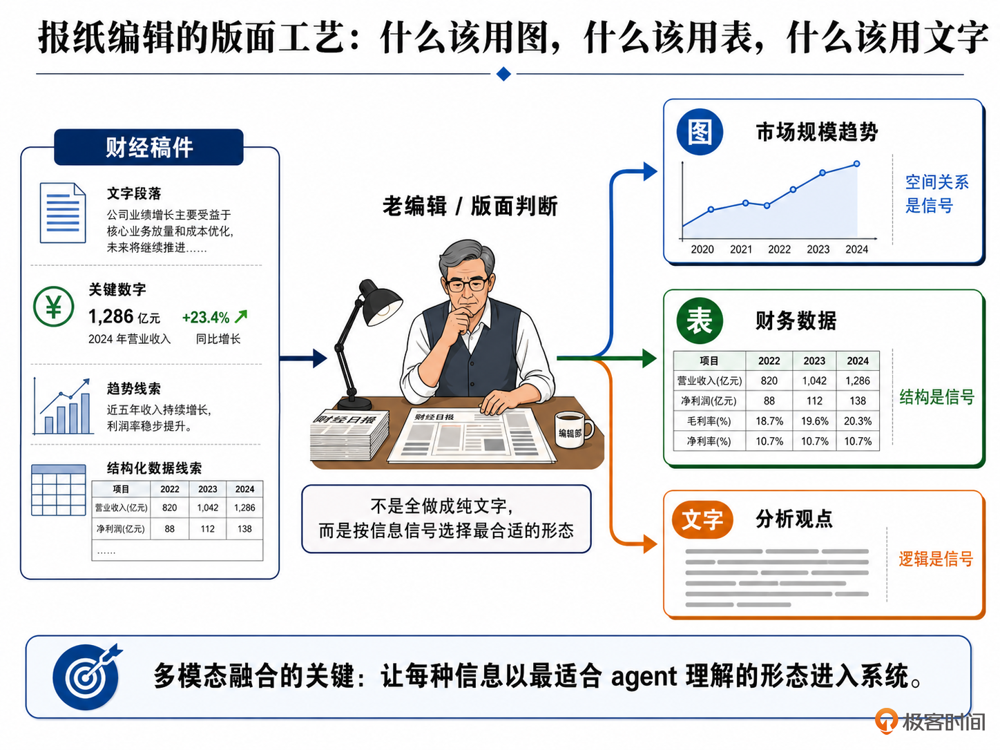
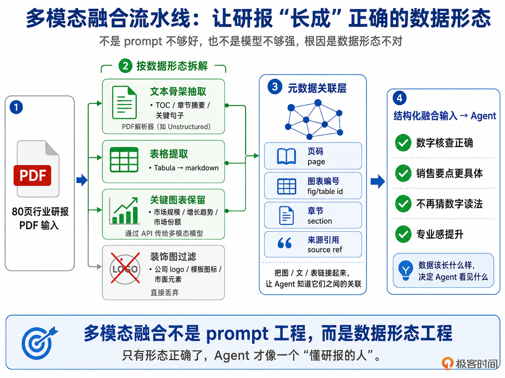
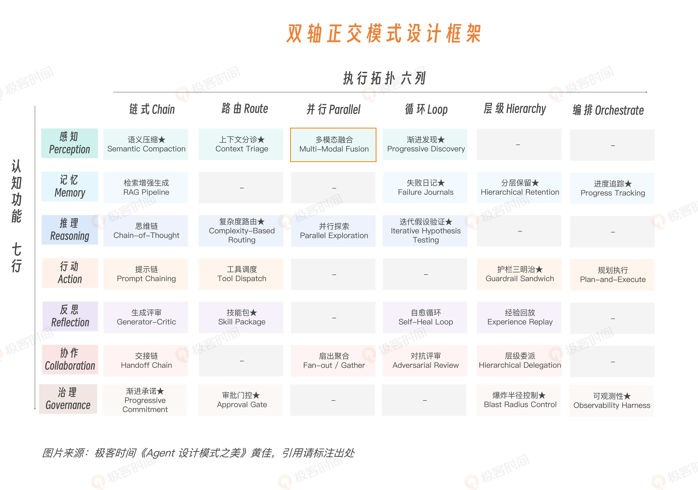
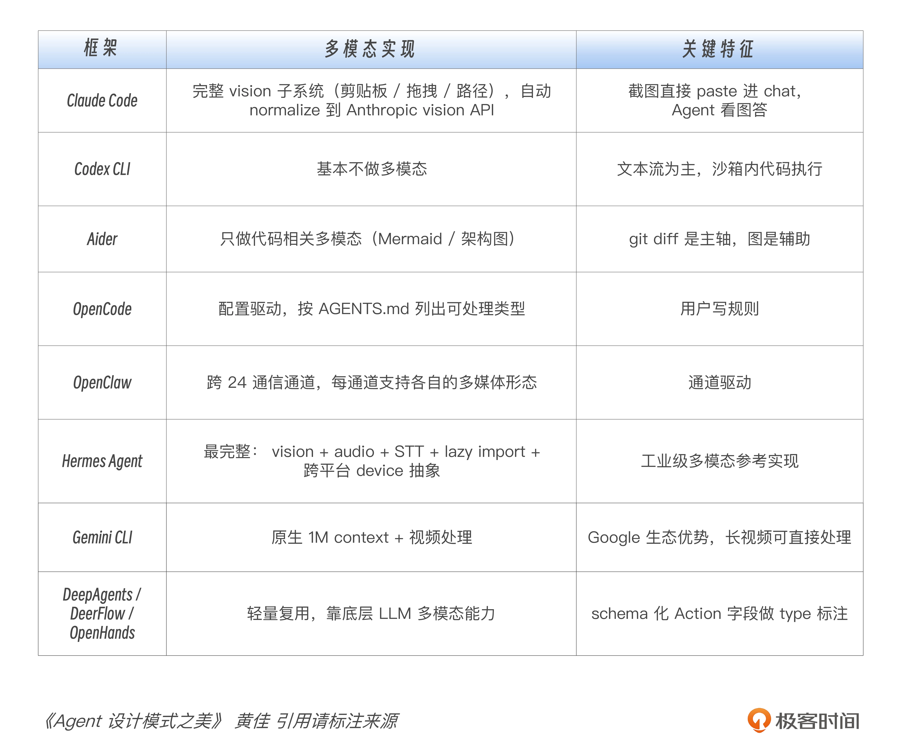
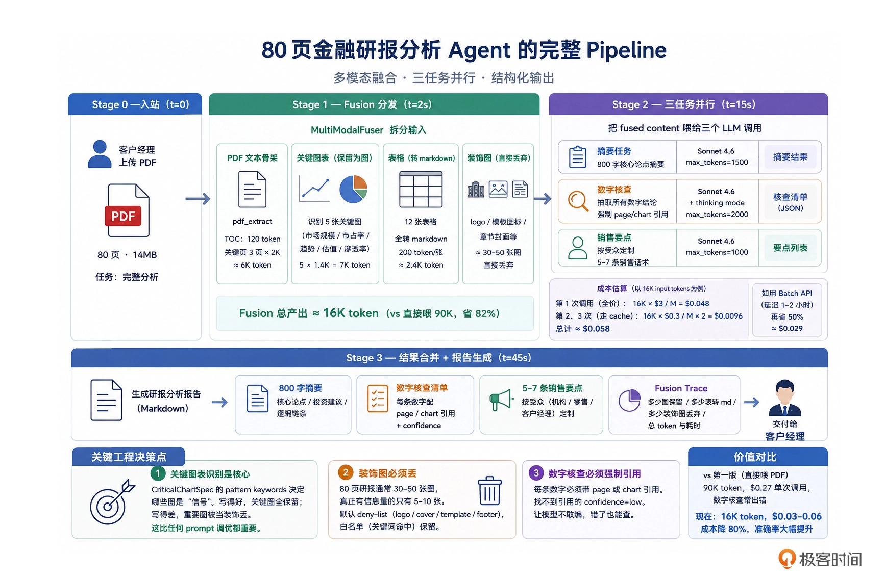
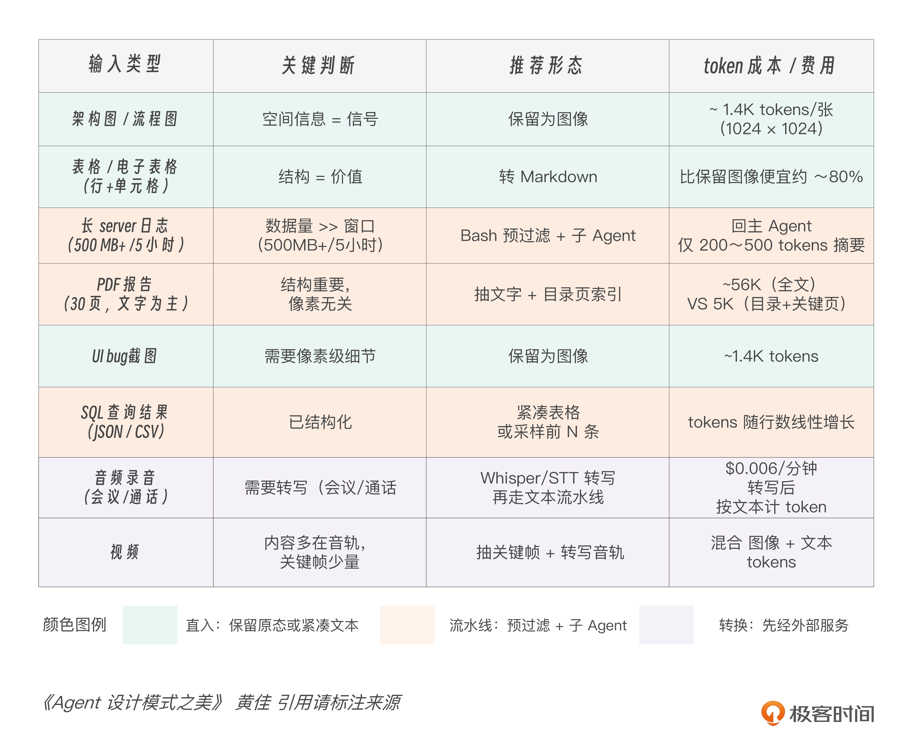
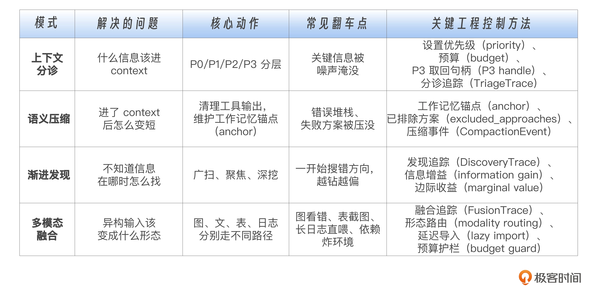

# 10 | 多模态融合：日志、SQL和PDF一起进Agent

你好，我是黄佳。今天我们一起来谈谈多模态，这也是感知模块的最后一讲——多模态融合（Multi-Modal Fusion）。

前面三讲，我们一直在讲 Agent 怎么“看对东西”：第 7 讲学习哪些信息先进来，第 8 讲关注进来以后怎么压缩，第 9 讲讨论不知道在哪儿的信息怎么探索。今天这一讲再往前走一步：Agent 接收到的信息，很多时候一开始就不是同一种形态，我们需要想想如何整合。

一个老练的编辑产出一篇财经类稿件，他不会全做成纯文字。他知道什么该用图、什么该用表、什么该用文字。市场规模趋势用折线图（空间关系是信号）、财务数据用表格（结构是信号）、分析观点用文字（逻辑是信号）。

报纸编辑整理多模态信息的这种敏感度，Agent 工程师和 Agent 也需要好好学习😗。



人理解世界，从来不是只靠单一信息通道。我们看一份研报，不只是读文字，还会扫图表、看趋势线、对数字、找脚注；我们排查一次故障，只读日志不够，还会看监控曲线、trace、SQL 结果、服务拓扑；我们理解一个客户问题，也不只读一段话，还会综合截图、录音、工单历史和系统状态。

人的大脑有一个隐含的“世界模型”，会把不同感官来的信号拼在一起：文字告诉我们逻辑，图表告诉我们关系，表格告诉我们结构，声音告诉我们情绪，日志告诉我们过程。哪条通道里的信号更关键，大脑会自动调权重。

Agent 处理多路信息源时也需要这个世界模型。比方说一家券商需要做研报分析 Agent。具体要求是，给定一份 80 页的 PDF 行业研报，Agent 需要输出：核心论点摘要、所有数字结论的事实核查、给客户经理的销售要点提炼。

怎么做呢？先看看最容易想到的方式为什么不行。

我们可以走大一统（all in one prompt）路线：把 PDF 完整塞进 Claude。一份 80 页文本加上图表混合的 PDF，摘要部分可能还 OK，图表理解和数字核查部分很可能出问题。如果 AgentAgent 看到了图但没把 y 轴刻度看清，就有可能把研报里“市场规模 5800 亿”误报成“5800万”。

我们也可以全转文本。用 OCR 加上 PDF 文本提取的方式，把 80 页内容全部转成 markdown喂进去，但这样做之后所有图表的空间信息丢光了。Agent 看到“图 4.2 市场规模趋势图”这一行字，但看不到图本身。

上面场景和提示词够不够好、模型强不强关系不大，根因是数据形态不对。

所以这里我们需要重新设计一下细节，不同信息形态的内容分别处理。

文本部分，用 PDF 解析器抽取文本骨架，包括 TOC、章节摘要还有关键句子。解析器有很多，比如 RAG 训练营里我常用的就是 Unstructed 工具；表格用 Tabula 转成 markdown 格式；市场规模、增长趋势、市场份额这类关键图表保留为图片，通过 API 传给多模态模型；其他装饰图（公司 logo、模板图标）直接丢弃。



在上面这个过程中，图、文、表这些信息还需要通过元数据来进行链接，让 Agent 知道它们之前的关联，这样才能让所有数字核查正确。只有“数据该长什么样”这个形态正确了，Agent 才更像一个懂研报的人。

## 多模态融合模式（Multi-Modal Fusion）

多模态模式处理的是这样一类问题：Agent 接到的输入不再只是纯文本，而是同时包含图片、文字、表格、日志、PDF、截图，甚至音频和视频。工程师要做的是先判断每一种数据最适合以什么形态被模型消化，再把它们带着关联关系合并到推理层。

它在双轴图谱里的位置，落在感知 × 并行的交点。

- 认知功能上，它属于感知，因为它决定 Agent 最终看到什么。

- 执行拓扑上，它属于并行，因为多种异构数据源会同时进入系统，每一种都应该走最适合自己的处理路径。

也是它和前三讲的本质区别：上下文分诊、语义压缩、渐进发现，主要处理的是“哪些 token进来、怎么压、怎么找”；而多模态融合处理的是更前面的一步：数据在进入 Agent 之前，应该先变成什么形态。



什么时候该用？只要 Agent 接到的输入不是干净纯文本，就应该考虑这个模式。比如金融研报分析、运维日志诊断、PDF 合同审阅、客户工单截图分析、代码评审中的架构图理解、医疗场景里的影像与病历联合分析。真实生产系统里，纯文本输入正在变少，混合形态输入才是常态。

什么时候不需要用？如果输入本身就是干净文本，比如简单客服问答、文本翻译、短代码补全，就可以直接进入推理。但要小心一种常见误判：很多看起来是文本任务的场景，实际运行时用户会上传截图、贴日志、转发邮件、附 PDF。只要这些异构材料出现，多模态融合就已经进入系统了。

简单来说：空间关系本身是信号，就保留为图；否则，尽量转成紧凑、可检索、易压缩的文本或者清晰的结构（如 Json Schema）。架构图、流程图、UI 设计稿 这类材料，价值往往在空间关系里，应该保留为图。表格、字段截图、错误日志、合同条款这类材料，核心价值在文字和结构里，通常应该转成 markdown、JSON 或结构化文本。不过，真正落到生产里，还需要更细的决策卡，判断每一种输入形态该走哪条处理路径。

## 工程现场切片

这一节挑两个最有代表性的工程切片。

第一，Claude Vision API 的 token 数学，帮你算清“保留为图”的真实成本；

第二，Hermes Agent 的多模态融合工程，重点看音频 STT 流水线和 lazy import；

### 切片一：Claude Vision API 的 token 数学

很多工程师对“保留为图”还是“转成文本”的成本判断并不准确。我们先把 Anthropic Vision API的 token 计算方式摆出来。

图片 token 数可以粗略按下面公式估算：

- tokens = width × height / 750

单图通常还有上限限制。以 1024×1024 的图片为例，大约是 1400 token 左右。

这个数字很有意思。对比一段 1500 字的中文 markdown，大约 800 token。一张 1024×1024的图，差不多相当于 1.5 倍左右的同长度文本。这个比值和很多人的直觉不同：图片并没有想象中那么贵。

比如一张完整架构图，里面有 5 个组件、8 条连线和若干标注。如果强行转成文字描述，可能要写 800 到 1200 字才能说清楚。这样的图保留为图片，反而可能更划算，也更不容易丢空间关系。

PDF 的情况就不同。一份 30 页的文本密集型 PDF，通过 PDF API 处理可能消耗五六万token，平均每页接近 2000 token。80 页研报如果整份暴力喂进去，很容易超过 15 万token。大文档场景里，“整份 PDF 直接喂模型”往往会变成成本和稳定性的双重压力。

这里还有一个关键变量，提示词缓存（prompt caching）。重复使用的 PDF、图片或长上下文，如果能走 cache，后续调用成本会明显下降。对于合同审阅、研报分析这类场景，同一份文件往往会被多次问答、摘要、核查。把可复用内容放进 cache，可能直接改变这个 Agent 的经济模型。

工程师拿到这些数字以后，最该做的一件事是：统计你的 Agent 每天处理多少重复文档。如果同一份 PDF、合同、研报被反复调用，cache 通常值得优先接入。

### 切片二：Hermes Agent 多模态融合的最完整工程

第二个切片来自 Hermes Agent。它的价值不只在于能处理图文，还在于它把音频输入也纳入了 Agent 流水线：支持麦克风实时录音、mp3/wav 文件输入，以及 macOS、Linux、Windows、WSL 等环境下的音频设备适配。

更值得注意的是它规定音频相关依赖必须 lazy load，不能在 module 顶层直接 import。

```
Lazy audio imports -- never imported at module level to avoid crashing
in headless environments (SSH, Docker, WSL, no PortAudio).
```

这行注释背后，其实是多模态工程很容易踩的坑。

Agent 会运行在各种环境里：本机、CI、Docker、远程 SSH、WSL。很多环境没有音频设备，也没有 PortAudio。如果启动时就硬 import 音频库，Agent 可能在还没处理任何音频任务之前就直接崩掉。

Hermes 的做法是把这些非纯文本能力延迟加载。只有用户真的使用音频功能时，才加载相关库；如果当前环境不支持，就优雅降级，而不是影响整个 Agent 启动。

这个原则同样适用于 vision、PDF 解析、音频 STT、视频帧抽取等依赖。生产里常见的问题是，一个用户根本用不到的多模态库，因为写在 import 顶部，导致 Agent 在容器或 CI 里启动失败。

```
凡是 80% 用户不会用到、且对运行环境有依赖的库，比如 cv2、pydub、pdfplumber、
transformers，都应该考虑放到函数内部 lazy import，或者用 try-except 做优雅降级处
```

理。这一步看起来很小，但对 Agent 的部署兼容性非常关键。

## 8 框架横切：每家是怎么做多模态的

把 8 个 Agent Harness 放在一起看，多模态融合这一栏的差异非常明显。有些框架重投入，比如 Claude Code、Hermes、Gemini CLI；有些框架几乎不把多模态作为主线能力，比如Codex CLI、Aider。这不是谁先进、谁落后，而是场景不同。



可以发现多模态投入和 Agent 场景强相关。编程 Agent 的主战场是代码、文件、终端、测试和 git diff，所以 Codex CLI、Aider 这类工具不一定需要重点关注多模态。它们更关心 reposearch、edit loop、test loop。但通用助理、客服 Agent、研究分析 Agent、金融研报 Agent就不一样。它们面对 PDF、截图、表格、图表、日志、邮件、音频，输入是天然混杂的。对这类 Agent 来说，多模态融合不是锦上添花，而是基础能力。

所以问题不是“框架有没有多模态”，而是你的 Agent 面对的世界，是不是本来就是多模态的。

Gemini CLI 的大上下文和视频能力代表了另一条路线，模型窗口足够大时，可以减少一部分预处理，让模型直接接收更多原始材料。这在视频、复杂图文混合材料里有价值，因为手工抽帧、切片、转写、对齐本身成本很高。但它不代表所有输入都该直接塞进大窗口。长日志、SQL 大结果集、海量表格、批量 PDF 仍然需要流水线处理。窗口变大，只是提高了上限，不会自动解决成本、噪声、延迟和可控性问题。

成熟的做法是先判断业务输入的形态，再决定多模态的投资深度。不要因为模型支持多模态，就把所有东西原样塞进去；也不要因为系统当前是文本 Agent，就假设用户永远不会上传截图、PDF 或日志。

## 工业级实现：可观测多模态融合的最小骨架

```
多模态融合不能只是一个 parse_file() 函数。生产里的融合器（fuser）至少要做三件事：
```

1. 识别输入形态；

2. 按形态分发到不同处理路径；

3. 记录每次处理的 trace，方便后续排查成本、延迟和质量问题。

下面是一个最小骨架实现。完整代码请参考这里。

首先定义输入形态：

```python
from dataclasses import dataclass, field
from enum import Enum
from typing import Any, Callable, Optional
from datetime import datetime
class ModalityType(Enum):
   TEXT = "text"              # 直接进入上下文
   IMAGE = "image"            # 空间关系是信号，保留为图
   TABLE = "table"            # 转 markdown
   LOG = "log"                # bash 预过滤 + sub-agent
   PDF = "pdf"                # TOC + 关键页 + 抽取文本
   AUDIO = "audio"            # STT 转文本
   SQL_RESULT = "sql_result"  # 抽样 / compact table
```

```
每条输入都带一个业务提示。这个 hint 很重要，它告诉系统这份材料的业务含义，比如“市
```

场规模图”“auth 服务日志”“用户上传截图”。

```python
@dataclass
class ModalityInput:
   type: ModalityType
   payload: Any
   hint: str = ""
   keep_as_image: bool = False
```

然后定义融合事件。多模态融合一定要可观测，否则你只知道 token 涨了，却不知道是图片涨了、PDF 涨了，还是日志预过滤失效了。

```python
@dataclass
class FusionEvent:
   modality: ModalityType
   tokens_out: int
   processing_ms: int
   method: str
   timestamp: str = field(
       default_factory=lambda: datetime.utcnow().isoformat()
   )
```

核心类只做一件事，按形态分发。

```python
class MultiModalFuser:
   def __init__(
       self,
       ocr_tool: Optional[Callable] = None,
       stt_tool: Optional[Callable] = None,
       pdf_extract: Optional[Callable] = None,
       log_subagent: Optional[Callable] = None,
       bash_filter: Optional[Callable] = None,
   ):
       self.ocr = ocr_tool
       self.stt = stt_tool
       self.pdf_extract = pdf_extract
       self.log_subagent = log_subagent
       self.bash_filter = bash_filter
       self.events: list[FusionEvent] = []
```

这里用的是原子工具注入，而不是把 OCR、STT、PDF 解析、日志分析全部写死在类里。这样同一套融合器（fuser）可以跑在不同环境：本地 OCR、云端 OCR、企业内部 PDF 解析器，都可以替换。

核心分发逻辑如下：

```python
def fuse(self, inputs: list[ModalityInput]) -> dict:
   content_blocks = []
   for inp in inputs:
       t0 = datetime.utcnow()
       if inp.type == ModalityType.TEXT:
           output = {"type": "text", "text": inp.payload}
           method = "direct"
       elif inp.type == ModalityType.IMAGE or inp.keep_as_image:
           output = self._as_image_block(inp.payload)
           method = "vision"
       elif inp.type == ModalityType.TABLE:
           md = self._table_to_markdown(inp.payload)
           output = {"type": "text", "text": md}
           method = "table_to_md"
       elif inp.type == ModalityType.PDF:
           extracted = self.pdf_extract(inp.payload)
           text = self._build_pdf_summary(extracted, inp.hint)
           output = {"type": "text", "text": text}
           method = "pdf_extract"
       elif inp.type == ModalityType.LOG:
           filtered = self.bash_filter(inp.payload, inp.hint)
           structured = self.log_subagent(filtered)
           text = self._format_log_structured(structured)
           output = {"type": "text", "text": text}
           method = "bash_filter+subagent"
       elif inp.type == ModalityType.AUDIO:
           transcript = self.stt(inp.payload)
           output = {"type": "text", "text": transcript}
           method = "stt"
       else:
           text = str(inp.payload)[:5000]
           output = {"type": "text", "text": text}
           method = "fallback"
       content_blocks.append(output)
       tokens = len(str(output)) // 4
       self.events.append(FusionEvent(
           modality=inp.type,
           tokens_out=tokens,
           method=method,
           processing_ms=int(
               (datetime.utcnow() - t0).total_seconds() * 1000
           ),
       ))
   return {
       "content": content_blocks,
       "total_tokens_estimate": sum(e.tokens_out for e in self.events),
       "fusion_trace": self.events,
}
```

这段代码里有几个关键决策。

第一，图片可以被强制保留。

```
keep_as_image=True
```

默认规则能覆盖大多数情况，但业务里一定会有例外。比如一张双 Y 轴图、一张架构图、一张 UI 设计稿，它的空间关系本身就是信号，不能简单转成文字。

第二，日志必须走流水线。

```
bash_filter → log_subagent → structured summary
```

长日志不能直接进主上下文。先用便宜工具粗过滤，再用低成本 Sub-Agent 提炼结构化摘要，最后只把摘要交给主控 Agent。

第三，PDF 不应该默认整份塞进去。

```
TOC + key_pages + business_hint
```

大多数 PDF 任务并不需要全文原样进入上下文。先提取目录、关键页、章节摘要，再按任务选择关键图表和表格，通常更稳也更便宜。

最后加一个最小健康检查。它不判断答案对不对，只监控 fusion 有没有异常膨胀。

```python
def health_check(self) -> dict[str, str]:
   if not self.events:
       return {"status": "no fusion events"}
   report = {}
   total = sum(e.tokens_out for e in self.events) or 1
   for modality in ModalityType:
       tokens = sum(
           e.tokens_out for e in self.events
           if e.modality == modality
       )
       ratio = tokens / total
       if modality == ModalityType.IMAGE and ratio > 0.5:
           report["image_token_overshoot"] = (
               f"image tokens = {ratio:.1%}, "
               "check whether some charts should be tables or markdown"
           )
       if modality == ModalityType.LOG and ratio > 0.4:
           report["log_token_overshoot"] = (
               f"log tokens = {ratio:.1%}, "
               "bash filtering may not be working"
           )
   return report
这个 health_check 的价值在于提前发现形态异常。
```

- 如果某天 image token 占比突然超过 50%，可能是有大量表格或装饰图被当成图片保留了。

- 如果 log token 占比突然超过 40%，可能是 bash 预过滤没有生效。

- 如果 PDF token 持续过高，可能是关键页抽取规则太松。

```
所以，这段代码真正表达的是多模态融合要按形态分发、计量、排障。没有 FusionEvent，
```

多模态融合就是黑盒。出了问题以后，你只知道 Agent 变贵、变慢、变不准，却不知道是哪一种输入形态在拖垮系统。

## 业务级实现：金融研报分析 Agent 的多模态融合流水线

前面的骨架版代码说明了 Multi-Modal Fusion 的基本结构。现在把它放进一个真实业务场景：金融研报分析 Agent。



假设客户经理上传一份 80 页 PDF 研报，文件大约 14MB。Agent 要输出三类结果：

- 核心论点摘要数字结论核查给客户经理的销售要点

这类任务最容易犯的错误，是把整份 PDF 原样交给模型。这样做看起来简单，但成本高、噪声大，而且图表和数字核查容易出错。正确做法是先做多模态拆解，把不同形态的数据转成最适合推理的表示。

这套流程可以分三步。

### 步骤一 融合层分发

```
Agent 接到 PDF 后，先由 MultiModalFuser 拆分输入。
PDF 主体：
抽取 TOC、章节摘要和关键页。
例如 TOC 约 120 token，关键页 3 页 × 2K，约 6K token。
```

- 关键图表：识别市场规模、市占率、增长趋势、估值、渗透率等图表。

```
假设保留 5 张关键图，每张约 1.4K token，合计约 7K token。
```

- 表格：

```
全部转成 markdown。
假设 12 张表，每张约 200 token，合计约 2.4K token。
```

- 装饰图：

```
公司 logo、模板图标、章节封面、页脚装饰，直接丢弃。
```

这样处理后，Fusion 总产出大约 16K token。如果暴力全喂，可能接近 90K token。差距不只是成本，也直接影响模型能否稳定抓住关键证据。

业务对象可以很简单：

```bash
@dataclass
class ResearchReport:
   pdf_path: str
   report_type: str      # industry / company / macro
   industry: str
   target_audience: str  # institutional / retail / broker
```

真正体现业务知识的，是关键图表识别规则：

```python
@dataclass
class CriticalChartSpec:
   pattern_keywords: list[str] = field(default_factory=lambda: [
       "市场规模", "市占率", "增长趋势",
       "营收", "利润率", "毛利率", "ROE",
       "渗透率", "用户数", "ARPU",
       "估值", "PE", "PB", "PS",
   ])
```

这组关键词不是普通配置，而是行业知识。金融研报里，这些图表往往承载最关键的数字结论，所以要优先保留为图。

输入拆解可以写成这样。

```python
def _build_inputs(self, report: ResearchReport) -> list[ModalityInput]:
   inputs = []
   # 1. PDF 主体：抽 TOC、关键页、章节摘要
   inputs.append(ModalityInput(
       type=ModalityType.PDF,
       payload=report.pdf_path,
       hint=f"{report.report_type} 研报，行业：{report.industry}",
   ))
   # 2. 关键图表：保留为图
   for chart in self._extract_critical_charts(report.pdf_path):
       inputs.append(ModalityInput(
           type=ModalityType.IMAGE,
           payload=chart["image_bytes"],
           hint=f"图 {chart['fig_no']}: {chart['caption']}",
           keep_as_image=True,
       ))
   # 3. 表格：转 markdown
   for table in self._extract_tables(report.pdf_path):
       inputs.append(ModalityInput(
           type=ModalityType.TABLE,
           payload=table["dataframe"],
           hint=f"表 {table['tab_no']}: {table['caption']}",
       ))
   return inputs
```

### 步骤二 三任务并行

Fusion 产出的 content blocks 会被复用到三个任务里：

- 摘要任务：

```
输出 800 字核心论点摘要。
```

- 数字核查：

```
抽取所有数字结论，要求给出 page 或 chart 引用。
```

- 销售要点：

```
根据目标受众，生成 5-7 条销售话术。
```

主流程可以简化成这样：

```python
def analyze(self, report: ResearchReport) -> dict:
   inputs = self._build_inputs(report)
   fused = self.fuser.fuse(inputs)
   summary = self._run_summary(fused["content"], report)
   fact_check = self._run_fact_check(fused["content"], report)
   sales_points = self._run_sales_points(fused["content"], report)
   return {
       "summary": summary,
       "fact_check": fact_check,
       "sales_points": sales_points,
       "fusion_trace": fused["fusion_trace"],
   }
```

其中最关键的是数字核查。这个任务必须强制输出引用：

```
system = (
   "你是事实核查员。从研报中抽取所有数字结论，"
   "输出 JSON 列表，每项包含 claim / number / "
   "page_or_chart_ref / confidence。"
   "找不到 page 或 chart 引用的，confidence 标为 low。"
)
```

这条规则能明显降低“数字说得很自信但没有出处”的风险。每个数字都必须挂到页码或图表，后续人工核查才有据可依。

### 步骤三 结果合并

最后，三个产物合并成一份报告，交给客户经理：

```
800 字摘要
```

- 数字核查清单

```
5-7 条销售要点
Fusion trace
这里的 fusion_trace 很重要。它记录了后面这些内容。
```

- 保留了多少张关键图

```
多少张表转成 markdown
```

- 多少装饰图被丢弃

```
总共消耗多少 token
```

这让质量审查有依据。后面如果某个数字核查错了，可以回头看：是关键图没保留，还是表格没抽出来，还是引用规则没执行。

这里有三个关键工程决策。

```
第一，关键图表识别是核心。CriticalChartSpec 写得好，市场规模、增长趋势、市占
```

率、估值这类关键图会被保留。写得差，重要图表可能被当成装饰图丢掉。这一步往往比prompt 调优更重要。

第二，装饰图要丢掉。一份 80 页研报可能有几十张图片，但真正有信息量的只有少数几张。logo、章节封面、模板图标、页脚装饰，不应该占用视觉 token。生产里可以采用白名单 + 黑名单：业务关键词命中的图保留，明显装饰性的图丢弃。

第三，同一份报告要复用。摘要、数字核查、销售要点基于同一份研报内容。生产里应该配合提示词缓存或批处理 API，避免每个任务都重新喂一遍 PDF。这样成本会明显下降，延迟也更可控。

所以，金融研报 Agent 的关键不在于“模型能不能读 PDF”，而在于工程师有没有把 PDF 拆成正确的业务形态。概括一下，就是文本给逻辑，表格给结构，图表给空间关系，trace 给质量审查。这就是业务级多模态融合模式的价值。

## 工业 trace：融合层的可观测性实战

我推荐三个可观测指标。

```
token_distribution_by_modality：按形态的 token 占比。健康分布大致是：text 40-
```

60% / image 10-30% / structured (table/json) 10-20% / log/Sub-Agent 摘要 5-15%。某天某形态占比异常（比如 image 突然涨到 60%），可能是有该转的图没转换形态。

```
fusion_processing_p99_ms：单次 fusion 总处理时间的 p99。健康线 < 5 秒。某天 p99
```

飙到 30 秒 +，多半是 PDF 抽取或 OCR 卡住了，这是产品体验早警报。

```
bash_filter_compression_ratio：bash 预过滤的压缩比（filtered_size /
```

original_size）。健康区间 0.01-0.05（500MB 日志压到 5-25MB）。超过 0.1 说明过滤规则太松；低于 0.005 代表过滤太狠（可能丢信号）。这是日志类 Agent 健康度的命门。

落地时建议把这三个指标做成实时 dashboard（可以借助 Datadog / Grafana 搭建）。没有trace 的 fusion 是黑盒，某天 Agent 突然变贵、变慢、出错了，你都不知道是哪一层流水线在出问题。

## 决策卡：图保留还是转文本

多模态融合里，最常见的坑是：一看到图片就丢给视觉模型，一看到 PDF 就整份塞进去。真正动手做工程时，应该先分析这份材料的价值，藏在布局里，还是藏在文字和结构里？

如果价值在布局、箭头、位置关系里，就保留图。 如果价值在文字、数字、表格结构里，就转成 Markdown、Mermaid、CSV 或 JSON。



- 多模态决策卡： 4 类典型输入的推荐处理方式以及 token 成本估算

下面是 4 类典型输入的推荐处理方式。

1. 架构图 / 流程图：能转 Mermaid 就转 Mermaid

架构图看起来天然适合保留成图片，但很多项目里，Mermaid 更好用。一个 8 个节点的架构图，写成 Mermaid 可能只有几十个 token；存成 draw.io XML 可能上千 token；保留成PNG，又不方便检索、修改和 diff。更重要的是，Mermaid 对模型很友好。服务调用、组件依赖、审批流程、数据流向，这些用 Mermaid 表达，模型通常读得清楚。

所以我的建议是系统结构图、流程图、调用链，优先转 Mermaid。只有在 UI 布局、视觉标注、复杂空间位置关系很关键时，再保留为图。

2. 表格 / 电子表格：默认转 Markdown

表格的核心价值通常在行、列、字段和数字，不在截图本身。普通业务表、财务表、SQL 查询结果，转成 Markdown 或 CSV 会更便宜，也更容易检索和计算。

判断标准是如果 Markdown 能还原 95% 信息，就转 Markdown。保留为图的情况虽然也存在，但比较少，比如跨页表、多层表头、合并单元格、斜线表头、嵌套分组。这类表格硬转Markdown 会丢结构，才值得走 vision。普通表格别截图，复杂版式表格再留图。

3. 图表 / 热力图：保留图，但数字要落到数据

柱状图、折线图、散点图、热力图，很容易让人高估视觉模型的能力。模型看趋势通常还可以，但让它直接读精确数字、算同比、算环比，风险就高了。尤其是坐标轴密、图例多、双 Y轴、颜色映射复杂的时候，答案可能看起来很顺，数字却错了。

所以这类图建议分两步处理：图像保留，用来定位和理解趋势；数字抽出来，转成 CSV 或JSON 后再计算。比如市场规模趋势图可以保留为图，让 Agent 知道这张图讲什么；但如果要回答“2024 到 2026 CAGR 是多少”，就应该让 Agent 基于结构化数据算。让视觉模型帮你看图，结构化数据负责算数。

4. 密集文字截图：有时直接当图更划算

如果是一整页密密麻麻的代码、报告截图、日志截图、表格截图，全部 OCR 成文本可能很长，还会带来格式噪声。此时把图片压到合适尺寸，直接交给 vision，有时更省 token，也更快。

适合这种处理的场景包括长代码截图、整页报告截图、密集 UI 截图、以及带大量文字的监控页面。不过如果只是快速理解页面内容，保留为图也可以；如果后续要搜索、diff、计算、引用字段，还是要转成文本或结构化数据。

## 收束：感知模块到此结束

多模态融合的核心是数据形态设计，多模态融合是数据形态工程，也就是让每种数据找到最适合 Agent 消化的形态。

模型供应商负责让模型能看图、读 PDF、听音频；工程师负责判断这张图、这页 PDF、这段日志、这段音频该用什么形态进入 Agent。架构图可能该转 Mermaid，普通表格该转Markdown，图表要先抽成 CSV/JSON 再算数，长日志要走预过滤和 Sub-Agent，音频要先STT，PDF 要拆成 TOC、关键页、表格和关键图。

好的 fusion 让 Agent 看到恰当的少。完整塞进去，看起来省事，实际会带来三类事故。

第一，看错图。研报里 5800 亿读成 5800 万，就属于这一类。图表可以帮助定位趋势，精确数字要落到结构化数据里；图像抽取出的数字，也要和正文、表格里的同名数字做交叉校验。

第二，图片账单爆炸。Agent loop 每跑一步，可能都会重新打包同一张图。Demo 只跑一两步，看不出问题；生产跑几十步，图片成本会按轮次放大。此时可以考虑使用缩略图（thumbnail）和提示缓存机制。

第三，Sub-Agent 死循环和关键发现丢失。多个 Agent 互相调用时，如果每次都传整段上下文，又没有预算上限，很容易烧钱。关键结论应该放进状态存储，上下文里只传一个指针。每个 Sub-Agent 启动前，都必须声明 token 预算、时间预算和递归预算（recursion budget）；任何一个上限被触发，就立刻停止。

感知模块四讲，其实是在切同一个问题：当下这个 session 里，Agent 怎么看清楚世界。



这四个模式的顺序也很重要。多模态融合最靠前，先决定数据形态；上下文分诊再决定哪些信息靠近模型；语义压缩负责长会话里的工作记忆；渐进发现负责未知空间里的探索。如果形态一开始就错了，后面如何分诊、压缩、探索，都是在错误材料上继续消耗。

到这里，感知模块可以收住了。它管的是当前会话内 Agent 看见什么。会话结束后，这些上下文都会被回收。生产 Agent 不能每次从零开始，所以下一模块进入记忆：怎么把这次会话学到的东西，跨会话留下来。

## 思考题

1. 算一下你 Agent 当前处理输入的 token 分布，按形态分别做个统计（text / image / table /log / pdf / audio）。有没有什么内容占了你 60% 以上的 token 但只贡献 20% 信息量？

2. 设计一些你系统中图片 vs 转文本的原则？是“看起来复杂的就保留”，还是有明确规则？写出 5 条具体规则（比如“普通条形图转表格”）。

3. 拿一张你的 Agent 真实处理过的图表，比如柱状图、折线图、热力图、市场规模图，设计10 个问题：

```
具体数值类：3 道
趋势方向类：2 道
类别比较类：2 道
坐标范围类：2 道
图例理解类：1 道
```

让模型直接看图回答，再把答案和原始数据对比。记录：

- 错了几道？错在读数、坐标轴、图例，还是单位？

```
哪些问题必须转成 CSV / JSON 后再算？
哪些问题可以直接让 vision 模型回答？
```

4. 给你的 PDF / 研报 Agent 设计一张融合（Fusion） 决策卡。找一份你业务里的典型 PDF，比如合同、研报、手册、审计报告、病历、招标文件。按下面格式拆解：

- 文本主体：怎么抽？

```
目录 / 章节：是否保留？
```

- 关键页：怎么识别？

```
表格：转 markdown 还是 CSV？
```

- 图表：哪些保留为图？装饰图：哪些直接丢？

```
原文：是否保留 P3 句柄？
```

输出一张你的业务决策卡：

```
输入类型       推荐处理方式       保留理由       token 估算
合同条款       转 markdown        需要引用       ...
财务表格       转 CSV             需要计算       ...
架构图         转 Mermaid/留图     看空间关系     ...
封面/logo      丢弃               无业务信号     ...
```

## 下一讲预告

下一讲咱们进入 03 模块记忆 - 沉淀之美。前面四讲解决的全是当下会话内的感知，会话一结束就清零啦。生产级别 Agent 不能每次从零开始。用户三天前问过的问题、Agent 上次踩过的坑、本租户的偏好设置，这些跨会话的状态应该如何保留并积累下来，这些都属于记忆的范畴。

期待你在留言区和我交流探讨。如果这节课对你有启发，也推荐你把它分享给更多朋友。
