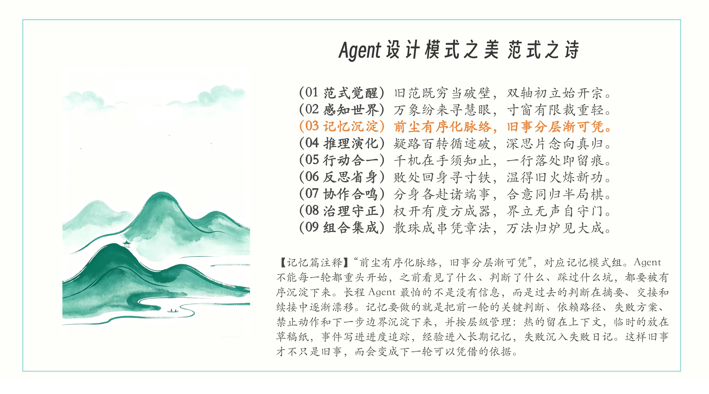
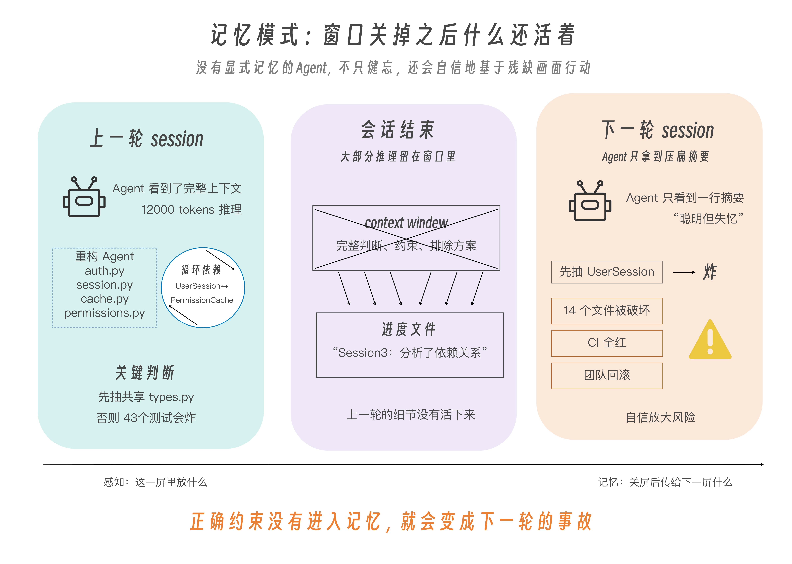
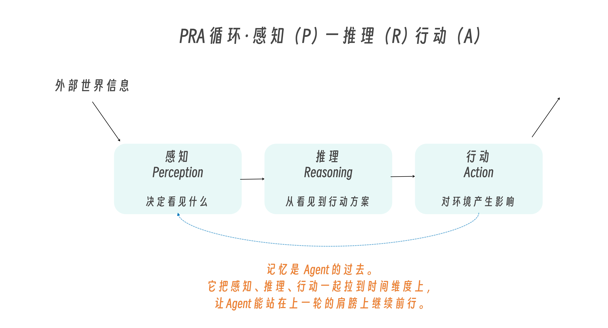
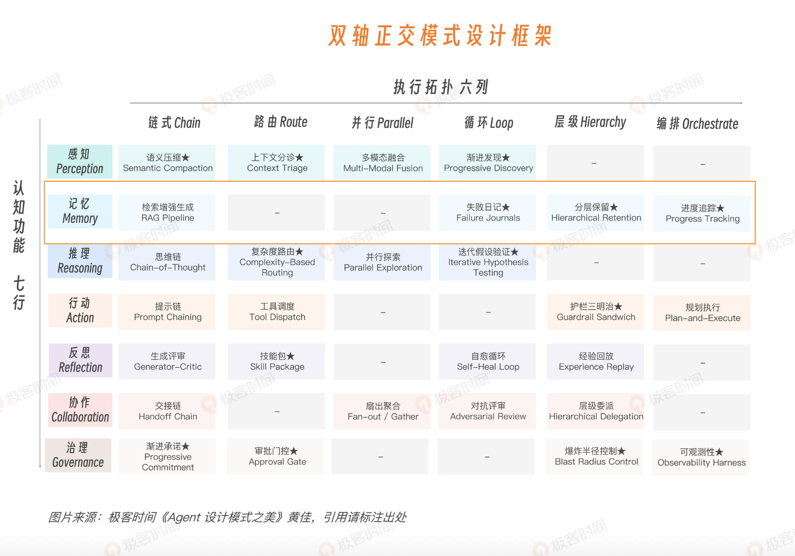
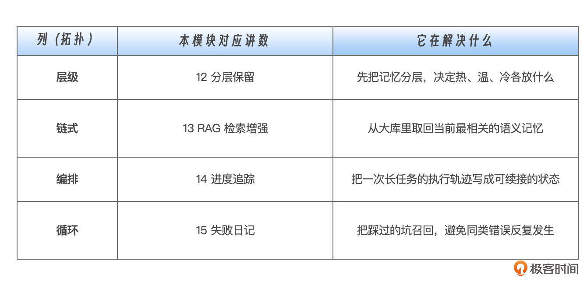
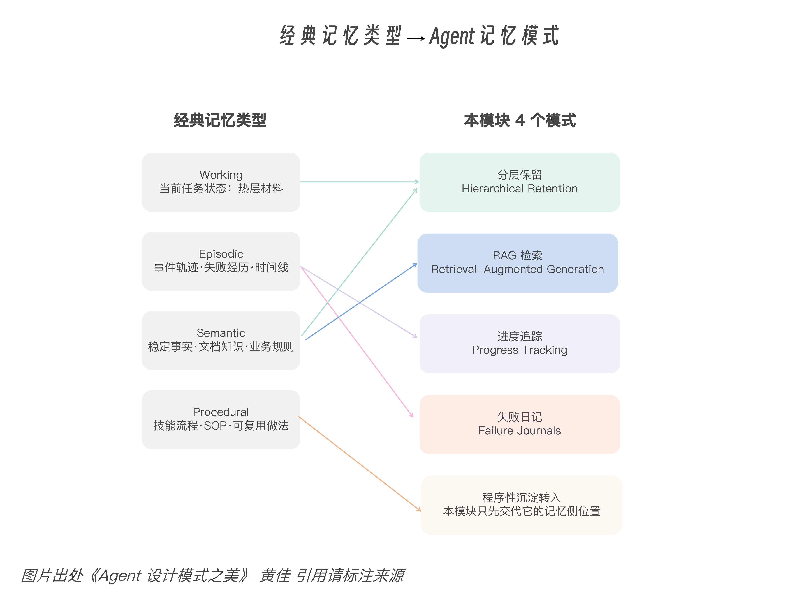

# 11 | 记忆模块导论：从草稿纸到长期记忆，建立Agent的经验沉淀秩序

你好，我是黄佳。欢迎进入第二个模式组，记忆模式。



不知道你是否看过电影《记忆碎片》？里面的主角患有短期记忆障碍，新的记忆只能停留很短时间，无法稳定变成长记忆。为了追查他妻子被谋杀的真相，他只能依靠外部线索：照片、纸条、纹身，把关键事实留在身体和物件上。换句话说，他给自己搭了一套外部记忆系统。


- 诺兰的电影《记忆碎片》，2000 年上映

这和 Agent 很像。大模型在一次会话里看见了很多东西，做了很多判断，也可能踩过很多坑。但如果这些东西没有被写到外部记忆里，窗口一关，它就很难在下一轮继续使用。于是我们给Agent 设计 scratchpad、进度追踪、长期记忆、失败日记，本质上也是在给它留下照片、纸条和纹身。

这一模块讨论的，就是怎样让今天的 Agent，用得上昨天它曾经学到的东西。

## 记忆模块到底关注什么

传统软件很少纠结“会不会忘”。进程崩了有数据库兜底，请求断了有 session 和 checkpoint，服务重启之后照着状态恢复就行。大语言模型不一样。如果不接外部记忆、不做显式再训练，模型权重不会因为一次会话自动改变。它在会话里“记住”的东西，主要活在上下文窗口里。窗口一关、会话一结束，Agent 就重置，变回一个对你和你的项目都不熟悉的陌生人。



```
举个例子。一个负责代码重构的 Agent，任务是把一个臃肿的 auth.py 拆成三个模块。
在前面几轮分析里，它发现 UserSession 和 PermissionCache 之间有一个循环依赖，并
且写出了完整判断。这个依赖横跨四个文件，应该先抽出一个共享的 types.py。如果直接
动 UserSession，会影响 43 个测试用例。这份判断烧掉了不少 token，但它是一份物有所
```

值的结论。

任务完成后，它把这一轮成果写进进度文件，交接给负责下一步的 Agent。

```
## Session 3：auth.py 拆分准备
```

- 已完成：

```
- 梳理 auth.py、session.py、permission_cache.py、permissions.py 的 import 关系
- 确认 UserSession 与 PermissionCache 之间存在循环依赖
- 建议先引入共享 types.py，再继续拆分 auth.py
```

- 待继续：

```
- 开始移动 UserSession 相关代码
- 跑 auth regression suite
```

这份进度记录，人类扫一眼是够的，对下一轮 Agent 续接却不够。它留下了主题和大方向，却丢了最关键的三个东西：循环依赖的具体路径，已经被排除的错误做法，以及“下一步不要先

```
移动 UserSession”这个禁止动作。最后一行“开始移动 UserSession 相关代码”还把下一轮
```

Agent 往危险方向轻轻推了一把。

这是长程 Agent 系统目标和任务漂移的一个具体展现。

长程任务不是一次推理完成的，而是在多轮会话、多次压缩、多次交接中逐步推进的。每一次摘要都会损失一点细节，每一次交接都会改变一点语义，每一次续接都会让 Agent 根据当前看到的残缺信息重新解释过去。最初明确的工程判断，经过几轮传递之后，可能从“先抽types.py，禁止先移动 UserSession”，漂移成“移动 UserSession 时顺手补 types.py”。

下一轮会话开始时，context 是空的。Agent 读到这份进度摘要，看到了“建议先引入共享types.py”，也看到了“开始移动 UserSession 相关代码”。它做了一个很合理、也很危险的解释：先把 UserSession 移到新模块，再在移动过程中顺手补 types.py。结果是一大批文件被改坏，CI 无法继续，项目不得不回滚。

所以，记忆模式并不是我们字面上所想的“让 Agent 记住东西”这么简单，它真正要解决的是防止长程任务在时间中漂移。Agent 需要记住的是那些会影响后续行动的承重信息：关键判断、依赖路径、失败方案、禁止动作、未完成假设，以及下一步行动的边界。

长程 Agent 会基于被压缩过、被改写过、已经漂移的记忆继续行动，而且行动得非常自信。记忆设计的意义，就是把这些容易漂移的判断固定下来，让下一轮 Agent 接手时，不只是知道“做过什么”，还知道“为什么这么做、什么不能做、哪些坑已经踩过啦”。

## 记忆是 PRA 循环里的时间维度

除了双轴框架，这门课贯穿始终的另一张图是 PRA 循环：感知、推理、行动。

- 感知回答的是：这一轮 Agent 看到了什么。

- 推理回答的是：它如何做判断。

- 行动回答的是：它如何改变外部世界。



而记忆回答的是时间问题：上一轮的感知、推理和行动，怎样影响下一轮？它把 PRA 一起拉到时间维度上，让今天的 Agent 能用得上昨天那个 Agent 留下的判断，站在上一轮的肩膀上继续前行。

1945 年，Vannevar Bush 在《As We May Think》里设想过一台叫 memex 的机器，能存下一个人的文档，也能存下文档之间的联想路径。memex 没有真的造出来，但他提出的愿景现在仍然成立：光存得多没有意义，真正有价值的是需要时能取出来。

今天每一个向量数据库、每一条 RAG 管道、每一份失败日记，都是这个愿景在大模型时代的局部实现。而且，Agent 的记忆比“能搜到资料”更复杂。它至少有四种东西要分清楚：

```
working memory（工作记忆）:
 当前 context window 里正在被模型使用的信息。
scratchpad（草稿纸）:
 当前任务里的工作台，用来暂存中间判断、工具结果分析、规则核对和下一步计划。
episodic / semantic / procedural memory（经验/语义/程序记忆）:
 事件、知识、流程这些跨会话保留的长期记忆。
memory trace（记忆追踪）:
 记录一次记忆如何被写入、取回、使用和淘汰的仪表盘。
```

这里最容易被低估的，就是 scratchpad（中文可以翻译成草稿纸）。

## Scratchpad（草稿纸）：记忆工作台

scratchpad 在 Agent 系统里是一张工作台：工具调用刚回来，规则还没核完，几个方案还没排除，下一步动作还没决定，这些东西先放在工作台上。等这一轮任务收束，再决定哪些该扔掉，哪些该写进进度追踪，哪些该升级成失败日记，哪些该进入长期知识库。重点是把工作台上的关键判断蒸馏成下一轮还能用的记忆。

2026 年的 Agent 工程开始重视这张“记忆工作台”。Anthropic 的 “think” tool 把 thinking 做成一种工具：它不获取新信息，也不修改数据库，只是把思考追加到日志里，用来处理复杂工具链、政策密集环境和顺序决策。

后来的 context editing 和 memory tool，又把“删掉 stale context”和“把关键信息存到 context外”分成两件事。OpenAI 的 reasoning models 文档提到：reasoning tokens 默认不会直接留在上下文里，多轮工具调用时，需要显式传回 reasoning items 或等价状态。LangGraph 这类框架则把短期记忆做成 thread-level state，用 checkpointer 让一次会话可以恢复。

现代 Agent 的记忆更像一条生命周期。

```
context window 上下文窗口
 ↓
scratchpad 草稿纸
 ↓
structured trace 结构化追踪
 ↓
long-term memory 长程记忆
 ↓
retrieval / replay / forgetting 检索/重放/遗忘
```

上下文窗口解决“这一刻看见什么”。草稿纸 scratchpad 解决“这一刻正在怎么算”。结构化追踪解决“这一轮到底发生了什么”。长程记忆解决“哪些经验值得跨会话留下来”。检索、重放、遗忘解决“下一次要不要把它拿回来，以及什么时候该让它过期”。

开篇代码重构 Agent 的例子的正是这条生命周期。上一轮真正值钱的判断应该先落到scratchpad，再被蒸馏成结构化进度。

```
scratchpad.write({
   "task": "拆分 auth.py",
   "current_finding": "UserSession 与 PermissionCache 循环依赖，跨 4 个文件",
   "cycle_path": [
       "auth.py",
       "session.py",
       "permission_cache.py",
       "permissions.py",
       "auth.py",
   ],
   "tested_attempt": "先移动 UserSession 到 session.py",
   "observed_failure": "43 个 auth regression tests 失败",
   "candidate_decision": "先抽共享 types.py",
   "do_not_do_next": "不要先移动 UserSession",
   "needs_persist": True,
})
```

任务收束之后，再把能复用、能交接、能审计的部分写入长期记忆。

```
memory.write({
   "goal": "把 auth.py 拆成三个模块",
   "finding": "UserSession 与 PermissionCache 存在循环依赖，跨 4 个文件",
   "cycle_path": "auth.py -> session.py -> permission_cache.py -> permissions.py
   "decision": "先抽出共享的 types.py，再继续拆分 auth.py",
   "do_not_do": "不要把 UserSession 作为第一步移动，已验证会触发 43 个测试失败",
   "evidence": "auth regression suite, Session 3 scratchpad",
   "next_step": "下一轮第一步：建 types.py，不要先碰 UserSession",
})
```

同样一轮推理，摘要式进度记录没有完全丢信息，但它丢掉了最值钱的可执行约束。新版记法先把中间判断放到工作台，再把能复用的部分沉淀到长期记忆。

这和只写“接口调用失败”却没有留下 error code 很像。人回头看，大概知道发生过什么；下一轮 Agent 接手时，却少了最关键的诊断入口。

还有一点，就是不要把模型原始的思考过程（raw chain-of-thought ）当成业务记忆。企业系统需要的是可验证、可审计、能续接的判断，而不是模型内部念头的原样留档。

## 各种类型的记忆

Agent 的记忆其实需要解决三个传统软件用不同机制分别处理过的问题。

- 第一是状态持久化。Agent 被打断之后，要记得自己刚才在干什么。这对应传统软件里的数据库状态、session 和 checkpoint。

- 第二是知识检索。Agent 要访问的信息，远超上下文窗口能装下的量，所以要有地方存，也要有办法取。这对应数据库、搜索索引和文档系统。

- 第三是经验累积。Agent 应该从过去的执行里学到东西，下次少踩坑。这一点，传统软件里没有完全等价的机制。最接近的是测试套件和事故复盘：它们都在把过去踩过的坑固化下来，让系统以后不要重犯。

Sumers 等人在 2023 年提出的 CoALA 框架，把语言 Agent 放进一个认知架构里看，里面有工作记忆，也有情节、语义、程序等长期记忆（后文还会解释这些记忆）。几乎同一时期，MemGPT 把记忆类比成操作系统的虚拟内存，让 Agent 像管理内存分页一样，决定什么留在上下文里、什么换出到外存。

到了 2026 年，这些学术理论已经进入工程产品：有的系统强调文件式记忆工具，有的强调线程级别的检查点 thread-level checkpoint，有的强调时序知识图谱，有的强调写入阶段先做抽取和压缩。这个稍后我们还详细展开。

这就是这个模块要反复打磨的手艺。真正的难点会落到四个问题上：

```
什么信息只该留在 context window 里？
什么信息该先放进 scratchpad，等任务收束再决定去留？
```

- 什么信息应该写进长期记忆，并在需要时准确召回？什么信息已经过期，应该被淘汰或降权？

把这四个问题放回 PRA 循环里就很清楚了：推理的质量，既取决于模型当下怎么想，也取决于记忆有没有把过去那些正确判断，完好地交到它手里。所以记忆更像经验工程，存储只是它的底座。一个 Agent 的经验，要看它从这些 token 里留下了什么，又在恰当的时候取回了什么。

## 记忆模式组中的四种模式

记忆模式组包含四种模式：分层保留（Hierarchical Retention）、检索增强（RAG）、进度追踪（Progress Tracking）、失败日记（Failure Journals）。





如果用四个字概括，就是：架、取、录、省。

第一讲，分层保留，解决的是“架”。做记忆系统，最先要定下来的就是层级。先想清楚分几层、每层放什么，再去写代码。CoALA 给了认知架构的分层，计算机里的内存层级（memoryhierarchy ）体现了从 L1 缓存到外存的设计，Claude Code 的记忆体系也是热的一层永远在线，温的一层按需加载，冷的一层留在外存，用工具去取。层级不能太少，否则什么都堆在一起；也不能太多，否则每一层都要维护一套晋升和淘汰规则。

第二讲，检索增强，解决的是“取”。记忆架构里最大的那一层，通常是语义记忆。语义记忆不可能全部塞进上下文窗口，只能在需要时取回来。过去很多系统把 RAG 当成万能入口，什么问题都先检索一遍。到了 Agent 系统里，RAG 要和“按结构直接读”“按路径打开文件”“按工具查询状态”科学分工，而不是包打天下。

第三讲，进度追踪，解决的是“录”。它管的是事件，而不是知识。Agent 跑一个长任务，每一步做了什么、为什么这么做、结果如何，这些都是情节记忆（episodic memory） 的原料。开篇那个 auth.py 事故，对症的药就在这一讲。写进度的关键，不是记一行“做了什么”，而是写下“为什么这么做”“排除了什么”“下一步该怎么办”“下一步不能做什么”。

第四讲，失败日记，解决的是“省”。这里的“省”，不是节省，而是反省。Agent 每一次踩坑，都是宝贵的学习信号。但这些信号默认会随着会话结束一起消失。失败日记把失败做成一类特殊的记忆，在下次遇到类似情境时主动召回。

可能你已经注意到，记忆模式组里没有单独安排“程序性记忆”一讲。“程序性记忆”把会做的活儿固化成可复用流程，也就是技能包（Skill Package）模式，是经验沉淀的高级形态。它的封装、复用和持续改进，更适合放到反思模式组里讲。

这样，梳理一些各种类型的记忆以及所对应的模式：

- 工作记忆 working memory，主要由分层保留来管理。

- 语义记忆 semantic memory，主要由 RAG 和其他检索机制来取回。

- 情节记忆 episodic memory，主要由进度追踪来沉淀。

- 失败记忆 failure memory，可以看作 episodic memory 里最值得主动召回的一类，由失败日记来管理。

- 程序性记忆 procedural memory，则会在后面的 Skill Package 里展开。



- Working、Episodic、Semantic、Procedural 四类记忆，在本模块里分别映射为分层保留、RAG、进度追踪、失败日记，以及后续的 Skill Package

## 四个记忆工程问题

2025 到 2026 这一年是 Agent 设计沉淀成型的一年。围绕 “Agent 怎么记住世界”，我们看下面四个问题。

第一，记忆框架到底选哪家？

Letta 的记忆系统设计是让 Agent 自己在 core、archival、recall 等记忆层之间搬运信息，这类似于构建了个 Agentic 记忆操作系统。Mem0 在则强调单遍层次抽取和多信号检索，试图把记忆的整理工作前移到写入阶段。Zep 是时序知识图谱，擅长表示“事实随时间怎么变”。Anthropic 的 Memory Tool 更底层，Agent 直接读写一个持久化记忆目录。

你可以尝试看看哪个框架更适合你的场景，或者自己设计记忆架构，但不建议同时上两套记忆系统。因为记忆有单一事实来源的问题。

第二，长程 Agent 如何记忆？

论文《Episodic Memory is the Missing Piece for Long-Term LLM Agents》提出，长程Agent 不能只记住抽象事实，也要记住具体事件。Anthropic 在 Managed Agents 方向上提出的 Dreaming 研究预览，也在把记忆整理从会话内搬到会话间。对我们的启发是 记忆存下来以后，还要经历整理和消化。

第三，向量数据库还是文件系统？

Manus 团队把文件系统当成 Agent 的外部化上下文来用。结构化记忆，比如任务清单、配置、标准流程、进度文件，放文件系统，简单、可调试、可解释；非结构化的大库，比如用户历史对话、文档全文、知识库，才更适合交给向量数据库或图数据库。

第四，记忆该让 Agent 自己写自己读，还是由框架强制规范？

前者灵活，但 Agent 也可能写出垃圾记忆、读到错误记忆。后者安全，但重，改起来贵。比较健康的中间态，是 Agent 提议、框架定规矩：让 Agent 判断该记什么，框架约束按什么schema 记，最后再用 trace 看这些记忆有没有真的被用上。

学完这一模块，你会发现，所谓“让 Agent 拥有记忆”，其实是在设计一套经验的沉淀秩序：什么值得留，什么留多久，什么时候该取回来，什么时候该让它过期。记忆不是存储的堆叠，而是经验的治理。

## Memory Trace：给 Agent 的记忆装一块仪表盘

像上一模块的感知追踪（Perception Trace） 一样。我们也需要做 Memory Trace，记忆追踪。没有 Memory Trace，你很难发现错误的根因，因为最终回答里看不出来 Agent 当时手里到底有没有相关记忆。Scratchpad 就是记忆追踪系统的实现方式之一，后续的各个模式中，我们会深入讲其具体实现。

出了问题，你还需要一套能顺着追下去的清单。

- 这次任务到底要它做什么：

```
Agent 最后错在哪一步：
```

- 正确做法依赖哪一段过去的经验或判断：这段经验，当时有没有被写进记忆：如果写了，这次为什么没被召回：没命中、被淘汰，还是召回后和场景对不上：如果没写，是哪个环节本该写却没写：

```
下一版，你会怎么改记忆 pipeline：
```

这套追问的目的，是把“Agent 怎么又犯蠢了”拆成一条可定位的链路：

```
should_write
 ↓
memory.write
 ↓
memory.retrieve
 ↓
memory.use
 ↓
avoid_repeat_failure
```

每一环都可能出问题。没有写入，是沉淀问题；没有取回，是检索问题；取回不用，是推理或规划问题；用了还错，是记忆质量或适用边界问题。

## 总结一下

好，记忆模块的开篇就写到这里。还记得上一个模式组开头，我提过一个问题：感知和记忆都属于 Context Engineering，为什么还要拆成两组？

```
这两组的边界有时候也没那么清楚。一份长期保留的 CLAUDE.md，你说它是感知，因为它决
```

定这一轮看到什么，也说得通。你说它是记忆，因为它跨会话留下来了，也说得通。但把这个边界想清楚，对设计系统很有帮助：感知关心的是空间，是这一轮会话里，Agent 看到了什么。记忆关心的是时间，是当前窗口关掉之后，怎么把有用的东西沉淀下来。

最后，再往深一层琢磨《记忆碎片》这部电影，让人后背发凉的不只是“人会忘”，而是“外部记忆也可能被自己利用来欺骗自己”。当线索被选择性记录、被错误解释，甚至被故意篡改时，记忆不再是通向真相的路径，反而会变成制造幻觉的机器。

这对 Agent 系统也是一个提醒：记忆不是只要存下来就可靠。写入什么、谁有权改、什么时候过期、下次如何召回、召回之后是否真的被用上，都需要设计。

否则，未来的 Agent 攻击很可能不只是提示词注入（prompt injection），还会包括记忆注入（memory injection）、记忆投毒（memory poisoning）和记忆篡改（memory tampering）：攻击者不急着骗过这一轮 Agent，而是先把错误线索写进它的外部记忆，污染它对用户、项目和历史任务的理解。等到下一轮 Agent 取回这些记忆时，它会以为自己拿到的是“过去验证过的经验”，于是非常自然地沿着错误方向继续行动。

记忆模式是在设计一套可以被追踪、被审计、被纠错的经验系统。

## 思考题

1. 拿自己的项目做一个简单实验：让同一个 Agent 跑同一个长任务，一次给它完整的结构化记忆，一次只给它一行摘要，看看两次成功率差多少。

2. 回想一次 Agent 表现不稳定、反复犯错，或者交接后走偏的场景。顺着 Memory Trace 问一遍：这次行动需要依赖哪段过去经验？这段经验当时有没有被写入？如果写了，为什么没被召回？如果召回了，为什么没被用上？最后判断一下：这个问题该靠改 prompt 解决，还是该靠补记忆链路解决？

3. 挑一个你正在做的 Agent 项目，列出它现在会接触到的十类信息，比如用户偏好、项目规则、任务进度、失败记录、工具返回、临时推理、代码约束、接口文档、历史对话、业务指标。然后给每一类信息标注：只留在 context window、先放 scratchpad、写进长期记忆、写进失败日记，还是应该过期淘汰。

这三个问题的目的是启发我们思考，我们的系统是否已经有记忆需求，但我们尚未发现，或者是把记忆的需求混淆成了其它问题。期待你在留言区分享自己的想法。

## 下一讲预告

记忆是 Agent 把今天的自己和昨天的自己连起来的那条线。下一讲，我们从记忆系统中的分层保留开始讲，工程上到底该怎么分层，又怎么决定谁留在 context、谁换出到外存？

我们下一讲见。

## 参考资料

1. Vannevar Bush. As We May Think. The Atlantic, 1945.

2. Sumers et al. Cognitive Architectures for Language Agents (CoALA). arXiv:2309.02427,2023.

3. Packer et al. MemGPT: Towards LLMs as Operating Systems. arXiv:2310.08560, 2023.

4. Anthropic. The "think" tool: Enabling Claude to stop and think. 2025.

5. Anthropic. Managing context on the Claude Developer Platform. 2025-09-29.

6. OpenAI. Reasoning models. OpenAI API Docs.

7. LangChain. Short-term memory. LangChain Docs.

8. Letta. Agent Memory: How to Build Agents that Learn and Remember.https://www.letta.com/blog/agent-memory

9. LinkedIn Engineering. The LinkedIn Generative AI Application Tech Stack: Personalizationwith Cognitive Memory Agent. 2026. https://www.linkedin.com/blog/engineering/ai/the-linkedin-generative-ai-application-tech-stack-personalization-with-cognitive-memory-agent

10. Anthropic. Memory Tool（Claude API 文档）.https://platform.claude.com/docs/en/agents-and-tools/tool-use/memory-tool

11. Mem0. State of AI Agent Memory 2026: Benchmarks, Architectures & Production Gaps.https://mem0.ai/blog/state-of-ai-agent-memory-2026

12. Pink et al. Position: Episodic Memory is the Missing Piece for Long-Term LLM Agents.arXiv:2502.06975, 2025.

13. Manus. Context Engineering for AI Agents: Lessons from Building Manus. 2025.https://manus.im/blog/Context-Engineering-for-AI-Agents-Lessons-from-Building-Manus

14. Business Insider. Anthropic says it taught AI agents how to "dream". 2026-05-06.https://www.businessinsider.com/anthropic-dreaming-ai-agents-2026-5
