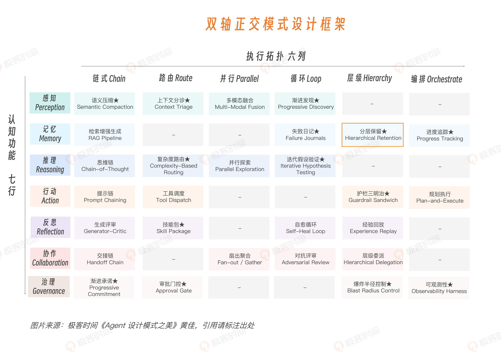
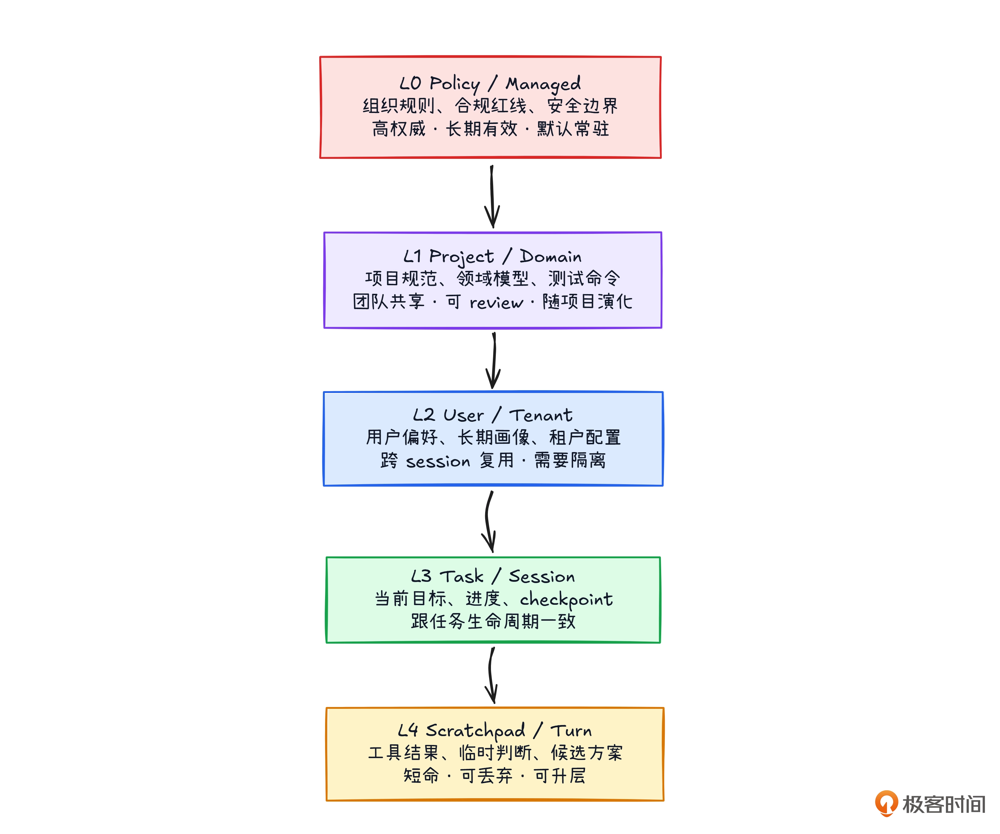
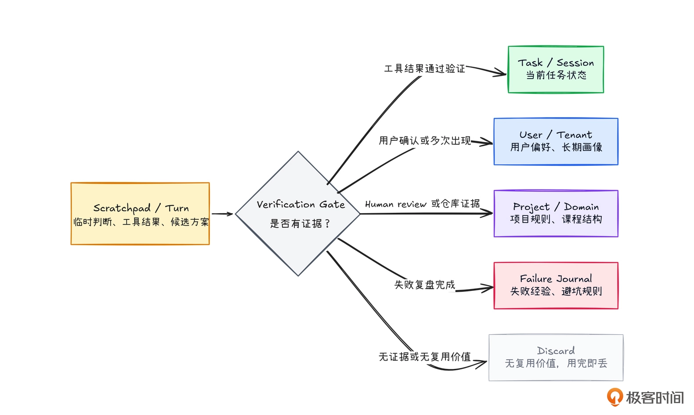
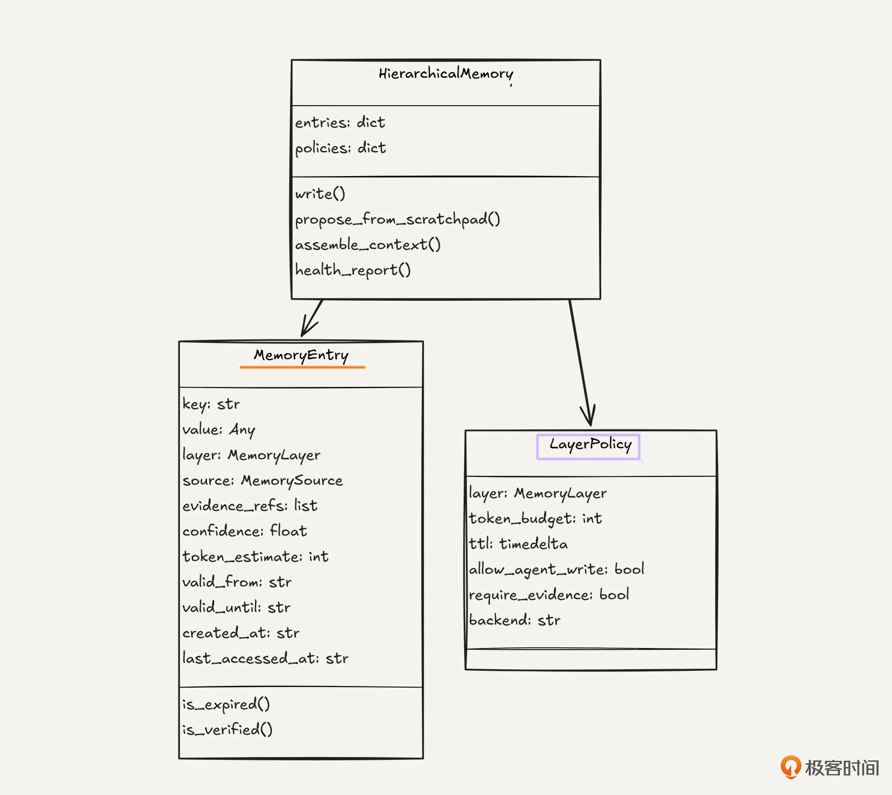
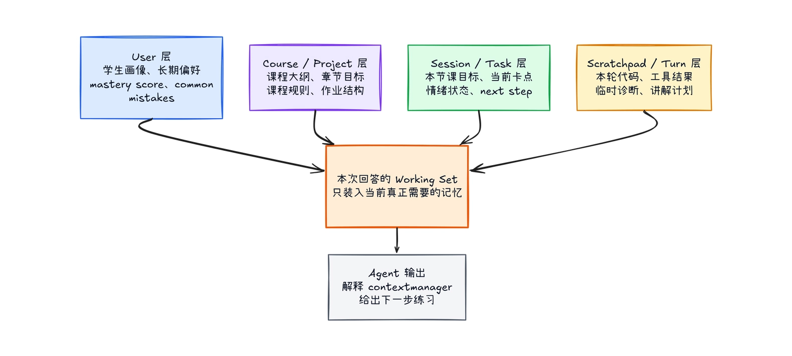
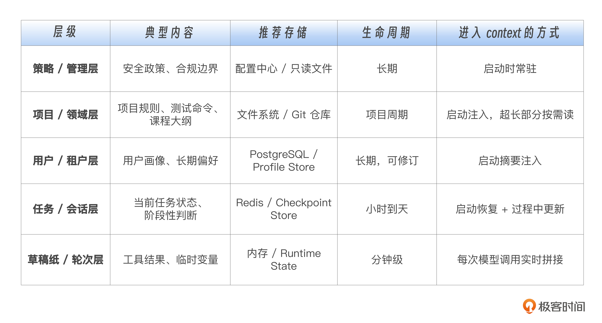
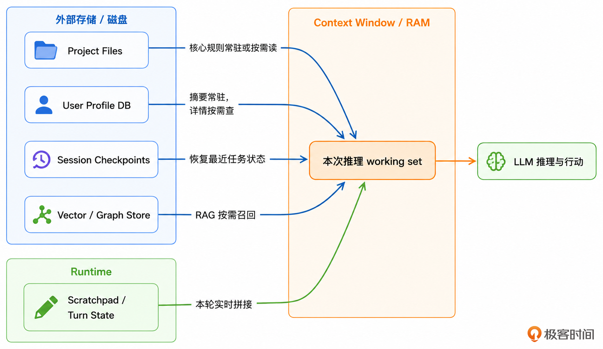

# 12 | 分层保留：给Agent的记忆建一套货架

你好，我是黄佳。今天我们进入记忆模式组的第一个具体模式：分层保留（HierarchicalRetention）。

上一讲我们说，记忆不是存储的堆叠，而是经验的治理。那这一讲要解决的，就是治理里的第一件事：先把货架搭起来。

做 Agent 记忆系统时，最容易犯的错是把所有东西都叫“记忆”。公司安全政策是记忆，用户偏好是记忆，项目规则是记忆，当前任务进度是记忆，刚刚工具返回的一段 JSON 也是记忆。名字都一样，但它们的作用范围、可信度和生命周期完全不同。

如果这些东西全都堆进同一个 prompt，短期看实现很快，长期看一定会乱。临时判断会被当成长期事实复用，长期规则会被当前会话里的工具结果覆盖，某个用户的偏好会串到另一个用户身上，某个项目的调试配置会被误当成团队规范。系统越跑越久，记忆库越像一个没人整理的仓库。

分层保留要做的，就是给 Agent 的记忆建一套货架。什么东西应该常驻 context，什么东西只在当前 session 有效，什么东西先停在 scratchpad，什么东西可以升级成长期记忆，什么东西过期后应该降权或删除，都要先有位置。

## 分层保留模式

在双轴图谱里，分层保留落在记忆 × 层级的交点。它是记忆，因为它处理跨轮、跨会话、跨任务的信息怎么留下来；它是层级，因为这些信息有天然的从属关系和覆盖关系。组织级规则高于项目偏好，项目规范高于当前会话里的临时猜测，当前任务目标又高于局部工具输出。



- 分层保留的关键词是从属、覆盖、加载顺序和生命周期

分层保留，就是把 Agent 的记忆按作用域、生命周期和可信度切成多层，让每一层有独立的加载策略、写入规则、淘汰规则和 token 预算。

这里最关键的词不是“多层”，而是“各有命运”。真正的分层，不是多建几张表，而是让不同类型的记忆拥有不同的存储位置、读取时机、覆盖规则和失效方式。

做分层时，不要一上来就问“到底分三层还是五层”。更稳妥的做法，是先问五个坐标。

- 第一，这条记忆的作用域是什么。它属于组织、项目、用户、任务、会话，还是当前一轮？

- 第二，它应该活多久。是几分钟、一个 session、一个项目周期，还是长期有效？

- 第三，它的权威来源是谁。是人写的、工具返回的、框架生成的，还是模型推断出来的？

- 第四，它有没有证据。是来自测试结果、代码路径、用户确认，还是只是模型的一次猜测？

- 第五，它要占多少上下文预算。它应该常驻 context，还是只在需要时被工具取回？

这五个坐标，比简单区分热、温、冷层重要。冷热分层主要回答访问频率，但回答不了公司合规规则能不能被覆盖，用户偏好能不能串租户，scratchpad 里的临时判断能不能进入长期记忆。长程 Agent 出问题，常常不是因为缺信息，而是因为不同可信度的信息被放在了同一个层级里：一条公司安全红线、一个用户口头偏好、一次工具调用结果、一个模型临时推断，被系统一视同仁。

分层，就是先给这些记忆分责任。


## 一套实用的五层货架

如果从零设计一个企业级 Agent 的记忆层，我建议先从五层开始想：策略 / 管理层（Policy /Managed）、项目 / 领域层（Project / Domain）、用户 / 租户层（User / Tenant）、任务 / 会话层（Task / Session）、草稿纸 / 轮次层（Scratchpad / Turn）。

策略 / 管理层是最高层，放组织级规则、合规红线和安全边界。比如生产数据库不能直接写，客户数据不能发送到未授权服务，涉及权限和账单的变更必须先生成计划再等待人工确认。这一层不是偏好，也不是建议，而是边界。它不能被用户一句话覆盖，也不能被当前 session 里的临时需求覆盖。

项目 / 领域层放项目规范、领域模型、代码架构和业务流程。对于开发者 Agent 来说，它可能

```
是 CLAUDE.md、AGENTS.md、README、测试命令和目录说明；对于课程 Agent 来说，它
```

可能是课程大纲、章节目标和作业结构。这一层最好贴近项目本身，因为项目规则不只是Agent 要看，人也要看。需要能进仓库、能 review、能 diff、能回滚。

用户 / 租户层放用户偏好、租户配置和长期个性化上下文。用户喜欢中文还是英文，喜欢先讲原理还是直接给结论，学生已经掌握哪些知识点，企业租户有哪些特殊配置，都属于这一层。用户层最怕自由文本堆积。“小李大概会一点装饰器”这种句子人能懂，但系统很难维护。半年以后，同一个概念可能出现多种写法，检索、统计、迁移都会变得混乱。长期用户记忆应该像数据库资产，而不是聊天日记。

任务 / 会话层放当前目标、里程碑、状态、checkpoint 和进度追踪（progress tracking）。它回答的是：这一轮任务现在推进到哪里，已经做了什么，下一步是什么，哪些方案被排除。它和 User 层的区别很重要。学生今天学装饰器时卡住了，这属于当前 session 的状态，不等于这个学生长期学得慢。短期状态可以影响当前策略，但不能随便污染长期画像。

草稿纸 / 轮次层放当前一轮工具结果、中间判断、候选方案和临时变量。它是工作台，不是档案馆。工具刚返回，规则还没核完，几个方案还没排除，下一步动作还没决定，这些东西都可以先放在草稿纸。等任务收束，系统再决定哪些要扔掉，哪些要写进任务层，哪些要进入用户层，哪些要沉淀成失败日记或长期经验。



- 五层记忆货架

这五层不是唯一标准。个人助手可能只需要用户 / 会话 / 轮次三层；开发者 Agent 通常至少需要项目 / 用户 / 会话 / 轮次四层；企业系统往往需要 组织 / 团队 / 项目 / 用户 / 会话 / 这样的更细边界。层数不是越多越好，关键是层数要和产品里的作用域一致。

记住，分层不是为了显得架构复杂，而是为了让 Agent 分得清：什么是边界，什么是偏好，什么是状态，什么只是草稿。

## 覆盖关系比层数更重要

分层之后，最重要的是覆盖关系。

策略层不能被覆盖，只能被执行。项目层可以覆盖通用默认值，但不能覆盖前者。用户层可以影响表达方式和个性化偏好，但不能覆盖项目的硬性规则。任务层可以决定当前优先级，但不能改写用户或项目里的长期事实。草稿纸只能提出候选判断，不能直接污染长期记忆。

这些常识人类可能下意识就做好判断了，但 Agent 却不行。一个销售 Agent 把用户这一次“我今天想看便宜点的方案”写成长期偏好，后面三个月都只推荐低价版本。一个代码 Agent 把一次临时 debug 的 mock server 地址写进项目规则，下一次生产发布还在读 mock。一个客服Agent 把某个租户的特殊折扣记成全局价格规则，另一个租户也被影响。

这些问题不能只靠数据库修好。它们的根因，是分层边界没守住。

比较好的做法是：内层可以临时影响外层的使用，但不能自动改写外层的事实。

当前会话里，用户说“我已经会装饰器了”，Agent 可以暂时把讲解难度调高一点。但要把用户层里的 mastery score 从 0.3 改到 0.6，需要更多证据，比如完成练习、连续解释正确、通过测试或用户确认。

```json
{
 "candidate_update": {
   "layer_from": "session",
   "layer_to": "user",
   "field": "mastery.decorator",
   "old_value": 0.3,
   "new_value": 0.6,
   "evidence": [
     "用户正确完成 decorator_exercise_2",
     "用户能解释 wrapper 返回函数"
   ],
   "confidence": 0.78,
   "requires_review": false
 }
}
```

这就是升层机制。草稿纸里的内容先是候选，任务层里的状态是当前事实，用户和项目层里的内容则需要更强证据。越长期、越高权威的层，越不能靠模型一句“我觉得”直接写入。

## 写入路由：先放工作台，再决定升层

上一讲我们强调了草稿纸（scratchpad）。到了分层保留这里，要把它正式纳入写入路由。

建议这样安排写入流程：Agent 在推理过程中，把中间判断、工具分析、候选方案先写进草稿纸；任务收束或验证通过后，再由记忆路由器（Memory Router）决定哪些内容升层。工具调用结果如果通过验证，可以写入任务 / 会话层。

被排除的方案如果有测试证据，可以进入进度追踪或失败日志 。用户明确偏好如果多次出现或被确认，可以进入用户层。项目约定如果有人类 review 或仓库证据，可以进入项目层。风险教训如果完成复盘，可以进入失败日志或经验记录。



- 从 scratchpad 到长期记忆的写入路由

这样设计，是为了避开两个极端。

一个极端是全都不记。Agent 每一轮都认真思考，任务结束后只留一句摘要，下一次又从头来。

另一个极端是全都记。草稿纸里的猜测、临时变量、过期工具结果和半成品判断全都进入长期记忆，跑久了以后，系统就像一个没有清理过的仓库。分层保留要建立的，是中间路线：先允许 Agent 把当前工作台用好，再用框架约束什么能沉淀、沉淀到哪一层、带什么证据、什么时候过期。

## 分层保留的最小代码骨架

下面是一份最小代码骨架。力求把分层保留最关键的几件事体现出来：作用域、生命周期、权威来源、证据、token 预算和升层规则。

```bash
from dataclasses import dataclass, field
from datetime import datetime, timedelta
from enum import Enum
from typing import Any
class MemoryLayer(Enum):
   POLICY = "policy"
   PROJECT = "project"
   USER = "user"
   TASK = "task"
   SCRATCHPAD = "scratchpad"
class MemorySource(Enum):
   HUMAN = "human"
   TOOL = "tool"
   AGENT_INFERENCE = "agent_inference"
   VERIFIED_TRACE = "verified_trace"
   FAILURE_REVIEW = "failure_review"
@dataclass
class MemoryEntry:
   key: str
   value: Any
   layer: MemoryLayer
   source: MemorySource
   evidence_refs: list[str] = field(default_factory=list)
   confidence: float = 1.0
   token_estimate: int = 0
   valid_from: str = field(default_factory=lambda: datetime.utcnow().isoformat()
   valid_until: str | None = None
   created_at: str = field(default_factory=lambda: datetime.utcnow().isoformat()
   last_accessed_at: str | None = None
   def is_expired(self) -> bool:
       if self.valid_until is None:
           return False
       return datetime.utcnow() > datetime.fromisoformat(self.valid_until)
   def is_verified(self) -> bool:
       return bool(self.evidence_refs) or self.source in {
           MemorySource.HUMAN,
           MemorySource.TOOL,
           MemorySource.VERIFIED_TRACE,
           MemorySource.FAILURE_REVIEW,
       }
@dataclass
class LayerPolicy:
   layer: MemoryLayer
   token_budget: int
   ttl: timedelta | None
   allow_agent_write: bool
   require_evidence: bool
   backend: str
class HierarchicalMemory:
   def __init__(self) -> None:
       self.entries: dict[str, MemoryEntry] = {}
       self.policies = {
           MemoryLayer.POLICY: LayerPolicy(
               layer=MemoryLayer.POLICY,
               token_budget=1200,
               ttl=None,
               allow_agent_write=False,
               require_evidence=True,
               backend="managed_file",
           ),
           MemoryLayer.PROJECT: LayerPolicy(
               layer=MemoryLayer.PROJECT,
               token_budget=3000,
               ttl=None,
               allow_agent_write=False,
               require_evidence=True,
               backend="git_file",
           ),
           MemoryLayer.USER: LayerPolicy(
               layer=MemoryLayer.USER,
               token_budget=1500,
               ttl=None,
               allow_agent_write=True,
               require_evidence=True,
               backend="postgres",
           ),
           MemoryLayer.TASK: LayerPolicy(
               layer=MemoryLayer.TASK,
               token_budget=5000,
               ttl=timedelta(days=7),
               allow_agent_write=True,
               require_evidence=True,
               backend="checkpointer",
           ),
           MemoryLayer.SCRATCHPAD: LayerPolicy(
               layer=MemoryLayer.SCRATCHPAD,
               token_budget=2500,
               ttl=timedelta(hours=2),
               allow_agent_write=True,
               require_evidence=False,
               backend="runtime_state",
           ),
       }
   def write(self, entry: MemoryEntry) -> None:
       policy = self.policies[entry.layer]
       if not policy.allow_agent_write and entry.source == MemorySource.AGENT_IN
           raise ValueError(f"Agent cannot write directly to {entry.layer.value}
       if policy.require_evidence and not entry.is_verified():
           raise ValueError(f"{entry.layer.value} memory requires evidence")
       self.entries[entry.key] = entry
   def propose_from_scratchpad(
       self,
       entry: MemoryEntry,
       target_layer: MemoryLayer,
   ) -> MemoryEntry:
       if entry.layer != MemoryLayer.SCRATCHPAD:
           raise ValueError("Only scratchpad entries can be promoted")
       return MemoryEntry(
           key=entry.key,
           value=entry.value,
           layer=target_layer,
           source=MemorySource.VERIFIED_TRACE,
           evidence_refs=entry.evidence_refs,
           confidence=entry.confidence,
           token_estimate=entry.token_estimate,
       )
   def assemble_context(self) -> list[MemoryEntry]:
       selected: list[MemoryEntry] = []
       for layer in [
           MemoryLayer.POLICY,
           MemoryLayer.PROJECT,
           MemoryLayer.USER,
           MemoryLayer.TASK,
           MemoryLayer.SCRATCHPAD,
       ]:
           budget = self.policies[layer].token_budget
           used = 0
           layer_entries = [
               entry
               for entry in self.entries.values()
               if entry.layer == layer and not entry.is_expired()
           ]
           layer_entries.sort(
               key=lambda entry: (
                   entry.confidence,
                   entry.last_accessed_at or entry.created_at,
               ),
               reverse=True,
           )
           for entry in layer_entries:
               if used + entry.token_estimate > budget:
                   continue
               selected.append(entry)
               used += entry.token_estimate
               entry.last_accessed_at = datetime.utcnow().isoformat()
       return selected
   def health_report(self) -> dict[str, Any]:
       return {
           "layers": {
               layer.value: {
                   "backend": policy.backend,
                   "token_budget": policy.token_budget,
                   "ttl_seconds": None if policy.ttl is None else policy.ttl.tot
                   "allow_agent_write": policy.allow_agent_write,
                   "require_evidence": policy.require_evidence,
                   "entry_count": sum(
                       1 for entry in self.entries.values() if entry.layer == la
                   ),
               }
               for layer, policy in self.policies.items()
           }
       }
```

这段代码里有几个设计点。

```
第一，SCRATCHPAD 是正式层。它不能只是“随便写几句”，而要有 TTL、有预算、有升层规
```

则。

```
第二，POLICY 和 PROJECT 默认不允许 Agent 直接写。Agent 可以提出修改建议，但要经过
```

人类 review、仓库证据或外部工具证据。

```
第三，require_evidence 把“能不能长期保留”跟证据绑定起来。长期记忆不能只靠模型一
```

句“我觉得”。

```
第四，assemble_context() 是按层组装，而不是简单按时间排序。这样组织规则、项目
```

约定、用户偏好、任务状态、scratchpad 不会互相挤。



MemoryEntry 数据结构所展示的，是分层保留不是只有 layer 名字，还要把来源、证据、过期时间、token 预算和写入权限一起纳入结构化的 schema。

## 用户场景：编程教练 Agent 的四层落地

我们最后用一个完整场景阐述分层保留：假设我们做一个在线 Python 编程教练 Agent。它不是一次性答疑，而是要跨会话陪学生学习。

第一版的设计也许是无状态的，学生第三次来，它还问：“你学过 list 吗？”这当然很糟糕，因为每次会话都像换了一个老师。

第二版把所有历史对话存起来，新会话开始时全量塞进 prompt。它不再问 list 了，但又出现新的问题：Agent 一直围着 list、dict、loop 打转，忘了学生已经学到装饰器。它不是没记住，而是记得太多、分不清轻重。

第三版才是分层。用户层记录学生长期画像，比如 Python 经验、学习目标、偏好的讲解方式，以及每个知识点的掌握程度。项目层记录课程结构，比如现在是 Python 进阶第七章，主题是装饰器和上下文管理器，课程规则是先给最小代码例子再解释术语。会话 / 任务层记录本节课的目标、已讲过的小主题、当前卡点和情绪状态。草稿纸 / 轮次层记录这一轮学生发来的代码片段、工具结果、临时诊断和下一步讲解计划。

可以把它写成这样的分层对象：

```json
{
 "user_layer": {
   "student_profile": {
     "age_group": "high_school",
     "english_level": "B1",
     "python_experience_months": 6,
     "teaching_preference": "example_first",
     "learning_goal": "3 个月内做出一个个人项目"
   },
   "mastery": [
     {
       "topic_id": "list",
       "score": 0.9,
       "last_practiced": "2026-04-10",
       "common_mistakes": []
     },
     {
       "topic_id": "decorator",
       "score": 0.4,
       "last_practiced": "2026-04-15",
       "common_mistakes": ["忘记写 @", "分不清 wrapper 和 inner"]
     }
   ]
 },
 "project_layer": {
   "course": "Python 进阶 · 装饰器与上下文管理器",
   "current_chapter": 7,
   "total_chapters": 12,
   "chapter_goal": "理解 decorator、closure、context manager 的关系",
   "course_policy": "每个新概念先给最小代码例子，再解释术语"
 },
 "session_layer": {
   "session_goal": "理解 contextmanager 装饰器",
   "covered_topics": [
     "@contextmanager 基本用法",
     "__enter__ / __exit__ 协议",
     "嵌套 with"
   ],
   "student_questions": [
     "为什么 yield 后面的代码会在退出 with 时执行？"
   ],
   "emotion_state": "confused",
   "next_step": "用文件打开/关闭的例子重新解释 contextmanager"
 },
 "scratchpad_layer": {
   "current_user_code": "with open('a.txt') as f:\\n    data = f.read()",
   "tool_result": "syntax_check_passed",
   "temporary_hypothesis": "学生理解 with 语法，但不理解 contextmanager 的 yield 分界
   "response_plan": "从 with 的进入和退出时机讲起"
 }
}
```

分层做对之后，Agent 在新 session 启动时不需要读取全部聊天记录。它只要知道这个学生是谁，这门课讲到哪，上次卡在哪里，当前这一轮正在看哪段代码。这样它才像一个真正的教练：不重复教已经会的，不跳过还没学的，也不会把今天用户的一次发挥失常误判成长期能力标签。



- 编程教练 Agent 的四层记忆

关键细节如下：

- 学生“今天卡住了”，应该先放会话层，不能马上写进用户层。今天卡住不等于这个学生长期学得慢。

- 学生连续三次在装饰器上犯同一个错，可以从会话层升到用户层，写成common_mistake。这时需要证据，比如三次作业、三次会话 trace，或者一次明确的练习结果。

- 本轮代码片段只放草稿纸 / 轮次层。它对当前讲解很重要，但不该长期保存，除非它暴露了一个可复用的学习弱点。

- 课程大纲应该放项目层，由人或课程系统维护。Agent 不应该因为一次对话就改写课程结构。

分层做对之后，Agent 不是“记性变好”这么简单，而是开始分得清：什么是学生长期特点，什么是这节课的状态，什么只是这一轮的草稿。

## 工程落地时看的三件事

在工程中实现分层保留要注意三件事：存哪里，何时读，何时写。

存哪里，不应该默认所有层都用同一个后台。策略层适合配置中心、只读文件或管理后台。项目层适合文件系统和 Git 仓库，因为它需要 review、diff 和 blame。用户层适合 profile store或关系数据库，因为它是长期资产，需要 schema、版本和迁移。任务 / 会话层适合检查点存储（checkpoint store），因为它要恢复状态。草稿纸 / 轮次层适合运行时状态（runtimestate），因为它高频变化、短期有效，用完就该清理。



何时读，也不能一股脑全塞回 prompt。策略层启动时加载关键规则，但要短。项目层启动时加载核心约定，长文档只放 handle，需要时再读。用户层启动时加载摘要，必要时按字段查详情。任务层恢复最近状态，不加载完整历史。草稿纸 / 轮次层只在当前模型调用前拼接，用完就丢。分层存储如果最后又全量读取，只是把仓库分了区，出门时还是把整个仓库背在身上。

何时写，更要分层。普通 Agent 可以用“定时写回 + session 结束兜底”。高风险场景，比如金融、医疗、权限审批，要用“关键状态实时写回 + 一般状态批量写回”。不要只等 session 结束再写。长程 Agent 跑半小时，中途崩一次就丢一大段状态，这种体验会让人很快失去信任。

长期层还要有 schema 纪律。项目 / 用户这种长期层最好带版本号、来源、置信度、证据和有效期。不要只写：

```json
{
 "learning_pace": "slow"
}
```

更完整的写法是：

```json
{
 "learning_pace": {
   "value": "slow",
   "source": "agent_inference",
   "confidence": 0.68,
   "evidence": "连续两次在 decorator 练习中请求基础解释",
   "set_at": "2026-06-15",
   "scope": "current_course",
   "schema_version": "2026-06-01"
 }
}
```

多几个 metadata 字段，写的时候麻烦一点，debug 时会救命。因为你会知道：这是用户自己说的，还是 Agent 推断的？置信度是多少？什么时候写入？适用范围是当前课程，还是所有学习场景？

## 分层记忆可以类比为操作系统的工作集（working set）

讲到这里，你可能会觉得，分层保留不就是数据库 schema 设计吗？User 表、Project 表、Session 表、Turn 表，加上 TTL、索引和权限，传统 Web 应用也这么干。

这个判断只对了一半。另一半是 LLM Agent 独有的问题：prompt context 是有限的，而且Agent 每一次推理真正需要的记忆是不确定的。

传统 Web 应用里，一个 dashboard 请求要查哪些表、哪些字段，通常是确定的。但 Agent 不一样。这一轮它可能需要用户偏好，下一轮它可能需要项目测试命令，再下一轮它可能需要上周某次失败经验。有时它需要课程大纲，有时只需要当前代码片段。你很难在设计时精确知道每一次 LLM 调用到底需要哪些记忆。

这就像操作系统里的工作集（working set）。一个进程在某段时间内真正活跃使用的内存页，应该留在 RAM 里；不活跃的可以换出到磁盘，需要时再换回来。估得准系统运行就流畅；估不准就会频繁 swap，性能崩掉。

LLM Agent 的 上下文窗口就相当于 RAM。外部文件、数据库、向量库、图数据库，就是磁盘。当前这次推理真正需要的记忆集合，就是 working set。

分层保留的本质，是给 Agent 一个工作集的先验。策略层通常常驻，因为它定义边界。Project 层常驻或半常驻，因为它定义项目规则。用户层用摘要常驻，因为 Agent 总要知道用户是谁。任务 / 会话层动态进入，因为只需要最近任务状态。草稿纸 / 轮次层只在当前轮进入，用完就丢。大体量语义记忆通常不常驻，而是交给下一讲的 RAG 按需取回。



- 分层保留作为 working set 管理器

所以，分层保留不是为了让 schema 看起来漂亮，而是为了提高 Agent 推理时的工作集命中率。好的分层，不看你存了多少，而看这一次该进入上下文的东西有没有进入，不该进入的东西有没有挡在外面。

## 小结

记忆模式组的第一个模式分层保留它决的是“架”的问题：先给 Agent 的记忆搭一套合理货架，再讨论检索、进度和失败日记。

1. 分层的第一原则，是按作用域、生命周期和可信度分层。公司级、项目级、用户级、任务级、草稿纸级记忆，不应该混在一起。

2. 分层的第二原则，是每层都要有独立的工程命运。每层应该有自己的 backend、TTL、token 预算、schema、加载规则、写入规则、覆盖规则和淘汰规则。

3. 分层的第三原则，是长期层要结构化，临时层要可丢弃。项目层和用户层要像资产一样管理，任务 / 会话层要像状态一样恢复，草稿纸 / 轮次层要像草稿纸一样用完即走。

4. 最后，分层保留不只是数据库 schema，而是 LLM 时代的工作集管理器。它决定哪些记忆常驻 context，哪些按需 swap in（换入），哪些长期 swap out（换出）。

最后提醒大家分层保留可能出问题的几个地方。

- 最常见的是把所有历史对话塞进 prompt，看起来最省事，实际上很快会把 Agent 拖进噪声里。长程任务后半段的很多迷失，不是因为 Agent 没有上下文，而是因为上下文里旧信息太多、权重又没有分层。

- 第二种是自由文本长期记忆。用户偏好、知识掌握度、项目约定这些长期资产，如果都写成散文，半年之后就很难维护。同一件事有十种说法，检索不稳定，更新也不可靠。长期层至少要把高频字段 schema 化。

- 第三种是 scratchpad 直通长期记忆。scratchpad 里的内容价值很高，但它是半成品，里面有猜测、临时解释、未验证观察和候选方案。它应该被验证、蒸馏、加证据后再升层，而不是原样长期保存。

- 第四种是没有降权机制。记忆写进去以后永远有效，非常危险。用户偏好会变，业务规则会变，代码结构会变，政策也会变。没有版本、来源、证据和失效条件，旧记忆就会变成新判断的毒药。

分层的目标，不是把记忆放整齐，而是让 Agent 在长程任务里分得清什么该信、什么该用、什么该忘。

## 思考题

1. 你可能注意到了分层保留模式的讲解过程中，我并没有给出各种 Harness 的工程现场切片，因为我觉得上面的讲解示例清晰，一气呵成。对各种 Harness 的分层保留分析就留给大家完成，请在评论区里面谈一谈你熟悉的 Harness 系统如何做分层保留（可以用 AI 辅助分析）。

2. 画出你当前 Agent 的记忆货架。它有哪些层？公司级、项目级、用户级、任务级、scratchpad 级分别在哪里？有没有几类信息现在被塞在同一个 history 字段里？

3. 找一条你系统里最近写入的长期记忆。它有没有来源、证据、版本和失效条件？如果没有，下一次它被错误召回时，你准备怎么判断它已经不该用了？

4. 检查你的草稿纸。它是只服务当前任务的工作台，还是已经变成长期记忆的垃圾入口？给它设计一条最小升层规则：什么内容能进入任务层，什么内容能进入用户层，什么内容必须任务结束后丢掉。

期待你在留言区记录想法或者提出问题 。也可以把今天的内容转发给身边的朋友，一同讨论。

## 下一讲预告

下一讲我们正式进入第二个具体记忆模式——检索增强（RAG）。分层保留解决“货架怎么搭”。检索增强解决“货架太大以后，当前这一轮到底该取哪几件东西”。

检索增强也是 2023 年大火、2024 年泛滥、2025 年开始反思、2026 年正在重新被定位的一个模式。到了 Agent 时代，它不能再被当成万能入口。它要回到记忆系统里，成为语义记忆那一层的取回方式。

我们下一讲见。
