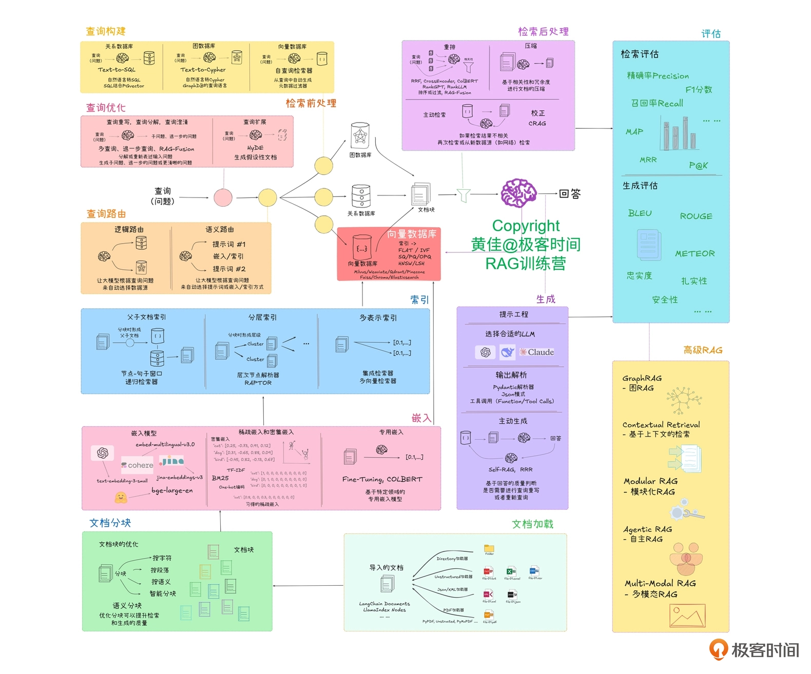
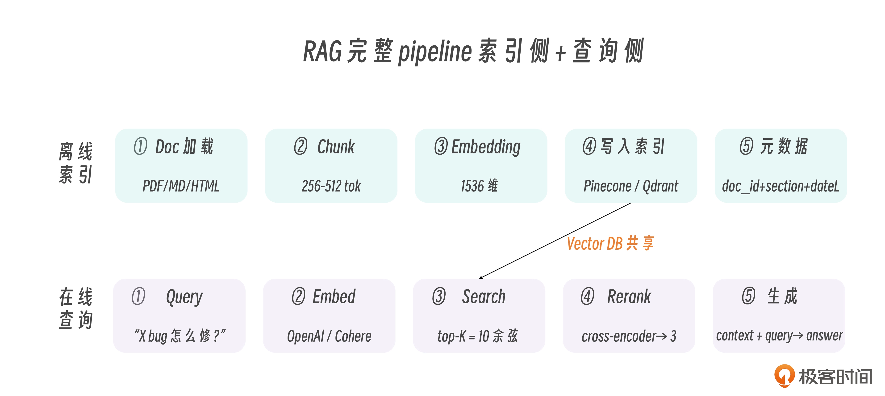
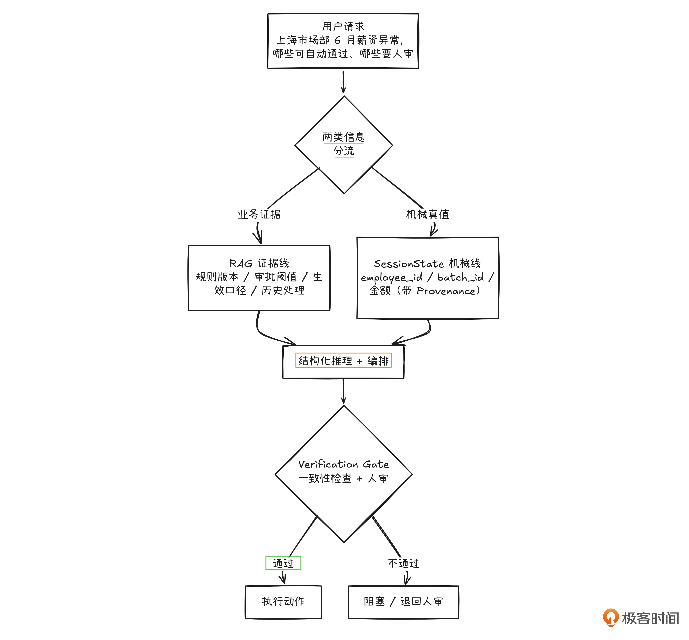
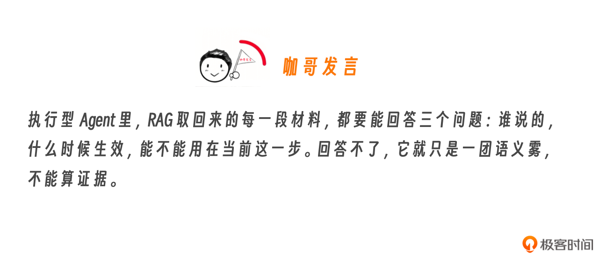
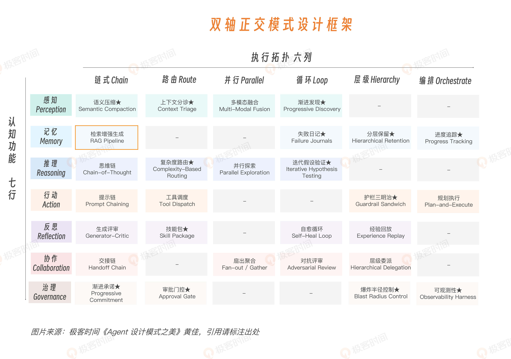
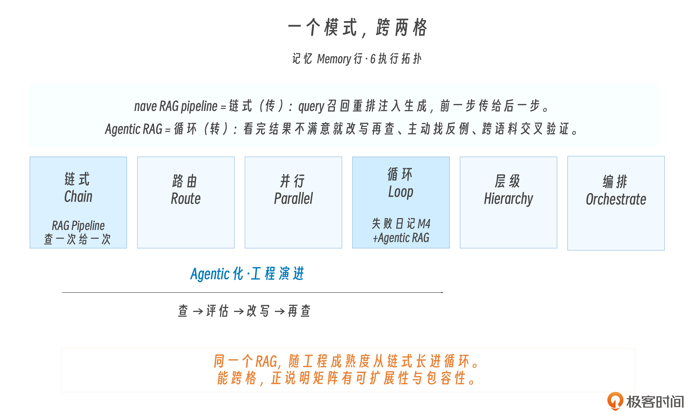
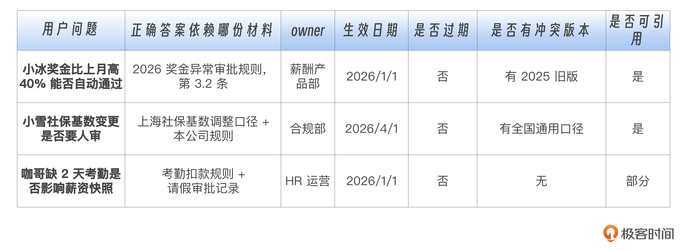
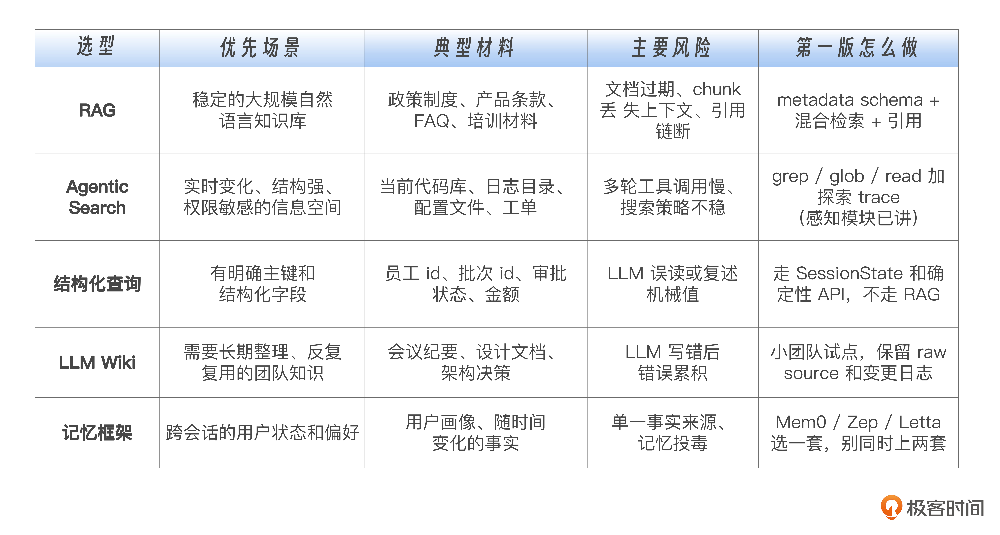
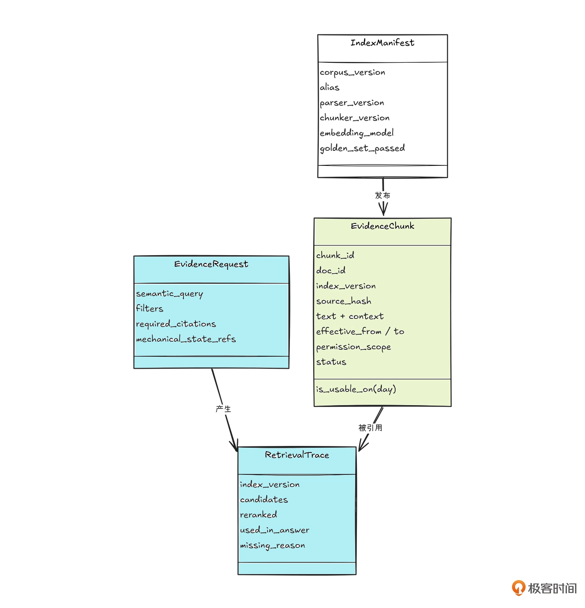

# 13 | 检索增强：Agent的知识库和证据链

你好，我是黄佳。今天我们继续讲记忆模式组的第二个具体模式，检索增强，也就是大家更熟悉的 RAG。

上一讲分层保留，我们先给 Agent 的记忆建了一套货架。策略 / 管理层、项目 / 领域层、用户/ 租户层、任务 / 会话层、草稿纸 / 轮次层，各有各的位置，也各有各的命运。

货架搭好以后，下一件事就是“取”。在真实系统里，货架里最大的一层，往往是语义记忆。公司制度、产品条款、历史政策、FAQ、培训材料、合同模板、研发文档，体量动辄几千份文档、几十万个片段。这些东西不可能常驻上下文窗口，只能在需要时取回来。

这就是 RAG 要解决的问题。



- 佳哥制作的 RAG 架构图

RAG 在 2023 年大火，2024 年泛滥，2025 年开始被反思，2026 年则正在被重新定位。Embedding、向量库、top-K、reranker 这些基础概念，我这一讲不重复（大家也可以去我的代码仓库里面去了解 RAG 相关知识点）。

我们聚焦一个更贴近记忆模块的问题：在 Agent 时代，RAG 怎样从“相似文本召回”，升级成“可用、可信、可追溯的证据取回”？

## RAG 为什么算记忆，不算感知

我也曾思考过，RAG 最后不也是把几段材料塞进 context，让模型这一轮“看见”吗？为什么不把它归在感知模式？

只看最后一步，RAG 确实参与感知，它把召回到的片段送进当前上下文，影响模型这一轮能看到什么。但这一讲讨论的 RAG，重心在前面那半段。

```
感知问的是：这一次推理前，哪些材料进入 context。
```

- 记忆问的是：这些长期知识怎样保存、索引、更新、过期、回滚。

RAG 的写入侧（索引侧）要管知识源登记、文档解析、切块、向量化、关键词索引、索引版本和权限范围；读取侧（查询侧）是大家熟悉的过滤、召回、重排、引用。只关注读取侧，RAG 很容易退化成给模型喂几段相似文本。



- RAG 是索引侧和查询侧两条链路的汇合：离线把文档整理成可发布、可回滚的索引资产，在线按当前任务约束取回带出处的证据

能进生产的 RAG，重点在于写入侧。要先把外部知识库做成一份可发布、可追溯的软件资产，然后才能够被加工成可持续读取、可版本控制、可回滚、可审计的记忆层。

## 从一个薪酬 SaaS 的真实问题讲起

我们用一个企业 SaaS 场景来讲。当用户发来如下要求：

```
帮我看一下上海市场部 6 月薪资快照里的异常。
咖哥缺 2 天考勤，小冰奖金比上月多 40%，小雪社保基数变了。
```

- 哪些可以自动通过，哪些要人审？

看起来这像一个问答任务，其实里面混着两类完全不同的信息。

第一类是机械状态。员工 id、薪资批次 id、考勤记录 id、奖金审批单号、社保基数 id，这些值必须按位精确。它们应该来自工具返回和 SessionState，由程序确定性绑定，并且带着provenance，也就是它从哪个工具、哪一次调用来的。LLM 不能凭印象复述一个 id，更不能从 RAG 里找一个“看起来像”的 id。

第二类是业务证据。6 月薪酬规则的版本、上海市场部适用的考勤扣款口径、奖金审批阈值、社保基数调整的生效规则、哪些异常需要人审，这一类才适合 RAG。它们来自制度文档、审批规则、历史政策和内部知识库。Agent 要回答“能不能自动通过”，需要的是当前任务真正适用的那一条规则，而不是几段语义相似的材料。

```
如果 RAG 召回了一段“上月奖金异常处理 FAQ”，模型顺手把里面的 payroll_batch_id 当
```

成本月批次 id，这就是机械状态被污染。反过来，如果 SessionState 里只有批次 id，却没有召回本月的规则版本，Agent 又会基于缺证据的判断强行下结论。

所以执行型 Agent 里的 RAG，是 SessionState 提供机械真值。RAG 提供业务证据。最终决策要同时绑定这两者，并且都带着来源（provenance）。

RAG 管的是叙事证据和知识记忆。它能告诉 Agent “这条奖金规则该怎么解释”，但它不能替Agent 生成“对哪个薪资批次执行哪个动作”的关键参数。证据和真值分属两个平面，最后在决策点合流。



- RAG 证据线和 SessionState 机械线，在结构化推理处合流，再过 Verification Gate。RAG 取回业务证据，SessionState 托管员工、批次、金额等机械真值，两条线



## RAG 的来龙去脉：从“相关文档”到“可用证据”

2020 年 5 月，Patrick Lewis 等人在 NeurIPS 的论文《Retrieval-Augmented Generationfor Knowledge-Intensive NLP Tasks》里第一次正式提出 RAG。核心想法是让生成模型在回答前，先去一个外部文档库里检索相关段落，把检索到的内容和问题一起送进模型。模型不必把所有知识都背进参数，需要时去查就行。

但检索这件事，比 RAG 古老得多。

RAG 的“取”这一半，血缘祖先是信息检索（information retrieval）。倒排索引、TF-IDF、BM25、向量空间模型，这些上世纪七八十年代就成熟的技术，解决的都是同一个问题：在一大堆文档里，按相关性把最可能有用的几篇排到前面。今天 RAG 里的 BM25 关键词召回，延续了这条几十年的老脉络。而稠密向量召回，则是把“相关性”从词面匹配换成了语义匹配。

而 RAG 的“证据”这一半同样重要。索引要有版本、文档要有来源、答案要能追回出处，这套要求来自企业数据工程：数据血缘（data provenance）、ETL 的可复现、内容寻址存储的hash 校验、发布系统的蓝绿部署。

信息检索的目标是“找到相关文档”，它默认屏幕前有一个人，会自己判断哪条能用、哪条过期、哪条不适用。但最原始的 Agent 系统中没有这个人。Agent 拿到召回结果就直接往下推理、往下执行。于是“相关”远远不够。Agent 要的是当前这个任务、这个租户、这个时间点、这个权限范围下，真正适用且可引用的证据。相关性是给人看的排序，证据是给机器用的依据。

2025 年业界集体意识到了这个问题。Chroma 在 的 Context Rot 研究里测了 18 个前沿模型，发现输入越长、待找信息和问题的语义相似度越低，模型表现退化得越明显。把一大堆“相似”材料堆进长上下文，并不会让模型更准。同年 ICML 2025 的 LaRA 基准用 2326 个用例得出一个的结论：RAG 和长上下文谁更好，取决于模型规模、上下文长度、任务类型和召回片段的质量，没有一个方案通吃。这些反思说明，朴素 RAG（Naive RAG） 那种“查一次、塞进去、生成”的相似召回，在生产里不够用了。

现在把 RAG 放回双轴图谱。刚才曾经说它落在记忆行，其实有争议，但更有争议的是它落在哪一列。经典的 Naive RAG 是链式（所以我在总模式表中把他归入链式），前一步把结果交给后一步。



```
文档进库 → 解析切块 → 建关键词索引和向量索引
→ 查询时召回候选 → 重排过滤 → 注入上下文 → 生成答案和引用
```

但 2024 年以后，越来越多系统在这条链外面加了一圈回路。LangChain 提出：朴素 RAG 用的是 chain，检索一次就生成。要支持“检索 → 评估文档 → 改写查询 → 再检索”的循环，用的就是状态机（state machine）。CRAG 和 Self-RAG 就是这套循环的两个实例。这种加了回路的 RAG，就是大家说的 Agentic RAG，它应该落在循环列。

所以同一个 RAG，会随着工程成熟度，从链式演进成循环（当然也可以出现检索路由和并行检索模式，参考佳哥的 RAG 实战课一书）。



- RAG 跨两格：naive RAG = 记忆 × 链式（一次性流水线），Agentic RAG = 记忆 × 循环（带评估—改写回路）

同一模式可以存在多种拓扑结构，也说明双轴矩阵本来就是描述性的，允许一个模式随成熟度跨格，未来也可以出现同一个认知功能 + 拓扑结构存在多种模式的情况。

## RAG 到底难在哪里？

很多团队第一次做 RAG，会把问题理解成“召回率不够”。于是换 embedding 模型，调 chunksize，换向量库，把 top-K 从 5 调到 20。调完以后 demo 往往好看一点，生产问题却不一定能解决。

生产 RAG 的失败，通常不是一个点坏了，而是几个环节叠在一起。

知识源本身可能没治理好。文档过期、互相矛盾、没有 owner、同一个概念有好几个名字。这样的知识库 embed 进向量库以后，矛盾不会消失，只会变成更难排查的矛盾。

切块也可能切坏。条款、表格、代码注释、PDF 页眉页脚被硬切开，模型召回一段文字时，看不出它属于哪一章、哪一版、哪一条。

```
metadata 可能太薄。很多团队只存 doc_id 和 text，但真实业务检索需要的是
effective_date、product_version、region、permission_scope、
source_owner、document_status。
```

召回也不能只看语义相似。自然语言相似当然重要，但企业系统里，产品代码、合同编号、错误码、条款号、地区编码同样关键。只靠 embedding，经常漏掉这些精确线索，所以才需要BM25 和稠密向量混合检索。

最后，答案如果没有引用链，就很难进入严肃业务。用户看到一段自然语言回答，却不知道它来自哪份材料。出错以后，工程师也分不清问题出在召回、重排、生成，还是知识源本身。

把这些问题放在一起看，RAG 其实是一条知识供应链。

供应链做的从来不是简单搬运。它要把正确的东西，在正确的时间，以正确的包装，送到正确的人手里。RAG 要做的，是把正确的证据，按当前任务的约束，带着可追溯的出处，送到模型面前。

## 企业 RAG 的第一件事：知识源和数据治理

这里有一个先后顺序问题。很多企业 RAG 项目开会时，第一张 PPT 会写技术栈：向量数据库、embedding 模型、reranker、LLM、LangChain 或 LlamaIndex。技术栈当然要选，但它不该是第一件事。

真实的 RAG 项目，第一件事应该是看知识源。你可以拿一批真实问题，做一张证据表。



这张表比一开始就建索引更重要，因为它会暴露几个基础问题：哪些知识没有 owner，哪些文档已经过期，哪些口径互相冲突，哪些材料不能给当前 Agent 看，哪些答案根本没有可引用证据。

如果这张表都填不出来，RAG 项目很容易变成“把企业知识的混乱自动化”。Agent 看起来更快了，错误传播也更快了。

所以，企业 RAG 的落地顺序应该是这样的：

- 先收集真实问题和正确证据，再给知识源补 owner、版本、生效日期和权限。

- 然后定义 chunk schema、citation schema 和 index manifest。

- 接着建 candidate index，用 golden questions 做回归。通过以后再切 alias 或 currentpointer。

- 最后接入答案引用、RetrievalTrace 和索引版本监控。

- 等这些基础打稳，再考虑 Agentic RAG、多轮检索和 LLM Wiki。

- 有关于企业知识本体和知识工程的建设指南，佳哥最近也在做更深入的思考，如果你有相关思考、实践和疑惑，也可以多多在留言区一起探讨。希望后面能够有更好的体系化作品呈现给大家。

## 向量索引库怎么建：先有 manifest，再有 vector DB

这几年大家不再把向量数据库单纯当成取信息的黑盒，而是开始意识到索引也是一份可以发布的软件资产。一套 RAG 索引应该说得清楚：它来自哪些源文档，用哪个解析器、哪个切块策略、哪个 embedding 模型生成；当前在线的是哪个版本，上一版在哪里；出问题以后能不能回滚；某个答案到底用了哪一版索引里的哪个 chunk。

一个比较实用的索引建设流程，可以拆成六步。

第一步，先做知识源登记。

```
每份文档进入系统时，不要只给一个文件名。至少要有稳定的 doc_id、source_uri、
owner、permission_scope、effective_from、effective_to、source_hash 和
document_status。这些字段看起来像后台管理，但后面会决定 RAG 能不能正确过滤版
```

本、权限和过期材料。

第二步，做可复现的切块。

```
chunk 不能只靠“今天脚本怎么切就怎么切”。更好的做法是把 parser_version、
chunker_version、chunk_index、text_hash 都记录下来，让 chunk_id 能稳定生
```

成。

```
chunk_id = hash(
   doc_id
   + parser_version
   + chunker_version
   + str(chunk_index)
   + text_hash
)
```

第三步，建立 ingestion manifest。

manifest 的读者通常是工程团队和运维系统，包含当前版本索引的构建参数。

```
raw_docs:
 - payroll-bonus-policy-2026-v2.pdf
index_manifest:
 corpus_version: payroll-policy-2026-06-14
 parser_version: pdf-parser-2.4
 chunker_version: clause-aware-v2
 embedding_model: bge-m3
 embedding_dim: 1024
 hybrid_index_version: bm25-cn-v1+dense-v3
 collection: payroll_rag_20260614_candidate
 alias_after_release: payroll_rag_current
 source_count: 1842
 chunk_count: 53218
 golden_set_passed: false
```

上面的列表示例记录了一版索引的全部构建参数：corpus 版本、解析器版本、切块器版本、embedding 模型和维度、混合索引版本、collection 名、源文档数、chunk 数。LlamaIndex 的

```
ingestion pipeline 会通过 docstore，用 doc_id -> document_hash 的映射判断文档是否
```

变化，hash 变了才重处理，没变就跳过。这也是索引版本控制的起点。

第四步，做候选索引和灰度发布。

不要在生产 collection 里直接重建索引。更稳的做法，是先生成一个候选索引，比如

```
payroll_rag_20260614_candidate，再用一组 golden questions 做回归测试。这里的
```

golden questions，不是普通测试用例，而是业务上最容易出错、最需要稳定召回的关键问题。你要检查它们的召回结果是否命中了正确证据，引用是否能追到原文，权限过滤是否生效，过期文档有没有被排除。

只有这组问题通过以后，候选索引才有资格进入线上发布流程。不要因为“索引构建成功”就急着切生产。RAG 的索引不是建出来就算完成，它要先证明自己能回答那些真正重要的问题。

第五步，用别名或线上指针做蓝绿切换。

通过回归测试以后，也不要让业务代码直接绑定某个具体 collection。更好的做法，是让应用

```
侧始终访问一个稳定别名，比如 payroll_rag_current。底层可以从旧 collection 切到新
```

collection，但业务代码不需要知道具体切到哪一版。

这和传统软件里的蓝绿部署很像。旧索引是 blue，新索引是 green。新索引先在旁边构建、验证、灰度，通过以后再把 alias 或 current pointer 指过去。Milvus 的 collection alias 就是这类思路的典型工具：应用访问稳定别名，底层 collection 可以动态切换，用于数据更新、A/B 测试和生产环境的平滑发布。LanceDB 则进一步强调版本化写入和 time-travel，让索引可以回到历史版本。这样的索引不再是一坨“建好就放那儿”的向量，而是一份可以发布、灰度、切换、回滚的软件资产。

第六步，处理删除、退休、备份和回滚。

索引发布以后，还要认真处理它的下线和恢复机制。很多 RAG 事故看起来像“新文档没生效”，根子却是旧文档还在回答问题。被替换的薪酬规则、废止的审批口径、权限收紧的内部

```
材料，不能继续躺在索引里参与召回。要么从索引中删除，要么用 status、
effective_to、permission_scope 这类字段严格过滤，默认不让它进入当前任务的证
```

据集合。

删除和退休之外，还要准备备份、快照和回滚。生产系统不能等事故发生后才第一次演练恢复。索引越大，恢复越慢；权限越复杂，回滚越容易牵涉业务状态。所以每一版索引都应该能回答几个问题：上一版在哪里？这一版用了哪些源文档和构建参数？如果新索引召回质量下降，能不能快速切回旧版？如果某批文档误入库，能不能定位并清掉对应 chunk？

到这一步，RAG 索引才真正成为工程资产：有候选版本，有回归验证，有蓝绿发布，有别名切换，有删除退休，也有备份和回滚。

## 工程现场切片

下面看一系列工程切片。它们分别回答 RAG 工程里的几个问题：怎样让 chunk 更可用，怎样让文档进入系统前更干净，执行性 Agent 中的 RAG，以及 RAG 和其它知识检索方案的比较与取舍。

### 切片一：Anthropic Contextual Retrieval

第一个切片是 Anthropic 在 2024 年 9 月公开的 Contextual Retrieval。它解决的问题是：文档一旦被切成 chunk，chunk 很容易失去上下文。因为 chunk 一旦脱离它的来源语境，召回的结果就撑不起可追溯的结论。

比如保险条款里有一句：

- 本责任在等待期后生效。

这句话单独拿出来几乎没法用。它属于哪款产品？哪一版条款？等待期是 90 天还是 180 天？这段文字是在“重大疾病保险金”下面，还是在“轻症疾病保险金”下面？

Contextual Retrieval 的做法，是在每个 chunk 前面加一段短上下文，再一起进入 embedding和 BM25 索引。也就是把原来的 chunk 变成：

- [Context]这是 ACME 重疾险 2022 版条款中“重大疾病保险金”一节。本节说明等待期后的赔付条件，适用于 2022-01-01 至 2023-12-31 生效保单。[Chunk]本责任在等待期后生效。

这个改动很实用。Anthropic 在自己的测试中报告，Contextual Embeddings 把 top-20 chunk检索失败率从 5.7% 降到 3.7%。再加 Contextual BM25，降到 2.9%。再加 reranker，降到1.9%。也就是相对降低 67%。

这套方法尤其适合三类材料：

- 条款、合同、法规这类强章节结构文档。

- 财报、研报、手册这类上下文依赖强的 PDF。

- 企业内部制度、FAQ、历史工单这类版本和适用范围很重要的材料。

反过来，如果你的材料本身已经很短、很独立，比如产品卡片、短 FAQ、单条知识条目，Contextual Retrieval 的收益可能没那么大。它会增加预处理成本，也会增加索引体积。工程上最好先抽一批真实查询做 A/B 测试，而不是直接全量改造。

此外，针对同一问题（切片时上下文的丢失）有不同的解决方案。Jina 在同期提出了 latechunking。它先用长上下文模型把整篇文档的所有 token 嵌好，再在 pooling 前切块，让每个chunk 天生带着跨段语义。在 BEIR 的多个数据集上的测试结果显示，它也稳定优于朴素切块，而且文档越长，增益越大。

### 切片二：LlamaIndex —— RAG 前面还有文档工程

LlamaIndex 早期几乎就是 RAG 框架的代表之一。但 2026 年它不再只把自己定位成 RAGframework，而是转向智能文档处理（agentic document processing），也就是面向 Agent 的文档处理基础引擎。这个转型的由来，是因为他们观察到很多 RAG 失败，在文档进入系统之前就埋下了。

用户最常见的第一个 RAG 用例，就是在 PDF 上做 RAG 问答，而结果往往很糟。PDF 里的表格被 OCR 读乱，页眉页脚混进正文，双栏论文阅读顺序错了，合同里的附件和主条款断开，财报图表只剩一句“图 4.2”。这些问题一旦进入索引，后面再怎么换向量库都很难救回来。它据此把解析层点名为 RAG 下游各种幻觉和断引用的根因。

真实企业知识库很少只有干净 markdown，Word、PDF、PPT、Excel、截图、扫描件、邮件转发常常混在一起。进入 RAG 之前，你得先把这些材料变成可检索、可引用、可维护的结构。

抽 50 条真实用户问题，再把对应应该命中的原始材料找出来，人工检查材料进入系统后的形态。看一看：

- 原始文档有没有被正确解析？

- 表格有没有保留行列关系？

- 图表里的关键数字有没有进入可检索文本？

- chunk 能不能追到页码、章节、条款号？

- 引用链能不能回到原始文件？

如果这些问题答不上来，先别急着调 top-K。你的 RAG 还没到 retrieval 优化阶段。

### 切片三：执行型 Agent 中的 RAG

在企业 SaaS 里，用户输入大致会被分成几类。闲聊直接结束。分析型任务可能需要查知识库后回答。真正的执行型任务，需要进入执行（resolve）流程，经过推理、编排、工具调用、状态绑定、人审和验证。

RAG 最适合承接分析（analyze），也会辅助执行。但它不能接管执行。

比如用户问：

```
为什么上海市场部 6 月奖金异常这么多？
```

这可能是 analyze。Agent 可以检索奖金政策、历史异常解释、部门规则，给出分析。

如果用户说：

- 把这些异常都处理掉，能自动通过的就过，不能的提交人审。

这就进入执行流程了。RAG 可以提供“哪些异常要人审”的业务证据，但员工 id、批次 id、审批单号、金额、状态流转，需要由会话状态器（Session State）和工具结果托管。最后动作还要过校验门控（ Verification Gate）。

这就是执行型 Agent 里的 RAG 位置：

```
RAG:
 查政策、查规则、查历史口径，提供可引用证据。
Session State:
 管员工、批次、金额、账号、审批单号等机械真值。
Orchestrator:
 根据证据和状态编排下一步。
Verification Gate:
 在高风险动作前做一致性检查和人审。
```

理解了上面的边界之后，RAG 的价值更大，也更安全。

### 知识检索技术选型卡

RAG 不是万能入口。把它放回 Agent 系统，它要和另外几条路科学分工。我把它们放进同一张选型卡。



关于 RAG 和 Agentic Search 的取舍，我们在渐进发现模式中有过讨论，这里不再重复。下面我讨论其它几个知识检索技术路径。

这里我特别想强调结构化查询。很多看起来像“知识检索”的问题，其实是结构化状态读取：这个批次现在什么状态，这张审批单过没过，这个员工本月社保基数是多少。遇到这类问题，优先查业务系统，别绕到 RAG。让 LLM 从召回的文字里“读”一个金额或 id，是执行型 Agent 最常见的事故源。

LLM Wiki 也很值得玩味。2026 年 4 月，Karpathy 提出与其每次提问都从原始文档重新召回、重新综合，不如让 LLM 在入库时就把原始资料一次性编译成一组结构化、可交叉引用的markdown 页面，知识“编译一次、持续更新”，好答案本身又变成新的 wiki 页。我不建议把它讲成“RAG 的下一代”。更准确的说法是，它补上了 RAG 不擅长的一类需求，长期的知识策展和复利积累。到了大型企业知识库，还要再补权限、审计、多人协作和审核流程。

记忆框架的代表作是 Mem0、Zep、Letta 这些 2025～2026 年成熟起来的框架，管的是跨会话的用户状态演化，和一次性的证据召回是两类不同机制。它们和 RAG 互补，不要混为一谈，更不要在一个系统里同时上两套，否则就会出现记忆的单一事实来源问题。

## 证据契约：RAG 到底应该返回什么

既然 RAG 要送的是证据，我们就先给“证据”下一个工程定义。我把它叫做证据契约（Evidence Contract）。一条可用的证据，至少要有四件套。

```
source   来源：原始文档、系统、表、API、文件路径
version  版本：文档版本、索引版本、生效时间、废止时间
scope    范围：适用地区、租户、角色、产品、流程阶段、权限
citation 引用：页码、章节、条款号、chunk_id、source_hash、index_version
```

回到薪酬场景。Agent 在检索“小冰奖金涨 40% 能不能自动通过”时，不该只发一个语义查询。

```
奖金增长 40% 自动通过 人审
```

它应该发一组带业务约束的证据请求。

```
semantic_query: 奖金增长异常 自动通过 人审 审批阈值
filters:
 tenant_id: acme
 region: 上海
 payroll_month: 2026-06
 employee_group: 市场部
 rule_status: active
 permission_scope: payroll_operator
required_citation: [rule_id, effective_from, source_owner, section, index_version
```

这样一来，RAG 的任务就从“找相关文字”，变成“按当前业务上下文取回可引用的证据”。这一步看着只是多加了几个过滤字段，它其实是 naive RAG 和企业级 RAG 的分水岭。

```python
下面是一份 DocumentStatus 的 Schema 示例，它提醒我们生产环境中 RAG 不能只存 text
+ embedding。
from dataclasses import dataclass, field
from datetime import date
from enum import Enum
from typing import Anyclass DocumentStatus(Enum):
   ACTIVE = "active"
   SUPERSEDED = "superseded"
   DRAFT = "draft"
   RETIRED = "retired"@dataclassclass IndexManifest:                 *#A 一版索引怎
   corpus_version: str
   collection_name: str
   alias: str                       *#B 应用只认别名，底层版本随时可切*
   parser_version: str
   chunker_version: str
   embedding_model: str
   embedding_dim: int
   built_at: str
   source_count: int
   chunk_count: int
   golden_set_passed: bool = False  *#C 没过回归不许上线*@dataclassclass EvidenceCh
   chunk_id: str
   doc_id: str
   index_version: str
   source_hash: str
   chunk_hash: str
   text: str
   context: str                     *#E Contextual Retrieval 补进来的上下文*
   source_uri: str
   page: int | None = None
   section: str | None = None
   effective_from: date | None = None
   effective_to: date | None = None
   region: str | None = None
   tenant_id: str | None = None
   permission_scope: str = "internal"
   status: DocumentStatus = DocumentStatus.ACTIVE
   metadata: dict[str, Any] = field(default_factory=dict)
   def is_usable_on(self, day: date) -> bool:   *#F 召回到不等于能用，先过期检查*if s
           return Falseif self.effective_from and day < self.effective_from:
           return Falseif self.effective_to and day > self.effective_to:
           return Falsereturn True@dataclassclass EvidenceRequest:
   semantic_query: str
   filters: dict[str, Any]
   required_citations: list[str]
   mechanical_state_refs: list[str] = field(default_factory=list)  *#H 依赖哪些机械
   request: EvidenceRequest
   index_version: str
   candidates: list[str]
   reranked: list[str]
   used_in_answer: list[str]
   missing_reason: str | None = None
```



- 生产级 RAG 不能只存 text + embedding。证据、版本、权限、引用和 trace，要一起进入 schema

```
这个 schema 里有几个设计点。IndexManifest 记录一版索引怎么构建、发布到哪里。
EvidenceChunk 不只存文本，还存版本、来源、权限、生效期和 hash，is_usable_on
提醒我们召回到一段材料不等于它现在能用。EvidenceRequest 把语义查询和业务过滤放
在一起，mechanical_state_refs 是最关键的一笔：它记录这次检索依赖哪些机械状态，
```

但绝不把这些机械值交给 RAG 生成。

## RetrievalTrace：给检索装一块仪表盘

上一讲的导论里，我提过一个贯穿整个记忆模块的东西，Memory Trace，记忆追踪。到了RAG 这里，它的具体形态就是检索追踪系统（RetrievalTrace）。

为什么需要它？因为最终呈现给用户的是一段自然语言答案，看不出 Agent 当时手里到底有没有正确证据。一次错误回答，可能错在四个完全不同的方面。

```
没召回到正确证据      → 召回问题（query、索引、过滤的锅）
召回到了但被重排压下去 → 重排问题
召回到了也用了，但材料是过期版本 → 知识源问题
材料没问题，模型却没采纳 → 推理或规划问题
```

没有检索追踪，这四种错误靠日志也排查不出问题，你只能靠猜。有了它，每一次检索都留下：这次发的证据请求是什么，用的哪一版索引，召回了哪些 candidate，重排后留下谁，最后哪几条真的进了答案，以及没召回到时的 missing_reason。

能从一次错误回答，反查到具体是哪一版索引里的哪个 chunk 出了问题，这也是企业 RAG 和玩具 RAG 的一个重要分界线。

## 总结一下

虽然检索增强模式在记忆模式组的关键字“取”，但它绝不只是 Agent 的“搜索框”，而是 Agent的知识供应链。或者可以说，朴素 RAG 像一个只管把相似的货堆过来的搬运工。生产级 RAG是一条带批次、带凭证、带召回能力的供应链。

一条成熟的供应链，关心的从来不只是东西在不在仓库里。它关心货从哪来（来源），是不是这一批的版本（版本），能不能发到这个区域（范围），运输途中有没有凭证可追（引用），出了质量问题能不能召回到具体批次（trace）。把这些事情经过 RAG 的过程转换成 source、version、scope、citation、RetrievalTrace，就是更完整的落地拼图。

回到记忆模块的主线。长程 Agent 的真实痛点，是每一步看起来都合理，合在一起却慢慢跑偏。RAG 在这里的责任，是减少“凭印象判断”，让 Agent 在下结论前先拿到当前任务适用的证据，而不是先拿到一段读着很顺的相似文本。

分层保留解决“哪些记忆常驻、哪些按需加载”，RAG 解决“外部大库里的哪一点证据该被取回来”。在执行型 Agent 中，RAG 管业务证据，SessionState 管机械真值，两者都带着信息来源，最后在决策点合流。

最后的最后，再次重复一下 生产级 RAG 的价值，要落到当前任务可用、可信、可追溯的证据上。越是把知识源、索引、引用、权限、机械状态边界和 trace 放在一起看。RAG 越接近生产，这几样就越不能分开。

## 思考题

这一讲我们把 RAG 放回记忆层，定位成一种证据取回机制。现在回到你自己的系统，做一次小审计。

1. 挑 20 条真实用户问题，逐条问：正确答案依赖的证据，真的存在于知识源里吗？这份证据有没有 owner、版本、生效日期和权限范围？

2. 你的 RAG 现在召回的，是当前任务适用的证据，还是只是语义相似的材料？能不能从一段回答，追回它用的原文页码、条款号、索引版本或文件路径？

3. 在你的系统里，哪些信息该走 RAG，哪些必须走结构化查询或 SessionState？有没有机械状态，比如 id、金额、批次号，正在被 RAG 或 LLM 的自由文本悄悄污染？

这三个问题的目的，是帮你判断你遇到的问题，到底该靠优化 RAG 解决，还是根本就不该交给 RAG。期待你在留言区分享。

## 下一讲预告

下一讲我们讲记忆模块的第三个模式，进度追踪（Progress Tracking）。

RAG 解决的是“从大库里取回该用的证据”。进度追踪解决的是另一个问题：一个长任务跑到一半，Agent 怎么记住自己已经做了什么、为什么这么做、下一步该怎么接。导论里那个

```
auth.py 重构事故，真正对症的药就在下一讲。
```

我们下一讲见。

## 参考资料

1. Patrick Lewis et al. Retrieval-Augmented Generation for Knowledge-Intensive NLP Tasks.arXiv:2005.11401, NeurIPS 2020.

2. LangChain (Ankush Gola). Self-Reflective RAG with LangGraph. 2024-02-07.https://www.langchain.com/blog/agentic-rag-with-langgraph

3. Anthropic. Introducing Contextual Retrieval. 2024-09-19.https://www.anthropic.com/news/contextual-retrieval

4. Jina AI. Late Chunking in Long-Context Embedding Models. arXiv:2409.04701, 2024-09.

5. Singh et al. Agentic Retrieval-Augmented Generation: A Survey on Agentic RAG.arXiv:2501.09136, 2025-01（v4 2026-04）.

6. Chroma Research. Context Rot: How Increasing Input Tokens Impacts LLM Performance.2025-07-14. https://www.trychroma.com/research/context-rot

7. LaRA: Benchmarking Retrieval-Augmented Generation and Long-Context LLMs.arXiv:2502.09977, ICML 2025.

8. Anthropic. Effective Context Engineering for AI Agents. 2025-09.https://www.anthropic.com/engineering/effective-context-engineering-for-ai-agents

9. LightOn (Amélie Chatelain). RAG is Dead, Long Live RAG: Retrieval in the Age of Agents.2025-11-12.

10. A-RAG: Scaling Agentic Retrieval-Augmented Generation via Hierarchical RetrievalInterfaces. arXiv:2602.03442, 2026-02.

11. LlamaIndex. LlamaIndex is more than a RAG Framework. It is Agentic DocumentProcessing. 2026-03-03. https://www.llamaindex.ai/blog/llamaindex-is-more-than-a-rag-

- framework

12. Andrej Karpathy. LLM Wiki. gist, 2026-04-04.https://gist.github.com/karpathy/442a6bf555914893e9891c11519de94f

13. Milvus Docs. Manage Aliases. https://milvus.io/docs/manage-aliases.md

14. Pinecone Docs. Backups overview（备份 / 恢复 2026-03 GA）.https://docs.pinecone.io/guides/manage-data/backups-overview

15. Qdrant Docs. Snapshots. https://qdrant.tech/documentation/snapshots/

16. LanceDB Docs. Versioning and Reproducibility.https://docs.lancedb.com/tables/versioning
