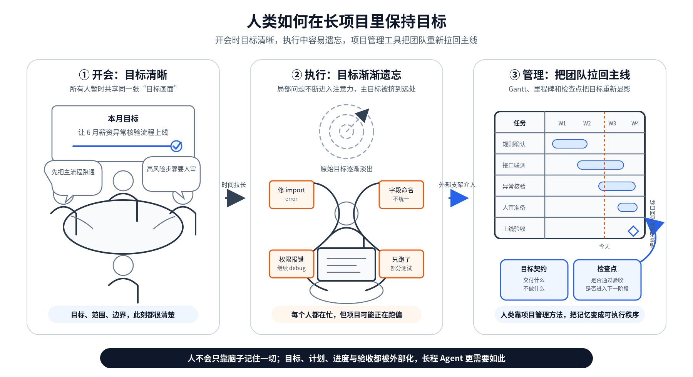
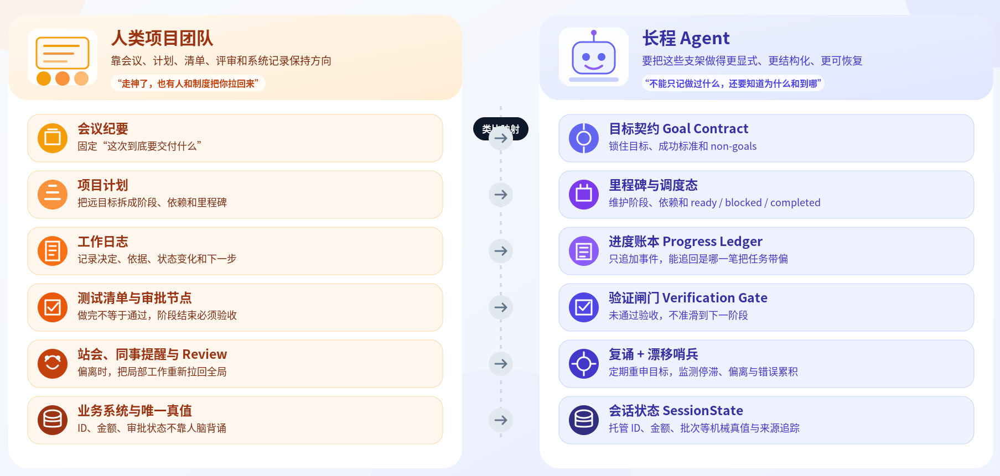
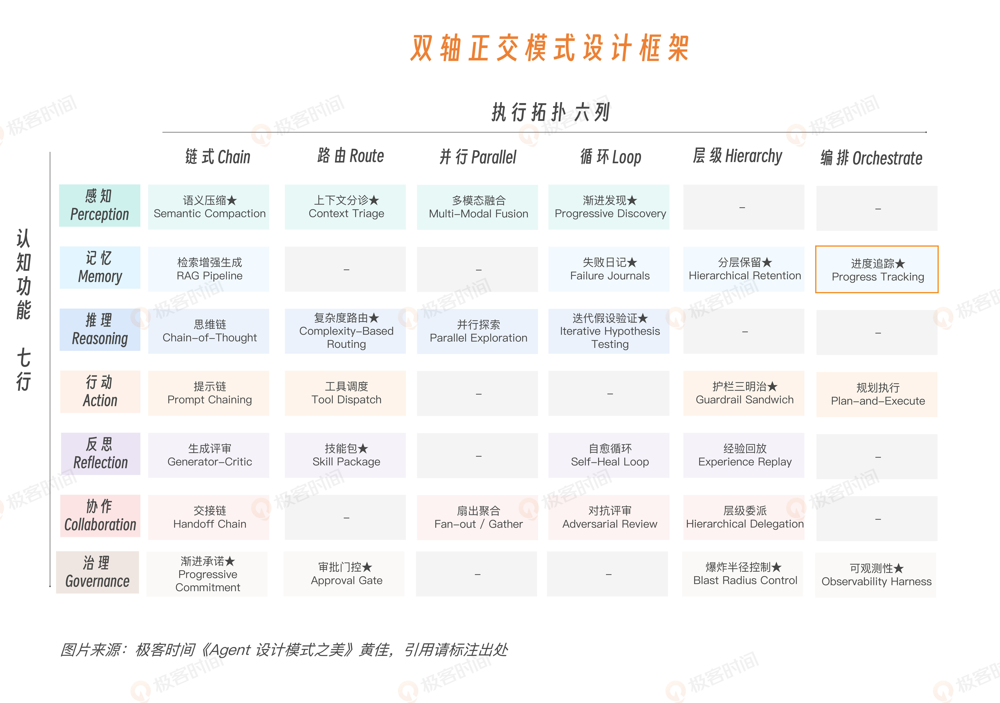
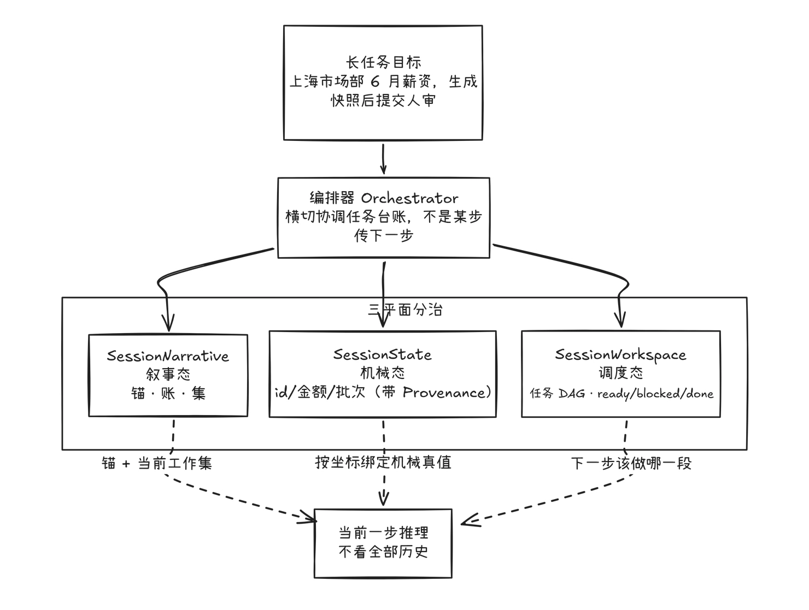
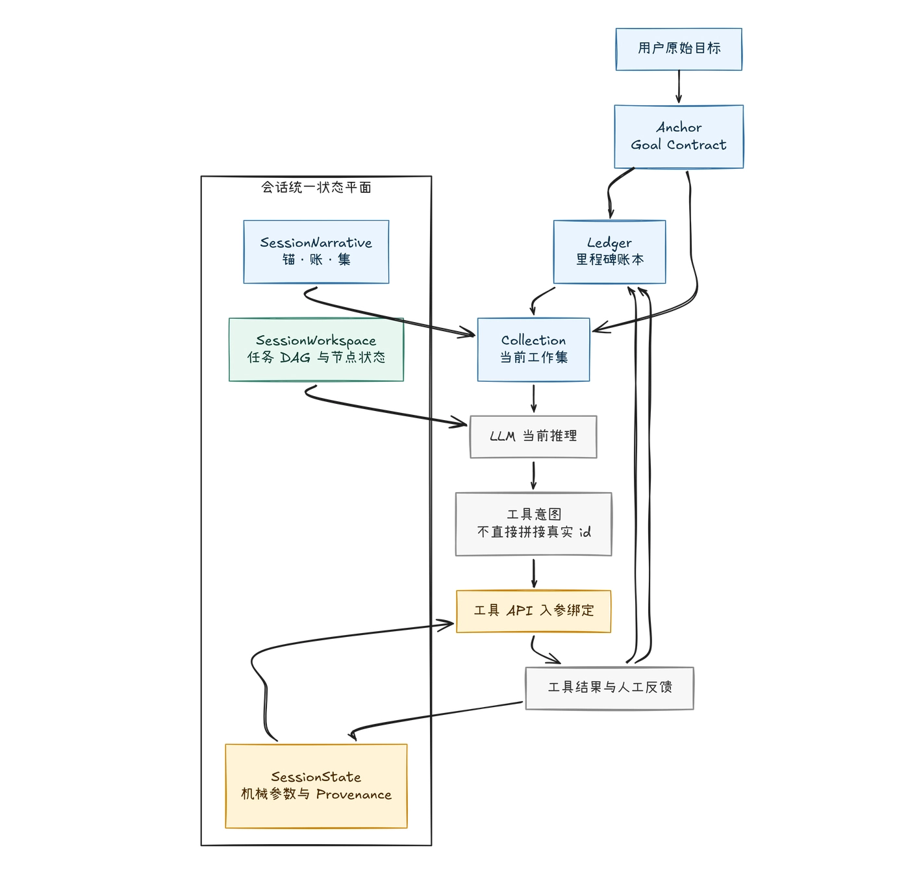
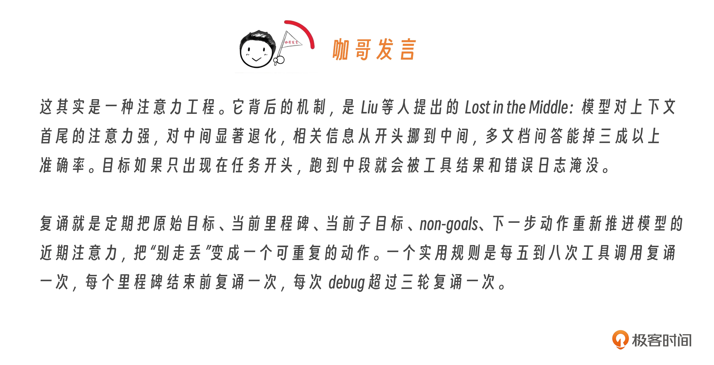
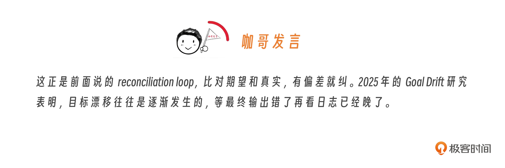
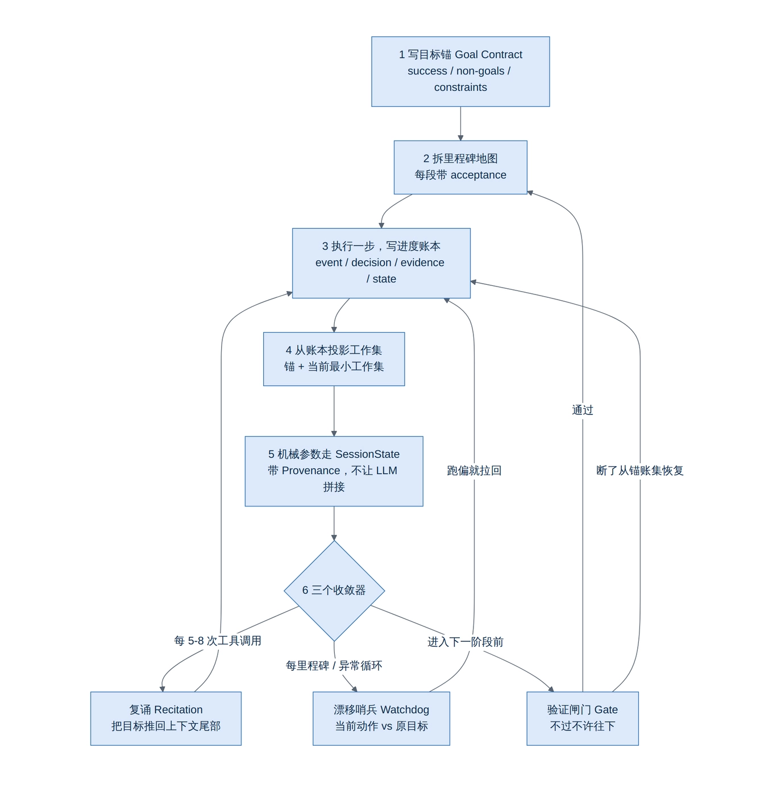
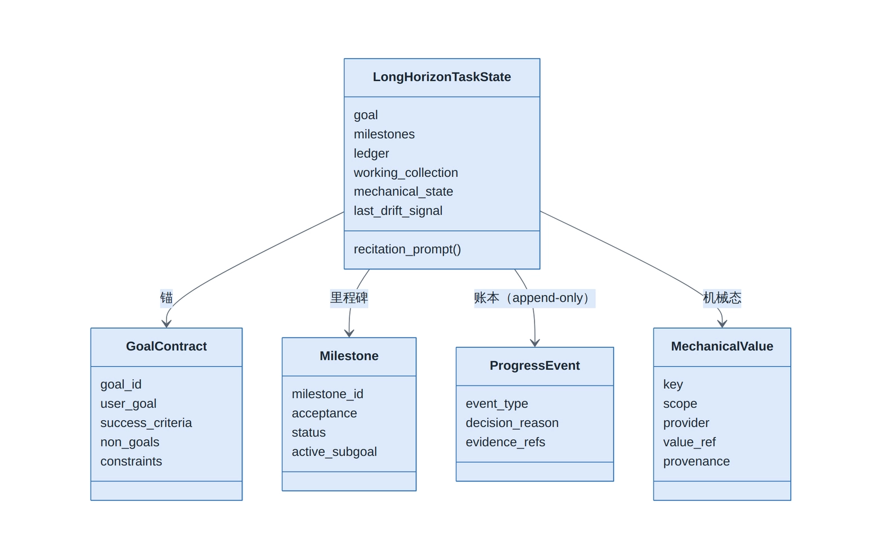
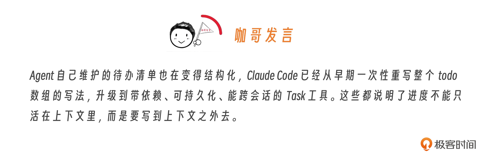

# 14 | 进度追踪：长任务中别让Agent走丢

你好，我是黄佳。

上一讲 RAG 解决的是“取”：聚焦于这一轮的 Agent 该在外部大库里取回哪一点证据。这一讲要面对的问题则更加令人头疼。Agent 已经开始干活了，任务很长，中间要调工具、读文件、写代码、查资料、等人审、修错、再修错。跑到一半以后，它怎么确保自己还在朝原来的目标走？这就是记忆模式组的第三个具体模式，进度追踪（Progress Tracking）要解决的事儿。

## 人类团队的软件工程管控系统

在关心 Agent 怎么做之前，我们先看看传统人类团队的长周期软件工程任务都怎么处理。

周一早上，工程经理把团队叫进会议室，说这个月最重要的任务，是把薪酬系统里的异常核验流程补齐，让 6 月批次能顺利上线。会上大家分了工，有人去核对规则，有人负责接口联调，有人补测试，有人准备人审清单。会后，每个人都散开去忙自己的任务。

到了周三，写接口的人正在 debug 一个权限报错，越修发现问题越深，感觉整体设计有好多隐藏的漏洞待修补，不知不觉就花了半天时间；补测试的人发现历史数据里有一列字段命名不统一，于是开始顺手清洗数据；负责规则的人又临时被拉去开另一个会，回来后不翻会议纪要，根本想不起来上次讨论到哪一步。

如果这个团队没有任何外部项目管理工具，这个项目很快就会散掉。大家每个人都在勤奋工作，但勤奋不等于还朝同一个目标前进。人之所以没有那么容易彻底迷失，是因为我们的工作环境里已经有了一整套“防跑偏装置”。



发现项目出问题之后，我们会通过会议纪要把原始目标重新固定下来，提醒大家“我们这周要交付的不是所有问题都解决，而是让 6 月薪酬批次能进入人审”；通过项目计划会把长目标拆成阶段，让人知道现在做的是“异常核验”，不是“完整规则治理”。任务清单会告诉你还有哪些事没做；测试清单会告诉你事情做完没有；审批节点会拦住那些不能直接进行的高风险动作；而同事的提醒、代码 review、晨会同步，又会不断把局部工作重新拉回到全局目标上。此外我们还有一整套业务系统和数据库，可以随时查阅数据的来源和状态。

## 为什么要有进度追踪

人并不是只靠脑子记住一切。 人是靠一整套外部化支架，才把一个长项目稳稳推进下去的。还记得导论里讲的草稿纸吗？工具刚返回、判断还没定、方案还没排除，这些都先落在草稿纸上。进度追踪做的，就是把草稿纸上那些值钱的判断，蒸馏成一份下一轮还能接着用的进度账单。

长程任务的 Agent 尤其需要进度追踪。因为真实工作流里，任务动辄几十轮、上百轮，Agent一开始记得目标，走着走着被细节牵走。一个局部错误没纠正，后面十步都在这个错误上搭楼。它解决了一个小问题，却忘了原来要交付什么。最后日志很长、工具调用很多，结果离目标越来越远。

这也是为什么长程 Agent 里的进度追踪，不能只理解成一张 todo list。 它真正要补的，是人类工作里那些默认存在、但 Agent 天然缺失的工程支架。

- 一份像会议纪要一样的目标契约，反复提醒“这次到底要交付什么，不要交付什么”；

- 一份像项目计划一样的里程碑状态，告诉 Agent 现在推进到哪一段；

- 一份像工作日志一样的进度账本，记录关键决策、证据和下一步动作；

- 一套像测试清单和审批节点一样的验证闸门，防止任务“看起来完成了，其实没有验收”；

- 还要有一类机制比人类的提醒、领导的监控更加自动化：我们可以让 Agent 持续监控自己是不是已经偏离原目标，我把这个方法称为漂移哨兵。

人做长项目，靠的是会议纪要、项目计划、任务清单、测试清单、审批节点和同事提醒。Agent 做长项目，也要有对应的外部支架，而且要更显式、更结构化、更可恢复。



这正是进度追踪的意义。除了给 Agent 加一个“记录做了什么”的日志工具之外，我们还需要给它补上一整套“怎样在长任务里不迷失”的工程支架。

## 进度追踪的来龙去脉

进度追踪在双轴框架里面落在记忆行、编排列。



为什么是记忆？因为它保存的是一次任务的执行轨迹：原始目标、当前里程碑、已完成步骤、关键决策、阻塞点、验证结果、下一步动作。

为什么是编排，而不是链式？因为进度状态不是某一步算完之后、把结果传给下一步那么简单，它更像一个横切在所有步骤之上的协调者，始终拥有一份任务台账。（每一个编排模式都是该模式组中最复杂、最不好掌握的模式，还望大家认真学习、耐心去理解，同时多做讨论。）

长任务里的迷失，通常是一点点积累出来的，很少一步崩掉。常见问题有五种。

- 最常见的是目标漂移。原来要“完成可上线的 auth.py 重构”，跑着跑着可能变成“把当前这个import error 修干净”。局部目标越来越具体，越来越占注意力，最后这个小目标做完了，Agent 却没有回到全局。

- 第二种是状态漂移。Agent 以为环境是 A，真实环境已经是 B；以为文件改完了，其实保存失败；以为测试跑过了，其实只跑了一部分。目标看着没错，但它对世界的记账错了。

- 第三种是错误放大。长任务是链式依赖，第一步误判了一个 schema 字段，后面的查询、验证、文档都会顺着这个误判长出来，最后是一整套看似完整、方向却错的产物。

- 第四种是细节过载。碰上一个不完美的设计、一条 Warning Message，Agent 容易围着它越钻越深，把预算耗在一个小坑里，忘了这个坑只是当前里程碑的一小部分。

- 还有一种很隐蔽，叫完成幻觉。Agent 把“计划上的 todo 都打勾了”当成“目标达成”。更新定价文档、通知销售、改 FAQ 都做了，却忘了验证真实报价系统有没有同步。

模型单步写代码、查资料、调用工具已经很强，但任务一拉长，规划错误、记忆受限、历史误差累积就会越来越显眼。

软件工程历史上有不少经典的进度追踪解决方案：

- 1987 年 Garcia-Molina 和 Salem 提出的 Saga，把一个长事务拆成一串可以交错执行的子事务，要么全部完成，要么用补偿动作回滚已经做的部分。这就是进度追踪里验证闸门加回滚的祖先。再往后，1992 年正式发表的 ARIES 把预写日志（write-ahead logging）做成工业标准：先把每一步写进日志，崩了再按日志恢复。今天我们让 Agent 先把每一步写入进度账、断了再从账本接上，用了一样的思路。

- 把“写日志”这件事抬到架构高度的，是 Martin Fowler 在 2005 年讲的事件溯源（EventSourcing）：所有状态变更都以一串只追加的事件存下来，他打的比方正是会计账本，过往条目永不擦改，纠错靠追加补偿条目。后面我会反复强调“写账本，不是写流水账”，根源就在这里。

- 另外两条思路来自分布式系统，后面会各自对应到进度追踪的一个部件。崩溃恢复靠一致性快照，也就是今天 Agent 框架里的检查点（checkpoint）。不断比对“期望状态”和“真实状态”、有偏差就纠正的对账循环（reconciliation loop），则是我们后面要做的漂移哨兵的原型。到了 Agent 这一代，CoALA 框架把长期记忆分成情景、语义、程序三类，进度追踪所监控的正是情景记忆，也就是“这次任务到底发生了什么”。

但是我们不能直接照搬这些方法，因为传统系统的状态是确定的。一个 dashboard 请求要写哪张表、哪个字段，设计时就定死了。Agent 不一样，它的状态一半是基于当前语义叙事状态的（不是明确的字段值或 Yes / No），会被压缩、被改写、被重新解释，而且它每一步真正需要哪段记忆是不确定的。所以我们不能只搬结果，还要专门防范目标和判断在时间里漂移。

微软的 Magentic-One 的编排器会维护两本账，外层任务账本（Task Ledger）记事实、猜测和计划，内层进度账本（Progress Ledger）记当前进度、各 Agent 的分工和“任务完成没有”的判断，专家 Agent 只负责执行单步。

Anthropic 的多智能体 SubAgents 系统也类似，主 Agent 先把计划写进持久记忆，再派生几个子 Agent，每个子 Agent 在自己独立的上下文窗口里干活，只回传一两千 token 的蒸馏摘要，主 Agent 负责综合，而不去接管子 Agent 的工作轨迹。

这就是 Agent 时代的工业界解决进度追踪问题的主流方案，也是编排和链式的分界。如果让子Agent 把自己的本地消息、重试、中间失败一股脑灌回共享上下文，主 Agent 很快就会被污染。所以进度状态要由一个协调者集中维护，让每一步的局部噪音被隔离在子上下文里，目标、状态和机械参数不随链式传递漂移。

## 三平面分治：把“迷失”拆成三件事

我在设计模式之美专栏上线的直播分享中介绍过东方屹腾团队的金融 / 薪酬 SaaS 案例。其中提到，执行型 Agent 跑偏的代价比内容生成型严重得多。内容型跑偏，结果是报告不准、摘要偏题。执行型跑偏，做的是薪酬、报销、入职、代发、报税这些异构 API 编排，要传业务实体 id、金额、账号、税号、批次号，一个参数串错就是业务交付失败，甚至误操作。

这里最有价值的设计是把“会话状态”分成三个平面，不让它们混在一个上下文里。

```
SessionWorkspace  调度态：任务 DAG，ready / blocked / completed
SessionNarrative  叙事态：锚、账、集
SessionState      机械态：API 入参的可审计真值（带 Provenance）
```

很多长任务跑偏，就是把这三件事混在了一起：自然语言摘要里夹着业务 id，工具结果里夹着目标解释，然后又要求 LLM 从一堆文本里自己找出下一步该传哪个参数。分平面，就是先把责任分清楚。

下面我们一件一件看。



- 编排器横切协调三平面，每一步只投影锚和当前工作集给模型，机械真值按坐标绑定

## 叙事状态平面：锚、账、集

叙事态可以收束为三个关键词：锚、账、集。锚锁住原始目标和边界，账记录里程碑级的进展和关键决策，集是每一步从账里投影出来的当前最该看的工作集。锚用于预防目标漂移，账用于预防历史断片，集用于预防上下文过载。

先说锚。长任务不能只靠一句自然语言目标。用户说“帮我把这个月薪资跑一下”其实太过宽泛，Agent 会把它理解成建薪资组、改规则、同步考勤、核对社保、生成代发表、准备报税一大堆方向。所以要把目标冻结成一份可引用的契约（Spec）。

```
goal_id: payroll-run-shanghai-sales-202606
user_goal: 为上海市场部准备 2026 年 6 月薪资批次，按上月规则生成快照，核验异常后提交人审
success_criteria:
 - 员工范围为上海市场部 6 月在职员工
 - 复用 5 月规则，并记录本月差异
 - 创建薪资组和批次，相关 id 由 SessionState 托管
 - 生成快照，完成异常核验
 - 代发、报税、正式提交前进入人工 review
non_goals:
 - 不修改员工主数据
 - 不改规则模板
 - 不直接发起银行付款或税局申报
constraints:
 - 金额、账号、员工 id 只从工具返回和 SessionState 读取
 - 业务 API 入参需要记录 Provenance
 - 发现规则缺口或金额异常时暂停并请求人审
```

这份契约比 todo 稳定得多。todo 可以随便增删，目标契约不能，要改也得写一条

```
goal_changed 事件说明谁改的、为什么；它还同时写了 success_criteria 和
non_goals。很多 Agent 跑偏，就是因为只知道要做什么，不知道现在哪些事不要做；
non_goals 是防止细节过载的一道护栏：Agent 看到薪资项名称不统一，可能花十几轮去做
```

完整薪资科目治理，而当前任务只是生成可审核快照。

再说账。账不等同于日志，要记的不只是“做了什么”。它的英文是 ledger 而不是 log。log 像是流水账，ledger 像则会计账本，账本要能对账，这正和前面提到过的事件溯源概念对应。一条进度账至少记四样：发生了什么（event）、为什么这么做（decision）、根据什么判断（evidence）、状态发生了什么变化（state_delta）。

```
event: 创建 2026 年 6 月上海市场部薪资组
decision: 复用 5 月薪资规则模板
reason: 用户要求"按上月规则"，本月规则变更未确认
evidence_refs:
 - tool:create_payroll_group#20260612-1005
 - policy/payroll-rule-2026-05.md
state_delta:
 write: [STATE.payroll_group_id]
 scope: company:acme / org:shanghai-sales / month:2026-06
next_action: 生成薪资批次，绑定 STATE.payroll_group_id
```

这样写，Agent 恢复时不用读完整对话，只读目标契约、当前里程碑以及最近几笔账就够了。在人进行审核的时候，也能一眼看出究竟是哪个决策把任务带偏了。而错误也不会悄悄放大，因为每个关键判断都有 evidence_refs 进行证据的溯源，证据错了可以沿链路回滚。

最后说集。账会越来越长，不能每一步都塞进上下文。集就是从账里再蒸馏、裁剪出当前这一步最相关的一小包材料，和锚一起注入模型。它同时解决两件事：每次注入都带着锚，Agent不会忘原始目标。每次只给当前子任务要的材料，Agent 也不会被全部历史淹没。这就是长任务里的“接手包”，新一轮 Agent 先读锚和集，再按需回账本查证。

这个锚、账、集的设计，比普通 todo 更接近长程任务的真实需要。Agent 每一步不需要看全部历史，只需要看当前步骤相关的那一小包“集”。但这个“集”必须带着锚，否则它会越来越像最近几轮聊天的摘要，慢慢脱离原目标。



- 进度追踪不是把上一步结果简单传给下一步，而是由编排器持续维护整份任务台账

```
在这张架构图中，长任务的状态被拆成三个平面：SessionWorkspace 管“接下来该做什
么”，也就是任务依赖和执行顺序；SessionNarrative 管“为什么这么做、当前做到哪”，用
锚、账、集保存目标、进展和当前工作集；SessionState 管员工 id、金额、批次号等机械
```

真值，并记录它们的来源（Provenance）。

每次推理时，模型不需要重读全部历史。编排器只把当前目标、当前工作集、下一步任务以及经过程序绑定的机械真值交给它。这样既能防止上下文过载，也能避免目标漂移和参数串错。

## 机械状态平面：别让 LLM 拼接真值

叙事态和机械态不是两套互不相干的记录，也不是把同一件事重复保存两遍。

叙事态用于服务模型推理。它告诉 Agent 原始目标是什么，当前进行到哪个里程碑，刚才为什么做出这个判断，下一步准备做什么。它保存的是任务的意义和脉络，所以由锚、账、集组成。

机械态则用于服务确定性执行。它告诉系统：当前薪资组的真实 id 是什么，批次属于哪个租户、部门和月份，金额是多少，这些值来自哪一次工具调用。它保存的是 API 真正需要的精确参数，所以由程序维护，不让模型在自然语言中复制和拼接。

两者通过状态引用衔接。前面锚、账、集管的是叙事态。执行型 Agent 还要单独管机械态。

```
叙事态不会把一个薪资批次的 ID pg_84721 直接塞进进度摘要，而是会写：
下一步创建薪资批次，需要 STATE.payroll_group_id。
```

执行前，编排器再从 SessionState 中解析这个引用，把真实值绑定到工具参数。工具执行成功后，新的机械真值写回 SessionState；与此同时，进度账本追加一条事件，记录这一步为什么执行、使用了什么证据、读写了哪些状态键、下一步是什么。

因此，一次完整动作会形成下面这条闭环：

- 叙事态提出动作意图

```
 ↓
调度态确认动作 ready
 ↓
```

- 编排器解析状态引用

```
 ↓
```

- 机械态提供精确参数

```
 ↓
```

- 工具执行

```
 ↓
```

- 机械态写入新真值

```
 ↓
```

- 叙事账本追加事件

```
 ↓
```

- 验证闸门对账

```
 ↓
```

- 调度态推进到下一步

可以把三者记成一句话：叙事态管意义，机械态管真值，调度态管顺序，编排器负责把三者对齐。


- 机械平面、叙事平面和调度平面的交互

薪酬场景里，员工 id、薪资批次 id、银行账号、税号、金额、审批单号这些值，更像机械参数，要按位准确。让 LLM 从上下文里复制、改写、拼接它们，风险是很高的。这里的实操做法，是把这类值放进 SessionState，由程序维护，每个值都带一份数据的来源。之后再通过调度平面传递给 API 或者 Tools 来处理。

```
key: payroll_batch_id
scope: company:acme / org:shanghai-sales / month:2026-06
provider: create_payroll_batch
runtime_layer: plan_exec.M3.step1
value_ref: STATE.payroll_batch_id
trust: tool_output
```

```
LLM 可以说“下一步提交 6 月的薪资批次”，但真正传给 API 的 payroll_batch_id，由程序
```

按坐标从 SessionState 读取。这样进度追踪才能回答执行型系统里最关键的问题：这个参数从哪来、在哪一步产生、后来被哪些工具用了。如果目标没偏、但参数串了，任务也一样会失败。叙事态靠锚账集，机械态靠状态平面和数据来源（Provenance）。

## 三个调度收敛器：复诵、哨兵、闸门

在调度平面中，还要有三个动作持续把任务往回收。

第一个是复诵（Recitation）。Manus 在文章指出：一个典型复杂任务平均要调大约五十次工

```
具，这么长的循环，Agent 很容易偏题。Manus 的做法是不断重写 todo.md，把全局计划反
```

复推回上下文的尾部。



第二个是漂移哨兵（Drift Watchdog）。光让 Agent 自己写进度还不够，要有一个哨兵定期问：你现在做的事，还跟原目标有关吗？

它可以先做得很简单，每隔固定步数或每个里程碑结束，用一个便宜模型或几条规则看几个分数：当前动作和原目标的相关度、当前里程碑有没有推进、关键结论有没有证据、最近错误是不是在累积。信号异常时不一定要终止任务，可以分级处理：相关度下降就触发复诵，里程碑停滞就要求缩小范围，证据变差就禁止汇报完成，错误压力上升就暂停进入诊断。



第三个是验证闸门（Verification Gate）。长任务最怕“看起来很努力，结果没验收”。闸门要把每个里程碑的验收条件落成具体检查：快照人数等于员工范围吗，金额波动在可解释范围内吗，异常项都标出了吗，关键 id 都有 Provenance 吗，高风险动作还 blocked 吗，待人审清单生成了吗。不通过就置成 needs_rework，写一条 failed_gate 事件，回到对应里程碑，不许进入下一阶段。

很多企业长程 Agent 失败，就是因为没有闸门，从一个阶段自然滑到下一个，上一阶段的错误也自然跟着传递过去。这就是 Agent 时代的 Saga 补偿思路的具体实现。



- 锚账集加机械态稳住状态，再用复诵、漂移哨兵、验证闸门三个收敛器持续把任务拉回原目标，断点从锚账集恢复

## 一份可执行的长程任务状态

我们用一个真实的 Schema 来解释上面出现的许多新名词吧，通过这个 schema，普通的TaskState 就变成了长程任务状态。

```python
from __future__ import annotations
from dataclasses import dataclass, field
from datetime import datetime, timezone
from enum import Enum
from typing import Any
class TaskStatus(str, Enum):
   PENDING = "pending"
   IN_PROGRESS = "in_progress"
   BLOCKED = "blocked"
   NEEDS_REVIEW = "needs_review"
   NEEDS_REWORK = "needs_rework"
   COMPLETED = "completed"
class DriftLevel(str, Enum):
   OK = "ok"
   WATCH = "watch"
   RECENTER = "recenter"
   PAUSE = "pause"
@dataclass
class GoalContract:
   """目标契约：把目标、边界和验收标准冻结下来。"""
   goal_id: str
   user_goal: str
   success_criteria: list[str]
   non_goals: list[str]
   constraints: list[str]
   version: int = 1
@dataclass
class Milestone:
   """里程碑：把远目标拆成可验收的近目标。"""
   milestone_id: str
   title: str
   acceptance: list[str]
   status: TaskStatus = TaskStatus.PENDING
   active_subgoal: str | None = None
@dataclass
class ProgressEvent:
   """
   进度账本中的一条事件。
   账本只追加，不覆盖。每一条记录都应说明：
   发生了什么、为什么这样决策、依据是什么、状态发生了什么变化。
   """
   event: str
   decision: str | None = None
   reason: str | None = None
   evidence_refs: list[str] = field(default_factory=list)
   state_delta: dict[str, list[str]] = field(default_factory=dict)
   next_action: str | None = None
   created_at: str = field(
       default_factory=lambda: datetime.now(timezone.utc).isoformat()
   )
@dataclass
class MechanicalValue:
   """机械态：每个可复用的真值都带来源、层级和信任信息。"""
   key: str
   scope: str
   value_ref: str
   provider: str
   runtime_layer: str
   trust: str
@dataclass
class DriftSignal:
   """漂移哨兵：判断当前执行是否偏离目标、证据或里程碑。"""
   level: DriftLevel
   goal_relevance: float
   milestone_progress: float
   evidence_health: float
   error_pressure: float
   reason: str
@dataclass
class LongHorizonTaskState:
   """长程任务状态：保存恢复任务所需的最小可靠上下文。"""
   task_id: str
   goal: GoalContract
   milestones: list[Milestone]
   current_milestone_id: str
   status: TaskStatus
   ledger: list[ProgressEvent] = field(default_factory=list)
   working_collection: dict[str, Any] = field(default_factory=dict)
   mechanical_state: dict[str, MechanicalValue] = field(default_factory=dict)
   open_blockers: list[str] = field(default_factory=list)
   next_action: str | None = None
   last_drift_signal: DriftSignal | None = None
   def current_milestone(self) -> Milestone:
       """返回当前正在推进的里程碑。"""
       for milestone in self.milestones:
           if milestone.milestone_id == self.current_milestone_id:
               return milestone
       raise ValueError(
           f"Current milestone not found: {self.current_milestone_id}"
       )
   def resume_packet(self) -> dict[str, Any]:
       """
       生成恢复包。
       任务中断后，新一轮 Agent 不需要翻完整聊天记录，
       只读取这个包，就能知道目标、当前近目标、最近账本、开放阻塞和机械态索引。
       """
       return {
           "goal": self.goal,
           "current_milestone": self.current_milestone(),
           "working_collection": self.working_collection,
           "recent_ledger": self.ledger[-5:],
           "open_blockers": self.open_blockers,
           "mechanical_state_keys": sorted(self.mechanical_state.keys()),
           "last_drift_signal": self.last_drift_signal,
           "next_action": self.next_action,
       }
   def recitation_prompt(self) -> str:
       """
       生成复诵提示。
       每次继续执行前，把目标锚、当前里程碑和下一步动作推回上下文尾部，
       降低长程任务中的目标漂移。
       """
       milestone = self.current_milestone()
       return "\n".join(
           [
               "Re-center before continuing.",
               f"Original goal: {self.goal.user_goal}",
               f"Success criteria: {self.goal.success_criteria}",
               f"Current milestone: {milestone.title}",
               f"Active subgoal: {milestone.active_subgoal or 'decide it'}",
               f"Non-goals: {self.goal.non_goals}",
               f"Constraints: {self.goal.constraints}",
               f"Open blockers: {self.open_blockers or 'none'}",
               f"Next action: {self.next_action or 'decide it'}",
               "Do not report completion until the current verification gate pas
           ]
)
这个 schema 里，GoalContract 是锚，用来冻结原始目标、成功标准、非目标和约束，防
止长程执行过程中目标被悄悄改写。Milestone 把远目标拆成近目标，让 Agent 每一步都知
```

道自己正在推进哪一个阶段。

```
ProgressEvent 是只追加的进度账本。它记录这一步为什么这样决策、依据是什么、下一
步是什么，以及通过 state_delta 记录这一步读写了哪些机械状态。
working_collection 是每一步投影给模型的集，负责控制模型此刻真正需要看的内容。
MechanicalValue 则记录机械参数的数据来源（Provenance），包括它来自哪里、由谁提
供、属于哪一层 runtime、可信度如何。DriftSignal 是漂移哨兵的判断，，用来观察当前执
```

行是否已经偏离原始目标、当前里程碑或可靠证据。

```
recitation_prompt() 方法负责复诵，它把目标锚、当前里程碑、活跃子目标、非目标、
```

约束和下一步动作重新推回上下文尾部，帮助 Agent 在继续执行前重新对齐。

```
resume_packet() 方法负责断点恢复，任务中断后，新一轮 Agent 不需要翻完整聊天记
录，只读取LongHorizonTaskState 生成的恢复包：当前锚、当前里程碑、工作集、最近
```

几条账、开放阻塞和机械状态键，就能接上上一次的中断点。

```
LongHorizonTaskState 则是整个长程任务的状态容器。它把目标锚、里程碑列表、当前
```

里程碑、任务状态、进度账本、工作集、机械态、阻塞项、下一步动作和漂移信号统一收拢在一起。换句话说，它定义了“这个任务现在到底处在什么位置”。

```
没有这个总状态，GoalContract、Milestone、ProgressEvent 和
MechanicalValue 都只是分散的数据结构；有了 LongHorizonTaskState，它们就被组
```

织成一个可以持续推进、可以暂停、可以恢复、可以审计的任务状态机。

这就是进度追踪和普通 todo 列表的差别。todo 列表只能告诉 Agent “还有哪些事没做”，但它无法说明目标为什么这样定义、当前阶段验收到哪里、哪些状态已经被可靠写入、哪些证据支撑了上一步判断、以及中断后应该怎样安全恢复，因为长程任务真正需要的是一套能维持目标、状态、证据和恢复路径的执行状态结构。



- 锚（GoalContract）+ 里程碑 + 账本 + 工作集 + 机械态。账本是 append-only 的，崩了从 resume_packet 恢复

## 断了怎么接上：进度追踪的恢复

进度追踪不只服务当前推理，还要服务故障恢复。长任务跑半小时，中途崩一次就丢一大段状

```
态，而前面 schema 里的 resume_packet()，就是为这件事准备的。
```

这两年工程界把“可恢复”做得越来越好了。

LangGraph 的 checkpointer 按线程给每一步存状态快照，传入同一个 thread_id 就能从最后一个检查点重建、从中断处续跑，还能 time travel 回任意一步。可以参考这里的详细说明。

再往下一层是可持续执行（durable execution） 引擎，OpenAI 的 Agents SDK 和 Temporal的集成在 2026 年 3 月正式发布，把每一步 journaling，崩溃后可以精确续跑，这其实就是预写日志 WAL（Write-Ahead Logging）在 Agent 工作流里的现代版。



工业界的这些做法和我们这一讲中 SaaS 系统的设计是高度对齐的，这里再次总结一下：锚和长期目标放 store 或项目文件，任务 DAG 和里程碑放 checkpointer，账本走 append-only 日

```
志，机械状态走 SessionState，中断以后从 resume_packet 一次性恢复，而不是回聊天记
```

录里去猜。

对于我们的 SaaS 系统，如果没有这一套进度追踪体系，Agent 有可能识别出“薪资组”任务，

```
创建了上海市场部 6 月薪资组，工具返回 payroll_group_id，LLM 在后面创建快照时则
```

可能误用了上月薪资组 id 或测试环境 id，异常核验看起来通过了，其实核验的是另一个批次，最终汇报写得很完整、业务对象却串了。每一步都有日志，Agent 看起来在好好干活，似乎如常在推进，最后才暴露出对象错了、月份错了、账号错了。

就能用三平面加三收敛器的方式来做，就能稳得多。目标先冻结成契约，里面写清

```
success_criteria 和 non_goals，付款和报税进non_goals。任务拆成场景确认、创
```

建薪资组、生成批次和快照、异常核验、人审准备五个里程碑，每个都自带验收标准。每个关键动作写进账本，机械 id 全部基于带原始数据的状态平面，LLM 只需要看到“上海市场部 6 月薪资组已创建”，而不必关心真实 id。

如果 Agent 围着“薪资项名称规范”修了好几轮（目标偏移），复诵插进来一句“当前里程碑是生成快照，不做完整薪资科目治理，命名问题记入待人审清单后继续”，就能把 Agent 从细节里拉回来。哨兵发现最近八个动作都在改命名、没推进快照，给出 recenter 的命令。每个里程碑结束前都会验证闸门，快照人数、金额边界、异常清单、数据溯源、付款 blocked 状态全部检查通过，才进入下一阶段。

这样 ，Agent 就可以处理薪资项、规则、异常，但不会在局部整理里迷路，更不会把机械参数交给语言模型自己传来传去。

## 总结一下

这一讲我们把进度追踪从 todo list 往前推了一步，定位成长任务里的防迷失机制，它由一个协调者横切维护任务台账。普通进度追踪回答“做到哪了”。长任务防迷失要再回答四个问题：我还在服务原目标吗，当前里程碑推进了吗，错误放大了吗，进下一阶段前验收过吗。到执行型Agent 里还要再加一个问题，关键业务参数还在正确的状态平面里吗。

一本好账本要能回答：当时为什么这么做（决策），根据什么判断（证据），现在到哪一步了（状态），下一步不能做什么（边界），出了错能不能追回到是哪一笔带偏的（trace）。流水账只记“做了什么”，账本能对账。长任务防迷失，差的往往就是这个“能对账”。

回到记忆模块的主线。RAG 让 Agent 在下结论前先拿到证据，进度追踪让 Agent 在长任务里始终知道自己在哪、要去哪、哪些坑不能再踩。两个加起来，Agent 才不会“每一步看着都合理，合在一起却跑偏”。

真要在企业里落地，可以先挑一条高重复、高损失的任务族，比如薪资快照、报销审批、合同审阅。然后只需要先做三件事：一是把那些会反复出问题的目标先冻成 Goal Contract，写清success_criteria 和 non_goals；二是关键业务参数全部存为会话状态（SessionState +Provenance），不要让 LLM 在自然语言里处理 id 和金额；三是每个里程碑都配上一道验证闸门，断点通过靠 resume_packet 恢复。剩下的就是观测同类失败的复发率有没有下降，如果持续下降，说明 Agent 在积累经验，而进度追踪有效。

最后压缩一下今天介绍的的关键新概念：长程执行型 Agent 不迷失，靠的是三平面分治——锚账集稳住叙事，任务状态机稳住调度，机械状态平面稳住参数，再用复诵、漂移哨兵和验证闸门持续把它收敛回原目标。

## 思考题

回到你自己的系统，找一个最容易跑偏的长任务，做一次小审计。

1. 这个任务的 Goal Contract 写得出来吗？non_goals 有没有写？Agent 最近一次跑偏，是不是做了一件“看起来有用、当前却不该做”的事？

2. 你的进度记录是流水账还是能对账的账本？最近一次错误放大，能不能从账本追回到是哪一个早期决策带偏的？哪些关键参数还在让 LLM 从上下文里复制和传递？

3. 如果今天断掉，明天新 session 能不能只靠一个 resume_packet 就接上，而不是去翻聊天记录？

期待你在留言区多多分享。这节课内容比较多，有什么疑问也可以留言区提出，大家一起探讨。

## 下一讲预告

下一讲我们讲记忆模块的第四个模式，失败日记（Failure Journals）。

进度追踪记录的是任务怎么往前走，失败日记记录的是任务在哪里摔倒过。长任务里，失败本身就是很重要的信号。如果错误 trace 被清掉、失败原因没分类、补救动作没写下来，下次类似任务来了，Agent 还会从头摔一遍。下一讲，我们就看怎么把失败也做成可召回的经验。我们下一讲见。

## 参考资料

1. Hector Garcia-Molina, Kenneth Salem. Sagas. ACM SIGMOD 1987.

2. C. Mohan et al. ARIES: A Transaction Recovery Method Using Write-Ahead Logging. ACMTODS, 1992.

3. Martin Fowler. Event Sourcing. 2005-12-12.https://martinfowler.com/eaaDev/EventSourcing.html

4. Sumers et al. Cognitive Architectures for Language Agents (CoALA). arXiv:2309.02427,2023.

5. METR. Measuring AI Ability to Complete Long Software Tasks. arXiv:2503.14499, 2025-03.

6. Arike et al. Technical Report: Evaluating Goal Drift in Language Model Agents.arXiv:2505.02709, 2025-05.

7. Liu et al. Lost in the Middle: How Language Models Use Long Contexts. TACL 2024,arXiv:2307.03172.

8. Yichao Ji (Manus). Context Engineering for AI Agents: Lessons from Building Manus.2025-07-18. https://manus.im/blog/Context-Engineering-for-AI-Agents-Lessons-from-Building-Manus

9. The Long-Horizon Task Mirage? Diagnosing Where and Why Agentic Systems Break.arXiv:2604.11978, 2026-04.

10. Microsoft Research. Magentic-One: A Generalist Multi-Agent System for Solving ComplexTasks. 2024-11.

11. Anthropic. How we built our multi-agent research system. 2025-06-13.https://www.anthropic.com/engineering/multi-agent-research-system

12. LangChain. LangGraph Persistence.https://docs.langchain.com/oss/python/langgraph/persistence

13. Temporal. Announcing OpenAI Agents SDK Integration（GA 2026-03-23）.https://temporal.io/blog/announcing-openai-agents-sdk-integration

14. Anthropic. Todo Lists / Task tools (Claude Agent SDK).https://code.claude.com/docs/en/agent-sdk/todo-tracking
