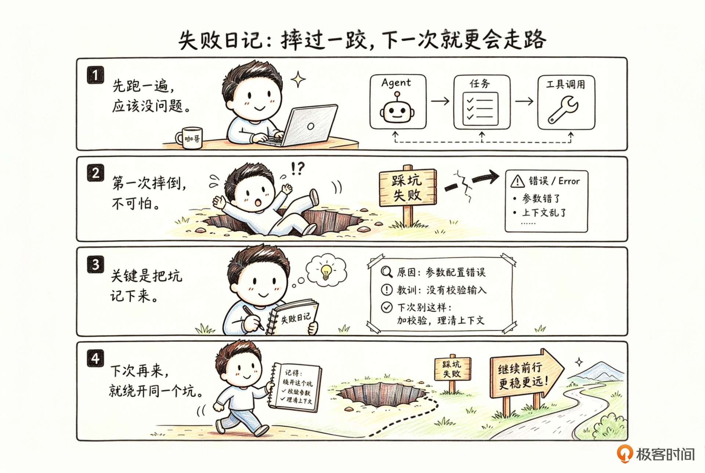
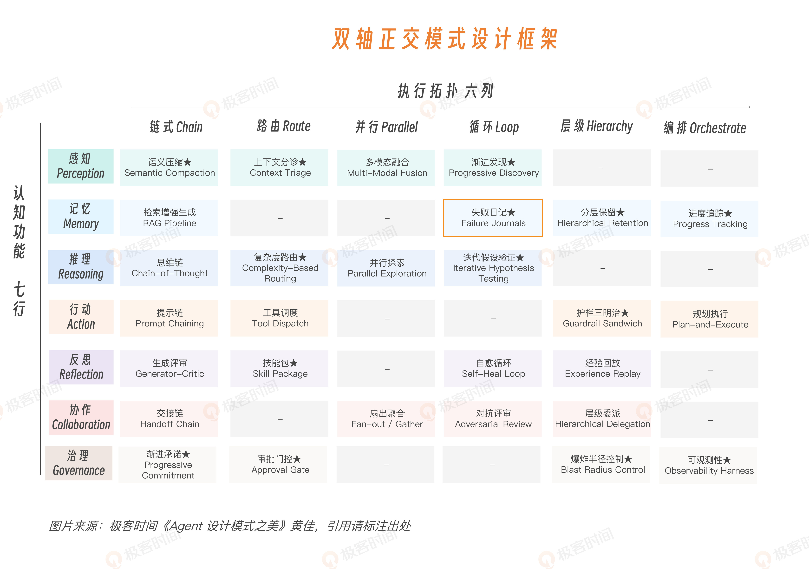
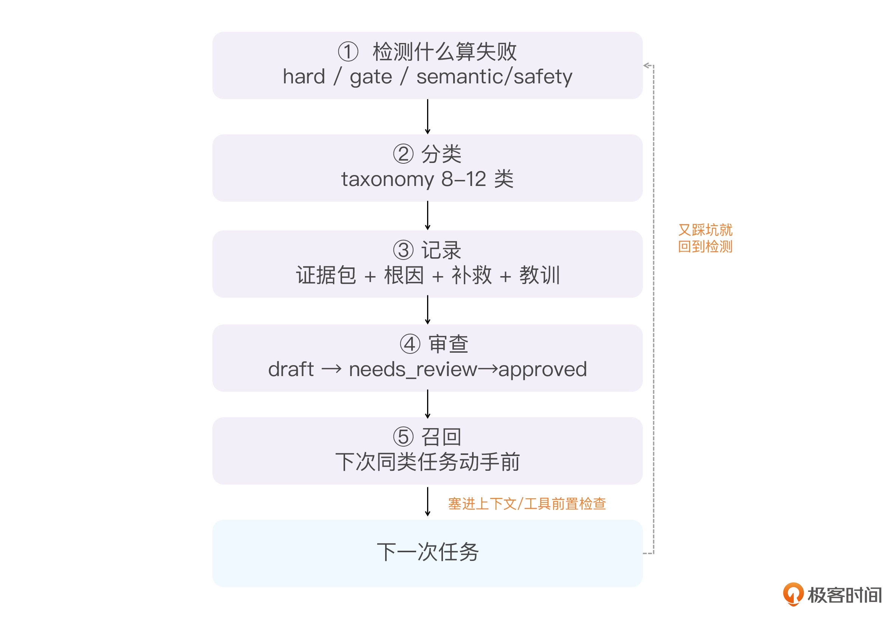
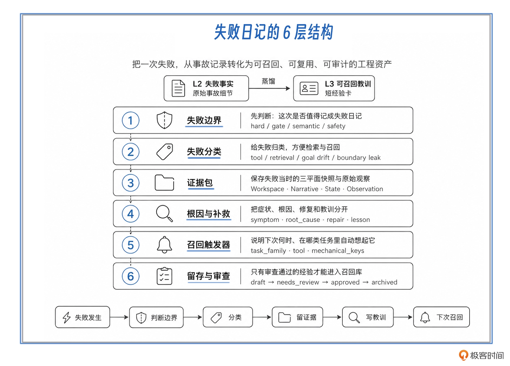
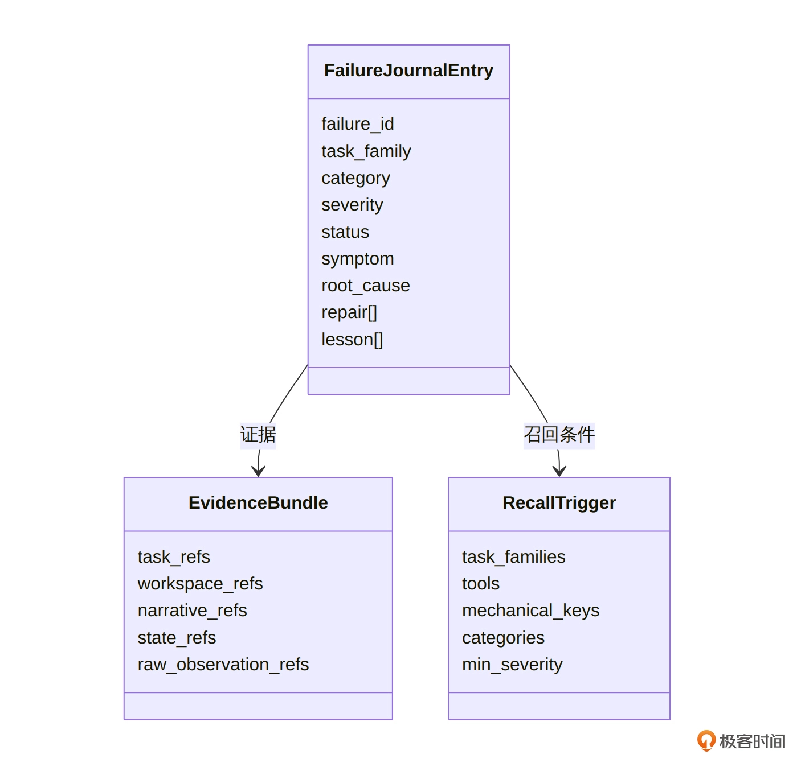
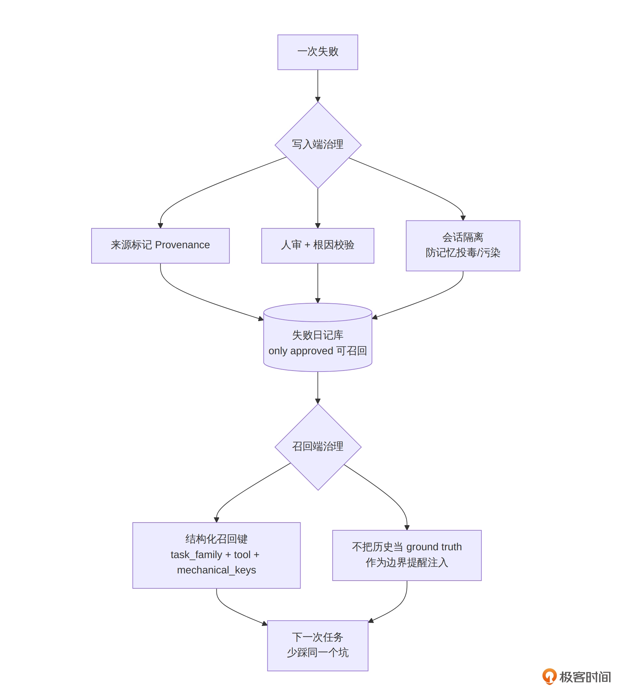

# 15 | 失败日记：让Agent把摔过的跤变成本事

你好，我是黄佳。今天我们讲记忆模式组的第四个，也是最后一个具体模式：失败日记（Failure Journals）。

上一讲进度追踪，我们给长程任务记了一本能核对的账。Agent 知道原始目标是什么，当前推进到哪个里程碑，关键参数从哪里来，中途断掉以后又该怎样接上。

但这还不够。进度追踪能帮助 Agent 处理这一次失败，暂停任务，回到上一个里程碑，修正状态，再重新执行。失败日记要解决的是更远的问题：怎样保证下次遇到相似任务时，不再重蹈覆辙，掉进同一个坑？



- 咖哥路走的多，踩得坑也多

做 demo 时，我们习惯把失败藏起来。工具调用失败了，就重试一次；上下文乱了，就新开一个会话；中间结果错了，就手工修一下。最后展示给用户的，是一条干净、顺滑的成功路径。

如果在生产系统中的 Agent 看到的是一个被打扫过的世界。它不知道哪些动作曾经失败，也不知道哪一种参数绑定曾经引发事故。任务完成后，系统只保存最后的成功结果，失败过程则随着 session 一起消失。下一次任务开始时，它仍然像第一天上班。

Manus 团队在上下文工程实践中强调过：在长循环任务里，失败本来就是循环的一部分。保留失败动作和后续观察，会让模型调整对相似动作的判断；清除失败痕迹，则等于清除了它能够利用的证据。

## 薪酬任务场景里的失败日记

我们沿用上一讲的薪酬 SaaS 场景。Agent 正在为客户 A 处理 6 月薪资结算。工具已经返回了

```
正确的 payroll_group_id，程序也把它写进了 SessionState。但后面生成薪资快照时，上
```

下文里还残留着客户 B 的薪资组说明。

模型在自然语言里复述了那个旧 id，某个工具封装又允许从文本里提取参数。结果，客户 A的 30 名员工被错误地写进了客户 B 的薪酬组。

```
好消息是，验证闸门兜住了它。系统发现员工归属与当前租户不一致，payroll_group_id
```

的租户范围也和当前任务不匹配，于是中止了后续动作，没有进入付款环节。

```
进度追踪在这里会做三件事：把当前里程碑标记为 needs_rework，废弃错误快照，重新绑
```

定正确的机械状态。

但如果事情到这里就结束，下个月同样的任务来了，Agent 仍然可能再犯一次。因为这一次失败虽然被修好了，却没有变成经验。

失败日记要把这次事故蒸馏成一条可以跨任务召回的教训：

```
凡是跨租户的 payroll_*_id，都不能从自然语言摘要中提取。
工具调用前，必须从 SessionState 按 key + tenant scope 绑定，
并校验该 id 属于当前客户、部门和月份。
到了 7 月结算，Agent 准备再次调用 create_payroll_batch 时，系统会先召回这条失败
```

经验，让它在动手之前看见：

- 这类任务以前错在“从自然语言里取 id，且没有校验租户归属”。本次必须从 SessionState确定性绑定。

6 月的一次事故，就这样变成了 7 月的一道护栏。这就是失败日记的意义，把失败保存下来，并让过去的失败正向影响下一次行动。

## 失败日记不是错误日志

在双轴图谱里：失败日记落在记忆行、循环列。



它属于记忆，因为保存的是跨任务经验，生命周期长于一次 session。

它属于循环，因为它形成了一条闭环：

- 失败发生

```
 ↓
```

- 检测与分类

```
 ↓
```

- 记录证据和根因

```
 ↓
```

- 审查并批准

```
 ↓
```

- 相似任务主动召回

```
 ↓
```

- 改变下一次行动

```
 ↓
```

- 观察是否再次失败

如果召回后仍然重复失败，系统还要重新分析是分类错了，是召回点太晚，是教训写得不够具体，还是根因本来就没找对。

所以，我们需要失败日记来构建出一条持续校正行为的经验循环。



- 经验循环链路：检测、分类、记录、审查、召回，再影响下一次任务

失败日记听起来像 Sentry、ELK 或普通异常日志，但它们的服务对象不同。

机制

- 主要服务谁记录什么是否自动影响下次任务

Retry

- 当前执行器错误码、重试次数通常不会

错误日志

- 运维和工程师堆栈、请求、环境通常不会

Postmortem

- 团队影响根因改进行动靠人阅读

普通错误日志回答的是：“系统刚才哪里报错了？”失败日记回答的是：“以后遇到某种情形时，Agent 应该提前改变什么行为？” 因此，失败日记必须完成一次从错误事实到可行动经验的蒸馏。

## 失败日记的 6 层结构

一条失败经验不应该只有一种形态。

我们之前已经知道记忆有三层。L1 是当前意识流，L2 是数据库里持久化的里程碑日志，L3 是经验教训类的语义记忆。L3 来自一次任务成功或失败时，对当时叙事上下文的蒸馏总结。成功经验帮下次快速收敛，失败经验让 Agent 在规划前先避坑。

原始事故细节通常很多，包括工具输出、失败节点、状态快照、验证报告、受影响对象、修复操作。这些信息适合保存在任务账本或情节记忆里。我们可以把它叫作失败事实层。

真正需要在下一次任务开始时进入上下文的，则应该更短。它只保留可复用的根因、教训、禁止动作和召回条件。我们可以把它叫做经验教训层。

例如刚才薪酬系统中的串租户事故的记忆。

```
失败事实（evidence_refs）：
客户 A 的 30 名员工被错误写入客户 B 的薪酬组；
附工具调用、SessionState、验证闸门和回滚记录。
... 此处省略1500字 ...
可召回教训（evidence_refs）：
跨租户 payroll_*_id 不得从自然语言读取；
只能从 SessionState 按 key + tenant scope 绑定，
```

- 写入前必须校验租户归属。

L2 保存“这次到底发生了什么”。L3 保存“下次到底应该注意什么”。

日常召回时，只把 L3 的短经验卡送进上下文。需要复盘、审计或重新判断时，再沿着

```
evidence_refs 回到 L2 查看原始事实。这和操作系统的工作集思想相似：热经验进入当前
```

上下文，冷细节按需换入。

更具体说，一条失败日记需要把失败从一段事故记录转化成清晰可用的工程资产。只有把下面六层信息明确了，才算完成了转化。

层

- 解决的问题

失败边界 Failure Boundary，

- 这件事到底算不算值得沉淀的失败

失败分类 Failure Taxonomy

- 它属于哪一种可重复的失败模式

证据包 Evidence Bundle

- 当时到底发生了什么

根因与补救 Root Cause & Repair

- 为什么会错，系统应该怎样改

召回触发器 Recall Trigger

- 下次什么时候应该想起它

留存与审查 Retention & Review

- 谁确认它可信，应该保留多久



### 失败边界：不是只有崩溃才算失败

只记录错误本身，会漏掉 Agent 最值得记住的失败。有些任务没有报错信息，甚至顺利生成了最终结果，但它完成的是错误目标、使用了错误对象，或者绕过了本应存在的人审。这类失败比一次普通超时更危险。

可以先区分四种失败边界：

```
hard_failure
```

- 任务无法继续，例如工具崩溃、权限拒绝、上下文溢出。

```
gate_failure
```

- 验证闸门没有通过，例如人数不符、金额异常、证据不足。

```
semantic_failure
```

- 表面完成，但完成的不是原始目标，例如目标漂移、口径错误。

```
safety_failure
```

- 触碰租户、权限、环境或人工审批边界。

反过来，也不要把每一次小抖动都写进失败日记。偶发网络重试、一次无影响的格式修正，如果没有复发价值，只需要留在普通日志里。要不要进入失败日记，主要看它是否值得 Agent改变下一次任务的行为。

### 失败分类：为了召回，不是为了做百科全书

没有分类的失败日记，只是一堆故事的堆砌。微软 AI Red Team 对 Agent 系统失败模式分类时强调：目标、上下文、工具、权限、插件与多 Agent 信任关系都可能成为失败来源。

企业落地时可以考虑下面的失败类型：

```
tool_failure               工具失败
retrieval_failure          检索漏召回、误召回或索引滞后
planning_failure           计划缺失、顺序错误、漏掉验收
goal_drift                 偏离原始目标或 non-goals
context_contamination      旧上下文或外部内容污染推理
mechanical_state_mismatch  id、金额、账号、批次号绑定错误
boundary_leak              租户、环境、组织或权限边界泄漏
hitl_bypass                本应人审的动作被绕过
policy_violation           违反业务、安全或合规策略
unknown                    根因未确认，等待人审
```

类别是下一次任务召回正确经验的主要依据。

### 证据包：给失败那一刻拍一张三平面快照

```
“Agent 用错了 payroll_group_id” 不是一份完整的失败记录。你还要知道：失败发生在哪
```

个节点？当时 Agent 以为自己在做什么？正确的机械参数来自哪里？哪个工具封装接受了错误值？哪条验证规则抓住了它？

这正好延续了上一讲的三平面：

```
SessionWorkspace
```

- 告诉我们哪一个任务节点失败，当前状态和重试次数是什么。

```
SessionNarrative
告诉我们 Agent 当时的目标、工作集和关键判断是什么。
SessionState
告诉我们机械值从哪个工具来、属于哪个 scope、被谁消费。
Raw Observation
```

- 保存工具输出、验证报告、错误堆栈或人工审查记录。

只保留原始错误本身，保存的是症状。把三平面和原始观察一起保留，才能形成可诊断的证据包。

### 根因与补救：不要写“模型太粗心”

失败日记要包含根因分析和补救措施。

```
symptom    表面发生了什么
root_cause 为什么会发生
repair     这次怎样修复
lesson     下次应该改变什么行为
```

比如：

- 无效根因：

```
LLM 产生了幻觉。
```

- 有效根因：

```
payroll_group_id 同时存在于自然语言摘要和 SessionState，
工具封装没有限制参数来源，也没有校验租户 scope，
导致旧摘要中的 id 覆盖了确定性状态绑定。
```

“模型幻觉”无法指导工程改进。后一个根因则能落到具体动作：禁止从自然语言抽取机械参数、增加 scope 校验、补充回归测试。好的根因能够让工程师和 Agent 都知道该从哪里入手进行修改。

### 召回触发器：写得再好，不召回也等于没写

失败日记最容易缺的，是召回条件。失败日记写得再认真，如果下一次任务却不会被 Agent 自动看到，结果变成“人类有空才翻”的文档库。

```
失败日记中每条日记都要写清 recall_when，标明它服务哪个 task_family、哪些工具、哪
```

些机械参数、哪个失败类别、什么风险级别。这样，当工作流程进入相关环节，就可以为Agent 选择性地加载与之匹配的失败日志，从而对可能出现的问题心中有数。

```bash
recall_when:
 task_family:
   - payroll_run
 tools:
   - create_payroll_batch
   - create_payroll_snapshot
 mechanical_keys:
   - payroll_group_id
   - payroll_batch_id
 categories:
   - boundary_leak
   - mechanical_state_mismatch
对于参数串错、租户泄漏这类失败，也要记录task_family + tool_name +
mechanical_keys 这种结构化的键值。
```

### 留存与审查：失败日记不能变成垃圾桶

Agent 可以自动生成失败日记初稿，但不能让它写完以后直接进入召回库。通过四种状态，人类和 Agent 一起生成它，维护它：

```
draft：Agent 自动生成，尚未确认。
needs_review：根因不确定或风险较高，需要人审。
approved：已经确认，可以进入召回。
archived：已过期、长期无价值，或者对应问题已经被系统机制彻底消除。
只有 approved 的失败日记才能进入下一次任务。
```

留存也可以分热、温、冷三档。最近的失败保留完整 trace，便于诊断；一段时间以后保留压缩后的失败条目和证据引用；长期只保留高严重度、高复现率、真正被召回过的经验。

跨租户泄漏、人审绕过、机械状态串错等高风险类别，不应该按普通策略自动淘汰。它们还应该进入回归测试集。一次修复过的 bug，最好的归宿不只是写进失败日记，还要变成一条永久测试。

以上面的串组失败案例为例，完整失败日记如下：

```bash
failure_id: fj-payroll-20260612-001
task_family: payroll_run
boundary: safety_failure
category: boundary_leak
severity: high
status: approved
symptom: >
 薪资组中 30 名员工的租户归属与当前任务不一致。
 payroll_group_id 指向客户 B，当前任务属于客户 A。
root_cause: >
 create_payroll_batch 的工具封装允许从自然语言摘要中提取
 payroll_group_id；上下文残留的客户 B 旧说明覆盖了
 SessionState 中客户 A 的确定性状态值。
 工具调用前也没有校验 tenant scope。
evidence_refs:
 - workspace:M3/create_payroll_batch
 - narrative:ledger/event-028
 - state:payroll_group_id@tenant-A/org-shanghai/month-2026-06
 - gate:tenant_scope_mismatch
 - tool:create_payroll_batch#20260612-1421
repair:
 - 废弃错误薪资组，将 30 名员工恢复到客户 A
 - 禁止工具封装从自然语言中解析 payroll_group_id
 - payroll_*_id 只允许从 SessionState 绑定
 - 写入前强制校验 tenant / org / month
 - 增加 cross_tenant_scope_mismatch 回归测试
lesson:
 - 跨租户机械参数必须从 SessionState 确定性绑定
 - 机械 id 不得通过摘要、聊天历史或账本正文传递
 - 任何写操作前都要验证 id 的 tenant scope
do_not:
 - 不从自然语言摘要复制 payroll_*_id
 - scope 未通过校验时，不调用写入型薪酬工具
recall_when:
 task_family:
   - payroll_run
 tools:
   - create_payroll_batch
   - create_payroll_snapshot
 mechanical_keys:
   - payroll_group_id
   - payroll_batch_id
```

注意，这条记录里没有一句“模型不够细心”，而是细致记录了：哪一个状态平面混了，哪个工具入口放宽了参数来源，哪道闸门发现了错误，以及下一次工具调用前应该出现什么提醒。



执行型失败优先使用结构化召回。相同任务族、相同工具、相同机械状态键，通常比纯文本相似更能指向同类事故。

## 把“记录、审查、召回”这条链跑通

有了失败日记的 6 层结构，下面我们把“记录、审查、召回”这条链跑通。

具体的召回点一般有三个。

- 新任务启动时，召回同 task_family 的高风险失败。

- 任务规划时，召回同场景的经验教训。

- 高风险工具调用前，按工具名和机械参数召回。对执行型 Agent，工具调用前那一刻往往最有价值，因为真正的副作用就发生在那里，这时候召回一张短短的“危险卡”，好过在上下文里面塞十条长日志。

把这套召回放到下个月的流程。7 月结算一启动，又是跨租户写入薪资组的同类场景，新任务启动这个召回点先命中 task_family，规划时再命中场景，等 Agent 走到

```
create_payroll_batch 前那一刻，按工具名加 payroll_group_id 把这条经验顶到最
```

前。Agent 还没动手，先读到一句“跨租户 id 写入前校验归属”。6 月这一跤，就这样变成了 7月的拦截。一次任务的教训，被我们成功喂给了下一次任务。

```bash
from dataclasses import dataclass, field
from enum import Enum
class Boundary(str, Enum):             # 先判断什么算失败
   HARD = "hard_failure"
   GATE = "gate_failure"
   SEMANTIC = "semantic_failure"
   SAFETY = "safety_failure"
class Status(str, Enum):
   DRAFT = "draft"
   NEEDS_REVIEW = "needs_review"
   APPROVED = "approved"
   ARCHIVED = "archived"
@dataclass
class EvidenceBundle:                  # 证据包：三平面的失败快照 + 原始观测
   workspace_refs: list[str] = field(default_factory=list)    # 哪一步失败
   narrative_refs: list[str] = field(default_factory=list)    # 当时以为在做什么
   state_refs: list[str] = field(default_factory=list)        # 机械参数从哪来
   observation_refs: list[str] = field(default_factory=list)  # 原始 tool output
@dataclass
class RecallTrigger:                   # 结构化召回键，比纯 embedding 可靠
   task_families: list[str] = field(default_factory=list)
   tools: list[str] = field(default_factory=list)
   mechanical_keys: list[str] = field(default_factory=list)
   categories: list[str] = field(default_factory=list)
@dataclass
class FailureEntry:                    # 单条失败记录：现象、根因、补救、教训、证据、召回
   failure_id: str
   task_family: str
   boundary: Boundary
   category: str
   severity: str
   status: Status
   symptom: str
   root_cause: str
   repair: list[str]
   lesson: list[str]
   do_not: list[str]
   evidence: EvidenceBundle
   recall: RecallTrigger
   recalled_count: int = 0
   def is_recallable(self) -> bool:
       return self.status == Status.APPROVED       # 只有审查过的才能召回
class FailureTrace:                    # 贯穿追踪面：失败日记的  Memory Trace
   def __init__(self) -> None:
       self.entries: list[FailureEntry] = []
   def recall_before_tool(
       self,
       task_family: str,
       tool: str,
       keys: list[str],
       top_k: int = 3,
   ) -> list[FailureEntry]:
       scored = []
       for e in self.entries:
           if not e.is_recallable():
               continue
           score = 0
           if task_family in e.recall.task_families:
               score += 3
           if tool in e.recall.tools:
               score += 3
           score += len(set(keys) & set(e.recall.mechanical_keys))
           if score > 0:
               scored.append((score, e))
       scored.sort(key=lambda x: x[0], reverse=True)
       hits = [e for _, e in scored[:top_k]]
       for e in hits:
           e.recalled_count += 1
       return hits
```

这段代码的重点有两处。

- 一是把 symptom、root_cause、repair、lesson、do_not 和召回条件分开存，系统才能检索、统计。

```
二是只有审查通过的失败才能召回。Boundary 先判断什么算失败，EvidenceBundle 把
```

- 证据按之前进度追踪模式中我们讲的的三平面分开存，哪一步失败、当时以为在做什么、机械参数从哪来、原始观测在哪，失败才追得回去。

还要注意，召回不要只靠文本相似度。很多事故来自同一个业务动作、同一批机械参数、同一个工具入口，语义相似反而不是主线索。所以结构化召回键，也就是 task_family 加 tool 加mechanical_keys，往往比纯 embedding 更可靠。

- 咖哥发言：除了在线召回之外，还可以进一步把失败轨迹重新标注和打包，转化成离线训练数据。不过，未经审查的失败直接拿去训练，可能把错误根因、过度概括的教训和错误边界一起内化进模型。因此，失败日记的第一目标，是让下一次任务少犯同类错误。训练则属于第二阶段。推荐的落地顺序是先跑通记录、审查、召回和注入。等失败日记里积累了足够多经过确认的高质量条目，再评估是否把它们变成训练数据。

## 失败日记本身也是攻击面

失败日记是一个长期记忆库，长期记忆库就是攻击面。未来的 Agent 攻击不只是提示词注入，还会有记忆注入、记忆投毒、记忆篡改。失败日记正好是这类攻击最理想的落点。

如果有人往里写一条假教训，比如伪装成“跨租户写入这步可以跳过校验”，下次召回就被污染，Agent 反而会被这条假经验领着去犯错。向 Agent 的长期记忆里投毒，攻击成功率非常高，而正常任务几乎看不出异常，攻击者甚至不需要直接改记忆库，只靠普通对话就能诱导Agent 自己把恶意记录写进去。

- MemoryGraft 把恶意流程伪装成“合法的、已验证过的最佳实践”，藏在普通文档里被Agent 摄入，下次遇到相似任务，Agent 无需任何显式触发，就会检索、信任、照搬。

为什么这么危险？因为记忆投毒和一次性提示词注入很不一样，它是持久的。恶意内容一旦写进记忆库，会在会话重启、上下文重置之后继续存活，几周后被一个语义相似的任务悄悄触发。因此，OWASP 的 Agentic 安全倡议把记忆投毒列为十五类威胁里的头号关注点。

对失败日记的设计来说，这意味着两端都要治理。写入端要带来源，做来源标记、人审和会话隔离，一条失败日记从哪来、谁审过、属于哪个租户，都要可查，不能让任意输入直接写进可召回库。召回回来的历史经验，是“边界提醒”，不是“绝对真值（ground truth）”。Agent 看到一条历史教训，应该把它当成一个需要再核对的提示，而不是一条不容置疑的指令。

最后，我们用下面的图给出失败日记的整体使用流程和生命周期。



写入端用来源追踪、租户隔离和审批防止记忆投毒；召回端把历史经验当作边界提醒，并与当前事实重新核验

## 失败日志的衡量指标

失败日记的价值，不看库里存了多少条记录，而看同类失败是否减少。最值得关注的是四个指标：

- 重复失败率过去已记录的失败模式，又发生了多少次。

- 召回有效率召回的经验中，有多少真正改变了计划或工具参数。

- 漏召回率发生重复失败时，对应日记是否存在，却没有被召回。

- 误提醒率召回了多少与当前任务无关的失败经验。

```
最核心的指标仍然是重复失败率。如果 mechanical_state_mismatch 一个月从十二次下
```

降到三次，这套系统在积累经验。如果日记越写越多，但同类错误数量丝毫不降，问题通常出在召回点、分类、根因或教训写法上。

## 总结一下

一架飞机发生事故，调查的目的不是只修好这一架飞机，也不是简单责怪某个飞行员。真正的目标，是读出黑匣子，把事故拆成可以命名、复现和改进的失败模式，再把改进传播到整支机队。失败日记就是 Agent 机队的黑匣子。

错误日志服务一次维修。黑匣子服务下一次飞行。失败日记要做的，就是把一个 Agent 的一次摔倒，变成所有同类任务以后都能绕开的坑。一个串租户事故，在失败日记中可不再只是一条失败记录，而成为每一次跨租户薪酬写入之前都会出现的护栏。

- 记失败日记的时候，要分清失败边界、失败分类、证据包、根因补救、召回触发器和留存审查。不要把失败写成一段故事，更不要用“模型太粗心”这种无法行动的根因。

- 用失败日记的时候，要在下一次同类任务的关键入口主动召回，尤其是高风险工具调用前。结构化任务族、工具名和机械状态键，通常比纯语义相似更可靠。

- 管失败日记的时候，要有审批状态、分档留存和来源追踪。只有经过确认的失败经验才能进入召回；召回到的经验也只能作为风险提醒，不能替代当前事实和规则。

那么，从哪里开始落地呢？可以先挑一条高重复、高损失的任务族，例如薪资结算、报销审批、合同审阅或生产发布。

```
第一步，把上一讲 Verification Gate 产生的 gate_failure 和 safety_failure 自动转
```

- 成失败日记草稿。这里的证据最完整，最容易起步。

```
第二步，设计八到十二个失败类别，以及 draft—needs_review—approved—archived
```

- 的审查状态机。

- 第三步，只加几个召回入口：任务规划时和高风险工具调用前。先把短危险卡送到真正会发生副作用的位置。

最后盯住重复失败率，形成可运行的经验闭环。期待你在留言区分享你的思考，也推荐你把今天内容分享给有需要的朋友。

## 思考题

第一，最近一次 Agent 重复犯错是什么？它是没有被记录，还是记录了却没有在下一次任务里自动召回？

第二，挑一条失败记录看一看。它的根因是“模型幻觉、用户没说清”这种甩锅式解释，还是已经落到了具体的状态平面、工具入口和系统改进动作？

第三，你的失败经验在什么时刻出现？任务开始、任务规划，还是高风险工具调用前？它出现的位置，真的来得及改变行动吗？

第四，如果有人向失败日记里写入一条伪装成最佳实践的恶意经验，你的来源追踪、审查机制和租户隔离能不能挡住？

期待你在留言区踊跃发言，也推荐你把今天的内容分享给吐槽过“Agent 总是同一个问题翻车”的朋友。

## 模块小结

到这里，记忆模式组的四个模式就讲完了。

- 分层保留解决“架”，给记忆建货架。

- RAG 解决“取”，从外部大库里取回证据。

- 进度追踪解决“录”，把长任务记成能对账、能续跑的账。

- 失败日记解决“省”，把一次摔跤变成下一次任务的护栏。

一次任务，从搭货架、取证据、记进度，到记教训，走完了记忆的完整生命周期。

程序性记忆，也就是把成功流程固化成可复用技能包，我们留到后面的反思模式组继续展开。下一讲开始，我们进入推理模式组。记忆解决的是过去的经验怎样留下来；推理要解决的是，当感知到的信息和召回的经验都摆在工作台上以后，Agent 怎样把它们组织成可靠判断和可执行计划。

## 参考资料

1. Shinn et al. Reflexion: Language Agents with Verbal Reinforcement Learning. NeurIPS2023, arXiv:2303.11366.

2. Toyota Production System / Five Whys（丰田佐吉 1930s，大野耐一纳入 TPS）.

3. US DoD. MIL-P-1629: Procedures for Performing a Failure Mode, Effects and CriticalityAnalysis. 1949.

4. Betsy Beyer et al. (eds). Site Reliability Engineering（Ch.15 Postmortem Culture）.Google / O'Reilly, 2016.

5. John Allspaw. Blameless PostMortems and a Just Culture. Etsy, 2012.

6. Manus (Yichao Ji). Context Engineering for AI Agents: Lessons from Building Manus（Keep the Wrong Stuff In）. 2025-07-18.

7. Letta. Recovery-Bench. 2025-08.

8. Liu et al. Contextual Experience Replay. ACL 2025, arXiv:2506.06698.

9. AgentHER: Hindsight Experience Replay for LLM Agent Trajectory Relabeling.arXiv:2603.21357, 2026-03.

10. Rethinking Continual Experience Internalization for Self-Evolving LLM Agents.arXiv:2606.04703, 2026-06.

11. Microsoft AI Red Team. Updating the Taxonomy of Failure Modes in Agentic AI Systems(v2.0). 2026-06-04.

12. Chen et al. AgentPoison: Red-teaming LLM Agents via Poisoning Memory or KnowledgeBases. NeurIPS 2024, arXiv:2407.12784.

13. MemoryGraft. arXiv:2512.16962, 2025-12.

14. OWASP Agentic Security Initiative. Agentic AI — Threats and Mitigations（MemoryPoisoning = T1）. 2025.
