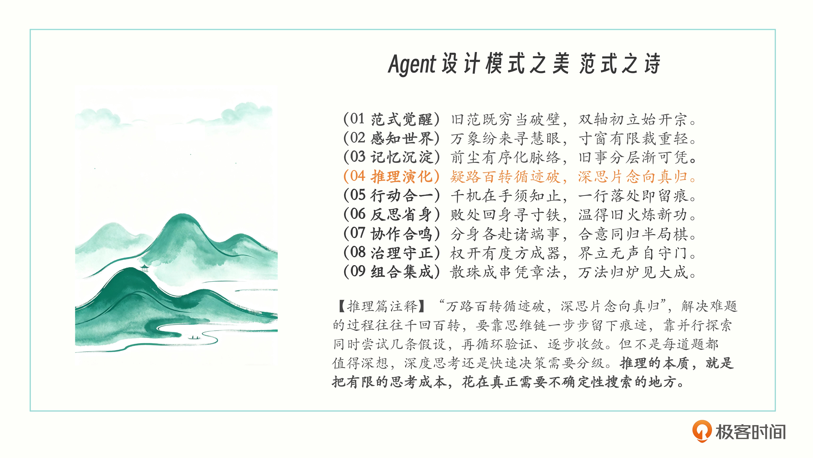
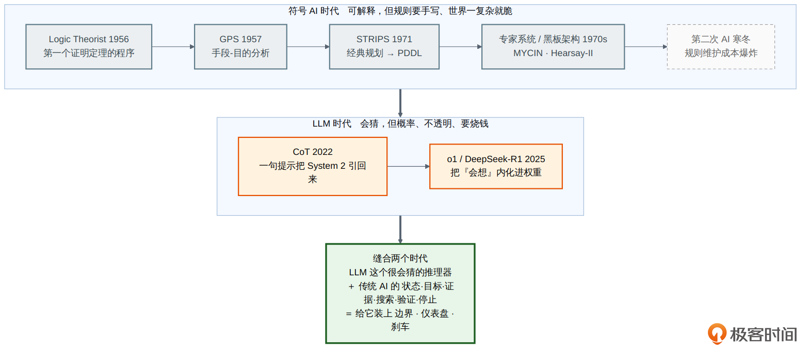
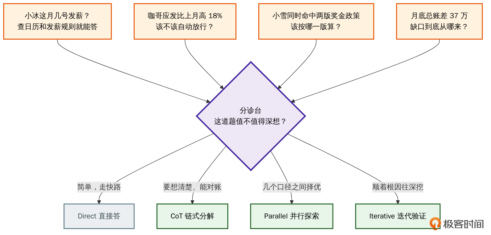
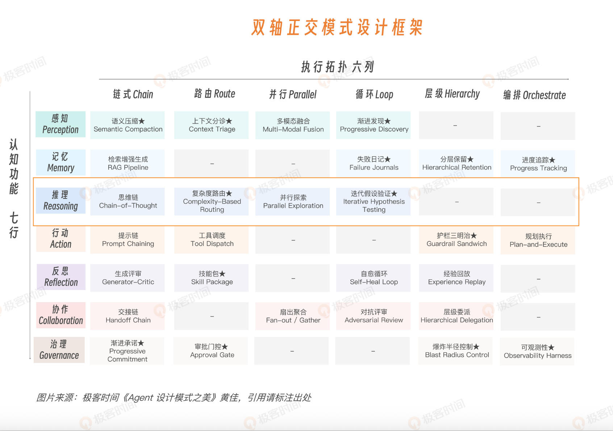
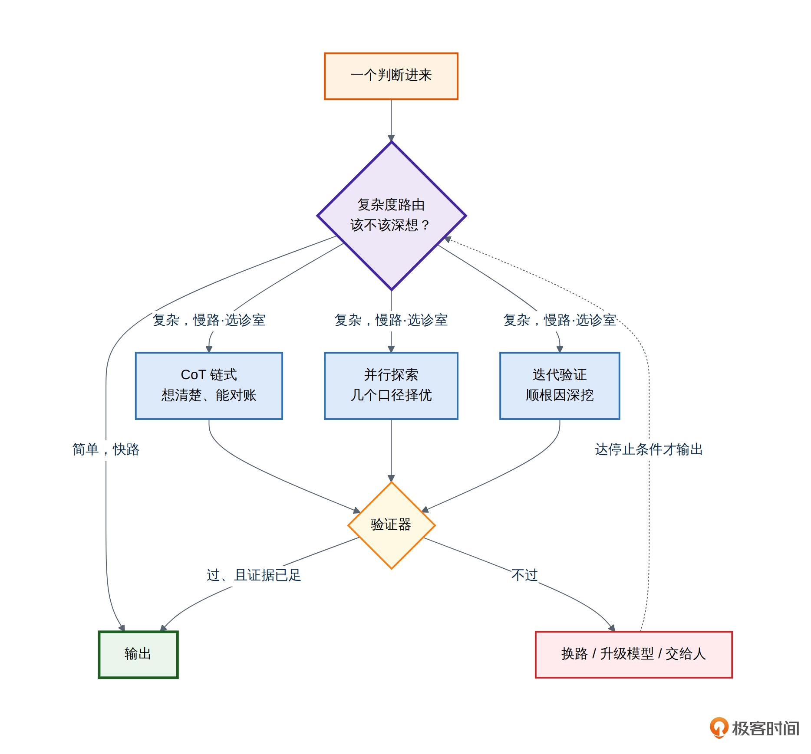
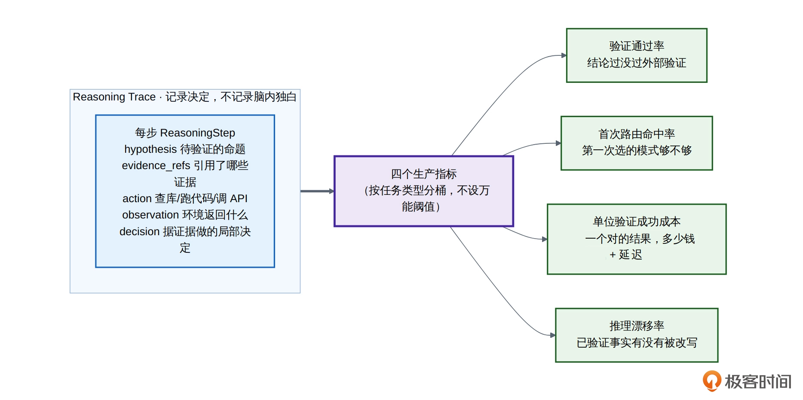

# 16 | 推理模块导论：让Agent想得清楚，也想得起来

你好，我是黄佳。今天我们进入第三个模式组，推理（Reasoning）。



感知让 Agent 看见此刻，记忆让 Agent 留住过去，推理要做的则是：面对眼前的信息和过去的经验，接下来该相信什么、该选择什么、该做什么。

假设我们的 Agent 发现这个月咖哥涨薪 18%（明显超出阈值需校验核实），并且通过渐进发现、 RAG 等感知和记忆模式把咖哥这笔 18% 的调薪证据取回来了，调薪审批单、奖金计算规则、政策版本、历史工资，每一条都带着出处。可证据到手，事情并没有结束。这 18% 到底是一次正常的年度调薪，还是混进了一次性奖金，是数据重复算了两遍，还是用错了规则版本？该自动放行，该转人工，还是该当场拦截？这些都是推理要负责的内容。

## 推理模式的来龙去脉

人类的推理，最早不是从公式开始的，而是从生存经验开始的：看到乌云会想到下雨，发现脚印会判断猎物方向，把一次次观察总结成“如果……那么……”的经验。

后来，古希腊的亚里士多德把这种思考整理成三段论。

三段论的结构可以抽象成：

- 大前提：所有 A 都是 B

- 小前提：C 是 A

- 结论：因此 C 是 B

进入计算机时代后，人们希望把推理写成明确规则，让机器像人一样一步步证明和规划：1956 年的 Logic Theorist 开始做定理证明，1957 年的 GPS 用“目标—手段分析”解决问题，1971 年的 STRIPS 把规划问题形式化，之后专家系统如 MYCIN、Hearsay-II 试图把专家知识写成规则库。

传统推理的核心，是“规则清楚、过程可解释”：输入相同，规则相同，输出就相同。程序本身就是推理过程，代码也就是证明。

```
if raise_ratio > 0.15 and not has_approval:
   block_payment()
```

但这种“程序推理”所有规则需要人工编写，面对复杂世界时维护成本很高，这也是 80 年代“专家系统”并没有引领人类走进真正的人工智能时代的根源。

LLM 不同，它的判断来自概率生成。LLM 把大量模式和启发式知识压进权重，面对开放问题时比传统规则系统灵活得多，却也带来了概率性、不透明性和不稳定性。同一个输入重复执行，可能走出不同的中间路径；提示词、采样参数、上下文顺序和工具返回，都可能改变最终结论。

所以，给 LLM 多写几条业务规则，并不能自动得到一个可靠的推理系统。我们真正聚焦的是怎样让一个概率系统，在不确定的环境里，持续产出足够程度可控、可复现的决策？

这里必须分清三个东西。

1. 第一个是模型的内部推理。它发生在模型内部，可能很长，也可能不向用户或开发者暴露。

2. 第二个是系统组织出来的外部慎思过程，例如提出假设、查询工具、比较证据、调用验证器。

3. 第三个是供工程师审计的决策记录，例如看过哪些证据、执行了哪些动作、为何升级、由什么规则放行。

这三者不能混为一谈。尤其不能把一段看起来有条理的自然语言，直接当成模型真实计算过程的证明。早期 OpenAI 的推理模型特意不向用户暴露原始思维链；Anthropic 的研究也发现，模型生成的 CoT 并不总是忠实披露实际影响答案的信息。



今天的 Agent 推理工程，本质上是在缝合这两个时代的方案：保留 LLM 的表达能力和泛化能力，同时把传统 AI 里的状态、目标、证据、搜索、验证和停止条件重新装回来。换句话说：LLM 给了我们一个很会猜的推理器，Harness 工程系统要做的，是给这个推理器装上边界、仪表盘和刹车系统。

## 推理不等于把思维链写得更长

2022 年，如果有人问“怎么让大模型推理”，答案是 Chain-of-Thought：在 prompt 里加一句“Let's think step by step”，让模型把推理步骤一条条写出来。如果那时你就会用 CoT，咖哥说：恭喜你，那一年你是处在时代前沿的。

到了 2026 年，只会这招就远远不够了。

推理这件事，被两股力量从根上改写了。一方面，它被训练进了模型。o1、DeepSeek-R1 这一代推理模型，靠强化学习把“会想”压进了权重：模型可以不依赖人工标注的推理轨迹，自己涌现出长链推理和自我验证。另一方面，它被产品化成了运行时的资源。reasoning_effort、GPT-5 的实时 router、adaptive thinking，这些选项把“想多深”变成了一个可以在调用时设定的参数。

于是核心问题也变了。过去侧重“怎么让 Agent 多想几步”，现在的难点则是让 Agent 来判断如何推理：这道题值不值得深想？该沿一条路想到底，还是同时试几条？给它多少 token、多少时间、多少次工具调用？什么时候证据够了该停？推不出来的时候，什么时候升级、什么时候交给人？

推理从模型的一种能力，进化成了一种需要被分配、约束、验证以及停止的计算资源。

这样说比较抽象，咱们还是看实际案例： 6 月的薪酬结算中出现了 4 个具体问题，需要我们采用四种不同的推理策略。

- 问题一，小冰这个月几号发薪？查一下日历和发薪规则就能答，根本不值得长推理。

- 问题二，咖哥的应发比上月高 18%，该不该自动放行？得拆开工资组成，核对调薪审批、奖金规则、生效时间，给出一个能对账的判断。

- 问题三，小雪同时命中了两版奖金政策，该按哪版算？可能有好几个都说得通的口径，需要并行比较不同的解释，再让验证器挑出证据最完整的那个。

- 问题四，月底总账差了 37 万，缺口从哪来？这不是一次推理能完成的，得提假设、查数据、排除、缩小范围、继续调查。

这四个问题分别需要的推理，是直接回答、链式分解、并行探索、迭代验证。



所以这一组模式要给 Agent 建的，不是一条无限延长的思维链，而是一座推理调度台。

一个判断进来，先判断它需不需要深想；需要再决定走哪条计算路径、投入多少预算、由谁验证、在什么条件下停止。如果证据不足会继续查，如果成本失控要知道换路。

## 思考快与慢和推理契约

最简单的推理调度是快慢思考系统，也就是我们很熟悉的 Kahneman 的 System 1 和 System2。

- System 1：快、自动、低耗，适合熟悉、直接的问题。使用直接生成、小模型、缓存、规则或简单工具查询，尽快给出答案。

- System 2：慢、刻意、高耗，适合多步计算、证据比较和复杂决策。启动结构化分解、并行搜索、反复验证，必要时调用更强模型和更多工具。

但这只能告诉我们思考“有快有慢”，还不够全面。设计生产系统的推理模块，我们要考虑下面五个问题：

1. 是否启动深入思考？ 这个请求直接回答是否已经足够？

2. 采用哪种推理拓扑？ 沿一条链推进、并行尝试，还是循环调查？

3. 投入多少预算？ 最多使用多少 token、时间、模型调用和工具调用？

4. 由什么验证？ 单元测试、业务规则、外部数据、人类审批，还是另一个模型？

5. 什么时候停止？ 达到什么证据标准后输出，出现什么情况后升级或放弃？

这五项合在一起称为一次任务的推理契约（Reasoning Contract）。同一个任务，你现在有一整排旋钮可拧：让它走更长的推理路径，跑多条候选再投票，用验证器筛选，根据中间观察修订计划，之后再决定要不要换一个更强的模型。

在上面的推理契约中，我特别想强调的是计算预算的控制。也就是说，目前推理时投入的计算（test-time compute）其实是可以被显式管理的维度。

我们要根据不同请求自适应分配计算，通过一个预算包控制整体思考量。

```
@dataclassclass ReasoningBudget:
   max_thinking_tokens: int = 8000   *# 内部思考 token 上限*
   max_latency_ms: int = 12000       *# 端到端延迟上限*
   max_model_calls: int = 4          *# 模型调用次数上限*
   max_tool_calls: int = 8           *# 工具调用次数上限*
   max_parallel_paths: int = 3       *# 并行路径数上限*
```

当答案已经稳定之后，就别再继续消耗推理所用的 Token 数量。

## 四种推理模式

本模块中的四种推理模式对应四种不同的计算拓扑，我们的学习顺序是“基础、路由、广度、深度”。不过，生产运行时要先路由。Agent 应该先决定是否需要深想，再决定采用 CoT、并行探索还是迭代验证。



- CoT，思维链，把复杂的判断拆解成一条可检查的链。咖哥 18% 的加薪，拆成基本工资变化、奖金变化、补贴变化、政策生效时间、审批状态，一项项的检查。中间产物包括子问题、计算项、证据引用、判断依据等等。

- 复杂度路由，按任务意图、证据状态、机械状态、动作风险四个信号，在直接回答、证据分析、结构化推理、计划执行、人工审批等车道之间分流，对成本和推理质量做权衡。

- 并行探索，让 Agent 广着想。当一个问题有多条都说得通的路径时，并行探索同时生成不同的假设、计划、解释，再由验证器比较。

- 迭代假设验证，让 Agent 深着查。有些问题在信息不足时根本不能一次生成解决。每一次观察，都改变下一轮的假设，让模型在行动获得的新信息上更新计划。



这是一座分诊台加三个诊室。 复杂度路由是分诊台，决定一个判断走快路还是进深想，进了深想又归哪个诊室。CoT、并行探索、迭代假设验证是三个诊室，分别管“要想清楚、能对账”“要在几个口径之间择优”“要顺着一个根因往深里挖”这三个不同方向。

四个模式组成一条控制链：先路由再推理，推理之后要验证，验证不通过就换路，达到停止条件才输出。

## 推理追踪：记录决定，不记录脑内独白

我们之前说过感知追踪和记忆追踪，推理模块自然也需要自己的仪表盘——推理追踪（Reasoning Trace）。没有它，推理系统就是个黑盒：我们不知道 Agent 在每个任务上想了多久、花了多少钱、想得对不对。

```
说到推理的追踪，你可能会想到可以把大模型返回 thinking 字段直接塞进记录。这是模型
```

生成的全部“内心戏”整体保存，更好的方法其实是记录外部可核验的决策事件。

```python
from dataclasses import dataclass, field
from enum import Enum
class ReasoningMode(str, Enum):
   DIRECT = "direct"        *# System 1，直接答*
   COT = "cot"              *# 链式分解*
   PARALLEL = "parallel"    *# 并行探索*
   ITERATIVE = "iterative"  *# 迭代假设验证*
@dataclass
class ReasoningStep:
   step_id: int
   hypothesis: str          *# 这一步要验证的命题，不是模型的私密思维*
   evidence_refs: list[str] *# 这一步实际引用了哪些可追踪证据*
   action: str              *# 查库 / 运行代码 / 调 API / 询问审批器*
   observation: str         *# 外部环境返回了什么*
   decision: str            *# 根据证据做出的局部决定*
   confidence: float = 0.0  *# 自评置信度，要做 calibration*
   model_calls: int = 0
   tool_calls: int = 0
   thinking_tokens: int = 0
   latency_ms: int = 0
@dataclass
class ReasoningTrace:
   task_id: str
   mode: ReasoningMode
   route_reason: str                  *# 为什么分到这个 mode*
   budget: ReasoningBudget
   steps: list[ReasoningStep] = field(default_factory=list)
   final_decision: str = ""
   validator: str = ""                *# 由什么验证器放行*
   validation_passed: bool = False
   stop_reason: str = ""              *# 为什么停*
   escalated_from: str = ""           *# 从哪个更轻的 mode 升级而来*
   @property
   def total_thinking_tokens(self) -> int:return sum(s.thinking_tokens for s in
   @property
   def total_tool_calls(self) -> int:return sum(s.tool_calls for s in self.steps
   @property
   def total_latency_ms(self) -> int:return sum(s.latency_ms for s in self.steps
```

上面的代码保存的是模式选择的原因、预算，每一步验证了什么命题，证据、中途是否升级，

```
以及最后由什么验证器放行，为什么停止。这些内容和 thinking 字段一起，形成了大模型
```

推理的全部痕迹记录。



- Trace 一步一记 hypothesis / evidence_refs / action / observation / decision，导出验证通过率、首次路由命中率、单位验证成功成本、推理漂

一个推理系统的健康度，可以归纳成四个指标。

- 验证通过率，最终结论通过业务规则、测试、执行结果或人工复核的比例。这是最直观的推理健康指标。

- 首次路由命中率，第一次选的推理模式是否足够解决问题。如果大量直接请求最后升级到迭代模式，说明系统低估任务难度；如果大量低风险查询一开始就进了高成本并行搜索，说明

- 系统在过度推理。

- 单位验证成功成本，获得一个通过验证的正确结果，平均需要多少成本和延迟。便宜模型反复失败、重试、升级，最终可能花费更高。

- 推理漂移率，长任务推进中，目标、约束、已验证的事实，是否被逐渐遗忘或改写。

这四个指标都要按任务类型进行分桶。客服分类、代码修复、财务审批、研究调查，这些不同的任务需要建立自己的基线、SLO 和升级规则。

## 总结一下

好，现在我们知道：

- 感知解决“发生了什么”。

- 记忆解决“过去留下了什么”。

- 推理解决“基于这些信息，现在应该相信什么、选择什么、做什么”。

推理工程不是一味制造更长的思维链，而是调度一条最短、充分、可验证的决策路径。它的核心不是让 Agent 想得最多，而是让它用最少的充分计算，得到可验证的正确决定。

四个模式，实际上是在做四种不同的经济学选择。

- CoT 用一定的 token，换取问题分解和中间产物。

- 复杂度路由用轻量判断，换取整体成本和延迟的下降。

- 并行探索用更多计算路径，换取对单一路径偏见的抵抗。

- 迭代假设验证用更多轮次，换取在未知环境中逐步逼近真相的能力。

没有一种方式永远最好。Agent 设计者真正要做的，是在准确率、成本、延迟、风险和工程复杂度之间，找到适合当前业务的点。该快时快、该深时深，并且每个重要结论都能回到证据上。

## 思考题

1. 你的 Agent 现在用什么模型做推理？是不管简单复杂都用同一个，还是按难度路由不同档？如果是固定一个模型，可以试着用三十天的账单估算一下，单用顶配模型和“便宜档加顶配档路由”能差多少钱？

2. 回想一次你的 Agent 明明拿到了足够信息，却还是绕了很远才给出答案的情况。它是真的需要推理，还是只是缺少一个明确的规则或流程模板？

3. 你的长任务 Agent，跑到第十步以后还记得住第一步定下的约束吗？如果不确定，今天就在trace 里加上 hypothesis 和 evidence_refs，看看事实和规范是什么时候在后面被悄悄改写的。

期待你在留言区聊聊你的想法，也欢迎你把今天学到的内容和身边朋友分享。

## 下一讲预告

下一讲，我们进入第一个具体推理模式：思维链（Chain-of-Thought）。

CoT 从 2022 年的提示技巧开始，后来延伸出 self-consistency、Tree of Thoughts 和各种推理时搜索方法。现在我们要回答的是：一条链应该怎样拆，才不会把错误一路传下去。

我们下一讲见。

## 参考资料

1. Newell, Shaw, Simon. Report on a General Problem-Solving Program. IFIP, 1959（GPS，程序成于 1957）.

2. Fikes, Nilsson. STRIPS: A New Approach to the Application of Theorem Proving toProblem Solving. 1971.

3. Shortliffe. MYCIN: Computer-Based Medical Consultations. 1976（专家系统 / 产生式规则）.

4. Daniel Kahneman. Thinking, Fast and Slow. 2011（System 1 / System 2）.

5. Wei et al. Chain-of-Thought Prompting Elicits Reasoning in Large Language Models.arXiv:2201.11903, NeurIPS 2022.

6. Wang et al. Self-Consistency Improves Chain of Thought Reasoning. arXiv:2203.11171,ICLR 2023.

7. Yao et al. Tree of Thoughts: Deliberate Problem Solving with Large Language Models.arXiv:2305.10601, NeurIPS 2023.

8. Yao et al. ReAct: Synergizing Reasoning and Acting in Language Models.arXiv:2210.03629, ICLR 2023.

9. Ong et al. RouteLLM: Learning to Route LLMs with Preference Data. arXiv:2406.18665,ICLR 2025.

10. DeepSeek-AI. DeepSeek-R1: Incentivizing Reasoning Capability in LLMs viaReinforcement Learning. Nature, 2025-09-17.

11. OpenAI. Introducing OpenAI o3 and o4-mini. 2025-04-16. / Introducing GPT-5. 2025-08-07.

12. Anthropic. Adaptive thinking / extended thinking（Claude API 文档，Opus 4.6–4.8）.

13. Anthropic et al. Inverse Scaling in Test-Time Compute. arXiv:2507.14417, 2025-07.

14. Shojaee, Mirzadeh et al. The Illusion of Thinking. arXiv:2506.06941, NeurIPS 2025.

15. Anthropic. Reasoning Models Don't Always Say What They Think. arXiv:2505.05410,2025.
