# 18 | 复杂度路由：一件事该消耗多少推理

你好，我是黄佳。

上一讲我们把 CoT 拆成了一条能对账的推理轨迹。但是判断一件事该想多深，这个判断本身也要花成本。如果每个请求都先认认真真分析一遍“你到底难不难”，那分析本身就成了新的浪费。这一讲，咱们就把“判断”这件事也做成工程，这就是复杂度路由（Complexity-BasedRouting），这个模式同样和 Token 经济学强相关。

复杂度路由是在任务进主链路之前，用一次轻量判断决定它该走哪条道、花多少推理、要不要人审。它是整个推理模块的前台。一个判断进来，简单的就用一句话回答完，复杂的进 CoT、并行探索、迭代假设验证这三个诊室。推理完成后还要通过验证器的验证，验证不通过还可能需要换路（进入其它推理诊室）、升级或转交人工来处理。

- 现在的急诊室门口有分诊台。病人一进门，分诊护士先按病情轻重分流，擦破皮的去普通门诊，胸痛的直接进抢救室。护士的第一眼的判断必须足够快、足够便宜，不能说为了做个分诊先做一遍全面体检。

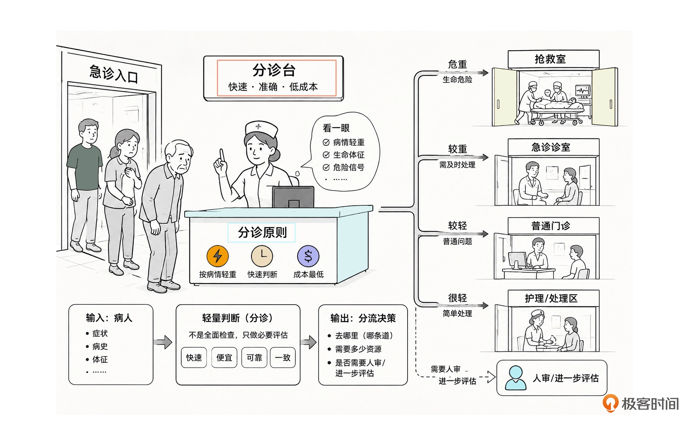

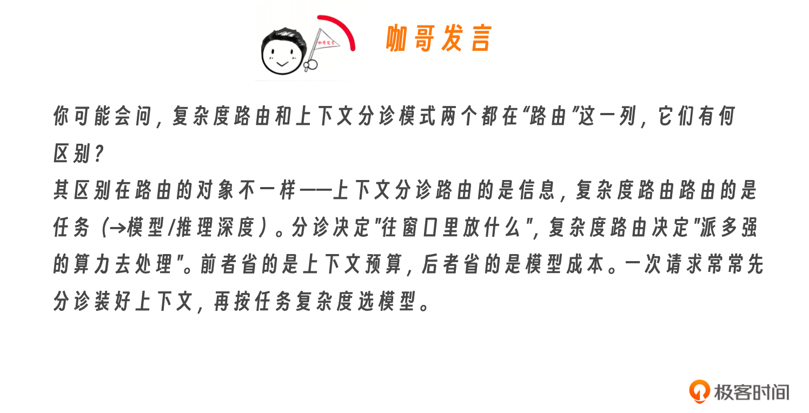

## 一句话里混着四类任务

假如 6 月薪酬结算时，用户给 Agent 发来一句话：

- 帮我处理上海市场部 6 月薪资快照里的异常 ; 能自动通过的直接过掉，不能过的列给我。

这句话表面上只是一个请求，实际上是一堆各种各样的任务，里面至少混了四类判断。

- 第一类是事实查询。比如“这个月几号发薪”。这类任务低风险、低复杂度，只需要查日历和发薪规则，不值得启动长推理。

- 第二类是结构化判断。比如“咖哥 的 6 月应发比 5 月高 18%，该不该自动放行”。这类任务证据齐、规则多、但主路径清楚，适合进入 CoT，沿一条可核验链推进。

- 第三类是多口径比较。比如“小雪 同时命中了两版奖金政策，该按哪版算”。这时几个口径都说得通，需要并行计算、并行解释，再由验证器挑出证据最完整的一条。

- 第四类是迭代调查。比如“月底总账差了 37 万，缺口从哪来”。这类问题没有足够信息一次解决，只能提出假设、查数据、排除假设、缩小范围，再继续查。

整句话如果直接丢给一个大模型自由发挥，风险很高。所以，这句话不该直接得到一个答案。它应该先被拆成任务原子，然后每个任务原子各自生成一份路由结果，也就是叫做RouteDecision 的数据结构。

```
intent: resolve
domain: payroll_exception
evidence_state: missing       # 还没召回完整审批与考勤
mechanical_ready: false       # 关键机械状态待补
risk: write_sensitive
lane: 人审澄清                # 整句先停在澄清，拆开后各子任务再分流
reasoning_effort: high
human_gate: before_write
```

这一小段结构化信号，就决定了后面整个系统怎么走。它不是给人看的注释，是驱动下游每一步的控制信号。

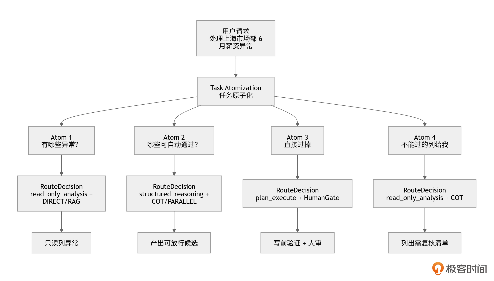

## 复杂度路由模式的定义

在双轴图谱里，复杂度路由落在“推理 × 路由”的交点。

- 它属于推理，因为它决定一次任务要不要启动深度思考、采用哪种推理拓扑、投入多少预算。

- 它属于路由，因为它不亲自解决问题，而是把问题送到合适的工作流、模型、推理模式和人审节点。

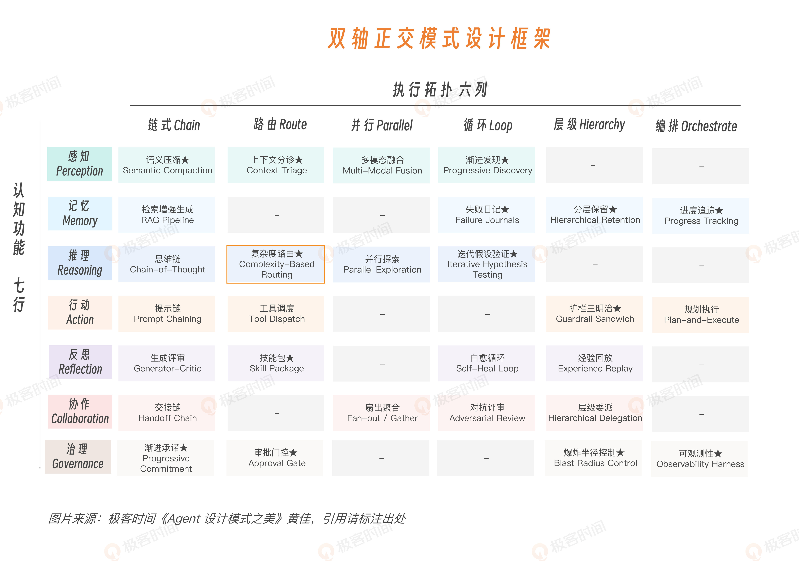

有限理性的哲学思想告诉我们，现实中的决策者没有无限时间和无限算力，不会穷尽所有选项再找全局最优，而是在成本可接受的范围内找到一个足够好的方案。Agent 也一样。推理本身有成本，所以系统在继续推理之前，要先多想一步，收益能不能抵过时间、token、工具调用和风险成本。这句话听起来像套娃，“先推理一下：这件事值不值得推理”。工程上也确实是套娃，所以分诊台必须便宜。为了节省推理成本而引入的路由器，不能自己变成新的成本黑洞。

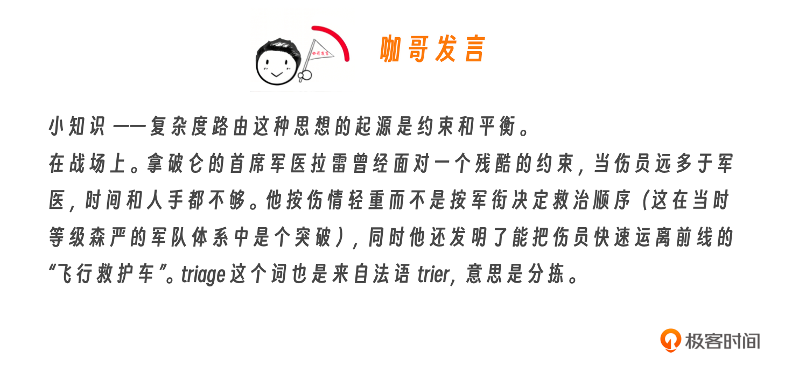


机器学习里也有类似思想。级联分类器先用便宜特征筛掉简单样本，难样本才进入更贵的后续模型；MoE 用门控网络把输入分给不同专家；企业集成模式里的 Content-Based Router 按消息内容把请求发到不同通道。到了 LLM 时代，FrugalGPT 把级联思想搬到大模型调用上，讨论 prompt adaptation、LLM approximation 和 LLM cascade 等策略；RouteLLM 则训练路由器，在强弱模型之间动态选择，以优化成本和质量平衡。

你可能会认为我们这里所讲的复杂度路由很像是意图识别。的确，这个模式要做的事情也包含意图识别，但是远远比意图识别覆盖面广泛得多。我们先给它一个工程版定义：

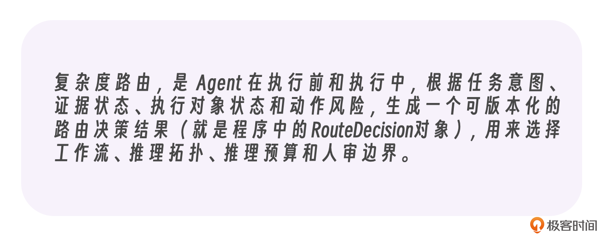

这句话里有几个词要解释一下。

- “执行前和执行中”，意思是路由不是一次性动作。初始路由可能判断错，证据回来以后也可能改变。一个请求可以从 Direct 升级到 CoT，从 CoT 升级到 Parallel，也可以因为证据缺失而转人审。

- “可版本化”，意思是路由策略必须能追责。

- “工作流”和“推理拓扑”必须分开。工作流决定有没有写权限、要不要证据、在哪插人审；推

```
理拓扑决定是直接答、链式推、并行比，还是循环查。分别对应两个字段：lane 和
reasoning_mode。
```

我们推理模块导论的推理契约中有五问，是否启动慎思、哪种推理拓扑、投入多少预算、由什么验证、什么时候停。复杂度路由回答“是否慎思、哪种拓扑、多少预算”，它本身不解题，它决定这道题该用多大力气解、由哪条流水线解。

因此复杂度路由的判断属于“外部慎思过程”里的元数据层，也就是 meta-reasoning。而它的产物 RouteDecision，落进控制平面的决策审计记录部分。这次为什么这么分、给了多少预算、后来有没有升级，都写进可审计的路由档案。普通分类器只分类，分完就完了。RouteDecision 这个数据结构则要驱动后续整个系统怎么跑。这是复杂度路由和老式意图识别式分类最大的区别：前者生成一个标签，后者给出一份可执行、可审计、可追责的控制契约。

## 先把模糊请求拆成任务原子

复杂度路由的第一步，不是判断“这句话难不难”，而是先把它拆成几个任务原子。

任务原子（TaskAtom），就是一个可以被单独路由的最小任务单位。一个任务原子最好只包含三件事：

- 它要处理什么对象；

- 它要做什么动作；

- 它依赖哪些上游结果。

比如上面那两句话，可以拆成四个任务原子：

```
A1：列出上海市场部 6 月薪资快照里的异常。
A2：判断哪些异常可以自动通过。
A3：把 A2 判断为可自动通过的异常执行通过。
A4：列出 A2 判断为不能自动通过的异常。
```

注意，A3 不能直接执行。它依赖 A2 的结果。 因为在 A2 做完之前，系统还不知道“哪些异常可以自动通过”。所以 A3 不是马上写库，而是进入一个带前置条件的执行流程。

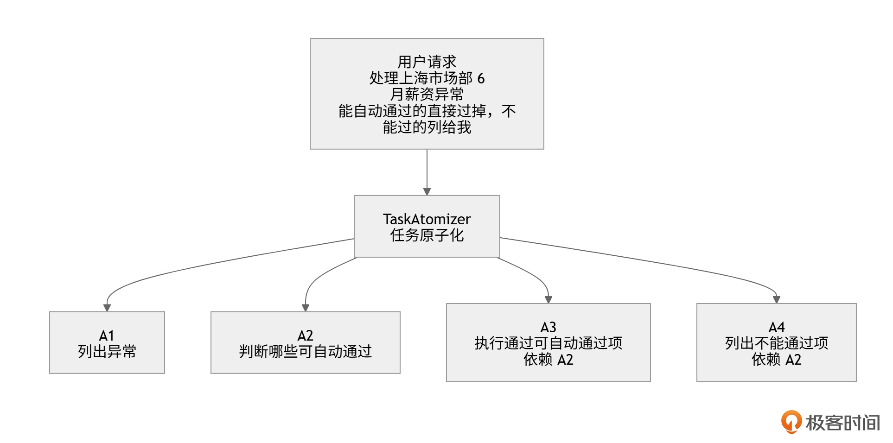

- 模糊请求先拆成任务原子

这一步的关键设计是不要让一整个模糊请求直接进入推理。先拆成任务原子，每个原子单独分诊。

## 四个路由信号：意图 / 证据 / 执行 / 风险

任务原子是下一步路由信号提取的起点。我们接下来要思考的是系统到底怎么判断一件事难不难？

在执行型 Agent 里，难度和风险不是一回事。比如：“把小冰社保基数改回上月”。这句话很短，推理也不深，但它要改敏感数据。反过来：“帮我统计全公司 5000 人过去 12 个月的薪资异常分布。” 这句话很长，数据量很大，也可能需要不少工具调用，但它只读，不直接改业务状态。

所以复杂度路由不能只问“这题难不难”，而要先拆成四个简单的信号：

```
intent              用户想做什么
evidence_state      证据够不够
mechanical_ready    执行对象是否确认
risk                动作后果有多重
```

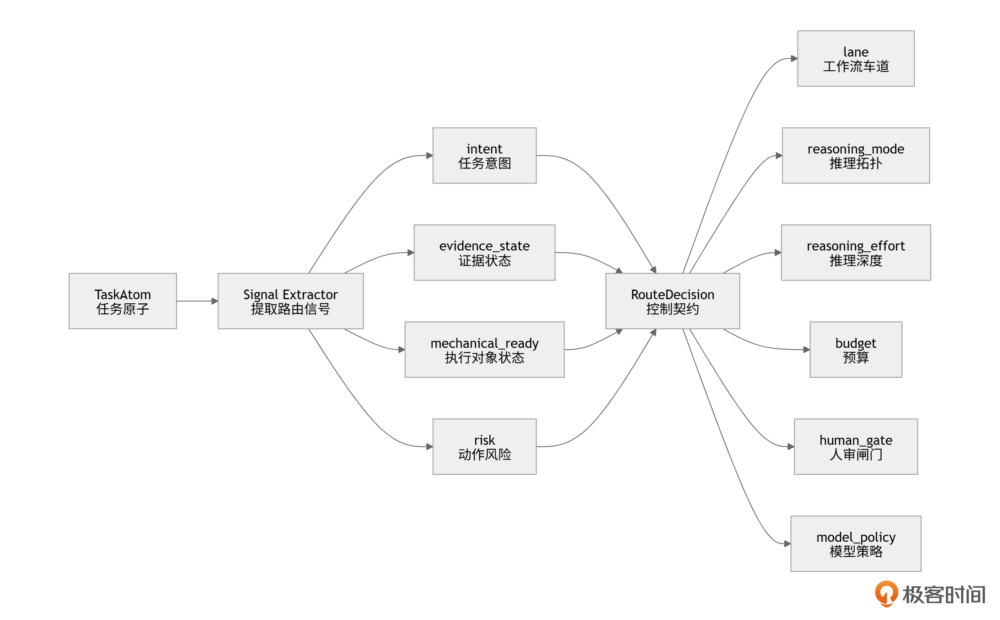

真正的复杂度路由就看这四个信号，让我们一个一个详细解释。

### 第一个信号：任务意图（intent）

任务意图先回答：用户到底要系统做什么？它至少可以粗略分为：

```
chat          闲聊
information   查事实
analyze       做分析
draft         生成草稿
resolve       完成一个业务动作
unknown       判不准
```

这个枚举一开始不要做得太细。上来就做几十个意图分类就太乱了。先粗粒度分一级，再在具体业务域里分二级。

```
比如“小冰这个月社保基数怎么变了？” 这是 analyze。它要查规则、查记录、解释原因，
```

- 但不改数据。

```
而“把小冰社保基数改回上个月。”这是 resolve。它要改变业务状态，而且是敏感数据。
```

### 第二个信号：证据状态（evidence_state）

证据状态回答：做这个判断所需的证据够不够？可以拆成五档：

```
ready      证据已召回，版本匹配
missing    关键证据缺失
stale      证据过期或版本不对
conflict   多个证据互相冲突
unknown    还没完成检索或核验
```

证据缺口不能用更大的模型弥补。缺审批单，就去审批系统查；缺考勤记录，就去考勤系统

```
查；政策版本冲突，就去政策注册中心核对。只要 evidence_state 是 missing、
conflict 或 unknown，任务就不能直接进入自动决策，更不能进入自动写入。
```

### 第三个信号：执行对象状态（mechanical_ready）

这个信号我们也可以叫做“机械状态”，因为它和我们之前说过的“机械平面”相关，它回答的是：这次动作要作用到哪个真实对象上？对象有没有被程序确认？

员工 ID、薪资批次 ID、审批单号、租户 ID、账号、税号，这些都不应该让 LLM 在自然语言上下文里复制来复制去。它们应该由程序维护，带数据来源版本、和校验。

比如：

```
employee_id 是否来自员工主数据？
payroll_batch_id 是否来自当前批次？
approval_id 是否确认为同一租户下的审批单？
policy_version 是否覆盖当前结算月份？
```

只要关键执行对象状态不完整，就一票否决，不能进入写操作。Agent 并不适合处理和传递数字类型的信息，Agent 需要确定信息的完整性，然后把数据对象交给机械平面中的工作流来执行。

### 第四个信号：动作风险 risk

动作风险必须独立评估，风险必须按动作后果来衡量。这里建议至少五档：

```
read_only               只读
draft                   生成草稿，不自动提交
write_reversible        可回滚写入
write_sensitive         敏感写入，如薪资、权限、合同
external_irreversible   不可逆外部动作，如发薪、报税、支付
```

## 一个结构化结果：RouteDecision

四个信号提取完以后，路由器会做一次路由选择，而 RouteDecision 是这次决策动作的结构化结果。

- 四个路由信号

```
   ↓
路由选择 routing
   ↓
RouteDecision
   ↓
lane / reasoning_mode / effort / budget / human_gate / model_policy
```

复杂度路由根据四个信号生成一份 RouteDecision；RouteDecision 是一个复杂的数据结构，是写给下游系统的一张“分诊单”。

```
RouteDecision(
   router_version="router_2026_06_01",
   policy_version="payroll_policy_2026_05",
   intent="resolve",
   evidence_state="ready",
   mechanical_ready=True,
   risk="write_sensitive",
   # lane 管业务边界：这件事属于计划执行类任务
   lane="plan_execute",
   # workflow_id 管具体流程：这次跑薪资异常放行流程
   workflow_id="payroll_exception_release_v3",
   # reasoning_mode 管推理形状：沿一条链推理
   reasoning_mode="cot",
   # reasoning_effort 管推理预算：中等强度
   reasoning_effort="medium",
   # human_gate 管责任边界：写入前必须人审
   human_gate="before_write",
   # model_policy 管模型策略：允许用推理模型
   model_policy="reasoning_model_allowed",
)
```

上面就是一次高风险执行型任务的 RouteDecision：证据已齐、对象已确认、任务意图是完成业务动作，但因为风险是敏感写入，所以进入 plan_execute 车道，用 CoT 做中等强度推理，并且写入前必须人审。

这就是复杂度路由和老式意图识别分类的区别。老式的意图识别一个简单标签（如“直接回答”/“查数据库”/“转人工”），我们这里的 RouteDecision 给出一份可执行也可以可审计的控制契约。这个就细致而且高大上多了。

至此，我们就有了任务原子、路由信号以及路由结果的完整数据结构。先定义枚举。

```python
from dataclasses import dataclass, field
from enum import Enum
class Intent(str, Enum):
   INFORMATION = "information"   # 查事实
   ANALYZE = "analyze"           # 只读分析
   DECIDE = "decide"             # 产出判断，但不写库
   EXECUTE = "execute"           # 执行业务动作
   UNKNOWN = "unknown"
class EvidenceState(str, Enum):
   READY = "ready"
   MISSING = "missing"
   CONFLICT = "conflict"
   UNKNOWN = "unknown"
class Risk(str, Enum):
   READ_ONLY = "read_only"
   DRAFT = "draft"
   WRITE_REVERSIBLE = "write_reversible"
   WRITE_SENSITIVE = "write_sensitive"
   EXTERNAL_IRREVERSIBLE = "external_irreversible"
class Lane(str, Enum):
   DIRECT_ANSWER = "direct_answer"
   READ_ONLY_ANALYSIS = "read_only_analysis"
   STRUCTURED_DECISION = "structured_decision"
   PLAN_EXECUTE = "plan_execute"
   CLARIFY_OR_REVIEW = "clarify_or_review"
class ReasoningMode(str, Enum):
   DIRECT = "direct"
   COT = "cot"
   PARALLEL = "parallel"
   ITERATIVE = "iterative"
class HumanGate(str, Enum):
   NONE = "none"
   BEFORE_WRITE = "before_write"
   ALWAYS = "always"
```

然后定义三个核心对象。

```bash
@dataclass
class TaskAtom:
   atom_id: str
   text: str
   depends_on: list[str] = field(default_factory=list)
@dataclass
class RouteSignals:
   intent: Intent
   evidence_state: EvidenceState
   target_ready: bool
   risk: Risk
   confidence: float = 1.0
@dataclass
class RouteDecision:
   atom_id: str
   signals: RouteSignals
   lane: Lane
   reasoning_mode: ReasoningMode
   human_gate: HumanGate
   blockers: list[str] = field(default_factory=list)
   route_reason: str = ""
```

这套结构里，字段前后一致：

```
TaskAtom 表示要分诊的任务原子。RouteSignals 表示四个路由信号。RouteDecision
```

表示路由结果。

```python
from dataclasses import dataclass, field
@dataclassclass RouteDecision:
   router_version: str             *# 路由策略版本，出事能追是哪版策略判错*
   intent: str                     *# chat / information / analyze / resolve / u
   evidence_state: str             *# ready / missing / stale / conflict*
   mechanical_ready: bool          *# 关键机械状态齐不齐（接进度追踪的机械平面）*
   risk: str                       *# read_only / draft / write_reversible / wri
   lane: str                       *# 五条车道之一：决定下游工作流*
   reasoning_mode: str             *# DIRECT / COT / PARALLEL / ITERATIVE：决定推理
   reasoning_effort: str           *# none / low / medium / high / xhigh*
   human_gate: str | None = None   *# 在哪一步插人审*
   confidence: float = 0.0         *# 路由本身的置信度，低了就降级到人审澄清*
   escalated_from: str | None = None  *# 从哪个更轻的 mode 升级而来，分诊时留空待回填*
   signals: dict = field(default_factory=dict)
   def can_write(self) -> bool:
       *# 要动写操作，机械状态必须齐、且落在计划执行车道*return self.mechanical_ready an
       *# 路由器自己不确定，就降级人审澄清，不硬选一条道*return self.intent == "unknown"
```

## 五条路由车道：Lane 负责流程

```
上面的结构化输出中的lane 字段回答的是：这次请求应该进入哪条业务流水线？它负责的是
```

工作流、权限和边界，不管具体怎么推理。

可以给出类似下面的五条车道。

车道 Lane

- 适用场景写权限证据要求

direct_answer

- 简单事实、低风险问答无可选

这张表比“简单 / 中等 / 复杂”三分法实用，因为它分流的是路径，不只是模型。

```
direct_answer 没有写权限。
read_only_analysis 必须引用证据，但不动业务状态。
structured_reasoning 只产判断，不执行写入。
plan_execute 才进入行动组，但写前必须过验证闸门和人审。
clarify_human_review 是兜底：意图不明、证据冲突、对象不清、风险顶格，就停下
```

- 来补证或交给人。

像刚才的需求：

- 帮我处理上海市场部 6 月薪资快照里的异常。 能自动通过的直接过掉，不能过的列给我。

分诊台会把所有市场部员工拆成几个组别。

```
“有哪些异常”
→ lane = read_only_analysis
→ 只读分析，引用证据，不写库
“哪些能自动通过”
→ lane = structured_reasoning
→ 绑规则、绑证据，只产判断
“直接过掉”
→ lane = plan_execute
→ 涉及写入，写前必须过验证闸门和人审
“员工 ID 错位 / 审批单缺失 / 政策版本冲突”
→ lane = clarify_human_review
→ 暂停，补证或人工复核
```

这就是我们所说的“分诊台先把它切成几个任务原子，再让它们各走各的车道。”

## 几种思考形状：reasoning_mode 负责拓扑

```
RouteDecision 还有一个重要字段reasoning_mode。lane 管流程，reasoning_mode 管
```

思考形状。lane 和 reasoning_mode 不是一一对应关系。一条车道里可以跑不同的reasoning_mode。同一个 reasoning_mode 也可能出现在不同车道里。

思考的形状，常见有四种（对应着我们的几种推理模式，未来还可以有更多）：

ReasoningMode

- 适用问题对应模式

DIRECT

- 简单、低风险、一步可答直接思考

COT

- 主路径明确，中间步骤不能省思维链

PARALLEL

- 多个合理口径，需要并行比较并行探索

ITERATIVE

- 信息不足，需要边查边修迭代假设

```
例如，小雪同时命中两版奖金政策时，业务车道仍然是 structured_reasoning，因为它
证据齐、只产决策、不写库；但它的 reasoning_mode 是 PARALLEL，因为要并行算几个
```

口径再择优。

```
而月底总账差 37 万时，可能还是只读分析或结构化推理车道，但它的 reasoning_mode 是
ITERATIVE，因为要边查边修假设。
这个月几号发薪，reasoning_mode 是 DIRECT。
咖哥那笔 18% 的加薪该不该放行，reasoning_mode 是 COT。
小雪命中双版政策，reasoning_mode 是 PARALLEL。
总账 37 万缺口，reasoning_mode 是 ITERATIVE。
```

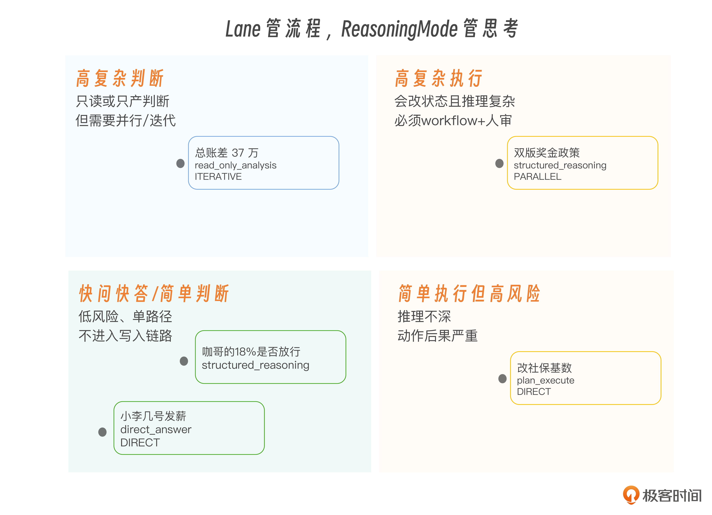

- Lane 与 ReasoningMode 是两个维度

## 路由规则的极简代码实现

下面，我们把上面所介绍的路由规则用简单的数据结构从头到尾串一遍。

先定义 Lane 的选择。

```python
def choose_lane(signals: RouteSignals) -> Lane:
   if signals.intent is Intent.INFORMATION:
       return Lane.DIRECT_ANSWER
   if signals.intent is Intent.ANALYZE:
       return Lane.READ_ONLY_ANALYSIS
   if signals.intent is Intent.DECIDE:
       return Lane.STRUCTURED_DECISION
   if signals.intent is Intent.EXECUTE:
       return Lane.PLAN_EXECUTE
   return Lane.CLARIFY_OR_REVIEW
```

再根据证据状态选择推理拓扑。

```python
def choose_reasoning_mode(signals: RouteSignals, lane: Lane) -> ReasoningMode:
   if lane is Lane.DIRECT_ANSWER:
       return ReasoningMode.DIRECT
   if signals.evidence_state is EvidenceState.CONFLICT:
       return ReasoningMode.PARALLEL
   if signals.evidence_state in {
       EvidenceState.MISSING,
       EvidenceState.UNKNOWN,
   }:
       return ReasoningMode.ITERATIVE
   if lane in {
       Lane.STRUCTURED_DECISION,
       Lane.READ_ONLY_ANALYSIS,
   }:
       return ReasoningMode.COT
   if lane is Lane.PLAN_EXECUTE:
       return ReasoningMode.DIRECT
   return ReasoningMode.DIRECT
```

再根据风险决定人审。

```python
def choose_human_gate(signals: RouteSignals) -> HumanGate:
   if signals.risk is Risk.EXTERNAL_IRREVERSIBLE:
       return HumanGate.ALWAYS
   if signals.risk is Risk.WRITE_SENSITIVE:
       return HumanGate.BEFORE_WRITE
   return HumanGate.NONE
```

最后生成 RouteDecision。

```python
def route(atom: TaskAtom, signals: RouteSignals) -> RouteDecision:
   lane = choose_lane(signals)
   reasoning_mode = choose_reasoning_mode(signals, lane)
   human_gate = choose_human_gate(signals)
   blockers: list[str] = []
   if signals.intent is Intent.UNKNOWN:
       blockers.append("intent_unknown")
   if signals.evidence_state is EvidenceState.MISSING:
       blockers.append("evidence_missing")
   if signals.evidence_state is EvidenceState.CONFLICT:
       blockers.append("evidence_conflict")
   if signals.intent is Intent.EXECUTE and not signals.target_ready:
       blockers.append("target_not_ready")
   if signals.confidence < 0.6:
       blockers.append("low_route_confidence")
   route_reason = (
       f"intent={signals.intent.value}, "
       f"evidence_state={signals.evidence_state.value}, "
       f"target_ready={signals.target_ready}, "
       f"risk={signals.risk.value}"
   )
   return RouteDecision(
       atom_id=atom.atom_id,
       signals=signals,
       lane=lane,
       reasoning_mode=reasoning_mode,
       human_gate=human_gate,
       blockers=blockers,
       route_reason=route_reason,
   )
```

这样就把一个任务原子和四个路由信号，编译成了一个 RouteDecision。

有了上面的数据结构，我们再把开头那两句话从头到尾跑一遍。原始请求如下：

```
帮我处理上海市场部 6 月薪资快照里的异常。
```

- 能自动通过的直接过掉，不能过的列给我。

先拆成四个任务原子：

```
atoms = [
   TaskAtom(
       atom_id="A1",
       text="列出上海市场部 6 月薪资快照里的异常",
   ),
   TaskAtom(
       atom_id="A2",
       text="判断哪些异常可以自动通过",
       depends_on=["A1"],
   ),
   TaskAtom(
       atom_id="A3",
       text="把 A2 判断为可自动通过的异常执行通过",
       depends_on=["A2"],
   ),
   TaskAtom(
       atom_id="A4",
       text="列出 A2 判断为不能自动通过的异常",
       depends_on=["A2"],
   ),
]
```

然后给每个原子生成四个路由信号。

A1：列出异常A1 是只读分析。它只需要扫描薪资快照，不改业务状态。

```bash
signals_a1 = RouteSignals(
   intent=Intent.ANALYZE,
   evidence_state=EvidenceState.READY,
   target_ready=True,
   risk=Risk.READ_ONLY,
   confidence=0.9,
)
decision_a1 = route(atoms[0], signals_a1)
```

结果：

```
A1
lane = read_only_analysis
reasoning_mode = cot
human_gate = none
blockers = []
```

它进入只读分析流程。

A2：判断哪些可以自动通过

A2 是结构化判断。它需要根据异常清单、政策、审批单、工资组成，判断哪些异常可以自动通过。但它不写库。

```bash
signals_a2 = RouteSignals(
   intent=Intent.DECIDE,
   evidence_state=EvidenceState.READY,
   target_ready=True,
   risk=Risk.READ_ONLY,
   confidence=0.85,
)
decision_a2 = route(atoms[1], signals_a2)
```

结果：

```
A2
lane = structured_decision
reasoning_mode = cot
human_gate = none
blockers = []
```

它进入结构化决策流程，也就是上一讲的 CoT Trace：一步步拆出 claim、evidence、validator，最后产出“可自动通过清单”和“不可自动通过清单”。

A3：执行通过

A3 是敏感写操作。它要改变薪资异常状态，所以不能直接交给模型执行。

它依赖 A2 的结果。只有 A2 产出了经过验证的可通过清单，A3 才有明确执行对象。

```bash
signals_a3 = RouteSignals(
   intent=Intent.EXECUTE,
   evidence_state=EvidenceState.READY,
   target_ready=False,
   risk=Risk.WRITE_SENSITIVE,
   confidence=0.8,
)
decision_a3 = route(atoms[2], signals_a3)
```

结果：

```
A3
lane = plan_execute
reasoning_mode = direct
human_gate = before_write
blockers = ["target_not_ready"]
注意，A3 确实应该进入 plan_execute，因为用户要求“直接过掉”。 但它现在还不能写库，
因为 target_ready=False。 它必须等 A2 产出明确的、验证通过的目标清单后，才能解
除 blocker（审查点）。 即使 blocker 解除，因为风险是 write_sensitive，也仍然要在写
前经过 human_gate=before_write。
```

这就是路由的意义所在——系统承认这是执行任务，但并不会让它立刻执行。需要等待后续步骤统一完成。

A4：列出不能通过的异常

A4 是只读报告。它依赖 A2 的判断结果，但本身不写库。

```bash
signals_a4 = RouteSignals(
   intent=Intent.ANALYZE,
   evidence_state=EvidenceState.READY,
   target_ready=True,
   risk=Risk.READ_ONLY,
   confidence=0.9,
)
decision_a4 = route(atoms[3], signals_a4)
```

结果：

```
A4
lane = read_only_analysis
reasoning_mode = cot
human_gate = none
blockers = []
```

它进入只读分析流程，输出“不能自动通过的异常清单”和原因。

最终，这两句话会被拆成下面这样的执行图。

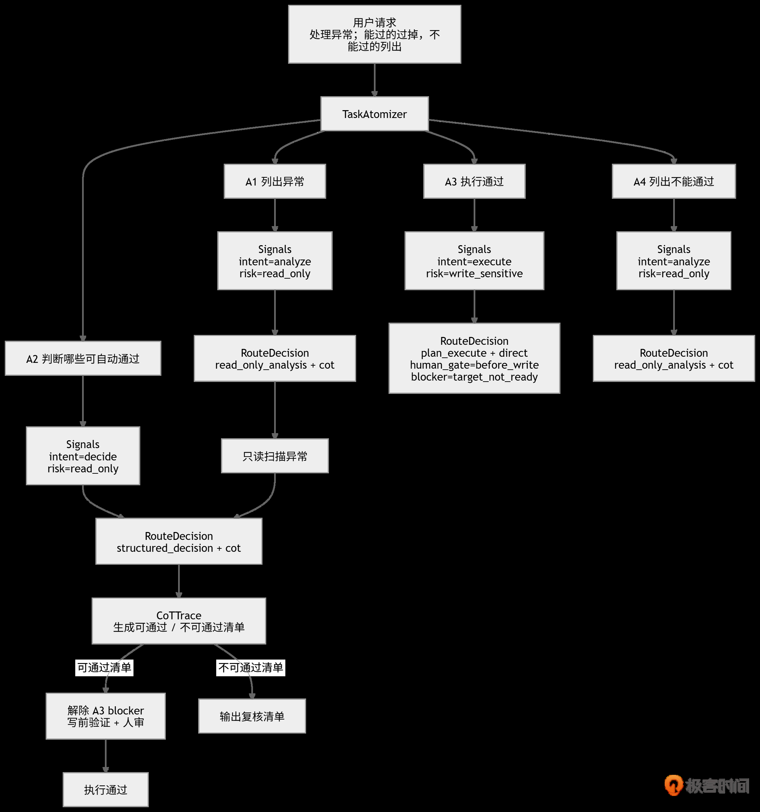

- 从模糊请求到不同流程

从这张图中，可以看到用户请求先拆任务原子；每个原子提取四个信号；四个信号生成RouteDecision； RouteDecision 决定车道、推理拓扑、 验证审查点（blocker）；不同原子进入不同流程。

## 三层路由复杂度选择：workflow、model vs effort

上面我们的复杂度路由聚焦于工作流路由（workflow routing）。它决定直接回答、只读分析、结构化推理、规划与执行、还是人工审核。

这一层永远在模型外面。因为它处理的是业务权限、证据缺口、写入边界、人审责任。模型不能自己决定“我可以改薪资”。

此外，还有第二层是模型路由（model routing）。它决定便宜模型、强模型、专用模型、推理模型之间怎么选。FrugalGPT 和 RouteLLM 主要在这一层。FrugalGPT 讨论 LLM cascade，用不同模型组合降低成本；RouteLLM 学习在强弱模型之间路由，以平衡成本和质量。

这里还要补充一个最近的关键变化。也就是第三层推理强度路由（effort routing）。它不是换模型，而是在同一个模型或同一模型族里调“想多深”。现在 Claude、GPT-5、Gemini 都把“想多深”做成了模型内部的一个 effort 档位，于是 effort 路由开始部分取代模型路由。OpenAI 的推理模型文档也明确把推理强度 reasoning effort（以及 reasoning tokens 和跨轮推理状态reasoning state）作为 API 里的工程概念，做成了可选参数。

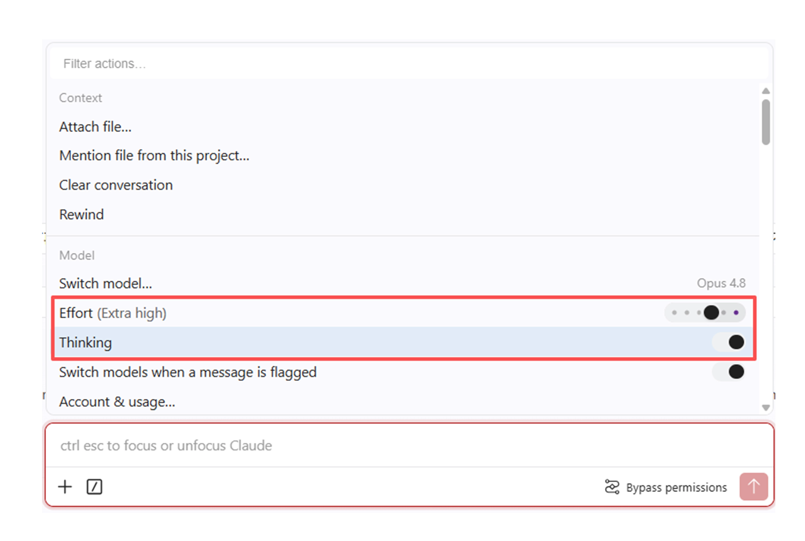

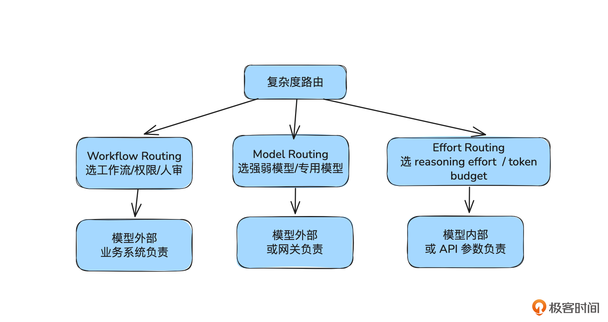

## 把路由推到极致：Talker-Reasoner 双模

前面讲的都是“同一个 Agent 选不同档位”。把这个思想推到极致，就是干脆把档位拆成两个独立的 Agent 同时跑，这就是 2024 年谷歌 DeepMind 在 NeurIPS 2024 的 Open-World Agentsworkshop 上提出的 Talker-Reasoner 架构。

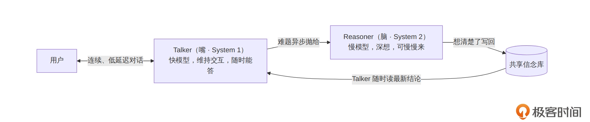

Talker 是嘴（System 1），用快模型维持连续低延迟对话。Reasoner 是脑（System 2），用慢模型在后台深想，想清楚了写回共享信念库，Talker 随时读最新结论接着聊。把路由推到极致，连嘴和脑都拆成了两个 Agent。

这种设计的好处在实时交互场景特别明显。你跟一个语音助手说话，它不能让你干等二十秒它“深度思考”。Talker 用快模型先把对话接住、维持节奏，遇到真需要深想的问题，异步抛给Reasoner，Reasoner 在后台慢慢算、把结论写进共享信念库，Talker 随时读最新的结论继续聊。一个管嘴、一个管脑，这其实是一种按时间维度做的路由，把“现在就得回”和“可以慢慢想”这两类需求，分给了两个跑在不同节奏上的 Agent。

不过它不是免费的，两个 Agent、两套上下文、两套 trace、一套同步协议，工程复杂度明显上去了。我的判断是，单 Agent 的后台批处理任务不值得拆，但语音助手、实时陪聊这类“边对话边深想”的场景几乎必须拆。Talker-Reasoner 是把路由推到极致的双模架构，它不是第五个推理模式，它是复杂度路由在“按时间分流”这个方向上的一种极端实现。

## 路由关键指标：首次路由命中率

导论中，我们给推理系统立了四个指标，验证通过率、首次路由命中率、单位验证成功成本、推理漂移率。这四个指标里，负责衡量复杂度路由的指标是首次路由命中率。

首次路由命中率衡量的是第一次选的推理模式是不是足够解决问题。读这个指标，关键看两种失配方向。

- 一种是系统性低估难度。大量本来认为是直接推理的请求，最后升级到了迭代才搞定。这就说明分诊台把难题当简单题放进了快路，省下的那点钱，全赔在反复升级、重试、推翻重来上了。

- 另一种是系统性过度推理。大量低风险的查询，一上来就被塞进了高成本的并行探索或迭代验证。这说明分诊台过于谨慎，把简单题当难题供着，每一笔都在烧没必要的算力。

这两种失配，前者要放松“判简单”的门槛、要么加强升级前的预判，后者要收紧“判复杂”的触发条件。那么，之所以能精准地对症下药，前提是你把每次 RouteDecision 和它最终的实际归宿都记进了 trace，才能算出“判了什么、最后实际走了什么”。这也是前面 RouteDecision 一定要进入审计记录的原因。

首次路由命中率还有个派生指标，单位验证成功成本。单位验证成功成本衡量的是，拿到一个通过验证的正确结果，平均花了多少钱和多少延迟。因为升级、重试、推翻重来的成本全摊进了分母里。命中率下降，单位成本当然就涨。因此会算账的 Agent，先要把分诊台调准。

## 总结一下

这一讲，我们把“该花多少推理”做成了一座工程化分诊台。

复杂度路由不是简单给 Agent 加一个分类器。它的核心，是在任务进入主链路之前，先判断这件事该不该深想、该走哪条车道、用哪种推理拓扑、给多少预算、哪里必须人审。

它看四个信号：

- 任务意图：用户是查事实、做分析，还是要完成动作？

```
证据状态：证据是否 ready，有没有缺失、过期或冲突？
机械状态：员工 ID、批次 ID、审批单号等执行对象是否确认？
动作风险：这是只读、草稿、可回滚写入，还是敏感 / 不可逆动作？
```

复杂度路由的输出不是一个“简单 / 中等 / 复杂”的标签，而是一份 RouteDecision。它是一张控制单，告诉系统：

```
lane：走哪条业务车道
reasoning_mode：用哪种推理拓扑
reasoning_effort / budget：花多少推理
human_gate：哪里必须人审
blockers：当前有没有阻塞项
```

这几个字段不要混。Lane 管业务边界，ReasoningMode 管思考形状，HumanGate 管风险刹车，Blockers 管当前能不能继续。

推理这一组可以理解成“一座分诊台加三间诊室”：复杂度路由是分诊台；CoT、并行探索、迭代假设验证是分诊之后进入的三间诊室。CoT 负责对账，并行探索负责择优，迭代假设验证负责逼近根因。

复杂度路由也是整套推理经济学的总开关。大部分请求其实不需要深想，应该走快路；深想要留给真正复杂、昂贵、高风险的那一小部分任务。盯紧它的本命指标：首次路由命中率。路由准了，成本、延迟、人审和重试都会一起下降。

最后记住一句话：先分诊，再看病。会推理的 Agent，先会分诊。

## 思考题

1. 你的 Agent 现在按什么决定一个请求用多大的模型、想多深？是按 query 长度或工具数量，还是按任务意图、证据状态、机械状态、动作风险这四个信号？这四个里，哪个信号你现在完全没看？

2. 找一条你系统里“很短但很危险”的请求，比如一句话改个金额或权限。现在的路由会把它放进哪条车道？它的 risk 是独立估的，还是搭了复杂度的便车？写操作前有没有验证闸门和人审？

3. 你的路由决策是一段自然语言，还是一个带版本号的结构化对象？如果上周发生过一次误路由，你能追到是哪一版策略、按哪个信号判错的吗？再看一眼，你分得清 lane 和reasoning_mode 这两个输出吗，你的系统里有没有把它们焊成了一对、结果在某个场景卡住？

## 下一讲预告

下一讲我们讲第三个推理模式，并行探索（Parallel Exploration）。

复杂度路由把判断分了诊。当一件事真分到深水区、而且一条路想不稳，要不要同时想几条？并行探索是深水区的广度诊室。下一讲，我们就把这间广度诊室拆开。

我们下一讲见。

## 参考资料

1. Dominique Jean Larrey. Mémoires de chirurgie militaire et campagnes. 1812-1817.

2. Herbert A. Simon. Administrative Behavior. Macmillan, 1947.

3. Eric J. Horvitz. Reasoning about Beliefs and Actions under Computational ResourceConstraints. UAI, 1987.

4. Thomas Dean, Mark Boddy. An Analysis of Time-Dependent Planning. AAAI, 1988.

5. Stuart Russell, Eric Wefald. Do the Right Thing: Studies in Limited Rationality. MIT Press,1991.

6. Jacobs, Jordan, Nowlan, Hinton. Adaptive Mixtures of Local Experts. Neural Computation,1991.

7. Paul Viola, Michael Jones. Rapid Object Detection using a Boosted Cascade of SimpleFeatures. CVPR, 2001.

8. Hohpe, Woolf. Enterprise Integration Patterns. Addison-Wesley, 2003.

9. Chen, Zaharia, Zou. FrugalGPT: How to Use Large Language Models While ReducingCost and Improving Performance. 2023.

10. Ong et al. RouteLLM: Learning to Route LLMs with Preference Data. arXiv:2406.18665,ICLR 2025.

11. Christakopoulou et al. Agents Thinking Fast and Slow: A Talker-Reasoner Architecture.arXiv:2410.08328, Google DeepMind, NeurIPS 2024 Workshop on Open-World Agents.

12. OpenAI. Reasoning models（reasoning effort / Structured Outputs）（API 文档）. /Introducing GPT-5. 2025-08-07.
