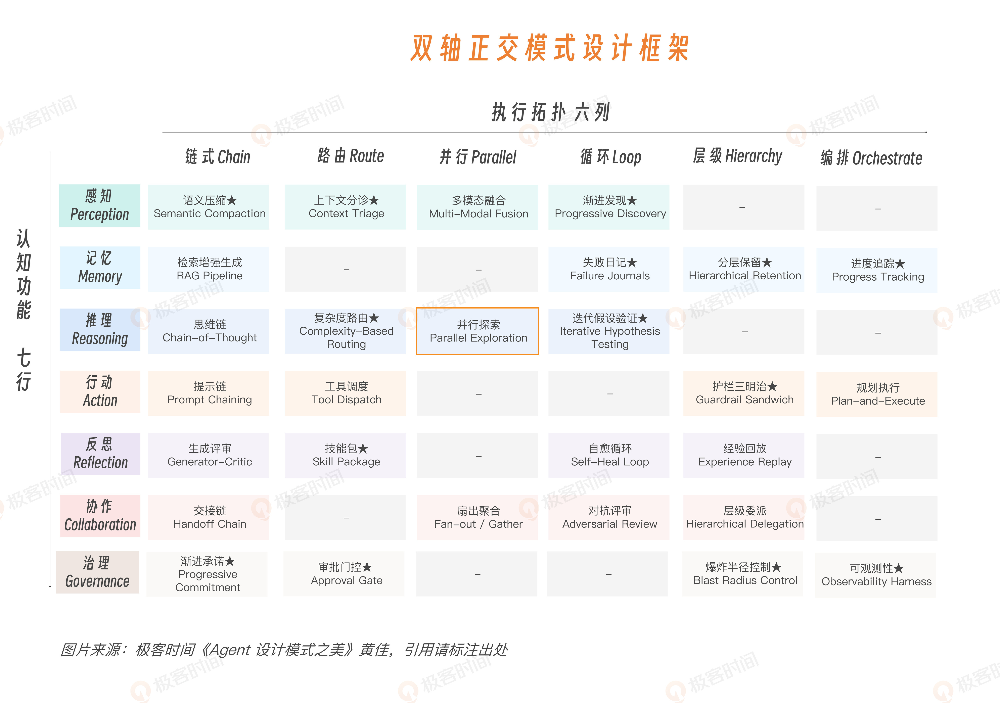
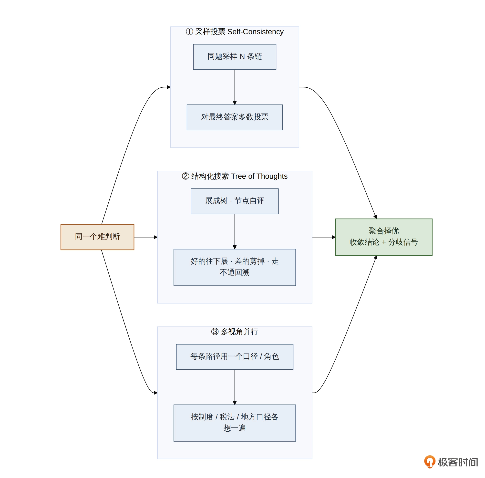
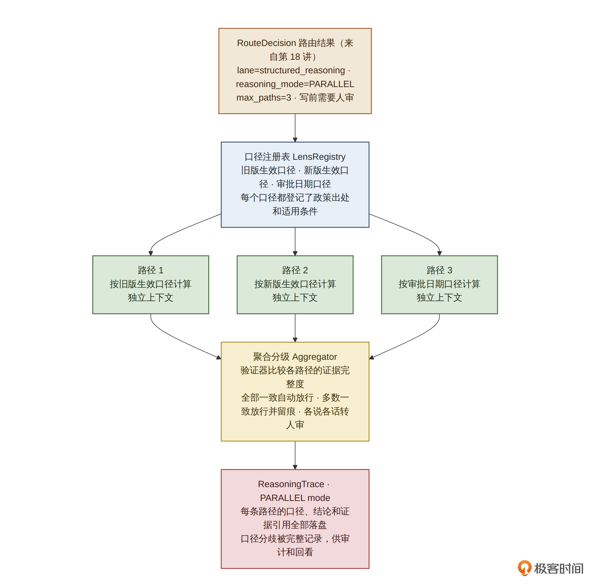
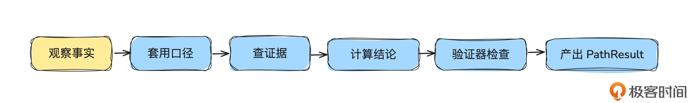
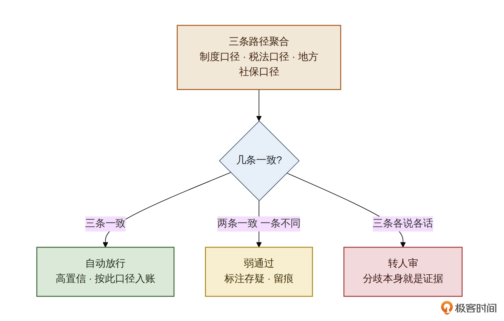

# 19 | 并行探索：一题多解，择优录取

你好，我是黄佳。

上一讲，我们把分诊台建起来了。一句模糊请求进来，系统先拆成任务原子，再给每个任务生成路由决策结果（RouteDecision）：员工几号发薪，直接回答；18% 的工资异常的调查，走CoT。

但还有一类任务会被“分诊台”送进深水区。比如，小雪这个月同时命中了两版奖金政策。旧版政策覆盖她的考核周期，新版政策覆盖她的发放时间，审批单又卡在新旧政策切换附近。你问系统：这笔奖金到底该按哪版算？系统就得琢磨琢磨各种不同的对策。

因为这道题的麻烦，不是链条长，而是口径多。按旧版有效期或按新版发放时点算都说得通，按审批日期切换还是说得通。三条路背后都有证据、都有制度解释，而且很可能算出三个不同金额。此时， Agent 应该多路探索，然后进行比较，把它认为最合理的答案推荐给人来审批，同时给出其它链路的优缺点。这才是我们希望 Agent 系统所做到的。

所以这一讲，我们建推理深水区里的另一间诊室：广度诊室。当一条路想不稳时，让 Agent 同时铺开几条路。每条路按自己的口径查证据、算结果、写理由，最后再把几条路放在一起比较，这就是并行探索（Parallel Exploration）。

## 为什么单跑一条链不敢信

同一道难题，向你的 Agent 问两遍，两次的答案一样吗？

答案是不一定。LLM 的推理是概率生成，temperature 不为零的时候，每次解码走的路径都可能不同。题目简单的时候，这个差异无所谓，怎么采样都能采到对的答案。但是题目一难，答案的分布就散开了。单跑一条链，你拿到的只是这个分布里的一个采样点，至于分布本身有多宽、这一次采样偏不偏，我们完全不知道。换句话说，单跑一条链，等于赌这一次采样刚好采到对的那条路径。

并行探索同一道题同时跑几条路径，再把几条结果聚合起来择优。它用多条样本去逼近那个分布，从而得到一个比单次采样更稳的结论。这个做法的本质，是用多样性换可靠性。

- 机器学习里的集成学习，用一堆有差异的弱模型投票来决定最终的预测或分类结果，就是这个道理。而到了 LLM 时代，Self-Consistency 这篇论文把并行探索的思路引入了大模型的推理过程。论文的做法是不再只取一条 CoT，而是采样多条推理路径，再选出最一致的答案。

到执行型 Agent 里，并行探索不能只停在“多采样几次”，我们在强调“多条路径”的同时，也强调“证据”“裁决”和“分歧。

这里先给并行探索模式下一个工程定义：

- 并行探索，是对同一个问题展开多条独立推理路径，让每条路径带着自己的口径、证据和结论回来，再通过聚合、验证器和分歧裁决，把结果收束成自动判断、弱通过、人审或重新路由。



在双轴图谱里，它落在推理行、并行列。推理契约中的第二问是“采用哪种推理拓扑”，此时的答案当然是并行；推理契约的第四问是“由什么验证”，并行探索给出的答案是：聚合策略、验证器，以及分歧裁决。

## 三种形态：多条路径是怎么造出来的

并行探索的工程实现主要考虑，这多条路径是怎么被制造出来的。通常有三种思路。

第一种是采样投票。

同一个 prompt，采样 N 条 CoT 链，最后对答案投票。这就是 Self-Consistency。它适合有明确标准答案的任务，比如数学题、分类、抽取、单一口径下的规则判断。它简单，便宜，效果常常不错，但前提是几条路径的错误不要高度相关。

第二种是结构化搜索。

Tree of Thoughts 把推理从一条链扩展成一棵树：每一步生成多个候选 thought，模型或验证器对候选做评估，好的继续展开，差的剪掉，必要时回溯。它适合需要前瞻、试错、规划和搜索的问题。论文里，ToT 明确强调了多路径探索、自评估、前瞻和回溯；在 Game of 24 等任务上，它相对普通 CoT 有明显提升。

第三种是多视角并行。

这才是执行型 Agent 里最值得重视的一种。它不是同一个 prompt 多采样几次，而是让几条路径各按一个不同的业务口径去推同一件事。

比如小雪的奖金判断：

- 路径一：旧版政策有效期口径。路径二：新版政策发放时点口径。路径三：审批日期切换口径。

再比如跨月年终奖：

- 路径一：实际发放月口径。路径二：税法所属期口径。路径三：地方社保规则口径。

这种问题靠采样投票是无法解决的。你把同一个 prompt 采样 10 次，如果它们都默认用了“发放月口径”，那 10 条链只是同一个前提下的 10 次复读。真正需要的是业务口径的多样性，而不是随机性的多样性。



三种形态：采样投票（同题采样 N 条链再投票）、结构化搜索（把推理展成树，自评、剪枝、回溯）、多视角并行（几条路径各按一个口径去想）。三种形态最后都汇入聚合择优。


## 工程实现：五层结构

这间广度诊室在工程上怎么建呢？我按照数据流的顺序把它拆成五层，每一层都对应一个具体的工程对象。



从 RouteDecision 到 ReasoningTrace 的完整数据流：口径注册表提供口径，N 条相互隔离的

- 路径各自计算，聚合分级不只数票，口径分歧被完整记录

### 第一层，接住路由结果

并行探索不是任务自己走进来的，是上一讲的分诊台送进来的。RouteDecision 至少要带几样东西：

```
lane = structured_reasoning
reasoning_mode = PARALLEL
max_paths = 3
human_gate = before_write 或 before_decision
budget = token / latency / tool_calls 上限
这里最重要的是 lane 和 reasoning_mode 继续分开。reasoning_mode = PARALLEL
```

只说明这次怎么推理。它不说明能不能写库、能不能自动放行、能不能跳过人审。能不能写，

```
仍然由 lane、risk、mechanical_ready 和 human_gate 决定。
```

### 第二层：口径注册表

多视角并行的“视角”从哪里来？ prompt 里写一句“请从多个角度分析。”是没什么技术含量的。因为模型现场编出来的角度没有出处。后面验证器不知道怎么查，审计时也说不清为什么当时按这个口径算。

更稳的做法，是建一个口径注册表，LensRegistry。

每个口径都应该登记：

```
lens_id
```

- 口径名称政策出处适用条件需要哪些证据默认验证器风险等级

以小雪这笔奖金为例，注册表里可以有三条口径：

```
old_policy_effective_period
出处：旧版奖金政策 + 考核周期条款
```

- 适用：奖金对应考核周期落在旧版有效期内

```
new_policy_payout_date
出处：新版奖金政策 + 发放时点条款
```

- 适用：发放动作发生在新版上线之后

```
approval_date_switch
出处：历史审批惯例 + 审批单日期
```

- 适用：政策切换期内，以审批通过日期确定适用版本

模型可以提议新口径，但新口径不能直接进入自动判断。它必须说明来源，经过人审确认，再进入注册表。这些口径也是业务资产的一部分。

### 第三层：路径隔离

多条路径要独立，工程上的落点就是上下文隔离。三条路径各拿自己的口径、证据要求和验证器，各算各的结论，中途不共享中间结果（参考《Claude Code 工程化实战》中 Subagent的设计和实现思路）。

模型在分析第二个口径时，不应该看见第一个口径的结论；分析第三个口径时，也不能被前两个结论影响。并行探索的可靠性，来自路径之间的差异和独立。如果路径互相污染，后面的投票和聚合就会产生虚假的置信度，最后得到的判断就不是独立的。

### 第四层：每条路径本身是一条 mini 可验证链

每条路径沿着自己的口径推进的时候，同样要观察事实、推导中间结果、核对证据，同样每一步都要绑定证据。路径的产出是一个结构化的 PathResult，里面记录四样东西：用的哪个口径（lens）、结论是什么（claim）、凭什么（evidence_refs）、自评置信度是多少。也就是说广度诊室里跑的，其实是 N 条 CoT 可验证链。



PathResult 不能只是答案 + 置信度；它至少要有：

```
lens
claim
normalized_claim
evidence_refs
validator
validation_status
confidence
latency
tool_calls
reasoning_tokens
```

这里也要强调：模型自评置信度只是弱信号。薪酬、税务、权限、合同这类任务，不能靠模型给出的置信度来放行。真正能放行的，是证据和验证器。

### 第五层：聚合分级，分歧落盘

多条 PathResult 回来之后，系统要聚合。最省事的做法当然是多数投票。但多数投票有一个危险本能：它总能投出赢家，这对执行型 Agent 很危险。因为有些分歧不是噪声，而是真实制度分歧。把它硬投成赢家，就是把不确定性盖住了。

生产里的聚合应该分级：

- 全部一致

```
→ 自动产出判断，置信较高。
```

- 多数一致，但存在异议

```
→ 只读分析可以弱通过并标注异议；
→ 高风险写入不能直接自动放行，必须看 human_gate。
```

- 平票、三方分裂、关键路径失败

```
→ 转人审或重新路由。
```

- 证据缺失、验证失败、对象状态不完整

```
→ 不聚合，先补证。
```

聚合完成后，整趟并行探索要写进 ReasoningTrace：

```
mode = PARALLEL
path_specs
path_results
aggregation_decision
disagreement_level
winning_path_ids
dissenting_path_ids
failed_path_ids
stop_reason
```

口径分歧要格外注意，因为它本身就是审计事件和重要信息。是 Agent 系统向人类汇报成果的一部分，并不一定非要选出一个“最正确的结果”。

## 最小生产级代码骨架

接下来，我们把前面讲的设计转换成代码实现的最小骨架。

### 数据结构设计

其中 PathSpec 类用于定义路径，PathResult 承载证据，AggregationDecision 裁决分歧，ParallelTrace 负责审计记录。

```python
from __future__ import annotations
import asyncio
import time
from collections import Counter
from dataclasses import dataclass, field
from enum import Enum
from typing import Any, Awaitable, Callable
class PathStatus(str, Enum):
   SUCCESS = "success"
   FAILED = "failed"
   TIMEOUT = "timeout"
class ValidationStatus(str, Enum):
   NOT_RUN = "not_run"
   PASSED = "passed"
   FAILED = "failed"
   NEEDS_REVIEW = "needs_review"
class AggregationRoute(str, Enum):
   AUTO_DECISION = "auto_decision"
   AUTO_WITH_DISSENT = "auto_with_dissent"
   HUMAN_REVIEW = "human_review"
   REROUTE = "reroute"
class DisagreementLevel(str, Enum):
   NONE = "none"
   MINOR_DISSENT = "minor_dissent"
   SPLIT = "split"
   INSUFFICIENT = "insufficient"
@dataclass(frozen=True)
class EvidenceRef:
   source_id: str
   source_type: str
   version: str | None = None
   effective_at: str | None = None
   content_hash: str | None = None
@dataclass(frozen=True)
class PathSpec:
   path_id: str
   lens: str
   instruction: str
   required_evidence: list[str] = field(default_factory=list)
   validator: str | None = None
   timeout_ms: int = 12_000
@dataclass
class PathResult:
   path_id: str
   lens: str
   claim: str | None = None
   normalized_claim: str | None = None
   evidence_refs: list[EvidenceRef] = field(default_factory=list)
   rationale_summary: str | None = None
   confidence: float | None = None
   validator: str | None = None
   validation_status: ValidationStatus = ValidationStatus.NOT_RUN
   status: PathStatus = PathStatus.SUCCESS
   error: str | None = None
   latency_ms: int = 0
   tool_calls: int = 0
   reasoning_tokens: int = 0
   def can_vote(self, require_validation: bool = True) -> bool:
       if self.status is not PathStatus.SUCCESS:
           return False
       if not self.normalized_claim:
           return False
       if require_validation and self.validation_status is not ValidationStatus.
           return False
       return True
@dataclass(frozen=True)
class AggregationPolicy:
   require_validated_paths: bool = True
   require_unanimous_for_auto: bool = True
   allow_auto_with_dissent: bool = False
   min_agreement_for_dissent: float = 2 / 3
@dataclass
class AggregationDecision:
   verdict: str | None
   route: AggregationRoute
   disagreement: DisagreementLevel
   agreement_ratio: float
   winning_path_ids: list[str] = field(default_factory=list)
   dissenting_path_ids: list[str] = field(default_factory=list)
   failed_path_ids: list[str] = field(default_factory=list)
   note: str = ""
@dataclass
class ParallelTrace:
   trace_id: str
   task_id: str
   route_decision_id: str | None
   path_specs: list[PathSpec]
   path_results: list[PathResult] = field(default_factory=list)
   policy: AggregationPolicy = field(default_factory=AggregationPolicy)
   aggregation_decision: AggregationDecision | None = None
   def aggregate(self) -> AggregationDecision:
       usable = [
           result
           for result in self.path_results
           if result.can_vote(self.policy.require_validated_paths)
       ]
       failed = [
           result.path_id
           for result in self.path_results
           if result.status is not PathStatus.SUCCESS
       ]
       if len(usable) < 2:
           return AggregationDecision(
               verdict=None,
               route=AggregationRoute.HUMAN_REVIEW,
               disagreement=DisagreementLevel.INSUFFICIENT,
               agreement_ratio=0.0,
               failed_path_ids=failed,
               note="有效路径不足，不能自动聚合",
           )
       votes = Counter(result.normalized_claim for result in usable)
       top_count = max(votes.values())
       top_claims = [
           claim
           for claim, count in votes.items()
           if count == top_count
       ]
       if len(top_claims) > 1:
           return AggregationDecision(
               verdict=None,
               route=AggregationRoute.HUMAN_REVIEW,
               disagreement=DisagreementLevel.SPLIT,
               agreement_ratio=top_count / len(usable),
               failed_path_ids=failed,
               note="多条路径平票或分裂，转人审",
           )
       top_claim = top_claims[0]
       winners = [
           result
           for result in usable
           if result.normalized_claim == top_claim
       ]
       dissenters = [
           result
           for result in usable
           if result.normalized_claim != top_claim
       ]
       agreement_ratio = len(winners) / len(usable)
       if agreement_ratio == 1.0:
           return AggregationDecision(
               verdict=top_claim,
               route=AggregationRoute.AUTO_DECISION,
               disagreement=DisagreementLevel.NONE,
               agreement_ratio=agreement_ratio,
               winning_path_ids=[result.path_id for result in winners],
               failed_path_ids=failed,
               note="所有有效路径一致",
           )
       if (
           not self.policy.require_unanimous_for_auto
           and self.policy.allow_auto_with_dissent
           and agreement_ratio >= self.policy.min_agreement_for_dissent
       ):
           return AggregationDecision(
               verdict=top_claim,
               route=AggregationRoute.AUTO_WITH_DISSENT,
               disagreement=DisagreementLevel.MINOR_DISSENT,
               agreement_ratio=agreement_ratio,
               winning_path_ids=[result.path_id for result in winners],
               dissenting_path_ids=[result.path_id for result in dissenters],
               failed_path_ids=failed,
               note="多数一致，但存在异议，必须留痕",
           )
       return AggregationDecision(
           verdict=None,
           route=AggregationRoute.HUMAN_REVIEW,
           disagreement=DisagreementLevel.MINOR_DISSENT,
           agreement_ratio=agreement_ratio,
           winning_path_ids=[result.path_id for result in winners],
           dissenting_path_ids=[result.path_id for result in dissenters],
           failed_path_ids=failed,
           note="存在分歧，当前策略不允许自动通过",
       )
```

```
这段结构里，PathSpec 是执行前的契约。它规定了这条路径采用什么口径、使用什么指
令、需要哪些证据、由哪个验证器检查。没有 PathSpec，所谓“并行探索”很容易退化成同一
```

个 prompt 多采样几次。

```
PathResult 是路径执行后的回执。它不只保存答案，还保存规范化后的答案、证据引用、
验证状态、失败原因、工具调用和推理 token。这里特别把 claim 和 normalized_claim
```

分开，是因为自然语言不能直接投票。“9600 元”“9,600”“旧版口径金额 9600”在语义上可能是同一个答案，聚合时必须先归一化。

```
can_vote() 是一个很重要的小闸门。路径成功、有规范化结论，并且在策略要求时通过验
```

证器，才有资格参与聚合。工具失败、证据缺失、验证器没过的路径，不能和有效路径拥有同样票权。

```
ParallelTrace.aggregate() 则是这段代码的核心。它不是简单地 most_common() 选
```

第一名，而是先判断有效路径是否足够，再判断是否存在唯一赢家。如果平票或分裂，直接转人审；如果全部一致，可以自动产出判断；如果多数一致但存在异议，则要看策略是否允许弱通过。对薪酬、税务、权限这类高风险场景，默认策略应该是

```
require_unanimous_for_auto=True，也就是不允许用 2:1 多数直接自动写入。
```

这就是并行探索和普通投票的区别：普通投票追求选出赢家，并行探索追求裁决分歧。选不出

```
安全赢家时，verdict=None 本身就是一个正确结果。
```

上一段代码只是把并行探索的账本设计好了，还没有真正把几条路径跑起来。

### 执行层设计

```
执行层要解决三个问题：第一，每条路径要在自己的 PathSpec 下独立运行，不能互相污
```

染；第二，每条路径都要有超时和异常处理，一条路径失败不能拖垮整次并行探索；第三，所

```
有路径完成以后，结果必须回填到 ParallelTrace，再交给聚合器裁决。
```

```
RunPath = Callable[[str, PathSpec], Awaitable[PathResult]]
async def _run_one_path(
   question: str,
   spec: PathSpec,
   run_path: RunPath,
) -> PathResult:
   start = time.perf_counter()
   try:
       result = await asyncio.wait_for(
           run_path(question, spec),
           timeout=spec.timeout_ms / 1000,
       )
       result.path_id = spec.path_id
       result.lens = spec.lens
       result.validator = result.validator or spec.validator
       result.latency_ms = int((time.perf_counter() - start) * 1000)
       if result.claim and not result.normalized_claim:
           result.normalized_claim = result.claim.strip().lower()
       return result
   except asyncio.TimeoutError:
       return PathResult(
           path_id=spec.path_id,
           lens=spec.lens,
           status=PathStatus.TIMEOUT,
           error="path_timeout",
           latency_ms=int((time.perf_counter() - start) * 1000),
       )
   except Exception as exc:
       return PathResult(
           path_id=spec.path_id,
           lens=spec.lens,
           status=PathStatus.FAILED,
           error=f"{type(exc).__name__}: {exc}",
           latency_ms=int((time.perf_counter() - start) * 1000),
       )
async def parallel_explore(
   trace_id: str,
   task_id: str,
   question: str,
   path_specs: list[PathSpec],
   run_path: RunPath,
   policy: AggregationPolicy,
   route_decision_id: str | None = None,
) -> ParallelTrace:
   tasks = [
       asyncio.create_task(_run_one_path(question, spec, run_path))
       for spec in path_specs
   ]
   results = await asyncio.gather(*tasks)
   trace = ParallelTrace(
       trace_id=trace_id,
       task_id=task_id,
       route_decision_id=route_decision_id,
       path_specs=path_specs,
       path_results=results,
       policy=policy,
   )
   trace.aggregation_decision = trace.aggregate()
   return trace
这段代码的灵魂不是 asyncio.gather。gather 只是让路径真的并发，生产级并行探索真
```

正要解决的，是路径定义、证据验证、失败路径、分歧裁决和 Trace 留痕。真正的可靠性来自

```
前面的 PathSpec、PathResult、验证器状态和聚合策略。
```

## 把小雪这笔奖金完整跑一遍

现在我们把小雪这笔判断在并行探索模式中真正跑一遍。

分诊台先给出 RouteDecision：

```
lane = structured_reasoning
reasoning_mode = PARALLEL
max_paths = 3
human_gate = before_write
```

这说明任务可以做结构化判断，但不能自动写入薪资系统。并行探索只是产出建议和证据，最终写入还要过人审或业务闸门。

口径注册表查出三个适用口径，系统生成三条 PathSpec。

- 第一条，旧版有效期口径。小雪这笔奖金对应的考核周期落在旧版政策有效期内，因此按旧版系数计算，金额为 9600 元。证据是旧版奖金政策第 4.2 条和考核周期记录。

- 第二条，新版发放时点口径。奖金实际发放动作发生在新版政策上线之后，因此按新版系数计算，金额为 8200 元。证据是新版政策里的发放时点条款和发放批次记录。

- 第三条，审批日期切换口径。奖金审批单在新版上线之前已经通过，公司历史上对政策切换期有惯例：以审批通过日期确定适用版本。因此仍按旧版计算，金额为 9600 元。证据是审批单日期和两条历史同类案例。

三条路径回来后，聚合器看到：

```
9600：两条路径
8200：一条路径
```

如果这是只读分析，可以给出“多数口径支持 9600，但存在新版发放时点口径异议”的结论，并把异议原样写进 Trace。

但如果下一步要写入薪资系统，就不能因为 2:1 多数直接自动改金额。这里要回到

```
RouteDecision：human_gate = before_write。系统可以把建议金额、异议口径和证据
```

链交给 HR 或薪酬管理员确认，但不能绕过写入闸门。

```
这就是 lane 和 reasoning_mode 分开的价值。PARALLEL 让判断更稳；lane 决定能不能
```

动手。

接着聚合器开始工作。既然 9600 这个结论出现了两次，8200 出现了一次，属于两条一致、一条不同。验证器接着比较证据完整度：旧版口径有政策文本、审批记录、历史惯例三样支撑，新版口径只有发放时点条款一样。最终的处理是弱通过：按 9600 元放行，同时把新版口径这条异议连同它的证据原样留痕，在 trace 里记上一笔，此判断存在口径分歧，多数口径为旧版生效。

我们可以对比一下，这笔判断如果单跑一条链会发生什么。链的第一步就要选口径。假设它选了新版口径，后面每一步都推得很严密，每一步也都有证据，最后它会非常自信地放行 8200元。而且这个错误在轨迹上完全看不出来，因为整条链形式上无懈可击，错的只是最开始那个没有人确认过的口径选择。并行探索则把口径本身存在分歧这件事，摆到了台面上来，供下游（或者是人，或者是 Agent）进一步判断。

## 如果三个口径都合法

小雪那笔判断，好歹还有一个多数，Agent 可以基于多数共识给出建议。但如果更难办的情况呢：公司的年终奖跨 5、6 两个月分两次发放，那么社保缴费基数和个税应该算到哪个月？

这道题至少有三个口径。制度口径按实际发放月归集，钱哪个月到账就算哪个月。税法口径按所属期摊分，这笔奖金对应哪个考核期，就摊到哪个期间。公司注册地的社保口径，对跨月发放的奖金基数又另有专门规定。三个口径背后是三套并行有效的法规体系。也就是说，这道题根本不存在唯一正确的答案，只存在这家公司这一次按哪个口径入账的选择。三条路径跑完，很可能是三个月份、三个基数，各有各的法规支撑，很难取舍。

这种时候，正确的动作是把三个口径连同各自的法规依据摊开，转给 HR 和财务去敲定。表面上看，这像是 Agent 没能给出答案，实际上它是在如实报告：这件事的不确定性是真实存在的，不应该由一次采样投票来假装消化掉。



- 聚合分级的三个出口

在这个场景中，我们可以规定，如果三条线路结果一致，自动放行。两条一致一条不同，弱通过并留痕检查。三条线路各说各话，则转人工审核。因为分歧本身就是该转人审的证据。

## 并行探索相关指标

并行探索这个模式对于生产指标来说是一抬一耗。

- 它抬高的是验证通过率。几个口径同时摆开之后，系统要么择优选出证据最足的那条，要么把分歧顶到人审，无论走哪条路，最终落库的结论质量都更高。

- 它消耗的是单位验证成功成本。因为每一次单独推理都消耗 token，有几条链路，就多几倍的 Token。

这一抬一耗，决定了并行探索不应该是默认开关，而应该由上一讲的分诊台挑出来适当情景下单独使用。客服分类这种又便宜又有标准答案的任务开并行何必呢。值不值得付这 N 倍的token，我们需要看这类判断错一次的代价有多大。

另外，分歧率本身是一个值得盯的观测信号。如果某类任务的分歧率突然升高，往往说明这类业务的口径正在变得不稳定，比如新政策刚刚上线、新旧规则正处在交接期。因此并行探索也是业务问题的一个预警器。

## 总结一下

并行探索，是对同一个问题展开多条独立的推理路径，再通过聚合、验证器和分歧裁决把它们收成一个更稳的结论。

最后聊聊并行探索的反模式（也就是避坑指南）。

第一，把同一个 prompt 多采样几次，就以为有了多视角。这只是简单采样多样性，并不是业务口径多样性。

```
第二，永远强行投出一个赢家。聚合器要可以接受 verdict = None，不要把真实分歧包装
```

成伪确定性。

第三，模型自己的置信度不能替代验证器。高风险任务需要单独的验证器进行校准。

第四，不记录异议路径。需要把多个视角的分析原因如实记录。

第五，并行探索绕过分诊台。不要所有的问题都并行探索，没有必要。

第六，口径没有注册表。探索口径靠模型现场编，今天一个说法，明天另一个说法。这样的并行探索不可审计，也不可复用。

并行探索的结论中，不要害怕分歧的出现，因为我们用多了 Claude Code/Codex 这些 Agent的人都知道，它们通常都会装的很确定，并行的探索应该让它们更诚实地暴露不确定性。

## 思考题

1. 你的 Agent 现在对高风险判断是单跑一次就出结论，还是会跑几条路径交叉验证？如果跑多条，遇到分歧的时候如何处理？

2. 挑一类你系统里“跑两次结果可能不一样”的判断，哪种情况用采样投票就够了，哪种情况值得建口径注册表。

3. 你现在有没有把多路径分歧当成一个可观测信号记进 trace？如果某类任务的分歧率最近悄悄升高了，你能不能第一时间发现不稳定的原因？

听完今天的课，如果你有任何想法、启发，不妨让 AI 把这些想法落地，期待你的反馈，咱们留言区见！

## 下一讲预告

广度诊室处理的是口径多的问题，一次铺开看清楚。但是深水区还有另一种病人：口径不多，根因藏得深。那是深水区的另一间诊室，也是推理模块的最后一个模式，迭代假设验证（Iterative Hypothesis Testing）。我们下一讲见。

## 参考资料

1. Francis Galton. Vox Populi. Nature, 1907.

2. Wang et al. Self-Consistency Improves Chain of Thought Reasoning in Language Models.arXiv:2203.11171, ICLR 2023（采样投票）.

3. Yao et al. Tree of Thoughts: Deliberate Problem Solving with Large Language Models.arXiv:2305.10601, NeurIPS 2023（结构化搜索）.

4. ParaThinker: Native Parallel Thinking. arXiv:2509.04475, 2025-09（模型原生并行思考）.

5. GenPRM: Generative Process Reward Models. arXiv:2504.00891, 2025（验证器引导的best-of-N 聚合）.
