# 20 | 迭代假设验证：用科学方法猜至证据的收敛

你好，我是黄佳。这是推理模块的最后一个模式，迭代假设验证（Iterative HypothesisTesting）。

上一讲，并行探索是深水区里的广度诊室。当一件事有好几个口径都说得通时，Agent 同时铺开几条路径，把分歧暴露出来，再由证据、验证器或人审裁决。

这一讲进入另一间诊室，深度诊室。它处理的不是口径多，而是根因深。比如，月底总账差了37 万。这不是查一张表就能回答的问题，也不是同时算三套口径就能解决的问题。它更像排查一个复杂故障：先猜一个可能原因，查证据，发现只解释了一部分，再修正假设，继续查，直到解释清楚，或者系统承认证据不足，把半成品交给人审。

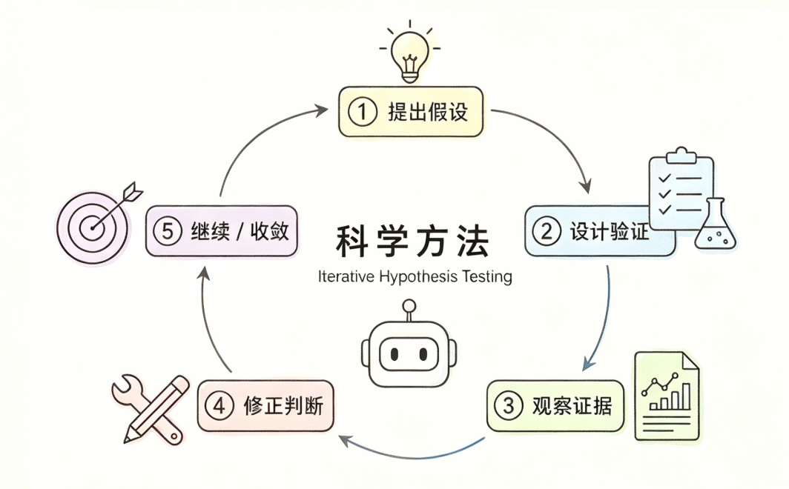

Agent 一轮轮拿证据推翻、修正和收敛。这也来自于我们人类的文明进化史，而且有个我们都熟悉的名字，叫科学方法。

## 迭代假设在推理契约中的位置

在双轴图谱里，迭代假设验证落在“推理 × 循环”的交点。

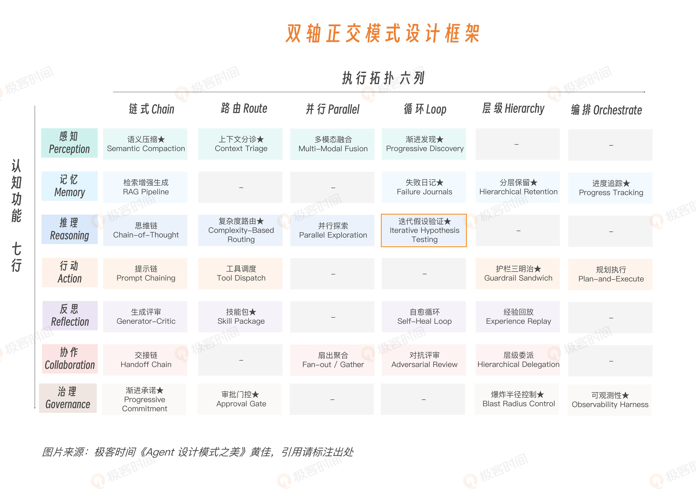

它属于推理，因为它要解决的是：基于当前证据，哪个解释更可信？它属于循环，因为它不是一次性生成答案，而是反复走一条闭环：提出假设，设计验证，观察证据，修正判断，再进入下一轮。

这个闭环和普通的多轮对话不是一回事。

普通多轮对话可能只是模型换个说法继续解释。第一轮说“可能是奖金”，第二轮说“进一步看也可能是奖金”，第三轮又补充一段更完整的奖金分析。表面上它在迭代，实际上没有新证据进入，也没有任何假设被推翻。这样的循环，只是在旧想法上继续加厚。

迭代假设验证不一样。它要求每一轮都带着一个可以被推翻的命题进入真实环境。系统不光问“有什么证据支持我”，还要问“什么证据能证明我错了”。如果证据推翻了当前假设，就换方向；如果证据只解释了一部分，就把已解释的部分锁住，再追查剩余缺口；如果连续几轮都没有新增解释，就停止自动迭代，把半成品交给人。

迭代假设验证，是让 Agent 把复杂问题拆成一串可证伪的假设，并通过多轮外部证据验证，把一次性猜测变成可停机的自收敛逼近过程。这句话里的关键词，不是“多轮”，而是“可证伪”“外部证据”“可停机”。这个定义有些复杂，我们下面会举例子详细解释的。

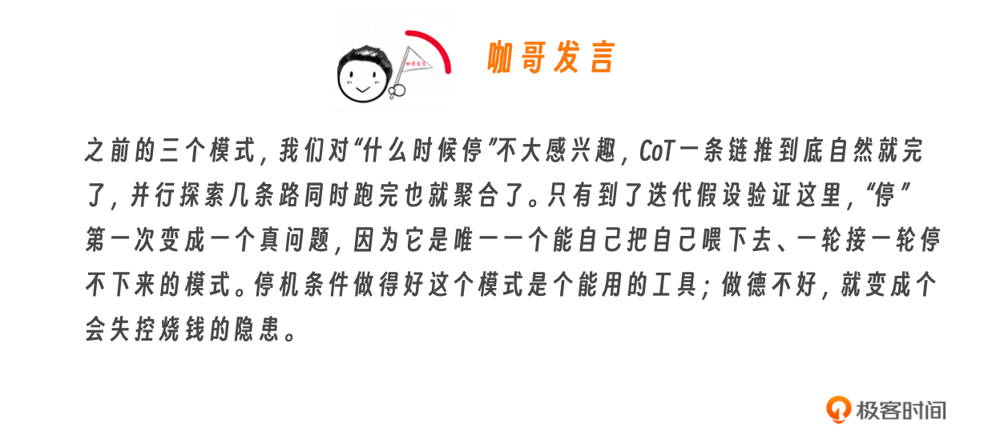

## 这其实就是科学方法的演进

人类认识世界的完整方法链条是逐步形成的。

从培根的归纳法开始，我们知道要推演一个道理，先要有观察和证据；休谟则认为再多正面例子也不能证明假设必然成立；在此基础上贝叶斯的提出的方法是让新证据持续修正原有判断；而波普尔的证伪原则，则强调主动寻找能推翻假设的反例。

维纳的控制论，把这一切变成反馈闭环：不断测量当前状态与目标之间的偏差，据此调整下一步行动。放进 Agent，就是不固守最初判断，不只搜集支持自己的证据，而是在每一轮根据新证据更新方向、主动寻找反例，并持续计算离目标还差多少：偏差仍大，就继续提出可验证假设；偏差足够小，就停止。

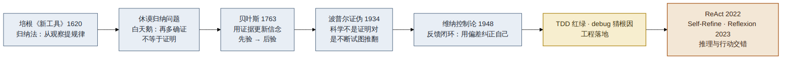

AI 时代，这套循环被正式搬进了大模型推理。2022 年的 ReAct 把推理（Thought）和行动（Action）交错起来：模型先想“下一步该查什么”，然后调一个工具去查（Action），把环境返回的事实（Observation）喂回下一步推理，再想、再查，直到信息够了。这恰恰是维纳的反馈闭环、加上波普尔的证据驱动在语言模型里的化身。2023 年，Self-Refine 让模型先给一版答案、再自我批评修订，Reflexion 更进一步，用“言语强化学习”把每次失败的教训写成文字、带进下一轮尝试把“做完之后回头改”这件事，做成了 Agent 的标准动作。

总结历史发展的主线： 我们人类和大模型都学会了遇到复杂情况别猜，而是提假设、设计实验、用证据证伪、再修正，这就是科学方法。而迭代假设验证，我是把这套方法搬进了 Agent系统设计。

## 真实的工业故障诊断场景

我猜对你而言，迭代假设验证和科学方法的定义现在仍然比较抽象。我们用一个工业故障诊断场景，帮着大家来理解这种模式究竟怎么用、何时用。

一家化工厂有一套故障诊断 Agent，接在 PLC / SCADA 系统后面。当一线工程师收到报警时，Agent 不直接给结论，而是生成一棵假设树（ hypothesis tree）：可能根因是什么，每个假设应该查什么证据，证据回来以后这个假设是被证伪、被确认，还是需要继续下钻。

凌晨 3:47，一条聚乙烯生产线报警。反应釜温度异常上升。正常工况应该稳定在 80℃ 左右，现场读数到了 92℃。这个温度还没有到灾难阈值，但已经足够让值班工程师老陈紧张。聚乙烯反应对温控非常敏感，温度继续上行，轻则产品批次报废，重则触发联锁停产。

Agent 给出第一轮假设：

```
H1：冷却水循环泵故障
H2：温度传感器漂移
H3：工艺配方异常
H4：催化剂活性突变
H5：PID 参数被异常修改
```

如果这是普通问答系统，它可能会直接说：

- 最大可能是冷却水循环泵故障，请优先检查冷却水系统。

这句话看起来没错，但它还不是诊断。

1. 真正的诊断不是给出一个最像答案的答案，而是让每个假设进入验证流程。

2. 工程师先验证 H1。他查冷却水流量、泵压、回水温度，结果都正常。H1 被证伪。

3. 接着验证 H2。他对比冗余温度传感器，两只传感器读数一致，没有单点漂移。H2 被证伪。

4. 再验证 H3。他查进料流量、配方切换记录和最近 1 小时 log，都正常。H3 也被证伪。

到这里，第一轮排序里靠前的三个假设都被推翻了。注意，这不是系统失败，而是迭代假设验证的正常工作方式。假设本来就是拿来被推翻的。初始概率只能决定验证顺序，不能决定最终真相。

问题卡在 H4。H4 是催化剂活性突变，这类判断不能只靠 SCADA 实时曲线，要等实验室分析。取样、送检、分析，至少 30 分钟。此时生产线已经停了 1 小时，每继续等待一轮，都是实打实的损失。

这时，一线工程师补充了一个新事实：

- 02:33 有一次远程登录修改控制参数。

这条新事实进入系统以后，诊断发生关键转折。

Agent 不应该只在原来的 H1 到 H5 上微调权重。因为这条证据改变了问题的因果结构。原来的搜索空间偏向设备故障、传感器异常、物料异常、催化剂异常；新的搜索空间直接指向“人为参数修改”。所以正确动作不是继续压缩旧上下文，而是重建假设树。

新的假设树变成后面这样。

```
H5'：PID 参数被异常修改
   └─ 查 02:33 远程登录的具体改动
       └─ 发现 P 参数从 0.8 改到 2.5
           └─ 反推该改动会导致控温过激
               └─ 与当前温度震荡上行吻合
```

最终，工程师找到根因：另一个班组做参数优化测试时，把 PID 的 P 参数从 0.8 改到了 2.5，测试后忘记回滚。恢复参数后，反应釜温度回归正常。

这条闭环证据链是：

```
02:33 远程登录
   ↓
PID P 参数 0.8 → 2.5
   ↓
```

- 控制行为异常

```
   ↓
```

- 温度震荡上行

```
   ↓
```

- 恢复参数后温度回归正常

这就是工业诊断里最重要的收敛证据：不仅解释现象，还能被干预验证。

## 这次事故里的迭代流程

把刚才所发生的事件拆开，它其实是一条非常标准的迭代假设验证链。

第一步，用假设生成器 Hypothesis Generator 根据当前症状生成假设清单。

输入是：

- 反应釜温度异常上升

```
正常 80℃
当前 92℃
```

- 生产线：聚乙烯

```
报警来源：PLC / SCADA
```

Agent 结合历史 case、设备拓扑、工艺知识和实时报警，生成五个候选假设。这里的输出不是答案，而是一个待验证集合。H1 到 H5 的概率排序，只是告诉工程师“先查哪个最划算”。

第二步，用验证执行器 Verification Executor 把每个假设翻译成可执行检查。

- H1 冷却水循环泵故障，应该查冷却水流量、泵压、回水温度。

- H2 温度传感器漂移，应该查冗余传感器读数是否一致。

- H3 工艺配方异常，应该查进料流量、配方切换记录、近 1 小时 log。

- H4 催化剂活性突变，应该触发实验室分析。

- H5 PID 参数被异常修改，应该查控制参数变更日志、远程登录记录、参数 diff。

这一步最能区分工业 Agent 和聊天机器人。聊天机器人会说“可能是冷却系统问题”。诊断Agent 必须继续问：“要查哪一个 metric？哪张 log？哪个传感器？哪个时间窗口？查到什么算证伪？”

第三步，用证据评估器 Evidence Evaluator 根据证据裁决每个假设。

- 冷却水流量正常，H1 不是“概率下降一点”，而是被当前证据证伪。

- 冗余传感器一致，H2 被证伪。

- 进料 log 正常，H3 被证伪。

```
H4 暂时不是被证伪，而是进入 needs_more_evidence。它需要实验室分析，验证成本
```

- 高、等待时间长。

这时，系统应该停下来重新评估：继续查 H4 是否值得？有没有更便宜、更快的新证据？人类工程师是否观察到模型没看到的异常？

第四步，HITL 触发，人类补充关键事实。

工程师老陈补充“02:33 有远程登录修改”。这就是人在回路的价值。工业现场很多关键信息不一定已经结构化进入系统。它可能来自工程师刚看到的一条控制日志，也可能来自班组交接，也可能来自一句“昨天有人做过测试”。这个事实一进入系统，就应该成为高权重证据事件（evidence event），而不是普通聊天上下文。

第五步，重置上下文 Context Reset，重建假设树。

系统不应该把新事实塞进原来的 H1-H5 列表里继续微调。因为这条证据改变了问题的因果结构：原来的搜索空间偏向设备、传感器和物料；新的搜索空间指向人为参数修改。所以更稳的做法是 reset：

- 保留：

```
- 当前症状：温度从 80℃ 上升到 92℃
- 已证伪假设：H1/H2/H3
- 未验证但高成本假设：H4
- 新关键证据：02:33 远程登录修改
- 时间压力：停线每小时 45 万
- 目标：尽快定位可验证根因，避免继续无效等待
```

- 清空：

```
- 旧假设树的排序惯性
- 已被证伪假设的上下文噪声
- 模型对 H1 的初始强先验
```

然后让新的 Hypothesis Generator 基于 handoff artifact 重新建树。结果就是 H5' 被拉到95%，并开始下钻参数 diff。

第六步，验证并收敛。

系统查到 P 参数从 0.8 改到 2.5，再把这个改动和温度曲线做反推。控温过激、温度震荡上行，与当前现象吻合。参数恢复后，温度回归正常。这时，根因不是“模型猜中了”，而是形成了一条闭环证据链：

```
02:33 远程登录
   ↓
PID P 参数 0.8 → 2.5
   ↓
```

- 控制行为异常

```
   ↓
```

- 温度震荡上行

```
   ↓
```

- 恢复参数后温度回归正常

这条链满足工业诊断里最重要的条件：不仅解释现象，还能被干预验证。恢复参数以后温度回归，就是最强的收敛证据。

这个例子对应的流程，就是一个带 reset 的假设验证闭环：

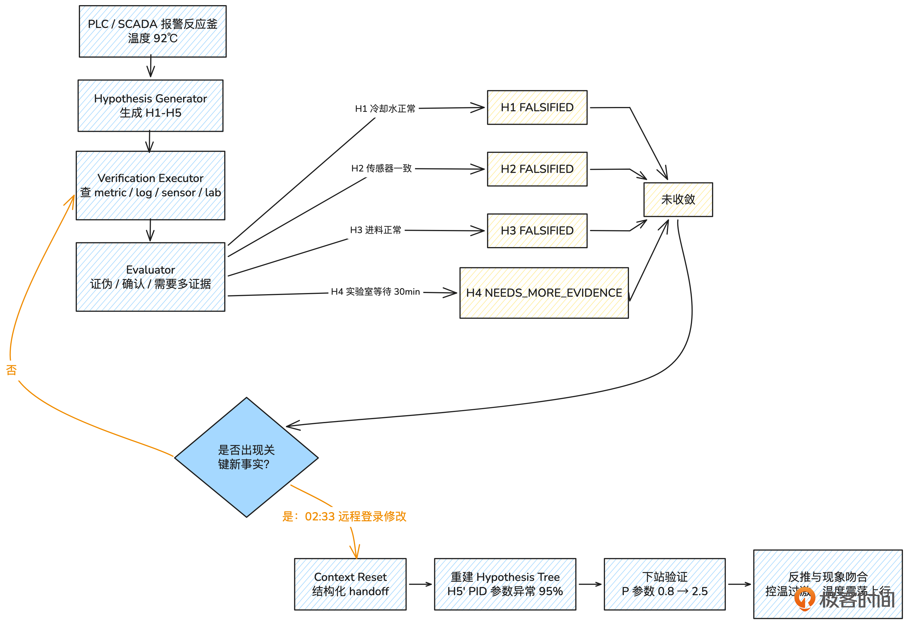

这张图要强调的是系统允许初始先验被证据推翻，并允许关键新事实触发重建假设树。这才是迭代假设验证。

上面的流程可以总结为四个要点:

1. 第一，初始概率可以作为验证顺序。H1 初始最像答案，但证据回来以后，它必须被剪掉，因为初始概率并不等于最终结果。

2. 第二，验证动作必须可执行。不能只说“可能是冷却水问题”，而要明确查哪个 metric、哪段log、哪个 sensor、哪个时间窗口，查到什么算证伪。

3. 第三，新事实可以触发上下文的重置（ context reset）。当新证据改变问题的因果结构时，系统不应该背着旧上下文继续前进，而应该生成一份可以交接的工件（ handoff artifact），用干净上下文重建假设树。

4. 第四，人在回路是新信息的获取渠道。一线工程师补充的“02:33 远程登录修改”，可能是系统暂时没有结构化接入的关键事实，有些证据最先存在于人的观察里，此时需要先进行人的输入或判断。

从整体上说，迭代假设验证带给我们的是一套长任务自主诊断架构。

## 三个角色：生成假设、执行验证、裁决证据

架构设计上，这个故障诊断系统不应该由一个模型从头猜到尾，可以拆成三个角色：

- 假设生成器 Hypothesis Generator 负责提出假设。它根据报警、工艺拓扑、历史 case 和当前上下文，提出一组可验证假设，并给出优先级。它的责任是打开搜索空间，不是证明哪个原因是真的。

- 验证执行器 Verification Executor 负责执行验证。它把每个假设翻译成具体动作：查哪个metric，读哪段 log，对比哪个 sensor，调用哪个实验室流程，拉哪个参数 diff。它的责任是拿证据回来，不是偏袒某个假设。

- 证据评估器 Evidence Evaluator 负责评估或叫做裁决证据。它根据验证结果判断每个假设是 verified、falsified、partial、needs_more_evidence，还是 human_required。它还负责判断是否需要 reset，是否触发人审，是否已经收敛。

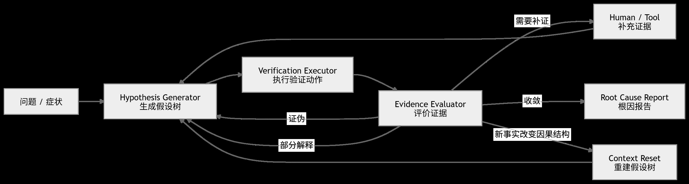

这次事故以后，团队把诊断 Agent 重写成了一个标准的迭代假设验证系统。

系统中需要把 reset 写成正式机制。当出现能改变因果结构的新事实时，系统不再在旧上下文里继续 compaction，而是生成一份 handoff artifact：当前症状、已证伪假设、剩余假设、关键新证据、时间成本、下一步目标。然后用这份 artifact 启动新的 hypothesis tree。

这个看起来像是为化工厂量身定做的设计，实际上它就是长任务 Agent 的通用骨架。Anthropic 的三 Agent harness 在软件开发里把规划器、生成器和评估器（ planner、generator、evaluator）分开；工业故障诊断里，对应的就是假设生成器 hypothesisgenerator、验证执行器 verification executor、和证据评估器 evidence evaluator。领域不同，结构一样：先把问题拆成可验证假设，再让执行器拿证据，最后由独立评价器剪枝、回溯或收敛。

这个案例说明了我们对迭代假设验证模式的定义：它不仅仅能“让模型多想几轮”，更是让Agent 在长任务里不断生成假设、验证假设、剪枝假设，并在关键新证据出现时敢于重建问题空间。

这个拆分能降低确认偏误。如果同一个模型既生成假设、又执行验证、又评价自己，它很容易围着初始高概率假设继续找补。H1 初始概率最高，它后面就倾向于在冷却水系统里不断补充支持这个假设的解释。

独立 Evaluator 的任务不是帮 Agent 把概率最高的假设初始 H1 圆回来，而是冷静地问：

- 冷却水流量正常吗？泵压正常吗？回水温度正常吗？如果都正常，H1 就证伪。

初始概率再高也没有用。所以，工业诊断 Agent 的核心不是“生成一个聪明的假设清单”，而是把三个 Agent 负责的角色分开：生成假设的人负责打开搜索空间，执行验证的人负责拿证据，评价证据的人负责剪枝。

## 三种迭代循环范式

这套“提假设、验证、修正”的循环，迭代假设验证落到工程里，常见有三种变体。它们共享“产出—检验—修正”的骨架，区别在于检验信号来自外部证据，还是模型自己。

1. 第一种是 ReAct，边想边做。推理和工具调用交错，每做一个动作就把环境返回的观察喂回下一步。它最适合需要外部信息的探查类任务，因为每一轮检验都来自真实环境。工业故障诊断、财务归因、日志排查、合规核查，都更适合这一类。

2. 第二种是 Self-Refine，先做再改。模型先给一版答案，再自我批评、自我修订，循环几轮。它适合写作、代码、解释优化这类模型能自己看出问题的任务。但它有天然边界：模型自己看不出来的盲区，自己批评自己也照样漏。

3. 第三种是 Plan-then-Execute，先规划再执行。系统先生成一套多步计划，再逐步落地，执行中根据偏差修正。它适合流程相对清楚、步骤可以预先排出来的长任务。它和 ReAct的区别在于计划出现的时机：ReAct 是走一步看一步，计划随时变；Plan-then-Execute 是先排出大致路径，再边执行边微调。

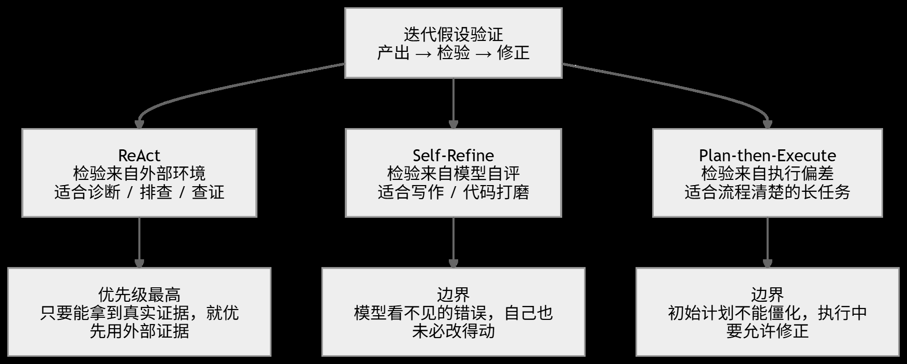

三种范式的共同点，是它们都不指望一次想到底，都把推理细化成“产出—检验—修正”的多轮。不同点是检验的证据来自哪里。ReAct 来自外部环境，Self-Refine 来自模型自己，Plan-then-Execute 来自执行中的偏差。一个判断该用哪种，先看它的检验信号能不能从外部拿到：能拿到真实证据的，优先 ReAct，因为外部证据比模型自评可靠很多。

## 关键纪律：一定要设停机条件

迭代循环有一个致命风险：它不一定收敛。有时候，想得更多，反而越改越糟。

为什么？

因为模型一旦进入循环，很容易产生一种“推理动量”。第一轮提出一个假设，第二轮不是冷静地证伪，而是不自觉地替这个假设找支持。第三轮又在找补的基础上继续推，越走越远，越走越自信。最后生成一大段看起来很认真、其实没有证据增量的解释。这正好和波普尔的精神相反。

健康的循环，每一轮都在试图推翻自己；而失控的循环，每一轮都在加固自己。所以，迭代假

```
设验证绝不能是一个没有刹车的 while True。它必须有三道停机条件。
```

第一道是预算上限。最多迭代几轮，最多花多少 token，最多多少次工具调用，到顶就停。不管是否收敛，这道硬墙必须存在。它防的是失控。

第二道是收敛判据。每一轮结束，系统要回答：证据到底够不够支撑结论了？在总账缺口案例里，这个判据可以非常具体：37 万缺口已经解释了多少，还剩多少无法解释。够了就停，不要为了“再认真一点”空转一轮。

第三道是反思哨兵。它不看绝对进度，而看趋势。如果连续两轮证据增量几乎为零，或者证据质量没有提升，或者模型不断换说法但没有新数据，就提前拉停。它防的是空转。

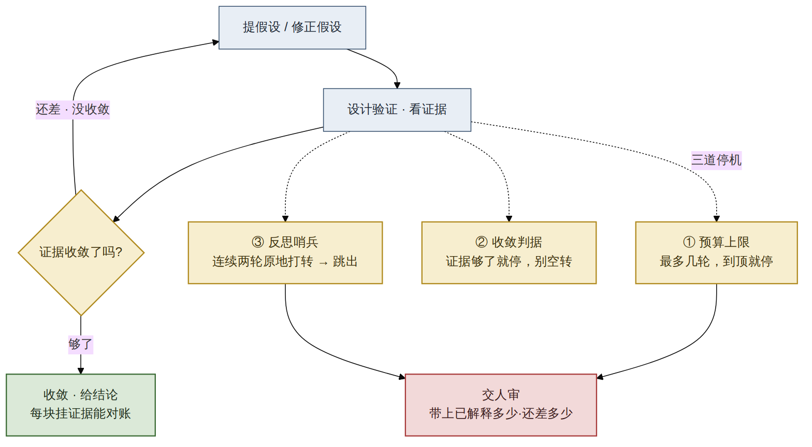

提假设、设计验证、看证据、判断收敛没有，没收敛就修正假设再来一轮。三道停机条件守在循环外：预算上限到顶就停，收敛判据够了就停，反思哨兵发现原地打转就跳出。三道都没触发又收敛不了，把部分结论和未解释的缺口一起交人审。

这三道刹车分工不同：预算上限是最后的硬墙，防止最坏情况下无限烧下去。收敛判据是循环的大脑，决定什么时候证据已经够了。反思哨兵是中途急刹车，防止系统在预算还没烧完时就已经开始原地打转。停不下来的时候，不是再迭代一轮，而是把部分结论和未解释缺口一起交给人审，并交出一份半成品账（参考下面的 Trace）：

- 已经解释了多少；每一块对应什么证据；还剩多少没解释；试过哪些假设；哪些假设被证伪；卡在哪一步；建议人类优先看什么。

这个时候，人接手的已经是一个被缩小过范围的问题。即使 Agent 没有把问题完全破解，人也不是从头开始判断。

## 推理漂移率和 Tracing

导论里，我们给推理系统设定了几个生产指标：验证通过率、首次路由命中率、单位验证成功成本、推理漂移率。

迭代假设验证的关键指标，是推理漂移率。

什么叫推理漂移？如果前面已经确认“奖金政策以审批日期为准”，十步以后 Agent 又按发放日期计算了。这就是推理漂移。它衡量的是长任务推进过程中，已经验证过的目标、约束和事实，会不会被 Agent 悄悄遗忘或改写。

为什么迭代假设验证最容易漂移？因为它的循环最长。

Direct 一轮就完。CoT 是一条链。并行探索虽然有多条路径，但各条路径通常有明确边界。只有迭代假设验证是一轮接一轮，每一轮都把上一轮结论带进来继续推。循环越长，上下文越厚，早期已经锁定的事实就越容易被埋掉。

比如在总账缺口案例里，第二轮已经确认“社保基数调整按 6 月生效记录归集”。到了第五轮，如果模型又按发放日期重算社保，那整张拆解表就会悄悄错掉。表面上每一轮都在推进，trace 也很完整，但某个口径中途被改写了。

防漂移不能靠模型记性，要靠 Trace，也就是推理模块仪表盘上，Reasoning Trace 的

```
ITERATIVE mode。每一轮都要写进 trace：
```

- 这一轮提出了什么假设；为什么提出这个假设；设计了什么验证；调用了什么工具；查到了什么证据；这个假设解释了多少缺口；哪些事实被锁定；

- 为什么继续或停止。

已验证的事实一旦进入 trace，就应该变成 locked fact。后续每一轮提出新假设时，都要和locked facts 对一遍。如果冲突，就报警、回滚或要求人审。

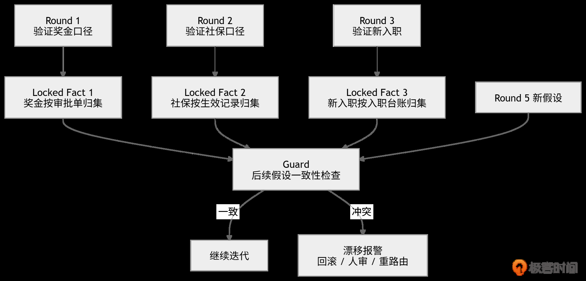

- 用 Locked Facts 防推理漂移

迭代假设验证里，trace 是运行时护栏。假设和证据要原样进入 trace，月底复盘时，如果有人问“这 37 万当时是怎么定位出来的”，trace 里应该能清楚看到：第一轮怀疑奖金，查了审批单，解释了多少；第二轮转向社保，查了生效记录，又解释了多少；第三轮落到新入职，对上了最后一块。

这份 trace 有两个重要作用：第一可以做审计依据，第二也可以在后续过程中配合“进度追踪”模式，提醒大模型当前情况的根因，防止推理漂移。

## 回到薪酬系统：37 万总账缺口怎么查

化工诊断例子证明了我们的设计模式是跨行业有效的。现在，把这套循环放回薪酬 SaaS。

6 月结算时，月底总账对不上，薪资总额比预期高出大约 37 万。第 17 讲里，咖哥的个人应发比 5 月高了 18%。那是一笔个人薪资异常。我们已经用 CoT 查过：拆工资组成，核奖金审批，最后判断能不能放行。但现在面对的是整月总额缺口：37 万。肯定不能拿一个个人案例去解释整月总账。

一个不会迭代的 Agent，面对 37 万缺口会直接给一段笼统分析：可能是奖金普涨，可能是社保基数调整，可能是人员增加。这样的答案一点用都没有。

会迭代的 Agent，则会像下面这样进行分析：

- 第一轮，提出假设：缺口主要来自奖金普涨。验证动作是调 6 月奖金审批单总额，和 5 月对比。证据回来以后，奖金确实多发，能解释掉一部分缺口，但不够解释全部 37 万。于是这一轮不是“证明奖金就是根因”，而是得出一个更精确的结论：奖金解释了一块，剩余缺口仍然存在。

- 第二轮，修正假设：剩下的缺口可能来自社保基数年度调整。系统查社保基数生效记录，看6 月有没有一批人的缴费基数集体上调。证据显示确实有一次年度基数调整在 6 月生效，又解释掉一块。但还差一小截，仍未收敛。

- 第三轮，再修正：剩下那一小截可能来自新入职。系统查入离职台账，看 6 月是否新增员工。证据对上了，几个新员工的工资正好补上最后缺口。

到这里，37 万被拆成了几块：

- 奖金普涨解释一块社保基数调整解释一块新入职解释一块

```
P 那类个人调薪解释一小块
```

链接上具体的证据，包括奖金审批单、社保生效记录、入离职台账、调薪审批等，下游回看的时候，才能精确对账到来源。在财务、风控、审计场景里，这是相当重要的。

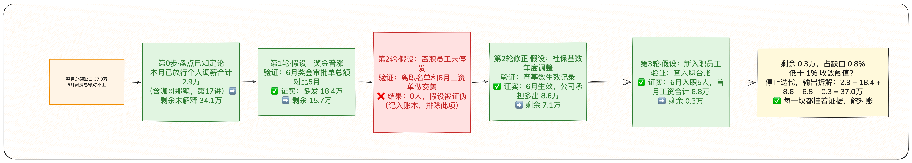

这就是迭代假设验证在执行型 Agent 里的优势所在。不会迭代的 Agent 给咱们“三个可能”；会迭代的 Agent 给咱们“三块证据”。

## 迭代假设验证最小代码骨架

把这套循环落成代码的最小骨架里，要有下面四个组件：

- Hypothesis，表示当前假设。

- VerificationResult，表示验证结果。

- IterationTrace，记录每一轮。

- StopCondition，决定什么时候停止迭代循环。

```bash
from dataclasses import dataclass, field
from enum import Enum
from typing import Protocol
class HypothesisStatus(str, Enum):
   DRAFT = "draft"
   VERIFIED = "verified"
   FALSIFIED = "falsified"
   PARTIAL = "partial"
   NEEDS_MORE_EVIDENCE = "needs_more_evidence"
   HUMAN_REQUIRED = "human_required"
@dataclass(frozen=True)
class EvidenceRef:
   source_id: str
   source_type: str
   version: str | None = None
@dataclass
class Hypothesis:
   hypothesis_id: str
   text: str
   status: HypothesisStatus = HypothesisStatus.DRAFT
   # 本轮新解释掉的缺口比例，0 到 1
   explained_delta: float = 0.0
   # 支撑或证伪它的证据
   evidence_refs: list[EvidenceRef] = field(default_factory=list)
   # 如果这个假设成立，下一步要查什么
   next_check: str | None = None
@dataclass
class VerificationResult:
   status: HypothesisStatus
   explained_delta: float
   evidence_refs: list[EvidenceRef]
   observation: str
@dataclass
class IterationRecord:
   round_id: int
   hypothesis: Hypothesis
   verification: VerificationResult
   cumulative_explained: float
   remaining_gap: float
@dataclass
class IterationTrace:
   task_id: str
   target_explained: float = 0.9
   max_rounds: int = 5
   min_progress_delta: float = 0.02
   records: list[IterationRecord] = field(default_factory=list)
   locked_facts: list[str] = field(default_factory=list)
   final_status: str | None = None
   stop_reason: str | None = None
   @property
   def cumulative_explained(self) -> float:
       return sum(
           record.verification.explained_delta
           for record in self.records
       )
   @property
   def remaining_gap(self) -> float:
       return max(0.0, 1.0 - self.cumulative_explained)
   def should_converge(self) -> bool:
       return self.cumulative_explained >= self.target_explained
   def is_stalling(self) -> bool:
       if len(self.records) < 2:
           return False
       last_two = self.records[-2:]
       return all(
           record.verification.explained_delta < self.min_progress_delta
           for record in last_two
       )
这里的 explained_delta 代表着本轮证据解释掉了多少缺口。对总账归因来说，它可以是
```

金额比例；对故障诊断来说，它可以是诊断不确定性的下降；对日志排查来说，它可以是已解释错误样本比例。

接下来定义两个协议：一个负责提出假设，一个负责验证假设。

```python
class Proposer(Protocol):
   def __call__(
       self,
       question: str,
       trace: IterationTrace,
   ) -> Hypothesis:
       ...
class Verifier(Protocol):
   def __call__(
       self,
       hypothesis: Hypothesis,
   ) -> VerificationResult:
       ...
```

主循环如下：

```python
def iterative_hypothesis_test(
   question: str,
   trace: IterationTrace,
   propose: Proposer,
   verify: Verifier,
) -> IterationTrace:
   for round_id in range(1, trace.max_rounds + 1):
       hypothesis = propose(question, trace)
       result = verify(hypothesis)
       hypothesis.status = result.status
       hypothesis.explained_delta = result.explained_delta
       hypothesis.evidence_refs = result.evidence_refs
       record = IterationRecord(
           round_id=round_id,
           hypothesis=hypothesis,
           verification=result,
           cumulative_explained=trace.cumulative_explained
           + result.explained_delta,
           remaining_gap=max(
               0.0,
               1.0
               - trace.cumulative_explained
               - result.explained_delta,
           ),
       )
       trace.records.append(record)
       if result.status is HypothesisStatus.VERIFIED:
           trace.locked_facts.append(hypothesis.text)
       if trace.should_converge():
           trace.final_status = "converged"
           trace.stop_reason = "target_explained_reached"
           return trace
       if trace.is_stalling():
           trace.final_status = "needs_human"
           trace.stop_reason = "reflection_sentinel_stalling"
           return trace
       if result.status is HypothesisStatus.HUMAN_REQUIRED:
           trace.final_status = "needs_human"
           trace.stop_reason = "human_required_by_verifier"
           return trace
   trace.final_status = "needs_human"
   trace.stop_reason = "max_rounds_reached"
   return trace
```

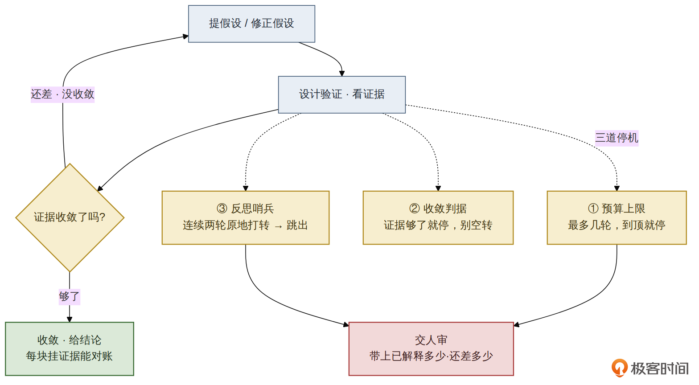

这段代码的关键在于三个循环结束的出口。

```
第一个出口是收敛：target_explained_reached。证据足够了，就停。
第二个出口是反思哨兵：reflection_sentinel_stalling。连续两轮没有进展，就
```

- 停。

```
第三个出口是预算上限：max_rounds_reached。轮数到顶，就停。
```

没有任何一个出口允许系统“继续想，直到模型满意”（哈哈）。这才是安全合理的迭代。如果最后实在无法收敛，trace 也不是废的，它也会带着已经解释的部分、被证伪的假设、剩余缺口和证据引用交给人审。

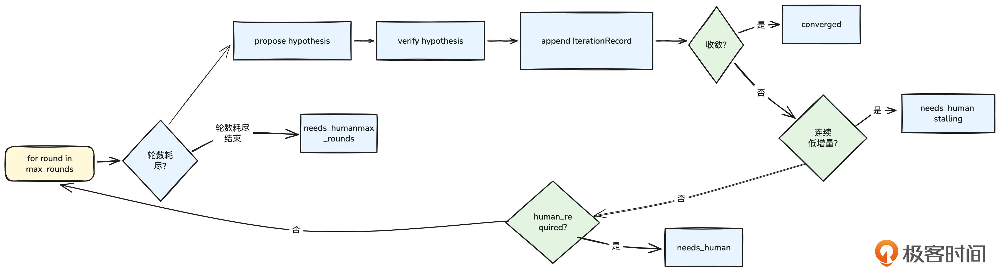

- 代码里的三道出口

把这段代码放回 37 万总账缺口，它的 trace 会长这样：

```
Round 1
Hypothesis: 缺口主要来自奖金普涨
Evidence: 6 月奖金审批单总额
Result: partial
Explained: 0.42
Round 2
Hypothesis: 剩余缺口来自社保基数年度调整
Evidence: 社保基数 6 月生效记录
Result: partial
Explained: 0.35
Round 3
Hypothesis: 剩余缺口来自新入职员工
Evidence: 6 月入离职台账
Result: verified
Explained: 0.18
Stop
Reason: target_explained_reached
```

这样就会生成一份能对账的推理轨迹。

## 总结一下

这一讲我们把迭代假设验证讲成了科学方法的工程化：提假设、设计验证、看证据、修正方向，一轮轮逼近，直到收敛。它是深水区里的深度诊室，从经济学的角度，这是用延迟换准确率，专门处理那些一次想不到底、根因藏得深的问题。

它和 CoT、并行探索的边界如下。

- CoT 是一条主路径，适合“要对账”。

- 并行探索是多条路径，适合“要择优”。

- 迭代假设验证是一轮轮逼近，适合“要查根因”。

迭代假设验证的三种常见范式是 ReAct、Self-Refine、Plan-then-Execute。能拿到外部真实证据的探查类任务，优先 ReAct，因为外部证据比模型自评可靠。迭代假设验证的关键是证伪：Agent 每一轮都要拿证据试着推翻自己。而预算上限、收敛判据、反思哨兵是迭代假设验证模式的停止条件，没有停止条件，循环就可能空转或越改越糟。

长循环最容易在后段把前面已经验证过的事实悄悄改写，因此要重视推理漂移率，把每一轮假设、证据、裁决和 locked facts 写进 trace，既是审计依据，也是防漂移的护栏。迭代假设验证强调的是让 Agent 一轮轮被证据纠偏，直到收敛或交人审。压缩成工程公式，就是：

- Hypothesis → Verification → Evidence → Evaluation → Update / Stop

## 推理模块小结

到这里，推理模块四个模式就配齐了。它们不是四个孤立技巧，而是一座分诊台加三间诊室。

- 复杂度路由是分诊台。它先判断一个任务值不值得深想，该进哪间诊室，还是应该直接回答、补证据或交人审。

- CoT 是链式诊室。它收“证据齐、规则明、主路径清楚”的任务，把复杂判断拆成一串可验证命题。比如员工 P 那笔 18% 薪资异常，沿一条链查工资组成、政策版本和审批单，最后形成能对账的放行判断。

- 并行探索是广度诊室。它收“多个口径都说得通”的任务，几条路径同时跑，分歧本身就是信号。比如跨月奖金到底按审批月、发放月还是归属期计算。

- 迭代假设验证是深度诊室。它收“根因藏得深、一次想不到底”的任务，顺着一条线索一轮轮查证据、剪假设、锁事实、追剩余缺口。比如 37 万总账缺口一块块拆。

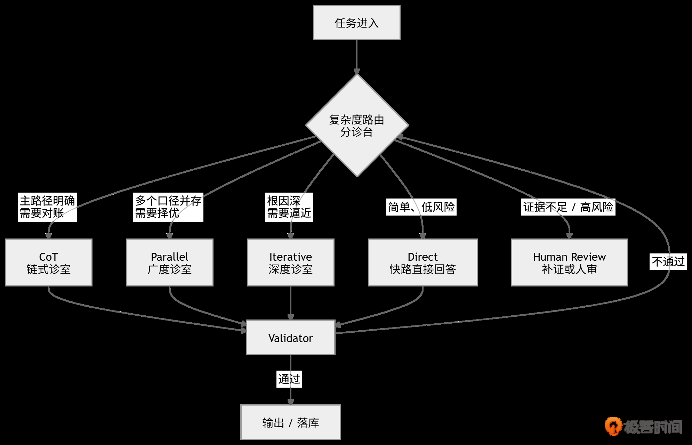

三间诊室出来的结论，都不能直接放行。它们还要过验证器：通过才输出，不通过就换路、升级模型、补证据或交人审。这就是推理模块的完整控制链：先路由，再推理；推理之后要验证；验证不过就换路；达到停止条件才输出。

## 思考题

1. CoT、ReAct、Self-Refine、Reflexion、Self-Consistency、Tree of Thoughts 以及其它一系列大模型推理相关的论文经典，他们都属于哪一类设计模式？大家给这些论文落个盘（不一定有标准答案）。

2. 你的 Agent 在处理归因、诊断、排查问题时，是否会一轮轮提出假设、查证据、修正方向？有没有证据链的设计？

3. 你系统里有没有跑着跑着停不下来的 Agent 任务？连续两轮没有证据增量时，它会提前停，还是继续空转？应该如何设计。

4. 你的 trace 里有没有 locked facts？如果第二轮已经确认“社保按生效记录归集”，第五轮模型又想换成发放日期口径，系统能不能发现这是推理漂移？当停不下来的时候，你的 Agent交给人的是一句“未能完成”，还是一份 Trace：已经解释了多少、还差多少、试过哪些假设、哪些被证伪、下一步建议查什么？

## 下一讲预告

到这里，推理模式组四个模式就讲完了。CoT 让 Agent 想得显式、能对账，复杂度路由让它想得分档、按需，并行探索让它想得广、择优，迭代假设验证让它想得深、收敛。四个加起来，是 Agent 把感知到的信息、记住的经验，组织成一个可靠判断的四种形式。一座分诊台，三间诊室，这就是推理模块交给你的东西。

但判断做出来，只是想清楚了，还没动手。下一组我们讲行动（Action）：一个判断要落到真实世界，要改状态、要调外部系统，怎么让 Agent 安全、可控地把它做出来。想清楚之后怎么稳稳地动手，是下一个模式组的事。我们下一讲见。

## 参考资料

1. Francis Bacon. Novum Organum. 1620.

2. David Hume. A Treatise of Human Nature. 1739–1740.

3. Thomas Bayes. An Essay towards Solving a Problem in the Doctrine of Chances. .

4. Karl Popper. Logik der Forschung. 1934 / The Logic of Scientific Discovery.

5. Norbert Wiener. Cybernetics: or Control and Communication in the Animal and theMachine. 1948.

6. Yao et al. ReAct: Synergizing Reasoning and Acting in Language Models.arXiv:2210.03629, ICLR 2023.

7. Madaan et al. Self-Refine: Iterative Refinement with Self-Feedback. arXiv:2303.17651,NeurIPS 2023.

8. Shinn et al. Reflexion: Language Agents with Verbal Reinforcement Learning.arXiv:2303.11366, NeurIPS 2023.

9. Gema et al. (Anthropic). Inverse Scaling in Test-Time Compute. arXiv:2507.14417, 2025.
