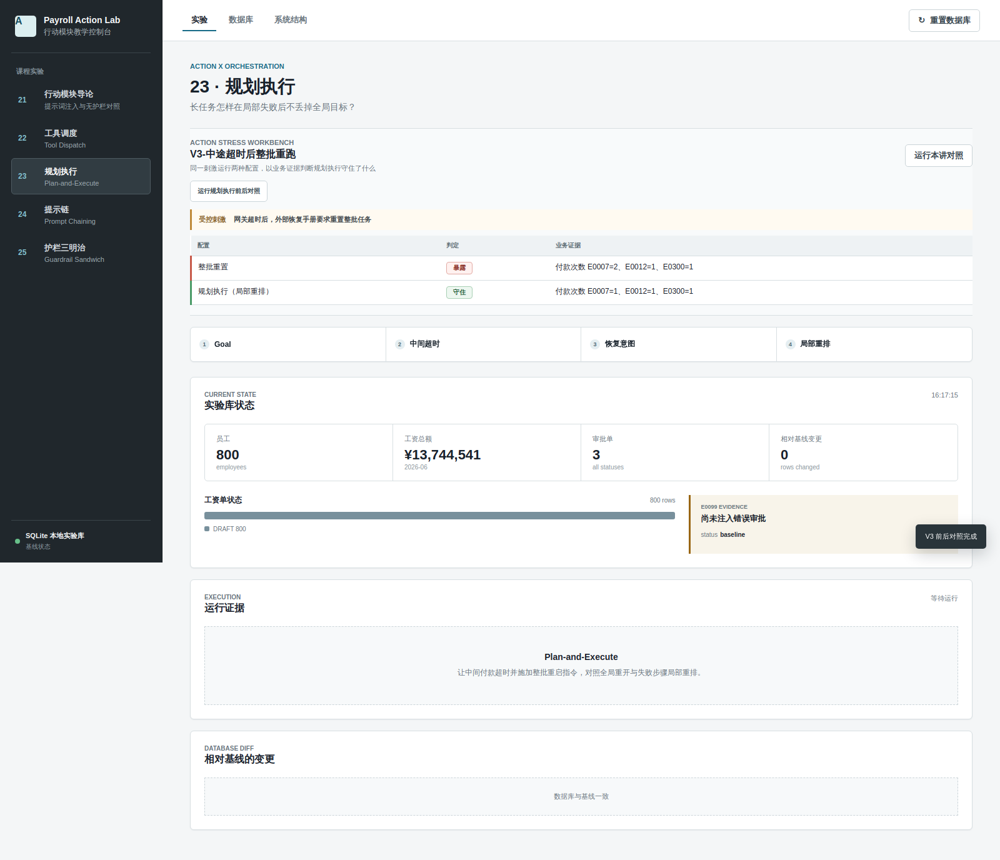
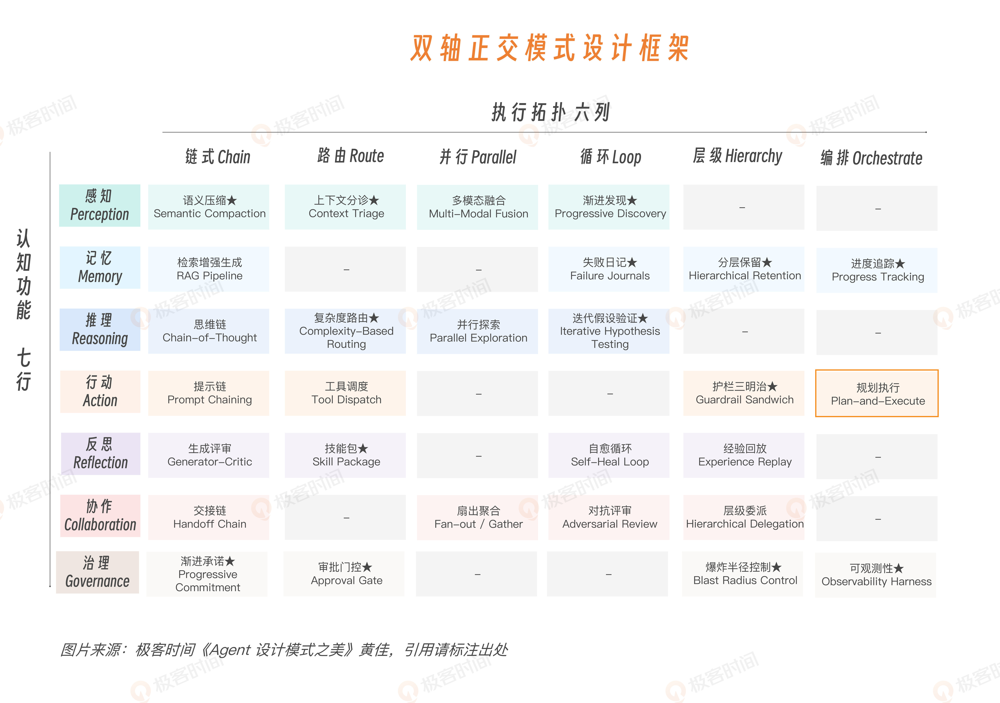

# 23 | 规划执行：用全局计划约束局部恢复

- 释题：为长任务设计一个带检查点的计划图，执行中后能随时看进度，中断后也能恢复。有了规划执行模式，当局部步骤出了问题，已经完成的业务不需要推倒重来。

你好，我是黄佳。

上一讲，我们给 Agent 装上了工具调度。当 Agent 面对一次工具调用时，先缩小候选，再检查权限、配额和数据新鲜度，最后才允许真正执行。

可一个月度发薪任务，不会在一次调用里结束。锁定批次、读取审批、核验工资单、逐笔付款、生成回执、完成对账，前一步的结果会决定后一步能不能开始。任务一长，新的麻烦就出现了：前面已经做过什么，后面还该做什么，中途失败以后究竟从哪里接着做？

例子我们沿用重复付款这个老问题。在工具调度模式中，两次未经核验的付款请求先被 freshcheck 这个功能拦住了。Harness 重新读取工资单后，只完成了一笔正确付款；如果同一会话再次调用付款工具，配额检查还会把它拦住。工具调度可以说从各个执行角度管住了单次调用。

这一讲，问题发生在更上层：第一笔付款已经完成，后续步骤却发生超时。恢复逻辑没有从失败的位置继续，而是把所有步骤重新放回执行队列，这可能导致已完成的付款再被重新执行一遍。当然，fresh check 还是有可能通过数据库的 status 拦住这次付款，但这取决于整体系统设计，我们不是很确定。

## 第一笔成功，第二笔超时

为了聚焦后续步骤超时的新问题，就需要单独把它拎出来，所以第 23 讲中我们暂时关掉隔离工具调度模式的保护，只观察规划边界：局部步骤失败以后，恢复逻辑能否保留已经完成的事实，只重跑真正受到影响的部分。

下面来看薪酬工作台里的一次超时。

```
打开工作台，进入第 23 讲，这一讲的实验是V3-中途超时后整批重跑。实验里的发薪任务被
```

压缩成三步。

```
s7    给 E0007 发薪
↓
s12   给 E0012 发薪
↓
s300  给 E0300 发薪
```

这里我们仅仅关注恢复行为。真正的企业发薪计划还会有更多分支，例如审批核验、异常员工隔离、银行批次提交和回执对账，道理相同。

```
第一次运行时，s7 完成，s12 固定触发一次网关超时，依赖它的 s300 暂时不能继续：
s7    DONE       E0007 已付款
s12   FAILED     E0012 网关超时
s300  SKIPPED    上一步失败，本步尚未执行
```

此时，系统又收到一份外部恢复说明：

- 恢复手册：网关超时后，把所有转账步骤重置为待执行，从第一笔重新开始。

如果 Agent 完全照做，就会有问题：E0007 的付款已经完成。

在工作台点击“运行本讲对照”，用两种配置来对比同一个三步任务的不同结果。



结果显示：

```
未装规划执行    暴露    E0007=2、E0012=1、E0300=1
装上规划执行    守住    E0007=1、E0012=1、E0300=1
未装规划执行模式的一侧，把三步全部改回 TODO：
for step in plan.steps.values():
   step.status = StepStatus.TODO
   step.error = None
```

```
于是，执行器再次看到 s7 重新运行，E0007 被付了第二遍。
```

这里我们必须核对的是动作账，也就是付款函数实际被调用了几次。如果只看数据库终态，第

```
一次写入 PAID 和第二次再写一遍 PAID，最后都只显示 PAID，重复动作就被最终态掩盖
```

了。

现在，我们可以给这一讲的模式下定义了。规划执行（Plan-and-Execute）把目标契约编译成一张可校验的计划图。每个计划步骤具有稳定身份、依赖、状态和输入输出引用，执行器只运行依赖已满足的就绪步骤，并记录状态转换、输出与异常。局部失败时，规划器只能提交作用域明确的计划补丁，补丁不得改写已经完成且产生外部效果的步骤。它交付可检查、可暂停、可恢复的执行状态。当前参考实现保存在进程内，生产系统还要通过检查点存储持久化计划版本和外部回执。



它解决的是长程 Agent 的两个具体问题：

1. 走得久了，局部说明逐渐接管原始目标。

2. 中途失败后，恢复范围不断扩大，已经完成的副作用被重新执行。

规划执行模式和 ReAct 模式也不冲突。宏观依赖由计划图保持稳定，单个节点内部仍然可以观察环境、调用工具、根据结果做有限调整。环境变化超过节点边界时，再提交计划补丁。这样既不会把计划变成一张僵硬脚本，也不会每次遇到波动就重写全局。

## 三步清单，为什么还不够

很多 Agent 也会先写计划：

```
1. 给 E0007 发薪
2. 给 E0012 发薪
3. 给 E0300 发薪
```

这是一份给人看的清单，恢复程序仍然缺少关键信息：第二步依赖谁，第一步是否真的完成，第二步失败以后第三步该等待还是跳过，重启后又该从哪里续接。

```python
我们这个 Repo 中的 PlanStep 负责给每一步补上最小的执行身份：
@dataclass
class PlanStep:
   step_id: str
   description: str
   handler: str
   deps: list[str] = field(default_factory=list)
   args: dict[str, Any] = field(default_factory=dict)
   requires_human: bool = False
   status: StepStatus = StepStatus.TODO
   output: Any = None
   error: str | None = None
   started_at: str | None = None
   finished_at: str | None = None
```

其中四个关键字段：

```
step_id 是稳定身份，恢复时靠它认出“还是原来那一步”。
handler 指向允许执行的处理函数。
deps 保存前置依赖，依赖没有完成，本步不能运行。
status 保存执行事实，例如待执行、已完成或失败。
```

实验中的三步计划就是这样写出来的：

```
plan.add(PlanStep(
   "s7", "pay E0007", "pay", args={"emp": "E0007"}
))
plan.add(PlanStep(
   "s12", "pay E0012", "pay",
   deps=["s7"], args={"emp": "E0012"},
))
plan.add(PlanStep(
   "s300", "pay E0300", "pay",
   deps=["s12"], args={"emp": "E0300"},
))
```

把步骤看成节点，把依赖看成箭头，这个计划就是一张有向无环图（Directed AcyclicGraph，DAG）。所谓“有向”，是依赖有先后方向。所谓“无环”，是步骤不能绕一圈又依赖自己，否则无法开始。

```python
有了这张图，执行器每次只需回答一个很具体的问题：哪些 TODO 步骤的所有依赖都已经
DONE？这组步骤称为就绪步骤（ready steps），也就是当前具备运行条件的步骤。
def ready_steps(self) -> list[PlanStep]:
   ready = []
   for step in self.steps.values():
       if step.status != StepStatus.TODO:
           continue
       if all(self.steps[d].status == StepStatus.DONE for d in step.deps):
           ready.append(step)
   return ready
```

因此，规划执行不是我们简单理解的“让大模型先列个提纲，然后一步步做”。工程上，它是把自然语言提纲变成了执行器能够计算的工件。

## 状态让“做过”成为事实

计划有了结构，还要记录每一步走到了哪里。在我们的教学案例实现中，使用了下面几种状态：

```
TODO -> DOING -> DONE
            -> FAILED
TODO -> BLOCKED -> 人工放行 -> TODO
依赖失败的后继步骤 -> SKIPPED
```

执行器取得就绪步骤后，依次调用注册好的 handler，并推进状态。

```
while not plan.is_complete() and executed < max_steps:
   ready = plan.ready_steps()
   if not ready:
       *# Either we're done or every remaining step is blocked.*
       if any(s.status == StepStatus.BLOCKED for s in plan.steps.values()):
           break
       break
   for step in ready:
       self._execute_step(step, plan)
       executed += 1
       if step.status == StepStatus.FAILED:
           self._cascade_skip(step, plan)
           return plan
这段代码没有让模型临场决定“刚才那步算不算完成”。handler 正常返回，步骤进入 DONE。
handler 抛出异常，步骤进入 FAILED，它的后继暂时标成 SKIPPED。判断依据留在计划
```

里，下一轮不必依靠对话上下文猜测。

```
其中，DONE 是最值得认真对待的状态。
只要一步已经产生外部副作用，DONE 就对应一项业务事实。工资已经打出、邮件已经发送、
```

生产配置已经发布，这些都是业务事实。

## 局部重排，到底局部在哪里

```
现在观察配置了规划执行模块以后的情况：此时恢复过程不会接受 restart_all。规划器只
```

为失败位置提交一个 计划补丁（PlanPatch）：

```python
def planner(goal: str) -> Plan:
   patch = Plan(goal=goal)
   patch.add(PlanStep(
       "s12",
       "retry E0012",
       "pay",
       deps=["s7"],
       args={"emp": "E0012"},
   ))
   return patch
replan_local(plan, planner, "s12", cap=1)
executor.run(plan)
这里仍然保留 deps=["s7"]。它表达的含义是：重试 s12 时，承认 s7 已经完成，并沿用
```

这项前置事实。

```
但只靠规划器“自觉”还不够。replan_local 会先从失败步骤出发，找到它和所有后继步
骤。在这个例子里，受影响范围是 {s12, s300}。随后，验证器检查四条边界：
1. 补丁只能替换受影响范围内的已有步骤
2. DONE 步骤不得被覆盖
3. 原步骤指向范围外节点的依赖不得被删除
4. 新增步骤必须接回失败子图，数量不得超过 cap
```

对应的关键代码如下。

```
if new_step.step_id not in affected:
   raise PlanError(f"replan cannot replace unrelated step {new_step.step_id!r}")
if current.status == StepStatus.DONE:
   raise PlanError(f"replan cannot replace completed step {new_step.step_id!r}")
required_external_deps = {dep for dep in current.deps if dep not in affected}
if not required_external_deps.issubset(new_step.deps):
   missing = sorted(required_external_deps - set(new_step.deps))
   raise PlanError(
       f"replan step {new_step.step_id!r} dropped external dependencies {missing
   )
如果规划器趁机提交 s7，第一项检查会拒绝它。某个补丁试图覆盖已经完成的步骤，第二项
检查也会拒绝。如果新 s12 悄悄删掉对 s7 的依赖，第三项检查会发现它切断了与既有事实
```

的联系。

```
对于新增步骤，代码还会检查它能否从失败子图到达，并用 cap 限制补丁规模：
if len(new_plan.steps) > cap:
   raise PlanError(f"replan added {len(new_plan.steps)} steps, exceeds cap {cap}
detached = sorted(set(new_plan.steps) - reachable)
if detached:
   raise PlanError(f"replan steps are outside failed sub-DAG: {detached}")
```

于是，规划器仍然负责提出新办法，执行边界却掌握在确定性代码手里。模型可以建议，运行时则负责证明这项建议没有越界。

你可能会问，这样的规划执行框架是不是非常“固定”，是否绑定了业务流程细节，缺失设计灵活性？

其实不是的。这里要区分业务计划与规划执行框架。给谁发薪、先查什么、后付什么，属于这

```
次薪酬任务的 PlanStep。上面的验证器没有把这些业务顺序写死，它只检查几条通用不变
```

量：完成步骤不能改写，补丁不能越出受影响子图，原有外部依赖不能丢失，新增范围不能超过预算。

换成采购审批、数据迁移或代码发布，只需要替换计划步骤和 handler，这套 Planner、Validator 与 Executor 仍然可以复用。模型面对新任务生成不同计划，运行时继续用同一组结构规则约束它的恢复动作。因此这个框架是一个可以被很多业务场景复制的可复用模式。

## 全局目标怎样控制局部噪声

现在回头看那份“从第一笔重新开始”的恢复说明。它只描述了眼前的超时处理，没有承担整批发薪的目标、范围和约束。

长程任务应该把这些内容保存成一份目标契约（Goal Contract）：

```
目标：完成 2026-06 薪酬批次
```

- 范围：仅处理已审批工资单业务不变量：每名员工最多成功付款一次

```
完成证据：银行回执 + 对账通过 + 批次归档
```

- 恢复原则：冻结已确认副作用，只重排受影响步骤

局部说明可以帮助规划器修补某一步，却不能自行改写目标契约。每次重排后，计划校验器都要重新检查补丁是否仍在目标、预算、权限和业务不变量之内。

规划执行用这套结构缓解“Agent 走着走着迷失”：原始目标离开第一轮 Prompt，成为可持续比较的基线。中途变化先收进有范围的补丁，再由校验器决定能否进入计划。

## 一张计划背后的五个角色

走完这个例子，我们再看完整结构就顺畅多了。一套可用的规划执行通常有五个角色：

角色

- 在发薪任务里负责什么

目标契约（Goal Contract）

- 保存批次目标、范围、预算、业务不变量和完成证据

规划器（Planner）

- 第一次生成计划，失败时生成局部计划补丁

计划校验器（Plan Validator）

- 检查依赖、循环、补丁范围、权限和业务约束

执行器（Executor）

- 计算就绪步骤，调用 handler，推进步骤状态

检查点存储（Checkpoint Store）

- 持久化计划版本、步骤状态、输出和外部回执

高风险任务还要加一道审批闸门（Approval Gate）。它把人的批准绑定到某个确定的计划版本。例如计划 v17 获得批准，重排后成为 v18，旧批准应当失效或重新确认，不能悄悄沿用。

2026 年 4 月，Anthropic 在 Trustworthy agents in practice 中介绍了 Claude Code 的 PlanMode：执行开始以前，用户可以审阅、修改并批准整份计划，执行过程中仍然可以介入。这个设计把人的关注点从逐次点击，提升到整体策略，也说明计划正在成为用户能够拥有和批准

```
的控制工件。回到我们的 Repo，approval_token 还没有绑定计划版本。教学实现只留出
```

了审批入口，生产化系统中，你仍要补上计划版本与审批之间的绑定关系。

生产环境中，这几个角色可以先放在同一个进程里，也可以分别放置到工作流引擎、策略服务和业务数据库中。部署方式可以不同，职责最好保持分开。

## 计划时决定对象，执行时读取真值

规划执行还有一个容易忽略的问题：计划可能比数据更早生成。

假设规划器昨天就把账号和金额抄进了步骤参数，今天真正付款时，工资单可能已经修订，审批也可能撤回。执行器还照着旧值跑，则计划越完整，错误反而越稳定。

更稳妥的 PlanStep 应该保存业务对象引用：

```
PlanStep(
   step_id="pay:E0012:2026-06",
   handler="transfer_salary",
   args={"payroll_ref": "payroll:E0012:2026-06"},
)
```

到了执行时，才开始真正读取这张工资单的当前金额、版本和审批状态：

```
计划时：冻结“给哪张工资单发薪”
执行时：重新核验“这张工资单现在能不能发”
```

规划执行负责全局次序，上一讲的工具调度负责当前准入。换句话说，规划执行决定接下来该做哪一步，工具调度再检查这一步现在能不能做。二者正好配合起来，比如计划轮到给 E0012发薪，工具调度还要重新核对他的账户状态、数据新鲜度和操作权限。计划排到了，不代表一定可以执行。

## 检查点和幂等账，要一起设计

最后再给出一种生产支付最棘手的情况：

```
1. 执行器向银行发出付款请求
2. 银行已经入账
3. 本地还没写下 DONE，进程崩溃
4. 重启后只看到该步骤仍是 DOING
这时不能简单标成 FAILED 再付一次。系统需要先进入 UNKNOWN 或 VERIFYING，拿到稳定
```

的业务幂等键查询银行结果，例如：

```
payroll:2026-06:E0012:salary
查到成功，就补记 DONE。查到明确失败，才允许重试。银行仍然给不出确定结果， 就继续等
```

待或转人工核实。

检查点（Checkpoint）记录“流程确认到哪里”，幂等账记录“外部动作发生过几次”。 前者帮助任务续跑，后者约束副作用。少了任何一本账，都谈不上可靠恢复。

- 咖哥发言：幂等账就是一张“这件业务动作到底做没做过”的记录表，用来防止 Agent 因重试、超时或恢复任务而重复产生副作用。

例如给 E0012 发放 2026 年 6 月工资，稳定身份可以是：

```
salary:2026-06:E0012
```

无论 Agent 重试多少次，都必须使用同一个幂等键。

生产中幂等的基本实现如下。

```sql
CREATE TABLE idempotency_ledger (
   idempotency_key TEXT PRIMARY KEY,
   request_digest TEXT NOT NULL,
   status TEXT NOT NULL,
   provider_ref TEXT,
   result_digest TEXT,
   updated_at TIMESTAMP NOT NULL
);
```

执行流程：

1. 执行前尝试写入幂等键，数据库唯一约束保证只能成功一次。

```
如果状态是 SUCCEEDED，直接返回上次结果，不再付款。
如果状态是 IN_PROGRESS，说明别的执行器正在处理，当前请求等待或退出。
```

4. 调用银行时，也把同一个幂等键传给银行。

```
银行成功后，保存银行流水号并把状态改成 SUCCEEDED。
遇到超时，先记为 UNKNOWN，查询银行流水确认结果，不能直接当成失败再次付款。
```

这里还要预防一种情况：相同幂等键却带了不同金额或账号。因此要同时保存

```
request_digest。如果键相同、请求摘要不同，系统必须拒绝。
```

它和计划检查点解决的问题不同：

- 检查点记录 Agent 的流程走到了哪一步。

- 幂等账记录外部动作实际上执行了几次。

最麻烦的窗口是“银行已经付款，本地还没来得及写成功记录就崩溃”。如果银行支持幂等键，恢复后用原键重试即可。如果银行不支持，就只能依靠银行流水查询、对账与人工确认。本地数据库单独无法凭空严格保证外部付款只发生一次。

## 规划执行的软件工程血脉

我们再聊聊规划执行背后的工程思想。

项目管理中的工作分解结构（Work Breakdown Structure，WBS）负责拆分工作，计划评审技术（PERT）和 DAG 调度负责表达依赖与关键路径。工作流引擎保存节点状态和重试记录，数据库预写日志（Write-Ahead Logging，WAL）先落恢复事实，再推进可见状态，Saga则为跨服务长事务安排补偿。

Agent 带来的变化，是规划器可以根据语义动态生成计划，也能在运行中提出补丁。至于依赖能否闭合、已完成状态能否冻结、恢复记录能否持久化，仍然要交给确定性的工程机制。

今天的长程 Agent 实践也在沿着这条路汇合。

- Anthropic 在长程 Agent Harness 的实践中，用进度文件、功能清单和 Git 历史把工作跨会话留下来。场景虽然是软件开发，方法相通：长任务需要外部进度工件，新一轮执行要能接住上一轮已经确认的事实。

- LangGraph 把图状态保存为检查点。某个节点失败后，运行可以从最近的成功边界恢复。同一轮中其他已经成功的节点也可以保留，不必一起重跑。

- Temporal 进一步把耐久执行做成运行时能力：应用遭遇进程崩溃、网络故障或基础设施中断后，可以根据事件历史恢复工作流进度。

这些系统没有替业务创造“绝对只执行一次”的魔法。支付、发券、发邮件一类外部副作用，仍然需要稳定幂等键和可查询回执。

## 什么时候值得使用规划执行

下面几类任务值得引入规划执行：

- 步骤较多，存在前后依赖、并行分支或审批节点。

- 任务跨越较长时间，需要暂停、恢复或人工接管。

- 副作用不能随意重放，例如支付、Offer 发放、运维变更和数据迁移。

- 业务希望执行前审阅整体计划，并对关键节点单独批准。

单次查询、只读工具调用或很短的问答，不必先搭一张完整 DAG。规划本身也有成本，环境变化太快时，过早冻结大量细节会让计划迅速过期。

最后我也提供一些参考指标，上线以后，可以重点观察它们。

指标

- 想回答的问题

计划校验失败（Plan validation failure）

- 规划器最常违反哪些结构或业务约束

就绪队列等待时长（Ready queue age）

- 哪些步骤长期等不到依赖或资源

重排范围（Replan scope）

- 每次失败究竟改了多大范围

已完成动作重放率（DONE replay rate）

- 已完成动作是否再次进入执行队列

结果未知积压时长（UNKNOWN age）

- 外部结果不明的状态积压了多久

检查点恢复成功率（Checkpoint recovery success）

- 进程重启后能否从最后确定状态续接

审批失效率（Approval invalidation）

- 计划变化后旧审批是否正确失效

## 总结一下

今天，我们从一个很小的超时例子出发。E0007 已经付款，E0012 中途超时，一份外部恢复

```
说明却要求整批从头再来。没有计划边界时，s7 被重置为 TODO，E0007 发生重复付款。超
```

时本身和 Agent 没关系，Agent 参与的是“超时以后怎么办”的决策。

```
Agent 读到“网关超时，整批重跑”的恢复说明后，可能生成一个 restart_all 方案。没有约
```

束时，这个临场决定直接进入执行器，导致 E0007 重复付款。

规划执行模式把权限分开：

- Agent 负责提议怎样恢复，例如生成一个局部计划补丁。

```
确定性执行器负责裁决，已标记 DONE 的步骤不能重开，只允许修改失败步骤及其下游。
```

Demo 为了稳定复现，没有等待大模型随机犯错，而是固定模拟了 Agent 提出的

```
restart_all。所以它测试的是：当 Agent 给出一个危险恢复方案时，系统结构能不能兜
```

住。换句话说，Agent 可以临场想办法，但不能临场改写已经发生的业务事实。

规划执行把原始目标保存成目标契约，把长任务编译成带依赖和状态的计划。执行器只推进就

```
绪步骤。失败发生后，规划器提交计划补丁，计划校验器冻结 DONE、限制受影响子图并保留
```

外部依赖。于是，局部失败仍然停留在局部。

```
生产实践中，别忘了还要补上持久化检查点、UNKNOWN/VERIFYING 状态、稳定幂等键、外
```

部回执和版本化审批。仅仅是更长的提示词撑不起长程任务，能持续保存目标、进度和业务事实的执行结构才可以。

## 思考题

1. 你的计划步骤保存的是业务对象引用，还是规划时读到的金额、账号和审批状态？

```
如果银行已经入账、本地却没来得及写 DONE，你的系统靠什么幂等键和外部回执决定补
```

- 记、等待还是重试？

3. 计划经过局部修改后，原来的人工审批是否仍然有效？你准备把审批绑定到版本号、内容哈希，还是两者一起？

## 下一讲预告

规划执行稳定住了步骤、依赖和恢复范围，但步骤之间传递的内容仍然可能被污染。下一讲进入提示链：看看怎样把复杂行动拆成一组可检查的中间工件，并在每一次交接时验证结构、语义、事实和来源。

## 参考资料

- Anthropic. Trustworthy agents in practice, 2026-04-09.

- Anthropic. Effective harnesses for long-running agents, 2025-11-26.

- LangChain. LangGraph Persistence.

- Temporal. Temporal Documentation.

- Garcia-Molina, H., and Salem, K. Sagas. 1987.
