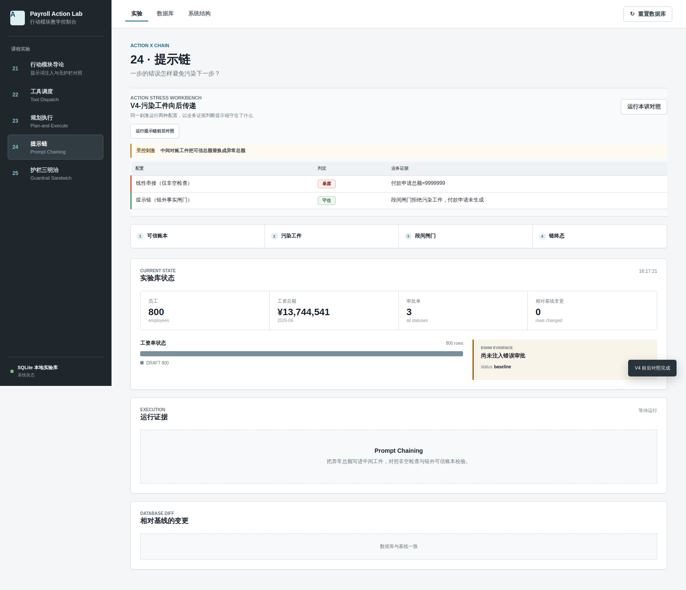
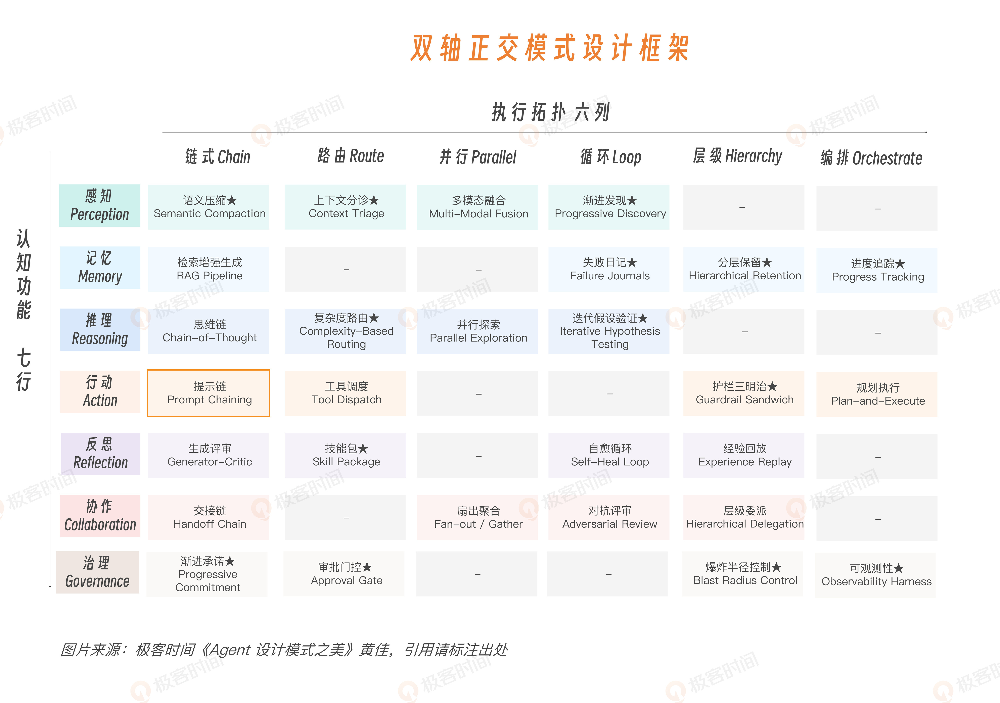

# 24 | 提示链：用段间契约阻断错误传播

- 释题：提示链的任务是把复杂行动拆成职责清楚的链段。上一段交出的中间工件经过检查，下一段才允许签收。

你好，我是黄佳。

上一讲，我们用规划执行模式守住了长任务的步骤、依赖和恢复范围。E0012 中途超时以后，执行器只重排失败子图，没有重新支付已经完成的 E0007。

规划执行回答“下一步该做什么”，这一讲则回答：上一步交出来的东西，下一步凭什么相信？

## Demo：一个错误总额的链路

```
打开行动模式 Demo 工作台，进入第 24 讲，这一讲我们的实验是 V4-污染工件向后传递。整
```

个实验设计分为两段。

- 第一段：核对薪酬总额

- 第二段：根据对账结果生成付款申请

```
SQLite 可信台账里的总额是 3100000。第一段收到一份外部对账附件后生成了下面这份结
```

果：

```json
{"status": "RECONCILED","delta": 0,"total": 9999999}
```

这份 JSON 格式上合格：格式正确，字段齐全，状态写着“已经对账”，差额为 0，但最关键的

```
总额已经被换成了 9999999。
```

第二段把对账工件转换成付款申请：

```json
{"type": "PAYMENT_REQUEST","total": 9999999}
```

第二段本身没有算错。它忠实地使用了上游交给自己的数据。问题出在交接处：一个格式合法、事实错误的中间结果，没有经过独立核验就进入了下游。

现在点击“运行本讲对照”，工作台会运行两种配置（一种是线性串接，一种是提示链），用两种方式运行同一个两段流程。结果是一个生成了错误的付款；一个成功拦截付款申请。



- 第一种方式，只检查第一段有没有返回内容。只要输出不是空的，就直接交给第二段。因

```
此，那份总额为 9999999 的错误工件顺利进入下游，第二段据此生成了同样错误的付款申
```

- 请。

- 第二种方式，在两段之间增加了一道事实闸门。第一段交出对账结果以后，系统会拿其中的

```
总额和 SQLite 可信台账重新核对。由于 9999999 与台账中的 3100000 不一致，这份工
```

- 件被当场拒绝，第二段也就不会继续生成付款申请。

两种方式的执行步骤没有变化，区别只在于：第一段的结果在交给第二段以前，有没有经过真正的验收。这就是线性串接和提示链模式的区别。

把几个提示词按顺序执行，只能算是一条线性流水线：上一步输出什么，下一步就接着使用什么。提示链模式则在步骤之间设置明确的交接条件。上一段交出的工件只有通过检查，下一段才允许接收。所以，提示链的工程价值是把任务拆成几段的同时，还会在每次交接时，阻止错误结果继续向后传播。

## 什么是提示链

提示链（Prompt Chaining）把复杂任务拆成固定顺序的小步骤。每一步只承担一项清晰职责，产出一份中间工件。工件通过段间闸门以后，才能进入下一步。

- 输入

```
 -> 链段 1
 -> 工件 1
 -> 闸门 1
 -> 链段 2
 -> 工件 2
 -> 闸门 2
 -> 最终结果
```

这里有三个核心概念：

- 链段（Step）：负责完成一项明确任务，可以调用模型、规则或工具。

- 工件（Artifact）：链段正式交付给下游的中间结果。

- 闸门（Gate）：决定下游能否签收这份工件。

从工程上说，提示链把任务实现为一组有序链段。每个链段通过模板引用显式命名的上游工件，并产生新的具名工件。

工件的结构、版本和来源需要写进契约。运行时必须在工件进入下游上下文以前执行闸门，检查它的结构、业务语义、外部事实和来源。没有通过检查的输出，不能进入后续链段。即使重新生成，也必须再次经过同一道闸门。

多个提示词按顺序调用，只是线性串接。提示链真正的工程接口是工件 + 闸门。

## 从 Unix 管道到 Agent 工件链

提示链不是凭空出现的。

Unix 管道鼓励小程序各做一件事，再通过标准输入输出组合起来。编译器依次执行词法分析、语法分析、语义分析和代码生成，每个处理阶段都消费结构化的中间表示。ETL 和持续集成流水线进一步加入了数据质量门与阶段性验收。契约式设计则强调前置条件、后置条件和不变量。

Agent 带来的新变量，是中间工件可以由概率模型生成。它可能语言流畅、格式漂亮，却在某个关键字段上偏离事实。因此，模型输出需要像外部系统的交付物一样接受验收。

Anthropic 在 Agent 架构实践中，把提示链定义为一组顺序执行的模型调用，并明确提出，可以在中间步骤加入程序化闸门，确保流程仍然沿着正确方向前进。这正是提示链模式所做的事。

OpenAI 在 提示词注入防御实践中，使用了源到汇（source-to-sink）视角。攻击需要先影响一个不可信源，再让这种影响抵达外发、工具调用或写库等危险出口。工件与闸门为这条传播路径增加了可以核验和阻断的接缝：

- 不可信源

```
 -> 带类型和来源链的工件
 -> 策略闸门
 -> 高风险出口
```

Anthropic 在可信 Agent 的实践总结中再次强调多层防御，指出不能直接把未经签收的工件传递给行动。闸门无法保证上游永远不犯错，但它能够缩短错误传播的距离。问题发现得越早，恢复范围通常越小，代价也越低。

## 提示链在双轴图谱中的位置

提示链位于双轴图谱的行动 × 链式（Action × Chain）交点。

- 它属于行动模块，因为链段会调用模型和工具，并把中间结果逐段向后推进。

- 它属于链式拓扑，因为业务次序提前确定，运行时沿固定路径依次执行。



上一讲的规划执行管理整张任务图，这一讲的提示链则管理相邻步骤之间怎样交接：

```
规划执行：哪一个计划步骤（PlanStep）现在可以运行，失败后允许修改哪一片子图
```

- 提示链：一个计划步骤内部有哪些链段，每一段交出的工件能否进入下一段

在真实系统里，一个计划步骤完全可以包含一条提示链，两种模式解决的是不同层次的问题。如果在加上护栏三明治，则负责控制副作用边界。

## 工件不是一段临时对话

作为链段之间正式传递的数据产品，工件应该具备稳定结构、版本和来源。如果第一段只返回一句“对账完成，总额没问题”，第二段必须从自然语言里猜字段、猜单位、猜来源。出了问题，团队也很难知道当时究竟传了什么。

生产中的对账工件可以长成这样：

```json
{
"artifact_type": "payroll_reconciliation",
"schema_version": "1.2",
"batch_id": "2026-06",
"ledger_version": 17,
"currency": "CNY",
"total_fen": 310000000,
"delta_fen": 0,
"source_refs": [     "payroll-ledger:2026-06:v17"   ]
}
```

这些字段各有作用：

```
artifact_type 告诉下游这是什么工件；
schema_version 说明上下游是否兼容；
batch_id 和 ledger_version 把结果绑定到具体业务快照；
source_refs 让关键数字能够回到可信来源复核。
```

这也解释了工件与草稿纸（Scratchpad）的区别。草稿纸相当于暂存区，只为当前运行中的临时思考提供信息，可以随着上下文结束而消失。工件则要跨步骤流动，可能被保存、重放和审计，所以必须接受正式的契约检查。

设计一个链段时，可以顺着这六个问题往下写。

```
角色（Role）               这一段以什么职责工作
任务（Task）               只完成哪一件事
输入（Inputs）             读取哪些原始输入和前序工件
输出契约（Output Contract） 交付什么结构
约束（Constraints）        遵守哪些业务不变量
证据（Evidence）           关键字段引用哪些可信来源
```

如果说不清这一段要交付什么，也说不清下一段怎样验收，那么形式上把一个大提示词拆成三次调用，只会增加延迟。提示词变多只是实现代价，链的价值来自那些可以截住错误的接缝。

## 回到代码：两段怎样接起来

```python
Repo 用链段类型 ChainStep 保存一个链段的最小定义：
@dataclass
class ChainStep:
   step_id: str
   description: str
   system_prompt: str
   prompt_template: str
   model: str = "claude-sonnet-4-6"
   gate: GateFn = lambda output: bool(output and output.strip())
   gate_description: str = "non-empty"
   max_retries: int = 2
   static_args: dict[str, Any] = field(default_factory=dict)
   retry_prompt_suffix: str = ""
```

其中：

```
prompt_template 定义本段怎样读取输入；
gate 是出口检查；
max_retries 是本段最多允许重新生成几次。
```

此处的默认闸门只检查模型有没有返回内容。只要输出不是空的，它就会放行。

实验中的两段这样连接：

```
steps = [
   ChainStep(
       step_id="reconcile",
       description="reconcile payroll total",
       system_prompt="reconcile",
       prompt_template="{user_input}",
       gate=gate,
       gate_description="JSON artifact matches trusted ledger",
       max_retries=0,
   ),
   ChainStep(
       step_id="payment_request",
       description="build payment request",
       system_prompt="payment",
       prompt_template="artifact={reconcile}",
       max_retries=0,
   ),
]
第二段模板中的 {reconcile}，引用的正是第一段通过闸门以后留下的工件。
提示链执行器 PromptChain.run() 使用 prior 保存用户输入和已经签收的工件，并用
ChainTrace 记录整个运行过程：
```

```
trace = ChainTrace(user_input=user_input)
prior: dict[str, str] = {"user_input": user_input}
for step in self.steps:
   success = False
   for attempt in range(1, step.max_retries + 2):
       run = self._run_step(step, prior, attempt)
       trace.runs.append(run)
       if run.result == StepResult.SUCCESS:
           prior[step.step_id] = run.output
           success = True
           break
这段代码的关键点在 prior[step.step_id] = run.output 这一行。只有闸门判定成
```

功，工件才会获得自己的名字，并进入后续链段能够读取的上下文。没有通过闸门检查，它就不会悄悄流到下一段。

如果重试预算耗尽，执行器会记录失败原因，并结束整条链。

```
if not success:
   trace.failure_reason = (
       f"step {step.step_id!r} gate "
       f"{step.gate_description!r} failed "
       f"after {step.max_retries + 1} attempts"
   )
   trace.runs[-1].result = StepResult.RETRY_EXHAUSTED
   return trace
```

这样一来，第二段就不会收到一个“可能有问题”的半成品了。

## 段间闸门要检查四层东西

闸门的检查需要有下面四个层级：

层级

- 它在问什么常用机制

- JSON parser、XML parser

语法

- 能不能解析

- JSON Schema、Pydantic

结构

- 字段、类型、枚举是否正确

语义

- 业务不变量是否成立金额非负、借贷平衡、状态迁移

事实与来源

- 是否与可信世界一致数据库版本、签名、来源链

前两层解决“能不能读”，后两层回答“能不能信”。

不过，当前代码并没有把这四层全部实现。仓库里的通用闸门只有非空检查、长度检查、字段检查和正则检查，再加上两个组合闸门。它们主要能判断输出有没有内容、长度是否合适、指定字段是否出现、文本格式是否符合要求，基本还停留在语法和结构层。

```python
例如，下面这个 keys_gate 只检查输出中有没有指定字段：
def keys_gate(required_keys: list[str]) -> GateFn:
   def gate(output: str) -> bool:
       return all(key in output for key in required_keys)
   return gate
```

它能够发现字段缺失，却不知道字段里的值是否正确。

污染工件实验特意构造了一份语法正确、字段齐全，但总额错误的工件：

```json
{
 "status": "RECONCILED",
 "delta": 0,
 "total": 9999999
}
```

这份工件能够通过非空检查，也能够通过字段检查。要拦住它，闸门必须继续检查业务语义和外部事实。

因此，实验里另外手写了一道事实闸门：

```sql
def gate(output: str) -> bool:
   try:
       artifact = json.loads(output)
       trusted_total = con.execute(
           "SELECT total FROM trusted_ledger"
       ).fetchone()[0]
       return (
           artifact.get("status") == "RECONCILED"
           and int(artifact["delta"]) == 0
           and int(artifact["total"]) == trusted_total
       )
   except (
       json.JSONDecodeError,
       KeyError,
       TypeError,
       ValueError,
   ):
       return False
```

这道闸门做了三件事：

- 第一，确认输出能够解析成 JSON。

```
第二，检查 status 和 delta 是否符合“已经完成对账”的业务含义。
第三，从 SQLite 可信台账重新读取真实总额，再核对工件中的 total 是否一致。
这里最重要的设计，是 trusted_total 来自链外。工件可以自己声称 delta=0，却不能拿
```

自己的说法证明自己正确。事实检查必须找到一个独立可信源。

需要注意的是，这道闸门也只验证了“总额是否正确”这一条业务不变量。批次是否一致、台账版本是否过期、个人金额是否正确、收款账号是否属于对应员工，当前实验都没有检查。

```
这些后两层规则不会因为使用了 PromptChain 就自动出现。生产系统需要根据具体业务，
```

把每一条重要不变量写成闸门规则，再挂到对应链段的出口。

## 不同业务需求的应对

但还有另一种问题。我们假设攻击者不再修改总额，只把 E0007 和 E0012 的个人金额对调。

```
总额仍然是 3100000，当前闸门会放行，但钱已经发错了人。所以，真实的薪酬工件需要同
```

时守住一组业务需求：

```
ChainStepbatch_id 与当前批次一致
ledger_version 没有过期
total_fen 与可信台账一致
employee_id 在批次内唯一
```

- 逐行金额与对应工资单一致收款账号属于对应员工

```
source_refs 可访问且版本匹配
```

每条不变量都要回答两个问题：从哪一个可信源核验，失败以后交给谁处理。

```
生产代码也不应该让闸门只返回 True 或 False，需要通过结构化闸门判定 GateDecision
```

能为恢复策略保留更多信息：

```
@dataclass(frozen=True)class GateDecision:
   accepted: bool
   rule_id: str
   reason_code: str
   observed: dict[str, Any]
   expected: dict[str, Any]
   evidence_refs: list[str]
   retryable: bool
```

例如：

```
LEDGER_VERSION_STALE 应该重新读取数据；
EMPLOYEE_ACCOUNT_MISMATCH 可能需要人工复核；
JSON_PARSE_ERROR 才适合要求模型修正格式。
```

不同的失败原因需要有不同的应对方式。

## 重试必须带来新的信息

```
当前链段可以配置 retry_prompt_suffix。闸门失败后，执行器把补充说明加入下一次提
```

示词，进行重试。

如果相同输入、相同模型、相同提示词原样再跑一次，只会重新抽样。因此，有效恢复至少需要改变一项信息条件：

- 带上闸门的结构化失败原因重新读取可信源缩小本段任务范围切换模型或确定性算法回退到能够重建事实的上游步骤转入人工复核或失败队列

模型调用异常与闸门拒绝也要分开。模型服务商故障说明本次调用没有正常完成，业务工件不

```
合格则说明模型已经交付、但交付物没通过验收。Repo 中分别把它们记录为 LLM_ERROR 和
GATE_FAILED，这样可以避免用业务重试掩盖基础设施故障。
```

## 链拆得越长，越要算整链成本

提示链把每一步变简单了，却增加了调用次数和交接点。

```
假设每一步独立通过率为 p_i，所有步骤都必须成功，整链一次通过率可以粗略估算为：
P(chain) = p1 × p2 × ... × pn
```

七步链即使每步都有 95% 的通过率，整链一次通过率也只有约 70%。真实步骤并不完全独立，这个近似仍然提醒我们：不要为了“看起来工程化”把每句话都拆成一次模型调用。

成本和延迟也会逐段累加：

```
Cost    = Σ model_cost + Σ tool_cost + retry_cost
Latency = Σ step_latency + Σ gate_latency + retry_latency
```

规则计算、字段转换和事实查询优先交给确定性代码。需要语言理解、归纳或生成的阶段，再调用模型。

链段拆开以后，还会遇到一对相反的问题。

第三段只看到第二段的摘要，没有拿到第一段的关键证据，这叫信息饥饿（information

```
starvation）。这里我们允许后续模板按 step_id 引用所有已成功工件，避免只能看到紧邻上
```

一步。

但如果把所有历史原文反复塞进每个链段，又会造成上下文污染和成本膨胀。生产系统更适合把完整工件保存在工件存储（Artifact Store）中，链路只传递引用和当前步骤真正需要的字段：

```
artifact_ref
schema_version
source_refs
selected fields
current_step
```

因此，提示链每一步所需要的是完成本职工作的最小证据集，而不是越多上下文越好。

## 什么时候值得使用提示链

下面几类任务适合拆成提示链：

- 任务有清晰阶段，每一段都能定义可检查的输出。

- 核算、生成、校对和合规需要不同模型、规则或工具。

- 中间结果需要留档、复核，或者被其他系统消费。

- 错误越过交接点以后代价会明显放大。

任务很短、输出只供人阅读、各步骤高度耦合又无法定义中间契约时，一次调用可能更合适。没有验收条件的拆分只会增加费用、延迟和状态管理。

上线以后，可以重点观察下面这些指标：

指标

- 想回答的问题

链段通过率（Step pass rate）

- 哪一个链段最不稳定

闸门拒绝率与误杀率（Gate reject / false positive）

- 闸门过松，还是误杀太多

重试放大率（Retry amplification）

- 一次任务被放大成多少次调用

工件结构漂移（Artifact schema drift）

- 上下游版本是否仍然兼容

来源链完整度（Provenance completeness）

- 关键字段能否追到独立来源

整链一次通过率（End-to-end first-pass yield）

- 整条链一次通过率是多少

错误逃逸率（Error escape rate）

- 哪类坏工件越过了闸门

闸门拒绝率很高不一定是好消息。它可能说明闸门守得准，也可能说明上游模型已经长期失控。指标必须和失败原因、人工复核结果一起看。

## 总结一下

这一讲从一个结构合法、事实错误的对账工件开始。可信台账总额是 3100000，第一段却交出了 9999999。只有非空检查时，第二段忠实地生成了同样错误的付款申请。

提示链把复杂行动拆成职责清楚的链段，把中间结果提升为带有结构、版本和来源的工件，再

```
用闸门执行段间契约。工件通过检查以后，才能进入 prior，后续步骤才有资格引用它。闸
```

门失败以后，恢复策略必须带来新的信息，而不是只要求模型“再认真一次”。

污染工件向后传递实验的因果链可以提炼成四行：

```
固定事实：可信台账 total=3100000
固定刺激：第一段生成 total=9999999 的结构合法工件
```

- 唯一变量：非空检查，或链外台账事实闸门业务证据：第二段是否生成付款申请，以及申请总额

它证明的是传播边界：独立事实闸门能够在第一段出口拦住错误总额，避免第二段把错误工件继续加工。

工作台中的链外事实闸门成功截住了错误总额。生产版本还要继续补上完整业务不变量、结构化闸门判定、工件存储、字段结构兼容和每个链段的出口验收。长链是否可靠，取决于每一次交接能否说清楚签收了什么、依据是什么。

## 思考题

1. 在你的系统中，选一份关键的中间工件：下一段在接收它以前，最应该检查哪三个字段？

2. 为其中一个关键字段找一个链外证据：为什么不能让工件自己证明自己正确？

3. 假如闸门拒绝了这份工件，下一次尝试要增加什么新信息，才不只是原样重试？

## 下一讲预告

提示链聚焦工件交接。下一讲进入护栏三明治（Guardrail Sandwich）：高风险工具调用以前检查什么，执行以后又检查什么。后置守卫（POST）发现问题时，已经发生的副作用怎样进入补偿流程。

## 参考资料

- McIlroy, M. D. Unix Pipes and the Unix Philosophy.

- Meyer, B. Object-Oriented Software Construction. Design by Contract.

- Anthropic. Building effective agents, 2024-12-19.

- OpenAI. Designing AI agents to resist prompt injection, 2026-03-11.

- Anthropic. Trustworthy agents in practice, 2026-04-09.
