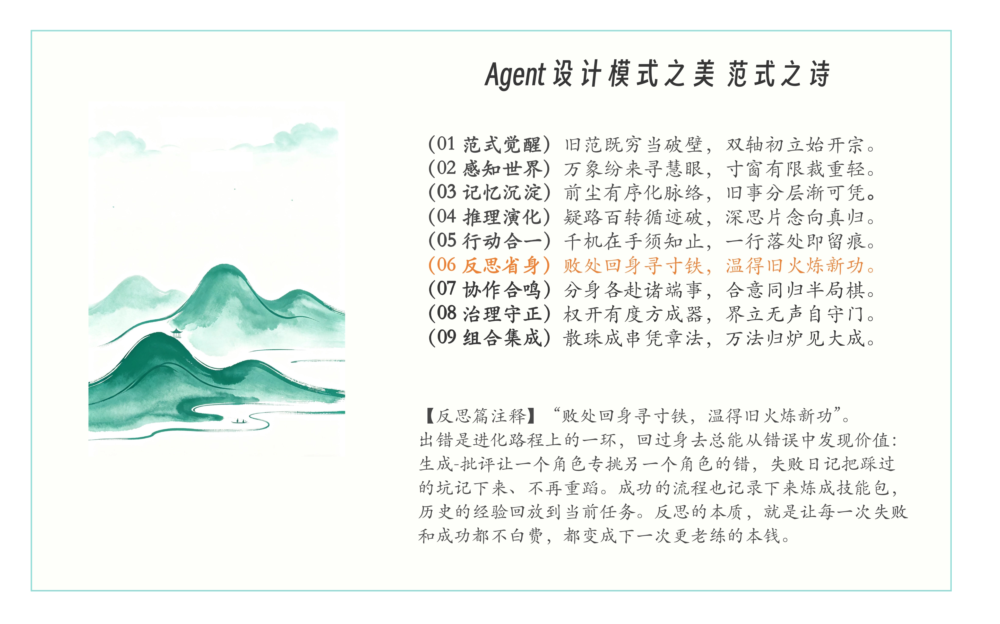
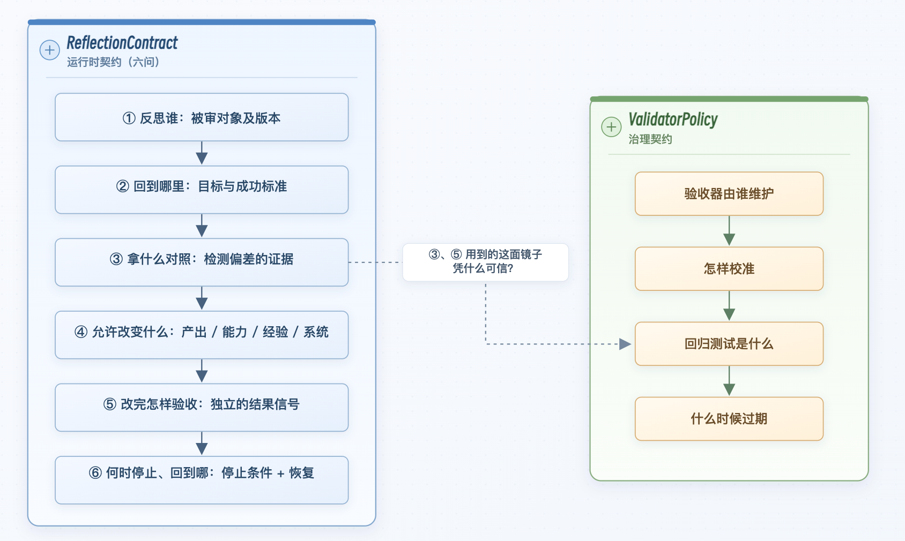
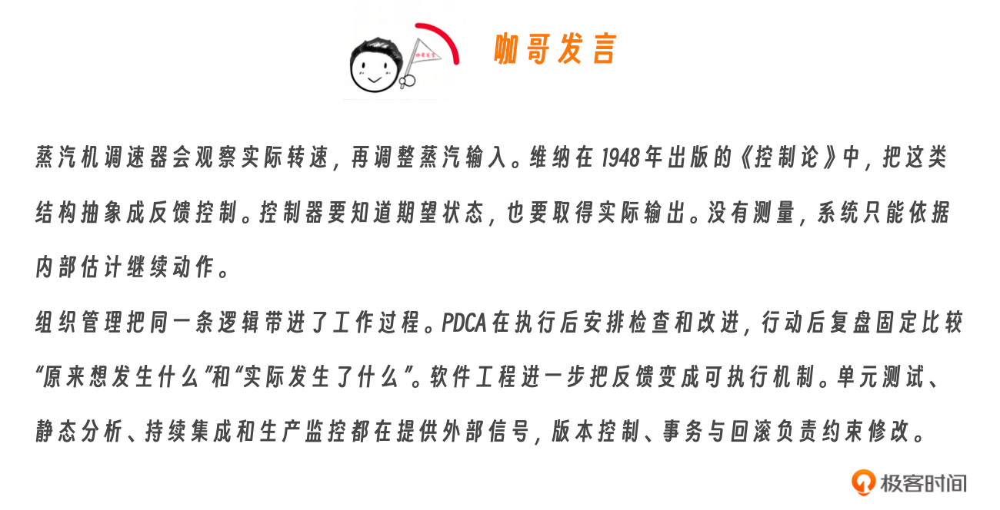
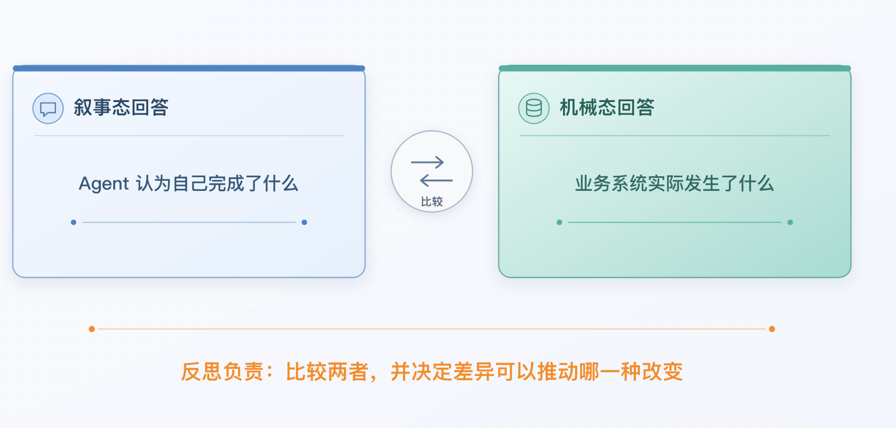
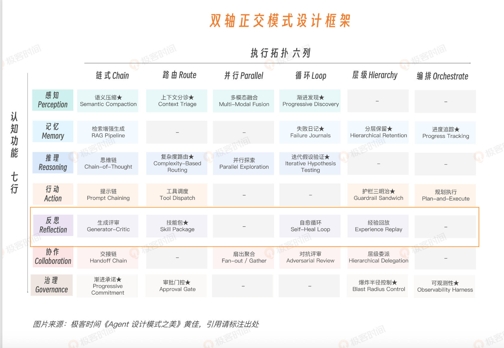
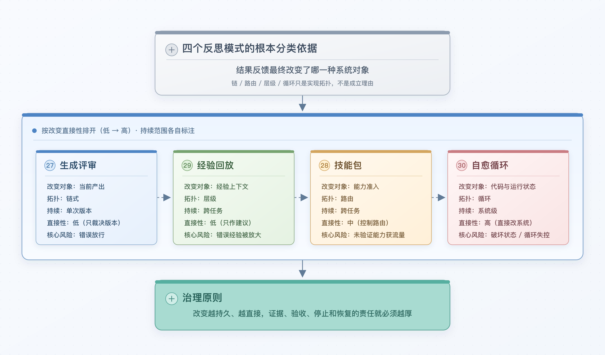
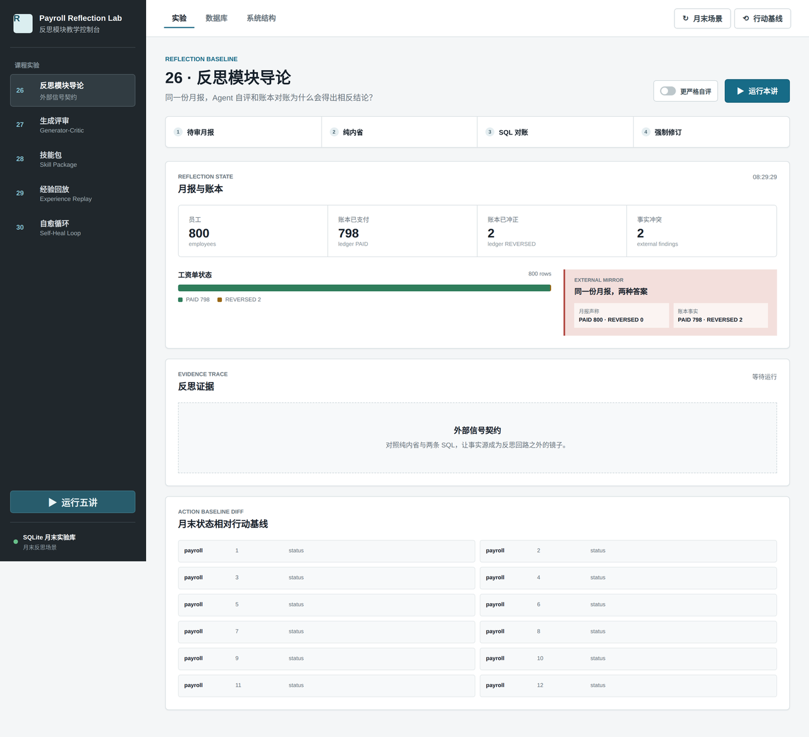
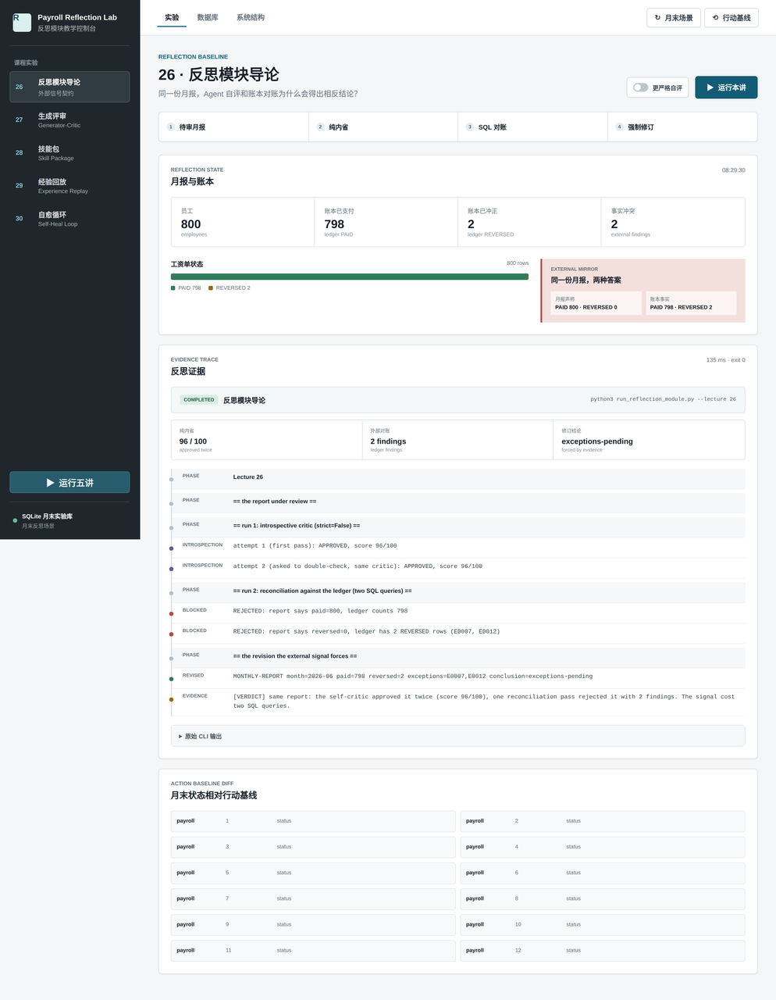
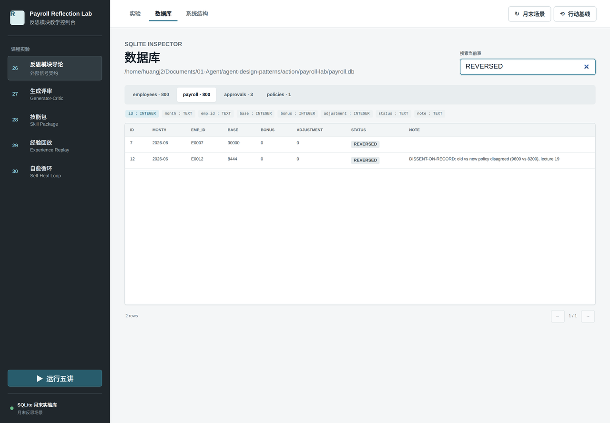
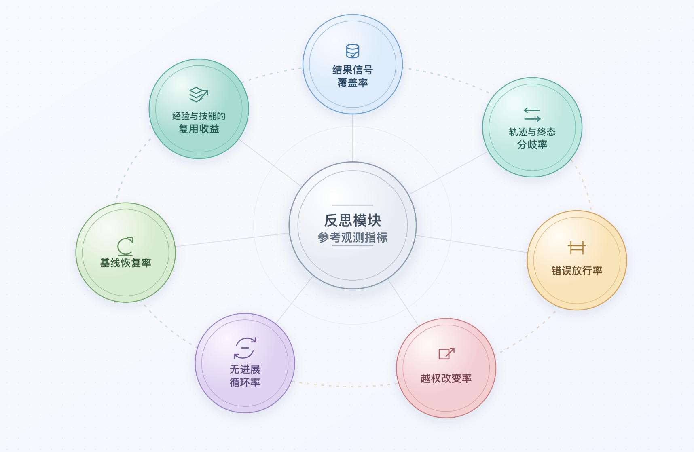

# 26 | 反思模块导论：让Agent站到自己的结果之外




你好，我是黄佳。

- 释题：反思把已经发生的结果送回系统。Agent 要找到可信的参照，限制改变范围，并在验证通过、没有进展或风险升高时停下来。

行动模块负责把模型的判断安全地做出来：工具要先取得准入，多步任务要受计划约束，中间工件要经过验收，高风险动作还要穿过前置与后置守卫。但动作完成以后，仍然可能留下另一

```
类问题。比如，账本里有 798 张工资单处于 PAID，E0007 和 E0012 已经冲正，状态是
REVERSED；财务月报却写着 month=2026-06 paid=800。业务终态已经形成，但月报没
```

有如实反映，行动过程本身也没有发现这道差异。

更隐蔽的情况是，发薪 Agent 算出的总额、人数和五险一金合计全部正确，但其中一人多发一元，另一人少发一元，两笔错误刚好抵消。只看汇总数字，系统会认为一切正常；只有把每名员工的工资单与权威明细逐条比对，才能发现问题。至于错误来自舍入、结转、录入还是科目映射，还要继续调查。

一个能把总账对平、还能自圆其说的系统，怎样知道自己其实错了？这就是反思模块要解决的问题。系统说任务成功，业务状态真的成功了吗？发现偏差以后，应该改当前报告、调整下个月的技能，还是直接修改代码？连续修了三轮，究竟是在接近目标，还是只围着最后一个报错打转？

会回头看，不等于会反思。模型可以重读答案、写一段复盘，或者重新生成，但工程系统真正需要的是一条能够连接结果、证据、改变与停止的反馈路径。推理重点是决定接下来做什么；反思则把已经发生的结果重新送回系统，约束后续行为。两者的区别不在发生时间，而在于有没有新的结果信号进入系统。如果输入、工具和事实源都没有变化，只是把同一段提示词再跑一遍，那更像重试、重采样或继续推理，还不是这里所说的反思。

## 六个问题构成的反思契约

要设计一个完整的反思回路，先想清楚下面六个问题。

问题

- 要固定的内容

反思谁

- 被审对象及其版本

回到哪里

- 原始目标与成功标准

- 检测偏差用的数据库、规则、字段结构、测试、指标或人工判断及

拿什么对照

- 其版本

允许改变什么

- 当前产出、能力路由、经验上下文或系统状态

改完怎样验收

- 用哪套独立检查判断这次改动真的成功，看的是哪些结果信号

- 通过 / 预算耗尽 / 无进展 / 风险升高 / 人工接管，以及停止后回到

何时停止、回到哪

- 哪个基线、怎样回、失败交给谁

这六个问题整理成反思契约（Reflection Contract），就成了一组在反思开始前就要说清楚的系统约束。可以写成后面这样的设计蓝图：

```python
@dataclass(frozen=True)
class ReflectionContract:
   contract_version: str
   subject_ref: str
   goal_ref: str
   evidence_refs: tuple[str, ...]      *# 检测偏差的证据*
   allowed_changes: frozenset[str]
   acceptance_ref: str                 *# 改完怎样重新验收*
   stop_conditions: tuple[str, ...]
   recovery_ref: str | None            *# 停止或失败后回到哪、怎样回、交给谁*
```

还有一层契约，不属于这次反思本身，而属于治理。治理契约判断用来验收的这面镜子凭什么可信，具体包括数据库快照，测试和模型评分器如何维护、怎样校准、回归测试是什么、什么时候过期：

```python
# 运行时契约回答“这次改得对不对”，
# 治理契约回答“判断对错的这套东西本身还可不可信”。
@dataclass(frozen=True)
class ValidatorPolicy:
   validator_ref: str
   owner: str
   calibration: str
   regression_suite_ref: str
   expires_at: datetime | None
```



反思能力越强，拥有的权限越多，而权限每深入一层，外部信号、验收、停止线和回滚的责任都要跟着加厚。因此，对反思的治理和测量也要跟着加厚。



测量和治理过程中有三个要点：

- 第一，反馈的质量取决于测量。测量如果拿不到真实业务状态，只能评价文本是否自洽，基本没啥用，因为大模型文本上基本都自洽。

- 第二，发现偏差与修改系统是两种权限。测试过程不应该顺手修改生产代码。评审者提出问题，修复和放行要经过独立策略。

- 第三，反馈回路必须能够停止。就像 CI 会在失败时会阻断合并，自动修复器也需要轮次的预算、无进展检测机制以及回滚的出口。

因此，反思仍然是工程，不是仅仅通过几句提示词，让 LLM 把判断、解释和修订变成了自然语言就完事儿了。比如找到另外一个模型说“你检查检查，反思反思”，这样做的确简单，反馈成本很低，但这样的设计聊胜于无，抓不到关键问题，我认为意义不大。

## 反思过程中究竟多看到了什么

Self-Refine 在多类任务上展示了模型生成反馈、再依据反馈修订的收益。Reflexion 把环境返回的成败信号转成语言经验，供后续尝试使用。CRITIC 则让模型借助搜索、 解释器和校验工具取得外部反馈。这些工作说明，反思可以成为 Agent 的有效能力。

此外，Huang 等人在 ICLR 2024 发表的反思推理研究（Large Language Models CannotSelf-Correct Reasoning Yet）中指出，没有外部反馈的情况下，模型只靠重新审视自己的推理并不稳定，有时还会把正确答案改差。

二者并不矛盾。因为反馈来源、任务类型和判定方式不同。而更关键的问题是：在收到反馈之后，第二遍查验的过程中，Agent 究竟多看到了什么。

近年来 Agent 的评测越来越强调轨迹（transcript）与结果（outcome）分开。Agent 可以在对话里说“机票已经订好”，这只能说明轨迹里出现了这句话。环境数据库中是否真的存在预订记录，才是问题的关键。2026 年新发表的REFLECT 论文指出：应该先定位长轨迹中的可疑步骤，再通过受控回放和针对性干预，观察结果是否翻转。如果干预后结果发生翻转，这个变化才成为错误归因的证据。

这几条研究线索共同指向同一个工程结论：反思要接入新证据，还要检查这份证据是否真的解释了结果变化。从“再想一次”走到“改变一个条件，再观察结果”，反思才开始接近可验证的工程机制。

梁博老师在他的执行型 Agent 的企业落地蓝皮书中，也反复强调模型的叙述状态和机械的控制状态要分开管理。

- 一类是叙事态。它保存用户目标、任务进展、里程碑和自然语言摘要，让模型知道自己正在做什么。

- 另一类是机械态。它保存业务对象 ID、版本、状态、参数绑定、外部回执和数据库事实，让系统知道实际发生了什么。

叙事态缺失，Agent 容易在长任务里失去目标。机械态缺失，系统就只能相信模型对执行结果的讲述。二者配合起来，才能完成反思。



执行型 Agent 的反思，如果只让叙事态评价叙事态。月报说“全部支付成功”，再让同一段上下文检查“这句话是否合理”，很容易得到一个内部自洽的通过结论。而加入机械平面中的工资单状态、 银行回执和冲正记录才是完整证据链。

除了把两种状态的数据结构分开之外，还要有权限边界：模型可以读取机械态、解释机械态、提出对机械态的变更，但一段叙事文本不能直接覆盖机械态。机械态只能通过受约束的业务接口改变。否则“月报说全发了”这句话，就可能被当成“账本已经全发了”写回系统。反思读的是机械态，产出的是变更提案，具体执行还是要重新走接口和权限，这都是必不可少的。

这也解释了为什么反思在企业系统里常常比内容生成场景更重。文案写得不满意，用户可以重新生成。业务状态已经改变以后，错误会进入账本、审批、通知和下游流程。反思更应该面对的是已经发生变化的世界（当然你写个文章、PPT 时，多反思一两次有益无害）。

## 给反思一个工程定义

有了上面的理论基础，现在我们给反思模块做出一个完整的定义：反思，是把已经发生的任务产出与可复核基准进行比较，识别偏差，在授权范围内改变后续系统行为，再用独立的结果信号验收这次改变的反馈机制。

它是这样一条闭环（反思是真正的 Loop Engineering）：

- 已发生的结果

```
 -> 版本化证据
 -> 偏差识别
 -> 归因假设（可选）
 -> 归因验证或干预证据（可选）# 没有外部信号，回路容易变成自我确认
 -> 授权范围内的改变 # 改变权限， 批评可能顺手修改不该触碰的对象
 -> 独立重新验收 # 有独立验收，系统只知道“改过”，不知道“改对”
 -> 通过、继续、回滚或交人 #  没有停止和恢复，反思会演化成长程任务里的负担
```

这里给出一个小提醒：“发现不一致”和“知道为什么不一致”并不是同一件事。月报对账能证明800 和 798 对不上是偏差识别；至于原因是旧快照、状态映射错误、数据延迟，还是汇总逻辑漏了冲正，对账本身证明不了。所以归因是可选的一步：发现偏差，系统已经可以拒绝放行，要注意 LLM 会不会为了显得聪明去编一个根因。除非做到受控回放和针对性干预（参考REFLECT 论文），让结果能翻转，才把偏差升级；普通对账过程中发现了偏差的时候，其实反思过程就可以结束了。

## 反思模块中的四个模式

反思模块包含四个模式。它们不按模型调用次数排序，也不表示自动化程度逐步提高。 区分它们的根本依据是：结果反馈最终改变了哪一种系统对象。 链式、路由、 层级、循环是它们各自的实现拓扑，不是它们成立的理由。



这张图要分三层看：

- 改变对象决定模式的性质；

- 执行拓扑决定模式怎样实现；

- 治理风险取决于改变持续多久、对业务状态有多直接。

对应讲数

- 模式改变对象执行拓扑持续范围改变直接性

- 27生成评审当前产出链式单次版本低（只裁决版本）

持续范围和改变直接性并不总能排成一条直线。一条经验可能只作为背景提示，模型可以不采用；一个进入正式路由的技能，却可能直接调用付款工具。因此，四个模式不应该被简单理解成从浅到深的一条阶梯。



生成评审

生成评审改变的是当前产出。评审者提出有证据的问题，策略闸决定当前版本能否通过。根据评审产生的修订稿，是一个新的版本，还没有接受审查，不能继承原稿的裁决。

技能包

技能包改变的是可复用能力的调用资格。一次成功轨迹只能成为候选技能。候选先处于

```
TRIAL，通过外部验证以后，才能进入正式路由。技能进入路由后，真实复用结果还要继续写
```

回。表现下降、政策变化或凭证过期时，旧资格必须能够被撤销。

经验回放

经验回放改变的是后续任务看到的经验上下文。它最难的地方是信用分配。一次任务同时注入五条经验，最后成功了，不能把五条经验全部记成有效。系统需要记录哪些经验被使用、后续结果怎样，再通过真实战绩把教训和迷信分开。

自愈循环

自愈循环直接改变代码、配置或运行状态。测试红灯触发诊断和补丁，补丁经过审查后原子应用，再重新验证。只要问题仍然存在，并且没有触发停止线，循环就可以继续。如果修复失败，系统必须恢复基线，并把原始目标、测试证据和尝试过的补丁交给人工。

它的目标不是让最后一个测试勉强转绿，而是恢复原始目标约束下的系统正确性。

## 反思与评估、记忆有什么区别？

反思与其他模块之间有两组边界容易混淆，所以我们区分一下。

评估与反思

评估回答：这次做得怎么样？它可以停在分数、标签或裁决；反思还要继续回答：这个判断准备改变什么？改变以后怎样重新验证？因此，评估是反思的信号入口，反思则是一条完整的反馈回路。在 Designing AI Agents 一书中，我把评估纳入了反思模块。

记忆与反思

记忆负责把过去留下来。失败日记可以完整保存 E0012 的冲正轨迹，但“保存了”不等于“已经学会了”。

反思还要判断这次失败说明了什么、是否值得影响下一次任务、以及复用以后有没有真正改善结果。尚未证明的教训，只能作为带来源的背景信息。经过多次验证、能够稳定检查的经验，才可能升级成规则、护栏或技能。

具体模式之间还有两条边界。

- 生成评审结束于一次版本裁决；自愈循环则结束于外部红灯转绿，或者停止策略接管。

- 技能包保存的是可以执行的能力；经验回放保存的是可能有帮助、但尚未完全固化的背景教训。

这些边界会直接决定数据结构：

- 生成评审要保存被审版本和未复审的新稿；

- 自愈循环要保存失败签名、补丁指纹和回滚栈；

- 技能包要保存版本、生命周期和路由记录；

- 经验回放要保存原始轨迹指针、注入记录和复用效果。

## 谁来检查反思本身

反思需要外部信号，但“外部”不等于“绝对正确”。

数据库里的数据可能已经过期，业务规则可能漏掉特殊情况，测试用例也可能只覆盖正常流程。模型评分器可能偏爱自己熟悉的表达方式，人工审核同样会疲劳，也会出现意见分歧。所以，不能因为一份证据来自模型外部，就直接把它当成最终真相。

生产系统通常会组合三类检查方式。

检查方式

- 适合检查主要风险

代码与环境检查

- 字段、状态、测试结果、工具参数和业务不变量可能过于僵硬，无法处理

模型评分器

- 语义质量、完整性和开放式内容非确定性、自我偏好，需

人工审核

- 专业责任、模糊边界和高风险决定成本高、速度慢，判断可

它们各有长处，也各有盲区，不能只依赖其中一种。检查对象也不能只有 Agent 最后说出的那句话，至少要分开检查三样东西：

1. 最终输出；

2. 完整执行轨迹；

3. 环境中的真实终态。

例如，Agent 最后说“任务已经完成”，执行记录却可能显示它绕过了审批，数据库中甚至没有留下成功记录。如果只检查最后一句话，就会同时漏掉过程违规和结果失败。这正是

```
ValidatorPolicy 要解决的问题：
```

- 谁负责维护这些检查器；

- 多久校准一次；

- 测试集是否仍然有效；

- 业务规则变化以后有没有及时更新；

- 什么时候需要人工抽检。

运行时验收回答的是“这一次修改到底改对了没有？”；验证器治理回答的是“用来判断对错的这把尺子，现在还准不准？”反思系统不但要检查 Agent，也要定期检查自己的评分器、业务规则和测试。否则，Agent 可能越来越擅长通过旧指标，却离真实业务目标越来越远。

## 长程 Agent 最怕反思也跟着走偏

短任务做错了，影响通常只停留在这一份答案里。长程 Agent 不一样。它会一边执行，一边修改外部环境，再把修改后的结果读回来，作为下一轮判断的依据。

这意味着，一个最初很小的错误，如果没有及时发现，可能会被后面的步骤当成真实事实继续使用。Agent 先根据错误信息做出判断，又把判断结果写回系统，下一轮再以这个结果为起点。循环几次以后，最初的猜测就可能越来越像一件已经确认的事实。

反思如果设计不好，不但不能纠正这种偏差，反而可能把它放大。例如，Agent 可能一直围着最近出现的一个报错打补丁。眼前的测试通过了，它就认为问题解决了，却忘记了整个任务原本要达到什么目标。它也可能把一次偶然成功的方法整理成技能，以后反复调用；或者一次注入了五条历史经验，任务碰巧成功，就把五条经验全部当成有效结论保存下来。这样一来，偶然经验和错误判断就会被稳定地复用。

为了避免反思越走越偏，长程 Agent 必须始终保留三条线。

- 目标线：每次修改以后，都要回头检查，它是否仍然服务于最初的任务目标和成功标准，而不是只解决了眼前的一个报错。

- 证据线：每个判断都要能够追溯到具体的数据库记录、测试结果、业务规则或人工意见，而且要知道使用的是哪个版本。

- 恢复线：如果修改没有成功，系统要知道应该回到哪个干净状态；如果已经无法安全恢复，也要及时停止，把现状和证据交给人工处理。

前面的行动模块已经留下了目标契约、动作记录和检查点。反思模块不是重新编一套故事，而是接过这些真实记录，判断当前偏差是否值得修改、允许修改到什么程度，以及修改失败后怎样退回来。

行动负责让任务向前走，反思负责在走偏以后把它拉回来。两者连在一起，长程 Agent 才不会因为解决了眼前的小问题，反而忘记了自己最初为什么出发。

## 一个薪酬例子的反思流程

理论说到这里，我们打开反思工作台，用一个可以重复运行的薪酬例子，把前面的概念落到具体系统里。

先说明一下，开篇和工作台展示的是两种不同的错误。开篇讲的“一人多发、一人少发”，属于补偿性错误。两笔错误抵消以后，总人数和总金额都可能完全正确。只检查汇总数字看不出问题，必须把每名员工的工资单与权威明细逐条比较。

工作台采用的是一个更简单的场景：

- 月报说 800 笔工资已经支付，没有冲正；

```
账本中实际只有 798 笔处于 PAID；
另外两笔已经变成 REVERSED。
```

这个实验只隔离一个变量：检查器有没有看到月报之外的账本事实？下面的两条 SQL 足以发现当前月报的问题，但它们不能覆盖全部薪酬风险。面对补偿性错误，还需要更细粒度的逐员工对账。

还要提前说清楚：这个实验控制的是信息边界，不是测量真实大模型的自我纠错能力。

实验里的评审者是一个行为固定的确定性适配器。我们不比较哪个模型更聪明，只比较检查者有没有拿到账本证据。

```
代码位于 huangjia2019/agent-design-patterns 的 reflection/payroll-lab。
```

从 Repo 根目录执行：

```
uv sync --extra ui
uv run --extra ui python reflection/payroll-lab/web_app.py
浏览器打开 http://127.0.0.1:8766，点击右上角的“月末场景”。
```



```
页面中间显示账本状态：798 笔已支付，2 笔已冲正。右侧把月报声称的 PAID 800、
REVERSED 0 与账本事实并排展示。
```

行动模块中的实验彼此隔离，每次运行结束都会恢复自己的基线，因此前面几讲的操作不会自

```
然累积成一份统一的月末账本。为了让反思模块的五讲从同一个状态开始，bench.py 会确
```

定性重建一个月末场景：798 笔支付成功，2 笔已经冲正，这是为了教学而重建的固定实验环境。

## 同一份月报，两种检查

Agent 月底给财务生成了下面这份月报：

```
MONTHLY-REPORT month=2026-06
paid=800 reversed=0 exceptions=none conclusion=all-clear
只看这份文字，它没有明显问题。格式完整，几个数字互相一致，最后的 all-clear 也能从
paid=800、reversed=0 推出来。问题在于账本里发生的事情和它写的不一样。
```

在第 26 讲页面点击“运行本讲”，工作台会依次运行两种检查：

1. 只让评审者重新阅读月报；

2. 查询外部账本并进行对账。



第一轮，评审者只能看到月报本身：

```
== run 1: introspective critic (strict=False) ==
  attempt 1 (first pass): APPROVED, score 96/100
     - format complete
     - numbers internally consistent
     - conclusion follows from stated numbers
  attempt 2 (asked to double-check, same critic): APPROVED, score 96/100
```

第一次检查，它给出 96 分，并批准了这份月报。要求它再仔细检查一遍，结果仍然是 96分。

它给出的三条理由是月报格式完整、月报中的数字互相一致、结论能够由前面的数字推出。评审者真正缺少的不是认真程度，而是账本访问能力。它只能检查月报与月报自己是否一致，不能检查月报与真实业务状态是否一致。

自评函数的实现如下：

```python
def self_grade(report, strict=False):
   """Introspective critic: the same mock model re-reads its own report.
   It can check format and internal consistency. It has no ledger access,
   so it cannot check truth. Strict mode lowers the score, not the blind spot.""
   notes = ["format complete", "numbers internally consistent",
            "conclusion follows from stated numbers"]
   if strict:
       notes.append("tone could be more cautious")
       return 88, notes
   return 96, notes
```

第二轮在不更改模型和提示词的情况下，只增加两条 SQL 查询：

```sql
== run 2: reconciliation against the ledger (two SQL queries) ==
  REJECTED: report says paid=800, ledger counts 798
  REJECTED: report says reversed=0, ledger has 2 REVERSED rows (E0007, E0012)
第一条查询统计真正处于 PAID 状态的工资单数量，第二条找出已经冲正的工资单：
paid_db = con.execute("SELECT COUNT(*) FROM payroll WHERE month=? AND status='PAI
                     (MONTH,)).fetchone()[0]
reversed_rows = con.execute(
   "SELECT emp_id FROM payroll WHERE month=? AND status='REVERSED'",
   (MONTH,)).fetchall()
```

账本事实进入检查过程以后，系统立即发现两处差异：

```
月报写的是 paid=800，账本实际只有 798 笔 PAID；
月报写的是 reversed=0，账本实际有 E0007 和 E0012 两笔 REVERSED。
```

原来的月报因此被退回，并修改为：

```
MONTHLY-REPORT month=2026-06
paid=798 reversed=2 exceptions=E0007,E0012
conclusion=exceptions-pending
```

真正改变结论的，不是评审者说话更严厉，而是检查过程接入了月报之外的事实。为了说明这一点，工作台还提供了“更严格自评”选项。打开以后，自评分数会从 96 降到 88，评审者增加一句：“语气可以更谨慎”，但它最后仍然批准了错误月报。


这说明更严格的提示词可以让评审者更谨慎，却不能凭空补上一份它没有见过的账本。

这里要分清两个概念：

- 自洽，检查的是月报与它自己的关系。真实，检查的是月报与账本的关系。

手里没有账本的评审者，只能检查前者。把几种检查方式放在一起看，变量就清楚了：

检查者

- 有没有账本证据结果

- 只能查格式和内部一致，96 分放行

同一评审器

- 否

同一评审器

- 是指出月报与账本不符，退回

- 分数降到 88，事实盲区不变

更严格的提示词

- 否

确定性 SQL 验收

- 直接拒绝，给出 798 与两笔冲正是

改变结论的不是更强的模型，也不是把提示词写得更严格，而是让检查过程真正拿到了业务事实。

## 6 个反思契约的答案

回到前面的反思契约，这个例子中的六个问题都有明确答案。

```
反思谁：检查的是那份声称 all-clear 的月报，而且必须固定它的具体版本。
```

2. 回到哪里：回到月报最初的目标——如实反映 2026 年 6 月账本的最终状态。

```
拿什么对照：对照 payroll 表中的两类数据：
处于 PAID 状态的工资单数量；
```

- 1.

```
处于 REVERSED 状态的工资单及员工编号。
```

- 2.

4. 允许改变什么；这一轮只允许修改月报文本，不允许反思器直接修改工资账本。

5. 改完怎样验收；修改后的月报还要重新运行同样的对账查询。只有月报数字和账本状态重新一致，才能通过。

6. 何时停止、失败后怎么办：对账通过就停止。如果账本状态无法解释，或者差异无法在授权范围内处理，就停止自动修改，把问题交给财务人员。 维护这两条 SQL、确认它们使用正确业务口径，并为它们编写回归测试的人，则负责验证这面“镜子”本身是否可靠。

工作台的数据库页面中还保留着一条更早的记录。在 E0012 的备注字段里，保存着第 19 讲留下的异议：

```
DISSENT-ON-RECORD: old vs new policy disagreed (9600 vs 8200), lecture 19
```



这条记录说明，其实反思照见的正是前面模块已经留下的业务痕迹。账本、冲正状态和异议备注原本就在系统里，反思回路要做的是把这些事实接回判断，让月报接受真实业务状态的检查，而不是临时编一份“外部信号”。

## 工作台怎样承接后面四讲

工作台提供的是一块统一证据面：

- 一边展示 Agent 的输出；

- 一边展示 SQLite 中的真实状态；

- 让我们直接比较“Agent 说了什么”和“系统实际发生了什么”。

但后面四个反思模式解决的问题不同，因此仍然需要各自的数据结构、执行流程和停止条件。

```
不能因为它们出现在同一个页面中，就把所有模式塞进一个万能的 reflect() 函数。
```

具体的设计如下。

检查者

- 有没有账本证据结果

- 只能查格式和内部一致，96 分放行

同一评审器

- 否

同一评审器

- 是指出月报与账本不符，退回

- 分数降到 88，事实盲区不变

更严格的提示词

- 否

确定性 SQL 验收

- 直接拒绝，给出 798 与两笔冲正是

## 上线以后观测的反思指标

判断反思系统好不好，不能只看它“反思了多少轮”。让 Agent 连续评论十遍，未必比一次准确的账本查询更有价值。真正值得观察的是它是否获得了正确证据，有没有阻止错误版本通过，有没有越权修改，以及失败以后能不能安全退回来。

具体可以考虑下面的指标。



- 结果信号覆盖率：有多少关键结论真正经过数据库、测试、业务规则或人工审核。如果十个业务结论中只有两个查过数据库，其余都来自模型推断，那么反思轮数再多，也不能证明系统可靠。

- 轨迹与终态分歧率：Agent 在对话中声称“已经完成”，但业务系统中实际没有完成的任务占多少。这个指标专门寻找过程说成功了，环境却没有留下成功结果的危险情况：

- 错误放行率：系统已经发现严重问题以后，错误版本仍然被批准的比例。它可以检查策略闸是否形同虚设：评分器发现了问题，最后的放行逻辑却仍然让错误结果通过。

- 越权改变率：反思器是否修改了契约不允许它触碰的对象。例如，本来只允许修改月报，它却改了工资账本；本来只允许生成补丁，它却直接发布到了生产环境。

- 无进展循环率：同一种错误配上同一种补丁，连续重复出现的比例。如果失败原因没有变化，补丁也没有变化，系统却仍然一轮轮重试，说明它并没有真正取得进展，只是在空转。

- 基线恢复率：自动修复失败以后，系统有多少次完整回到了修改前的干净状态。如果修复没有成功，却留下了一半代码、一半配置或一半业务状态，后续问题通常会比原来的错误更难处理。

- 经验与技能的复用收益：注入某条经验或把某个技能放进路由以后，真实任务结果是否比原来更好。不能因为经验写得漂亮、技能曾经成功一次，就认为它值得长期保留。最终仍然要看它是否提高了成功率、降低了成本或减少了错误。

这些指标不能脱离业务风险单独看。薪酬放行、客服文案和代码格式化的错误代价完全不同。它们不应该共用同一条看似整齐的健康线，而要根据风险、可逆性和人工介入能力设置不同标准。

## 总结一下

这一讲建立了反思模块的理论地基。反思不是让模型多批评自己几次，而是把已经发生的结果重新送回系统，与可以核对的事实进行比较。发现偏差以后，系统只能在授权范围内修改，并且必须重新验收。修改成功就通过，仍有问题就继续、回滚或交给人工。

通过反思契约，我们可以提前固定六件事：检查的是哪个对象和版本；原始目标和成功标准是什么；使用什么证据发现偏差；允许修改哪些内容；修改以后怎样重新验收；什么时候停止，失败以后回到哪里。用来验收的规则、测试和评分器，也不能永远默认正确。它们需要明确负责人、版本、校准方式、回归测试和有效期。

发现偏差，并不等于找到了原因。账本能够证明月报中的 800 与实际的 798 不一致，却不能自动证明错误来自旧快照、状态映射还是汇总逻辑。系统可以先拒绝错误版本，不必在证据不足时强行编造根因。只有获得进一步的回放、调查或干预证据，才能更有把握地完成归因。

对于执行型 Agent，还要始终分清两类状态：叙事态记录 Agent 认为自己做了什么；机械态记录业务系统实际发生了什么。月报可以说“全部支付成功”，但这句话不能直接改写工资账本。模型可以读取和解释机械态，也可以提出修改建议，真正改变业务状态仍然必须经过受控接口。

反思能力主要在于它能不能依据真实结果，推动一次受到约束的改变。改变越持久、对业务状态越直接，证据、验收、停止和恢复的要求就必须越严格。对于长程 Agent 来说，原始目标不能丢，判断证据必须能够追溯，修改失败以后必须知道怎样退回来。

后面的四讲会分别处理四种不同的改变对象，敬请期待。

- 生成评审处理当前版本是否可以通过；

- 技能包处理候选能力能否进入正式路由；

- 经验回放检查历史教训是否真的对后续任务有帮助；

- 自愈循环在确定性红灯下修改代码、配置或运行状态。

## 思考题

1. 你的 Agent 第二次检查时，究竟获得了什么新信息？如果输入、工具和事实源都没有变化，为什么第二次结论会更可靠？

2. 找一条真实的反思记录。它最后改变的是当前输出、能力路由、经验上下文，还是代码与业务状态？这项改变是否在原来的授权范围内？

3. 选择一个你最信任的外部信号，例如数据库、测试或人工审核。它由谁维护，多久更新一次？如果这套检查本身出错，系统怎样发现？

4. 当自动修复没有让测试转绿时，系统能不能证明自己已经回到修改前的干净状态？交给人工时，能否同时提供原始目标、尝试过的补丁和停止原因？

## 下一讲预告

下一讲进入第一个具体模式：生成评审。我们会把四样东西分开管理：被检查的版本、评审者提出的证据、策略闸给出的裁决以及根据评审生成的新版本。

评审者可以指出问题，但不能自己决定放行。修订稿也是一个全新的版本，不能直接继承旧版本的审批结果，必须重新接受检查。我们下一讲见。

## 参考资料

1. Wiener. Cybernetics: Or Control and Communication in the Animal and the Machine.1948.

2. U.S. Department of the Army. A Leader's Guide to After-Action Reviews, TC 25-20. 1993.

3. Beck. Test-Driven Development: By Example. 2002.

4. Madaan et al. Self-Refine: Iterative Refinement with Self-Feedback. NeurIPS 2023.

5. Shinn et al. Reflexion: Language Agents with Verbal Reinforcement Learning. NeurIPS2023.

6. Gou et al. CRITIC: Large Language Models Can Self-Correct with Tool-InteractiveCritiquing. ICLR 2024.

7. Huang et al. Large Language Models Cannot Self-Correct Reasoning Yet. ICLR 2024.

8. Anthropic. Demystifying Evals for AI Agents. 2026-01-09.

9. Lin et al. REFLECT: Intervention-Supported Error Attribution for Silent Failures in LLMAgent Traces. 2026-06-08.
