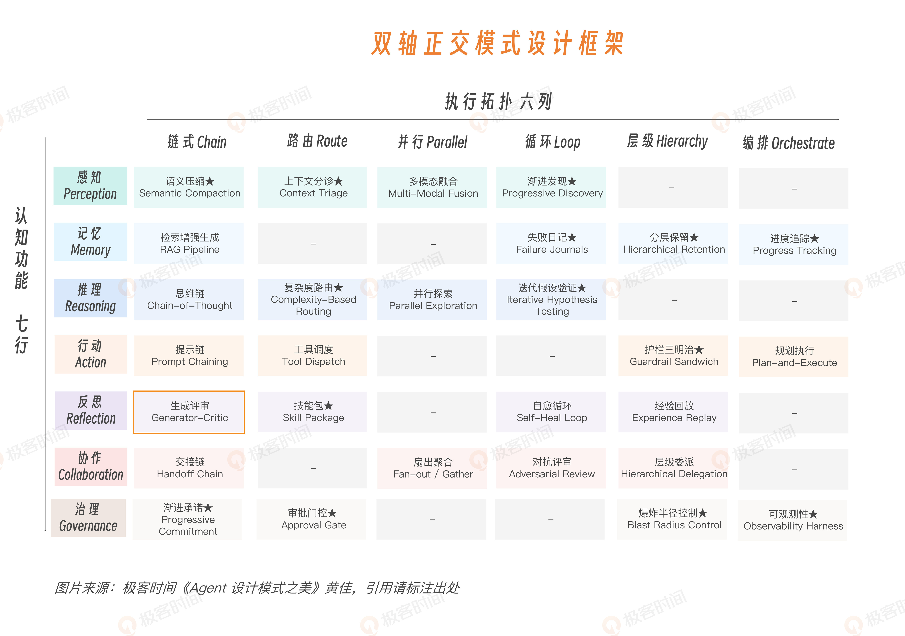
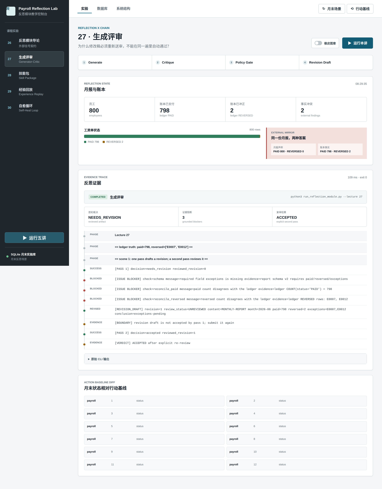
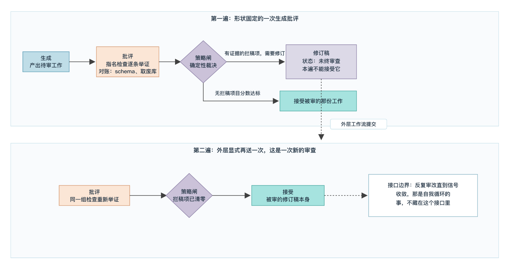
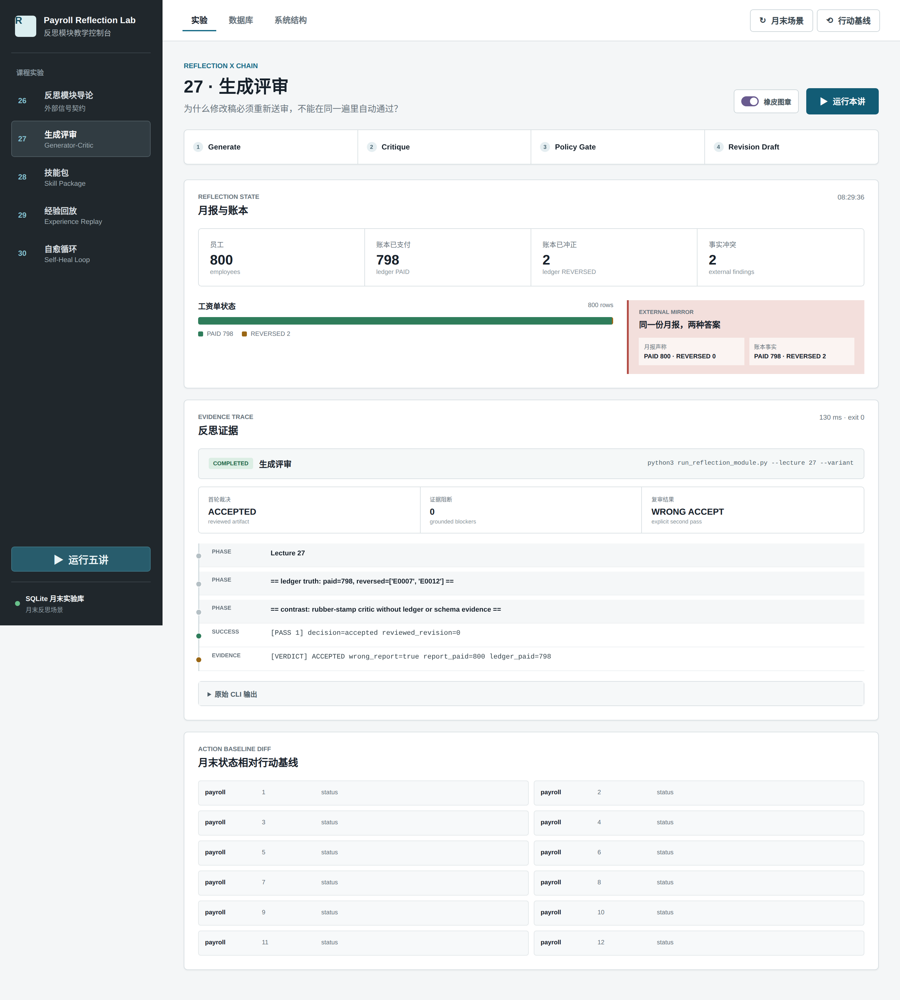

# 27 | 生成评审：让每个版本独立接受审查

- 释题：生成者提交候选版本，评审者报告问题与证据，策略闸裁决当前版本。修订器产生的是一份新的候选，它还没有接受评审。

你好，我是黄佳。

上一讲，我们把反思讲成了一条结果反馈闭环：拿到已经发生的结果，对照外部证据识别偏差，在授权范围内修改，再独立验收一次。这一讲进入闭环中最靠近验收的一段。

一份薪酬月报被对账证据退回来以后，并没有结束，还有一系列问题要解决：谁负责修改？修改以后谁负责再检查？第一遍审查原稿时得到的结论，能不能直接交给修订稿使用？评审者说“建议通过”，系统是不是就应该真的放行？

看起来这些只是流程细节，实际直接影响了检查质量。

这一讲进入反思模块的第一个具体模式：生成评审（Generator–Critic）。它位于反思行、链式列。我们先沿着一个常见的版本错误拆开接口，再打开工作台，观察两遍评审怎样为两个版本留下彼此独立的结论。

## 评审结论必须绑定具体版本

很多生成评审流程会写成下面这样：

```
feedback = critic(draft)
final = revise(draft, feedback)
return final
```

这段代码先生成原稿，再让评审者提出意见，根据意见修改，最后返回修改后的版本。问题在

```
于，评审者真正看过的是 draft，系统最后发布的却是 final。
如果审查状态只挂在 task_id 上，原稿和修订稿就会共享一枚“已经审过”的徽章。日志里确
实调用了 critic，也调用了 reviser，但最终准备发布的那份内容，反而没有被真正检查
```

过。

所以，生成评审要遵循的纪律是：评审结论回答的是“这个版本是否满足当前标准”。内容一旦改变，原结论就不能直接转给新版本。

## 四个角色，三种权限

生成评审的一次流程中通常包含四个角色：

```
生成者 -> 评审者 -> 策略闸 -> 可选的修订器
```

四个角色分别持有三类权限。

权限

- 持有者可以做什么不可以做什么

提案与修改权

- 生成者、修订器产生候选版本给自己的版本授予通过状态

观察与举证权

- 评审者报告问题、分数和证据直接改变发布状态

裁决权

- 策略闸根据规则决定通过或退回悄悄修改被审内容

这套分工与金融系统中的 maker-checker 原则很接近。Maker 负责提交交易，Checker 负责复核，但最终授权仍然来自制度和权限系统。提交者不能自己给自己盖章，检查者也不能一边提出问题，一边绕过规则直接修改生产状态。

这套结构源自 1976 年的 Fagan 软件检查，其中把作者、检查者和主持人拆成不同角色。后来，Constitutional AI、Self-Refine，以及 Anthropic 的 Evaluator-Optimizer，又把评价和修订引入了模型工作流。

ADPS 在这里做的，是把它放到“反思 × 链式”的位置，并把一次生成评审收敛成一个可以组合的最小单元：一次调用只审一个版本，只产生一次裁决。如果这一遍产生了修订稿，本轮就结束。修订稿是否再次提交，由外层流程明确安排，而不是藏在接口内部自动循环。



## 评审者没有放行权

```python
Repo 中的 Critique 只保存评审结果。
@dataclass(frozen=True)
class Critique:
   """The critic's evidence. It can report issues, never approve directly."""
   score: float
   issues: list[Issue]
   summary: str
   score_evidence: str = ""
它可以记录分数、问题、总结和评分依据，但这里没有 approve()，也没有最终的
decision。真正负责拍板的是确定性的 AcceptancePolicy。
def decide(self, critique: Critique) -> Decision:
   if self._actionable(critique.blockers()):
       return Decision.NEEDS_REVISION
   if not self.allow_warnings and self._actionable(critique.warnings()):
       return Decision.NEEDS_REVISION
   if self._score_is_actionable(critique):
       return Decision.NEEDS_REVISION
   return Decision.ACCEPTED
```

评审者和策略闸回答的是两个不同的问题。评审者回答“我发现了什么，依据是什么”；策略闸回答“按照当前规则，这些问题意味着通过还是退回”。

即使模型在评审文本中写出“建议通过”，运行时也只把它当成一条输入。真正的状态转换，仍然由策略代码完成。这样做，是为了避免让一个非确定性的模型同时掌握观察权、解释权和放行权。也就是说，评审者可以提供判断，却不能自行签发通行证。

## 证据闸不仅要看到证据，还要知道是谁检查的

```
每一个 Issue 都可以携带检查名和证据。当前接口要求两者同时存在，才把一条意见视为可
```

复核：

```python
@property
def grounded(self) -> bool:
   return bool(self.evidence.strip())
evidence 回答“检查器看到了什么”，check 回答“这条结论来自哪一道检查”。只有观察内
```

容，却说不清由哪个检查器产生，事后仍然很难复现和追责。

例如，一条意见写着：月报中的支付数量与账本不一致。如果它同时记录：

```
check=reconcile_paid
evidence=ledger COUNT(status='PAID') = 798
```

系统就知道这条结论来自哪道对账检查，也知道当时看到了什么事实。如果只有一句“报告看起来不太可靠”，却没有检查名和证据，它就只能被当作意见，而不能自动推动修改。

```
开启 require_evidence 以后，没有充分依据的问题仍然可以保存，但不能自动触发退回
```

和修订。

```
不过，早期接口曾经留下一条缝：单条 Issue 会经过证据过滤，但低于 min_score 的总分
```

却可以直接退稿。这样一来，评审者即使没有提供任何有依据的问题，只给出一个裸的低分，仍然可以绕过证据闸。

因此，现在低分本身也必须交代依据：

```python
def _score_is_actionable(self, critique: Critique) -> bool:
   if critique.score >= self.min_score:
       return False
   if not self.require_evidence:
       return True
   return bool(critique.score_evidence.strip())
```

生成者可能输出错误内容，评审者同样可能误判、漏判或空口打分，需要有系统可以复核的依

```
据。但 score_evidence 非空，也不代表依据一定正确。它只能证明评审者为低分提供了一
```

份理由，不能自动证明证据真实、数据仍然新鲜、规则版本正确，更不能证明评分器覆盖了关键风险

## 被挡住的意见不能从系统里消失

一条没有证据的意见被挡住以后，去了哪里，是一个容易被忽略的设计选择。如果系统只是在裁决时把它过滤掉，这条意见就会彻底消失。事后既看不出评审者曾经提出过什么，也看不出系统为什么没有采纳。

当前接口把没有证据的意见显式放进另一个桶：

```python
@dataclass(frozen=True)
class Critique:
   score: float
   issues: Sequence[Issue]
   summary: str
   score_evidence: str = ""
   dropped_issues: Sequence[Issue] = field(default_factory=tuple)
   def __post_init__(self) -> None:
       if not 0.0 <= self.score <= 1.0:
           raise ValueError("score must be between 0.0 and 1.0")
       all_issues = (*self.issues, *self.dropped_issues)
       grounded = tuple(issue for issue in all_issues if issue.grounded)
       dropped = tuple(issue for issue in all_issues if not issue.grounded)
       object.__setattr__(self, "issues", grounded)
       object.__setattr__(self, "dropped_issues", dropped)
```

顺着这段构造函数看，可以看到三层处理。

```
第一，分桶在 Critique 构造时完成。issues 中只保留能够复核的问题，
dropped_issues 保存全部没有充分依据的意见，两类信息都不会丢失。
```

第二，系统会把两个输入桶中的所有问题重新分类。调用者即使错误地把一条有证据的

```
BLOCKER 放进 dropped_issues，构造函数也会把它重新捡回 issues。这样可以防止上
```

游通过预先分错桶，把真正有据的问题藏起来。

```
第三，两个桶最终都会被快照为 tuple。frozen=True 只能冻结字段绑定，如果字段中仍
然放着一个可变 list，调用者仍可能在裁决以后继续追加或删除问题。换成不可变序列以
```

后，本次裁决看到的证据集合就不会再被事后修改。

```
仓库用两条测试钉住了这些边界。第一条确认无证据意见会进入 dropped_issues，并且在
```

要求证据时不能推动修订。

```python
def test_ungrounded_opinion_is_dropped_and_cannot_trigger_revision() -> None:
   opinion = Issue(Severity.BLOCKER, "the report feels thin", "body", check="vib
   critique = Critique(score=0.92, issues=[opinion], summary="one opinion")
   assert critique.issues == ()
   assert critique.dropped_issues == (opinion,)
   assert AcceptancePolicy(require_evidence=True).decide(critique) is Decision.A
   assert (
       AcceptancePolicy(require_evidence=False).decide(critique)
       is Decision.NEEDS_REVISION
   )
这里的 ACCEPTED 并不表示报告已经被证明完全正确。它只说明：
```

- 当前这条没有充分依据的意见，不能成为自动退稿的理由。

```
第二条测试确认，即使调用者把一条有据的 BLOCKER 错误放进 dropped_issues，构造过
```

程也会重新分类：

```python
def test_critique_reclassifies_grounded_items_from_dropped_input() -> None:
   blocker = grounded_blocker("paid count mismatch")
   critique = Critique(
       score=0.92,
       issues=[],
       dropped_issues=[blocker],
       summary="misbucketed input",
   )
   assert critique.issues == (blocker,)
   assert critique.dropped_issues == ()
   assert AcceptancePolicy().decide(critique) is Decision.NEEDS_REVISION
分桶结果还会进入运行轨迹。如果本轮有一条意见被丢弃，trace 中会留下：
```

```
dropped_opinions:1
```

这样，审计时既能看到评审者提出过什么，也能看到哪些意见没有进入自动裁决，以及它们为什么没有生效。

无据意见不会被删除，只是不参与本次自动放行判断。

```
需要注意，进入 dropped_issues 并不等于这条意见一定是错的。一条正确但暂时拿不出充
分证据的问题，也会进入这个桶。dropped_issues 表示的是“当前不能自动执行”，而不是
```

“已经证明错误”。

这也把上一讲的两层责任接了起来。证据闸负责决定哪些意见有资格进入当前版本的自动裁决，属于运行时验收；评审器本身是否可信、由谁校准、什么时候过期，则属于验证器治理。

## 评审者证明偏差，不必先查清根因

对账 SQL 发现：

```
账本 PAID = 798
月报 paid = 800
```

这已经是一条明确的偏差证据。它证明月报与账本不一致，却没有说明为什么不一致。

可能的原因包括使用了旧数据快照、状态映射错误、汇总逻辑漏掉冲正、上游数据延迟，或者参数绑定错误。

偏差识别与根因归因是两件事。生成评审只需要证明偏差，就可以退回当前版本。评审者不必先查清完整根因，才有资格说“这份月报现在不能发布”。

后续是否继续调查原因，要由具体任务决定。如果只需要根据权威账本修正报告数字，那么偏差证据已经足够；如果同类错误还可能继续影响后面的结算，就必须进一步调查数据源、映射关系或汇总逻辑。

把两件事分开以后，评审者只负责自己擅长的事情：对照事实，指出当前版本哪里不成立。它不必为了显得完整，编造一个尚未验证的根因。

## 修订稿为什么必须保持未评审

```python
ChainResult 会把本次真正评审过的对象，与本轮刚刚产生的新候选分开保存：
@dataclass(frozen=True)
class ChainResult:
   """Auditable output of exactly one Generator-Critic pass."""
   decision: Decision
   reviewed_artifact: Artifact
   critique: Critique
   revision_draft: Artifact | None
   trace: tuple[str, ...]
   @property
   def artifact(self) -> Artifact:
       """Compatibility view: the newest artifact produced by this pass."""
       return self.revision_draft or self.reviewed_artifact
   @property
   def requires_re_review(self) -> bool:
       return self.revision_draft is not None
这里的 decision 只属于 reviewed_artifact。如果本轮产生了 revision_draft，就
意味着出现了一份新内容；新内容存在，requires_re_review 就会变成 True。
```

业务需要复审时，由外层流程显式调用：

```
first = chain.run(f"monthly report {MONTH}")
second = chain.review(first.revision_draft)
这也解释了生成评审为什么属于链式模式。一次 pass 完成以后就结束：
```

- 接收或生成候选

```
→ 评审
→ 策略裁决
→ 可选地产生修订稿
→ 返回
接口内部没有隐藏的 while，也不会悄悄自动重试很多次。外层流程可以再次提交修订稿，
```

但每次提交都是一轮新的评审。

```
如果面对的是已经被 test、lint、build 或 CI 判坏的系统，需要不断修复，直到测试转
```

绿、触发停止条件或恢复基线，那属于第 30 讲的自愈循环。

## 有证据，还要覆盖真正的风险

```
evidence 字段回答的是“这条意见凭什么成立”，但生产系统还需要回答另一个问题：最危险
```

的错误，有没有对应的检查器？

可以把它整理成一张风险证据覆盖表。

失败面

- 评审器证据源阻断规则

一个评审者完全可能拥有真实证据，却没有覆盖真正重要的问题。例如，它指出“报告中包含标题和结论”，这条观察有证据，而且可能完全正确，但它与支付数量是否准确没有任何关系。所以，有证据，不等于风险已经被覆盖。

后面的橡皮图章实验，就会把这种情况演出来。

## 模型独立与事实独立要分开

评审独立性至少包含两个方向。

第一是事实独立，也就是评审者能否获得数据库状态、测试结果、业务规则、原始资料和外部回执。

第二是认知独立，也就是评审者是否使用干净的上下文、不同提示词、不同模型或独立人员。

配置

- 能增加什么仍然存在的盲区

同模型、同事实

- 最低成本的角色分工同源偏见和事实盲区

不同模型、同事实

- 增加第二种判断视角两个模型可能共同缺少事实

同模型、外部事实

- 能核对环境中的真实结果仍可能受到表达偏好和推理惯性影响

不同模型、外部事实

- 同时增加认知与事实独立性成本与治理复杂度更高

Panickssery 等人的研究发现，模型评分器可能偏爱自己生成的内容。确定性策略闸只能保证评审结果按照固定规则转成裁决，却不能保证模型一定能发现问题，也不能阻止模型错误分级或引用错误证据。

GitHub Copilot CLI 的 Rubber Duck 是一个现实例子。它会在计划、设计、实现和测试阶段，引入另一个模型族给出第二意见，这提高了认知独立性。但如果两个模型都没有访问

```
SQLite，它们仍然可能一起批准 800/0 的错误月报。所以跨模型不等于拥有外部事实。
```

## 从教学接口走向生产评审

```
当前 Repo 使用 Artifact.revision 表示教学版的版本身份。生产系统还需要一份正式的
```

评审回执：

```python
@dataclass(frozen=True)
class ReviewReceipt:
   artifact_digest: str
   revision: int
   critic_version: str
   policy_version: str
   evidence_snapshot_refs: tuple[str, ...]
   decision: str
   reviewed_at: str
这是一份生产设计蓝图，当前 Repo 还没有这个类。其中，artifact_digest 把回执绑定
到具体内容，revision 记录版本号，critic_version 记录使用了哪一版评审器，
policy_version 记录使用了哪套裁决策略，evidence_snapshot_refs 记录评审时看
到了哪一版事实，reviewed_at 则记录评审时间。
```

评审证据也有时间边界。上午 10 点根据账本快照签发的回执，不能自动批准上午 11 点发生冲正以后形成的新业务状态。

最终发布入口还要强制检查：准备发布的内容，是否拥有与自身内容摘要、版本和证据快照相

```
匹配的评审回执。日志里出现过一次 critic 调用，并不能证明最后发布的版本拥有自己的
```

审查资格。

上线以后，至少要观察四项指标：

- 错误放行率：已经通过的版本，后来被外部事实或人工审核判错的比例。

- 误拦率：本来合格的版本，被无效证据或过严策略错误退回的比例。

- 风险证据覆盖率：关键失败面中，已经配置有效评审器和证据源的比例。

- 版本逃逸率：最终发布版本没有匹配评审回执的比例。

通过率很高，不一定说明系统质量好，也可能说明评审者已经变成了橡皮图章。退回率很高，也不一定说明系统严格，也可能只是评审器不断制造没有价值的问题。

所以，这些指标必须与人工抽检、环境终态和真实业务结果一起看。

## 长程 Agent 容易在版本里迷路

长任务中，版本增加很容易被误判为进展。每一遍都有新内容，文字也越来越完整，Agent 因而判断自己正在收敛。但如果证据没有变化，版本数量只是在增加。

更危险的是，如果修订稿继承了旧版本的裁决，系统就会把“已经修改”误写成“已经重新验证”。

为了避免这种假进展，生成评审至少要保住四个锚点：

- 被评审版本：这一遍真正检查的是哪一份内容。

- 目标与标准：这份产出原本需要满足什么要求。

- 证据集合：本次裁决真正使用了哪些数据库记录、规则、测试和文本。

- 外层预算：最多允许再次提交多少次，什么时候停止自动修订并转交人工。

干净的评审上下文可以减少旧结论对新判断的影响，风险覆盖表可以防止评审者只盯着一个局部问题却漏掉更重要的失败面，评审回执可以阻止新版本继承旧版本的审批结果，外层预算则可以防止生成评审演变成没有终点的改稿循环。

## 生成评审和护栏是什么关系

这里使用的 SQL 对账，看起来很像第 25 讲护栏三明治中的检查。其实，同一段检查代码可以出现在不同位置，承担不同责任。

如果在动作执行以前运行，它是准入护栏：

- 检查失败

```
→ 不允许执行动作
```

如果在月报已经形成以后运行，它是评审证据：

- 检查失败

```
→ 当前版本退回修改
```

代码可能完全相同，但两者的触发时间、状态转换和责任人不同。护栏负责在行动发生前后守住边界，生成评审则负责在产出形成以后，决定当前版本能不能通过，以及是否要产生一个新的候选版本。

## 打开工作台：两遍评审怎样绑定两个

设计讲完了。现在我们动手找找体感。我们打开反思工作台，在左侧选择第 27 讲，点击“运行本讲”。实验会连续执行两遍：第一遍评审 revision 0，并生成 revision 1；第二遍把 revision 1当作新的评审对象重新提交。



- 第一遍退回原稿并产生未评审修订稿，第二遍才接受新版本

下面是第一遍评审： revision 0。

```
[PASS 1] decision=needs_revision reviewed_revision=0
  reviewed: MONTHLY-REPORT month=2026-06 paid=800 reversed=0 conclusion=all-clea
  trace: generated -> critiqued -> needs_revision -> revision_drafted
  [ISSUE BLOCKER] check=schema
     evidence=report schema v2 requires paid/reversed/exceptions
  [ISSUE BLOCKER] check=reconcile_paid
     evidence=ledger COUNT(status='PAID') = 798
  [ISSUE BLOCKER] check=reconcile_reversed
     evidence=ledger REVERSED rows: E0007, E0012
  [ISSUE INFO] check=wording
     evidence=reporting guideline R-7
  [ISSUE WARNING] check=vibe
     evidence=NONE
这里出现了三条有证据的 BLOCKER：月报缺少规范要求的字段，月报写 800 笔支付但账本实
```

际只有 798 笔，月报还遗漏了 E0007 和 E0012 两笔冲正。

```
最后一条“报告有点单薄”没有证据，因此被标记为 [DROPPED]。trace 中同时留下了
dropped_opinions:1。它出现在记录中，却没有进入裁决依据。
```

修订器随后生成 revision 1：

```
[REVISION_DRAFT] revision=1 review_status=UNREVIEWED
  content=MONTHLY-REPORT month=2026-06 paid=798 reversed=2
          exceptions=E0007,E0012 conclusion=exceptions-pending
[BOUNDARY] revision draft is not accepted by pass 1; submit it again
这里最重要的是 UNREVIEWED。第一遍真正评审过的是 revision 0。revision 1 虽然修正了旧
```

问题，却也可能带来新的问题，所以不能继承 revision 0 的评审结论。

外层流程要把 revision 1 再次提交：

```
[PASS 2] decision=accepted reviewed_revision=1
  reviewed: MONTHLY-REPORT month=2026-06 paid=798 reversed=2
            exceptions=E0007,E0012 conclusion=exceptions-pending
  trace: artifact_received -> critiqued -> accepted
  [ISSUE WARNING] check=vibe evidence=NONE
[VERDICT] ACCEPTED after explicit re-review
第二遍真正检查的是 revision 1，三条 BLOCKER 已经消失。那条没有证据的措辞意见第二遍
仍然被提出，仍然进入 dropped_issues，也仍然没有推动系统继续修改。
```

把两遍记录连起来，可以看到四件事。

- 评审者负责提交问题和证据，策略闸负责决定放行；

- 无据意见会留下痕迹，但不进入自动裁决；

- 修订稿离开第一遍时仍然是未评审状态；

- 每一个新版本都必须取得属于自己的评审结论。



- 一遍生成评审只裁决当前版本，修订稿离开本遍时仍未评审

## 对照实验：移除关键证据通道

在工作台中打开“橡皮图章”，然后重新运行。下面同样只保留与结论直接相关的字段。



- 橡皮图章保留完整链条，却因缺少关键事实通道放行错误月报

```
[PASS 1] decision=accepted reviewed_revision=0
  reviewed: MONTHLY-REPORT month=2026-06 paid=800 reversed=0 conclusion=all-clea
  [ISSUE INFO] check=surface_format
     evidence=the report contains a heading and a conclusion
[VERDICT] ACCEPTED wrong_report=true report_paid=800 ledger_paid=798
```

这个评审者并不是完全没有证据。它确实发现报告包含标题和结论，这条证据是真实的。问题在于，它与工资支付数量是否正确没有关系。

橡皮图章实验是一组消融测试。它保留了生成者、评审者、策略闸和完整调用链，只撤掉了与账本和字段规范相连的证据通道。关键事实一旦消失，错误月报马上被放行。所以，生产系统中要关注真正的问题就是最危险的失败面，有没有对应的评审器？

这里要补充一条实验边界。当前 Lab 中的数量差异可以通过聚合查询发现，但面对上一讲开

```
篇所说的补偿性错误——一名员工多发、另一名员工少发，人数和总额都完全对上，COUNT
```

和总额检查都可能通过。这时必须改用按员工主键对齐的逐条验收器，让证据覆盖对应的失败面。

## 总结一下

这一讲把生成评审拆成了四个角色和三种权限。生成者与修订器负责产生候选版本，评审者负责报告问题、分数和证据，策略闸负责决定当前版本通过还是退回。评审结论绑定具体版本，修订稿不能继承原稿的通过状态。

证据闸同时约束单条问题和总分。一条问题要参与自动裁决，不仅要说明看到了什么，还要说

```
明来自哪一道检查。没有充分依据的意见不会被删除，而是进入 dropped_issues 留痕。
```

构造阶段还会重新检查两个桶中的所有问题，避免调用者通过错误分桶藏起有据问题；随后把问题集合冻结为不可变序列，防止裁决完成以后继续修改证据。但有证据仍然不等于评审完整。系统还要检查这些证据是否覆盖业务中的关键失败面。

```
在薪酬实验中，revision 0 因三条有证据的 BLOCKER 被退回。revision 1 先以 UNREVIEWED
状态离开第一遍，经过显式复审以后才获得 ACCEPTED。对照组保留了完整的生成、评审和
```

裁决流程，却移除了账本和字段规范对应的事实通道，于是错误月报获得放行。这说明：调用过评审者，不等于完成了有效评审。

重要的是，检查的是否是最终发布版本、评审意见是否可以复核、无据意见是否留下记录、证据是否覆盖关键业务风险以及最终放行是否由独立策略决定。

长程 Agent 还要始终保住四个锚点：本次评审的具体版本、原始目标和成功标准、本次裁决实际使用的证据，以及允许再次提交的次数和人工接管条件。版本数量只能说明发生过多少次修改，是否真正接近目标，仍然要由新的结果证据回答。

## 思考题

1. 你的评审者输出的是观察和证据，还是直接拥有放行权？这两种责任能否在代码中分开？

2. 最终准备发布的产出，与真正接受评审的产出，是不是同一个版本？修改以后，新版本处于什么评审状态？

3. 阅读理解题：文中所设计的“证据闸”解决的是“空口无据打分”问题，还是“拿错证据打分”问题？还是同时解决了这两个问题。

4. 为你的业务列出三个高风险失败面。每一个失败面由哪个评审器检查，证据来自哪里？

5. 一条没有充分证据的评审意见被策略忽略以后，系统是否仍然需要保存它？

期待你在留言区分享你的想法，如果这节课对你有启发，别忘了分享给身边更多朋友。

## 下一讲预告

下一讲进入技能包模式。一份月报通过复审，只说明这一次产出取得了放行资格。一次跑通的流程准备进入下个月的能力路由，还要经历候选、验证、晋级、复用反馈和降级。

我们下一讲见。

## 参考资料

1. Fagan. Design and Code Inspections to Reduce Errors in Program Development. IBMSystems Journal,1976.

2. Bai et al. Constitutional AI: Harmlessness from AI Feedback.2022.

3. Madaan et al. Self-Refine: Iterative Refinement with Self-Feedback. NeurIPS 2023.

4. Panickssery et al. LLM Evaluators Recognize and Favor Their OwnGenerations.NeurIPS 2024.

5. Anthropic. Building Effective Agents.2024-12-19.

6. Anthropic. Demystifying Evals for AI Agents.2026-01-09.

7. Anthropic. Harness Design for Long-Running Application Development.2026-03-24.

8. GitHub. GitHub Copilot CLI Combines Model Families for a Second Opinion.2026-04-06.

9. GitHub. Rubber Duck in GitHub Copilot CLI Now Supports More Models.2026-05-07.

10. GitHub. Copilot CLI: Improved UI, Rubber Duck, Prompt Scheduling, and VoiceInput.2026-06-02.
