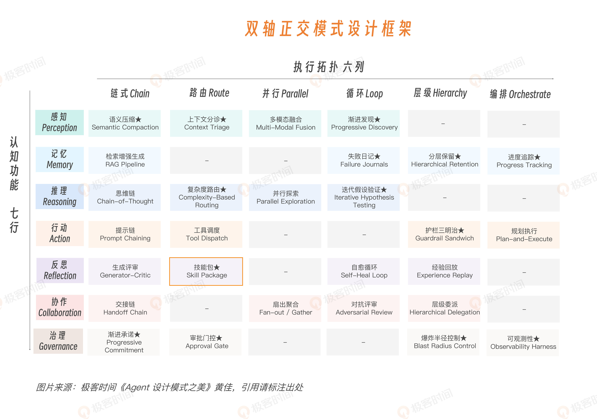
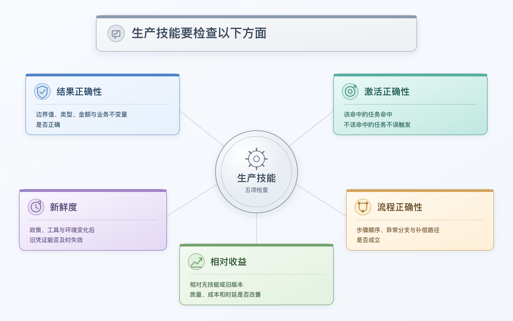
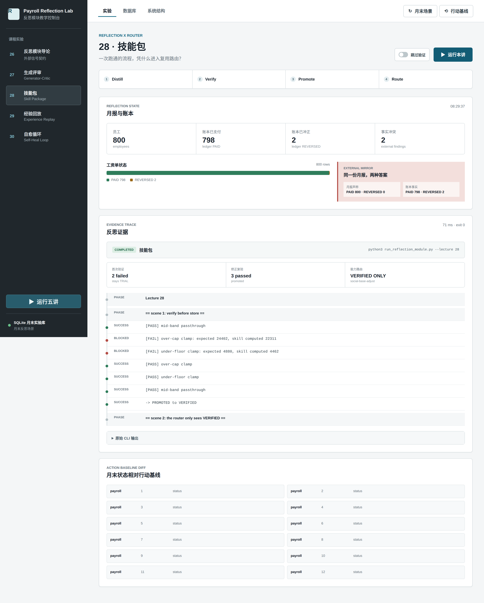
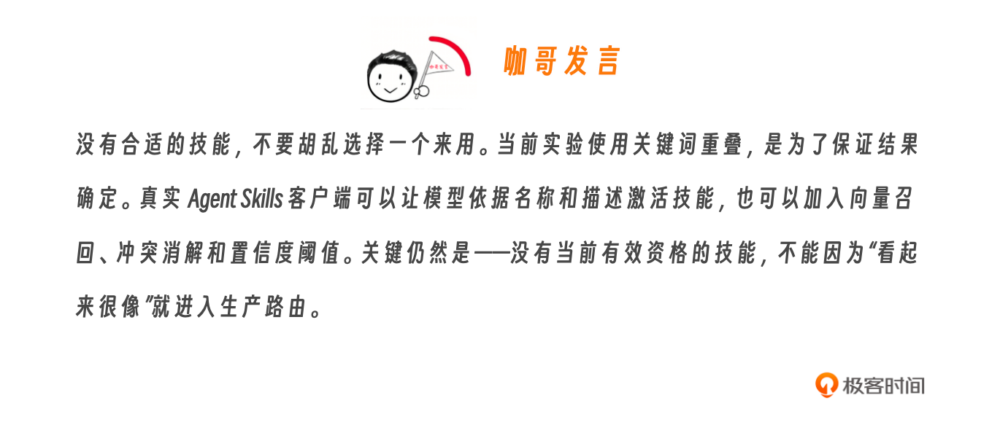
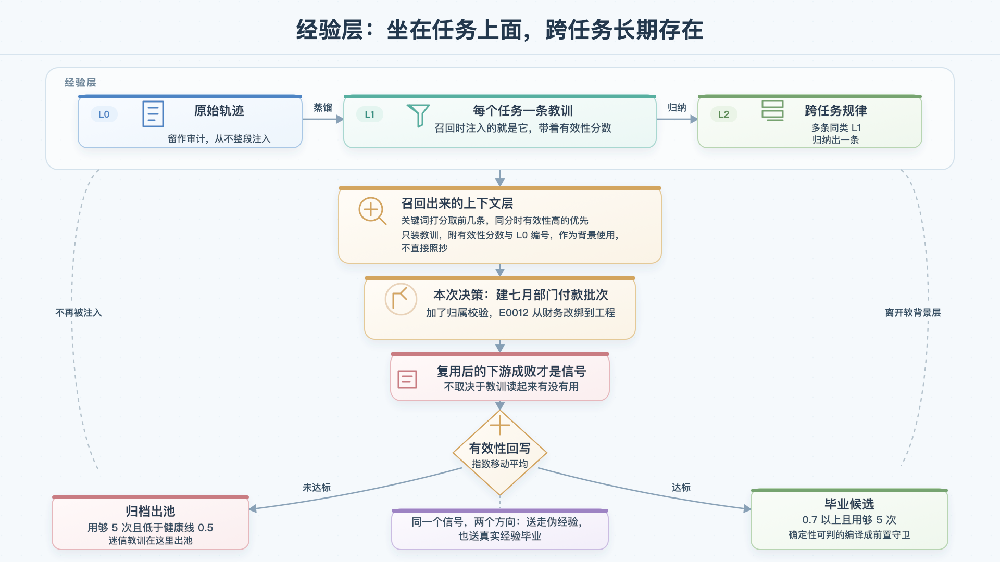
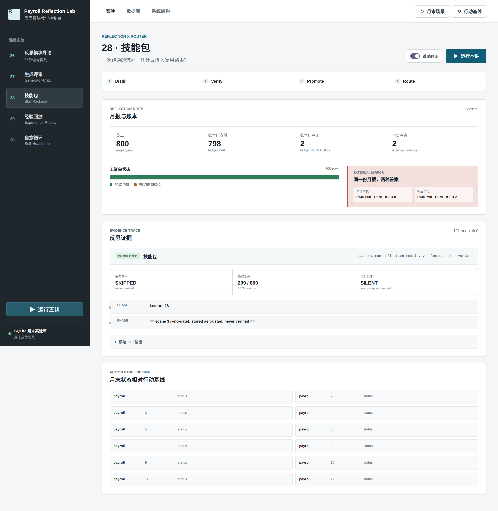

# 28 | 技能包：从成功轨迹到可验证能力

- 释题：技能包把已经跑通的方法整理成可以重复使用的能力。但一次成功只能产生候选技能。候选通过独立验证，取得当前有效的调用资格以后，路由器才能把新任务交给它。

你好，我是黄佳。

上一讲中的错误月报经过批评、修订和显式复审，终于取得了放行资格。到了七月，再遇到同一类结算任务，Agent 还要不要重新找工具、重新排步骤、重新处理那些已经遇到过的边界条件？

如果每次都从头开始，那么上一轮虽然完成了任务，却没有给系统留下可以复用的能力。最自然的做法，是把这次跑通的方法整理成一个技能。以后遇到相似任务，Agent 可以直接发现并调用它。

但风险也随之改变了。

一份月报写错，影响的通常只是当前这份产出。一套带着错误假设的技能一旦进入正式路由，就会被一次又一次调用。错误不会只发生一次，而会随着复用不断扩大。所以，把成功经历保存下来并不难。真正困难的是怎样证明这个技能并不平庸、以后仍然值得被调用，而且在新场景中，也仍然能正常运行。

这一讲进入反思模块的第二个模式：技能包（Skill Package）。它位于反思行、路由列。



我们沿着两条线来讲：

- 第一条线，把一次经历整理、验证并发布成能力；

- 第二条线，在新任务到来时发现、选择并调用这项能力。

最后我们还是会打开工作台，从六月结算走到七月复用，看看一次成功怎样真正取得调用资格。

## 什么才算技能包

工具、知识、SOP 和技能包经常被混在一起。

构件

- 主要回答

工具（Tool）

- 能执行哪个原子动作

知识库（Knowledge Base）

- 当前判断依据哪些事实

SOP / 工作流

- 一类工作按什么顺序完成

技能包（Skill Package）

- Agent 何时加载哪套做法，它凭什么仍可使用

```
一个 calculate_social_base() 函数是工具。
```

- 社保基数上下限属于知识。

- “先读取政策、 再截断基数、最后对账”可以写成一份 SOP。

技能包比这些还要多走一步，它还要回答发现、依赖、验证、路由和退出。这里说的技能包，是工程化模式，范围比某一种目录格式更宽。技能包是一份可以被发现、按需加载和执行的方法。它有明确版本和适用边界，经过独立验证，由运行时决定是否调用，复用后的结果还会反过来影响它的资格。

```
SKILL.md 可以用来携带技能说明，脚本、参考资料和资产也可以放进技能目录。Agent
```

Skills 的目录格式解决技能怎样被携带和按需加载，但一个技能能不能进入生产能力库，仍然需要系统管理它的验证证据、调用权限、依赖状态和生命周期。

## 发布与调用是两条管线

技能包看起来是一个目录，系统中实际运行着两条管线。

第一条是能力发布管线：

```
轨迹收集 -> 候选蒸馏 -> TRIAL -> 验证 -> 晋级、降级或退役
```

它管理发布权，即一种做法能不能成为公共能力？谁可以提名候选技能，什么证据足以让它进入正式路由，政策和依赖发生变化以后怎样撤销旧资格，都属于这条管线。

第二条是运行时调用管线：

```
任务进入 -> 技能发现 -> 路由选择 -> 按需加载 -> 受控执行 -> 结果回写
```

它管理调用权，即当前任务应该调用哪一个已经获得资格的技能？当前 Agent 能看见哪些能力，哪个技能与任务匹配，没有合适技能时怎样明确回退，都属于这条管线。

两条管线需要分开。能力发布管线负责把一次经历变成候选能力，再通过验证决定它能否获得生产资格，并在后续表现下降或环境变化时撤销资格；运行时调用管线负责在新任务到来以后，从当前有效的技能中发现、选择、加载和执行合适能力，再把执行结果写回。在两条管线中，蒸馏器可以提出候选，验证器负责签发资格，路由器只消费当前有效的资格。这样，一次成功经历就没有机会自己给自己颁发生产通行证。

这也解释了技能包为什么落在反思 × 路由的交点。

发布管线体现的是反思：系统回看过去的成功轨迹，把它整理成候选技能，再用外部结果决定这项能力能否晋级、是否需要降级或退役；调用管线体现的是路由：新任务到来以后，系统要从已经取得资格的技能中选择一个合适的能力执行。

技能发现、按需加载和受控执行都是运行时调用管线的一部分；其中真正决定“这次任务交给哪个技能”的，是路由这一步。因此，技能包内部可以采用分层加载，也可以使用不同的发现机制，但这个模式在执行拓扑上的核心仍然是从多个可用能力中做一次选择。

## 从程序性记忆到 Agent Skills

把经验整理成“遇到某类情况，就执行一组动作”，并不是大模型时代才出现的想法。

Newell 和 Simon 的产生式系统，已经使用条件和动作表达规则。ACT-R 又进一步区分了两类知识：

- 陈述性知识回答“知道什么”；

- 程序性知识回答“怎样做”。

2023 年的 Voyager 会把在环境中学到的程序保存到技能库，供后续任务检索和使用。

```
Agent Skills 则提供了一种开放的技能目录格式。一个技能至少包含 SKILL.md，还可以携带
```

脚本、参考资料和其他资产。它采用渐进式披露：

- 启动时只加载技能名称和描述；

- 任务命中以后再读取正文；

- 脚本和资料在真正需要时再打开。

这样可以减少上下文成本，但格式本身不会自动证明一个技能是正确的。

Hermes Agent 把技能称为程序性记忆，并会在复杂任务成功后，建议保存这套做法。当前Repo 借用了这条思路：只有成功而且具有一定复杂度的轨迹，才值得被提名为候选技能。同时增加工具种类门槛，过滤过于琐碎的流程。

SKILL-DISCO 则进一步从多条成功轨迹中提取可参数化的控制流，再编译成可以调用和验证的技能。

这些工作共同说明了成功轨迹只是制作技能的原材料。真正能够稳定复用的，是经过参数化、验证和版本管理的技能制品。

## 成功轨迹先成为技能的候选

一次成功证明这套方法在当时的输入和环境中走通了。它能不能成为公共能力，还要看换一个时间、换一批输入、换一个环境以后，关键条件是不是仍然成立。因此，Repo 中的蒸馏接口明确要求来源轨迹已经成功，但返回的仍然只是候选技能：

```python
def distill_from_trace(task: str, tool_calls: list[dict[str, Any]],
                      name: str, description: str, triggers: list[str],
                      *, succeeded: bool,
                      min_calls: int = 5, min_unique: int = 3) -> Skill | None:
   """Hermes-inspired distillation trigger: only a successful trace with
   enough distinct tool calls is worth freezing into a skill. The
   returned skill is TRIAL — distillation earns storage, never trust."""if not s
       return Noneif len(tool_calls) < min_calls:
       return Noneif len({c.get("tool") for c in tool_calls}) < min_unique:
       return None
```

以前的注释写着“只蒸馏成功轨迹”，接口却没有明确的成功标志，调用者仍然可能把失败轨迹

```
传进来。现在，succeeded 成了明确输入，来源任务也会保存到 source_task 中。即便通
过了这层筛选，新技能仍然处于 TRIAL。
```

调用次数多、使用工具种类多，只能说明这条轨迹不算太简单，不能证明它可以跨任务稳定复用。这里的 5 次调用和 3 种工具，只是为了让教学实验保持确定，不是通用的技能蒸馏标准。

一条成功轨迹通常混着三类内容：

1. 可以跨任务复用的稳定步骤；

2. 当前任务独有的日期、ID、路径和租户状态；

3. 这一次碰巧没有暴露出来的隐藏假设。

```
后面实验中的fetch_policy:2025就属于第三类。它在六月能够跑通，不代表七月仍然正
```

确。多轨迹抽取、参数归一化和留出任务验证，都是为了把真正稳定的做法，从偶然条件中分离出来。

## 验证通过以后，技能才进入路由

我们的教学 Repo 把技能状态压成三类：

```python
class SkillStatus(str, Enum):
   TRIAL = "TRIAL"          *# stored, not routable*
   VERIFIED = "VERIFIED"    *# passed all golden questions, routable*
   RETIRED = "RETIRED"      *# evicted, kept for audit*
```

它们可以理解为：

```python
TRIAL：已经保存，但还不能接生产任务；
VERIFIED：已经通过当前验证，可以被路由器选择；
RETIRED：已经退出使用，但记录仍然保留，方便审计。
任何技能进入技能库时，状态都会被重置为 TRIAL：
def add(self, skill: Skill) -> Skill:
   """Every skill enters as TRIAL — human-written or distilled.
   The badge comes from verification, not from authorship."""
   skill.status = SkillStatus.TRIAL
   self.skills[skill.name] = skill
   return skill
即使技能是人写的，也不能直接获得 VERIFIED。作者身份可以被记录下来，但“谁写的”和
```

“能不能用于生产”是两个不同问题。生产调用资格仍然要由外部验证决定。

Repo 使用所谓的“黄金题（Golden Questions）”来提供确定性的输入和期望结果：

```
GOLDENS = [
   GoldenQuestion("over-cap clamp", {"declared": 30000}, 24402),
   GoldenQuestion("under-floor clamp", {"declared": 4000}, 4880),
   GoldenQuestion("mid-band passthrough", {"declared": 12000}, 12000),
]
```

你可以把黄金题理解成技能的验收用例，其中包含边界值；已知正确样例；对账结果；必须成立的结构断言。正确答案应当来自业务规则、确定性测试或人工确认，不能由被测技能自己生成。

这仍然对应上一讲的两层责任：黄金题判断当前技能是否通过验收；谁维护黄金题、题目是否覆盖充分、什么时候该更新，属于验证器治理。

## 重新验证时，旧资格要先撤销

假设一个技能去年通过了验证，今年新增了一道边界题。系统不能让它一边继续接任务，一边

```python
慢慢等待新的验证结果。因此，复验一开始，旧的 VERIFIED 资格就会先被撤销：
def verify(self, name: str, goldens: list[GoldenQuestion],
          runner: RunnerFn) -> VerificationReport:
   skill = self.skills[name]
   skill.status = SkillStatus.TRIAL
   skill.verified_against = []
   report = VerificationReport(skill=name)
   ...
   if goldens and not report.failed:
       skill.status = SkillStatus.VERIFIED
       skill.verified_against = [g.name for g in goldens]
       skill.use_count = 0
       skill.success_count = 0
       report.promoted = Truereturn report
```

只有新一轮验证全部通过以后，系统才重新签发调用资格。这带来三个结果：

- 空验证集不能保留旧资格；

- 复验失败以后，路由器立即看不到这项技能；

- 新资格会重新开启一段复用观察窗口。

最后一点也很重要。如果新版本继续使用旧版本积累的成功与失败数据，就可能出现两种误判：

```
新技能刚转正，就被旧版本的失败记录拉回 TRIAL；
```

- 新技能明明表现变差，却被旧版本积累的高成功率长期掩护。

所以，新版本、新验证和新复用记录必须分开。

## 验证状态必须绑定版本与环境

一句“这个技能已经验证过了”，信息其实不够完整，更完整的说法是：

```
技能版本 v
在验证集 e、政策快照 p、工具契约 t、运行环境 r 下
于时间 d 通过验证
也就是说，VERIFIED 不是一个技能的固定属性，而是技能版本与一组外部条件之间的关
```

系。政策、Schema、 工具权限、模型或运行器发生变化，这段关系都可能失效。

生产系统可以把验证结果签成一份能力凭证。（下面这段是设计蓝图，尚未在我的 Repo 中完整实现）：

```
@dataclass(frozen=True)class SkillCredential:
   skill_digest: str
   skill_version: int
   suite_version: str
   policy_snapshot: str
   tool_contract_digest: str
   runner_version: str
   issued_at: datetime
   expires_at: datetime | None
```

一项技能能够进入路由，至少应同时满足：

- 可路由

```
= 已通过验证
 ∩ 环境兼容
 ∩ 来源可信
 ∩ 权限允许
 ∩ 凭证仍有效
```

教学 Repo 主要实现了第一项，也就是“通过验证才能进入路由”这一项。其余条件目前只体现

```
在 SkillCredential 设计蓝图中，Repo 尚未实现，路由器也没有消费这份凭证。等这条
```

签发与校验链补齐后，系统才能回答“我依据哪一版验证结果，调用了哪一版技能”。（你可以尝试补全这个设计。）

## 复用结果会反过来调整资格

技能入库前，可以依靠黄金题。真正进入路由以后，还要继续观察它在真实任务中的表现：

```python
def record_use(self, name: str, success: bool) -> Skill:
   skill = self.skills[name]
   if skill.status is not SkillStatus.VERIFIED:
       raise ValueError("only VERIFIED skills can record routed outcomes")
   skill.use_count += 1if success:
       skill.success_count += 1if (skill.use_count >= self.min_uses
           and skill.success_rate < self.demote_below):
       skill.status = SkillStatus.TRIAL     *# must re-verify*return skill
```

只有拥有有效资格，而且真正被路由器选中的技能，才能记录复用结果。达到一定样本数量以

```
后，如果成功率低于阈值，技能会被撤回 TRIAL，等待重新验证。一次复用是否成功，应该
```

由对账一致、审批完成、测试转绿、用户采纳或人工确认等外部结果判定。

```
Agent 说“我执行成功了”，仍然只是叙事态。success=False 只能说明这次复用没有达到预
```

期，却不能自动说明原因。至于原因是技能逻辑失败、上游数据错误、依赖不可用、环境变化还是路由选错，属于归因，要再查一步才能分开。

```
生产系统还需要保存复用结果回执，至少绑定 task_id、skill_digest、
credential_id、外部结果和证据引用。否则，一次失败可能被记到错误的技能版本上。
```

## 生产验证要覆盖五个方面



除了上面列出的三道黄金题之外，生产技能至少还要检查五个方面。

1. 结果正确性：边界值、类型、金额和业务不变量是否正确

2. 激活正确性：该命中的任务命中，不该命中的任务不误触发

3. 流程正确性：步骤顺序、异常分支和补偿路径是否成立

4. 相对收益：相对无技能或旧版本，质量、成本和时延是否改善

5. 新鲜度：政策、工具和环境变化后，旧凭证能否及时失效

Agent Skills 的官方评测指南建议同一任务分别运行有技能与无技能版本，或比较新旧技能，形成基线。每次运行使用干净上下文，并记录输出、断言、时延和 token。

确定性规则通常可以一次验证。包含模型判断的端到端技能，则要重复运行，观察成功率、波动和失败分布。

## 机械状态守住业务边界

东方屹腾团队早期把 SaaS API 描述成工具，再在技能里写清调用顺序，希望模型按照自然语言步骤完成任务。

而实际运行中，Agent 仍然会出现跨过步骤、漏掉步骤、拿错上一步生成的业务对象等问题。后来，参数的产生、消费和来源进入了统一状态平面。

技能仍然负责说明怎么做，而结构化运行时负责保存业务对象 ID；租户；版本；权限；参数绑定。

这给技能包补上一条重要边界：技能可以描述业务做法，业务不变量不能只靠叙事文本维持。

例如：“先创建快照，再导入薪资组，失败时恢复快照”可以写进技能。快照 ID 属于哪个租户、 来自哪次调用、当前步骤能否消费，则要由机械状态和执行器保证。

## 技能加载要纳入软件供应链治理

技能可以携带脚本、Shell 命令、参考资料和资产。加载技能，相当于给 Agent 接入 一段新的程序性行为。

Agent Skills 客户端指南提醒，项目级技能可能来自刚克隆的不可信仓库。因此，客户端在加载技能之前，需要判断项目是否可信，避免仓库静默向上下文中注入危险指令。技能规范中的

```
compatibility、metadata 和 allowed-tools 等字段，可以帮助描述兼容性和工具边
```

界。格式验证工具则可以检查目录和 Frontmatter 是否符合规范。但是要注意这类格式校验只能说明技能包装得像一个技能，不能代替前面讲的业务结果验证。

企业技能至少要记录：

治理项

- 要回答的问题

来源

- 谁或哪些轨迹生成了它

- 依赖哪版政策、工具、模型和 Schema

版本与依赖

权限

- 会读取、写入和调用什么

验证证据

- 哪套评测在哪个环境通过

停用能力

- 出现风险时怎样暂停、降级或退役

开放格式让技能更容易迁移，也让危险脚本更容易传播。互操作性越强，信任边界就越要清楚。

## 上线以后看什么

技能库里有多少技能，不代表系统有多少可靠能力。更值得观察的是下面四类指标。

1. 验证结果：多少技能通过了验证，失败主要集中在哪些题目和边界上。

2. 激活效果：应该调用时能否命中，不该调用时会不会误触发，没有合适技能时能否明确回退。

3. 真实增益：与无技能或旧技能相比，质量、成本和时延是否真的改善。

4. 复用与过期情况：不同技能版本的真实成功率如何；政策和工具变化以后，旧资格多久能够被发现并撤销。

这些指标没有统一健康线。报表排版和付款技能的错误代价完全不同，阈值要与风险、可逆性和人工复核能力一起设定。

## 打开工作台：一次成功怎样取得调用资格

打开反思工作台，选择第 28 讲，点击“运行本讲”。这次实验固定候选技能、员工数据、任务文本和计算代码，只改变一件事：技能有没有经过验证闸。

```
标准组先把候选保存为 TRIAL，验证通过以后才允许进入路由。
对照组跳过验证，直接把候选标成 VERIFIED，然后观察这条带有旧政策的流程会影响多
```

- 少条模拟计算。



教学夹具中，六月的结算轨迹被标记为成功。它包含六次调用、四种工具，具备沉淀成候选技能的复杂度。但技能第一步把当时使用的政策版本直接写进了流程：

```
fetch_policy:2025
候选技能先以 TRIAL 状态保存进技能库，随后通过黄金题申请调用资格。验证通过后才晋级
为 VERIFIED，进入生产路由。
```

候选技能接着通过三道黄金题（Golden Questions）申请调用资格的转正：

```
== scene 1: verify before routing ==
  distilled from June's trace: steps[0] = fetch_policy:2025
     [PASS] mid-band passthrough
     [FAIL] over-cap clamp: expected 24402, skill computed 22311
     [FAIL] under-floor clamp: expected 4880, skill computed 4462
  -> stays TRIAL, not routable
中间值通过了，但上下边界两道题失败。因此，技能继续留在 TRIAL，路由器看不到它。
把第一步从fetch_policy:2025改为 fetch_policy:2026，版本加一，再跑同一组题：
fix one step: fetch_policy:2025 -> fetch_policy:2026, re-verify
  [PASS] over-cap clamp
  [PASS] under-floor clamp
  [PASS] mid-band passthrough
-> PROMOTED to VERIFIED
这一次三道题全部通过，技能才获得 VERIFIED 资格。
```

为什么中间档输入一直通过？因为 12000 没有碰到政策上下限，两版 mock 政策都会得到相同结果。只有高于上限和低于下限的边界题，才能暴露技能中写死的年份假设。

```
教学代码为了缩短实验，直接修改同一个 Skill 对象的第一步，再把版本号加一。但生产系
```

统则不应该原地修改正式技能。更稳妥的做法是：

1. 发布一个新的不可变技能版本；

2. 保留旧版本和旧验证回执；

3. 新版本通过验证；

4. 再原子地把路由别名切换到新版本。

这样可以避免并发任务读到一份半新半旧的技能。

- 咖哥发言：这里的政策数字和“七月切换版本”都是教学设定，不对应任何城市的真实社保政策。实验要观察的是一条当时成功的轨迹，可能携带只在当时成立的条件。

## 路由器只接收当前有效的能力

技能晋级后，工作台进入第二幕：

```
== scene 2: the router only sees VERIFIED ==
  library: social-base-adjust     status=VERIFIED
  library: settlement-hotfix      status=TRIAL
  route('2026-07 settlement social base adjust contribution recalc')
     considered: [('social-base-adjust', 1.0)]
     matched: social-base-adjust
settlement-hotfix 的触发词与当前任务有较多重合，但它处于 TRIAL，因此根本不会进
```

入候选集合：

```
for skill in self.skills.values():
   if skill.status is not SkillStatus.VERIFIED:
       continue
```

没有合适技能时，路由器返回显式回退：

```
route('year-end bonus special payout')
  matched: None, fallback: from_scratch
```

“这类任务还没有可用技能”是一条很有用的运行信号。如果路由器悄悄挑一个看起来相近的技能顶上，就会把能力不足伪装成正常执行。





## 对照实验：跳过验证以后发生了什么

在工作台中打开“跳过验证”，然后重新运行。



```
== scene 3 (--no-gate): stored as trusted, never verified ==
  route matched: social-base-adjust (steps[0] = fetch_policy:2025)
  evaluated all 800 employees against 2025 bounds:
  209 contribution bases computed wrong in simulation. Every step
  reported success; nothing in the run knows the policy year rolled over.
  No computed value is written back and no payment is triggered.
```

标准组与变体组使用同一批员工、同一个任务和同一段计算代码。变体只撤掉验证闸，因此，两组结果的差异可以归因到能力准入。

在对照组中，旧政策技能被直接放进路由，最终有 209/800 条模拟计算出错。但技能执行中的每一步都报告成功。工具没有报错，程序没有崩溃，调用链也完整走完。整条流程只是使用了错误年份的政策。旧年份已经写进程序性步骤。运行时甚至不需要再次询问模型。即使模型知

```
道现在是 2026 年，也不会自动把技能中的fetch_policy:2025改掉。
```

这正是技能风险和普通回答错误不同的地方，错误一旦被固化进程序性能力，就可以在没有模型再次判断的情况下稳定传播。209/800 是固定夹具与 mock 政策下的模拟计数。程序没有写回 SQLite，也没有触发付款。

因此，实验结论是：每一个步骤都成功返回，仍然可能整条流程执行了错误规则。

## 总结一下

第 28 讲处理的是一个很实际的问题：怎样把一次成功经历变成可以反复调用的能力，同时避免把当时的偶然条件一起固化下来。工作台里的旧年份流程能通过普通输入，却在上下边界上失败，这正是成功轨迹仍需独立验证的原因。

技能包因此分成两条管线。能力发布管线负责候选、验证、晋级、降级和退役。运行时调用管线只在当前有效的能力中选择，没有合适技能就留下明确回退。

```
在教学 Repo 里，所有技能都先以 TRIAL 保存，全部黄金题通过以后才取得 VERIFIED 资
```

格。生产系统还要把这份资格绑定到技能版本、验证集、政策快照、工具契约和运行环境，并让真实复用结果继续校准它。

这样，技能目录负责携带程序性知识，能力凭证负责说明当前能否调用，机械状态负责守住对象、版本、顺序和权限。三者各管一层，技能复用才不会变成旧流程的自动扩散。

## 思考题

1. 找一条团队反复使用的 Prompt、SOP 或脚本。它距离真正的技能包，还缺少发现、验证、版本、权限和退出机制中的哪几项？

2. 为一个真实技能设计三道结果题和两道激活题。其中有几道真正碰到了业务边界？

3. 一个技能昨天通过了验证，今天依赖的 API Schema 发生了变化。系统怎样撤销旧资格，又怎样阻止并发任务继续调用旧版本？

4. 在你的业务中，哪些做法可以写进技能？哪些对象 ID、版本、步骤顺序和权限必须进入结构化执行平面？

期待你在留言区记录想法，也欢迎你把这节课分享给更多有需要的朋友。

## 下一讲预告

技能包适合保存相对稳定、可以执行的做法。但还有一些教训尚未成熟到能封成技能，却也有可能影响下一次决策。

下一讲进入经验回放。系统会在新任务开始前召回相关经验，再把复用后的真实结果写回经验池。真正有帮助的教训靠战绩留下，未经验证的迷信则逐渐降权和退出。我们下一讲见。

## 参考资料

1. Newell & Simon. Human Problem Solving. Prentice-Hall, 1972.

2. ACT-R Research Group. ACT-R 6.0 Reference Manual.

3. Wang et al. Voyager: An Open-Ended Embodied Agent with Large Language Models.2023.

4. Anthropic. Equipping Agents for the Real World with Agent Skills. 2025-10-16.

5. Agent Skills. Specification.

6. Agent Skills. Evaluating Skill Output Quality.

7. Agent Skills. How to Add Skills Support to Your Agent.

8. Hermes Agent. Skills System.

9. Guo et al. SKILL-DISCO: Distilling and Compiling Agent Traces into ReusableProcedural Skills. 2026-06-25.
