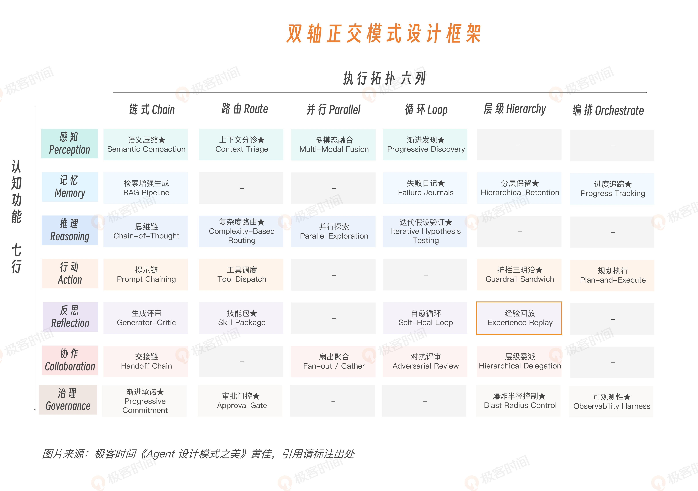
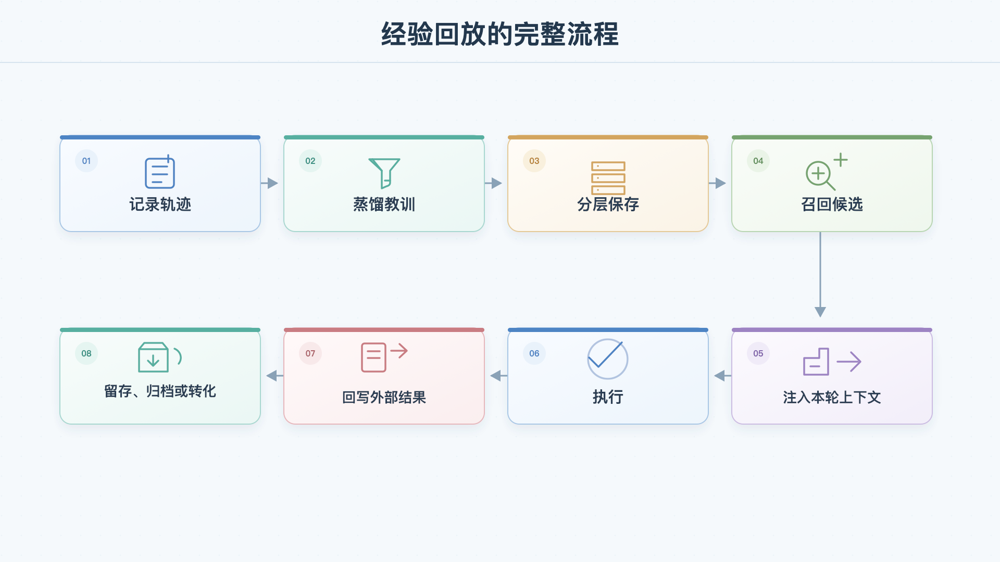
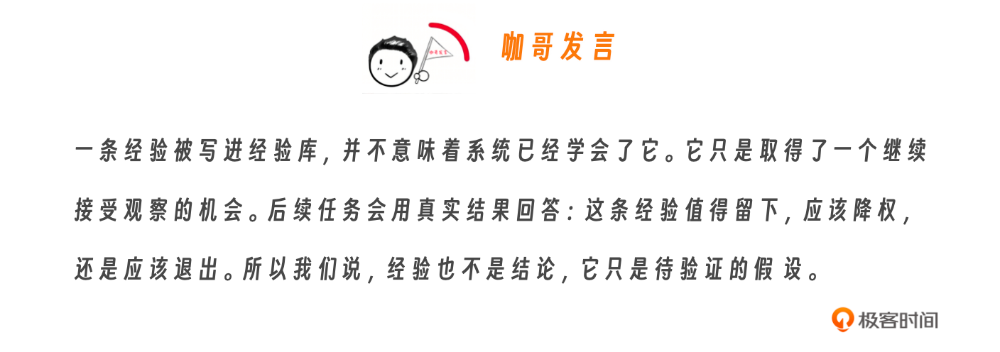
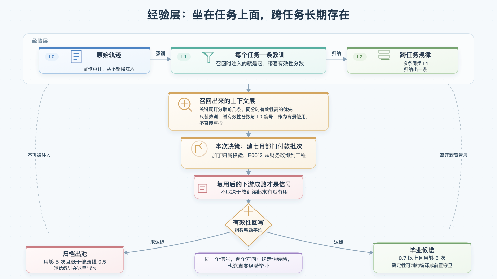
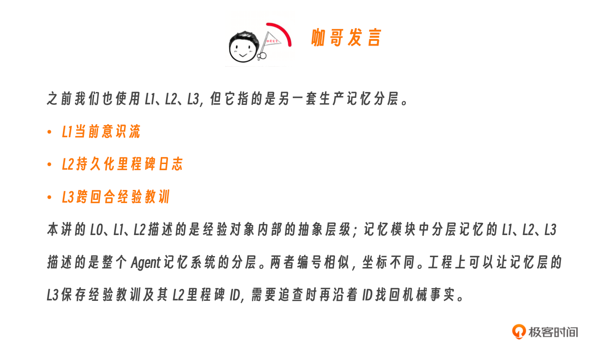
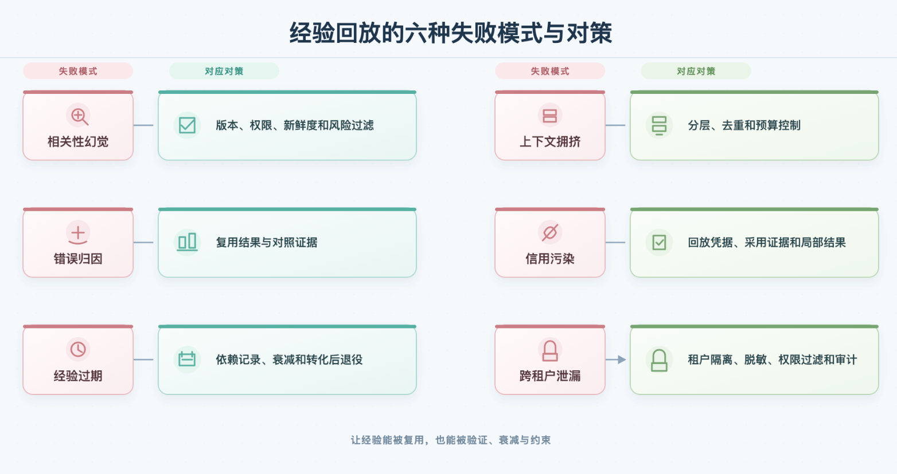
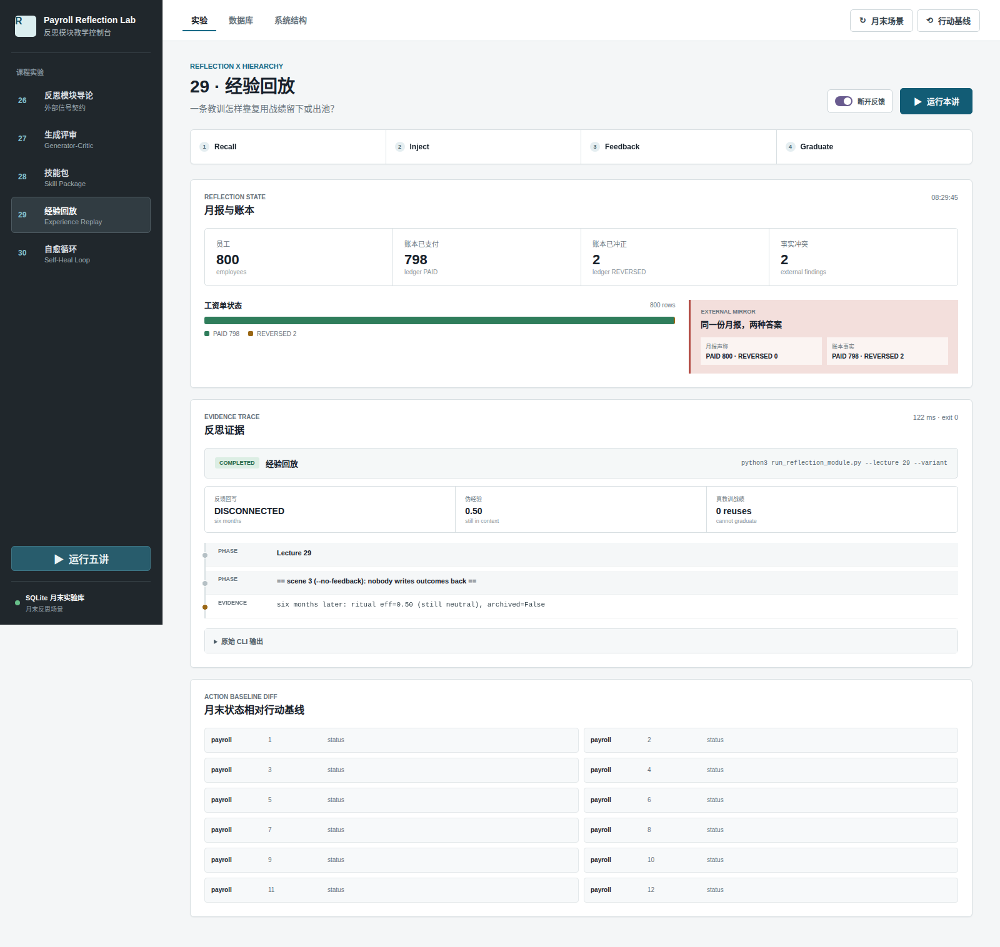
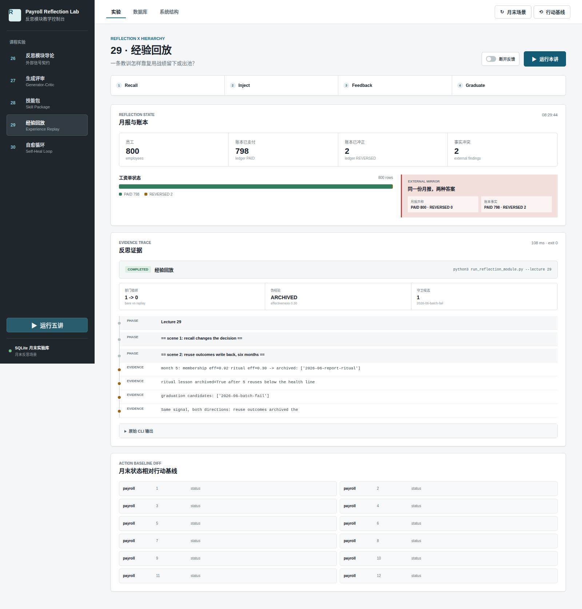

# 29 | 经验回放：让经验在复用中持续校准

- 释题：经验回放把过去的轨迹整理成可追溯的经验，在新任务开始前召回，作为当前决策的背景。一条经验能不能长期留下，要看它是否真的被采用，以及采用以后有没有改善结果。

上一讲技能包模式中，我们把一条跑通的流程整理成候选技能，再用黄金题决定它有没有资格进入正式路由。技能包适合保存相对稳定、可以命名、可以执行，也能够独立验证的做法。

但不是所有经验都已经成熟到能封装成技能。比如六月结算以后，团队留下这样一句提醒：

```
把员工绑进部门付款批次以前，先按 HR 记录核实当前部门。
```

这就是专家头脑中的隐形知识的一种体现形式，不一定是一套完整流程，也不一定能封装成工具直接调用。它就像一位做过这件事的同事，在你准备动手时提醒一句：“这里上个月出过问题，先核一下。”

到了七月，Agent 再次处理部门付款批次，它怎样在正确的时候想起这句话？想起来以后，它有没有真的照着做？任务最后成功了，又凭什么说这条经验立了功？

要回答这些问题，就需要我们把保存、召回、采用和结果回写四件事拆开，再用六月到七月的部门归属实验，看一条历史教训怎样进入当前任务，又怎样靠后续表现决定自己的去留。这个思路背后对应的模式，就是经验回放（Experience Replay），它位于反思行、层级列。



## 经验回放怎样形成闭环

1992 年，Long-Ji Lin 在论文 Self-Improving Reactive Agents Based on ReinforcementLearning, Planning and Teaching 中提出，应该把过去经历保存下来，在后续学习中重新采样；2015 年，DQN 让经验回放成为深度强化学习中的经典机制。

到了 LLM Agent，回放从训练样本进入了推理上下文。AgentRR 会记录轨迹、抽象经验，再在相似任务中回放；CER 把经验积累进动态记忆缓冲区，在推理时检索和合成，不要求重新训练模型。后续研究还进一步把失败轨迹重标为训练数据，或者把“从经验中学习”本身训练成一种能力。

技术载体在变化，工程难题没有变化。过去我们问的是“旧样本重新训练以后有没有改善策略”，今天则要问“旧经验进入上下文以后有没有改变当前动作”。无论训练时还是推理时，真正难的都不是存下历史，而是确认它有没有被使用，以及结果该不该算到它头上。

因此，经验回放是一种跨任务反思。系统把过去的执行轨迹保存下来，从中提炼出教训；新任务到来时，再召回相关经验，装进本轮上下文。任务完成以后，系统还要把外部结果写回经验池，调整这条经验的可信度和生命周期。

经验回放的完整流程是：记录轨迹→ 蒸馏教训→ 分层保存 → 召回候选 → 注入本轮上下文 →执行 → 回写外部结果→ 留存、归档或转化。



它之所以位于层级拓扑，是因为经验跨任务长期存在，位于当前任务上方，为当前决策提供背景。任务结束以后，结果回写经验层，它影响的是下一次召回，并不会重新触发当前任务，也不会在本轮内部形成无限循环。



- 咖哥发言：一条经验被写进经验库，并不意味着系统已经学会了它。它只是取得了一个继续接受观察的机会。后续任务会用真实结果回答：这条经验值得留下，应该降权，还是应该退出。所以我们说，经验也不是结论，它只是待验证的假设。

## 真实经历也可能产生错误归因

经验回放需要优先处理一种风险：把时间上的先后误当成因果关系，然后从真实经历中得出错误结论。

我们结合例子来理解，设想经验库里保存了这样一句话：

```
June closed clean because the report was exported twice before paying.
```

- 六月结算顺利，是因为付款前把报表导出了两遍。

六月确实导出了两遍报表，也确实完成了结算。两件事都发生过，然而因果关系却没有被证明。

佳哥把这种经验叫作迷信经验（Superstitious Experience）。它不是一条凭空编造的假记录，而是把时间上的先后、同时发生或者个人习惯，误写成了因果关系。

这种经验很难靠阅读发现。它有真实轨迹、有具体动作，也能讲出一套完整故事。把它和“付款前先核实员工当前部门”放在一起，两条都像认真复盘后的结论，光看文字很难判断哪条真正有用。

下面代码中把这条错误归因保存成了一项普遍适用的经验（注意这是一个反面教材）：

```
superstition = store.record(Experience(
   exp_id="2026-06-report-ritual",
   task_kind="monthly-report",
   outcome="success",
   lesson="June closed clean because the report was exported twice "
          "before paying (mis-attributed cause)",
   keywords=["report", "monthly", "export", "settlement"],
))
```

把它记下来没有问题。问题在于，系统不能因为它来自一次成功任务，就直接把它当成长期规律。一条经验被召回得多，可能只是因为关键词常见，也可能是排序机制偏爱它。它能不能留下，要看复用后有没有稳定改善结果。

```
因此，代码把两个数字分开记录：retrieval_count 表示它被召回了多少次，
reuse_outcomes 表示它进入后续任务以后，任务结果如何。即使一条经验被召回一百次，
```

只要没有采用证据，也没有结果改善，它仍然没有证明自己的价值。

## 三层经验：越往上越容易复用，越往下越容易追查

当前 Repo 使用 L0、L1、L2 表达经验对象内部的三个抽象层级。

层级

- 保存内容是否直接进入上下文

L0

- 简化的原始步骤与轨迹来源否，只保留引用

层级是为了同时解决两个相反的问题：如果每次召回都把完整轨迹塞进 Prompt，上下文很快会被历史淹没；如果只保存一句没有出处的摘要，系统又会失去追查能力。

所以，L0 保存证据来源，L1 保存可以进入当前任务的单次教训，L2 保存经过多次任务归纳出来的稳定规律。越往上，表达越短、越容易复用；越往下，信息越具体、越容易审计。

```python
Repo 中的 Experience 表示一条 L1 经验。下面保留关键字段：
@dataclass
class Experience:
   exp_id: str
   task_kind: str
   outcome: str
   lesson: str
   keywords: list[str]
   steps: list[str] = field(default_factory=list)
   retrieval_count: int = 0
   reuse_outcomes: list[bool] = field(default_factory=list)
   effectiveness: float = 0.5
   archived: bool = False
   hard_guard_eligible: bool = False
lesson 负责进入上下文，steps 在教学实现中保存一份简化轨迹。生产系统通常不会把完
```

整事件复制到每一条经验里，而是把原始事件保存到不可变的 Trace Store，在经验中只留下轨迹 ID，需要审计时再沿着 ID 取回。

```python
def render(self, hits: list[Experience]) -> str:
   """The context block the current task runs under. Lessons only —
   L0 steps stay in the store, referenced but not pasted."""
render() 只把 L1 和 L2 的摘要装进上下文，L0 原始步骤继续留在存储层，通过引用回查。
```

摘要负责控制上下文成本，轨迹引用负责保留证据来源。



- L0、L1、L2 位于当前任务上方，下游结果回写经验层



## 经验回放的三道关卡：召回、采用、归因

经验回放上线以后，容易把三个不同问题混淆。

- 相关经验有没有被召回

```
召回以后有没有被 Agent 采用
```

- 任务结束以后，结果能不能归到这条经验

这三步分别是召回、采用和信用分配。任何一步缺失，经验库都可能看起来花团锦簇，实际上没有学到东西。我们逐个来看。

第一关：召回以后还要做准入过滤

相关，不等于可以进入当前任务。教学 Repo 使用关键词重叠做确定性召回。下面节选候选排序的核心逻辑：

```python
def retrieve(self, task: str) -> list[Experience]:
   words = set(task.lower().split())
   scored = []
   for e in self.entries.values():
       if e.archived:
           continue
       kw = {k.lower() for k in e.keywords}
       score = len(words & kw) / len(kw)
       if kw else 0.0if score > 0.0:
           scored.append((score, e))
   scored.sort(key=lambda t: (t[0], t[1].effectiveness), reverse=True)
```

相关度相同时，有效性更高的经验排在前面。这个设计既能让教学实验稳定复现，也让历史复用结果参与后续的召回排序。

生产系统不能只看语义相似，还要继续过滤：

- 任务相关度经验有效性政策与工具版本租户与数据权限新鲜度与失效时间当前任务风险等级

另一家企业的薪酬经验、旧政策下的操作、依赖已经下线工具的教训，即使语义很像，也不应该直接进入当前上下文。召回只能产生候选，版本、权限和风险过滤决定哪些候选真正获得进入本轮任务的资格。

RAG 也在做检索，但两者取回的对象不同。

- RAG

对比项

- 经验回放

主要对象

- 事实、文档和证据历史做法、失败与教训

核心治理

- 来源、版本和引用采用、复用结果和生命周期

典型问题

- 这条事实从哪里来这条经验复用以后有没有用

二者可以共用向量库、检索器和重排器，但不能因此混成同一种记忆。RAG 关心事实是否可靠，经验回放还要关心一条做法是否真正改善了后续任务。

第二关：进入 Prompt，不等于被采用

系统可以准确记录哪些经验被召回，也可以记录哪些文字被写进 Prompt，但模型有没有真的照着做，当前 Repo 还不能完整回答。

```
retrieval_count 统计的是曝光次数，不是采用次数。经验出现在上下文里，只说明
```

Agent 有机会看到它，不能说明它改变了计划或动作。

生产系统需要一张回放凭据（Replay Receipt），把召回到执行之间的路径留下来。下面是设计蓝图，当前 Repo 还没有这个统一类型：

```python
@dataclass(frozen=True)
class ReplayReceipt:
   run_id: str
   candidate_ids: tuple[str, ...]
   injected_ids: tuple[str, ...]
   applied_ids: tuple[str, ...]
   action_evidence: tuple[str, ...]
   bundle_version: str
   outcome_ref: str | None
candidate_ids 记录哪些经验进入过候选，injected_ids 记录哪些经验真正进入上下
文，applied_ids 记录哪些经验改变了计划或动作，action_evidence 则指向工具调
```

用、字段读取或者决策差异。

本讲实验里，比较强的采用证据是动作轨迹中真的多出了一次 HR 当前归属检查，随后 E0012从 Finance 改绑到了 Engineering。

模型的自我报告可以作为线索，不过还不能作为唯一证据。真正可靠的采用记录，应当落在可观察的计划变化和动作差异上。

第三关：任务结果还要分配到具体经验

当前 Repo 使用指数移动平均（EMA，Exponential Moving Average，给予近期数据更高权重）来更新经验有效性。关键反馈逻辑的代码实现如下：

```python
def feedback(
   self,
   injected: list[Experience],
   downstream_success: bool,
) -> list[str]:
   archived = []
   for e in injected:
       if e.archived:
           continue
       e.reuse_outcomes.append(downstream_success)
       signal = 1.0 if downstream_success else 0.0
       e.effectiveness = 0.7 * e.effectiveness + 0.3 * signal
       if e.reuses >= MIN_REUSES and e.effectiveness < HEALTH_LINE:
           e.archived = True
           archived.append(e.exp_id)
   return archived
```

这一步把判断权从“Agent 觉得这条经验有用”，移到了后续任务的外部结果，已经比纯自评前进了一大步。但它仍然有一个明显边界：传入的每条经验都会拿到同一个任务结果。

如果一次任务同时注入五条经验，最后成功了，五条经验都会加分。系统暂时分不清哪条被真正采用，哪条只是同场出现，哪两条甚至互相冲突。

把任务级结果分配到具体经验，叫作经验信用分配（Experience Credit Assignment）。说得直白一点，就是“这次成功，功劳到底该记给谁”。

一次任务成功还是失败，可以由外部结果判断；成功应不应该归到某条经验，还要结合采用证据、对照实验和局部结果继续分析。我们的演示实验中，是把部门归属经验和报表仪式分别送入各自的确定性反馈序列。生产实现中则要逐步补齐下面三类证据：

1. 采用证据：计划和动作是否真的落实了这条经验。

2. 对照证据：有经验与无经验，或者不同经验包之间，结果相差多少。

3. 局部结果：与这条经验对应的步骤、字段和约束是否真的改善。

样本很少时需要积累证据，复用结果可以逐步提高可信度。

## 反馈既会淘汰经验，也会推动能力转化

反馈有两个方向。长期无效、已经过期或者只是在制造噪声的经验，需要被归档；持续有效，并且能够转化成确定性机制的经验，则应该离开软 Prompt，进入更稳定的能力形态。

Repo 把“是否可以变成确定性检查”写成一个明确字段：

```
hard_guard_eligible: bool = False
graduation_candidates() 同时检查四项条件。这表示进入能力转化候选，还不代表已
```

经发布到生产系统。

```python
def graduation_candidates(self) -> list[Experience]:
   return [e for e in self.entries.values()
           if not e.archived
           and e.hard_guard_eligible
           and e.effectiveness >= 0.7and e.reuses >= MIN_REUSES]
```

一条经验要成为动作前守卫候选，需要满足：

- 仍在有效经验池明确可以编译成确定性检查有效性达到转化门槛复用次数达到最低门槛

“把员工绑进部门批次以前，先核实 HR 当前归属”可以写成机械检查。因此，当它积累了足够复用证据以后，就可以成为第 25 讲护栏三明治 PRE 阶段的候选。进入守卫以后，系统不再依赖模型每次想起并遵守这句话，而是由运行时强制执行。

经验成熟以后，还可能去往其他方向。

成熟形态

- 适用条件去向

稳定的多步做法

- 可执行、可验证、可反复调用技能包

确定性的禁区或前置条件

- 可以写成机械断言硬守卫

- 知识库或 RAG

稳定的业务事实

- 需要查询、引用和版本管理

过期或长期无效

- 复用效果差，环境已经变化归档

所以，经验池不是知识的终点，而是软知识的试验场。未经充分证明的教训先留在这里接受复用检验；真正成熟以后，再进入技能、守卫或者知识库。转化仍然要经过对应模式自己的测试、审批和发布流程。

## 反馈规则本身也需要校准

经验回放使用有效性 EMA、健康线和转化门槛，判断一条经验应该留下、归档，还是进入能力转化。问题是，这些数值本身并不是自然规律。

```
为什么 EMA 是 0.7/0.3？为什么健康线是 0.5？为什么至少复用五次才能归档或毕业？这
```

些值都要根据业务风险、结果延迟、样本量和误判代价来定。

这正好承接第 26 讲中运行时验收与验证器治理的区别。有效性分数回答“这条经验在最近几次任务中表现如何”，属于运行时记账；健康线、EMA 系数和转化门槛如何设置，则属于

```
ValidatorPolicy 那一层，需要有人持续校准。
```

阈值过松，错误经验会长期占用上下文；阈值过紧，有效经验还没积累足够样本，就可能被提前归档。经验库需要新陈代谢，但不能把新陈代谢做成随意淘汰。

我们曾把 Agent 记忆分成当前意识流、持久化里程碑和跨回合经验层。当前任务只加载最小必要经验，完整业务事实继续保留在数据库和业务系统中。这个分工对经验回放尤其重要。

E0012 的员工编号、当前部门和租户状态，属于机械真值，应该从 HR 系统实时读取。经验层

```
只应该提醒 跨部门批次开始以前，要核实员工当前归属。如果把 E0012 属于
Engineering直接固化成长期经验，时间一长，旧状态就会被当成当前事实。经验回放不但
```

没有减少错误，反而把过期状态稳定地带进了后续任务。

因此经验负责提醒查什么，机械状态负责回答现在是什么。叙事态帮助模型理解局面，机械态提供当前事实。经验层越丰富，越不能把会变化的业务状态写成永久教训。

## 上线以后的观察指标

生产系统至少要把召回、采用和结果三段分开记账。比较值得观察的指标有五组：

1. 召回精确率与采用率。

2. 相对无经验基线的回放增益。

3. 按任务、版本和时间窗口观察的有效性。

4. 过期发现时延与上下文成本。

5. 能力转化、撤销和回滚率。

单看召回次数，会奖励那些关键词常见、经常出现的经验；单看最终成功，会奖励所有碰巧与成功任务同场出现的经验。两者都不能替代采用证据和对照结果。

下面的列表中给出了经验回放的六个常见失败模式，也就是注意事项。



失败模式

- 主要对策

相关性幻觉

- 版本、权限、新鲜度和风险过滤

错误归因

- 复用结果与对照证据

经验过期

- 依赖记录、衰减和转化后退役

上下文拥挤

- 分层、去重和预算控制

信用污染

- 回放凭据、采用证据和局部结果

跨租户泄漏

- 租户隔离、脱敏、权限过滤和审计

经验条目不断增加，不代表系统能力也在增加。只有当经验能够被正确召回、留下采用证据、接受外部结果检验，并且拥有退出机制时，经验库才不会变成一个越来越大的历史意见堆。

## 打开工作台观察：召回是否改变了当前决策

这个实验要看的，就是 Agent 能不能把“上次吃过的亏”带到这一次任务里，并且通过后面一次次真实结果，慢慢分清哪些经验真有用，哪些只是碰巧。

工作台把员工数据、HR 当前部门、七月任务和批次构建代码全部固定，只改变一个条件：这次任务开始前，要不要把六月留下的经验拿回来。这样前后两次结果如果不同，我们就能比较清楚，经验有没有真正影响这次行动。

打开反思工作台，选择第 29 讲，点击“运行本讲”。

```bash
cd agent-design-patterns
uv run --extra ui python reflection/payroll-lab/web_app.py
浏览器进入 http://127.0.0.1:8766。
```



第一遍不读取六月经验：

```
== scene 1: recall changes the decision ==
  bare run: 800 employees bound into 5 batches
  mis-bound (stale department, totals still balance): ['E0012']
```

程序运行得很顺，800 名员工都进入了 5 个付款批次，人数和总金额也全部能对上。但E0012 仍然按照旧数据被分到了 Finance，而 HR 中最新的部门已经是 Engineering。也就是说，这次任务没有报错，账也对平了，但业务上仍然做错了一件事。

第二遍运行前，系统先把六月留下的经验找回来：

```
with replay -- the context layer this run executes under:
  ## Relevant past experience
  - [failure] before binding an employee into a department batch,
    verify current membership against the HR record
    (teaching trace: E0012 transferred after June's rollback)
  - [heuristic] [cross-dept-batch] recurring lesson across 3 runs:
    verify current membership against the HR record
  Use as background. Adapt, don't copy.
membership check: E0012 re-routed Finance -> Engineering
mis-bound: []
```

这一次，Agent 在分配付款批次之前，多做了一步 HR 当前部门检查，于是发现 E0012 已经从 Finance 调到了 Engineering，并把它放进正确的批次。

所以现在我们证明了：经验不能只是被检索出来，还得真正改变这一次的做法。这里我们能够看到明确的行动变化——系统多做了一次部门检查，最终也避免了错绑。这比“Agent 说自己参考了历史经验”要可靠得多。

一次有效，还不能说明它永远有效

接下来再问第二个问题：一条经验这次帮上忙了，能不能马上把它当成长期规律？

也不能。一次成功很可能有偶然性，所以实验会继续观察几个月。

Lab 固定了两组教学结果：

```
batch_outcomes = [True, True, True, True, True, True]
report_outcomes = [True, False, True, False, False, True]
```

第一条经验是“绑定部门批次以前先查 HR 当前归属”。它连续六次都带来了正确结果。第二条经验则是“付款前把报表导出两遍”，这句话来自一次真实成功经历，但后面几个月有时成功、有时失败，看不出“导出两遍”真的起了什么作用。

系统把这些后续结果持续记回来：

```
month 1: membership eff=0.65   ritual eff=0.65
month 2: membership eff=0.75   ritual eff=0.45
month 3: membership eff=0.83   ritual eff=0.62
month 4: membership eff=0.88   ritual eff=0.43
month 5: membership eff=0.92   ritual eff=0.30
        -> archived: ['2026-06-report-ritual']
month 6: membership eff=0.94   ritual eff=0.30
```

第一个月，两条经验看起来一样好，都是 0.65。随着使用次数增加，差别才逐渐显现出来。“先查当前部门”不断得到正面结果，有效性一路升到 0.94；“报表导出两遍”则忽高忽低，第五次以后降到 0.30，最终被系统归档。

这就是这里真正想说明的事情：一条经验写进库里的时候，还只是一个待观察的判断。后面一次次真实使用，才慢慢告诉系统它值不值得继续相信。

```
注意：这里的 0.7/0.3 EMA、健康线 0.5 和至少复用 5 次，都只是为了方便教学演示；
```

- 真实系统要根据业务风险、样本量和结果出现的速度重新设定这些数字。

如果只记经验，从来不看后来发生了什么

最后再把“结果回写”关掉，看会怎样。



CLI 的关键输出如下：

```
== scene 3 (--no-feedback): nobody writes outcomes back ==
  six months later: ritual eff=0.50 (still neutral), archived=False
  month 7 context still contains:
     - [success] June closed clean because the report was exported
       twice before paying (mis-attributed cause)
  membership lesson: reuses=0, eff=0.50
  so it can never qualify to graduate into a guard either.
```

六个月以后，“报表导出两遍”仍然停在初始的 0.50。系统不知道它有没有用，所以第七个月还在继续把这句话拿出来。真正有价值的“先查当前部门”也停在 0.50，因为没有后续结果，它同样无法证明自己长期可靠，更没有资格进一步变成一个强制检查规则。

这就是经验库很容易出现的一种“假学习”：每天都在保存新经验，每次任务也能检索出一堆旧经验，看起来系统知道得越来越多，但它从来没有问过一句——这些经验后来到底帮上忙了吗？

如果没有这一步，好经验和坏经验会一起堆在库里。坏经验退不出去，好经验也长不大。时间越久，经验库越容易变成一堆谁也说不清是否有效的历史句子。

所以完整的经验回放应该是：

```
想起经验 → 放进当前任务 → 真的照着做 → 看任务结果 → 判断这条经验有没有帮助 → 决定下次还要不要继
```

用前面的工程术语写，就是：

```
召回 -> 注入 -> 采用 -> 执行 -> 外部结果 -> 信用分配 -> 生命周期更新
```

- 咖哥发言：你真正需要记住的，其实就是三句话：想起来了吗？照着做了吗？做了以后真的更好吗？三件事都能回答，经验库才开始具有学习能力。只做到“想起来”，最多算一个会查历史记录的系统。

## 经验回放如何回答反思契约

反思契约中我们提出了六个问题，现在回顾一下经验回放模式提供的答案。

- 第 29 讲的答案

问题

反思谁

- 一条带来源和版本的经验

回到哪里

- 当前任务的原始目标和成功标准

拿什么对照

- 采用后的下游结果、局部动作证据和对照基线

允许改变什么

- 后续任务的经验上下文、召回排序和生命周期状态

- 下一次复用的外部结果；一次 EMA 更新只是记账，不代表经验

改完怎样验收

- 已经通过

- 单次任务结束即停止，本次结果只影响后续召回；经验被误归档时，原始轨迹和 reuse_outcomes 仍可按 ID 取回复核，再由人

何时停止、回到哪里

- 工决定是否恢复

回忆一下第 26 讲反思模块的导论中，还曾经留下了一个不在六问之内的责任：验收器本身由谁维护（可以看成是对反思的反思）。有效性 EMA、健康线和转化门槛也是经验回放中的“镜

```
子”。这些值应该定在哪里、多久重新校准一次，属于 ValidatorPolicy ，并不属于单条经
```

验的有效性分数。

经验回放会跨月演化，却不会在当前任务中无限重试。这正是它位于层级拓扑，而不是循环拓扑的原因。

## 总结一下

经验回放把过去的教训放到当前任务上方，让过去的经验在新任务中继续接受检验。L0 保存轨迹和证据来源，L1 保存单次任务教训，L2 保存跨任务规律；摘要进入上下文，完整证据按引用回查。

召回负责找到候选，采用证据说明经验有没有改变计划或动作，信用分配再来判断后续结果是不是真正和这条经验相关。缺少这些环节，反思并不彻底，经验也不那么可靠。

工作台中，部门归属经验让 E0012 从旧部门改绑到当前部门；经过六个月的确定性结果，迷信式的报表仪式被归档，可以机械判断的归属检查则进入守卫候选。断开反馈以后，两种变化都不会发生：错误经验退不出去，有效经验也长不大。

经验负责提醒应该查什么，当前事实仍然由机械状态系统提供。相似性决定一条经验有没有机会进入候选，采用证据和复用结果决定它有没有资格继续留下。经验不是一旦写进库就成为真理，而是一条带着出处、等待后续任务继续验证的假设。只有写入、没有结果回写的经验库，不是学习系统，只是一面越来越长的意见墙。

## 思考题

1. 检查你们团队现有的复盘文档。哪些记录只是经常被大家提起，哪些已经有复用后的结果证据？

2. 找一条“我们一直这样做”的团队口诀。怎样设计一个最低成本的对照，判断它是有效经验，还是从真实经历中长出来的错误归因？

3. 一次任务同时注入五条经验并成功完成。你会保存哪些动作和局部结果，避免给五条经验全部记满分？

4. 选择一条已经比较成熟的经验。它更适合转成技能、硬守卫、知识，还是继续留在软背景层？你的判断依据是什么？

期待你在留言区和我交流探讨，深入思考能让你对这讲内容理解更深刻。

## 下一讲预告

经验回放让过去进入今天，却不会在当前任务失败以后自动修复系统。

下一讲是反思模块的收官：自愈循环（Self-Heal Loop）。当薪酬脚本在确定性测试中变红，Agent 要诊断失败、提出补丁、限制改动范围、重新验证，并在没有进展或风险升高时恢复安全基线。自愈循环的重点会从“经验怎样留下”，转向“修复怎样停下”。我们下一讲见。

## 参考资料

- Lin, L.-J. Self-Improving Reactive Agents Based on Reinforcement Learning, Planning andTeaching. Machine Learning, 1992.

- Mnih, V. et al. Human-level control through deep reinforcement learning. Nature, 2015.

- Sumers, T. et al. Cognitive Architectures for Language Agents. 2023.

- Shinn, N. et al. Reflexion: Language Agents with Verbal Reinforcement Learning.NeurIPS 2023.

- Feng, E. et al. Get Experience from Practice: LLM Agents with Record & Replay. 2025.

- Liu, Y. et al. Contextual Experience Replay for Self-Improvement of Language Agents.2025.

- Ding, L. AgentHER: Hindsight Experience Replay for LLM Agent Trajectory Relabeling.2026-03.

- Ferraz, T. P. et al. Retrieval-augmented LLM agents: Learning to learn from experience.2026.

- Shalev, Y. et al. Training Language Agents to Learn from Experience. 2026-05.
