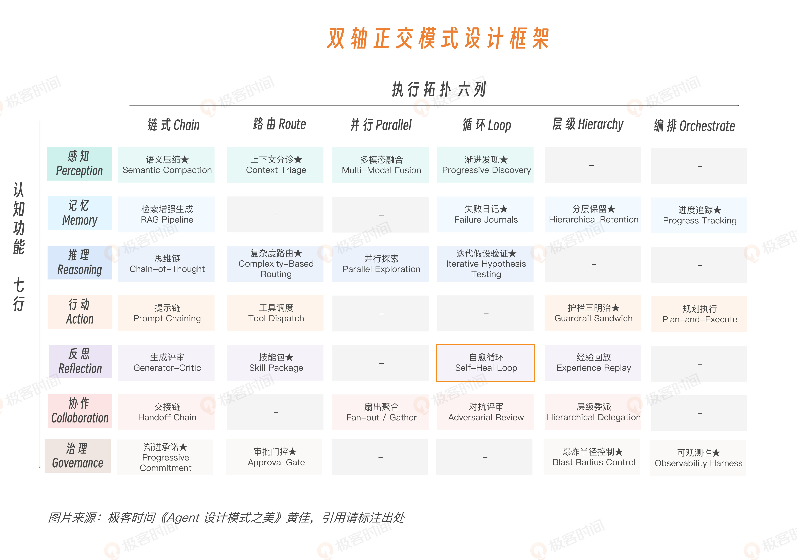
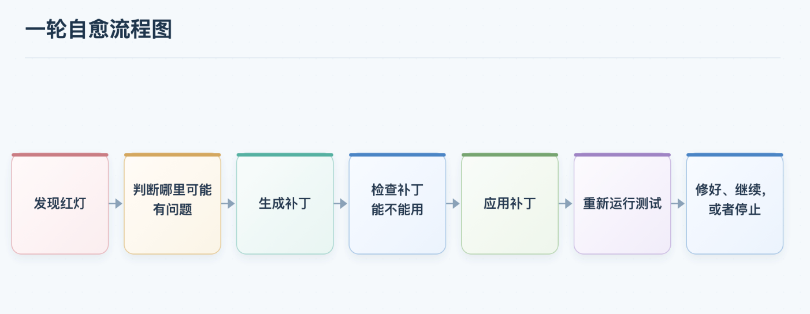
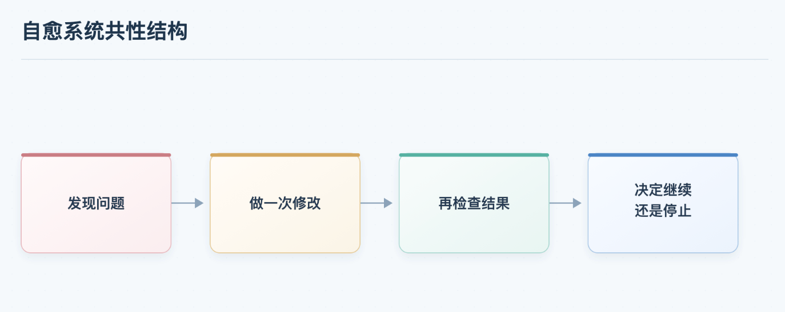
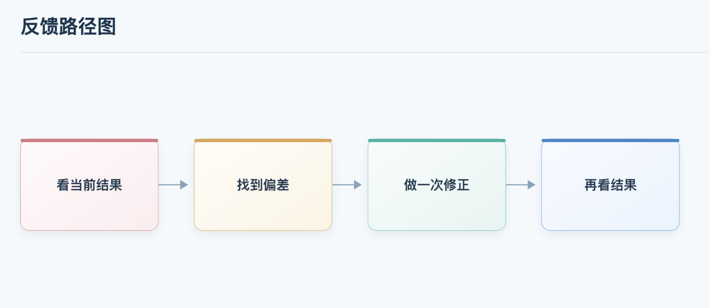
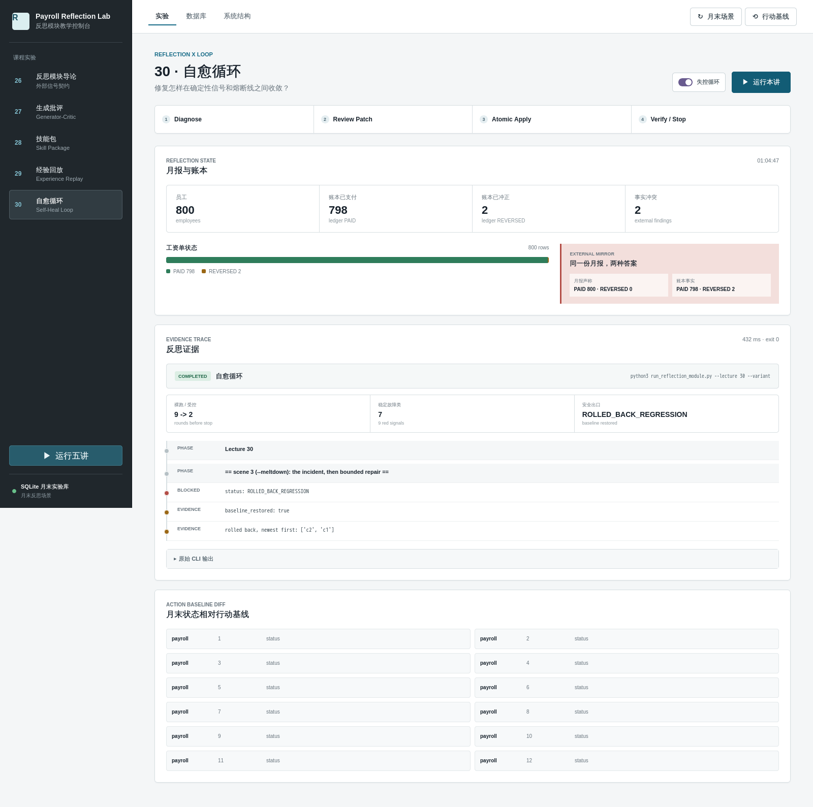
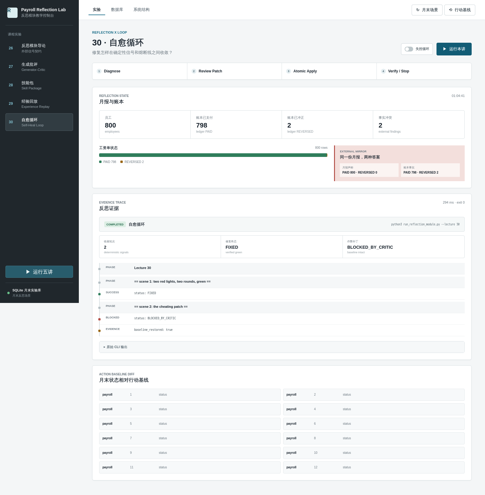

# 30 | 自愈循环：让自动修复在边界内收敛

- 释题：当测试给出明确红灯时，Agent 可以尝试修复。每一份补丁都要接受审查和重新验证；修不好、没有进展或者越修越乱时，系统要退回起点，把证据交给人工。

你好，我是黄佳。这是反思模块的最后一讲。

前面三讲，反思改变的还是报告、技能和经验。这一讲再往前走一步：Agent 开始直接修改代码、配置和工作流。假设七月打款脚本的 CI 流程中的对账测试给出了明确错误，系统要找到原因、修改实现，再重新运行测试。

最简单的自愈循环如下：

```
while tests_are_red:
   patch = agent.fix(error)
   apply(patch)
   rerun_tests()
```

这个自愈循环不完整，因为它只知道“测试还红就继续改”，却没有回答关键问题：连续几轮都没有解决原问题时，系统怎样发现自己正在原地打转？修复引出更多错误以后，怎样回到修改前的状态？

自愈循环的核心可以提炼为四个字：修、验、停、退。

能够提出补丁，只完成了“修”。每次修改以后重新测试，才完成“验”。发现没有进展或风险扩大时及时停手，才有“停”。修复失败以后能够回到干净状态，才有“退”。



一轮自愈流程大致如下：



- 发现红灯

```
 → 判断哪里可能有问题
 → 生成补丁
 → 检查补丁能不能用
 → 应用补丁
 → 重新运行测试
 → 修好、继续，或者停止
```

Agent 主要参与两件事：分析问题和提出补丁。运行时则负责好几件更重要的事情，包括控制修改范围、判断补丁能不能应用、重新运行测试、限制最多尝试几轮，以及失败以后执行回滚。如果测试转绿，说明补丁生效了；如果测试一直不绿、补丁越权或者影响面不断扩大，系统就要停止自动修复。

这和第 27 讲的生成评审有所不同。生成评审一次只审一份版本，产生一次裁决，本轮就结束。自愈循环的起点已经是一条明确红灯，它要一直处理到测试转绿，或者明确停止并恢复现场。

## 自愈系统的历史

早期自愈系统的代表是 Erlang/OTP 里的监督树。当它发现某个进程挂了，会自动把它重启；但如果短时间里连续挂很多次，它也不会永远重启下去，而会停止并向上报告。Kubernetes也是类似的思路：系统知道“我希望有三个实例在运行”，如果现在只剩两个，控制器就会尝试补回来。在我们熟悉的 TDD 和 CI 中，测试变红，说明当前实现和预期不一致；开发者修改代码以后，再跑一次测试，看问题有没有真正消失。

这些系统背后都有一个很简单的共性结构：



- 发现问题

```
→ 做一次修改
→ 再检查结果
→ 决定继续还是停止
```

大模型带来的变化，是“做一次修改”这一步突然变强了。以前很多修复需要工程师自己诊断和写补丁，现在 Agent 可以阅读错误信息、理解代码，并主动提出修改方案。但它也带来了新的风险：Agent 虽然可以做修改，但它经常不知道什么时候应该停。

例如，测试失败以后，它可能连续尝试很多种补丁；一个错误消失了，另外三个错误又冒出来，它仍然觉得“再试一次也许就好了”。更危险的是，如果修复器还能修改测试，它甚至可能不去修代码，而是把测试标准改松，让红灯变成绿灯。

所以自愈循环最重要的经验就是每改一次，都要重新测；越修越乱，就要停。从控制系统的角度看，它就是不断重复下面这条反馈路径：



- 看当前结果

```
→ 找到偏差
→ 做一次修正
→ 再看结果
```

如果检查结果变好，系统可以继续；如果原来的错误一直回来，或者影响范围越来越大，就说明修复没有收敛，应该停止并退回。要点是自愈不能靠 Agent 自己觉得“应该修好了”，每一轮都要让外部检查重新告诉它，问题到底有没有变小。

## 故障签名：给错误一个“身份证”

长程修复中有一种常见现象：同一个问题每次报出的数字不同，Agent 就以为遇到了新问题。

例如下面的代码：

```
totals off by 19200
totals off by 471833
totals off by 1088412
```

三个报错中的金额不同，背后的问题却可能完全一样：付款总额与账本不一致。如果系统只看整段错误文字，就会把它们当成三次不同故障，继续扩大修改范围。

因此，运行时要给每类故障建立一个相对稳定的身份，也就是故障签名。故障签名可以优先使用机器可读错误码；没有错误码时，可以把报错中的数字归一化：

```python
@dataclass(frozen=True)
class FailureSignal:
   kind: str
   error_text: str
   affected_files: list[str] = field(default_factory=list)
   code: str = ""
   @property
   def signature(self) -> str:
       identity = self.code.strip()
       if not identity:
           normalized = re.sub(r"\b\d+\b", "#", self.error_text.lower())
           identity = " ".join(normalized.split())[:240]
       key = f"{self.kind}|{identity}"
       return hashlib.sha256(key.encode()).hexdigest()[:12]
```

经过归一化以后，前面的报错都会变成：

```
totals off by #
```

这样系统就能认出：数字虽然变了，原始问题仍然没有消失。

薪酬实验台中直接使用两个错误码：

```
PAYROLL_REVERSED_IN_PAYOUT
PAYROLL_STALE_DEPARTMENT_BINDING
```

故障类别需要保持稳定，不同的问题不可以合并为同一类错误。生产系统通常会使用业务对象、验证器版本和证据位置，让这个“身份证”既稳定，又足够准确。

## 补丁指纹：再认出同一种修法

光认出“还是那个问题”还不够，系统还要知道自己是不是又准备用同一种办法去修。

因此，每份补丁也要有一个稳定身份，也就是补丁指纹（Patch Fingerprint）。

```python
@dataclass(frozen=True)
class Patch:
   description: str
   touches: list[str]
   @property
   def fingerprint(self) -> str:
       key = f"{self.description}|{'|'.join(sorted(self.touches))}"
       return hashlib.sha256(key.encode()).hexdigest()[:12]
```

如果故障签名相同，补丁指纹也相同，就说明系统准备对同一个问题再次使用已经失败过的同一种修法。这时继续重试通常不会带来新信息，可以判定为“没有进展”。生产系统里的补丁指纹可以更严格，直接绑定 diff 哈希、仓库版本和依赖变化。

## 什么时候必须停手

自动修复系统还需要自动识别什么时候应该结束或者停止循环，因为有些问题是再循环也无解的。

第一种情况是补丁本身就不该被应用。例如，测试失败以后，Agent 不去修业务代码，反而把测试中的期望值改成当前错误结果；或者诊断只涉及一个文件，补丁却准备修改十几个目录。自愈循环系统中应该有能力拦截住这样的修复补丁。

第二种情况是没有进展。同一种故障出现以后，系统又准备应用已经失败过的同一种补丁，说明它正在重复上一轮。

```
attempt = (failure.signature, patch.fingerprint)
if attempt in attempts:
   self._rollback_all(trace)
   trace.status = HealStatus.ROLLED_BACK_NO_PROGRESS
   return trace
```

此时故障相同，修法也相同，再试一次不会带来新信息，这就应该停止循环并交给人工处理。

第三种情况是越修越大。原来只有一个文件报错，补丁应用以后，新的故障扩散到三个、五个甚至更多文件，说明修复正在制造回归。

教学 Repo 使用受影响文件的数量作为一个简单的信号来判断是否出现了这种扩散：

```
radius_limit = baseline_radius * self.stability.max_radius_multiplier
changed_failure = new_failure.signature != failure.signature
if changed_failure and len(new_failure.affected_files) > radius_limit:
   self._rollback_all(trace)
   trace.status = HealStatus.ROLLED_BACK_REGRESSION
   return trace
```

生产系统还会考虑严重程度、依赖关系、代码负责人、金额影响和安全风险，如果问题类型变了，影响范围还明显扩大，就不要继续让系统自动尝试。

第四种情况是轮数耗尽。即使每一轮看起来都有一点变化，系统也不能无限修下去。

Repo 中使用独立策略控制最大轮数和允许的影响范围：

```python
@dataclass(frozen=True)
class StabilityPolicy:
   max_rounds: int = 3
   max_radius_multiplier: float = 2.0
```

模型每一轮都可能觉得“再试一次就能成功”，但是否还有资格继续，应该由外层 Harness 决定。

代码中最终形成了五种结束状态：

```python
class HealStatus(str, Enum):
   FIXED = "fixed"
   BLOCKED_BY_CRITIC = "blocked_by_critic"
   ROLLED_BACK_REGRESSION = "rolled_back_regression"
   ROLLED_BACK_NO_PROGRESS = "rolled_back_no_progress"
   MAX_ROUNDS_HUMAN_HANDOFF = "max_rounds_human_handoff"
其中只有 FIXED 会保留补丁。其他状态都意味着自动修复没有成功，系统要恢复基线，再把
```

证据交给人。

状态

- 发生了什么系统怎么办

## 绿灯必须由独立检查器给出

Agent 提出补丁以后，需要重新运行原来的测试、CI 或业务检查，让独立验证器给出结果。

薪酬实验台中的规则是：对账测试失败以后，修复器不能通过修改测试来获得绿灯。

```python
def critic(patch: Patch, failure: FailureSignal) -> str:
   if patch.touches_tests:
       return "patch weakens the test; the code it guards is unchanged"
   if len(patch.touches) > 2:
       return "patch touches more files than the diagnosis names"
   return ""
```

这里并不是说测试永远不能改。需求发生变化时，测试和生产代码当然可能一起调整。问题在于没有新的需求证据，也没有人工批准时，同一个自动修复器不能一边修改实现，一边降低验收标准。打个比方，测试就像考试卷。学生答错以后，可以修改答案；如果他同时把标准答案也改了，最后的满分就没有意义了。

因此，自愈至少要把两种权限分开：修复器负责提出修改，验证器负责判断修改以后有没有满足标准。跨模型评审可以增加一个视角，但最后仍然需要测试、业务不变量或人工审核等可复核信号。

## 回滚以后，真的回去了吗

```
修复失败以后，系统通常会调用 rollback()。但“调用过回滚”和“现场已经恢复”之间还隔着
```

一步检查。

Repo 会记录每轮补丁对应的提交号：

```python
基线 c0
 → 补丁 c1
 → 验证仍红
 → 补丁 c2
 → 触发停止
 → 依次撤销 c2、c1
baseline_restored 会检查回滚顺序是否正好与应用顺序相反：
@property
def baseline_restored(self) -> bool:
   return self.rolled_back == list(reversed(self.applied_commits))
如果应用记录是 [c1, c2]，回滚记录就必须是 [c2, c1]。这能够证明教学实验中的“提交
```

账”是完整的。

它还不能证明真实文件、数据库和部署状态已经恢复。生产系统需要在回滚以后重新读取现实状态：

- 执行回滚

```
 → 重新读取文件、部署和数据库
 → 与修复前的基线比较
 → 生成恢复证明
```

回滚本身也可能失败，比如 Git 冲突、数据库补偿超时，或者旧部署版本已经无法取得。这时系统要进入更高优先级的失败状态，停止所有自动操作并立即交给人工。

也就是说，回滚命令执行完了，只能说明系统尝试退回；重新核对现场，才能说明它真的回来了。

- 咖哥发言：这里我们要区分 Saga、幂等性和恢复验证几个重要概念。Saga 负责定义失败后的补偿路径，幂等性保证补偿动作可以安全重试，而恢复验证负责最后再看一眼现实世界：补偿都执行完以后，系统是不是真的回到了基线。

## 代码恢复 vs 业务恢复

自愈系统首先要弄清楚：自己到底准备恢复什么。

如果问题发生在代码、配置或者部署制品上，基线通常比较清楚。修复前是哪一个 commit、用了哪一版依赖、配置文件是什么内容，都可以记录下来。修复失败以后，回到原来的版本，再重新跑测试和检查，通常就能确认现场是否恢复。

业务世界就麻烦得多。数据库已经写入、消息已经发出、付款已经完成，这些事情不会因为

```
git revert 自动消失。代码退回去了，钱还在对方账户里；配置恢复了，已经发出去的通
```

知也收不回来。

这一讲的实验还停在 CI 阶段，修复器只是修改脚本定义，没有产生真实业务副作用，所以恢复代码就足以把教学现场拉回基线。到了生产系统，如果动作已经落到外部世界，就要同时依赖幂等键、效果账本、补偿动作、冲正以及必要的人工处置。

因此，自愈最适合处理边界比较清楚、能够验证恢复结果的对象，例如沙箱里的代码和配置、尚未发布的计划和工作流、可以通过快照恢复的部署单元，以及已经提前设计好补偿路径的受控状态。

一旦涉及难以撤销的业务副作用，自动修复就应该更谨慎。代码能回滚，不代表业务世界也能回滚；越接近不可逆动作，自愈越应该早点停下来，把现场和证据交给人工。

## 打开工作台：比较无约束循环与受控修复

下面我们打开工作台，比较无约束循环与受控修复会走向怎样不同的结果。

工作台中固定了初始故障和后续故障序列，只改变系统有没有停止和回滚约束的配置。

打开反思工作台，选择第 30 讲，再打开“失控循环”。

```bash
cd agent-design-patterns
uv run --extra ui python reflection/payroll-lab/web_app.py
浏览器进入 http://127.0.0.1:8766。
```



无约束版本连续运行九轮：

```
round 1: RED [555a6ab4ddc1] reconcile_payout: totals off by 19200
round 2: RED [634b9b14e706] batch_membership: E0012 stale binding
round 3: RED [08b9c9a973e0] payslip_render: missing exceptions field
round 4: RED [7f696f02f760] approvals_join: unknown column
round 5: RED [b3a462bdb6b7] tax_calc: negative net pay for 3 employees
round 6: RED [555a6ab4ddc1] reconcile_payout: totals off by 471833
round 7: RED [ea3b50931c69] payslip_render: duplicate rows
round 8: RED [a98b12ea07ef] batch_membership: 14 employees unassigned
round 9: RED [555a6ab4ddc1] reconcile_payout: totals off by 1088412
after 9 rounds: 8 files edited in overlapping
distinct failure classes: 7
repeated class 555a6ab4ddc1: rounds [1, 6, 9]
```

九轮一共改了八个文件，其中还有原本没有问题的文件。表面上看，每一轮都出现了新报错；而稳定签名却告诉我们，第 1、6、9 轮其实是同一个对账故障。差额从 19200 变成 471833，再变成 1088412，原问题一直没有消失。

这就是失控修复：修改越来越多，报错越来越丰富，系统却没有真正接近目标。

受控版本从同一条故障开始。第一轮修改以后出现新的部门归属问题，第二轮又出现涉及三个文件的新问题。影响范围已经超过初始故障的两倍，运行时判断风险正在扩大，于是停止第三

```
轮，按照 c2、c1 的顺序撤销两个提交。
```

受控自愈没有修好这次问题，但它及时停了下来，也把现场退回了起点。这比继续修改八个文件安全得多。

下面关闭“失控循环”，运行标准场景。



标准场景中原本就存在两个确定性缺陷。CI 每次只返回当前遇到的第一条红灯，所以第二个问题最初被第一个问题挡住了。

第一条错误是：

```
PAYROLL_REVERSED_IN_PAYOUT
打款构建器没有排除已经 REVERSED 的工资单。第一份补丁只修改 payout.py，应用为
c1。
```

重新验证以后，系统看到第二条错误：

```
PAYROLL_STALE_DEPARTMENT_BINDING
这次补丁增加当前部门归属检查，只修改 batch.py，应用为 c2。再次验证以后，CI 转绿：
round 1 ... applied as c1
round 2 ... applied as c2
status: FIXED
CI after heal: green
```

第一轮修好以后出现第二条红灯，并不代表第一份补丁制造了回归。第二个问题本来就存在，只是之前被挡住了，而且新的影响范围仍在允许范围内，所以系统可以继续第二轮。

工作台还有一个故意修改测试的补丁：

```
raise expected total in reconcile test to match actual
touches=['tests/test_reconcile.py']
```

评审器在应用前把它拦下：

```
status: BLOCKED_BY_CRITIC
baseline_restored: true
```

这次没有任何提交被应用，所以现场自然保持在原基线。这个场景说明，补丁审查要发生在应用以前；降低验收标准的修法，不能进入系统。

至此，我们的 Lab 已经能够演示怎样识别同类故障，怎样阻止越权补丁，怎样发现没有进展或影响扩大，以及失败后怎样恢复提交账。在生产系统中还要进一步补足真实环境核对、权限审批和外部副作用处理。

## 反思契约六问和自愈循环

讲完自愈循环之后，我们可以更为具体的看一下之前的反思契约六问。

- 第 30 讲的答案

问题

反思谁

- 当前出问题的代码、配置或工作流版本

回到哪里

- 回到原始任务目标，以及修复开始前那个确认过的干净状态

- test、lint、build、CI 和业务对账这些可以重复运行的检查

拿什么对照

允许改变什么

- 只修改白名单范围内、出了问题还能撤销的代码和配置

- 每次补丁应用以后，重新跑原来的检查。修复器不能为了让自己通

改完怎样验收

- 过，顺手把检查标准也改掉

- 测试转绿就停止并保留修改；如果补丁被拦、连续没有进展、越修

何时停止、回到哪

- 影响越大，或者达到轮数上限，就停止自动修复，撤销本轮所有修改，回到修复前的基线，再把现场和记录交给人工

最后一个问题尤为重要：如果修复没成功，系统退回哪里？

前几种反思通常比较好收场。生成评审失败，可以继续保留原稿；技能验证不过，就先留在

```
TRIAL；一条经验没效果，也可以归档。自愈不太一样，因为它已经真的改过代码或配置。所
```

以失败以后，系统还要把刚才的修改撤回，回到修复开始前的基线，再确认现场确实恢复了。

此外，自愈通常靠测试、CI 或业务对账判断“修好了没有”。修复器可以根据这些结果改代码，但不能为了让结果变绿，顺手把测试或验收规则也改掉。测试本身是否合理、什么时候更新，

```
是 ValidatorPolicy 负责的另一件事。所以，自愈比前几种反思多了一层要求：不只要会
```

改，还要知道什么时候停，以及失败以后怎么回去。

## 总结一下 & 反思模块收官

自愈循环可以归结为四个字：修、验、停、退。

- 确定性红灯启动修复，Agent 诊断问题并提出补丁；

- 策略闸控制修改范围，独立验证器重新运行测试；

- 同一种错误和同一种修法重复出现、影响面扩大或者轮数耗尽时，系统停止自动修改；

- 修复没有成功，就回到基线并把证据交给人工。

自愈循环中的故障签名给问题建立稳定身份，补丁指纹则给修法建立稳定身份。两者放在一起，可以识别系统有没有重复已经失败的尝试。

这里，我们再给出几个相似策略的比较。这些策略都是出了问题的应对方式，含义则各有不同。

处理方式

- 例子系统做了什么

重试

- 网络抖动，接口超时原动作再执行一次

重规划

- 主支付通道不可用改走另一条合法路径

自愈

- 打款脚本过滤条件写错修改代码，再重新测试

补偿

- 工资已经打错发起冲正等反向业务动作

网络临时超时，再调用一次接口，属于重试。主支付通道不可用，改走备用通道，属于重规划。代码逻辑写错，修改以后重新跑测试，属于自愈。如果钱已经打出去了，就要通过冲正等业务动作抵消影响，这属于补偿。

```
自愈适合处理代码、配置和可以回滚的系统状态，通过baseline_restored 来确定事务的
```

回滚。但代码退回旧版本，已经发生的转账不会跟着自动消失。如涉及已经发生的外部副作用，还需要幂等、业务账本、补偿事务和人工处置的配合，进一步读取文件、数据库和外部状态，证明现实现场已经恢复。

自愈的本事，不只体现在能不能修好（AI 能把任何错误“看起来修好”），更体现在能不能及时停手。修不好就应该交给人；越修越坏又退不回来，才是自动修复最大的风险。

最后，我们来回看整个反思模块，四个模式分别处理不同对象。

模式

- 改变对象主要结果信号怎样结束

生成评审

- 当前产出对账、字段结构和规则当前版本通过或退回

技能包

- 可复用能力黄金题和复用结果准入、降级或退役

经验回放

- 跨任务经验采用证据和后续结果保留、归档或转化

- test、lint、build、CI

自愈循环

- 代码、配置和工作流转绿，或者恢复后交人

## 思考题

1. 你的系统里有没有一直重试或一直修补的流程？它在什么情况下会停下来？

2. 同一个错误只改了数字、行号或时间戳以后，系统还能认出它是同一类问题吗？

3. 你的回滚能够证明什么？是记录上已经撤销，还是文件、数据库和外部状态都已经恢复？

4. 找一个反复出现的故障。它应该继续交给自愈循环，提前做成守卫，还是因为风险太高直接交给人工？

期待你在留言区记录想法或者提出疑问，如果这节课对你有启发， 也欢迎分享给身边的朋友。

## 下一讲预告

反思模块到这里结束。感知、记忆、推理、行动和反思，构成了单个 Agent 的基本闭环。下一个模块进入协作。当任务超出一个 Agent 的上下文、权限和专业能力以后，系统要决定怎样分工、怎样汇合，以及怎样避免多个局部正确拼成一个整体错误。咱们下一讲见。

## 参考资料

- Kephart, J. O. & Chess, D. M. The Vision of Autonomic Computing. IEEE Computer, 2003.

- Erlang/OTP. Supervisor Behaviour.

- Kubernetes. Controllers.

- Aider. Linting and testing.

- Huang, J. et al. Large Language Models Cannot Self-Correct Reasoning Yet. ICLR2024.

- Kamoi, R. et al. When Can LLMs Actually Correct Their Own Mistakes?. TACL 2024.

- GitHub. GitHub Copilot CLI combines model families for a second opinion. 2026-04-06.

- Lodkaew, T. et al. Do Coding Agents Deceive Us?. 2026-06.

- Godio, A. et al. Iter-T: ITERative Test Suite Generation for Automated Program Repair.IEEE TSE, 2026.

- Spotify Engineering. Coding Is No Longer the Constraint. 2026-06-03.
