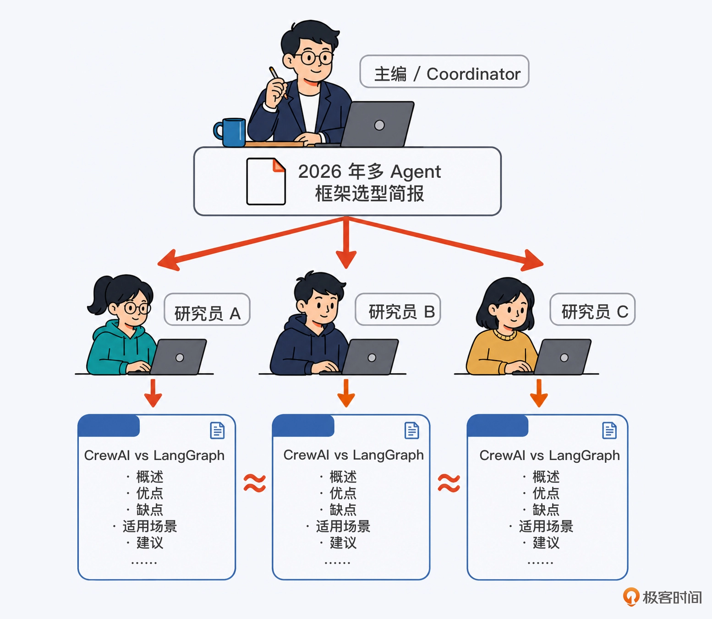
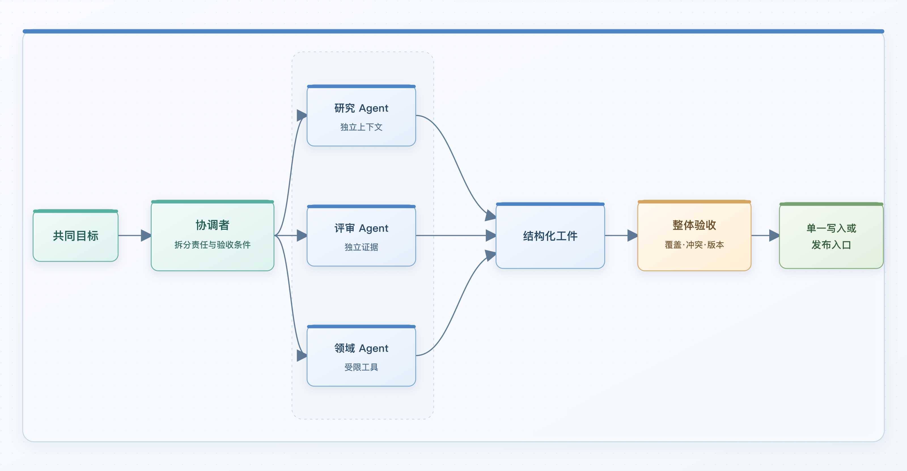
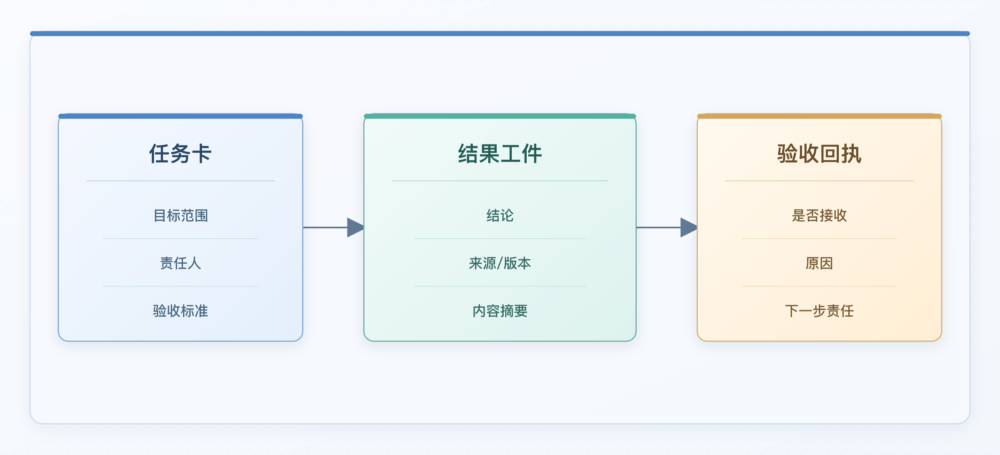
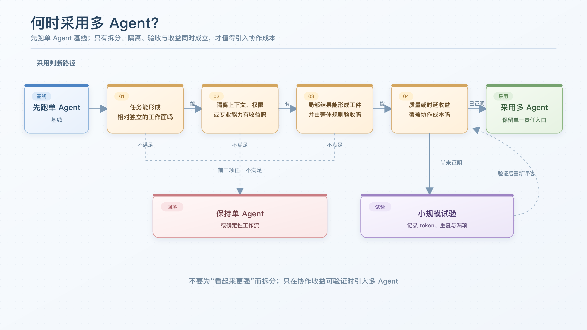
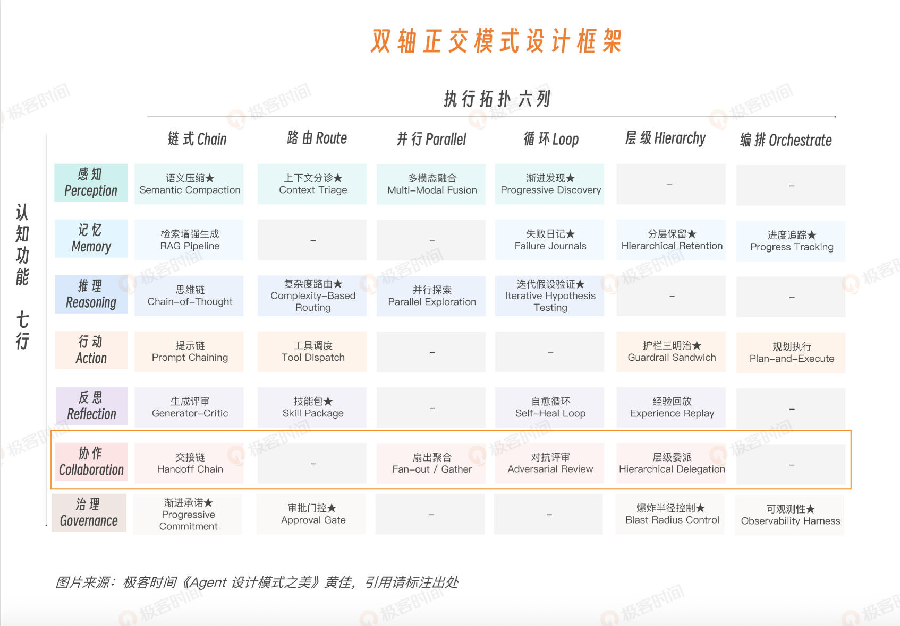
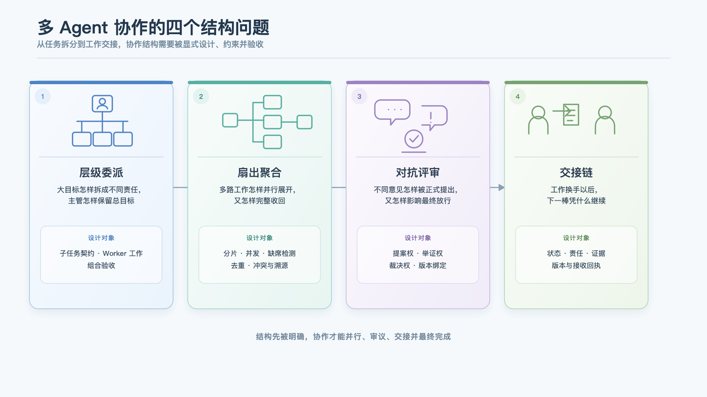
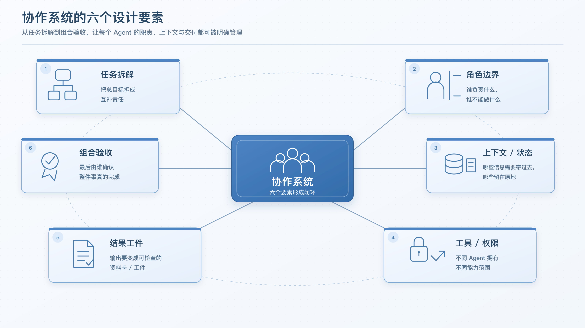

# 31 | 协作模块导论：人一多，就需要把边界说清楚

- 释题：“分身各赴诸端事，合意同归半局棋”。单个 Agent 的上下文和注意力有限，复杂任务有时需要几位执行者一起完成。问题是，每个人各自走完半局棋之后，系统能不能把这些局部工作重新拼成一盘完整的棋。

你好，我是黄佳。

假设我们要做一页“2026 年多 Agent 框架选型简报”。我把任务同时交给三位研究员，我心里盘算：一个人要查半天，三个人并行，一杯咖啡的工夫应该就能交稿。材料果然很快回来了。

三位研究员都很认真，但我拿到的结果是同一块内容的三个版本，三个人比较的都是 CrewAI和 LangGraph（也许这三位研究员都调用了同一个 Agent，说不定就是 Codex 或者Workbuddy）。

相互之间怎么分工，没人管；状态怎样保存，没人查；三个人怎样交接、如何协作，没人负责；最终简报需要覆盖哪些方面，是否全面，是否形成了统一、且更有高度的整体思想，没人在意。

于是我很气馁，心想：无论是 Agent 还是真人下属，都还是不行啊，关键时刻还是得我自己来。



上述情景中，问题出在 Agent 之间的任务范围重叠了，内容留下空白，最后又没有人按照总目标验收，而这就是协作模块要解决的问题：当工作跨过执行者边界时，怎样把意图、真值、结果和责任说清楚，让局部产出真正合成为一个可验收的整体？

多 Agent 是这套协作机制的一种实现形式。其实人和 Agent 混合协作、两个外部 Agent 系统之间的合作，也会遇到同样的问题。

## 到底什么算 Agent 协作

开场案例真正的问题，是系统只复制了一个目标：

```
研究 2026 年多 Agent 框架。
```

它没有继续说明：

- 你负责哪一块？哪些内容不在你的范围内？依据哪一版资料？最后交回什么？谁检查三份结果是否完整？

于是，三位研究员都选择了最容易进入的方向。对每位研究员来说，这个选择完全合理；对整份简报来说，三个合理选择叠在一起，留下了两块无人负责的空白。

这里需要区分两种“完成”。

- 局部完成：某位研究员已经返回了一份材料。

- 整体完成：所有必需内容已经覆盖，重复和冲突得到处理，最终结果通过了总目标验收。



很多多 Agent 系统只记录第一种完成。只要所有子 Agent 都返回，父任务就进入

```
completed。至于大家有没有做重、有没有漏项、结果能不能拼起来，系统留给最后一个大
```

模型“总结一下”。

这种做法更像同时发起了几次调用，还谈不上协作。一个 Agent 连续调用搜索、数据库和代码工具，仍然是一位执行者在使用多种能力；一个 Agent 加载三份 Skill，也没有因此变成一支团队。协作模式讨论的是多个相对独立的执行上下文怎样围绕同一个目标工作。这里的“相对独立”，至少意味着它们在上下文、工具、状态或责任中，有一项被明确分开。它们可以使用同一种模型，也可以来自不同模型、不同 Harness，甚至由不同公司的系统承载。

因此，我对 Agent 协作的工程化定义是：Agent 协作，是把一个共同目标分配给多个相对独立的执行上下文，再通过明确的边界协议把局部结果组成一个可验收的整体。

这句话包含三个动作：分出去、做回来、验整体。只会分出去，系统得到的是一群各自宣布完成的 Agent。没有隔离，几位 Agent 看似分工，实际上仍然共享同一段嘈杂上下文、同一套宽泛工具和同一份可变状态。只验局部，不验整体，则会出现开场的情况。

## 协作契约：意图、真值、结果和责任

工作留在一个 Agent 内部时，很多信息藏在上下文里。它知道为什么排除某个方案，记得当前使用哪一版资料，也知道自己还欠哪一步。

如果工作一旦跨过边界，这些隐含信息就靠不住了。接收者可能只拿到一句“继续完成简报”，不知道目标读者、任务范围和已排除的方向；关键数字经过几轮自然语言转述，可能混入旧值；上游觉得自己已经交付，下游却认为自己只是临时帮忙。最后出问题时，其实是无法追责的。

因此，协作开始以前，要先立一份四句话的边界契约：意图随消息，真值随引用，结果随工件，责任随验收。

意图随消息意味着任务消息要说明这一棒做什么、做到哪里，以及哪些事情明确不在范围内。开头例子里说的“研究多 Agent 框架”范围太宽。更清楚的任务应该是：

```
Atlas：研究团队怎样组织和委派任务。
Birch：研究上下文、会话和状态怎样隔离与保存。
Comet：研究结果怎样在 Agent 或系统之间交接。
```

真值随引用，说的是关键事实不要在 Agent 之间反复口头转述，应当指向原始记录、官方文档、代码版本、数据库快照或 commit。内容经过压缩，事实仍然能回到原处核对。

- 隔离的是会话、工具还是文件系统？

```
结论针对哪个 provider？
```

- 依据哪一版文档或代码？

结果随工件，即 Worker 不应只返回一段自由文本。研究任务可以提交资料卡，代码任务交补丁和测试结果，审批任务交版本化决策记录。

一张最小研究卡应该包含：责任面、结论、适用范围、来源、版本、未决问题。主 Agent 拿到的是可以检查、比较和组合的工件，不必重新阅读每位 Worker 的完整对话。

责任随验收，指的是接收者依据明确标准签收以后，这一项责任才算真正交付。验收要回答：

- 谁接收了？接收的是哪一版？依据哪套标准？通过、退回还是等待补充？下一步由谁负责？

这几句话最终落到三类核心对象上：任务卡、结果工件、验收回执。任务卡固定意图和范围；结果工件携带结论、来源和版本；验收回执说明谁接收了什么，以及父目标是否可以继续。

```python
from dataclasses import dataclass
@dataclass(frozen=True)
class TaskCard:
   task_id: str
   goal_ref: str
   owner: str
   scope: str
   input_refs: tuple[str, ...]
   deliverable: str
   acceptance_ref: str
@dataclass(frozen=True)
class ResultArtifact:
   task_id: str
   producer: str
   artifact_ref: str
   evidence_refs: tuple[str, ...]
   version: str
   content_digest: str
@dataclass(frozen=True)
class AcceptanceReceipt:
   task_id: str
   artifact_version: str
   artifact_digest: str
   reviewer: str
   accepted: bool
   reason: str
```

这几个对象负责让系统知道：现在谁在做什么，依据什么，交回了哪一版，最终有没有被接收。下图展示了这个协作闭环流程。



- 最小协作闭环：任务卡 → 结果工件 → 验收回执

## 什么时候才值得协作

多 Agent 不是更高级的默认架构，它是在支付通信、调度、等待和聚合成本以后，换取并行、隔离、专业分工和独立视角。

因此，决定是否协作时，要把“为什么值得拆”和“拆开以后能不能安全运行”分开。单一智能体已经完全可以解决问题时，就不要强行引入多智能体架构。

建议出现下面几类情况，再开始考虑协作。

第一，任务中存在真正互不依赖的工作面。不同资料源、地区、合同、代码目录或测试分片可以同时推进，并行能够缩短墙钟时间。

第二，过程信息已经超过一个上下文适合承载的范围。子 Agent 可以把大量搜索、阅读和局部尝试留在自己的上下文，只把压缩工件交回主管。

第三，权限或专业责任需要分开。研究员可以读取资料，发布者才有官网写权限；对账 Agent可以查看工资事实，付款 Agent 才能调用银行接口；安全、财务和法务也可能需要不同的工具、资料与验收标准。

第四，独立视角本身有价值。同一个方案需要第二证据源、专职评审或竞争假设时，另一个执行者带来的价值不是速度，而是不同的观察条件。

这些是采用协作可能获得的收益。它们并不保证协作一定会成功。真正启用多 Agent 以前，还要经过下面的考量。

门槛

- 要回答的问题开场案例中的检查

任务可拆

- 能否拆成责任清楚、可以单独验收的子任务拓扑、状态和交接是否各有

- 上下文、工具和工作区能否隔离，或写入能否串行收

状态可管

- 三位研究员可以独立阅读口

结果可验

- 局部工件能否对齐、组合并接受整体验收三个方向是否到齐，是否重

Anthropic 曾让 16 个 Agent 一起写一个 C 编译器，最终产出了约 10 万行 Rust 代码，还能编译 Linux 6.9。它之所以跑得起来，不是因为 Agent 多，而是任务可以拆开：不同 Agent 负责不同部分，各自有测试，Docker、Git 和 CI 又能防止大家互相踩脚。可当 16 个 Agent 都卡在同一个 Linux 内核错误上时，并行反而失效了。大家反复排查同一个问题，还会覆盖彼此的修改。后来，团队用 GCC （GNU Compiler Collection，标准 C 编译器）作为正确结果的参照，再把问题重新切成能够单独验证的小块，并行才重新发挥作用。

这个案例就说明了：多 Agent 不是人越多越快。任务要能拆开，工作区要能隔离，结果还要能独立验收。

多个 Agent 不是不能一起写代码。只要每个人有独立的 worktree、容器或沙箱，再配上任务锁、合并规则、自动测试和发布门槛，并行写入完全可以做。问题是，这些东西一个都不能少。否则你只是把一个人的写权限复制成了十份，冲突也会跟着放大。

所以，多 Agent 到底值不值得用，不能只看“同时跑了几个人”。更稳妥的办法，是先跑一个单Agent 基线，再比较结果质量、总 token、实际耗时、重复工作、交接出了多少问题，以及最后真正通过验收的比例。多 Agent 多花了成本，就应该拿出相应的收益。



而且，并行也有天花板。十个人可以同时查资料，最后还是要有人把材料合起来、统一口径、处理冲突并做最终决定。前面跑得再快，最后这个收口环节慢，整体也快不到哪里去。

所以判断协作是否划算，我们得算清楚账单：并行省下来的时间和带来的质量提升，能不能抵掉多出来的通信、协调和聚合成本。

下面我提供了几类具体场景，方便你了解何种情况适合引入多 Agent ，以及拆分思路是什么。

现场

- 怎样拆判断

- 适合。

开放式行业研究

- 按地区、公司或资料源分头检索，由主编统一成稿核对

- 每个 Worker 只读一份合同并提交风险卡，聚合器检

八百份合同初筛

- 适合。查漏评、重复和冲突

- 多人共享同一段隐含控制流，还需要同时修改同一文

修复一个文件里的状态机 Bug

- 先克制件

月末付款

- 对账与异常核查并行，真正付款只保留一个入口混合使

## 协作模块中的四个模式

层级委派、扇出聚合、对抗评审和交接链，这四种模式，分别在协作链的不同位置修补不同问题。



模式

- 边界作用

层级委派

- 谁负责哪一块，主管怎样保留总目标把简报拆成拓扑、状态和交接三张互补

扇出聚合

- 多路结果怎样带着口径、来源和冲突返回检查三块是否到齐，识别重复资料和相

对抗评审

- 谁有权提出异议，异议怎样影响放行防止主编把有限结论改成没有证据支持

交接链

- 状态、证据和责任怎样交给下一棒让事实核查后的版本准确到达编辑和发

层级委派：把人头变成责任

开场失败的第一处断点在派工。主管要拆出三份互不相同的责任。Atlas 负责拓扑，Birch 负责状态，Comet 负责交接。每张任务卡都写明问题、输入、交付物和验收标准。

主管派完工以后仍然保留总目标。三位 Worker 分别完成自己的局部责任，整份简报有没有完成，仍由主管检查。

子代理隔离是层级委派的一个伴随机制。层级委派回答“这块责任交给谁”，子代理隔离回答“这位 Worker 在什么边界里工作”：它能看到哪些上下文，使用哪些工具，拥有多少预算，失败会影响多大范围。

扇出聚合：不要急着把差异抹平

任务拆开以后，结果还要收回来。三位研究员可能讨论不同维度，也可能引用同一份资料，还可能得出冲突结论。聚合器要统一对象和口径，识别同源重复，保留未决冲突，最后检查这些局部结果合在一起是否违反全局约束。

在技术简报中，聚合器会发现：

```
topology：已覆盖
state：已覆盖
handoff：已覆盖
重复责任：0
```

- 核心来源：可追溯

```
未决冲突：1
```

多路工作到齐，只能说明材料齐了。结论能不能成立，还要看来源和冲突怎样处理。

对抗评审：让异议进入放行条件

聚合后的报告仍然可能被主编概括过度。比如，资料只证明进程内 Worker 的会话隔离，标题却写成“所有子 Agent 默认完全隔离”。这时，评审者要提交带规则和证据的异议。提案权、举证权和裁决权由不同责任主体承担，评审可靠可信。

交接链：把正确版本交给下一棒

研究、事实核查、编辑和发布通常由不同角色顺序完成。可靠交接不能只传一段前情摘要，而要传递一份版本化交接包，其中包含当前目标、已确认事实、工件引用、被排除项和下一步责任。接收方签收以后，责任才真正转移。



## Harness 会变，协作边界不会

下面我们看看业界实践，这些框架能够帮助我们创建子 Agent、转移会话、限制工具和传输Artifact。但它们不会自动知道简报需要覆盖哪三块，也不会自动决定谁有资格宣布整件事完成。也就是说，它们只能帮助我们搭建起基本的协作协议框架，而具体的协作责任，也就是业务契约，都需要在实践中补充。

Harness / 协议

- 边界和接口说明

- Crew 负责角色协作，Flow 负责状态和流程；层级流程中的

CrewAI

- manager 承担委派与验证

- 区分 agents-as-tools 与 handoff，明确工作委派和控制权转

OpenAI Agents SDK

- 移不是一回事

- 每个 Agent 有独立 session thread；共享基础设施不等于共

Claude Managed Agents

- 享上下文、工具和历史

- 用 ctx.subagents 统一多种 provider，并提供 persona、工具

DeepSeek Harness

- 过滤和委派深度等边界

- 用 Message 交流，用 Artifact 正式交付；协议负责互通，业

A2A v1.0

- 务负责验收

不同 Harness 使用不同名字表达协作。有的叫 manager 和 worker，有的叫 coordinator 和specialist，有的叫 agent 和 subagent。接口名称会变化，但协作系统需要回答的问题并没有变化。

## 小结

协作扩大了 Agent 可以同时处理的工作范围，也把原来集中在单一上下文里的决定拆散到了多个执行者手中。系统由此获得并行、隔离和专业化，也开始承担通信、等待、聚合、版本和责任成本。多 Agent 架构真正需要设计的是 Agent 之间的边界。



协作模式组的任务，是让工作分得出去、收得回来、争得明白、接得安全。采用多 Agent 以前，先看边界是否清楚。采用多 Agent 之后，大家需要注意的是清晰的分工和明确的责任。

- 写到这儿，佳哥觉得这一篇不只是在谈技术，也是在谈管理。当我们设计好一个 Agent 系统，实现“意图随消息，真值随引用，结果随工件，责任随验收”之后；我们也应该思考，在组织和团队的管理过程中，是否也应该像设计多 Agent 协作系统一样，有清晰的目标设定和高效的沟通机制，为每个团队、每一个人制定明确的责任和交付工件的结果形状呢？祝大家协作愉快！

## 思考题

1. 你当前设计里的多个 Agent，各自承担哪一块不可替代的责任？

2. 删除其中一个 Agent，最终交付会明确少掉什么？如果答案是“好像也不会少什么”，它可能只是一次昂贵的重复调用。

3. 多位 Agent 得出不同结论时，谁有权修改最终工件，谁有权宣布通过，谁负责保留被否决版本的证据？

期待你在留言区和我交流，也欢迎把今天的内容分享给身边更多朋友。

## 参考资料

- Anthropic, How we built our multi-agent research system，2025-06-13。

- Cognition, Don't Build Multi-Agents，2025-06-12。

- Cognition, Multi-Agents: What's Actually Working，2026-04-22。

- Anthropic, Building a C compiler with a team of parallel Claudes，2026-02-05。

- CrewAI Documentation，Crew、Flow 与层级流程。

- OpenAI Agents SDK: Multi-agent orchestration，manager-as-tools 与 handoff。

- Claude Managed Agents: Multiagent orchestration，隔离线程与版本化团队名单。

- DeepSeek Harness: Subagent subsystem，统一子代理接缝与 provider。

- A2A Protocol Specification v1.0，Message、Task 与 Artifact。
