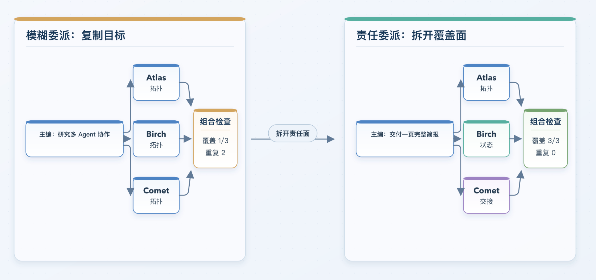
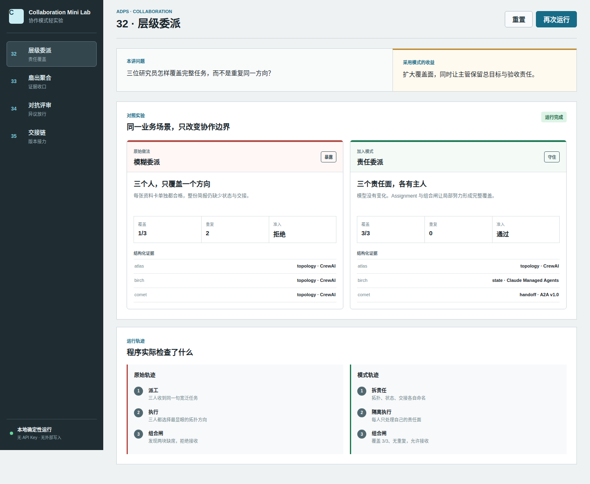
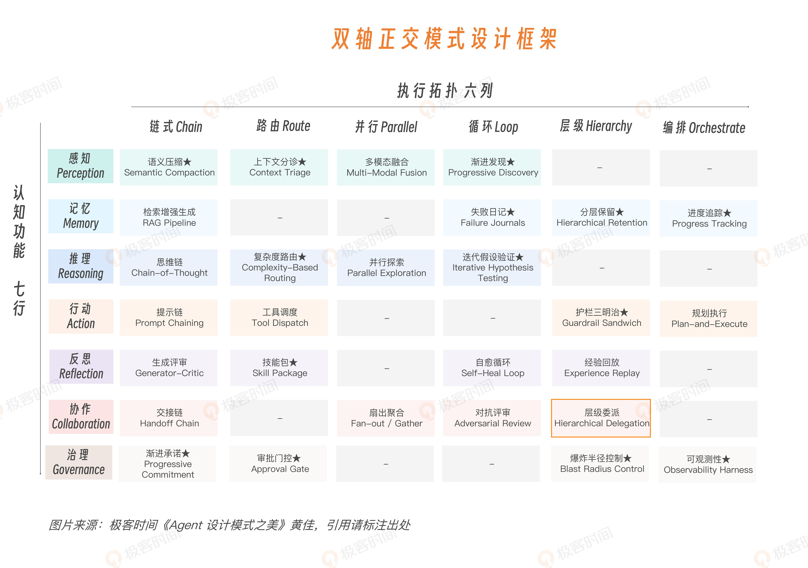
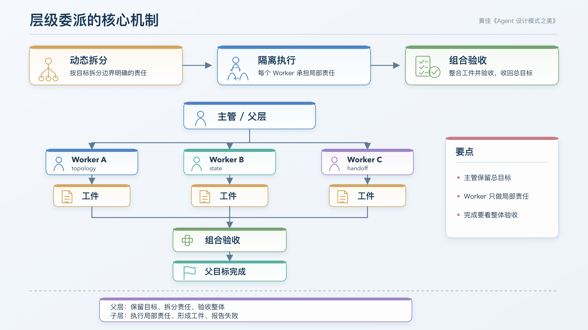

# 32 | 层级委派：把大目标拆成可验收的责任

- 释题：把大目标拆成可验收的责任。主管守住父目标，子 Agent 承担边界清楚的局部责任，最后由工件闸和组合闸确认整个任务真正完成。

你好，我是黄佳。

上一讲我们举了个例子，把一页“多 Agent 框架选型简报”交给三位研究员执行，三个人都很勤快，研究了 CrewAI 和 LangGraph 等多个框架，团队产出了三份材料，但状态管理与跨Agent 交接仍然空缺。

Anthropic 在复盘多 Agent 研究系统时也提到过类似问题，协调者曾把“研究半导体短缺”这样宽泛的任务交给多个子 Agent。一位回头研究 2021 年汽车芯片危机，另外两位重复追踪当时的供应链。每个 Agent 都完成了一次像样的研究，但整个 Agent 团队却没交付出一个完整的结果。

问题出在派工的那一刻。协调者复制了目标，没有拆开责任。换句话说，“我们派出去的是三个人，不是三份责任。” 子 Agent 需要明确的目标、输出格式、工具和来源指引，以及清楚的任务边界；描述过于宽泛时，重复劳动和覆盖缺口会同时出现。

层级委派要解决的正是这一类问题：一个大目标交给多位执行者以后，怎样保证每个人承担一块可区分、可交付、可验收的责任，最后再由一个稳定责任人确认整体目标已经完成。

## 先跑一遍 Demo

```
配套实验：collaboration/light_labs/editorial_delegation_lab.py
配套工作台：collaboration/light_labs/web_app.py
```

我们把这个问题复现一下。让 Agents 用 Repo 创建一份简报，要求覆盖三个方向：

```
topology：团队由谁协调，任务怎样分发
state：Agent 的上下文和状态怎样隔离与保存
handoff：结果怎样跨 Agent 或跨系统交接
```

第一轮不划分责任，先给三位研究员完全相同的任务：Research multi-agent collaboration。

进入公开 Repo 运行：

```
python3 collaboration/light_labs/editorial_delegation_lab.py
```

第一段结果是：

```
== vague delegation ==
atlas  lane=topology source=CrewAI
birch  lane=topology source=CrewAI
comet  lane=topology source=CrewAI
coverage=1/3 duplicates=2 admitted=false
missing=state,handoff
atlas、birch 和 comet 都返回了资料卡，每张卡也都带有来源。从单个 Worker 的角度
```

看，三次调用都成功结束。

但这里出现了层级系统中两种不同的“完成”：

```
Worker completion：
```

- 某位执行者已经返回结果。

```
Goal completion：
```

- 所有被要求的责任已经形成可接受的组合结果。

```
如果运行时只记录第一种完成，三位研究员的状态都会是 SUCCEEDED，从编审的角度看，整
```

份简报却无法发布。因此，我们不能把“所有子调用都结束”直接等同于“父目标已经完成”。



用网页版工作台再跑一次，展示层级委派前后变化。克隆公开 Repo：

```bash
git clone https://github.com/huangjia2019/agent-design-patterns.git
cd agent-design-patterns
python3 collaboration/light_labs/web_app.py
终端出现 Collaboration Mini Lab: http://127.0.0.1:8098 后，在浏览器打开这
```

个地址。左侧选择“32 层级委派”，点击“运行对照实验”。工作台左边跑模糊委派，右边跑责任委派，底部把程序实际做过的三步检查展开。



这组对照是一项消融实验。它保留 Worker、资料卡、来源和组合闸，只撤掉责任划分。责任划分消失以后，重复与缺口同时出现；重新加入责任面以后，覆盖恢复，组合闸才允许结果继续流转。

```
两次运行过程中模型和资料没有变化，左侧覆盖只有 1/3，重复为 2，组合闸的任务并未完
成。右侧把责任拆开以后，覆盖变成 3/3，重复归零，此时验收器才允许简报通过验收。
```

## 层级委派起作用的核心机制

如果我们只是在图上放一个 manager，再从它下面拉出几条线，连接若干 worker。但这个线本身不代表它拆出了三份不同责任；而三个 worker 都返回成功，也不代表总目标获得了完整覆盖；主 Agent 最后把三段文本拼在一起，也不代表它完成了组合验收。

层级委派位于双轴框架的协作行和层级列，下面分析它为何属于“层级”拓扑。



我们把层级委派的核心机制归纳为动态拆分、隔离执行和中心化综合。其完整的工程化定义是：层级委派由一个稳定责任人保留总目标，根据当前输入拆出边界明确的子责任，把它们交给相对隔离的执行者，再通过结构化工件与组合验收，把局部结果收回总目标。



这条定义包含四项内容。

```
第一，主管保留总目标。他可以把 state 交给 birch，自己仍然要记得最终交付包含
topology、state 和 handoff 三部分。别觉得分工出去了，任务就结束了。
```

- 第二，子任务严格根据当前目标生成。研究 Harness 时可以按拓扑、状态和交接拆分；处理上百份合同时，可以按合同分片；调查线上事故时可能按时间线、代码变更、基础设施和用户影响拆分。子 Agent 一般不应该在运行时动态拆解目标。

- 第三，Worker 只承担自己的局部责任。每一个子 Agent 只需要得到足够完成当前任务的上下文、工具和预算，并不需要继承主管的全部会话历史。

- 第四，主管验收组合结果。每位 Worker 的完成是局部完成，整体父目标是否完成，要看所有局部工件放在一起以后是否覆盖总目标、是否存在冲突、是否违反全局约束。

因此，层级委派中的“层级”主要是一种责任层级：

- 父层：保留目标、拆分责任、处理缺口、验收整体。

- 子层：执行局部责任、形成工件、报告失败与证据。

主管可以由模型担任，也可以由确定性代码、工作流引擎或人机混合系统承担，关键在于总目标始终有一个明确的持有者。

## 层级委派的必要性

那么，层级委托的好处是什么呢？这个模式解决了哪些具体的问题？

层级委派模式首先解决的是注意力覆盖。一位 Agent 要同时记住总目标、搜索资料、核对来源和整理结构，很容易被最显眼的线索吸住。把责任拆开，每位 Worker 可以在较小的上下文里把一个方向做深，主管继续守住全局缺口。

第二个收益是失败隔离。状态研究超时，不必把拓扑和交接两份已经完成的资料一起丢掉。主管知道缺的是哪一块，可以只重派那项责任。

第三个收益是替换执行者的自由。责任契约稳定以后，某一块可以交给进程内子 Agent，也可以换成 Codex、Claude Code 或外部服务。系统可以任意切换工作方式或者 Agent 的具体实现，但是总目标与验收口径（也就是业务规则）已经固化下来了。

要想获得这些收益的前提是任务一定要有真实可拆的责任面，否则多 Agent 带来的协调成本往往高于收益。

## 层级委派的实现细节

```python
先看责任的划分。我们的实验中，最小任务对象叫 Assignment：
@dataclass(frozen=True)
class Assignment:
   """A bounded responsibility handed from the editor to one researcher."""
   worker_id: str
   lane: Lane | None
   question: str
   deliverable: str = "one claim card with a source"
```

这个任务对象记录四件事：谁负责、责任面是什么、本次要回答哪个问题、交回什么。在生产系统中还需要输入引用、工具范围、权限、预算、超时和目标版本等信息。

当我们把任务改成：

```
Assignment("atlas", "topology", "Who coordinates the team and dispatches work?")
Assignment("birch", "state", "How are agent context and state isolated?")
Assignment("comet", "handoff", "How do results move across agent boundaries?")
```

第二段输出随之变成：

```
== scoped delegation ==
atlas  lane=topology source=CrewAI
birch  lane=state    source=Claude Managed Agents
comet  lane=handoff  source=A2A v1.0
coverage=3/3 duplicates=0 admitted=true
```

这个改变发生在协调接口上。每人拿到一个能够被区分的责任面，最终结果从三份相似材料变成三块互补材料。

那么，如何判断责任面已经形成呢？你可以问问自己，当拿掉某个子任务时，最终交付会明确少掉什么？如果答案明确，则说明责任边界通常已经成形。如果拿掉谁都没区别，说明你还没有分清责任。

再看看如何把结果转成工件。

子 Agent 中间可以搜索十次、推翻两次假设、读几十页文档。主管如果把这些过程全部收回来，那他自己要消化的上下文就太多了。层级委派要求 Worker 压缩过程，交回一份能验收的小工件。

```python
实验里的 ResearchCard 设计如下：
@dataclass(frozen=True)
class ResearchCard:
   """The small artifact returned by a researcher."""
   worker_id: str
   lane: Lane
   claim: str
   source_id: str
   source_url: str
claim 是结论，source_id 和 source_url 把结论连回来源，lane 说明它履行了哪一块
```

责任。主管接收这张卡，不需要接管研究员的整段思考过程。

工件压缩并不意味着过程必须全部丢弃。完整轨迹仍然可以留在子会话、Trace 或工件存储中，主管默认只接收压缩结果，需要调查时再沿引用展开。Anthropic 在多 Agent 研究系统的复盘中也提到，子 Agent 可以把完整结果直接写入外部工件系统，再把轻量引用交给协调者。这样可以减少多轮转述造成的信息损失，也能避免大段结果在主会话中反复复制。

```
不过，lane=state 仍然只是 Worker 的自报。系统不能因为模型填对了字段，就认定它已经
```

完成状态管理研究。生产验收还要把工件与原始 Assignment、来源内容、目标版本和外部规则对照。模型可以提交履约声明，但不能单凭自己的声明完成验收。

最后一个值得记住的工程细节，是通过两道闸门把局部验收与组合验收分开。

第一道是工件闸。它看一张资料卡有没有约定字段、来源、正确的任务版本与生产者。以我们熟悉的发薪场景为例，它还会检查这批工件是否覆盖契约指定的员工，金额和输入指纹是否一致。

第二道是组合闸。它把所有资料卡摊开，检查三个责任面是否各出现一次。在薪酬系统里，它还要检查五个部门加起来是否覆盖 800 人、是否存在重复员工、月度总额是否超过资金线。

```
review_cards() 是组合闸的简单实现：
counts = Counter(card.lane for card in cards)
missing = tuple(lane for lane in REQUIRED_LANES if counts[lane] == 0)
duplicate_count = sum(max(0, count - 1) for count in counts.values())
sources_present = all(card.source_id and card.source_url for card in cards)
accepted = not missing and duplicate_count == 0 and sources_present
```

为什么不能只设第一道闸？开场的三张卡都能通过单卡检查，整份简报仍缺两块。

为什么不能只设第二道闸？三个方向虽然齐全，但其中一张卡可能没有来源，或者属于旧版本目标。

两道闸分别回答：这一个责任单元能不能接收？所有责任单元合起来，总目标能不能接收？

其实这个问题并不只属于 Agent。在微服务场景中，有可能每个微服务都满足自己的延迟预算，整条调用链仍可能超过端到端 SLA。在薪酬场景中，每个部门的付款批次都通过局部检查，所有批次合起来仍可能出现重复员工。在测试场景中，每位测试工程师都完成了自己的用例，整次发布仍可能漏掉关键业务路径。这些都告诉我们：局部正确不会自动推出整体正确。

## 层级委派 vs 子 Agent 隔离

层级委派解决责任怎样拆分、交付与验收。子 Agent 隔离解决局部执行怎样形成真正的运行边界。两者经常一起出现，却不是同一个模式。

隔离面

- 在研究简报中的含义生产做法

上下文

- 每位研究员只获得自己的问题和必要背景新会话、最小输入引用、压缩工件

工具

- 研究员可以搜索，不能直接发布官网工具白名单、沙箱、只读数据源

上下文隔离和权限隔离不同。子 Agent 开启了新会话，却仍然继承了付款工具和生产凭证，风险并没有被真正缩小。

工具约束的可靠限制要在运行时执行：工具不出现在子 Agent 的可见集合中，确保它绝不会被没有授权的子 Agent 调用。

设置最大委派深度是为了防止责任链无限展开。父 Agent 创建三个 Worker，每个 Worker 再创建十个下属，系统很快会同时失去预算、覆盖和追踪能力。

层级委派定义责任树，子 Agent 隔离定义每条边能够传递什么。

## 什么时候适合使用层级委派模式

层级委派适合应用于存在清楚责任面的任务。开放研究可以按地区、公司、主题或资料源拆分，主管负责统一口径；合同、简历和工单可以按输入主键分片，每片独立交付；安全、财务和法务任务可以给不同 Worker 配置专门工具与数据权限；长任务可以把大段探索过程留在子上下文，只把压缩工件送回主管。

而下面几类情况要谨慎。

- 第一，任务很短，一个 Agent 的上下文和工具已经足够。此时增加 manager、Worker 和验收层，只会增加通信开销。

- 第二，步骤之间存在密集的隐含依赖。每位 Worker 都必须知道上一位执行者刚刚做出的临场决定，交接成本可能高于上下文隔离的收益。

- 第三，多位 Agent 同时修改同一份状态，却没有独立工作区、合并规则和全局验证。此时责任虽然已经拆开，但写入时仍然会互相覆盖，容易造成混乱。

- 第四，团队只能描述角色，不能定义交付。诸如“你是高级研究员”“你负责深入思考”这样的提示词并没有说明交回什么，也无法形成验收。

- 第五，父 Agent 既负责拆解，又只凭自己的感觉宣布拆解完整。在开放性的问题中，主管可能遗漏自己没有想到的责任面。因此，能编码的覆盖要求应进入确定性规则；无法预先枚举的部分需要独立评审、外部清单或人工验收。

## 小结

总结一下，层级委派先由稳定责任人保留父目标，再把目标拆成带有边界的 Assignment。Worker 在隔离环境中完成局部责任，用结构化工件交回结论与证据。工件闸判断单项结果能不能接收，组合闸判断所有结果合起来能不能完成父目标。

本讲实验中，模糊委派产生三张合法资料卡，却只覆盖一个责任面。把任务拆成 topology、state 和 handoff 以后，覆盖率从 1/3 变成 3/3，重复数从 2 变成 0，组合结果才获得接收资格。

DeepSeek Harness、CrewAI、OpenAI Agents SDK 和 Claude Managed Agents 这些主流的Agent 框架都可以提供不同的子 Agent 运行方式。它们负责启动、会话、工具、控制权和生命周期，责任是否拆全、工件是否合格、父目标是否完成，仍然要由模式契约和业务验收，也就是通过我们的 Harness 系统设计来回答。

## 思考题

1. 你现在的子 Agent 清单里，删掉哪一个不会让最终交付少掉任何明确内容？

2. 你的主管只检查每位 Worker 是否完成，还是会检查所有结果合起来是否覆盖总目标？

3. 如果把进程内子 Agent 换成外部 Codex 或 Claude Code，哪些责任契约应保持不变，哪些运行边界必须重新验证？

## 下一讲预告

下一讲进入扇出聚合。层级委派先解决“每个人负责哪一块”。当多路结果一起回来以后，新的问题会出现：有的结果缺席，有的重复，有的互相矛盾，还有的使用了不同版本的事实。

系统需要决定怎样等待、去重、保留溯源、暴露冲突，并在多数、高分和外部事实之间选择裁决依据。我们下一讲见。

## 参考资料

- Anthropic, How we built our multi-agent research system，2025-06-13，包含模糊委派导致重复研究的实际复盘。

- ADPS, C1 Hierarchical Delegation，动态拆分、隔离执行与中心化综合。

- ADPS, C5 Sub-Agent Isolation，上下文、工具与失败边界。

- CrewAI Documentation，Crew、Flow 与层级流程。

- OpenAI Agents SDK: Multi-agent orchestration，agents-as-tools 与 handoff。

- Claude Managed Agents: Multiagent orchestration，隔离 session 与版本化团队名单。

- DeepSeek Harness: Subagent subsystem，统一子代理接缝与 provider 能力。

- DeepSeek Harness README，Developer Preview、插件架构与源码运行方式。
