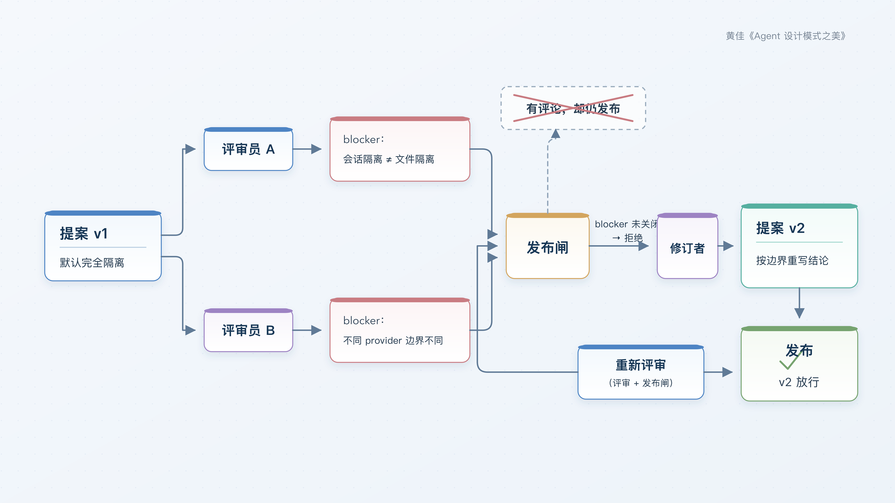
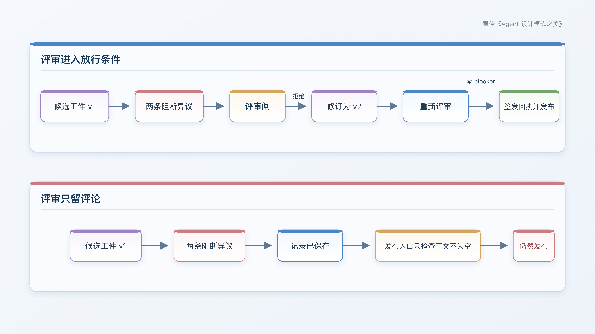
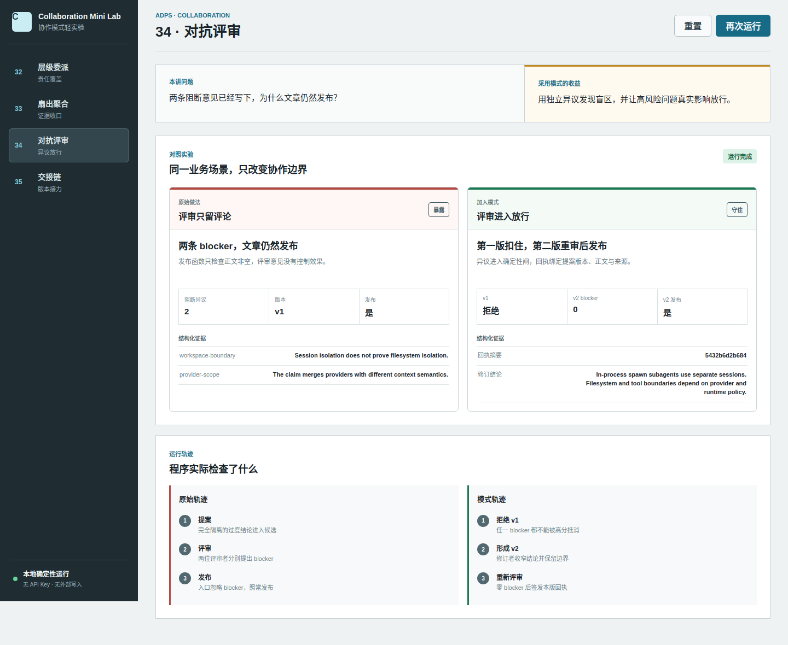
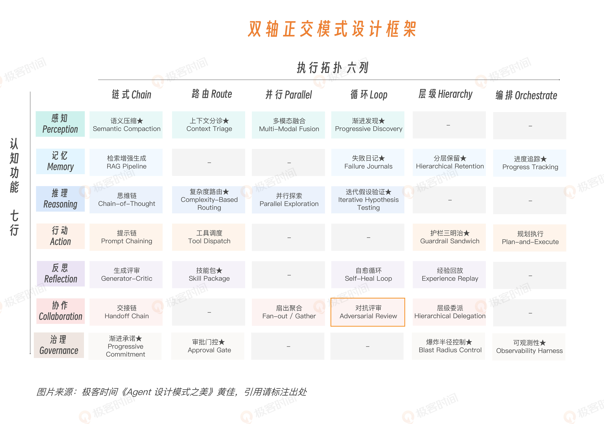
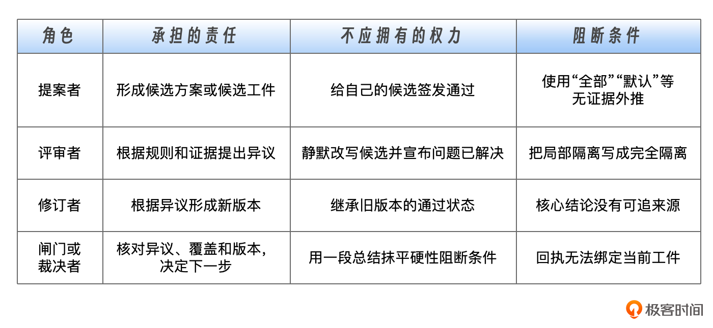
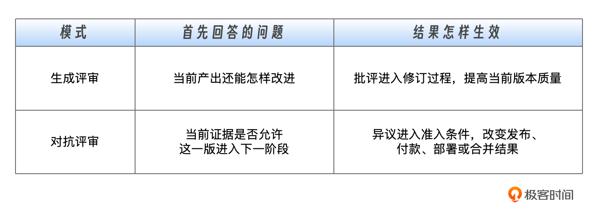
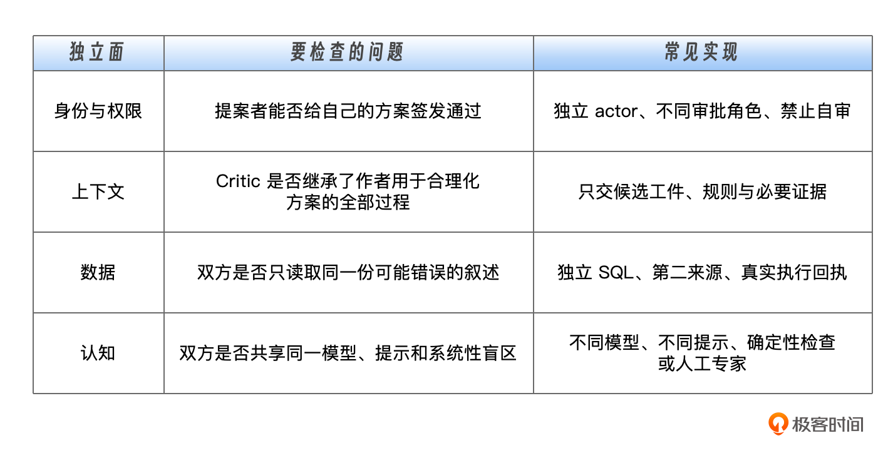
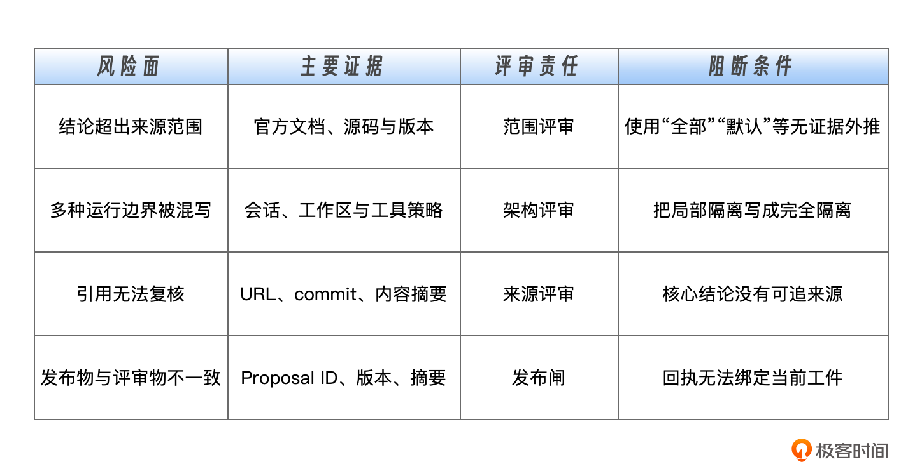
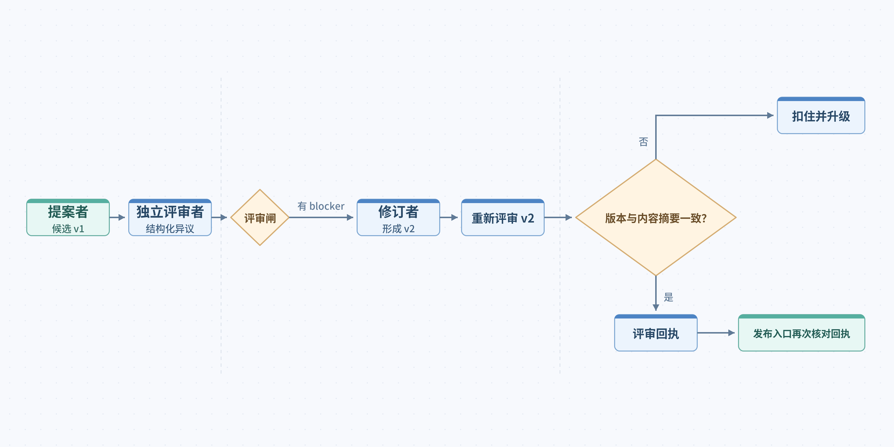

# 34 | 对抗评审：让独立异议真正约束结果

- 释题：让独立异议真正约束放行。评审意见只有绑定具体版本、带着证据进入发布闸，才会从一条评论变成控制。

你好，我是黄佳。

上一讲，我们把“子 Agent 是否隔离”拆成了三个维度。聚合报告形成了一句带条件的结论：

```
进程内 spawn Worker 使用独立会话，工具面可以收窄；文件系统是否隔离，取决于
```

- provider、沙箱与运行策略。

主 Agent 看完以后，觉得这句话不够利落，把这篇报告的主题定为：DeepSeek Harness 的子Agent 默认完全隔离。

而在报告发布前，有两位评审员分别检查了结论的适用边界。一位指出，会话隔离不能直接推出文件系统隔离；另一位补充，不同 provider 在上下文、工作区和工具范围上的语义并不相同。根据这两条异议，评审环节重新拟定了一个更准确的主题：DeepSeek Harness 的子Agent 在会话、工作区与工具三个层面上分别怎样隔离。



上面这个对抗评审的流程给我们的启发是：评审者提出反对意见的同时，还要让这些意见进入

```
合并与发布的状态转移条件。当存在未关闭的 blocker（拒绝闸门）时，候选稿就不能从“评
```

审中”进入“已批准”或“已发布”；修订者根据异议形成新版本后，新版本还要重新接受评审。

让对抗评审模式落地，建好发布闸，需要有一套详细的控制机制。接下来，我们看看这套机制如何设计。

## “有评审”和“评审生效”的差别

我们先跑一下工作台中的示例，来展示对抗评审的流程和注意事项。

```
配套实验：collaboration/light_labs/editorial_review_lab.py；
配套工作台：collaboration/light_labs/web_app.py
```

进入公开 Repo，并运行：

```bash
git clone https://github.com/huangjia2019/agent-design-patterns.git
cd agent-design-patterns
python3 collaboration/light_labs/editorial_review_lab.py
```

在第一次执行时，候选工件接受了评审，评审意见也被完整记录下来了，但是发布函数却没有把这些意见纳入准入条件。

```
== review as comments ==
proposal=v1 blockers=2
published=true
problem=objections_recorded_but_not_enforced
两位评审员提出了两个 blocker，但是没有继续检查阻断项是否已经关闭，以及这次评审是
```

否覆盖必需风险，这样的“已评审”只做了一半。

同样的问题会出现在许多工程现场。PR 中有要求修改的评论，仓库仍允许强制合并；安全扫描产生了高危报告，流水线却只检查构建是否成功；合规 Agent 给出风险标记，付款函数只看审批字段是否存在。系统具备评审功能，但评审没有获得控制效果。

因此，第二次执行过程中把阻断意见正式接入发布条件：

```
== review as gate ==
proposal=v1 published=false
proposal=v2 blockers=0 published=true
receipt=5432b6d2b684
```

```
只要存在未关闭的 blocker 就不能发布，后面修订者把结论改回带边界的表述，形成 v2。
```

相同的评审规则重新执行，直到没有阻断项，发布闸才会生成一张绑定当前版本的回执，确认进行发布流程。



也可以从 Repo 的网页版启动工作台观察上述流程。

```
python3 collaboration/light_labs/web_app.py
```

浏览器打开 http://127.0.0.1:8098，左侧选择“34 对抗评审”，点击“运行对照实验”。页面会运行两个评审器。



```
左侧流程中，两条 blocker都被记录下来，发布入口却只验证正文存在，因此 v1 仍然上
```

线。

```
右侧流程中的发布函数必须获得一张有效评审回执。v1 因阻断项未关闭被拒绝；修订后的
v2 重新接受评审，才获得自己的发布资格。
```

这里就是我们所希望强调的：评审结果需要进入状态转移条件。

## 对抗评审到底是什么

模式名称中的“对抗”指目标函数和责任位置不同。提案者的任务是形成一个能够向前推进的候选版本；评审者的任务是主动寻找足以阻止当前版本进入下一阶段的失败条件。一个负责证明“可以做”，另一个负责检查“凭什么可以做”。

先来看对抗评审的工程化定义。对抗评审，是把提案、举证与放行分配给相对独立的责任主体，由评审者针对某一版候选工件提出带规则和证据的结构化异议，再由确定性闸门或授权裁决者决定退回、修订、放行或升级人工。

这一定义包含四个不可缺少的对象：候选工件、结构化异议、裁决策略以及版本回执。

没有候选版本，评审对象会在过程中漂移；没有结构化异议，评论无法稳定进入机器规则；没有裁决策略，blocker 只能停留在界面上；没有版本回执，旧评审可能被借给一份已经改过的新工件。



对抗评审落在协作维度，是因为提案、质疑和放行由不同责任主体承担。即使底层使用同一个模型，这几个角色也要在身份、上下文、数据访问或权限中形成明确边界。

对抗评审位于循环拓扑的原因是，评审一旦拒绝当前版本，系统要经过一条完整路径：提案→评审→退回→修订→重新评审。新版本不能继承旧版本的评审结论。每次修改都会形成新的被审对象，必须重新进入评审循环。

所以，对抗评审的循环不是让多个 Agent 无休止地互相评论，而是让每个新版本都重新获得一份属于自己的裁决。

一套完整的对抗评审通常包含下面四个角色。



这些角色把提案权、举证权和裁决权三种权力分开。提案者负责提出方案；评审者负责指出哪条失败条件已经被触发；裁决者（也可以叫放行闸门）负责决定该版本能否进入下一阶段。这与财务流程中的 maker-checker 原则相近。经办人可以发起付款，复核人检查依据，最终授权仍受额度、身份和策略约束。

## 它和生成评审模式的不同点

对抗评审和反思模块的生成评审模式名称比较相似，但服务的目标不同。

- 生成评审主要服务当前产出。生成器写一版，批评者指出问题，修订器继续改。它适合报告、代码和计划的质量提升，批评者可以是同一运行时中的另一个角色。

- 对抗评审把要求再往前推一步。评审者是协作边界上的独立责任主体，异议会影响工件能否放行。错误代价、审计要求与职责分离，是从生成评审升级到对抗评审的主要理由。



生成评审关心当前产出的质量改进，也就是“还能不能写得更好”。对抗评审更关心状态是否能达到转移的标准。

- 当前版本是否已经满足放行条件？是否存在任何不能被其他优点抵消的硬伤？

二者可以组合。外层对抗评审发现 blocker 后，修订过程内部可以使用生成—批评提高修复质量；修订完成以后，外层仍要对新版本重新评审。内层负责把东西改好，外层则负责决定改好的东西能否发表。

## 把评审独立性结构化

所谓“把评审独立性结构化”，解决的是评审必须覆盖不同的角度的问题。因为，“用了多个Agent”本身不能证明评审独立。多个 Agent 也可能使用同一模型、继承同一段上下文、读取同一份错误摘要，最后在同一个盲区里互相确认。

而我们所关注的是来自不同评审者相互独立的证据条件。独立性至少可以从四个方面检查。



跨模型可以增加认知差异，不能代替事实独立。两个不同模型都只读一份错误月报，仍然可能一起批准错误数字。反过来，同一个模型在提案阶段只读月报，在评审阶段读取独立数据库查询，也可能形成有价值的事实对抗。所以，独立性应该是一组可以被审计的结构证据：

- 谁在评；它看到了什么；它没有继承什么；它从哪里取得事实；它能不能给自己放行。

任务风险越高，对这些证据的要求越严格。

## 风险覆盖面和评审者的数量

另外，只是多加上几位评审者，也不代表风险覆盖更完整。三个评审者可能都在检查文风，没有人核对事实和权限。

上线以前，我们可以先通过一张风险覆盖表做个分析。



这张表回答的是每位评审者为什么存在。删除其中一位以后，哪一类风险会失去观察者？如果答得出来，它就不能被取代；如果回答不出来，它可能就只是“再看一眼”的重复角色，是可有可无的。



## 回执必须绑定正在放行的那一版

评审过程中也可能会发生状态的变化。如果我们用显式状态机表达对抗评审的流程：

```
DRAFT
 ↓
IN_REVIEW
 ├── CHANGES_REQUESTED
 │        ↓
 │     REVISED
 │        ↓
 │     IN_REVIEW
 │
 ├── ESCALATED
 └── APPROVED
          ↓
       RELEASED
一旦 APPROVED 工件发生修改，状态应立即失效：
APPROVED
  + mutation
     ↓
   STALE
     ↓
 IN_REVIEW
```

如果评审发生在上午十点，发布发生在十一点。中间候选内容、依赖数据或规则版本都可能变化。那么发布入口必须重新核对“现在拿到的工件，就是刚才评审的那一版”。


也就是说，回执同时绑定提案身份版本，以及正文与来源引用的联合摘要。正文哪怕只改一个字，或者来源引用被换掉，摘要都会变化。因此旧的回执不能被传递给最新的工件。

上面这段话要强调的是：审批状态不是工件的永久属性，而是“某个版本在某套规则和证据下曾经通过”的历史事实。而这个事实不一定持续稳定，它可能随着时间流转和状态变化。

## 小结

对抗评审增加的，是一条真正能够影响放行的责任链。评审不是“有人看过”，而是“有人能够挡住”。提案者给出候选，评审者提出带规则和证据的异议，修订者产生新版本，闸门决定退回、放行还是升级。只要工件发生变化，就重新评审。

对抗评审最适合那些错误真的会进入下一步业务，而且单靠程序规则又很难完全判断的场景。

- 例如，付款需要 maker-checker；公开报告的重要结论需要独立核查；安全方案需要有人专门从攻击面挑问题；法律、医疗和合规判断需要职责分离；代码即使测试通过，也可能仍然存在权限扩大或架构副作用。

- 它尤其适合那些程序很难直接判断的内容风险。比如，一句话有没有说过头，结论是否超出了证据能够支持的范围，几个分别正确的局部事实拼在一起以后，有没有被概括成一个错误

- 结论。这类问题的字段可能是齐的，格式也完全正确，普通 Schema、类型检查和规则校验都发现不了。

所以，对抗评审更适合处理这类需要理解“意思”的问题；而格式、类型、余额、身份、版本绑定这些能够明确写成规则的检查，交给确定性程序通常更稳。两者配合，比把所有检查都交给Critic 更可靠。

也可以按风险分层：普通内容一个 Critic 足够；重要工件增加独立证据和确定性闸门；真正高风险的动作，再保留人工授权。关键不是多一个评审者，而是这位评审者到底增加了什么：新的风险覆盖、新的证据来源，还是新的控制权。

## 思考题

1. 你的 Critic 提出 blocker 以后，真的能阻止发布、付款或部署吗？

2. 修订产生新版本以后，会重新评审，还是继续沿用旧回执？

3. Critic 相比提案者，到底多看到了什么新的证据或风险？

期待你在留言区分享你的思考或者疑问。也推荐你把今天的内容分享给身边更多朋友。

## 下一讲预告

下一讲进入交接链。简报经过聚合和评审，已经形成了一份可以发布的版本。接下来，它要从研究员交给编辑，再交给发布者。

这时要解决的是另一个问题：工作换手以后，正确的那一版状态、证据和责任，怎样一起交到下一棒手里。我们下一讲见。

## 参考资料

- Michael Fagan, Design and Code Inspections to Reduce Errors in ProgramDevelopment，1976。

- NASA Software Assurance and Software Safety，软件保障与独立验证。

- OpenAI, A shared playbook for trustworthy third party evaluations，2026。

- OpenAI, Separating signal from noise in coding evaluations，2026-07-08。

- OpenAI Agents SDK: Guardrails，多 Agent 工作流中的闸门覆盖边界。

- ADPS, C3 Adversarial Review，结构独立与评审循环。

- DeepSeek Harness: Subagent subsystem，provider 与工具过滤接缝。
