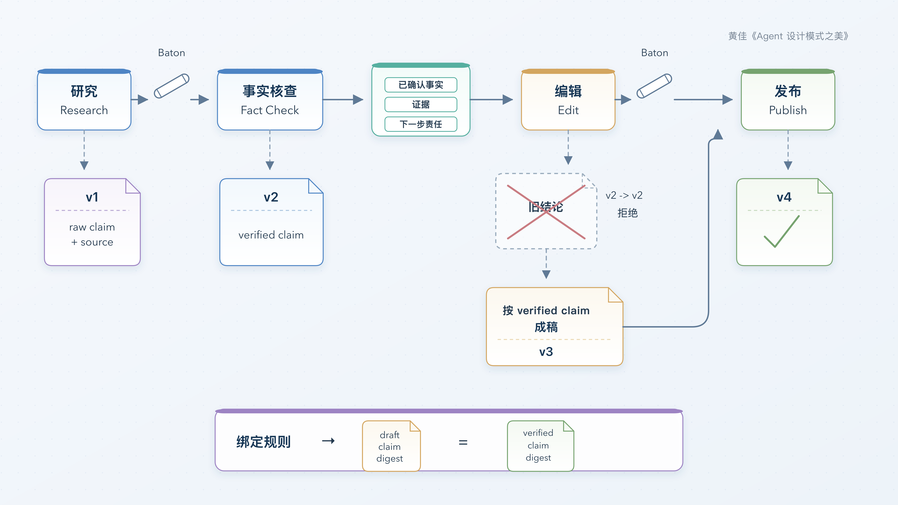
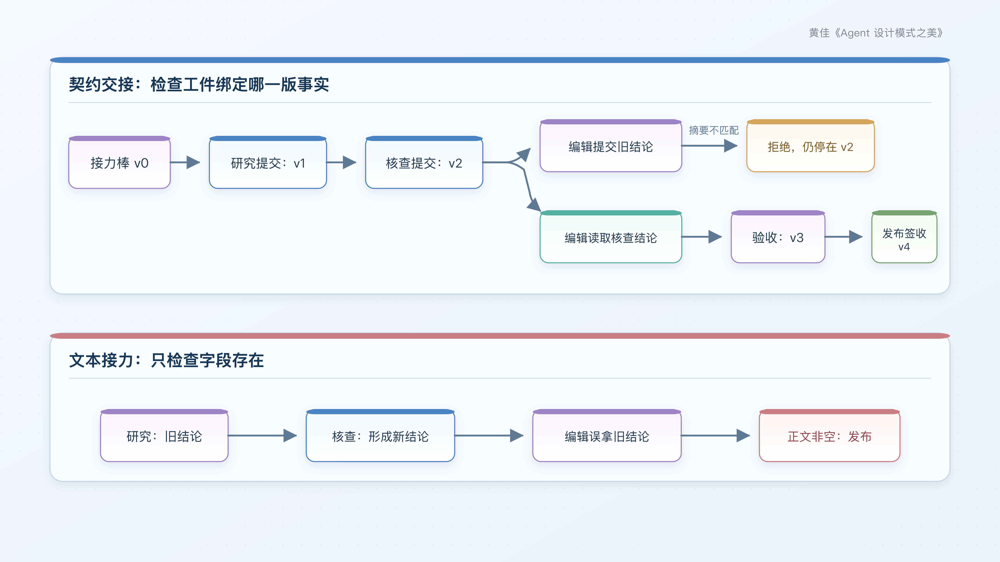
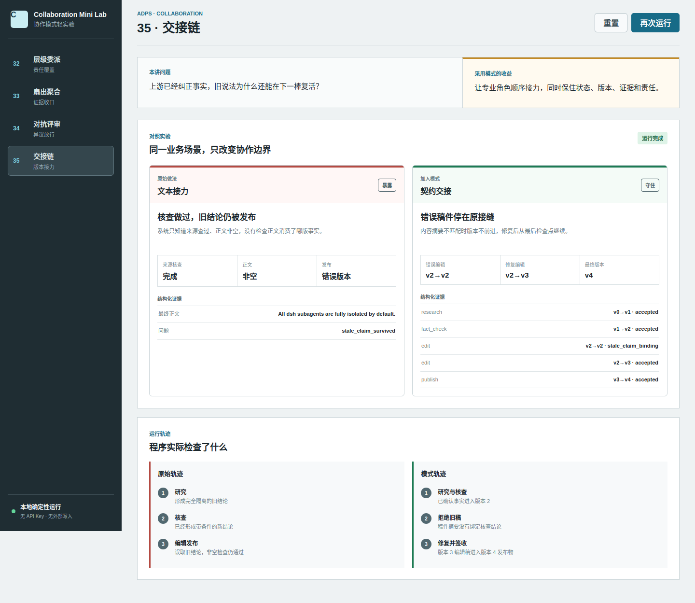
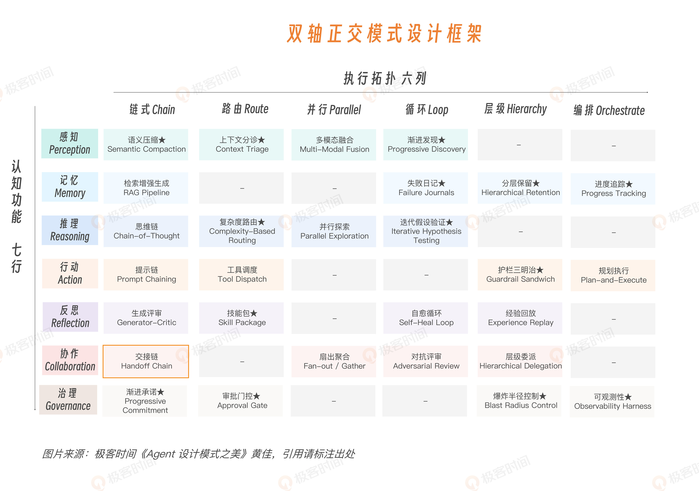
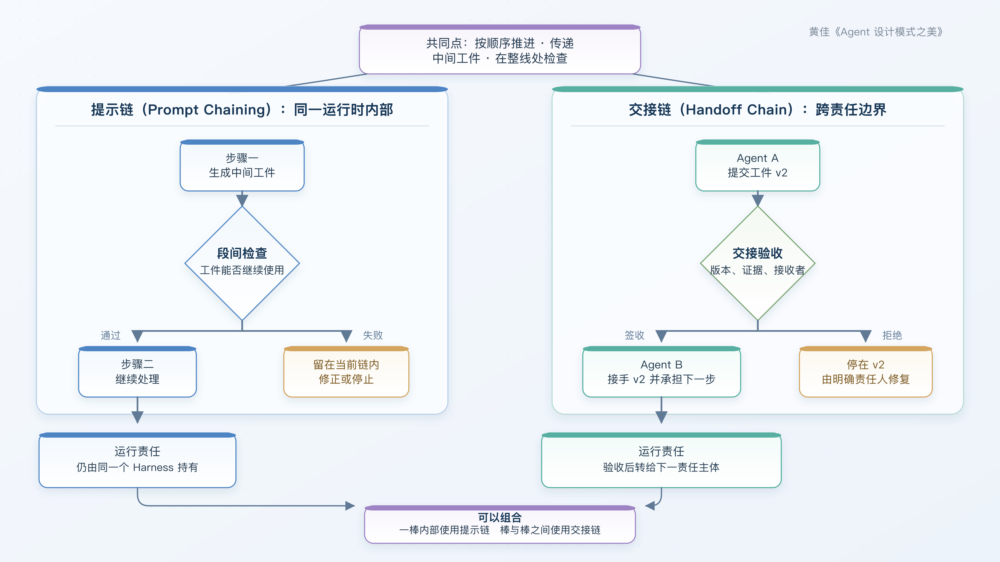
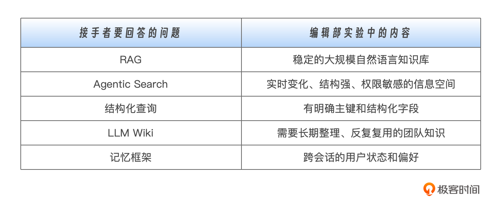
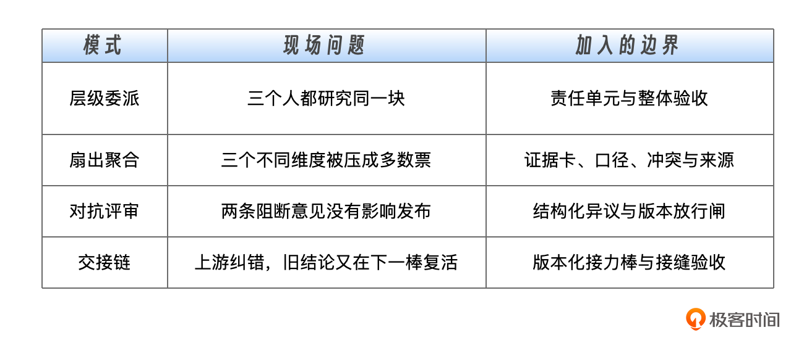
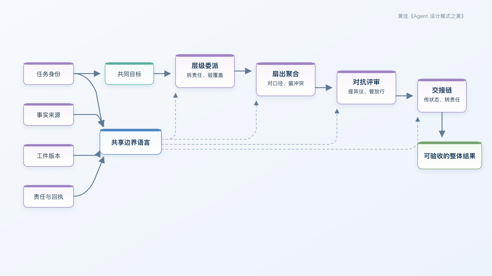

# 35 | 交接链：让状态、责任与证据一起抵达下一棒

- 释题：每次交接都要说明交付哪一版工件、谁负责接收、依据什么事实，以及失败后从哪里继续，让下一棒接住正确的那一版。

你好，我是黄佳。

上一讲，两位评审员把一篇描述有问题的技术简报拦了下来。研究员最初写的是：“DeepSeek

```
Harness 的子 Agent 默认完全隔离。”事实核查员查过文档，把它改成：“进程内 spawn
```

Worker 使用独立会话，文件系统隔离取决于运行策略。”

这条修订是对的。可到了编辑环节，系统里同时放着原始主张和核查结论。编辑 Agent 顺手参

```
考旧句子来生成标题，并交给发布者。发布者看见 source_checked=true，正文也不为
```

空，于是把旧结论发了出去。

上游已经纠错，下游又把错误捡了回来。这类问题在长任务里出现的情况并不罕见。每一位Agent 单独看都完成了工作，问题出在工作交接的缝隙。要避免发生这样的事情，就需要引入交接链模式。



交接链维护的是一条版本链。研究员交出原始主张，事实核查把它升级成已确认事实，编辑必须依据这一版事实成稿，发布者再签收最终工件。任何一棒如果使用了旧状态，接缝就拒绝本次交付，版本停在最后一个已验收的位置。这样，换了 Agent、换了会话，正确状态也不会在下一棒重新丢掉。

## Demo：旧结论怎样在下一棒复活

```
配套实验：collaboration/light_labs/editorial_handoff_lab.py配套工作台：
collaboration/light_labs/web_app.py
```

我们进入 Repo 运行后面的内容。

```bash
git clone https://github.com/huangjia2019/agent-design-patterns.git
cd agent-design-patterns
python3 collaboration/light labs/editorial handoff lab.py
```

程序先跑一条普通文本接力。

```
== text relay ==
source_checked=true published=true
draft=All dsh subagents are fully isolated by default.
problem=stale_claim_survived
其中 source_checked=true，published=true，代表核查和编辑过，但发布出去的
draft 仍然是核查前的旧句子。
```

再看加入交接链后的输出：

```
== contract handoff ==
research   v0->v1 accepted=true reason=accepted
fact_check v1->v2 accepted=true reason=accepted
edit       v2->v2 accepted=false reason=stale_claim_binding
edit       v2->v3 accepted=true reason=accepted
publish    v3->v4 accepted=true reason=accepted
final_version=4 publication=brief-2026-08-15
```

前两棒研究员交出原始主张和来源，接力棒进入 v1。核查员交出已验证结论，接力棒进入v2。

编辑第一次仍然使用旧主张。接缝检查发现，编辑稿的内容摘要与 v2 中的核查结论摘要对不

```
上，于是拒绝本次交接。输出里的 v2->v2 表示状态没有前进，错误稿也没有混进接力棒。
```

编辑重新读取 v2，用已验证结论写稿，这次才进入 v3。发布者收到 v3，核对稿件与已验证结论仍然绑定，随后签收为 v4。

一共四棒，程序实际增加了三件事：每棒声明自己接什么、交什么，交接内容带版本，接缝检查前后版本的关系。



再启动工作台：

```
python3 collaboration/light_labs/web_app.py
浏览器打开 http://127.0.0.1:8098，在左侧选择“35 交接链”，点击“运行对照实验”。
```



根据图里的版本变化，可以直接看出故障停在哪里、从哪里继续。

## 交接链：管道、契约和长事务

交接链用于顺序敏感的专业协作。每位 Agent 接收上一棒已经确认的状态，完成自己的局部责任，再把新工件、证据和下一步责任交给接手者。

这个思想在现代计算机系统设计中有很长的历史。

- Unix 的管道让小程序通过稳定文本流组合。上游写标准输出，下游读标准输入。它告诉我们，稳定边界能够让实现自由替换。管道本身不理解业务语义，所以交接链还要增加版本、

- 所有权和验收。

- 契约式设计进一步说明调用双方各有责任。提供者保证后置条件，调用者满足前置条件，系

```
统不靠“大家应该知道”维持接口。requires 与 provides 就是这条思想在 Agent 阶段上
```

- 的表达。

- 1987 年的 Saga 论文关注长事务怎样拆成一系列子事务，并在失败时运行补偿。交接链不等同于 Saga，却会遇到相同现实：前几棒可能已经产生外部影响，后面失败时无法简单把世界回滚到原点。补偿、升级和人工责任都必须提前设计。

Agent 时代的交接链把一个顺序敏感的长流程交给多位职责明确的 Agent。每一棒读取上游已经确认的状态，完成自己的责任，再把新状态、证据和下一步责任一起交给接收者。

它的工程化定义是：交接链按业务顺序连接多个责任主体，每次换手都提交一份结构化、带版本的交接包，接收方验收成功以后才获得下一步控制权。

这句话里，“接收方验收”很重要。发送成功只说明上游把消息发出去了。接收成功还要确认对象正确、版本正确、内容满足这一棒的前置条件。审批系统发来一张通过票，付款 Agent 还要等接缝检查完成后，责任才能从上一棒转到下一棒。

交接链位于协作模式的“链式”拓扑。



还记得之前行动模式组里的提示链么？我们分辨一下它们的不同点。

行动模块的提示链也会把多个步骤顺序接起来。两种模式都会检查中间结果，区别在控制权。

- 提示链通常发生在同一位 Agent 或同一条工作流内部。步骤二消费步骤一的工件，运行责任仍由同一个 Harness 持有。

- 交接链会把责任交给另一位专业 Agent、另一个会话或另一个系统。下一棒可能拥有不同工具、权限和服务级别。因此，交接时还要写明谁接手、接了哪一版、验收依据是什么、失败后由谁继续。



二者可以组合使用，一棒内部先使用提示链。事实核查 Agent 先检索资料，再抽取证据，最后形成核查结论。它把正式结果交给编辑 Agent 时，再使用交接链。

## 交接链的设计和实现

把整段聊天记录原样塞给下一位 Agent，看起来信息很多，接手者仍然要自己从几十轮对话里找当前状态。可靠交接更像一张值班交接单。



生产系统还会补上任务 ID、工件引用、有效期、权限、截止时间和人工接手人。字段多少可以按风险调整，上面五个问题最好一直留着。

交接包的目标是帮助下一位继续工作。原始轨迹可以留在子会话或审计存储中，接力棒只带当前状态和可展开的引用。这样既减少上下文负担，也保住追溯路径。

在我们的示例中如何固定交接边界呢？继续往下看。

1. StageSpec：这一棒接收什么，交出什么

编辑棒的声明如下：

```
EDIT = StageSpec(
   "edit",
   ("verified_claim", "verified_claim_digest"),
   ("draft", "draft_claim_digest"),
   (BindingRule(
       "draft_claim_digest",
       "verified_claim_digest",
       "stale_claim_binding",
   ),),
)
编辑开工前必须拿到 verified_claim 及其摘要。编辑完成后必须交出 draft 和稿件摘
```

要。运行时按这份声明验收，少字段、多字段、改写别人拥有的字段都会被拒绝。

```
角色提示词可以告诉模型“你是编辑”。StageSpec 进一步告诉程序，编辑这次究竟要消费哪
```

几项事实，交付哪几项工件。

2. FactRecord：这个值是谁根据什么产生的

```
接力棒里不只保存 key=value：
@dataclass(frozen=True)class FactRecord:
   key: str
   value: str
   producer_stage: str
   evidence_ref: str
producer_stage 记录责任人，evidence_ref 指向来源。下游对某个值有疑问时，可以
```

把问题送回对应阶段。

薪酬系统更需要这种区分。员工身份来自 HR 主档，审批状态来自审批系统，到账状态来自银行回执。三个值都可以写成自然语言里的“已确认”，它们的生产者和证明方式完全不同。

3. BindingRule：新工件必须使用已验收事实

此处，最关键的检查只有一行：

```
draft_claim_digest == verified_claim_digest
```

它没有把结论写死在框架里。换一个业务，只要替换绑定两端：

- 付款文件摘要要等于审批回执中的工资单摘要。

- 部署制品摘要要等于安全扫描通过的构建摘要。

- 合同签署页要属于法务评审过的正文版本。

交接链检查的是“下一棒消费了哪一版上游事实”。具体事实仍由业务契约定义。

4. Baton 与 StageReceipt：成功才前进

```
Baton 是不可变的版本化接力棒。阶段不能直接改它，只能提交一份增量。接缝通过以后，
```

编排器才创建下一版。

```
StageReceipt 记录阶段、输入版本、输出版本、是否接收和原因。编辑第一次失败时，输
```

入和输出都是 v2。由此可以区分“Agent 尝试过”和“系统已经接收”。

共享可变字典很难做到这一点。一个 Agent 写进去两个字段后异常退出，下一棒可能把半成品当正式状态继续使用。不可变版本为每次换手留下了一条清楚的提交边界。

## 失败以后，怎样从原地继续

交接失败时，系统至少要返回三项信息：失败阶段、最后已接收版本、机器可读原因。

```
本讲的 edit v2->v2 stale_claim_binding 已经具备这三项信息。编排器可以重新调
```

度编辑棒，并再次提供同一个 v2。研究和核查没有必要重跑。

接入外部副作用后，还要多做两件事。

- 第一，给同一阶段生成稳定幂等键。网络超时后重试，接收系统能够识别这是同一次交接。

```
A2A v1.0 允许实现利用 messageId 去重，但规范没有保证所有发送操作天然幂等。业务
```

- 系统仍要持久化自己的执行键和结果。

- 第二，区分“没有收到回执”和“对方没有执行”。银行可能已经打款，只是本地没收到响应。此时不能简单重试，要先查询外部真实状态，再决定补发、补记回执或转人工。

## 2026 年的 Agent 交接接口

2026 年的 Agent Harness 已经提供了越来越丰富的交接能力。

```
OpenAI Agents SDK 把 handoff 表达成一种模型可调用的工具。input_type 可以约束模型
在交接时提交的原因、语言和优先级，input_filter 可以筛选下一位 Agent 看到的历史，
is_enabled 可以动态关闭某条交接路径。官方文档同时提醒，input_type 适合交接元数
据，已有应用状态应放在运行上下文中。涉及参数授权时，也要在 on_handoff 开始处重新
```

检查。

```
DeepSeek Harness 通过 ctx.subagents 挂接不同 provider。spawn 启动新上下文，
fork 可以继承父会话的已完成历史，ACP、Codex 和 Claude Code 也能成为外部执行者。
provider 决定任务怎样运输，Baton 决定业务状态怎样交付。
```

A2A v1.0 把 Message、Task 和 Artifact 分开。Message 用于交流，Artifact 表达任务正式产出。规范还提醒，关键内容不能只依赖临时消息，客户端要用任务和工件恢复状态。这个区分与交接链很合拍：聊天可以帮助双方沟通，正式交付仍要落成有身份的工件。

```
Anthropic 在长程 Agent 实践中用 claude-progress.txt 配合 Git 历史，让新的上下文窗
```

口知道上一班做了什么。进度文件负责快速接手，Git 提供可验证的版本历史。它们共同说明了一件朴素的事：上下文会结束，工件和版本要留下。

这些框架解决了会话、路由、生命周期与协议互通。不过业务系统仍要定义工资单、合同、简报或部署包的验收条件。模型知道“该转给谁”，不等于接手者已经拿到可放行的业务状态。

## 交接链的适用场景

交接链适合顺序和责任都有业务意义的流程：

- 研究、核查、编辑、发布。

- 客服分诊、专业处理、升级与回访。

- 合同起草、法务审核、客户签署与归档。

- 薪酬核算、资金检查、付款和银行回执。

- 长程 Agent 跨会话、跨天继续同一项工作。

下面几类任务大概率不必考虑交接链模式：

- 一个 Agent 在一个上下文里几步就能完成。

- 多项工作没有先后依赖，扇出聚合更省时间。

- 团队还说不清每一棒交付什么，只能转发聊天记录。

- 多位 Agent 同时修改同一状态，却没有所有权和合并规则。

每增加一棒，都会增加一次序列化、验收、等待和失败恢复。新角色应当拥有独立的专业责任、权限边界或验收价值。只为角色扮演而拉长链条，系统会更慢，也更难追责。

## 小结

交接链要保证下一位 Agent 接住当前已经确认的状态。每一棒声明输入和交付，事实带着生产者与证据，接力棒按版本推进，接缝成功后才转移责任。

```
输出中的 v2->v2 说明编辑 Agent 已经工作过，系统没有接收错误结果。修复从 v2 继续，前
```

面两棒的成果仍然有效。

多 Agent 系统跑得久以后，一棒失败通常还不算昂贵。团队说不清失败发生在哪一版、下一位该从哪里接手，才会让返工沿整条链扩散。把这件事写进交接接口，长任务才有机会稳定地走完。

## 思考题

1. 你的交接包能否区分原始主张、已确认事实和最终工件？

2. 下一位 Agent 怎样证明自己消费的是上一棒刚刚验收的版本？

3. 某一棒失败以后，系统能否指出最后检查点、拒绝原因和接手人？

## 四个协作模式怎样打配合？

这四讲围绕同一份技术简报，分别处理四种协作问题。





这四种模式共享一套边界语言：任务有身份，事实有来源，工件有版本，改变有责任，接收有回执。外部框架（如 dsh、OpenAI Agents SDK、DeepAgents）可以替换 Agent 的运输方式，业务契约则决定协作是否成立。

下一讲，我们进入治理模式组，学完最后这个模式组，你会了解为什么适当的约束和治理反而能带来更大的自由。

## 参考资料

1. ADPS, C4 Handoff Chain，结构化交接包与接缝约束。

```
OpenAI Agents SDK: Handoffs，input_type、input_filter、is_enabled 与应
```

- 用状态边界。

3. A2A Protocol Specification v1.0，Message、Task、Artifact 与操作幂等语义。

4. Anthropic, Effective harnesses for long-running agents，进度文件与 Git 历史。

5. David Parnas, On the Criteria To Be Used in Decomposing Systems into Modules，稳定接口与信息隐藏。

6. Hector Garcia-Molina and Kenneth Salem, Sagas，长事务与补偿。

```
DeepSeek Harness: Subagent subsystem，ctx.subagents 与 provider 能力边界。
```
