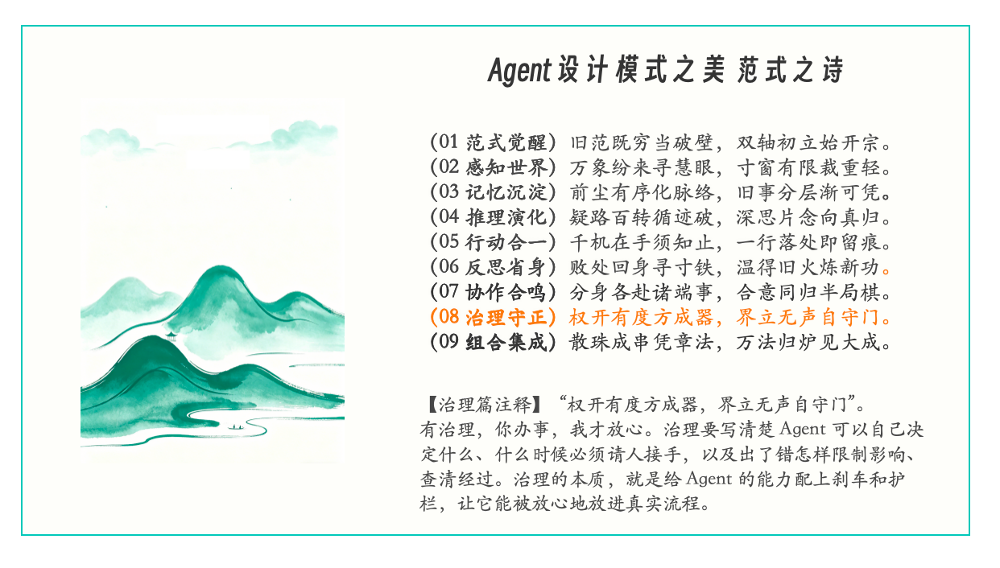
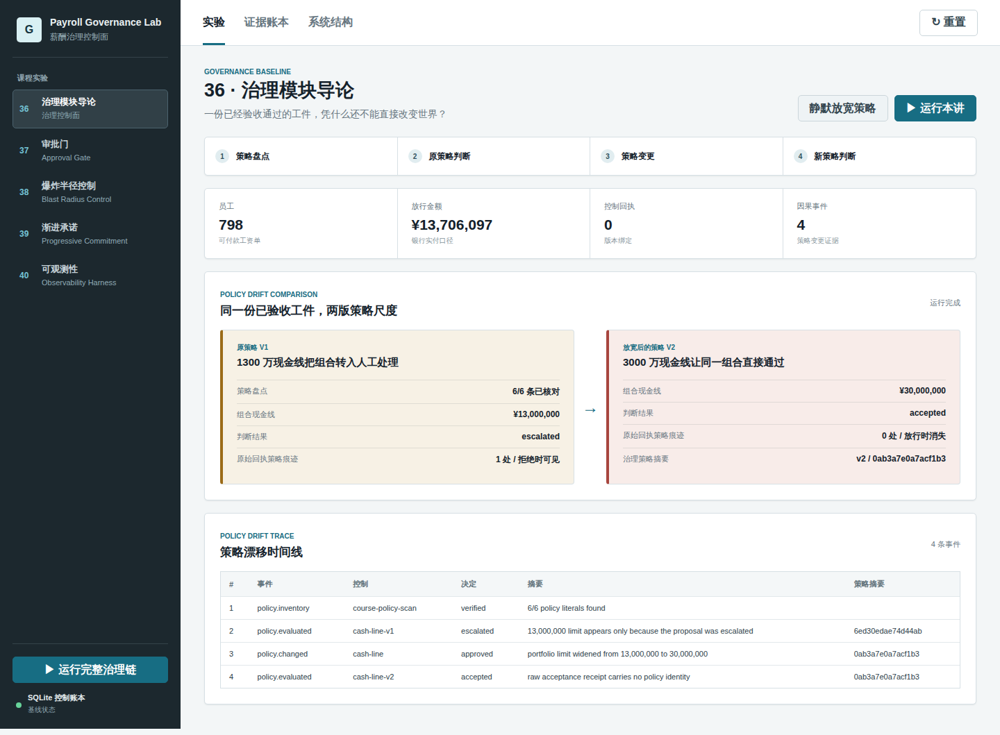
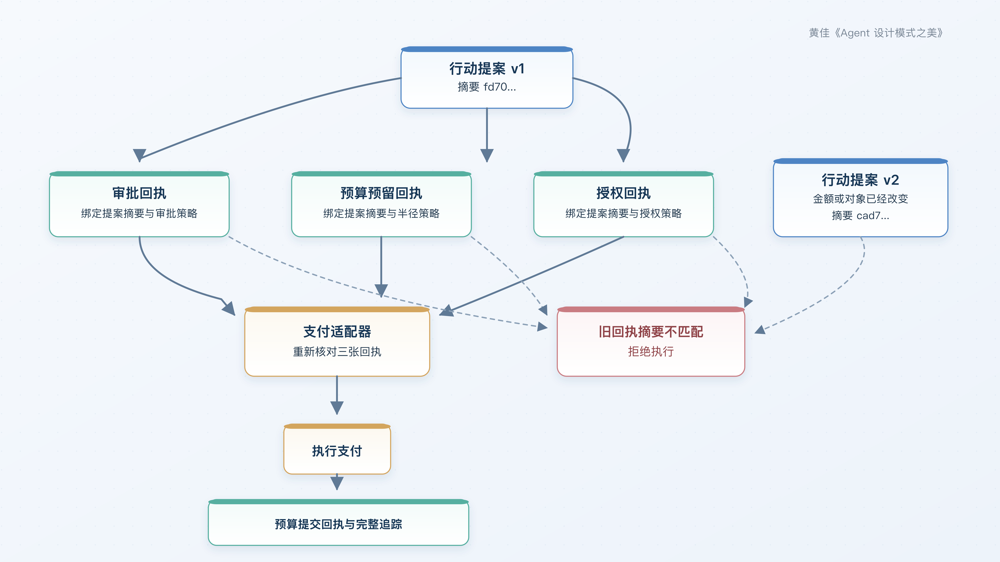
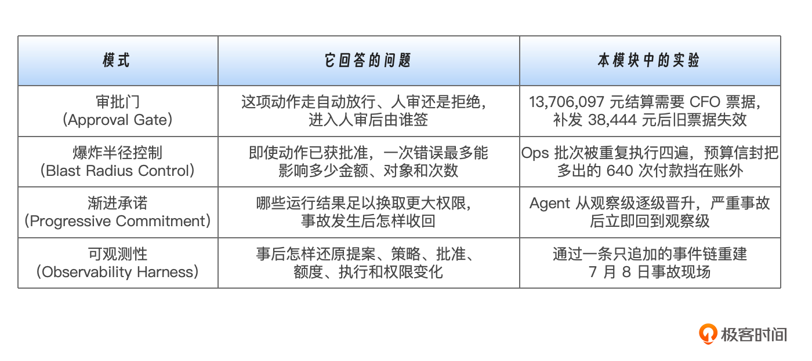
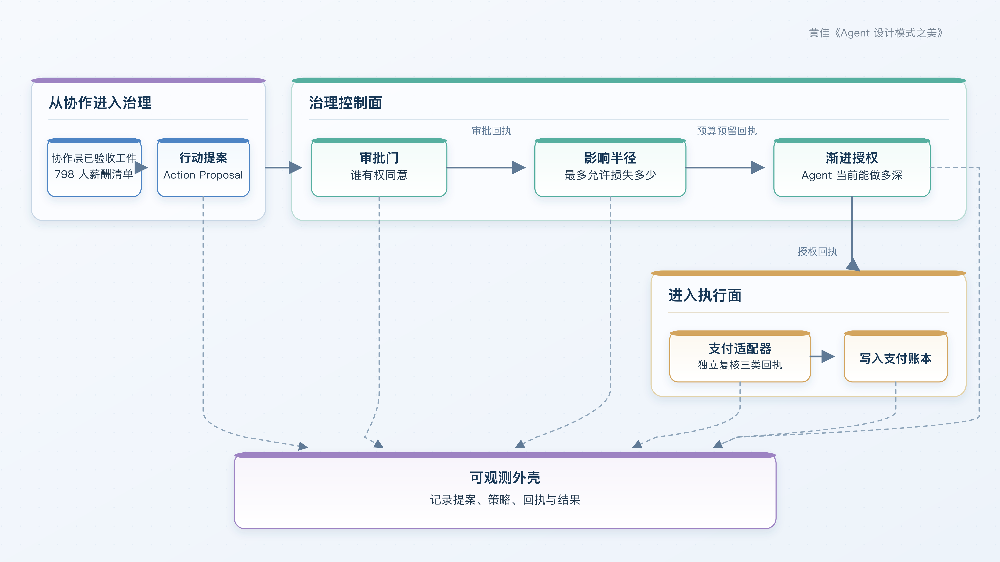

# 36 | 治理模块导论：把边界写清楚，才敢把事交出去




你好，我是黄佳。

讲治理时，我经常用管孩子举例子。我给他的屏幕时间是每天两小时，一小时看视频，一小时玩游戏。在这条边界里面，他自己安排。有时他把一小时拆成三个二十分钟，有时拿游戏时间换视频时间，还会提出做家务换几分钟屏幕时间。

这个规则确实带来了我想要的东西。他开始学习怎样分配时间，也有了选择。也就是说，有规则让我轻松多了，而且还在可控范围内增加了一些他的自由。不过，规则同时留下了协商空间。多看五分钟似乎问题不大，下一次再多五分钟也有理由。每一次单独看都说得过去，连在一起却可能慢慢偏离“学会管理时间”这个目标。

Agent 治理也有这层麻烦。人如果每一步都要点头，Agent 就只剩下自动填表。系统如果只看眼前这一笔调用，一串分别合规的动作，合起来又可能越界。我们既要给它做事的空间，也要看住这段空间的边界。

## 当 Agent 开始替人做事

传统软件也会在运行时做选择。它读一个输入，进入某个分支，再调用一个函数。只是大部分选择空间已经由工程师写在代码里，我们能沿着分支逐条检查。

Agent 把更多具体选择推迟到了运行时。模型看到当前上下文以后，才决定用哪个工具、带什么参数、按什么次序组合。API Key 把调用关联到某个账户或应用，基于角色的访问控制（RBAC）规定这个角色可以使用哪些接口。但单靠这些信息，还回答不了下面这个问题：这一位员工、这一笔金额、在这个时间点，究竟该不该付？

假设客服 Agent 准备给一位用户发 100 元优惠券。动作很小，却已经包含三类治理问题。

1. 能否放行。 当前工单是否满足补偿条件，金额是否在权限内，这次操作需不需要人看。

2. 怎样追责。 事后要能找到用户请求、Agent 提案、采用的策略、审批结果、工具返回值和业务系统的实际变化。

3. 最多影响多少。 即使判断错了，也只能影响这一张工单，不能顺手修改全站补偿规则，更不能因为重试连续发出十张券。

这三件事分别关注准入、证据和损失范围。治理还要处理时间：Agent 今天积累的成功记录，是否足以换取明天更大的操作空间。于是又多出第四个问题，权限怎样增长，又怎样在事故后收回。

把四个问题放在一起，本模块所说的治理就有了一个可落地的定义：Agent 治理是在运行时分配行动权。它把具体提案交给策略裁决，为错误设置硬上限，让权限随可核验结果变化，并保存能够还原责任的运行记录。

## 先看一条悄悄变宽的现金线

我们还是回到薪酬 Agent，看看同一份结算数据，为什么只改一个限额，检查结果就变了。

六月月末的测试账本：798 张工资单标为已付款，另外 2 张已冲正，形成一份总额为13,706,097 元的结算清单。这里，程序会用两条规则检查它，其中一条是全款允许自动通过的金额上限。上限为 13,000,000 元时，清单需要转交人工处理（escalated）；此时，我们把这个额度放宽到 30,000,000 元后，同一份清单就通过了检查（accepted）。

换句话说，同一份 1370 多万元的工资清单，按原来的规定，超过 1300 万元就要找人审批。实验中把限额提高到 3000 万元，系统就自动通过了。但放行记录没有记下采用的规则版本，事后只知道“通过了”，却说不清“按什么规则通过的”。这就是本次实验试图呈现的问题。

总额放宽，这也许是公司为一次补发工资，临时批准提高结算限额。这没问题，但这段旧实现只在超限回执中写下触发的金额上限，放行回执没有写清新的策略版本。批准之后，我们并不知道这次采用的是哪一版规则，也无法据此查清谁提出了放宽、谁批准、为何调整。

运行实验：

```
python3 governance/payroll-lab/ungoverned_policy_lab.py
```

下面是限额变化后的四行输出：

```
== scene 2: the quiet widening (June claim 13,706,097) ==
  limit 13,000,000 -> escalated
     refusal names the policy: limit=13000000 observed=13706097.0
  limit 30,000,000 -> accepted
     policy marks on the acceptance receipt: []
```

拦下来的时候，系统说得出哪条规则拦了它。放过去以后，规则反而从记录里消失了。



- 策略漂移实验：同一份结算清单，限额改变后由转交人工变成通过检查。图中金额来自已有的测试账本，不表示本次实验执行了付款。

## 把提案、策略和裁决分开保存

上一个实验中，同一份 1370 多万元的工资清单，限额改成 3000 万元后，系统就通过了检查。但记录里只有“通过”，没有说明采用了哪版规则。

现在，我们给每版规则编上号：第一版的限额是 1300 万元，第二版是 3000 万元。每次检查结束，系统除了记录“通过”或“转交人工”，还要记下使用的规则编号和版本。

Repo 的模式实现中，把提案、策略和回执分开保存。（参考

```python
governance/boundary_contract.py ）
@dataclass(frozen=True)
class ActionProposal:
   proposal_id: str
   version: int
   contract_digest: str
   artifact_id: str
   artifact_digest: str
   requested_by: str
   action: str
   resource_scope: tuple[str, ...]
   idempotency_key: str
   risk: RiskLevel
   reversibility: Reversibility
@dataclass(frozen=True)
class PolicyRef:
   policy_id: str
   version: int
   content_digest: str
@dataclass(frozen=True)
class GovernanceReceipt:
   receipt_id: str
   control: str
   proposal_digest: str
   policy_digest: str
   decided_by: str
   decision: ControlDecision
   issued_at: str
```

- ActionProposal 保存“准备做什么”。它绑定任务契约、结算工件、动作范围和幂等键。

- PolicyRef 保存“按哪一版尺度判断”。

- GovernanceReceipt 保存“谁在什么时间作出了什么裁决”。

可以把这三份记录看成“申请单、规则版本和处理回执”。摘要是根据内容算出的一串校验值，回执会记下当时提案和策略的摘要。执行入口准备付款时，还要重新核对：眼前的提案和当前生效的规则，是否与回执对应。金额、收款对象或策略版本变了，就需要按新内容重新判断。

这样，财务人员事后问：“这份清单超过了原来的 1300 万元，怎么还能通过？”我们就能查到：这次采用的是限额为 3000 万元的第二版规则。再查这版规则，就能看到负责人和修改原因。

这个实验增加的，就是让每一次放行都有规则可查。它还没有证明规则改得合理，也没有证明修改经过了有权审批的人同意。

接下来才是第二个问题：谁有权修改规则？比如，Agent 想把限额从 1300 万元提高到 3000万元，不能自己提出、自己批准，必须交给有审批权的人确认。

```
== scene 3: pin the policy, the change signs its own name ==
  v1 (13,000,000) digest=6ed30edae74d44ab -> escalated
  v2 (30,000,000) digest=0ab3a7e0a7acf1b3 -> accepted
  four-eyes: policy 'cash-line' v3: proposer and approver are the same actor
```

现在，系统通过检查时，也会记下采用了哪版规则。

实验还加了一道检查：把限额从 1300 万元提高到 3000 万元，提出修改的人不能自己批准自己（这叫做四眼原则）。如果有人把自己同时填成提出者和批准者，程序就会报错。

不仅付款需要审批，放宽付款规则也需要审批。



- 付款前重新核对回执。提案金额或对象改变后，旧回执的摘要对不上，执行入口拒绝付款。

## 四个问题，四种模式

把薪酬结算交给 Agent，我们还需要回答四个问题：这笔钱能不能付？出了错会影响多大？什么时候可以让它自己多做一点？事后能不能查清经过？

接下来的四讲，分别通过四个模式讨论这些问题。



为什么要分成四种模式？变化的原因不同。因为这些规则经常需要分别调整。比如，公司临时提高了某个月的结算额度，并不意味着 Agent 从此可以自行批准大额付款。预算变了，审批人的责任和 Agent 的权限仍要分别确认。

分开设计后，我们就能说清楚：这次到底改了什么，又有哪些约束必须继续有效。 代码和测试也围绕这些具体问题展开，改额度时检查额度，改权限时检查权限，再验证它们能否一起守住业务要求。

- ADPS 版本说明：本专栏沿用写作阶段形成的四讲结构，把可观测性放在治理模块中收束。ADPS 共同体在后续研讨中调整了目录，把 G1 审批门、G2 爆炸半径控制和 G3 渐进承诺保留在治理行，把可观测性调整为 X1 横切工程面，用来贯穿全部模式和生命周期。这里保留原有教学编排，最新分类与编号以 ADPS 模式目录为准。



- 控制面分工：策略负责判定，执行层只消费当前有效的回执、额度和权限凭证

## 边界越清楚，日常打断越少

如果我们没有说清楚哪些事可以交给 Agent，它就只能不断来问。人被问得多了，也容易从认真审批变成随手点“同意”。

所以，治理要先分清两类事情：哪些可以让它自己完成，哪些必须停下来找人确认。

2026 年 5 月，OpenAI 介绍内部 Codex 的安全设计时，就区分了沙箱和审批策略。沙箱限制它能访问哪些文件、能否连接网络，审批策略决定哪些操作需要人确认。Claude Code 也提供权限设置，以及工具执行前的检查机制。

这些工具能帮我们把检查放进执行过程，但具体检查什么，还得由业务方决定。

比如，允许 Agent 使用付款接口，并不代表它提出的每一笔付款都应该执行。工资有没有核对过，这笔钱是否已经付过，金额变化后要不要重新审批，都需要薪酬系统自己判断。

新加坡在 2026 年 1 月发布的 Agentic AI 治理框架，也把技术控制和人的责任放在一起讨论：事前评估风险，明确哪些环节需要人负责，在开发和运行过程中持续检查，并让使用者了解系统的能力、限制和操作责任。

对企业来说，这意味着：既要把检查写进程序，也要让人知道自己什么时候该接手、接手后需要判断什么。

## 从教学 Repo 到生产系统

本模块使用固定的样例数据和本地 SQLite 数据库。每次从相同的起点运行，我们就能看清：改了一条规则以后，检查结果、批准记录和预算余额发生了什么变化。

实际业务，还需要考虑：

- 确认是谁在操作。用户、Agent 和审批人的身份，要从可信的登录与身份系统中取得，不能由程序随便填个名字。

- 查得到规则的来历。当前限额是多少，什么时候生效，谁提出修改、谁批准，都要保存下来，旧版本也不能直接抹掉。

- 真正付款前必须检查。最终执行付款的程序，要核对申请内容、审批结果、剩余额度和当前权限，不能只在前面的页面上检查一次。

- 分清钱付到了哪一步。 记录哪些款项已经支付、哪些尚未支付、哪些暂时查不到结果。银行请求超时后，要先查清有没有付成，不能直接再付一遍。

- 出事后查得清，也停得下。保留经过脱敏的操作记录，并提供不依赖 Agent 自己决定的停止手段，及时阻止后续操作。

检查自己的系统时，可以从“真正提交付款”的那段代码往回看：它执行之前，到底检查了什么？如果“超过限额必须审批”只写在提示词里，付款程序却不检查批准记录，这条要求就还没有真正落实。

## 总结一下

给孩子两小时屏幕时间，是希望他在这个范围内学会自己安排。如果规则被一次次放宽，最后偏离了原来的目的，我也需要介入。

把任务交给 Agent，同样要说清楚：哪些决定可以交给它，哪些仍然需要人确认。交出去以后，还要知道它实际做了什么，以及什么时候应该收回权限。

后面四讲会沿着薪酬结算这个例子，逐一讨论审批、损失范围、权限调整和运行记录。每一讲都解决一个具体问题，让“放心交给它”有可以检查的依据。

## 下一讲预告

Agent 提出一项操作后，哪些可以直接执行，哪些需要人看，又该找谁审批？我们还会追问：主管已经同意，但申请金额后来变了，原来的批准还能不能用？下一讲审批门模式将详解这个过程。

## 思考题

1. 你的系统记录“通过”时，能不能查到当时采用了哪一版规则？

2. 如果有人要提高付款限额，应该由谁批准？现有记录能否查到修改前后的数值和修改原因？

3. 找到系统里真正执行付款、删除数据或对外发送消息的代码。它执行前检查了什么，又有哪些要求只写在提示词或文档里？

## 参考资料

1. OpenAI, Running Codex safely at OpenAI, 2026-05-08.

2. IMDA, Model AI Governance Framework for Agentic AI, 2026-01-22.

3. IMDA, AI Agents: Insights from the Singapore Government and Google Sandbox, 2026-05-20.

4. Saltzer, J. H. and Schroeder, M. D., The Protection of Information in ComputerSystems, 1975.

5. ADPS, 《治理模块 · 把 Agent 的自主权变成可管理的工程对象》, Agent 设计模式白皮书, 2026-08-20.

6. ADPS, 《Agent 设计模式白皮书 · 模式目录与选型框架》, 2026-08-26.
