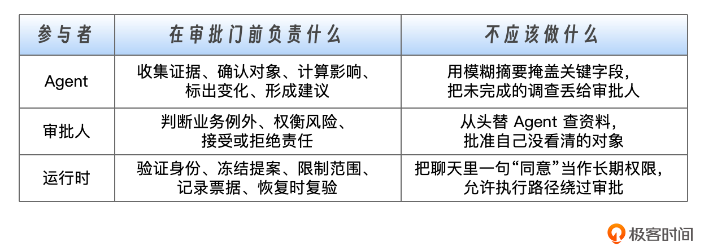
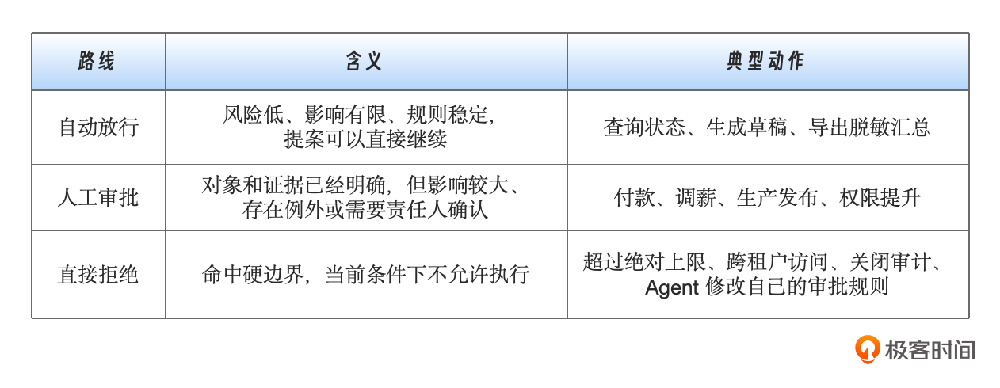
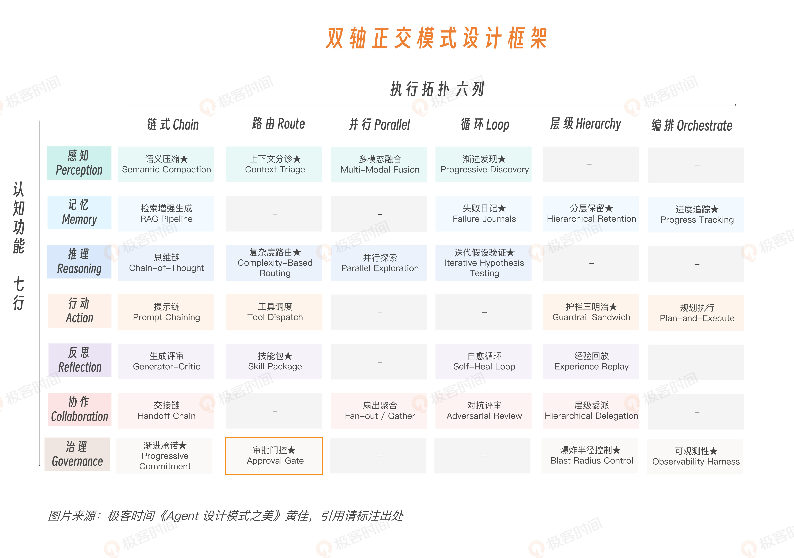
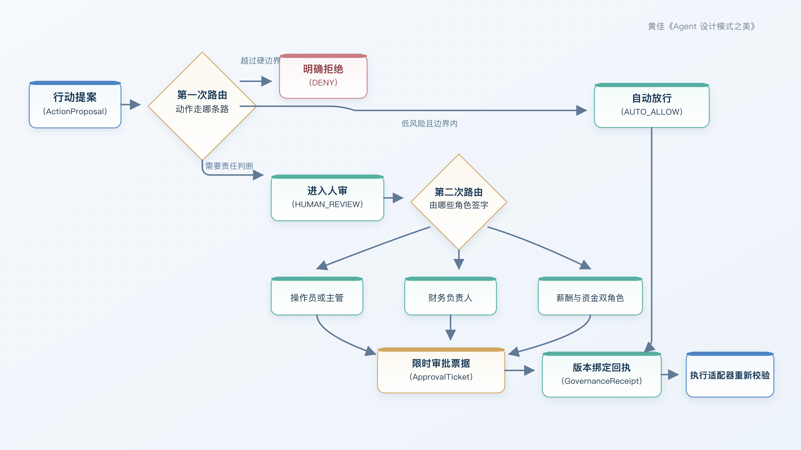
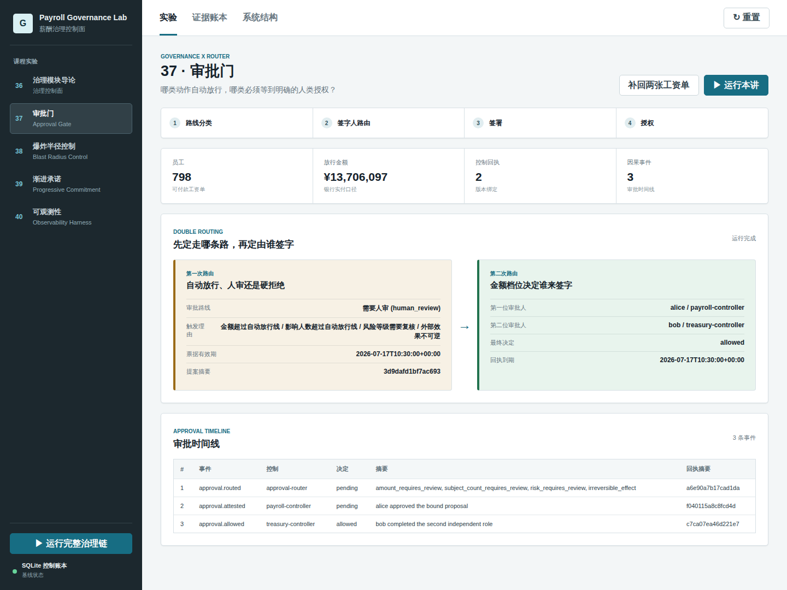
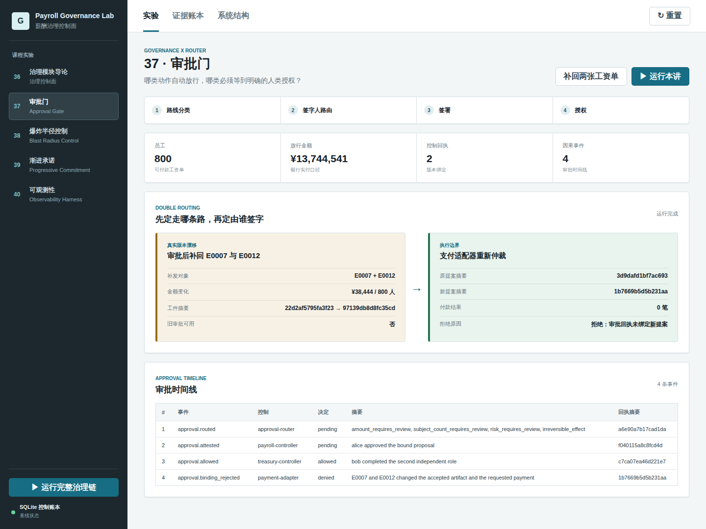
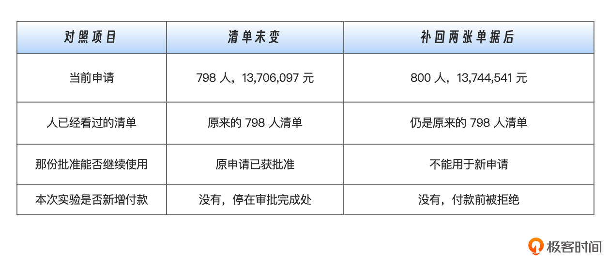
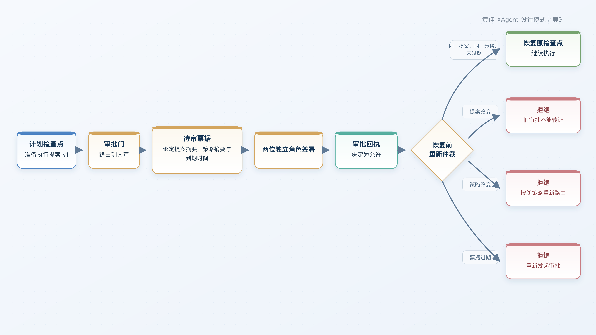
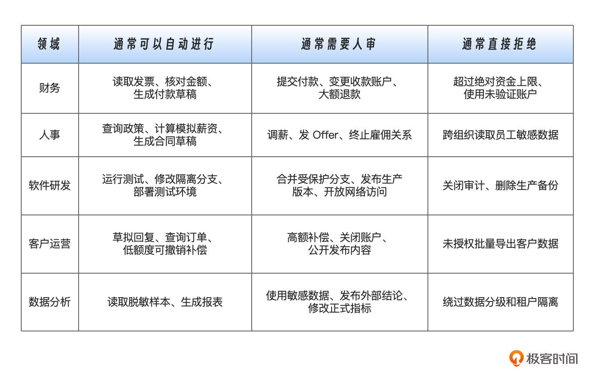
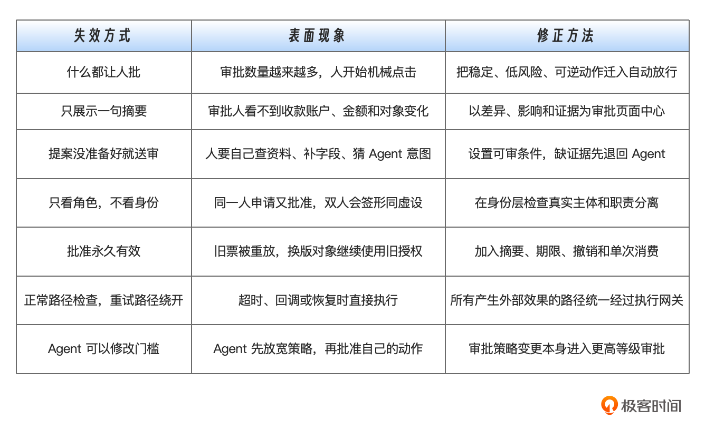

# 37 | 审批门：让批准只对这一项动作有效

- 释题：高风险动作生效之前，Agent 先把事实、差异和影响整理清楚，再请人作出判断；人的一次点头只打开眼前这一扇门。

你好，我是黄佳。

任何在公司里工作过一段时间的人，都对审批不陌生。

请假超过三天，要主管批准；报销超过一定金额，要再往上走一级；供应商要求变更收款账户，财务要复核；工程师准备把新版本发布到生产环境，要等负责人放行；销售准备给客户一笔超出常规额度的折扣，也不能自己决定。

这些流程有的在 OA 里，有的在邮件里，有的藏在财务、采购、权限和发布系统中。它们长得不太一样，做的却是同一件事：流程可以自己往前跑，到了责任边界，先停一下。

## Agent 给审批带来什么新问题？

审批门很普遍。请假、报销、文档签署和业务流程批准这都是企业 ERP 系统常见场景；GitHub 可以要求生产部署先经过指定 reviewer，还能禁止发起人自我批准；AWS StepFunctions 则允许工作流暂停，等人作出决定后再从原位置继续。审批是企业软件里的基础结构。

Agent 时代，审批门遇到了一种会自己组织动作的新来客。

传统工作流里的申请单大多是固定的。报销单有哪些字段，采购单要走哪些节点，生产发布对应哪个版本，工程师提前都写好了。审批人看到的是一张已经成形的业务对象。

Agent 不一样。它会在运行时决定调用哪个工具、使用哪些参数、处理多少对象、按照什么次序执行。用户只说一句“把这个月符合条件的退款处理掉”，Agent 可能先查订单，再判断资格，然后生成退款清单，最后调用支付接口。

Agent 的权力现在越来越大，它会真正改变外部世界。拿我的工作过程来说，使用 Agent 来读取邮件、撰写草稿、抓取微信群的新信息已经成了家常便饭。Claude Code 或者 Codex 会告诉我：“这封给你老板的回复邮件已经写好，还没发，你自己点。”有的时候它甚至补上一句：“你告诉我一声，我帮你直接发。”（真的）

此时我不觉得轻松，而是紧张。有时我会觉得万一它把它写的那封给老板的邮件直接发出了怎么办，万一它直接回复了我的好几百人的微信群怎么办。这还是我个人使用场景，而在生产环节，“让人看一眼”就更不够了。需要回答的是：人看见了什么？他批准的是哪一版对象？批准以后，Agent 还能不能改参数？等待期间数据变了怎么办？这一声“同意”可以使用几次，又能沿用到什么时候？

## 人和 Agent 在门前怎样交接

审批门首先是一种人机协作关系。

一般的系统把这层关系时较为粗糙。Agent 做到一半，弹出一句：“这是高风险操作，是否继续？”如果人不知道它查了什么、为什么这样做、具体会改哪些对象，只能凭感觉点击“批准”。

出了问题以后，系统又说：“这一步有人确认过。”这不叫人类监督，只是把责任推给了一个信息不足的人。

真正有效的审批，应当由三方各自完成一部分工作。



Agent 要把动作做到“可审”，再来敲门。不该总让人替 Agent 补表、查 ID、核对加法；Agent应当先完成那些可以被工具和规则完成的工作，把事实整理成一份紧凑的决策材料。人的精力应当放在价值判断、业务例外、重大影响和责任归属上。并不是 Agent 一犹豫，就应该把问题送给人。

举个例子，比如供应商发来一封邮件：请把本月货款打到新账户。付款 Agent 查到这家供应商已经合作五年，本月金额也和平时接近，于是生成审批请求：

- 支付本月供应商货款，是否批准？

这张审批单几乎没有价值。真正值得注意的不是“支付货款”，而是“收款账户刚刚发生了变化”。一张合格的审批卡，应该把最需要人判断的差异放在最显眼的位置。例如：

项目

- 内容

- 向供应商 HZ-204 支付发票 INV-8821

申请动作

- 486,000 元

金额

- 收款账户由 ****2381 变更为 ****9042变更时间：今天 10:42；过去 18

关键变化

- 个月内第一次变更

- 供应商主数据：已匹配；变更申请：已取得通过预先留存的联系人电

核验结果

- 话回拨确认：已完成发票金额与采购订单：一致

审批人不需要翻阅 Agent 的全部思考过程。他需要看的是业务对象、关键差异、证据来源、未决风险、外部影响和批准范围。

“提交六月工资”“发布最新版本”“支付本月货款”都只是摘要。审批真正应该围绕的是：和上一次相比，什么变了；这次动作会影响谁；一旦点头，系统将具体做什么。

证据不足和需要审批，是两种不同状态。

- 证据不足，说明 Agent 还没有把工作做完，应当继续查证、澄清或停止。

- 需要审批，说明事实已经基本清楚，只是动作的影响和责任超过了自动权限。

一个提案进入人审之前，至少应当具备四个条件：执行对象已经确认；关键证据已经取得；外部影响已经说明，能计算的部分也已经算清楚；动作的可逆性和后续步骤已经说明。缺少其中任何一项，都不建议流转到审批环节。

因此，审批门真正处理的是三条路线。



对象不清、证据缺失或业务状态未知，先补充；政策有冲突，先厘清适用规则。这些事情Agent 应该在审批之前提前为人准备好。

## 审批的范围和审批者的角色

人在聊天里说一句“可以”，可能有很多含义：

- 这一次可以；

- 这一批可以；

- 今天之内可以；

- 以后遇到类似动作都可以；

- 允许 Agent 自己判断。

因此审批门要把人的自然语言决定编译成一项有边界的许可，这个边界要包含以下维度。

- 谁批准；

- 批准哪一项动作；

- 作用于哪些对象；

- 在什么时间内有效；

- 最多可以使用几次。

- 开发者工具已经开始把这种范围明确展示给用户。Codex 的安全文档建议，在“一次批准”和更宽范围间选择能够完成任务的最窄授权；Claude Code 也区分临时批准、会话级授权、持久规则，以及 allow、ask、deny 不同权限结果。企业系统更应该坚持这个原则。批准一笔付款，不等于以后可以向同一供应商自动付款；批准一个生产版本，不等于以后可以绕过发布审查。新加坡 Agentic AI 治理框架把这种安排称为“有意义的人类责任”：系统应当找到重要的动作边界，在那里设置真正有作用的人类检查点，同时训练审批人理解自己正在批准什么。重点不在于流程里出现过一个人，而在于这个人是否拥有足够的信息、权限和时间作出有效判断。

另外，审批者也有不同的角色。NIST 对人机交互风险的讨论强调，要明确区分 AI 系统中不同人的角色与责任。审批人、系统所有者、业务操作员和最终用户各有所指。

审批者也不一定永远是人。确定性规则可以处理硬拒绝和明确放行，一些边界请求还可以先交给独立 reviewer agent。OpenAI 在 Codex 的 auto-review 设计中，让单独的 reviewer agent处理符合条件的升级请求，同时保持原有沙箱和审批策略不变。它改变的是谁来检查，并没有取消边界本身。重大外部影响、业务例外和责任性决定，仍然应当保留有意义的人类检查点。

## 审批门模式

现在可以给审批门下个更完整的定义了。审批门（Approval Gate）位于一项具体动作生效之前。它根据动作主体、参数、资源、环境、影响和可逆性，在自动放行、人工审批和拒绝之间作出路由；进入审批后，人的决定只绑定当前提案、当前策略、当前身份和有限的有效期。

它在设计模式双轴中的坐标是治理 × 路由。



它属于治理，因为它分配的是行动权；它属于路由，因为它不亲自完成业务动作，而是决定动作走自动路径、人审路径还是停止路径，并在进入人审以后继续选择责任人。

Agent 把准备执行的这项具体动作整理成要交给审批人的提案，其中包括工具版本、规范化参数、资源范围、委托身份、策略版本和业务前置条件。后面也还要记录清楚谁批准了哪一个提案，最后实际执行了什么。



- 审批门的完整路径。人审发生在可审提案形成以后，执行发生在批准重新验证以后。

## 回到薪酬工作台

两位负责人已经批准了六月的工资清单。准备执行时，Agent 又往里面加了两个人。金额只多了几万元，原来的批准还能不能用？

下面就做这一个实验。先让原清单获得批准，再改变清单，检查程序能否认出“人批准的那份”和“现在准备执行的这份”已经不同。

我们沿用第 36 讲的月末测试数据。800 张工资单中，798 张标为已付款，另外 2 张标为已冲正。程序取出前 798 张，组成一份 13,706,097 元的清单，用它模拟一项准备提交的结算申请。

```
申请由教学程序以 payroll-agent 的名义提出。本次是整月批量结算，按工作台的规则，
```

需要两位负责人共同同意：Alice 负责薪酬，Bob 负责资金。一个人同意还不够。Alice、Bob都是程序里预设的测试身份。点击运行后，脚本会依次模拟他们同意，页面展示过程和结果。

通过下面的命令启动网页：

```
uv run python governance/payroll-lab/web_app.py --port 8767
点击“运行本讲”。后台调用 governance_lab.py 中的 run_approval_gate()，先生成
```

原清单的申请，再交给审批门检查。

这笔申请的金额、人数和风险都超出了自动处理范围，因此页面左侧显示“需要人审”。接下来，程序模拟 Alice 和 Bob 依次同意。看右侧的两位审批人，再看下面的“审批时间线”，会看到三个阶段：

发生了什么

- 审批结果为什么

- 等待，pending

申请进入审批门

- 需要两位负责人同意，还没人签字

Alice 同意

- 仍在等待，pending薪酬负责人已确认，资金负责人还没有确认

Bob 也同意

- 允许，allowed两个不同身份分别完成了所需确认



- 完整模式的双人会签。审批角色、提案摘要、策略摘要和有效期同时出现。

```
此时的 allowed 表示：这份 798 人、13,706,097 元的申请通过了审批。 页面顶部的金额来
```

自样例清单。程序在这里停在审批结果，没有继续执行付款。

现在点击“补回两张工资单”。这个按钮会从同样的初始数据重新跑一遍：先取得两位负责人对原清单的批准，然后把 E0007、E0012 两张单据加回来，再尝试使用刚才那份批准。它不是在上一次运行的结果上不断追加数据，多点一次也会从头开始。

两张单据合计 38,444 元。加回来以后，申请变成了 800 人、13,744,541 元。审批人没换，原来的两次同意也还在，变的是他们没有看过的新清单。

程序为新清单生成新申请，再把它和旧批准一起送到付款前的检查程序。页面左侧的“旧审批可用”会变成“否”，右侧显示“拒绝：审批回执未绑定新提案”。这句话的意思是：手里的批准对应原来的 798 人清单，不能拿来执行现在的 800 人清单。



- 工件漂移：审批人的级别没有问题，问题出在批准对象已经换版

把两次观察放在一起，结果是这样的：



```
想再核对一次，可以打开页面上方的“证据账本”，选择 payment_effects。这是本地实验记
录实际付款动作的表，两种情况都没有新增付款记录。原工资单上的 PAID 是准备样例时写入
```

的状态。

因此，第二次运行的拒绝有明确原因：两位负责人没有批准后来加进来的两张单据。下一步应当把新增人员和 38,444 元的差额交给他们重新确认。本实验演示到拒绝旧批准为止，没有自动完成新一轮审批。

在代码目录运行下列命令，会连续执行“批准原清单”和“改变清单后检查旧批准”，与工作台调用的是同一个函数：

```
uv run python governance/payroll-lab/approval_gate_lab.py --changed
```

这是输出的最后一段，前面的路线判断和签字过程没有重复贴出：

```
== E0007 and E0012 restored after approval ==
  restored=E0007, E0012 delta=38,444.00
  artifact_digest=22d2af5795fa3f23 -> 97139db8d8fc35cd
  changed_digest=1b7669b5d5b231aa
  changed_scope=800 subjects, 13,744,541.00
  old_approval_authorizes=False
  adapter=payment adapter rejected invalid receipts: approval-gate
delta=38,444.00 是增加的金额，changed_scope 是修改后的 800 人清单，
old_approval_authorizes=False 表示旧批准不适用于新申请。最后一行说明付款前的
```

检查也拒绝了它。

## 为什么付款前还要再查一遍

请思考，审批门已经检查过了，为什么支付适配器还要再查？

因为审批与执行之间有时间差。检查时成立的条件，使用时可能已经改变。这就是软件工程里的 TOCTOU，英文是 Time of Check to Time of Use，中文可以理解为“检查时”和“真正使用时”之间出现了空档。

生产执行器在付款前至少要重新确认四件事：

```
回执的决定是 ALLOWED。
```

- 回执绑定的提案摘要等于当前提案摘要。

- 回执绑定的策略摘要仍是当前生效版本。

- 回执尚未过期。

```python
核心契约把这四项集中在 GovernanceReceipt.authorizes()：
def authorizes(
   self,
   proposal: ActionProposal,
   policy: PolicyRef,
   *,
   at: str,
) -> bool:
   if self.decision is not ControlDecision.ALLOWED:
       return Falseif self.proposal_digest != proposal.digest:
       return Falseif self.policy_digest != policy.digest:
       return Falsereturn self.expires_at is None or _instant(at) <= _instant(se
```

执行器应从可信存储读取回执。这段代码只检查批准是否仍对应眼前的提案和当前政策，使用次数另行处理。账户状态、结算版本和资金余额等业务条件，也要在提交事务前重检，并用版本条件或锁防止检查后再次变化。



- 等待期间允许外部状态变化，恢复点必须重新验证当前提案

## “等待审批”是一种动态状态

审批会把一次 Agent 运行切成前后两段。

前半段形成提案，后半段在批准后恢复。中间可能只等两分钟，也可能等两天。任务等待期间，库存、余额、人员状态、代码版本和其他 Agent 的执行结果都可能变化。

因此，“等待审批”必须成为一种持久化运行状态，不能只停在某个 Web 请求或模型上下文里。下面这些信息都要能找回来：

```
run_id                  # 哪一次任务
intent_digest           # 当时审批的提案
policy_digest           # 当时生效的规则
approval_id             # 对应哪一张票据
approval_status         # 等待、批准或拒绝
required_approver        # 谁还需要签字
expires_at              # 批准何时过期
resume_node             # 从哪里恢复
business_preconditions  # 恢复前需要重查的条件
```

恢复时，也不能拿着审批结果直接跳到工具调用。运行时需要重新读取当前提案、当前策略和关键业务状态，再验证票据。对象变了，就重新生成提案；票据过期了，就重新申请；条件仍然成立，才允许执行。

AWS Step Functions 的人工审批示例会暂停状态机，等待外部回调后再继续；LangGraph 的

```
interrupt() 配合持久化检查点和任务标识，也能保存状态并在收到外部输入后恢复。要留
```

意，LangGraph 恢复时会从被中断节点的开头重新运行，因此中断前做过的外部操作也要防止重复。框架提供暂停和恢复机制，业务系统仍然要决定保存哪些事实、回来后重查哪些条件。

## 对审批规则本身的审批

另外，不仅付款要审批，修改“什么付款可以免审批”的规则，也要审批。

比如，原来超过 1,300 万元的付款必须找人批准。现在有人想把上限提高到 3,000 万元，就意味着更多付款可以自动通过。这项改动不能由 Agent 自己决定。

教学实验里，普通主管没有权限批准这种改动，必须由 CFO 点头。还可以采用更严格的安排，需要治理负责人和风险负责人共同批准。这样做是为了防止一种绕行：一笔付款本来过不了，Agent 先把规则改松，再拿新规则批准自己的付款。

## 企业中的常见审批场景和策略

同一项能力在不同参数下，可能走完全不同的路线。“读取数据库”可能只是查看一条订单，也

```
可能是导出全部客户资料；“运行命令”可能是执行 git status，也可能是删除生产数据；
```

“发放补偿”可能是给一位客户补一张十元优惠券，也可能是向十万名用户批量发券。

所以风险并不只是和工具名称相关。审批门需要看调用者、动作、目标资源、环境、对象数量、金额、数据敏感度、外部可见性和可逆程度。



这里没有一张放之四海而皆准的金额表。企业真正需要建立的是一套委托尺度：什么动作可以自动做，什么动作需要哪一级角色批准，哪些动作无论谁批准都不能做。

审批门要回答两个问题：

1. 这项动作要不要交给人？

2. 需要交给哪一个人，或者哪几个人？

第一个问题在自动放行、人审和拒绝之间分流。第二个问题把进入人审的提案送到具有相应责任和权限的角色。低额付款可能由薪酬主管批准，大额批次可能交给财务控制人，收款账户变更可能要求财务和资金团队分别确认。

## 审批门使用注意事项

审批门看起来简单，真正上线以后，问题通常出在下面几处。



其中最常见的是审批疲劳。相信你在使用 Claude Code、Codex 等 Agent 时，早期一定也会对一遍又一遍 Approve 感到厌烦，最后都不知道自己 Approve 的是什么了。直到后来，Claude Code 根据大家的使用系统推出了自动 Approve 常用命令的 Auto 模式。一扇成熟的审批门，目标是让人少审批，只看到值得点的那几次。

因此，系统还应当观察人审比例、退回率、拒绝率、平均等待时间、票据过期率、对象变化导致的失效率，以及是否出现高风险动作绕过审批。比如，某条规则连续半年没有一次拒绝，可以检查它是不是还有必要进入人审；确认风险和适用条件已经稳定，再考虑自动放行。

## 总结一下

审批门是企业很熟悉的一种结构。Agent 让它重新变得重要，是因为动作不再全部由固定流程预先写死。Agent 会在运行时形成提案、选择工具、组合参数，还会在暂停恢复后继续执行。

这时，人机之间需要一次清楚的交接。Agent 负责把事情做到可审：对象明确、证据齐全、差异突出、影响可见。人负责判断例外、权衡后果并承担相应责任。

审批门的目标不是处处插人，成熟的设计，是让日常动作安静地通过，少数高风险动作带着完整材料来到人面前。Agent 把事情准备好，人把责任想清楚，系统来绑定当前提案、当前策略、当前身份、限制时间和次数，这些都用于保证当前审批的精准性和明确性。

## 思考题

1. 找到你所在系统里的一张审批单。它展示的是动作摘要，还是把真正变化的字段单独标了出来？

2. 哪些动作现在频繁进入人审，其实已经稳定到可以自动放行？哪些动作虽然金额不大，却因为不可逆或涉及个人权益，仍应保留人审？

3. 一项动作等待批准两小时以后，哪些业务事实可能已经变化？你的恢复路径会重新检查它们，还是直接沿用旧批准？

4. 如果 Agent 缺少关键证据，它现在会继续查证、退回澄清，还是把问题包装成一张审批单交给人？

## 下一讲预告

人的批准完全正确，执行仍然可能出错。程序可能重复提交，外部接口可能超时，一项合法动作也可能被放大成严重损失。那么既然错误无法完全消灭，怎样把一次错误最多能影响的金额、对象和次数提前圈住？

## 参考资料

1. OpenAI，Running Codex safely at OpenAI，2026-05-08.

2. Anthropic，Claude Code Hooks Reference，accessed 2026-08-29.

3. LangChain，LangGraph Interrupts，accessed 2026-08-29.

4. NIST，Role Based Access Control，accessed 2026-08-29.

5. ADPS，《G1 · 审批门》，Agent 设计模式白皮书 v0.4，2026-08-19.

6. IMDA，Model AI Governance Framework for Agentic AI，关于重要检查点与有意义的人类责任。
