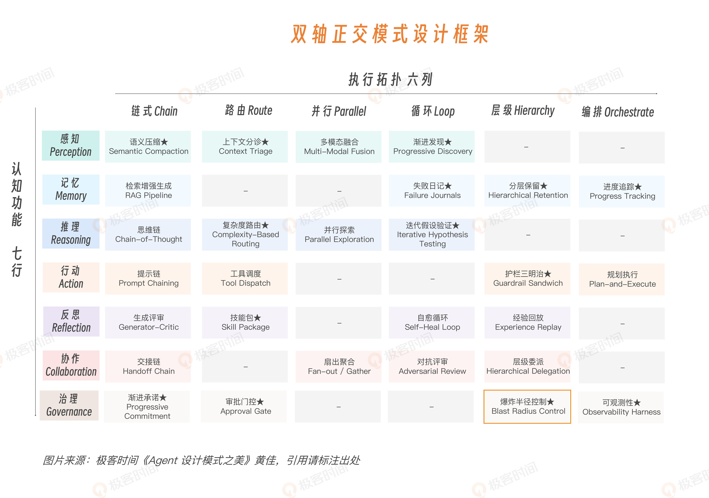
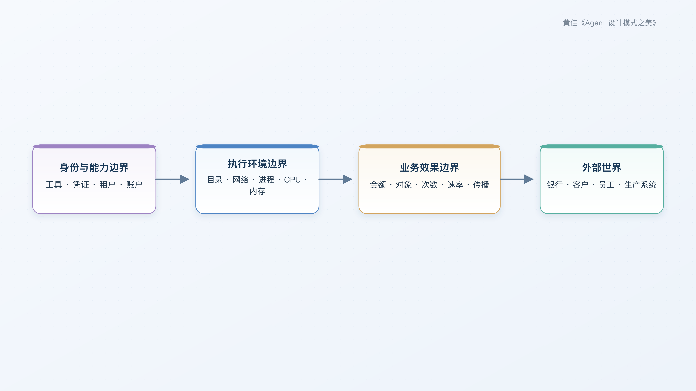
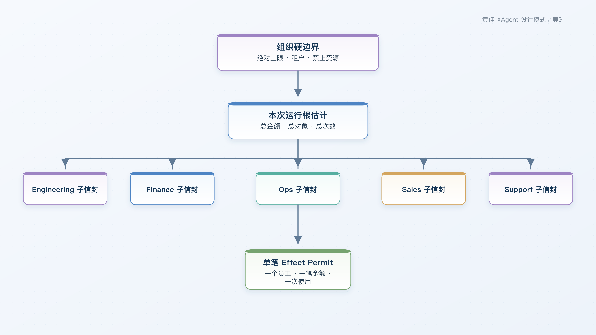
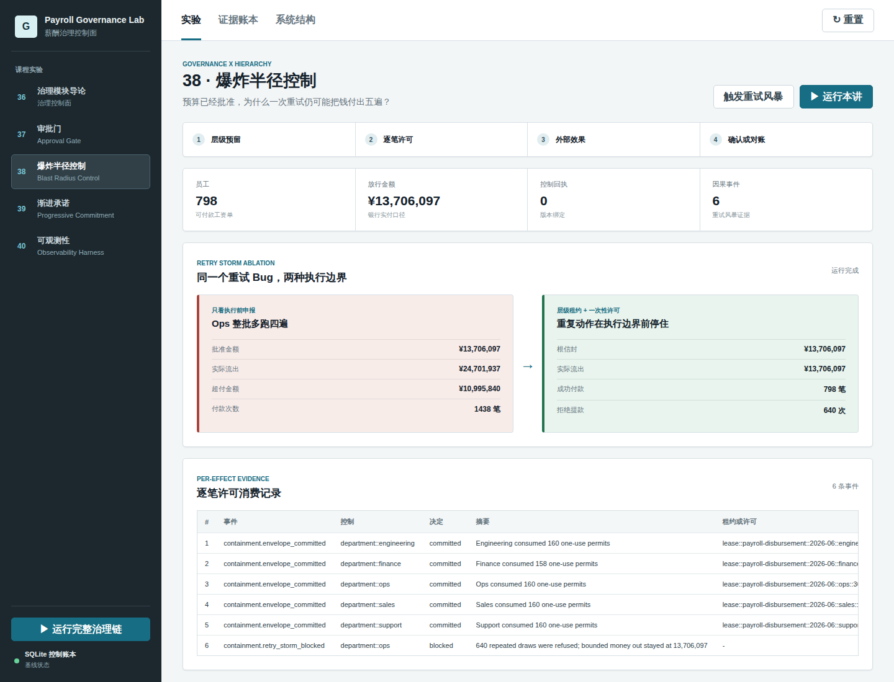
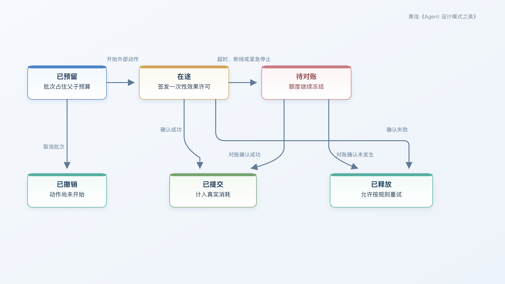

# 38 | 爆炸半径控制：把最大损失写进系统

- 释题：审批决定一项动作能不能开始；爆炸半径控制继续假设它会出错，提前规定错误最多能碰到哪些资源、产生多少外部效果、持续多长时间。

你好，我是黄佳。

设想公司批准一位员工出差，又给了他一张公务卡。卡上有单笔上限、周期额度、可用地区和商户范围。出差批准了，不代表花钱没任何限制。审批解决“这次能不能花”，额度解决“最多花到哪里”。

Agent 治理也需要这两层。上一讲，CFO 看到了正确的结算数据，批准票据绑定了正确的工资单，审批过程没有问题。但到了执行阶段，程序仍然可能超时、重试、重复提交，也可能把一个原本只该影响十个人的动作扩散到一千个人。

一道门负责放行，一道保险丝负责在短路时把损失截住。这道保险丝，就是爆炸半径控制。

## 批准正确，执行仍然可能出错

审批人判断的是一项准备执行的业务提案。真正产生外部效果时，还要经过工作流、执行器、消息队列、网络、外部 API 和回调系统。每一层都可能产生新的故障。

不只安全团队需要考虑爆炸半径问题，任何能够改动外部世界的 Agent，都应该先回答这个问题。

- 一个运维 Agent 得到批准，准备把服务扩容两个实例。执行器读错了参数，可能扩出二百个实例；

- 一个客服 Agent 得到批准，准备向投诉用户发一张补偿券，循环终止条件失效，可能向同一用户连续发出十张；

- 一个营销 Agent 得到批准，准备向五百名测试用户发送活动邮件。一旦下游接口把测试分组解释成了完整名单，一次调用便覆盖十万人。

- Agent 准备做什么

业务场景

- 需要提前圈住的半径

- 单用户金额、单工单次数、Agent 当日累计金额

客服补偿

- 给投诉用户发优惠券

营销运营

- 发送一批活动消息接收者名单、人数、发送速率、渠道和时间窗口

人力资源

- 修改员工记录可改字段、员工集合、一次运行最多影响的人数

数据处理

- 导出或更新业务数据租户、表、字段、行数、导出目的地

软件发布

- 部署一个新版本环境、区域、实例比例、流量比例和持续时间

云资源运维

- 扩容计算实例服务、区域、实例数、小时费用和自动回收时间

采购付款

- 向供应商发起付款供应商集合、单笔金额、累计金额和付款次数

在上面这些真实场景中，没有谁越权进入了工具。动作类型也都经过了批准。问题出在一次合法动作产生了超过预期的实际效果。

因此，一套完整的治理系统不能只问“这件事可不可以做？”它还要继续问：假如模型判断错了、程序写错了，错误最严重的影响范围是多大？

同一个工具，在不同参数下也会有完全不同的后果。

```
send_message 可以给一位客户发一条回复，也可以向整个会员库推送通知；
update_employee 可以修改一位员工的办公电话，也可以批量终止劳动关系；
run_command 可以执行 git status，也可以删除生产数据。
```

所以，爆炸半径不能按“工具名称”粗略设置。它需要看到真实资源、对象集合、数量、金额、速率、环境、传播范围和恢复条件。

## 爆炸半径不是一个数字

谈到限额，人们最先想到的是钱。钱当然重要，但很多 Agent 事故最初并不表现为资金损失。

一封错误邮件发送给十个人和十万人，单封邮件的成本几乎一样，声誉后果完全不同。错误字段修改一条记录和一百万条记录，调用的还是同一个 API。一个子 Agent 多运行十分钟，可能只多花几美元；如果它在十分钟内不断派生 Worker，影响会沿协作关系迅速放大。

爆炸半径至少要从五个方向度量。

维度

- 它限制什么例子

真正危险的往往不是单笔大动作，而是一串小动作的累计。一个 Agent 每次只能更新 100 条记录，看起来很谨慎。它派生十个 Worker，每个 Worker 都更新 100 条，整个运行还是写入了 1,000 条。每个调用都没有越界，组合起来已经越界。因此，限额不能只设置在单次工具调用上。还要选择合适的聚合层级：单个动作、一次运行、一个身份、一个租户，乃至同时工作的整组 Agent。

## 爆炸半径控制模式

现在可以给这个模式下定义了。爆炸半径控制（Blast Radius Control）是在动作执行前建立一组不可自行扩张的资源与效果边界，并在每一次外部效果发生前核减额度。边界沿任务层级逐层收窄，任何子任务都不能通过拆分、并发、循环或重试获得父任务没有的权限。

它在 ADPS 双轴中的坐标是治理 × 层级。



它属于治理，因为它限制的是 Agent 能够造成的实际后果；它属于层级，因为这些限制通常形成嵌套结构：组织边界包住身份边界，身份边界包住任务边界，任务边界再包住批次、Worker 和单个外部效果。

除去上面的功能边界外，还可以从 Agent 自主程度上区分两种控制边界。我把这种圈定范围的边界形象地称为“信封”（Envelope）：可用的钱和权限装在里面，执行时不能越过它。

```
硬边界，Hard Envelope 保存租户隔离、生产凭证、绝对金额上限和禁止访问的数据类
```

- 别；

```
自主边界，Autonomy Envelope 保存当前 Agent 可以自动处理的批量、频率、对象集
```

- 合、工具和并发范围。

前者只能由独立管理面或明确的人类流程修改，后者可以在硬边界内随场景和运行证据收放。

边界

- 典型内容谁能改变

- 租户隔离、禁止工具、生产凭证、绝对资金上限、敏

Hard Envelope

- 独立管理面或更感数据类别

A tonom En elope

- 当前批量速率对象集合并发数自动化档位在硬边界内由策

这里的“硬”不代表永远不能修改，它的意思是：正在运行的 Agent 和当前任务没有修改它的权力。

Agent 的实际执行范围，可以理解为多层范围的交集：

```
effective_scope =
   hard_envelope
   ∩ principal_scope
   ∩ task_scope
   ∩ capability_scope
   ∩ current_context_scope
   ∩ evidence_based_scope
```

对于金额和数量，系统取其中最小的上限；对于对象集合，系统取各层允许集合的交集；只要任意一层明确禁止，动作就不能继续。

## 三种边界，各管一段

一套高风险系统通常要同时建立三层边界。

第一层是能力边界。它规定 Agent 能调用哪些工具、访问哪些账户、租户和服务，能拿到哪一种凭证。AWS IAM 的 permissions boundary 就体现了类似关系：边界规定一个身份最多可能得到哪些权限，但边界本身并不授予权限。

第二层是执行边界。它规定代码运行在哪里，能够写哪些目录、访问哪些网络地址、启动多少进程、占用多少计算资源。OpenAI 在 Codex Windows 沙箱中，把文件写入与网络访问作为

```
操作系统层需要明确约束的两类范围；Kubernetes 的 ResourceQuota 则可以在
```

namespace 层累计限制 CPU、内存和对象数量，并在新请求超过硬上限时拒绝创建。

第三层是业务效果边界。它规定最多转出多少钱、修改多少员工、发送多少邮件、影响多少客户，以及可以在多长时间内产生这些效果。

前两层解决“技术上能到哪里”，第三层解决“业务上最多会发生什么”。沙箱能够阻止 Agent 写出工作目录，却不知道一张工资单应该支付 8,111 元还是 81,110 元；一个完全合法的邮件API，也可以在沙箱内向十万人发出错误消息。



- 三层边界逐层收窄，技术沙箱与业务额度不能互相替代

这套思路和分布式系统里的 Bulkhead 模式有相同血脉。船体被分成多个水密舱，一个舱进水，其他舱仍能工作；在软件系统中，连接池、服务实例和资源池被分开，某一部分故障不会耗尽全部资源。Agent 场景还要考虑更多，除了隔离线程、进程和服务，还要隔离租户、资金、客户、数据等。

## 拆任务不能复制权限

多 Agent 系统会让爆炸半径问题更加明显。

假设一个根任务获得了 100 万元采购预算。它把任务拆给五个采购 Agent。如果每个 Agent都拿到“最多 100 万元”的局部配置，系统实际上创造了 500 万元行动空间。

任务拆分可以复制工作，不能复制权力。

正确的结构是，根任务先持有一份总信封，子任务从父信封中预留更小的份额。父级剩余额度随预留减少；所有子信封的总和永远不能超过父信封；孙任务继续从子信封中分配，层级变深而总额度稳定。



- 嵌套围堵：每下一层都只能保持或缩小父层范围

未使用的子额度可以返还，但返还也要有条件：子任务已经结束，没有仍在跑的调用，也没有结果未知的外部效果。否则，一个 Worker 把额度返还给父级以后，旧请求晚到，下一个Worker 又重新消费同一份额度，那还是有可能产生双重支出。

## 工资 Demo 工作台实战

```
模式代码库：governance/b-blast-radius/。
本节运行的教学程序是 governance/payroll-lab/budget_envelope_lab.py。
```

现在回到薪酬 Agent。六月结算集包含 798 张工资单，总额 13,706,097 元。CFO 已经看过完整数据，审批票据也准确绑定了这份结算集。执行器准备按照五个部门分批付款：

部门

- 工资单数子信封金额（元）

Engineering

- 1602738800

Finance

- 1582726337

Ops

- 1602748960

Sales

- 1602737120

Support

- 1602754880

- 79813706097

合计

实验把“恢复时误把整批重跑”简化成一个固定故障：包含 160 人的 Ops 批次正常执行后，再额外执行四遍。程序直接控制重跑次数，没有真的制造网络超时，也没有调用银行，付款结果记录在内存中。这让我们能用同一个故障比较加额度限制前后的差别。

从教学 Repo 根目录运行下面的程序。

```
python3 governance/payroll-lab/budget_envelope_lab.py
```

没有运行级额度时，输出中的关键三行如下：

```
== scene 1: the unbounded rerun (approved 13,706,097, retry storm on Ops x4) ==
  money out without envelopes: 24,701,937
  overpay: 10,995,840
```

审批金额只有 13,706,097 元，最终却付出 24,701,937 元，多付了 10,995,840 元。

前面的审批门为什么没有起作用？因为审批门检查的是准备执行的结算提案，而提案没有变化。错误出现在执行阶段：同一项已经获准的动作，实际发生了五次。审批批准的是计划，爆炸半径控制约束的是实际效果。

解决办法是把 CFO 批准的整月结算总额设为根信封，再按上表的部门金额和人数，为五个部门各自预留一个子信封。

子信封同时限制三个维度：金额、付款次数、允许处理的员工集合。执行器每准备发出一笔钱，先从对应信封提款。信封余额不足、员工不在名单、次数已经用完，付款就不会进入外部系统。

核心对象字段如下：

```python
@dataclass(frozen=True)
class BudgetEnvelope:
   """A pre-authorized spending boundary on three axes: how much money,
   how many payments, and exactly which employees."""
   envelope_id: str
   holder: str
   max_amount: float
   max_payments: int
   allowed_refs: frozenset
函数 draw() 在记录模拟付款之前检查当前累计金额、累计次数和员工编号。检查通过才更
```

新信封状态。生产接入时，这一步要放在提交银行请求之前。

同一个重试 bug 再跑一遍。第二幕的结果行显示如下：

```
money out with envelopes: 13,706,097
  refused draws: 640
     first refusal: envelope_amount_exceeded :: draw=8,111 remaining=0
```

160 人的 Ops 批次多跑四遍，正好产生 640 次额外请求。这些请求没有变成钱，而是变成640 条拒绝记录。程序 bug 还在，业务损失已经被限制在批准范围内。



- 左侧模拟付款 24,701,937 元，右侧停在获批的 13,706,097 元

额外付款是零，不代表系统毫无代价。执行器仍然做了无效工作，告警和人工处置也有成本。爆炸半径控制把损失从不可追回的钱，换成了可以处理的拒绝记录。

## 子任务只能分走父任务已有的额度

层级边界还有一项重要用途。多 Agent 系统常把大任务拆给多个 Worker。每个 Worker 单独看都可能合规，合起来却超过总预算。

根信封解决这个问题。五个部门预留完成后，根额度已经用满。系统再创建一个 5,000,000 元的补发信封，会在预留阶段直接得到：

```
reservation_over_parent :: child=5,000,000 parent_remaining=0
```

如果一个子信封试图处理父信封名单之外的员工，返回原因还会包含：

```
reservation_out_of_scope
```

## 幂等键也要穿过系统边界

生产系统还有一个麻烦：外部调用结果可能不确定。

执行器向银行发出付款请求后连接中断。本地不知道银行有没有成功。如果此时立刻把额度退回，重试可能形成第二笔付款。如果永远不退，系统又会卡住一笔真实失败的请求。

```
因此，一次付款在准备阶段就应生成稳定的 idempotency_key。网络超时后，重试必须沿
```

用同一个键。下游系统看到相同的键，应返回第一次请求的结果，而不是重新创建一笔付款。

Stripe 的官方 API 文档就采用了这种做法：创建或更新请求可以携带幂等键，服务端保存第一次执行的结果；使用相同键重试时返回同一结果，并检查重试参数是否和原请求一致。

```
这里用一次性 EffectPermit 记录每个外部效果，并把结果分成四种状态：
IN_FLIGHT -> COMMITTED
         -> RELEASED
         -> UNKNOWN -> 对账后再进入 COMMITTED 或 RELEASED
UNKNOWN 期间，额度继续被占用。独立对账任务读取银行流水或回执，再决定这笔额度已经
```

消费，还是可以释放。Agent 自己说“刚才应该没成功”不能成为释放依据。



- 结果未知时，额度继续占用，等待对账确认。

预算信封限制累计效果，幂等键负责识别“这是不是同一次请求”。

## 先小后大，也是缩小半径

控制爆炸半径不只有“达到上限后拒绝”这一种做法。很多动作可以分阶段落地，让系统先在小范围内观察结果，再继续扩大。

动作

- 较窄的第一步继续扩大的条件

新加坡政府与 Google 合写的 AI Agents Sandbox 中，把受控测试、渐进式真实部署、风险分级监督和“有边界的灵活性”列为 Agent 落地时的重要考虑：高风险动作可以前置批准，低风险且可补救的动作允许在受控条件下先执行、再复核。

这里缩小的是一项已获批准动作在本次运行中的即时半径。而下一讲的渐进承诺处理的是另一件事：Agent 连续表现可靠以后，长期自治等级能否提高。

## 边界必须放在 Agent 之外

需要注意的是，写在提示词里的“本次最多支付一千万元”，不是爆炸半径控制。因为模型可能忽略提示词，提示词也无法阻止另一个路径、回调处理器或补偿任务直接调用银行接口。真正的控制必须位于统一的外部系统中，付款、重试、恢复、回调和人工补单都要经过同一个账本和同一组限额。

Agent 如果拿着能直连银行的凭证，或能改写预算账本，那么程序里即使有检查，也未必拦得住它。所以，执行 Worker 只拿受限凭证，由统一入口核对额度后提交付款。硬上限交给独立管理流程。Kubernetes 的资源配额文档指出：管理员不仅要创建 ResourceQuota，还要限制其他主体删除或修改配额，否则边界本身就会被执行者拆掉。

一个能够自行提高额度、关闭计量或修改停止开关的 Agent，是危险的，是没有边界的。一句“你最多付款 1 万元”，“你不能直接自己群发邮件”是拦不住它的。

## 从教学 Lab 走向生产系统

把实验搬进自己的业务时，可以顺着三个问题往下想。

先问一次错误，企业最不能接受什么损失？ 薪酬系统怕多付钱，也怕付错人，所以要同时圈住金额和员工名单。营销系统可能更在意打扰了多少客户，云资源系统则可能先看实例数和小时费用。先找到业务后果，再决定限什么、限多少，不必把前面的每个维度都装一遍。

再问哪些执行者实际上在花同一份额度？ 单进程实验可以顺序扣减，生产里可能有十个Worker 同时付款。假如账上只剩 10 万元，两个 Worker 同时申请 8 万元，不能让它们各自查完余额就都通过。检查和占用额度要在同一笔事务里完成，后来的申请才能看到前一笔已经占走了钱。这也决定了账本应该放在哪里、由谁共同使用。实际记账时，金额统一用“分”等最小货币单位或十进制定点数。

最后问出了问题，谁能确认结果，谁能停下后续动作？ 银行已经付款、回执却没回来时，查本地日志不够，要有人或独立程序去银行对账。额度继续占着，重试沿用原来的幂等键。需要止损时，值班人员能从独立入口停止新付款，已经发出的请求则继续查清结果。

这三个问题回答完，测试也就有了方向。可以沿着同一笔付款，试一次并发领取、一次重复提交、一次丢失回执来设计测试用例。

## 总结一下

审批门解决的是一项动作能不能开始。爆炸半径控制则假设：审批人会遗漏，模型会判断错，程序会有 bug 等情况出现时的损失上限。

能力边界限制 Agent 能拿到哪些工具和凭证，执行隔离限制代码能够进入哪些技术环境，业务信封限制实际能改变多少金额、对象、次数和资源。父任务持有总边界，子任务只能领取其中的一部分。

每一个外部效果都要先消费许可。结果明确成功，额度正式提交；结果明确失败，额度安全释放；结果未知，额度继续占用，等待独立对账。使用幂等键防止同一请求重复，同时用预算信封限制所有请求的累计后果。

爆炸半径控制的内核就是在错误发生以前，把最坏结果限制在企业可以承受的范围。批准给动作开门，信封给后果封顶。

## 下一讲预告

第 39 讲会进入时间维度。一个 Agent 连续完成了很多次受限任务，企业能否减少日常审批，给它更大的自治空间？渐进承诺会说明，Agent 的权限怎样逐步获得，又怎样在事故、漂移和环境变化后被收回。

## 思考题

1. 你系统中真正需要限制的是单次大动作，还是大量小动作的累计？现在的限额设置在工具调用、一次运行，还是整个租户上？

2. 一笔请求超时以后，系统应该把它记成失败、成功，还是 UNKNOWN？在获得证据以前，额度是否仍然被占用？

3. 如果三个子 Agent 分别拿到合法额度，谁负责保证它们的总和没有超过根任务的上限？

期待你在留言区记录思考或疑问。也欢迎把今天所学分享给更多朋友。

## 参考资料

1. ADPS, 《G2 · 爆炸半径控制》, Agent 设计模式白皮书 v0.4, 2026-08-19.

2. OpenAI, Building a safe, effective sandbox to enable Codex on Windows, 2026-05-13.

3. CSA、GovTech、IMDA 与 Google, AI Agents: Insights from the Singapore Governmentand Google Sandbox, 2026-05-20.

4. Michael T. Nygard, Release It!, Bulkheads pattern, Pragmatic Bookshelf.

5. Hector Garcia-Molina and Kenneth Salem, Sagas, 1987.

6. AWS, Permissions boundaries for IAM entities。

7. Kubernetes, Resource Quotas。

8. Microsoft Azure Architecture Center, Bulkhead Pattern。

9. Stripe, Idempotent requests。

10. Hector Garcia-Molina and Kenneth Salem, “Sagas,” 1987.
