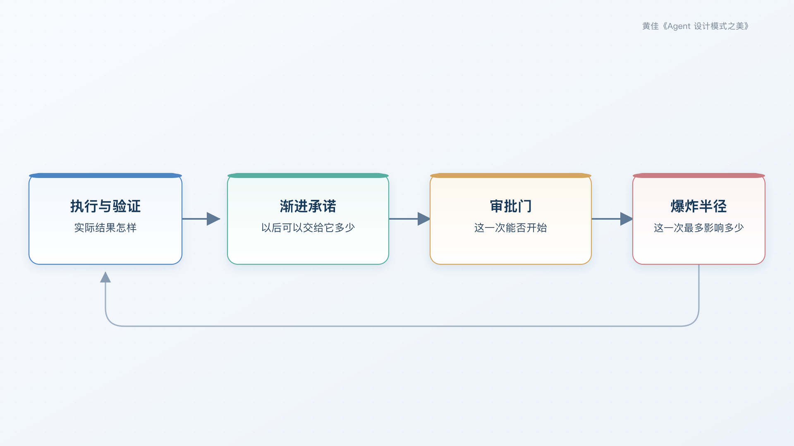
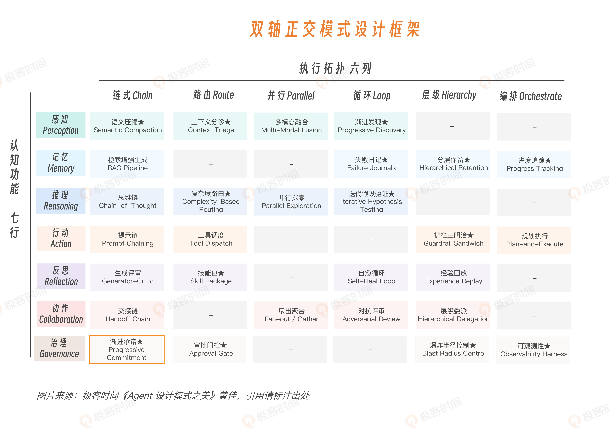
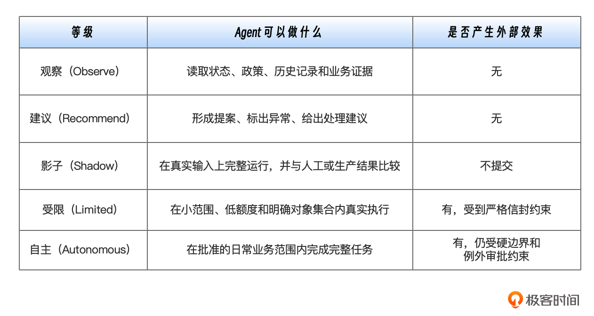
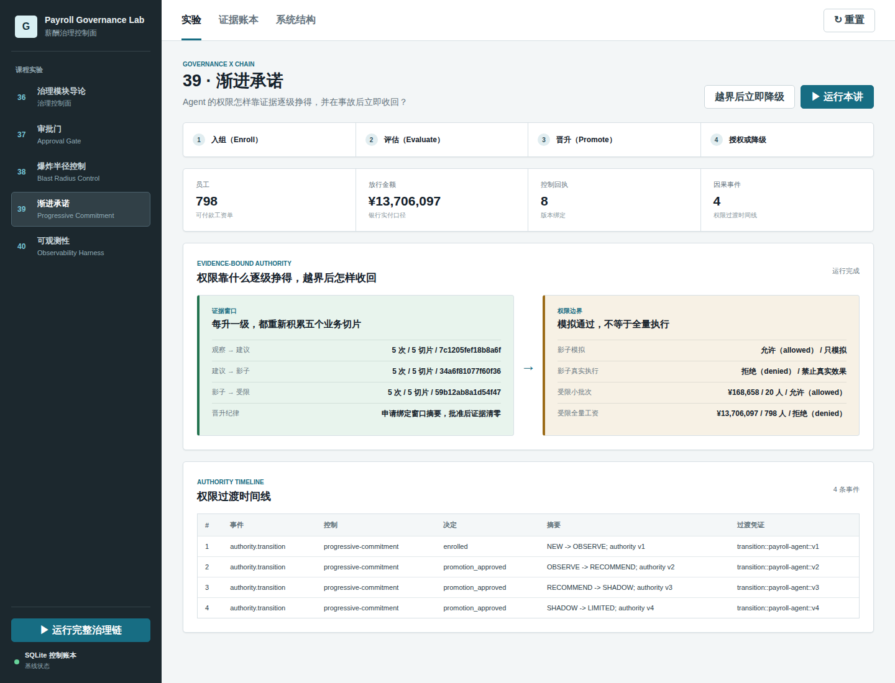
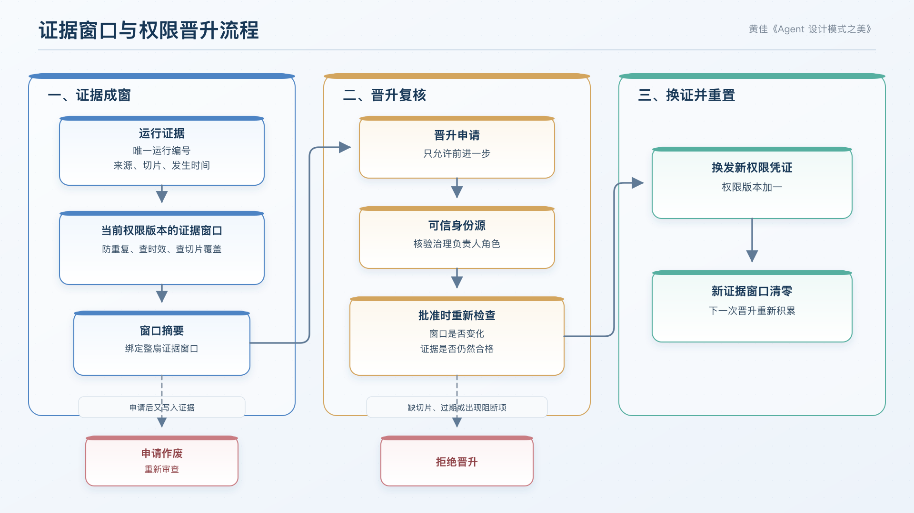
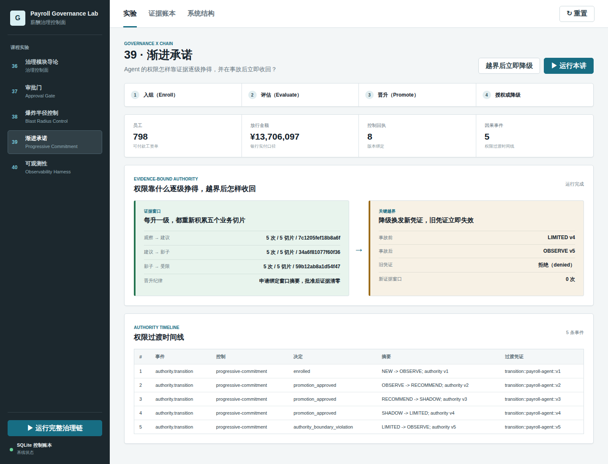
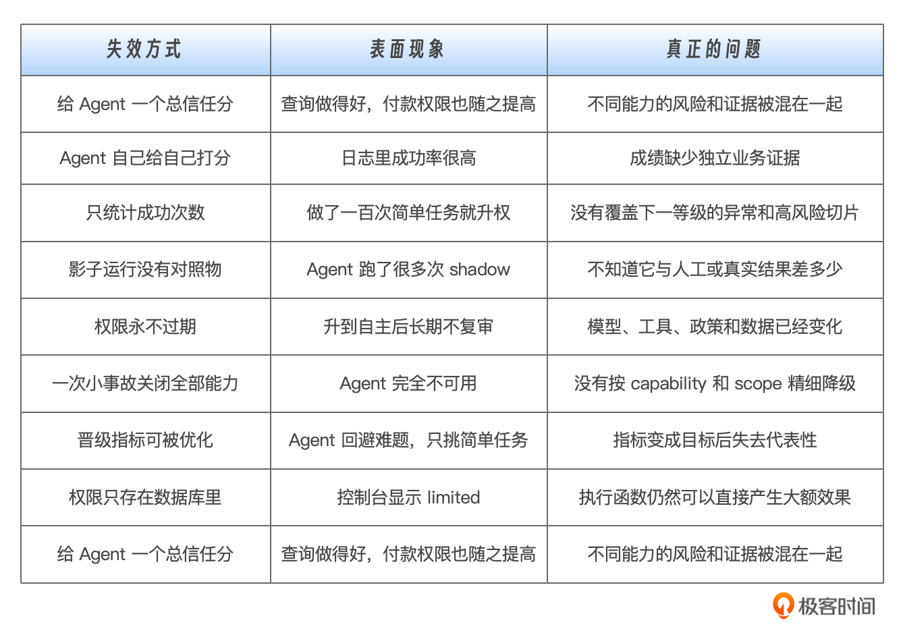

# 39 | 渐进承诺：自治要靠证据挣出来

- 释题：先让 Agent 在小事、窄范围和可撤销的动作中证明自己，再逐步把更大的工作交给它。出了严重问题，先收回相关权限，再谈怎样恢复。

你好，我是黄佳。

我愿意先让一个购票 Agent 帮我买电影票，但不会第一天就把订国际机票的任务交给它。

电影票选错了场次，损失通常有限。国际机票牵涉姓名、证件、签证、转机时间、行李规则和退改政策，填错一个字母都可能带来很大麻烦。Agent 成功买过几张电影票，只能说明它完成过低风险购买，并不能证明它已经会处理一家人的跨国行程。

企业带新人，其实也是这个道理。一位新入职的财务员工，第一周通常先看流程、核对单据、整理付款清单。熟悉以后，他可以生成付款提案，再由主管复核。继续做得稳定，才可能独立处理小额付款。至于变更供应商账户、提交整月工资、处理重大资金调拨，仍然会保留更高一级的确认。

先分配一小块工作，看结果。结果稳定，再交下一块。 Agent 也应该这样进入真实业务。

把目前学到的三个模式放到一起看，审批门问的是：眼前这一项动作能不能开始？爆炸半径控制问的是：即使开始以后出错，最多能影响多少？渐进承诺问的是：这个 Agent 连续完成了许多次任务以后，下一次能不能少问一次人、多做一点事？



- 治理形成闭环：每一次运行的结果，都会影响以后能够获得的自治范围

这里的“承诺”，指企业逐步交给 Agent 的资源和行动空间。渐进承诺（ProgressiveCommitment）把这个过程做成可检查的规则：每次扩大权限，都要有相应的运行证据和批准。证据失效或发生严重事故时，权限也要能够收回。

它在本课双轴矩阵中的坐标是治理 × 链式。链上的每一步，都以前一步的检查结果为依据。



## 信任的对象是一项具体能力

简单系统对 Agent 的权限可能只有两档，要不就能执行，要不就不能执行。试点阶段，Agent只能给建议。一旦业务团队觉得效果不错，便把生产工具全部打开。系统一下就从“不能改数据”，跳到“可以发消息、提交订单、执行付款”。

这中间少了好几层。一个客服 Agent 可以很擅长查询订单，却不一定适合关闭客户账户。一个代码 Agent 可以独立修改测试分支，却不应该因此获得生产部署权限。

所以，我们需要把“信不信这个 Agent”问得具体一些：这个版本的 Agent，在哪项能力上已经表现稳定，可以在什么范围内独立工作？

例如，同一个薪酬 Agent，可以独立生成上海市场部的工资结算提案，提交银行付款却仍然受到限制：

能力

- 当前可以交给它的工作

生成工资结算提案

- 在已确认的数据和规则内独立完成

提交银行付款

- 只处理获批的小批次超出范围转人工

这里保留了能力、环境和业务范围的区别。一项低风险能力积累的好成绩，不能直接借给另一项高风险能力使用。

## 渐进承诺的两只钟表

渐进承诺同时发生在两个时间尺度上，我把它称为两只钟表。

第一只是一项任务里的钟。系统先做成本低、可撤销的动作，再走向成本高、难撤销的动作。

例如，代码 Agent 可以按下面的顺序工作：

- 读取代码

```
→ 生成补丁
→ 运行测试
→ 部署测试环境
→ 小流量发布
→ 扩大生产流量
```

薪酬 Agent 则可以这样推进：

- 读取花名册

```
→ 计算工资
→ 生成结算草稿
→ dry-run 检查
→ 小批次真实执行
→ 完整结算
```

一步通过再进入后一步。越往后，动作越接近真实外部效果，要求的证据和控制也越强。

第二只是很多次任务之间的钟。Agent 在较低权限下反复运行，表现稳定以后，才申请进入下一档。

- 只能看

```
→ 可以建议
→ 可以影子运行
→ 可以小范围真实执行
→ 可以在规定范围内自主处理
```

两只钟表不能混用。今天的一次模拟检查通过，只能支持今天这份提案继续往下走，不会让Agent 的长期权限自动升级。反过来，一个已经能够自主处理常规业务的 Agent，遇到高风险任务时，仍然要完成该有的校验和审批。

一次任务里，我们关心这件事怎样一步步落地。多次任务之间，我们关心以后可以把多大的事交给它。

## 渐进承诺的五级阶梯

下面使用五个等级来演示渐进放权的过程，供你项目中参考。



观察级先看它能不能找到正确数据、分清当前版本、识别业务对象，信息不足时能不能停下来。刚接入系统就找错工资表，后面的计算再漂亮也没有用。

建议级让它把事情准备好。一份付款提案应当说清楚付给谁、付多少、依据什么、有哪些异常。人拿到以后可以判断是否采用，不必从头替它调查。

影子级让它在真实任务旁边跑。例如，财务照常完成六月结算，Agent 也用同一批输入生成自己的清单，但不提交银行。我们逐项比较员工、金额和异常处理，看看它与核实后的业务结果差在哪里。只让 Agent 跑很多次，却不找对照结果，仍然不知道它做得对不对。

影子运行有自己的风险。它可能读取敏感数据，也可能因工具配置错误把结果写入生产。因此，只读凭证、隔离的输出位置和资源限制仍然需要保留。

受限级开始接触真实后果。这时要把“允许执行”写成具体范围，例如只处理某个部门、最多多少人和多少钱。影子测试很准确，也可能没遇到真实写入时的超时、并发和重复请求。这些问题要在有限范围内继续观察。

自主级则允许它在已经批准的日常范围内独立完成工作，不必每一步都等人点击。绝对金额上限、租户隔离和重大例外审批仍然存在。自主不是没有边界，而是边界内不再频繁打断。

逐级放权给团队留下了观察新问题的机会：先看能否算对，再看真实执行能否稳定。Google的金丝雀发布也是类似思路，先让一小部分真实流量接触新版本，用结果决定是否扩大范围。关键在于每一步都有对照和退路。

## Payroll 工作台的渐进承诺实验

- 代码路径：

```
governance/c-progressive-commitment/
governance/payroll-lab/authority_ladder_lab.py
```

下面运行教学 Lab，通过代码简单实现一下渐进承诺模式。

这次实验带我们观察：同一个 Agent 获得受限权限以后，系统怎样允许小批次、拒绝整月付款，并在出问题后收回权限？

此处使用的仍是六月测试账本，其中 798 张工资单标为已付款，2 张已冲正。程序读取这 798张单据，生成一份总额为 13,706,097 元的测试提案，用来检查权限。渐进承诺控制器检查晋级条件，随后用不同大小的付款提案检查当前权限。

从教学 Repo 根目录启动工作台。

```
uv sync --extra ui
uv run python governance/payroll-lab/web_app.py --port 8767
浏览器打开 http://127.0.0.1:8767，左侧选第 39 讲，点击"运行本讲"。
```

演示先让 Agent 从观察级开始，再为每一级加入预设的合格评测记录，并模拟治理负责人批准，逐步升到受限级。

工作台中，页面左侧列出三次晋级：观察到建议、建议到影子、影子到受限。每次晋级要求五条证据，这五条运行证据分别来自 Engineering、Finance、Ops、 Sales 和 Support 五个部门，避免 Agent 只凭单一场景的重复成功获得晋级。



- 五条证据分别覆盖五个业务切片

再看页面右侧。同一套控制器依次检查下面四种情况：

当前权限

- 提交什么请求检查结果

影子级

- 只模拟整月结算允许

影子级

- 要求实际执行整月结算拒绝，当前只能模拟

- 20 人、168,658 元的小批次

受限级

- 允许

- 798 人、13,706,097 元的整月结算

受限级

- 拒绝，超过当前权限

受限级在代码中的上限是 50 人、100 万元。20 人、168,658 元是这次拿来测试的一批工资单，低于这两个上限，所以通过。整月结算同时超过人数和金额上限，因此被拒绝。“允许”表示请求通过授权检查，不表示钱已经付出去。

图上方的 798 人和 13,706,097 元，是账本中这份结算的统计值。判断 Agent 有没有获得付款权限，要看右侧的允许和拒绝结果。

上一讲的预算限制也没有消失。程序在检查真实执行请求时，还会提供审批门和预算预留的回执。即使这两项都通过，只要 Agent 当前等级允许的范围更小，整月结算仍然不能继续。

至此，三个模式各自负责什么就能看出来：审批门检查这份提案有没有获准，预算限制防止执行超额，渐进承诺检查这个 Agent 目前是否有资格承担这么大的任务。

## 成功记录怎样变成晋级依据

虽然工作台里写了“五次成功”，但我们还需要追问：这五次是谁说成功的？是不是把同一次结果复制了五遍？

生产实践中，一条可用于晋级的运行结果至少要带这些信息：下面节选模式文件

```python
governance/c-progressive-commitment/pattern.py 中的字段。
@dataclass(frozen=True)
class RunOutcome:
   run_id: str
   success: bool
   blocker: bool
   evidence_ref: str
   evaluation_slice: str
   occurred_at: str
   recorded_by: str
```

解释一下后面这些字段。

```
run_id 防止同一次成功被重复计算。
evidence_ref 指向业务结果或独立评测记录。
evaluation_slice 说明证据覆盖哪类任务，防止只挑简单样本。
occurred_at 保证证据产生在当前策略和当前权限版本之下。
recorded_by 说明谁记录结果，生产中还需要受信的验证器核实。
这些结果被收进 EvidenceWindow。控制器收到记录以后，会检查运行编号和证据引用是否
```

重复，时间是否早于当前权限的签发时间，并调用验证器确认这条记录是否可信。因此，重复提交同一次成功，不会增加晋级所需的次数。

晋级时，系统要把这一批证据锁成一个整体，审批人批准的也是这一批证据。等待审批期间，只要又出现一次失败，原来那批证据就变了，之前的批准随即失效，需要重新审核。



- 证据窗口在审批前后保持同一版本，新增失败会使旧晋级申请失效。

证据还得和即将开放的权限相匹配。准备给它多大权限，就要先让它在相应的金额、任务、租户、工具和异常场景中接受检验。

我们继续使用第 38 讲的预算信封来解释“受限级”和“自主级”：

- 受限级只拿到 Ops 部门的信封，最多处理 160 人、2,748,960 元。

- 自主级可以处理整月结算，但仍要遵守各部门信封，总计 798 人、13,706,097 元。

实验结果如下：

```
limited: paid 2,748,960, 638 draws outside the envelope refused
supervisor signs the autonomous ticket -> approval_authority_mismatch
autonomous: paid 13,706,097
```

评测内容也得配得上新权限。一个 Agent 连续处理一百笔百元以内的报销，并不足以证明它能独立处理千万元工资结算。要扩大到整月付款，就应当先验证大额批次、账户变更、冲正、重复请求等情况。

2026 年 2 月，Cloud Security Alliance 介绍的 Agentic Trust Framework，把持续表现、安全验证和治理签署都列为晋级条件。4 月微软介绍的 Agent Governance Toolkit，则把动态信任、执行权限和紧急停止机制放进运行时设计。具体档位各有不同，但都在处理同一个问题：权限要跟着证据和风险变化，不能一次授予后就不再过问。

## 升权要慢，出事先收权

Agent 想获得更高权限，需要积累运行证据、等待观察期并通过审批。发生严重事故时，系统不能再按这套慢流程收权，应该先停下来止损。

实验中会把自主级 Agent 直接降回观察级：

```
incident INC-2026-07-08 -> level=observe since=2026-07-08
re-promotion on pre-incident receipts ->
promotion_evidence_stale,promotion_evidence_thin
```

降级以后，原来的权限凭证立即失效。事故前积累的成绩也不能直接拿来申请恢复权限。Agent 必须在新版本、新策略下重新运行，重新证明自己。

回到刚才的工作台，点击“越界后立即降级”。这个按钮会从头重跑晋级过程，再把受限级申请整月付款这次越界尝试，预设为严重事件，触发降级。

图中右侧可以看到：

- 降级前：受限级，权限凭证第 4 版。

- 降级后：观察级，权限凭证第 5 版。

- 再拿旧凭证申请刚才获准的 20 人小批次：拒绝。

- 用于重新晋级的新记录：0 条。



降权虽然要快，也不能让任何人都能触发。否则，一个普通调用者就可以随手把生产 Agent 打回观察级，那样也不合适。

## 渐进承诺模式的注意事项

下面给出一些需要注意的事项。



还有一种常见误区：把渐进承诺做成一套漫长的官僚流程。每一级都要求大量人工表格，Agent 永远停在试点阶段。

成熟系统应当让证据尽可能自动形成：测试结果、银行回执、工单状态、人工改判、回滚结果和异常记录自动进入证据窗口。人主要处理晋级标准、边界任务和重大例外。

## 从教学实验走向生产系统

如果在生产系统中使用这个模式，还要考虑后面这些问题。

第一，究竟准备多交给它哪一项工作？

“把 Agent 升到自主级”还不够具体。你可能只是想让它独立处理一类常规退款，并没有打算允许它修改客户账户。因此，权限要按能力和业务范围分开。出了问题，也能有针对性地收回，不必把所有能力一起停掉。

第二，什么结果足以说明它可以接手？

如果准备开放退款，就比较退款对象、金额和理由是否正确，是否识别重复申请，遇到例外会不会转人工。不能只看工具返回成功，更不能只让 Agent 给自己打分。

还要看放权后的表现。如果权限扩大以后，人工纠正、回滚或事故明显增多，就说明原先的测试没有覆盖新风险，需要调整评测和晋级条件。

第三，权限必须在执行时真正生效。 付款、发信、写库、部署这些动作，在执行前都要检查当前权限。出了严重事故，独立控制面可以立即冻结相关能力，不能等 Agent 自己停下来。

另外，企业还要留一张很短的清单：哪些事情即使 Agent 已经到了自主级，也仍然必须由人确认。渐进承诺需要让权限始终和当前证据匹配。

## 有些决定始终交给人

渐进承诺会改变人在流程里的位置。试点时，人逐项检查 Agent 的普通任务。系统稳定以后，人可以少点一些日常确认，把精力放到放权标准、困难样本、重大例外和事故处置上。

不过，有些责任不能凭成功率自动交出去。比如变更重要收款账户、删除不可恢复的数据，或者作出带有法律与人事后果的决定。企业应当提前规定哪些动作始终需要人工确认。Agent 即使已经处于自主级，也要遵守这些规则。

反过来，也不必把每次晋级都做成漫长的材料审批。规则清楚、记录自动形成，符合条件的日常检查就可以由系统完成。人处理需要判断和承担责任的部分。

## 总结一下

渐进承诺的关注点是：Agent 的行动空间怎样随着证据一点点放开，又怎样在证据失效后收回来。

一次任务里，先读、再算、再演练、再小范围执行，最后才碰更大的真实后果。跨越多次任务，Agent 从观察、建议、影子运行走到受限执行，再凭借真实、可核验的业务结果申请更大的自治空间。

权限不能笼统地发给整个 Agent，而要绑定具体的能力、版本、环境和业务范围。旧模型的成绩不能直接交给新模型，测试环境的成绩也不能直接带进生产。晋级通常一步一步走，出了严重事故则可以立即降级。

前两讲也在这里接了起来：审批门决定扩大权限时由谁负责，预算信封规定当前权限到底有多大，渐进承诺则用一次次真实运行的结果，决定下一次能不能再多放一点权。

## 下一讲预告

第 40 讲进入治理模块的最后一环：可观测性。谁批准了这次动作，额度用了多少，Agent 为什么升权，又为什么在事故后被降级？如果这些事实散落在日志、数据库和聊天记录里，出了问题仍然说不清。下一讲，我们把它们接成一条可以还原的运行史。

## 思考题

1. 当你说某个 Agent“可以自主工作”，具体是指哪项能力、在哪个环境、能做到什么范围？

2. 找一项真正会改变外部世界的能力，比如付款、发信、写库或部署。检查执行代码：它现在读取的是一张具体的能力凭证，还是只根据“这个 Agent 已经可信”来放行？

3. 做一次反向测试：把模型版本换掉、让权限凭证过期，或者人为加入一条严重失败记录。看看旧权限是否真的失效。如果 Agent 还能继续执行，边界到底漏在了哪里？

期待你在留言区与我交流，如果这节课对你有启发， 别忘了分享给身边更多朋友。

## 参考资料

1. Google， Canarying Releases，The Site Reliability Workbook.

2. Cloud Security Alliance，The Agentic Trust Framework，2026-02-02.

3. Microsoft Open Source Blog，Introducing the Agent Governance Toolkit，2026-04-02.

4. Matthew Francis Dixon，Adaptive AI Delegation under Uncertainty，2026-06-28.

5. ADPS，《G3 · 渐进承诺》，Agent 设计模式白皮书 v0.4，2026-08-19.
