# 40 | 可观测性：看清过程，改对系统，留下可追责的运行史

- 释题：日志只告诉我们某个组件做过什么；可观测性则把提案、策略、批准、额度、权限和业务结果串起来，说明一项行动为什么发生，又怎样走到最后。

你好，我是黄佳。

在 ADPS 治理研讨会上，我举过一个客服场景：Agent 答应给用户一张 100 元的补偿券，用户却没有收到。用户拿着聊天记录来找你，你该查什么？我们推演一下这个场景下的排障情形。如果工程师打开监控，模型服务和发券服务都没有报警。再看聊天记录，Agent 说：“100元补偿券已经发放，请到卡包查看。”

问题究竟出在哪？可能是券发给了另一个账号，可能是请求还在等待审核，也可能根本没有调用发券工具。单看最后一句话，我们其实无法区分各种情况。

这就是可观测性要解决的问题：当实际结果与你的预期不一致时，系统要留下足够的线索，让你查明发生了什么，缩小原因范围，并检验下一次修改是否有效。

## 状态告诉你现在，运行史告诉你来路

继续查这张券。假设这一次系统留下了完整记录，我们能看到：Agent 查询了补偿政策，提出发券申请，调用工具，最后组织回复。发券工具确实返回了 “200”（HTTP 接收成功不），但返

```
回内容中还有一个关键字段：pending_review，意思是“申请已受理，等待审核”。
```

Agent 把“申请提交成功”说成了“券已发放”。券系统里的申请仍在待审核队列，用户卡包里自然没有券。

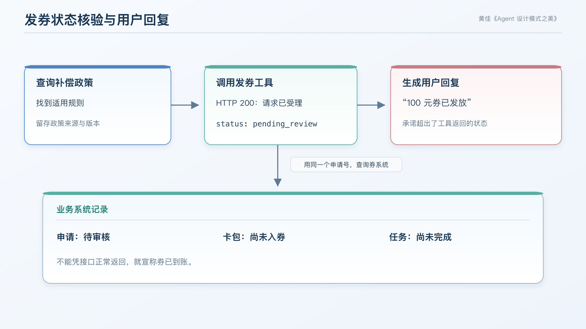

- 工具调用成功和补偿券发放成功，是两项不同的事实

现在，我们至少知道要检查哪一段了。我们应该聚焦后面这三个问题：工具返回的状态，在传给回复生成器时有没有被保留？给模型的提示词里，我们有没有说清楚“受理”和“完成”的区别？回复发出前，程序有没有核对实际发放状态？

```
上面这些问题，和模型的强弱无关，因为中间的程序记录 success=True，把“待审核”丢
```

了，后面的模型再强也缺少判断依据。

传统系统里，也会遇到异步受理与最终完成不一致的情况。Agent 又多了一步自然语言解释和智能化的判断，这个解释和判断过程更可能把一个有限的状态扩写成过度承诺。

2010 年，Google 的 Dapper 就在解决跨服务追踪的问题。今天我们继承了这套关联调用的办法，又需要保存 Agent 当时拿到的上下文、选择的工具，以及最后的业务结果。我们要通过调用链来说明请求怎样在系统里如何流转，补偿券有没有到账，则要到卡券系统确认。

## 系统中的多种可观测信号

Agent 运行中会产生很多信号（不仅仅是“日志”），我们简单区分常见的几种。

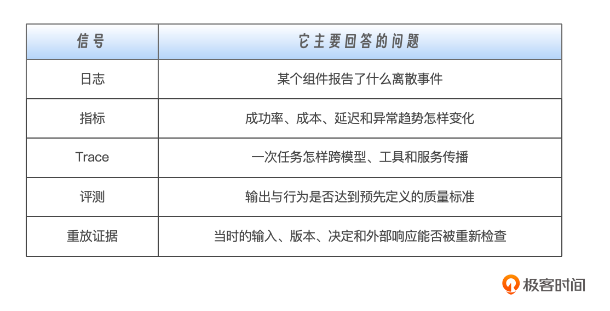

在这里，日志、追踪和指标各有用处。

- 日志记录某个环节发生的事，适合看一个局部组件发生了什么，例如支付适配器返回超时。

- 追踪把一次请求的各步接起来，例如把支付适配器和前面的提案、审批、预算许可接起来。一次追踪通常叫 Trace，其中一段有起止时间的操作叫 Span。发券工具调用是一段，模型生成回复是另一段。

```
指标帮助我们看一批任务的趋势。比如帮助团队发现最近一周 UNKNOWN 付款突然增加。
```

- 评测判断 Agent 在工资异常识别上是否仍然达到要求。

- 重放证据则让调查者在不重新付款的前提下，还原当时的判断路径。重放主要是读取历史输入、版本、决定和结果，重建已经发生的路径，不一定要再次执行原来的外部动作。因为外界环境此时已经发生改变（银行余额已经变化，模型版本可能已经更新，工具接口也可能不同），重新发起一次业务运行难度过高，不大现实。

## 可观测性模式

可观测性，就是在运行的关键位置留下结构化事实，用共同标识、前后关系、版本和证据引用把它们关联起来，帮助人查清过程、核对结果。 有了这些事实，评测才能判断是否达标，改进也才能有依据。

这里有三个关键词。

1. 第一个是结构化事件。系统显示“付款成功”，这个事件的结构中还要说明谁付款、付给谁、使用哪一张票据、消费哪一个预算信封、对应哪一版提案和政策。

2. 第二个是因果关系。审批发生在付款以前，不等于说审批一定导致了这笔付款。系统要明确记录：这次工具执行消费的是哪一张审批票，哪一笔付款属于哪一个批次，哪一次降权由哪一项事故触发。

3. 第三个是完整性。除了检查已有日志没有被修改之外，系统还要检查本来应该出现的审批、额度和权限控制有没有被绕开。

在本专栏早期的双轴图谱中，可观测性被放在“治理 × 编排”位置，因为它要跨多个服务协调提案、策略、审批、额度和工具执行。（ADPS 后续把它调整为 X1 横切工程面，它贯穿智能体设计的整个生命周期——检索、记忆、规划、协作需要它，调试、评测和产品改进都依赖它。）

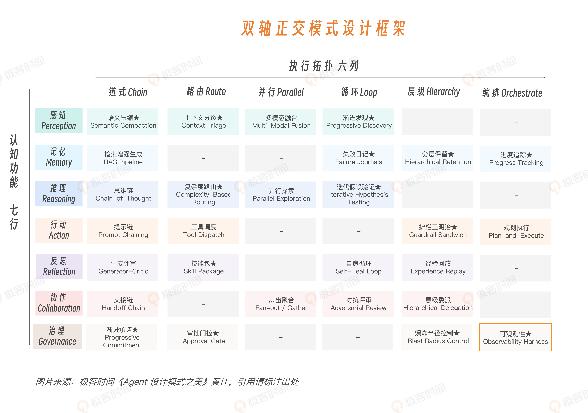

治理模块前面三讲也都需要可观测性模式才能闭环：

- 审批门需要它证明谁批准了哪一项提案；

- 爆炸半径控制需要它证明额度怎样被预留和消费；

- 渐进承诺需要它提供升权和降权所依据的真实结果。

## 玻璃罩里的机械表

梁博老师介绍东方屹腾的执行型 Agent 时，用过一个很贴切的比喻：在透明玻璃罩里组装、修理一块瑞士机械表。零件很多，但你能看见每个零件在哪儿工作。


他展示的界面，除了用户问题和最终回答，还把意图识别、路由判断、推理步骤等活动按顺序展开。每一步可以继续查看调试详情，包括当次真正使用的提示词、模型输出和调用成本。

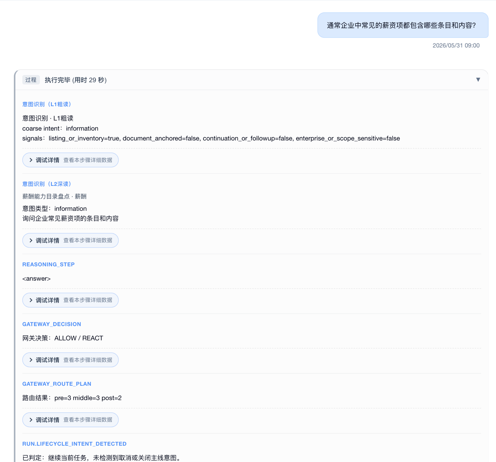

- 展开具体环节，才能继续检查当时的输入与输出

这些记录来自真实的调用位置，能够指向某次检索、某个参数、某版提示词。有了它们，在调试时我们就能够检查模型收到了什么、返回了什么。梁博团队在跑通 Agent 基本对话之后，就开始建设这条时间线，再往上添加能力。每增加一层记忆、规划或工具调用，都能马上查看它怎样影响原有行为。

## 观测过程也观测结果

不过，透明罩虽然让维修更方便了，但判断手表走得准不准，还要对时间。Agent 的过程与结果也需要一起看。在治理研讨中，马阳阳老师提出了三个观察层次。

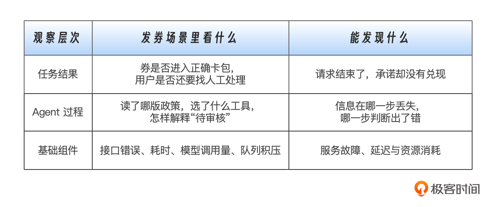

可以从最上面往下查：先看事情办成没有，再看卡在哪里，最后检查相关组件。如果只查接口，看到全部正常就结束排查，便会漏掉第一层（详细说明可参考 ADPS 治理研讨会记录）。

可观测性中返回的结果也可以帮助我们统计成本。可以用一段时间内的 Token 总消耗除以成功完成的任务数，把失败尝试花的钱也算进去，人工返工的成本则需要另外计算。计算耗时，最好把成功与失败任务分开看，少数反复重试的任务也需要单独计算。

再比如说分析报告、失败日记这样的产物，还可以观察它后来有没有被使用：例如是否据此创建了任务。通过这些产物的采用率来提供业务线索，也要对这些产物的正确性进行抽检。我个人觉得，马阳阳老师对于“任务结果也应可观测”的思想，对于系统自进化的闭环其实相当重要。

## 最容易缺的记录，在模型之外

大模型的 SDK 包传给我们的是模型调用、Token 和耗时；但业务结果有没有兑现，SDK 并不知道。我们得从业务问题出发，决定还要留下什么可观测的记录。

说回 100 元补偿券的例子，至少需要记录以下几个线索。

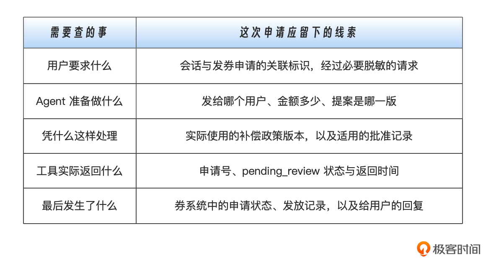

这些信息要能相互找到。请求跨进程、消息队列或子 Agent 时，需要继续传递追踪上下文。几

```
小时后才到的回调，还要靠稳定的业务申请号接回原任务。程序里的 trace_id 帮我们找到
同一次追踪，span_id 标明其中哪一步，父子关联或链接说明哪一步接了谁的工作。业务申
```

请号负责把追踪与券系统接起来。因为长任务可能跨越多次运行，这几种标识在长任务的各环节各有用途。

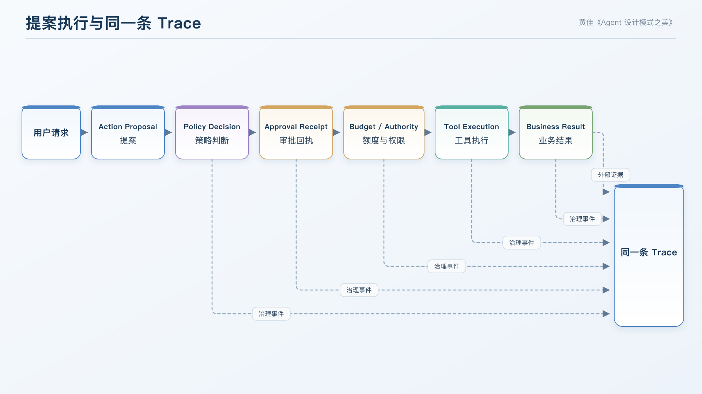

- 一次运行中，把提案、控制记录和执行结果关联起来。跨次运行或延迟回调时，还要靠业务申请号接续查询

在 Agent 时代，清晰的版本记录也很重要。用户昨天得到的承诺，不能拿今天改过的政策去解释。保存当时实际使用的模型、提示词、检索材料和工具版本，才能判断条件在哪一处变了。当前状态可以更新，关键变化还要留给以后查询的人和 Agent。

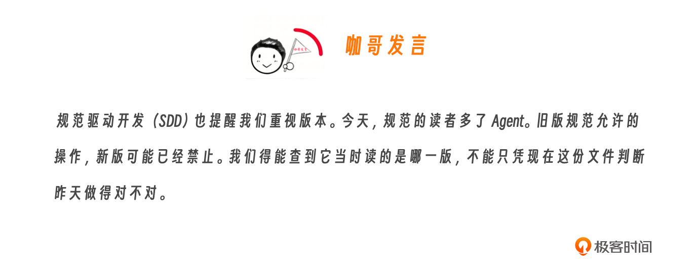

还有一类线索容易被忽视：Agent 当时有哪些选择，也就是在做出具体决定时，它能用哪些工具，不能用哪些工具。它没用某个工具，可能是判断不需要，也可能是权限过滤后根本看不到。工具被过滤、审批被拒绝、额度不足时，都应该在可观测性平台留下一条记录，说明原因与规则版本。

再看另一种情况：券已经发出，按规定，发券前必须有人批准。工程师在日志平台找到了发券记录，却找不到对应的批准记录。这张券到底有没有经过审批？

要回答这个问题，就拿这笔申请的编号，到审批系统查询发券前的审批结果。如果当时已经批准，就检查为什么批准记录没有传到日志平台。如果发券时还在等待审批，就要查程序为什么提前发了券。

只记下“发券成功”，还不能说明这件事办得合规。我们还要能查清，发券前有没有得到应有的批准。

## 业界怎样把这些记录用起来

现在我们已经知道要查什么，再来看平台怎样帮助团队开展这项工作。

### Factory：让一条差评能找到对应的调用

LangChain 在 2024 年公布的 Factory 案例中，介绍了他们怎样使用 LangSmith。具体做法是把调用步骤与 AWS CloudWatch 日志关联，让工程师沿同一次运行继续查。用户反馈也附到对应调用和工作流阶段，随后汇入数据集，用来分析问题、改进提示词。这样，当收到“这段代码建议不好”的反馈时，工程师就能找到当时的输入、上下文和输出。改完后还能拿原例子再测。这条反馈才有机会影响下一版程序。

### Canva：让懂业务的人参与判断

Langfuse 公布的 Canva 案例里，面向用户的 Help Assistant 运行在 Java 上，通过OpenTelemetry 接入。处理异步工单的 Omni Agent 使用 Python SDK，两套技术栈的运行信息进入同一平台。

在这个项目中，参与分析的也不只有工程师。QA 做标注，内容设计人员改进回答与检索内容，日本市场的业务人员还建立了语气评测，检查回复是否符合当地正式商务表达。工程师能知道接口有没有超时，但未必知道哪种措辞会让客户不舒服。把可以观测的记录在团队之间共享，这样业务专家也能够参与判断，提升项目质量。

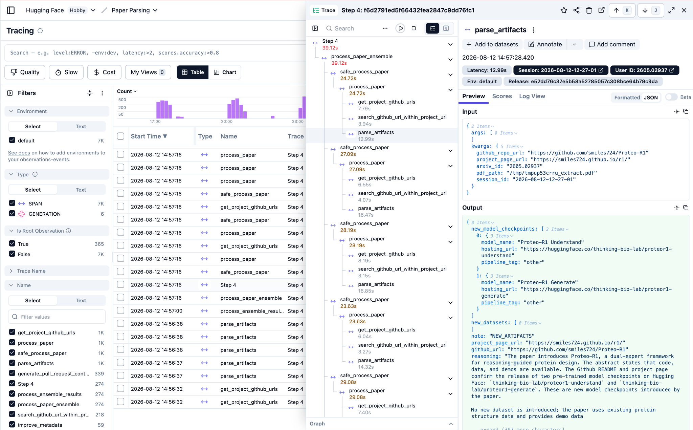

- Langfuse 官方文档示例图，左侧筛选运行记录，中间沿调用树定位，右侧查看具体输入输出

### 如何选择可观测性平台

LangSmith、Langfuse、Arize Phoenix 都是有代表性的可观测性平台，都提供追踪与评测能力。它们也各具特色，可以按自己最需要补齐的工作来选择。Phoenix 的文档也介绍了从运行记录整理数据集、用同一批输入比较修改的流程。OpenTelemetry 则是采集和传递这些信息的标准与工具体系，可以连接不同语言和服务。

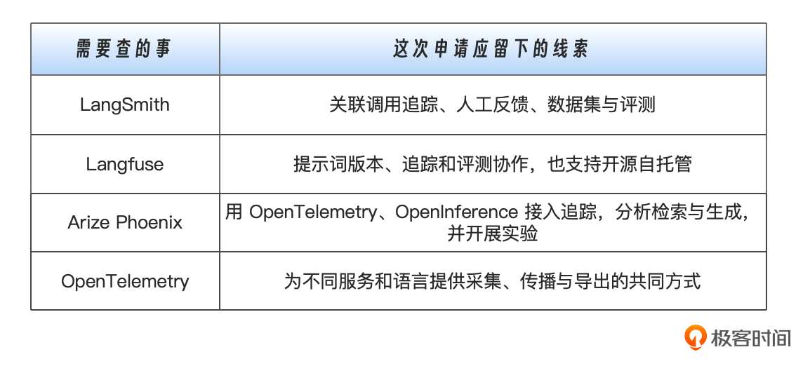

如果公司已经有 Grafana、Prometheus 等基础监控，不必全部换掉。可以先拿一条真实投诉试走一遍，看看能否找到对应运行，并看到当时模型收到什么、工具返回什么，再到业务系统确认结果的过程。把这一条路走一遍，才知道缺的是没有记录、记录关联不上，还是业务结果尚缺乏清晰的记录体现。

随后再比较部署方式、查看权限和使用成本。最后，如果团队的工程能力较强，而现有的可观测性平台并不符合项目需求，也可以自行研发可观测性平台和看板。

### 查清一次，也要改好下一次

龙波老师在治理研讨中谈到，留下运行事实并查明问题以后，还要继续区分问题出在工具、知识、执行过程还是业务结果，并思考后续对策。不同原因，对应不同修改。

发券例子就有两种容易混淆的情况。如果回复生成器根本没收到“待审核”，就要修传递状态的代码；如果状态传到了，但模型却把所有成功调用都解释成“办理完成”，就要调整状态解释规则，在提示词中给出更清晰的规则说明。两种情况都表现为“Agent 说错了”，而修改方法并不相同。

```
我们先看第一种情况。当工程师查到发券工具返回了 pending_review，中间的转换代码却
只保留了 success=True，回复程序因此没有看到待审核状态。
```

那么代码不完善就是根因，工程师要改的是这段转换代码，让它把业务状态传下去。同时也要把回复规则对应上：待审核时，只能告诉用户申请已提交，不能说券已发放。

改完怎样检验？不必再替这位用户申请一张券。把当时保存的工具响应取出来，作为测试输入，交给修改后的转换代码和回复程序。我们只检查状态有没有传下去，最后的回答有没有与状态相符。

如果模型在这个测试场景中回答：“申请已提交，审核通过后发放”，就改对了。但是测试还未结束，还应继续拿“确实已发放”和“申请被拒绝”的例子再测，避免程序改完以后，对什么情况都只会等待。这些例子就是回归测试集。以后换模型、修改提示词或者修改程序逻辑时，可以复用。

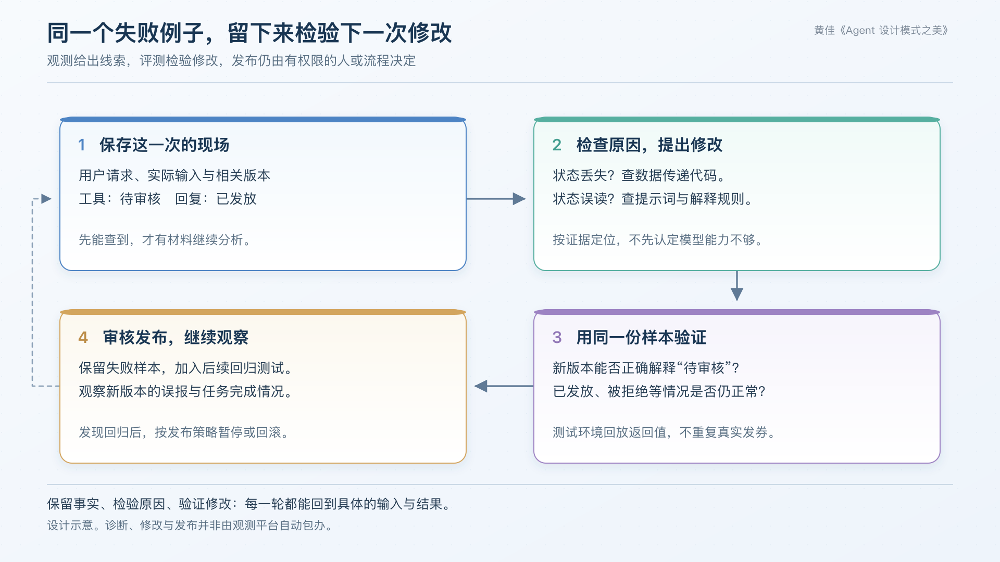

- 同一份失败样本贯穿调查与验证。原因由团队检查，修改经过测试与审核后发布

现在再看本课开头所说的“重放”这个词，就更容易理解了。查旧记录时，程序没有重新作决定，我们看的是已经发生的经过。测试新版本时，修改后的程序会重新运行，但发券工具由保存的响应代替，不办理真实业务。

Canva 的案例也提到，他们把输入与预期结果存进数据集，离线实验时用模拟的工具响应代替真实工具调用。这样的测试能检查程序是否会再次误解这份输入。

可观测性平台也能帮忙缩小排查范围。例如 LangSmith Insights 可以归类多条运行记录中的行为与失败模式。

从分工上看，业务团队负责说明什么答复和结果才算合格，工程师据此定位和修改，发布负责人决定何时上线。一个好的观测记录，能够把这些人需要的材料接起来，让大家在同一个平面上协作。

## 进度追踪、交接链和可观测性怎样配合

这三个模式都需要保存记录，容易被混在一起。我们举个任务恢复的例子，帮你分清各自的功能。

薪酬 Agent 已经付完部分工资，向银行提交下一笔时超时，随后进程退出，Agent 停止处理。另一个执行进程接手，它首先要问“做到哪了”。此时进度追踪给出恢复位置：哪些已确认，哪些没处理，哪一笔结果未知。

接着，它要检查交来的材料。任务账要求使用 v3 版资料进行结账，收到的文件却是 v2，那就应停在交接处。交接链负责让接手者验收清单、回执和待对账事项，避免拿错材料继续做。

至于刚才的超时付款，调查者可以通过可观测性找到当时的请求、审批、额度和后续重试。钱到底有没有付出，则需要凭原请求编号向银行查询。银行确认成功，就补齐结果，不再付款。确认未生效，才按当前有效的批准和权限决定怎样继续。仍查不清时，就保留“结果未知”的状态，避免重复付款。

所以，进度追踪告诉我们接着做什么，交接链确认接到了什么，可观测性帮助查清先前发生了什么。它们可以共用同一个业务任务编号，让接手者能找到对应材料。

## 记录也要管：谁能看、存多久、能不能改

为了方便查问题，我们很容易这样想：我把 Agent 看过、说过、做过的东西全部存下来，以后总用得上。可这样一来，不仅仅信息会过载，而且客户资料、内部文件，甚至密码，也可能被复制进日志。业务系统里的资料通常管得很严，但到了日志平台却人人能看，此时要小心是不是无意中开了一个泄露信息的口子。

那怎么管理记录呢？

先分清楚谁需要看什么。 客服查用户的申请走到哪一步，不需要看到完整银行账号；开发者排查调用错误，不需要拿到用户密码；审计人员则需要知道谁批准了什么、实际执行有没有超出批准范围。不同的人看到不同内容，够用就好。即使把日志平台部署在公司自己的服务器上，也要先设置好查看权限。

不该存的内容，在记录送出去之前就处理好。 密码、访问令牌不要写进日志，账号、证件号等敏感信息必须按需要进行脱敏。我们要检查可观测性工具会不会自动把这些内容一并收录，大模型如果要输出任何敏感信息，也必须要有护栏进行拦截。

但遮住信息以后，前后的记录仍然要对得上。举例来说，审批人批准向账户 A 付款，实际却付到了账户 B。如果两处都只显示“账号已隐藏”，调查者就看不出区别。可以不展示完整账号，但要留下有查看权限的人能够核对的账户编号和版本，以确认实际使用的账户是不是当时获批的那个。

不同记录，保存的办法也不同。 普通调试详情可以只保留一部分，保存多久具体情况具体分析；付款、审批、额度使用和权限变更这些关键记录，要长期单独保存，不能随意丢掉。因为用户可能几天后才来投诉，那时还得查得到相关经过

最后，还要检查记录有没有真的存下来。 有时候记录保存操作也会失败，也可能出现“业务已经做了，日志却没留下”的情况。这类故障要及时提醒负责人，提前规定哪些操作可以继续、哪些必须暂停，以及已有记录怎样补存。查不到记录时，不能直接认定动作没有发生，应该核对业务账和外部回执。

所有记录都不应该被随意修改。发现记录有误，可以追加一条更正，说明哪里错了、谁改的、为什么改，而不是直接删除原始记录。

## 三道治理控制，一条运行史

好，写到这里，治理模式组就完成了。我们再看一下 798 张工资单，总共 13,706,097 元。清单准备好了，钱发出去以前，还有三件事。

- 审批门查的是：这份清单批过没有？ 谁签的字，签字时看的是不是眼前这一版，批准现在还是否有效。

- 爆炸半径控制管的是：实际最多能付多少？ 批准的总额按部门分好，每付一笔，就占用相应额度。

- 渐进承诺看的是：现在允许这个 Agent 做多少？ Agent 要接手更多部门，得先有相应的运行成绩，再经过升权批准。

可观测性则把检查和执行的经过一起留下来：谁按什么规则批准了哪份清单，每笔钱用了哪份额度，Agent 当时有什么权限，银行给了什么结果。出了事故，也能查到是谁、在什么时候收回了它的付款权限。

这些记录还要用来决定下一次怎么办。如果 Agent 的处理被人纠正的频率越来越高，就先别急着让它接手更多工作，查清它总在哪类任务上出错。需要调整时，由相应负责人决定。改了哪条规则、为什么改、谁决定的、从什么时候生效，都要跟着记下来。 下一次执行，再按调整后的规则检查。

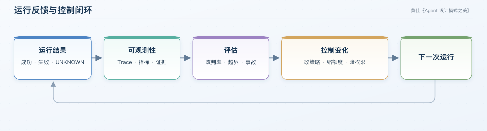

- 运行结果为审批、额度和权限调整提供依据，调整后的规则再约束下一次执行

这样，以后有人问“为什么只让这个 Agent 处理 Ops 部门”“这笔额度什么时候调低了”，系统就能找到当时的问题、处理决定和规则版本。

传统系统中的日志，每天只记“完成了多少笔付款”，它解释不了上面的这些变化。我们现在所谈的可观测性，是把事情怎样办、结果怎样、后来为什么改规则连起来，这样企业才知道下一次可以多交给 Agent 一些，还是应该先收回一部分权限。

## 总结一下

可观测性，是那块玻璃罩里的机械表，让人看得见里面的零件怎样转动。不过，零件都在转，最后还得看时间走得准不准。Agent 也是这样：我们既要看它调用了什么、经过哪些步骤，也要核对事情到底办成没有。

就像给孩子约定每天使用手机的时间。我给他每天两小时，希望他自己学着安排。安排得怎么样，哪些地方总要提醒，约定要不要调整，都得看实际情况。企业把工作交给 Agent，也需要这样的余地：日常事情让它自己做，出了问题能查清、能及时停下，需要时再调整权限和规则。

可观测性留下的记录，就是为了让我们作这些决定时，知道发生过什么，而不是全凭感觉。

## 下一讲预告

全部 Agent 设计模式到这里收束。下一讲，我们把局部设计放回完整系统，先看清业务目标和故障假设，再判断需要加入哪些结构，以及用什么证据证明它们确实有用。

## 思考题

1. 你的 Agent 有没有“接口全成功，任务却没完成”的情况？最终结果应该到哪个业务系统确认？

2. 拿一条用户投诉，你能找到当时的输入、工具返回、策略版本和执行身份吗？哪一段最容易断？

3. 选一次真实失败，保留什么材料，才能在不重复办理业务的前提下，检验下一版是否改对了？

期待你在留言区记录想法或提出疑问。如果这节课对你有启发，别忘了分享给身边更多朋友。

## 延伸阅读

- ADPS 治理研讨会，2026-08-18：三层观察口径、组织分工与演进闭环。

- ADPS X1 可观测性：跨模式的运行身份、版本、因果和外部结果。

- Google Dapper，2010：分布式追踪的经典实践。

- Factory 使用 LangSmith 与 Canva 使用 Langfuse：两则业界实践的原始发布页。

- OpenTelemetry GenAI 语义约定：模型、工具和 Agent 操作的共同字段与演进状态。
