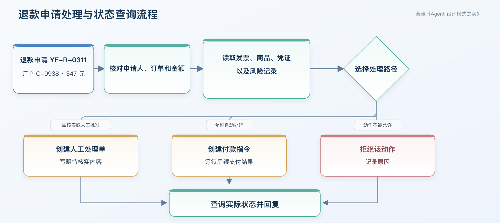
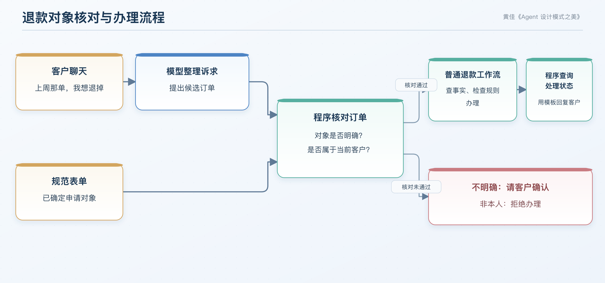
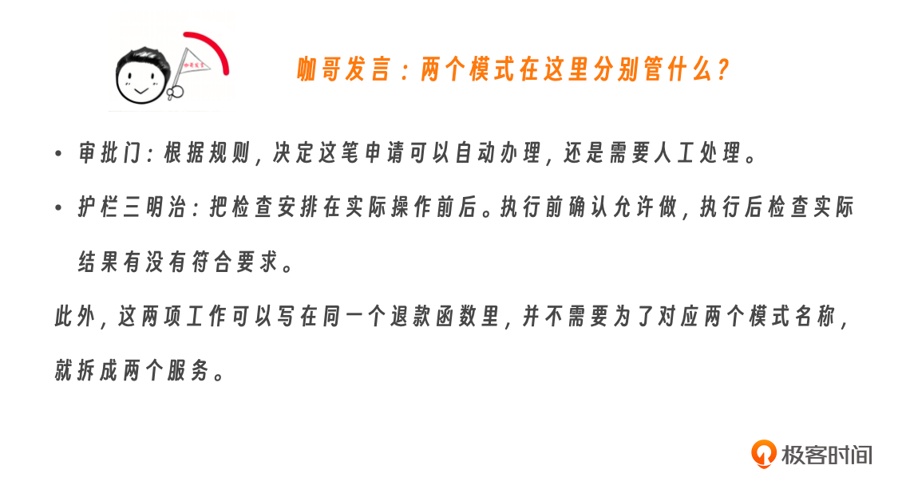
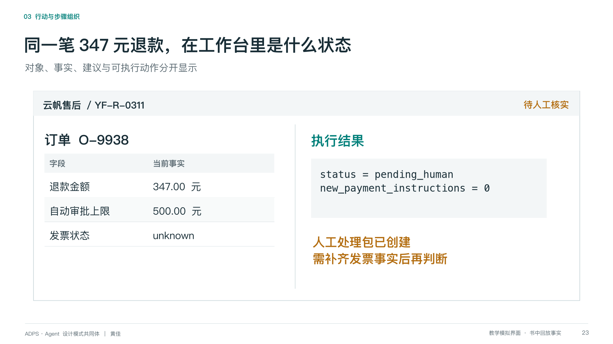
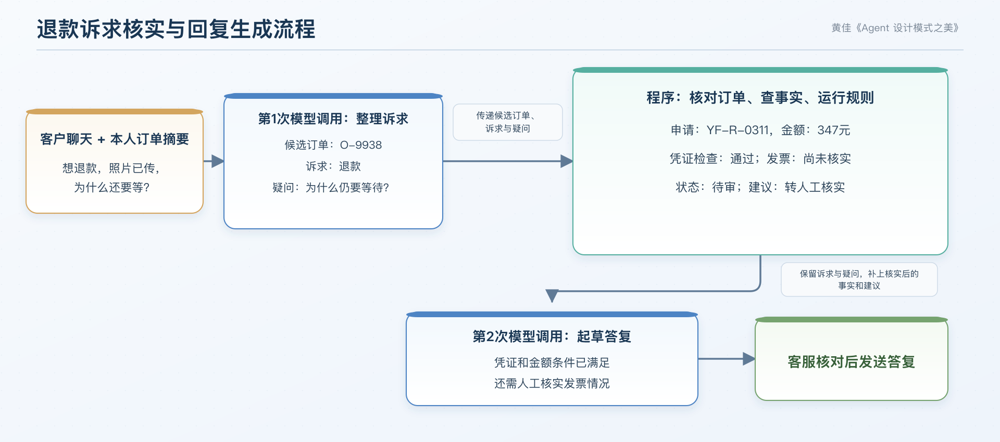
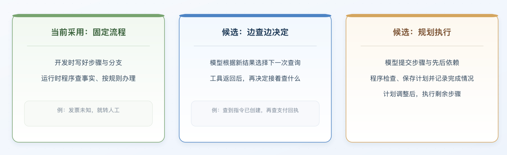
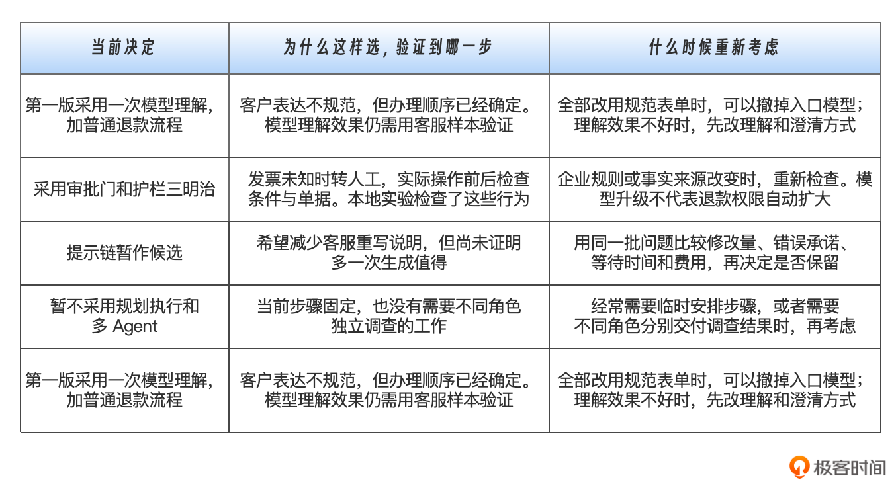
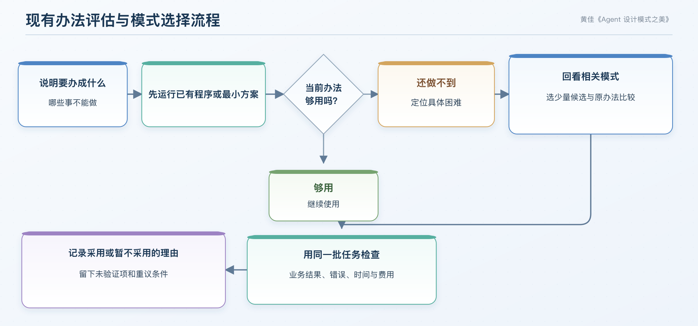
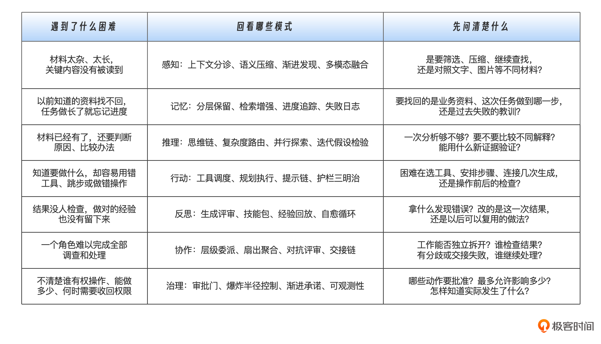

# 41 | 模式选型：因事制宜，先看任务，再定结构

- 释题：因事制宜。先弄清任务需要哪些判断，再决定把多少工作交给模型。

你好，我是黄佳。

学到这里，你已经认识了不少模式。面对一项任务，一个新项目，我们看着那张熟悉的模式地图，似乎总能找到几个相关模式的名字。接下来的问题是：这么多模式，到底该用哪几个？如果我们把生成评审、规划执行、交接链一股脑儿都加上，系统就一定会更好吗？我们又凭什么作出这个选择？

前面讲行动模式时，有同学问过我：“涉及钱的操作，金额、顺序和权限都要由程序控制。那直接写程序不就行了吗，为什么还要接入 Agent？”

这个问题问得很好。如果输入规范、步骤明确，程序已经能把事情办好，那就直接用程序。学过设计模式，不意味着每创建一个 Agent 都要多加几个模式。

不过，客户不一定按表单提要求。他可能只说：“上周那单我想退掉。”也可能把退货、换货、优惠券和发票混在一起，让你“帮忙一起处理”。这时，我们才需要继续判断：哪些内容需要模型理解，哪些步骤需要它帮助安排，哪些事情仍然应该由程序负责。在这种用户意图模糊、操作流程不确定，且明显存在操作风险的场景中，就适合引入我们这套设计模式了。

这一讲，我们以售后服务为例，把这个 Agent 的设计和模式选择过程走一遍，一起看看什么时候需要用上模型的判断，先用什么模式、再用什么模式，以及为什么这么用。下一讲再来讲模式如何组合，最后一讲说说系统架构如何演化。

## 一、先看这笔退款怎样才算办对

这是一个“云帆公司售后服务”的场景。

客户申请了退款 347 元，订单号是 O-9938，退款申请号是 YF-R-0311，目前待审。这家企业规定：符合条件的 500 元以内退款，可以自动处理；已经开过发票的订单，要交财务处理。

不过，这张订单是否开过发票，目前还没有核实。先别急着选模式。我们先把这笔申请该怎么办说清楚。



- 从核对申请到报告处理结果

程序要先核对申请人、订单和金额，确认办的是谁的哪一笔退款。接着，读取发票、商品、凭证和风险记录，再按照企业规则决定下一步。如果条件齐备，就创建付款指令；还有需要核实的内容，就创建人工处理单，写明要核实什么；当前身份没有操作权限，就拒绝这次操作。处理之后，再查询实际状态，告诉客户办到了哪一步。

这里有一个容易忽略的地方：退款助手的任务，是按规则处理申请，并不是无论如何都把钱退掉。若发票情况不明，要按规定转给财务核实。系统不应该因为没有退成钱，就认为自己失败了。

因此，在讨论架构之前，我们先要知道：什么结果算办对，什么事情不能做。这两个问题没有说清楚，后面即使用了再多模式，也无法判断系统是否正确地完成了任务。

## 二、步骤已经确定，就先交给程序（以及何时引入模型）

假设客户在退款页面选好了订单，填好了退款原因。系统拿到的申请号、金额和原因编码都是规范的数据。那么，刚才这套流程完全可以由普通程序完成。

- 发票状态未知就转人工；

- 各项条件满足就继续办理。

后续的等待人工、保存进度或者处理失败等流程，也都可以由工作流来编排，不一定非让模型来安排步骤。

模型可能派上用场的，是另一种入口。当客户在聊天里说：“上周那单，外包装破了，东西还没用，我想退掉。”

他没有说订单号，也没有把诉求填进固定字段。这种情况传统的 CRM 系统可能就束手无策了，因为客户需求相当模糊。这时候，我们就可以把这位客户的订单摘要和前面的聊天记录交给模型，让它整理诉求，提出一个候选订单。


这样，模型和程序各自负责什么，就比较清楚了。

模型帮助理解客户的话。退款金额从申请记录中读取，发票情况从业务数据源查询，权限由程序检查。对于这些已有明确来源的内容，并不需要模型猜测。

而办理后的答复，也可以先用固定模板来完成。例如：“申请已转人工，还需核实发票情况。”如果这个模版可用，就没有必要再调用一次模型来生成额外的回复。

所以，第一版设计就是：模型整理客户诉求，程序按既有流程办理，最后用模板报告结果。



- 模型帮助理解客户诉求：核对对象后，程序按既有流程办理

到这里，我们还没有把“下一步做什么”交给模型。整个流程仍然由程序控制，模型只参与其中的一部份工作。它和模型每轮自行选择工具、决定下一步的自主 Agent，是两种不同的设计。因为当前任务还比较简单，无需过度设计。

## 三、发票没查到，该加评审，还是转人工

现在客户的意图已经弄清，大模型根据之前的对话记录，成功地定位了这笔退款申请之前的订单。程序接着查询发票，却没有找到记录。

那这能不能直接理解成“没有开过发票”？

不能。因为也有可能发票已经开出，只是查询的数据还没有同步过来。“发票状态未知”和“财务确认未开票”，是两种不同的情况。

这时，再让模型重新分析一遍，或者找另一个模型评审，都不能凭空补出财务记录。我们缺的不是更多的推理，而是一条经过核实的事实。此时程序应该把申请转给人工，并说明：“需要核实这张订单是否开过发票。”

这就是审批门在这里承担的工作：根据当前事实和规则，决定这次可以自动办理、需要人工处理，还是不允许操作。

## 四、工具调用之前及之后的检查

给出具体判断后，下一步是把这个判断落实到实际办理的程序里，也就是调用工具来创建付款指令。

创建付款指令之前，程序要检查当前条件。前面提到，如果发票状态仍然未知，就只能创建人工处理单，不能继续走付款分支。即使模型提出了付款请求，也不能跳过这项检查。

而操作之后还要再查一次：人工处理单有没有创建？付款指令有没有被错误地创建？

这就是护栏三明治在这个例子中的用法：动手前检查是否允许，动手后检查实际结果。审批门负责判断允许走哪条路，护栏则把这些要求落实到操作前后。



到这里，我们已经有了明确的取舍：采用审批门和执行前后的检查，而不需要为“发票未知”再增加一次模型评审。因为当前要补上的是财务确认，不是再次调用模型进行多一次的分析。

## 五、用两份数据，检查刚才的选择

下面我们看看配套实验 refund_selection_demo.py。

实验准备了两份独立的初始数据。两份数据中的退款金额都是 347 元，唯一的区别是：第一份的发票状态未知；第二份多了一条测试用的财务确认，说明订单未开票。

每份数据都依次做三件事：先读取申请，再查看处理建议，最后实际办理。

按配套实验说明准备好工程后，在脚本目录运行：

```
python3 refund_selection_demo.py
```

先看发票状态未知的那份数据：

- 【发票状态未知】

```
读取：订单=O-9938，退款=YF-R-0311，金额=347 元
事实：invoice_status=unknown
起草：建议=queue_human，业务数据未变=True
执行后：退款状态=pending_human
新增人工处理单=HAP-0311
新增模拟付款指令=无
```

unknown 表示发票情况尚未核实，queue_human 表示建议转人工，pending_human 表示申请正在等待人工处理。

此处注意建议和办理之间的区别。建议就是输出中的“起草”部分，是程序按规则给出处理建议，不是让模型写客户答复，也没有创建任何单据，不改变任何业务数据。实际办理之后，才出现人工处理单 HAP-0311，这里没有出现新增付款指令。

这时，客服告诉客户：“这笔申请已经转交人工，还需要核实发票情况。”



再看已经确认未开票的那份数据：

- 【财务已确认未开票】

```
读取：订单=O-9938，退款=YF-R-0311，金额=347 元
事实：invoice_status=none
起草：建议=auto_approve，业务数据未变=True
执行后：退款状态=approved
新增人工处理单=无
新增模拟付款指令=PI-0311
```

这里的 none 表示已确认未开票。程序因此建议自动批准。到了办理这一步，才创建模拟付款指令 PI-0311。approved 表示退款申请已经获批。本实验没有连接支付系统，因此此状态不代表客户已经收到退款。

两次处理的金额和规则都一样。改变结果的，是财务确认：不知道有没有开票时，转人工；确认未开票且其他条件满足时，创建付款指令。

## 六、什么时候值得再调用一次模型

系统当前的版本已经能处理退款申请了。但现在遇到了一个新问题：客户觉得之前的固定回复模版不够具体，追问“照片已经传了，金额也只有 347 元，为什么还要等？”

开始时，我们觉得这样的问法出现的不多，补一条模板可能就够了。但如果客户经常把多件商品、不同凭证和几轮沟通放在一起问，客服每次都要重写说明，操作非常麻烦。那么，我们可以试着再次让模型起草答复——这就再次引入了一次模型调用。

在这个系统中，哪里使用了模型做判断呢？我们来梳理一下。

意图识别：先弄清客户在问什么

程序把客户的订单摘要和聊天记录交给模型。这次只要求它整理诉求和疑问，暂时不判断能不能退款。

假设模型给出：

```
候选订单：O-9938
```

- 客户诉求：退款客户疑问：照片已经传了，为什么仍要等待？

程序核对候选订单是否属于当前客户。对象不清楚，先请客户确认；核对通过，再查询退款申请和相关记录。

中间：程序查清事实，给出处理建议

程序查询凭证和发票记录（这个过程可以有模型的帮助，也可以应用各种设计模式），按规则给出建议。这里仍然只看建议，还没有实际办理。

它把客户原来的疑问保留下来，再补上查到的业务信息：

```
订单：O-9938
退款申请：YF-R-0311
```

- 客户诉求：退款客户疑问：照片已经传了，为什么仍要等待？

```
申请金额：347元，符合500元以内的金额条件
```

- 凭证检查：已通过发票状态：尚未核实当前申请状态：待审按规则给出的建议：转人工核实发票情况

这份材料里，不同信息各有来源。347 元来自退款申请，凭证和发票状态来自业务查询，处理建议来自规则判断。

需要注意的是，当客户说“照片已经传了”，只说明他认为自己完成了上传。只有系统查到“凭证检查已通过”，才说明凭证已经满足要求。

回复问题：根据查到的结果，回复客户详细信息最后，模型拿到了回答“为什么还要等”所需的材料。它可以这样起草回复：

```
您提交的凭证已经通过检查，347元也在小额自动处理范围内。目前还没有核实这张订单是否开过发票。按处理
```

这段解释针对的是客户真正的疑问：当前还在等发票核实。



- 模型帮助理解客户诉求：核对对象后，程序按既有流程办理

这就是提示链在这里的用法：第一次调用理解问题，程序在中间核实情况，第二次调用根据这些情况组织答复。两次调用可以用同一个模型，也可以用不同模型。重要的是，后一次拿到的材料和前一次不同。

为什么不在第一次调用模型时顺便把回答写好？

因为它那时还不知道凭证有没有通过、发票有没有核实，也就不知道这次等待究竟是什么原因。


## 七、什么时候才需要模型安排步骤

到目前为止，客户的说法虽然不同，退款流程却没有变。模型帮助理解和解释，办理顺序仍然由程序决定。

再把任务扩大一点。客户又说：“这笔组合订单里，两件退货，一件换货。用过优惠券，有一件已经开票，请一起帮我处理。”这次可能需要等商品退回入库，核实发票处理情况，再重新分摊优惠。事情变多了，而且有先后关系。

这种情况是不是就必须用规划执行？仍然不一定。如果企业已经有成熟的组合售后流程，直接调用它就好。

当这类请求经常需要客服临时安排步骤，而现有流程又很难覆盖时，才有理由让模型参与计划。

例如，模型根据查询结果，提出下面这份安排：

```
步骤1：核实退货入库情况
步骤2：核实发票处理结果
步骤3：计算可退金额，等待步骤1和步骤2完成
步骤4：提交退款，等待步骤3完成
```

模型提出安排后，程序要检查并保存这份计划，还要记录每一步是否完成。第一、二步在业务上互不依赖时，可以并行；第三步必须等前两步结束，不能仅因为模型把它写在计划里，就提前执行。

如果后来发现某件商品不用退回，模型可以提出修改计划。程序检查并接受修改后，再安排剩下的工作。已经完成的步骤，不能因为计划重写就变成“还没做”。

这才是规划执行带来的变化：每项任务的安排可以不同，但安排、完成情况和后续变化都要被程序记录和处理。我们得到更多灵活性，但也多了检查计划、记录进度和处理变更的工作。

还有一种安排，不一定一开始就列出完整计划，而是让模型边查询、边决定下一步。例如调查退款为什么迟迟未完成，可以先看退款状态，再根据新结果决定还需要哪些查询。

这里也要分清：如果查到某个状态后该查哪个接口，本来就有明确规则，那仍然可以直接写进程序。只有下一步确实需要根据新材料作判断时，才考虑交给模型。

上面这几种编排方式，可以用这样一个问题区分：下一步是由谁决定的？

- 固定流程由开发时写好的程序决定；

- 边查边决定，由模型根据最新结果选择；

- 规划执行则让模型先提出计划，再由程序保存、检查和推进。



- 三种编排方式的区别：下一步由谁决定，是否保存一份待执行计划

如果一项任务比较长，我们希望先让人看看准备怎么做（明确“哪一步做完，才能开始下一步”，或者中途停下来以后还能接着做），就可以通过进度追踪模式保存计划，按计划执行。如果只是查几条资料，看完再决定要不要继续查，就不必先列一份完整计划。

不过，计划做完了，不等于已经满足付款条件。假如模型漏写了“核实发票”这一步，其他步骤即使全部完成，付款程序也必须检查发票状态。该核实的还没核实，就不能付款，这是护栏三明治模式的基本要求。

回到这笔 347 元退款，应该查什么、什么情况下转人工、什么情况下可以继续办理，都已经有明确规则。直接让程序按这些规则执行就够了，暂时不需要模型另拟计划。

涉及客服、财务和风控三个部门，也不意味着要分别建立三个 Agent。如果只是从三个系统取资料，程序调用三个查询工具就可以。等到确实需要不同角色分别调查、各自保存调查过程，再把结果交回来共同处理时，我们可以再考虑层级委派等协作模式。

## 八、双轴矩阵怎样帮助我们作选择

回头看，我们始终在回答两类不同的问题。

- 一类是要补哪项职责。这笔钱能否自动处理，需要治理方面的判断。多段模型工作怎么衔接，需要行动方面的安排。

- 另一类是怎样组织这项工作。审批按条件走不同出口，所以选择路由。理解申请、查询事实、起草答复有固定先后，所以提示链是候选。需要运行时产生不同计划，才考虑由规划器

- 统一安排。

在 ADPS 双轴矩阵中，审批门对应“治理 × 路由”，提示链对应“行动 × 链式”，规划执行对应“行动 × 编排”。读到这里，这些坐标已经对应了具体选择。要不要增加第二次模型调用、退款前怎么检查发票、整体流程怎么编排、条件怎么判断、工具怎么调用、最后怎么回复用户……这些环节其实都是灵活的，基于业务场景和对模式内核的深刻理解而作出的选择。

我把整个思考和实践过程，整理成了后面这张选型卡。



这样的记录，比只写“采用了审批门、提示链”更有用。后来如果来了新接手项目的同事，也能看出你为什么这样设计，知道哪些结论还没有经过验证。

需要记录的也不只是模式名称，相关设置也应当随测试结果一起留下来。比如采用迭代假设检验模式时，允许试几次、什么时候停、最多花多少钱等等。

现在，你也可以拿自己的项目，沿着同样的顺序试一次。



- 已有办法够用，就继续使用；有做不到的地方，再比较候选方案

实际应用时，应该先说清楚任务怎样才算完成，哪些事情不能做。再让现有程序或最小方案走一遍，看看究竟哪一步还做不到。针对那个困难，选少量候选，用同一批任务比较。

比较时，不只看事情有没有办成。还要看有没有增加原来不会犯的错，时间和费用能不能接受。最后记录下你的最终决定，并写明哪些部分还没验证。而每一项结论，都要有对应的检查。

举例来说，如果你在设计差旅系统。员工问“出差住宿标准是多少”，如果能准确找到现行制度，先把相关条款和出处给他，可能就够了。遇到复杂问法，需要结合几处内容解释时，再考虑增加生成。不涉及替他办理业务，就不需要照搬退款的整段审批流程。同一个员工接着说“帮我订好下周的行程”，任务就变了。系统需要比较时间和费用，还可能替他作出预订承诺。这时才要重新考虑计划和审批。要不要审批，取决于系统能够做出什么操作。

设备故障调查也是如此。几份记录互相矛盾，需要提出可能原因，再用检测结果排除，就可以考虑迭代假设检验。如果已经有成熟的诊断树，程序沿着既定分支查询，也可能完成任务。需要同时调查机械、电气和控制三个方面时，先看看三项工作能不能独立展开。各自有资料、有明确的调查范围和结果要求，那么就值得考虑扇出聚合模式。

所以，选择模式时，要说出任务里的具体困难。同一个行业里，不同任务可能需要不同结构；不同的行业，也可能遇到同一种问题。

## 九、现在，再回头看学过的模式

面对一项任务，我们只需要问：我的任务究竟卡在哪里？然后再对照 7 组模式。



同样是回答错了，原因可能完全不同。资料没找到，要改善查找；用了过期资料，要检查更新；材料正确却推断错误，才继续看推理和评审。同时要保证可观测性，查了什么、作了什么判断、执行了什么操作，都可能需要留下记录。

找到需要补的工作以后，还要考虑怎样安排它。一条轴看“要负责什么工作”，另一条轴看“这些工作怎样组织”。

- 步骤有固定先后，可以用链式；

- 不同条件要去不同出口，可以用路由；

- 几项工作互不依赖，可以用并行；

- 需要根据反馈继续调整，可以用循环；

- 需要分层分工、逐层检查结果，可以考虑层级；

- 需要统一维护计划、协调步骤依赖，可以考虑编排。

模式的增加代表着复杂性也随之提升，多一个循环，就要处理什么时候停止；多一个角色，就要处理它交回什么、谁来检查。只有当任务确实需要这些安排，增加的工作才有必要。

## 总结一下

这一讲，我们从一笔 347 元退款出发，从简单流程开始，逐步根据需要，搭建起了一套复杂的 Agent 架构。

客户意图说得不清楚，就让模型帮助理解；当退款条件已经明确，就交由程序检查和办理；如果模板解释不够用，再比较是否值得增加一次模型生成；如果请求经常需要临时安排步骤，再考虑规划执行。

前面学过的模式，帮助我们识别问题、寻找办法。用上一部分，以及暂时不选另一部分，都是设计中的正常决定。

选型以后，应该能说清楚四件事：遇到了什么问题，为什么这样安排，怎样知道有效，还有什么没有验证。

## 思考题

1. 如果所有客户都通过规范表单申请退款，你会删掉第一版设计中的哪一部分，保留哪一部分？

2. 发票状态未知时，补上什么信息才能继续判断？增加一次模型评审，能否获得这项信息？

3. 找一项你正在做的业务。什么具体变化会让你考虑从固定流程转向规划执行？引入以后，又多了哪项检查？

## 下一讲预告

选出了几种模式，接下来怎样让它们配合起来完成任务？第 42 讲，我们会比较资料研究、代码修复和薪资组配置三个场景，看看哪些工作可以分头做，哪些必须按顺序做，哪些需要边查边决定。还会讨论一个容易忽略的问题：每个部分单独看都合理，接在一起以后，为什么仍然可能办错事？

## 延伸阅读

1. ADPS 模式目录与白皮书：查阅模式定义、适用条件和后续修订。

2. Anthropic：Building effective agents：比较固定工作流与模型动态决定步骤的安排。

3. 《Designing AI Agents》第 10 章。
