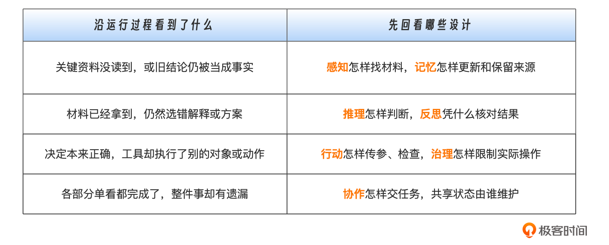
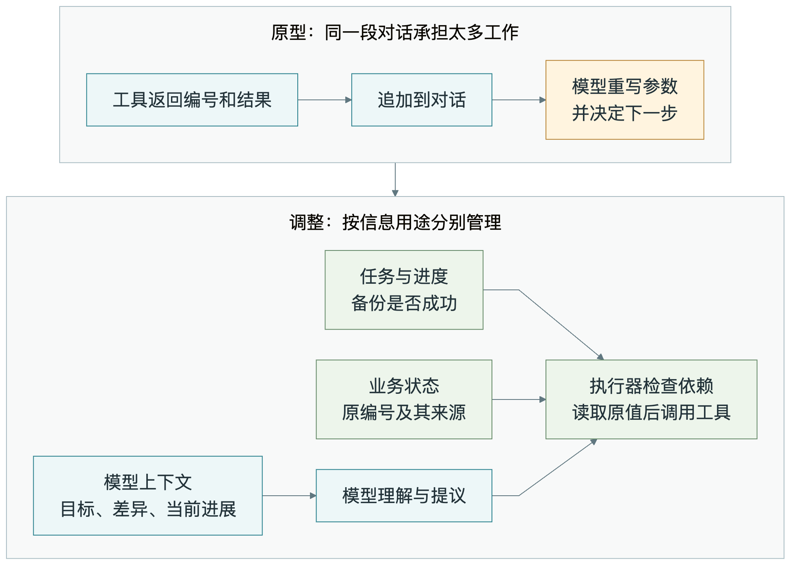
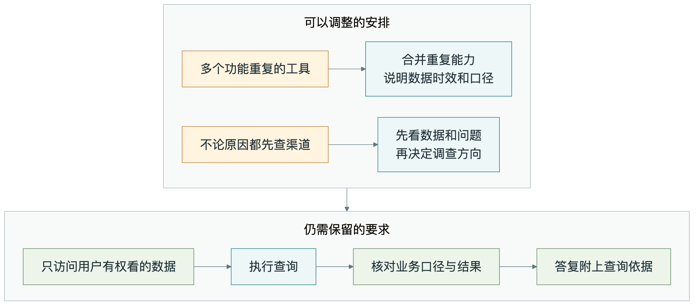
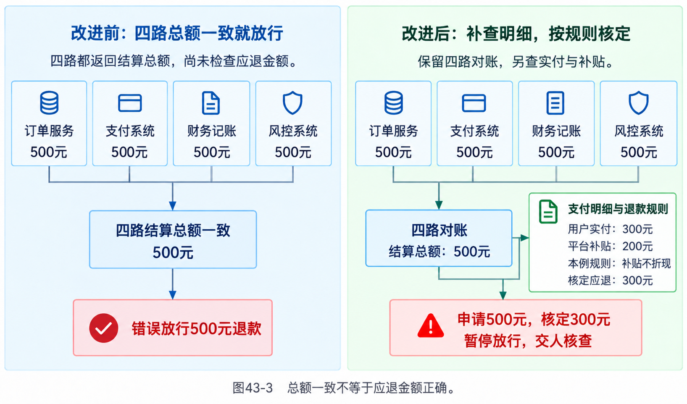
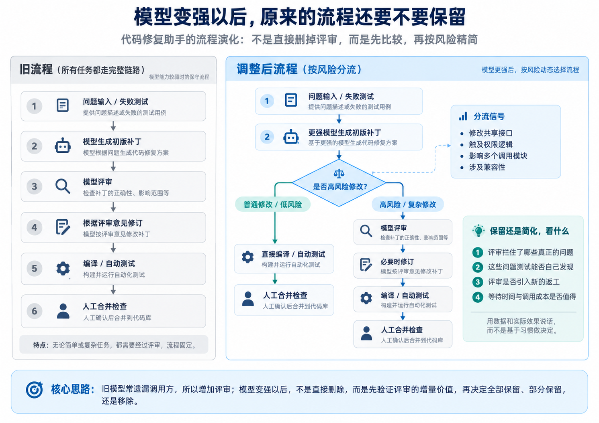
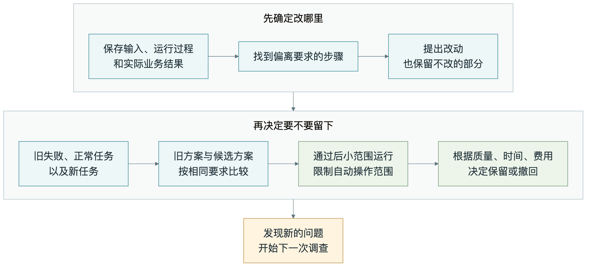

# 43 | 架构演化：让证据决定怎样修改系统

- 释题：改变，要因变而改。系统运行以后，原来的安排还合不合适，要靠实际结果来判断。有些地方需要补强，有些地方可以简化，还有一些应该继续保留。

你好，我是黄佳。

前两讲，我们讨论了怎样选择模式，以及不同任务中的模式怎样配合。到了最后一讲，我想和你聊一个系统上线以后会反复遇到的问题：已经设计好的 Agent，什么时候该改，又该怎么改？

一个数据分析助手，本来回答得不错，最近却总是找错表。你会怎么处理？换一个更强的模型，加一轮评审，还是让几个 Agent 分头查询？

这些办法都有可能用得上。不过，根源也可能只是业务换了一套表，知识库还指向旧表。此时最该更新的是资料。在这种情况下把同一份旧资料交给多少个 Agent，也不会增加找到新表的机会。反过来，如果材料没有问题，发现近期真正的变化是，系统工具越来越多，几十个功能重叠的工具都交给模型选择，造成了混淆，那么这时的修改方向可能是要限制当前任务的可用工具数量。

所以，设计完成以后，我们还要继续回答：当初为什么这样安排，现在这个理由还成立吗？

这一讲，我们一起来复盘并研究一下几次值得细看的改变，再联系前面学过的模式研究这些改变。

## 一、先找到事情从哪里开始出错

首先我们需要意识到：“回答不对”只是一个结果，还不足以决定改法。任何时候都不应该盲目地因为“Agent 这次答错了”同时修改模型、提示词、工具和流程。

就拿刚才的数据分析助手来说。工程师要沿着这次运行往回看：用户问了什么，系统找到了哪张表，采用了什么业务定义，执行了哪条查询，最后又怎样解释查询结果。

假如选中的表已经过期，先检查检索和记忆更新。如果表选对了，却把“付款人数”理解成“下单人数”，再检查推理时拿到的定义和提示。如果查询结果是 798 人，答复里却写成 800 人，就继续查生成与核对这一步。

而前面学过的这七组模式，恰好可以在这里帮助我们缩小分析范围。

沿运行过程看到了什么

- 先回看哪些设计

- 感知怎样找材料，记忆怎样更新和保留来源

关键资料没读到，或旧结论仍被当成事实

- 推理怎样判断，反思凭什么核对结果

材料已经拿到，仍然选错解释或方案

- 行动怎样传参、检查，治理怎样限制实际操作

决定本来正确，工具却执行了别的对象或动作

- 协作怎样交任务，共享状态由谁维护

各部分单看都完成了，整件事却有遗漏

可观测性让我们看见这些过程，业务查询和测试则帮助我们确认实际结果。找到问题以后，再去模式目录中比较办法。

这里要注意：Agent 在一次任务里修正回答，是运行中的反思，这种类型的变化由 Harness 来负责治理和应对。而工程师根据一批任务的表现，更换工具、调整分工或撤掉循环，则是在修改系统设计。任何对系统设计的修改，都需要经过严格的测试、评审和发布流程，不能让Agent 分析后就直接根据它的建议来改生产配置。

## 二、哪些是模型决策，哪些是程序逻辑

在薪资组配置场景中，新客户知道自己想怎样发工资，却未必知道软件里应该怎样选择模板、建立工资项、配置补贴。让模型参与的好处是：不要求客户先学会每个配置界面，就能用业务语言说明要求，让模型帮助理解差异、为客户寻找合适的模板。

团队起初把业务 API 做成工具，将操作说明放进 Skill，由 ReAct 循环逐步选择工具。所谓ReAct，就是执行一步、看一次结果，再决定下一步。作为初始设计，这种安排保留了调整空间，相信也是大多数团队的第一选择。但进一步的测试暴露出这个初始设计存在两类不同的问题。

第一类问题：模型自主判断和固定逻辑的配合

配置操作有一条必须遵守的依赖：当前配置备份成功后，才能导入新配置。导入失败时，要能用备份恢复。

第 42 讲已经讲过，早期运行会出现漏备份就导入的情况。团队随后把依赖写入任务图（DAG），让执行器检查完成状态：备份没有成功，导入就不能开始。

客户需求还没弄清时，调查过程仍可采用 ReAct；开始执行已确定的操作后，由程序保证依赖。这两种安排可以用在同一项任务的不同阶段。

第二类问题：即使编排准确，参数调用仍可能出错

这一类问题发生在相邻步骤之间。模板匹配已经返回了编号，后面的导入接口需要原样使用。

早期，团队把编号也写进对话，通过自然语言传递，再让模型生成导入参数，测试中出现了ID 误写和错绑问题。因为大段的自然语言传递不像程序那么精确，即使每个步骤都按次序执行，仍然可能导入错误对象。规划执行管住了流程的先后次序，却没有替我们保存好每一个参数的精准来源。

沿运行记录可以看到：上游工具返回的编号正确，变化出现在模型重新填写下游参数的时候。我们当然可以在提示词中继续强调“认真复制每一个 ID”，但这仍然要靠模型再次生成编号。团队选择了更直接的办法：程序保存返回值，下一个工具从保存位置读取，模型不再负责重写编号。

- 任务完成状态决定能否继续，业务参数原样传递，模型仍然参与意图理解和后续判断。

在这套设计里，工作区 Workspace 保存任务和进度，会话状态 SessionState 保存精确业务值及其来源，会话叙事 SessionNarrative 则保存目标、重要进展和下一次判断需要的材料。模型看到“模板已找到”，可以继续解释方案、提出下一步。导入程序需要的是那次工具返回的完整编号。两者使用的信息有关联，保存和读取方式却不必相同。

我们可以用模式语言回看这次改造：规划执行和进度追踪管理步骤，工具调度在调用时读取并检查所需状态，语义压缩负责组织模型要看的材料。需要调整的是它们之间的分工。精确参数一旦交给程序保管，就应该不再随着对话摘要一起被改写了，那并不准确，而且也没有必要。

这也回答了“是不是应该增加多 Agent”的疑问。眼前没有几个独立任务需要分头处理，换成多个 Agent 传话，仍然要解决编号怎样传递。先修复好这次交接，比增加角色更切合问题。

如果应用始终只有一套固定配置流程，普通工作流也能落实同样的要求。只有当需要根据用户需求形成不同计划、局部重排时，规划执行才有更多发挥空间，这时才是需要 Agent 来发力的时机。

## 三、工具集的简化和提示词的优化

增加程序约束是一种改法，减少不必要的安排也是。

OpenAI 在 2026 年 1 月介绍过内部数据 Agent 的两次调整：早期给模型暴露的工具功能重叠，选择容易混淆，后来限制并合并了部分调用。团队还发现，过细的路径指令会把分析带向错误方向，于是改用较高层的目标指引，让模型根据问题决定调查路径。

为了看清这两种调整，我们用一个具体问题来举例，比如我们让 Agent 分析“本周付款人数为什么下降？”

如果工具列表里同时有“查付款统计”“读付款看板”“生成付款汇总”三个工具，而这些描述又都写着“查询付款数据”，模型应该选哪一个？

所以这里的重点是工程师应该先核对这些工具。如果只是同一能力的不同包装，可以合并。如果一个读实时数据、另一个读昨日快照，这个区别就必须在工具说明和结果中出现。必要时继续询问用户细化意图。这是对工具调度所面对的候选集做调整。

再看路径指令方面的优化。假设当前的提示词要求：“先查营销活动，再按渠道解释下降。”这条经验曾经奏效，可这一次可能是付款事件晚到了几个小时。

这个场景里，可以这样修改提示词：先确认统计口径和数据是否齐备，再根据查到的情况调查。若发现数据延迟，继续查数据管道。如果数据完整，才分析客户和渠道变化。只有问题确实需要多轮区分原因时，再使用迭代假设验证。

- 可以合并重复能力、放松固定调查顺序，访问权限和结果核对仍然保留。

想想看，这和前面的薪酬案例矛盾吗？前一个案例把步骤管得更严，这一个却放宽了对固定路径的限定。

并不矛盾，区别在步骤的性质。“备份成功后才能导入”是业务操作的前提，不会因为模型有了新想法就消失。“先分析营销渠道”则是对原因的一种猜测，新证据出现以后，完全有可能应该换一条路。

必须成立的条件交给程序保证，尚未确定的调查方向允许调整。在同一个 Agent 里，这两种要求可以同时存在。说“流程越固定越可靠”，或者“模型越自主越好”，都是不完备的思路。正确的思路就是因地制宜，根据实际情况和项目所遇到的真实问题进行调整，微调或者大调都有可能。

## 四、重新检查验收依据：多路一致，就能通过吗？

前面调整了模型与程序的分工，也整理了工具集和调查路径。不过检查通过了，却没法证明业务办对了。

设想一个退款审核 Agent，会并行查询订单服务、支付系统、财务记账和风控系统。在这个例子里，四个查询接口都返回订单结算总额。原来的设计把“四路金额一致”作为金额核验通过的条件，认为几个系统互相对得上，就可以按这个金额退款。

某次，用户申请整单退款 500 元，四路查询都返回 500 元，Agent 通过了金额审核。财务查看支付明细后发现，这 500 元由两部分组成：用户支付 300 元，平台补贴 200 元。按照本例的退款规则，只退还用户支付的金额，补贴不折成现金退给用户，因此应退 300 元。

四路返回的订单总额并没有算错。出错的是下一步判断：系统把“订单结算总额一致”当成了“应退金额正确”。

四路对账回答的是“几个系统记得是否一样”，退款核验要回答的却是“这笔钱究竟该退多少”。

这时，增加一个 Agent，继续比较四个 500 元，没有补充新的依据。让生成评审模式重新检查这几个数字，也很难发现支付构成的问题。需要调整的是验收方式：保留四路查询，另行读取原始支付明细和补贴记录，再按退款规则核定应退金额。这里不能只把四路汇总值交给另一个模型重新解释，而要通过增强的验收方式，来取得汇总中没有呈现的明细。

修改以后，同样一笔 500 元的退款申请，程序根据用户实付和补贴规则核定为 300 元。申请金额与核定结果不符，就暂停放行并交人核查；明细无法取得，也不能只凭四路一致继续通过。

那么，多路查询还值得保留吗？如果团队仍需要核对几个系统的记录是否同步，它就有价值。某个系统没有更新、某一路金额出现异常，并行对账仍然能够帮助发现。此次需要补上的，是针对退款金额的业务核验，无须因此撤掉整个扇出聚合。

调查循环也不必马上增加。明细和规则已经足以确定应退金额，就直接核验；只有明细互相矛盾、补贴状态不清楚，需要根据新线索继续追查时，才考虑迭代假设验证。

这一节的调整方向是：重新检查通过条件，让验收依据对准业务目标。 原有模式仍然可以保留，但要弄清楚它究竟检查了什么，还有什么没有检查，确实的部分进行相应的增补。

- 咖哥发言：其实这一小节的思路同样适用于没有 Agent 存在的传统系统，我们只是举出一个有 Agent 参与的示例，来描述这种业务需求驱动的设计更改。

## 五、模型变强以后，架构和设计是否跟着修改

前面几次调整，是因为系统暴露了问题。模型升级以后，原来为了避免出错而增加的步骤，也值得重新检查。比如，每次改完代码都要再请一个模型评审，这一轮现在还帮得上忙吗？

我们用代码修复助手举个例子。网页请求和后台批处理都会调用同一个函数。早期模型修复这个函数时，经常只顾眼前报错的网页入口，网页恢复了，后台批处理却出了问题。团队于是增加一轮模型评审，专门检查还有哪些地方调用了这个函数、修改是否影响了它们，再把发现的问题交回去修订。

后来换了模型，初版修改已经能照顾到更多调用方。团队观察到，评审经常只是调整写法、补充注释，很少发现新的功能问题。每次任务仍然要等它跑完，大家自然会问：这一轮是不是可以省掉？

要回答这个问题，得看评审究竟帮我们发现了什么。不做这一轮，哪些错误会漏过去，哪些仍能被后面的检查发现？

可以让新模型生成一份初版修改，然后从这里分成两条路径。

一条照旧运行：模型评审，提出意见，再据此修订。另一条直接跳过这轮评审。两条路径都保留相同的编译、测试和原有的人工合并检查，测试失败也按同样的规则处理。这样才能看出，额外的模型评审到底带来了什么。

如果评审它发现后台还有一个调用方没有处理，补上以后避免了故障，说明这个步骤仍然有用，别轻易拿掉。如果它建议的大多是普通的局部修改，而这些修改已经很少受益于模型评审，那就可以考虑不再走这条评审的路线。

但是当涉及共享接口、权限或兼容性的修改，仍然需要多检查一遍。这时可以考虑复杂度路由：普通修改走短路径，特定类型的修改保留评审。这样既不用每次都跑完整流程，也不必把评审全部撤掉。

从同一份初版修改分出两条路径，保留相同的编译、测试和人工检查，比较额外模型评审的作

- 用

总之，当初为什么加这个环节，现在就检查这个理由还在不在：如果还在，就保留，不在了，就撤掉它。只有部分任务需要，就只在这些任务上运行。经过对照，某类任务去掉评审后并未增加遗漏和返工，就可以考虑简化流程。

## 六、改动大小，要能对应到发现的问题

前面的几次调整，可以归入五种处理。

处理方式

- 在什么情况下采用

保留

- 四路比较仍有用途，继续用它检查分歧

修复

- 原来只比较总额，补上支付明细与退款规则核验

重组

- 模型继续理解需求，程序接管任务状态和精确参数

简化

- 合并重复工具，或让部分任务跳过不再必要的模型评审

退役

- 固定格式已经由工具处理，停止运行原来的模型格式修订流程

同一次改造可以包含几种处理。薪资组配置保留了模型的语义能力，重组了状态与执行责任。补贴核对保留了有用的多路读取，修复了验收条件。

作出决定以后，留下一小段说明很有用。可以这样记录之前的修改：

- 原来把四路结算总额一致作为退款金额通过的条件。这次发现，500 元中包含用户实付 300元和平台补贴 200 元，而本例规定只退用户实付。现在保留多路对账，另外读取支付明细和补贴记录，按规则核定应退金额。申请金额与核定金额不符，或必要明细缺失时，暂停放行并交人核查。暂不增加调查循环，只有明细或规则仍有疑问、需要继续追查时再考虑。

下一位维护者读到这段话，就能理解为什么保留多路对账、为什么没有增加 Agent，以及什么新情况值得重新讨论。比起只留一张最终架构图，这段决定理由更容易帮助下一位维护者。

## 七、怎样确认改好了？谈谈验收机制

设计修改完成以后，除了一张更清楚的图之外，真正需要验证的是：旧问题有没有被处理，原来能做好的任务有没有受到影响。因此，改动之后，先重跑原来失败的任务，再检查原来正常的任务。两者都需要进行。

用同一批任务、相同的数据权限和相同的业务判据，比较旧方案与候选方案。再看等待时间、调用费用和人工接手量。

修改先接受已有任务和新失败案例的检查。上线后继续观察，必要时撤回，运行结果也可能提

- 出下一次调整。

离线比较通过以后，再小范围上线。数据分析助手可以先只给分析员建议，由分析员核对查询和结果。执行型 Agent 则可以先限制部门、金额或对象数量。这里又用到了渐进承诺和爆炸半径控制：逐步扩大允许自动完成的工作，同时限制一次错误可能造成的影响。

最后，生产中出现新的失败的时刻，就是我们需要特别警惕的时刻。请把有价值的失败留下来。保存必要的输入、当时可用的材料、工具结果、系统版本和最终业务结论，并做好访问限制与脱敏。下一次有人修改模型、提示词或流程，这些材料就可以重新用于检查。

系统从运行中获得经验，靠的是这些证据进入下一次设计和验证。聊天记录存得再多，如果根本没有人用它们检查后续改动，也不会自动产生这种积累。对话记录和系统日志越积越多，而企业的数据反馈飞轮可能仍然没有真正转动起来（这里我们可以再次复习失败日记、技能包等模式）。

## 最后，回到我们为什么学习设计模式

在刚开始接触智能系统的设计时，我们很容易从工具和框架出发：接入模型、连上工具，再想办法把任务跑完。遇到新问题，就继续增加提示词、记忆、评审和角色。

这当然很务实。但学完《Agent 设计模式之美》这门课之后，希望你对 Agentic 系统的设计过程增加一些理解和感悟，可以结合自己的业务判断每一个设计和选择为什么有用，又在什么条件下不再需要。

- 第 41 讲，我们从任务出发进行工程设计。客户的话需要理解，退款条件已有规则，模型与程序各自承担合适的部分。

- 第 42 讲，我们比较不同场景怎样组合不同模式。调查可以分头进行，评审要能找回原文，执行要遵守依赖。各部分单独合理，接在一起还得检查材料、状态和权限能否衔接。

- 第 43 讲，我们根据新证据修改这些设计决定。精确值传错了，就通过 Schema 来明确保管和传递的责任。工具重复了，可以合并。不能证明应退金额正确，就补查支付明细，按退款规则核验。模型和工具进步以后，就重新审视流程是否可以简化。

回头看双轴框架，感知、记忆、推理、行动、反思、协作和治理，帮助我们分清系统需要完成哪些工作。链式、路由、并行、循环、编排和层级，帮助我们比较这些工作怎样组织。一个维度提醒我们有没有漏事，另一个维度帮助我们判断安排是否合适。

模式的使用是动态的。从具体场景出发，如何对模式进行选择和应用是我希望 ADPS 社区持续积累的内容。除了模式的定义，还要留下当时的任务、失败记录、比较过的办法和修改结果。这样，后来的人既能学到成功做法，也能看见之前的思考过程和决策原因。

如果这套方法帮助你发现一个过去没看见的问题，并通过验证确认系统确实改好了，它就已经在你的项目里产生了价值。不需要等到搭出一套庞大的 Agent 平台，才算学会设计。能把这样的判断做扎实，并让同事理解、复查和继续改进，就是设计工作的进展。

谢谢你一路学到这里。希望这些模式以后再出现在你的项目里时，已经和一件具体的业务结合在了一起。

## 思考题

1. 选一项你已经采用的模式。最初哪条失败记录促使你选择它？现在模型、工具或任务变了，这个理由还成立吗？

2. 找一个具体的业务。要判断这个业务是否办对，你需要查哪些事实、需要按什么规则核验？

3. 选一段你想简化的流程。你会用哪些旧失败、正常任务和新任务比较两种方案？哪些要求即使简化也要保留？

## 参考资料

- ADPS：模式组合与 Agent 设计生命周期，查阅组合与持续调整的方法。

- ADPS：东方屹腾执行型 Agent，阅读梁博案例中的步骤依赖、业务状态与运行记录。

- OpenAI：Inside our in-house data agent，查看工具合并、目标指引与结果评估的原始复盘。

- 《Designing AI Agents》第 10 章、第 11 章，分别讨论组合设计及运行证据推动的架构调整。

期待你在留言区和我交流，也欢迎把今天的内容分享给身边更多朋友。
