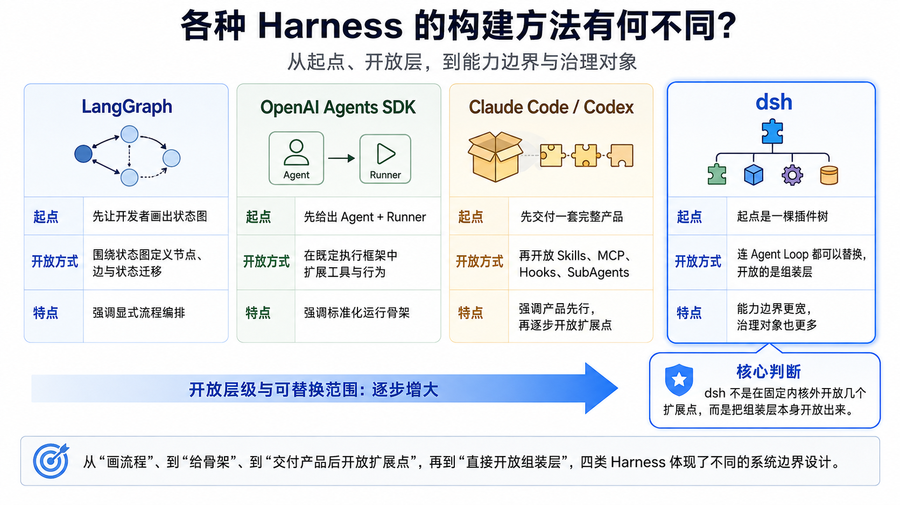
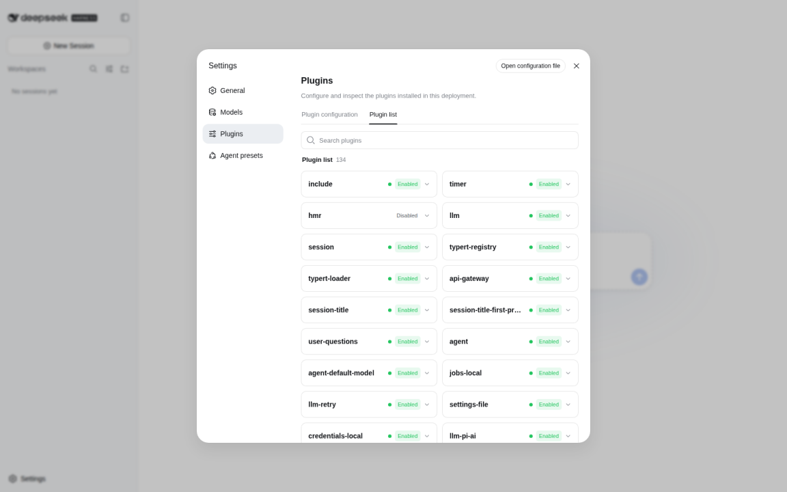
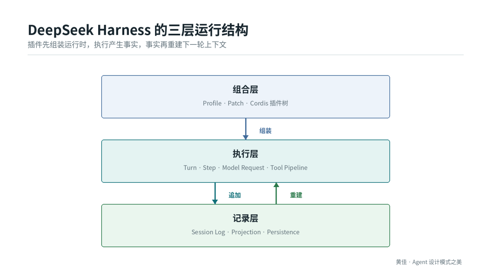
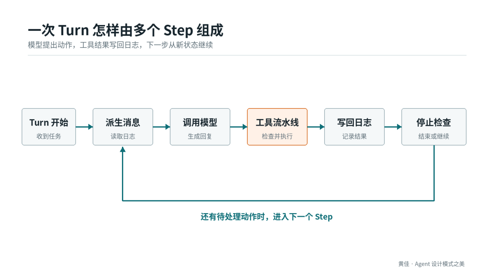
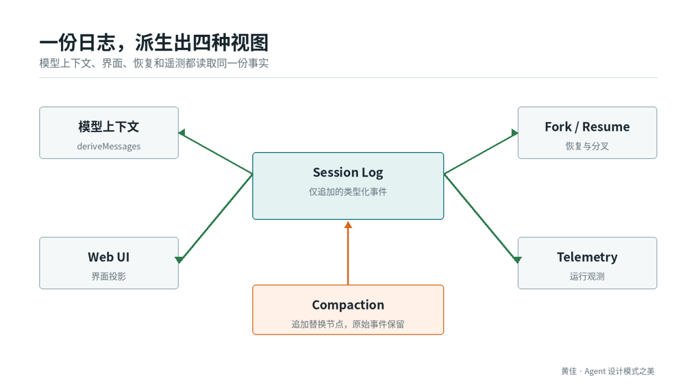

# DeepSeekHarness(dsh)全插件化架构的组合、执行与记录

你好，我是黄佳。

2026 年 8 月 13 日，DeepSeek 开源了自己的 Agent Harness。仓库叫 DeepSeek Harness，命令行叫 dsh，因此也可以把它简称为 dsh。消息发出来以后，有同学问我：DeepSeekHarness 看起来和主流 Harness 完全是两条路线，它是不是也把 Agent 治理变难了？我们先比较一下各种 Harness 的构建方法究竟有何不同。

- LangGraph 先让开发者画出状态图；

- OpenAI Agents SDK 先给出 Agent + Runner；

- Claude Code 和 Codex 等 Agent 先交付一套完整产品，再开放 Skills、MCP、hooks 和SubAgents；

- dsh 的起点是一棵插件树，连 Agent Loop 都可以替换。因此它开放的是组装层，因此能力边界更宽，治理对象也更多。



一个 AI Agent 想要真正完成工程任务，不仅要能与模型对话，还要能够读写文件、执行命

```
令、调用工具、维护上下文，必要时还要启动子代理协同工作。dsh 提供的，正是支撑这些
```

能力运行起来的一整套基础骨架。

大多数 Agent 框架都有一个相对固定的“特权内核”：主循环如何推进、工具如何调度、上下文如何管理，通常都被写在框架核心里。使用者可以扩展外围能力，却很难改变系统真正的运行方式。一旦想修改 Agent 的行为，往往就要深入内核代码，或者通过层层补丁绕开原有设计。

```
dsh 选择了另一条路：它没有一个不可替换的中心内核。
在 dsh 中，模型适配器、工具注册表、会话日志，以及负责驱动整个对话过程的主循环，都
```

被设计成地位平等的插件。它们不是围绕某个固定核心排列的外围模块，而是共同组成一棵可以重新配置、拆卸和组合的插件树。系统中的每一个关键部分，都可以通过配置被替换。

这种设计带来了非常直接的扩展性。无论是接入新的模型供应商、更换整套工具系统、把本地命令执行迁移到远程沙箱，还是把另一个产品中的 Agent 接入为子代理，原则上都不需要修改所谓的“核心代码”。你只需要找到合适的能力接缝，在现有插件树旁挂上一个新的插件。

## 直观感受一下 plugin

说到“插件”，很多人首先想到的是给浏览器装一个广告拦截器，或者给 Agent 增加一个搜索工具。打开 dsh 以后，这个直觉很快就不够用了。

我们先亲手把开源的 DeepSeek Harness 跑起来。克隆源码，按照官方文档启动 Web 工作台，再进入 Settings → Plugins → Plugin list。在本文使用的版本中，一共能看到 134 个插件条目。



这些条目究竟是什么。它们并不是 134 个供模型调用的工具，而是 134 个参与组装运行时的部件。模型适配器、工具注册表、会话持久化、文件系统、沙箱、Skills、子代理、遥测、Web UI，甚至驱动 Agent 前进的 Agent Loop，都可以由插件提供。DeepSeek 对 dsh 的官方描述也是如此：Cordis 只负责插件的加载、卸载和依赖关系，真正的 Agent 能力则由插件组合出来。

所以，严格来说，dsh 并不是“完全没有内核”。它仍然有 Cordis 这个很薄的装配内核。它没有的是一个承载全部 Agent 行为的特权内核：模型怎样调用、工具怎样执行、会话怎样保存、Agent Loop 怎样推进，并没有全部写死在一个不可替换的中心里。

在普通 Agent 框架里，插件通常是在运行时外面增加能力；在 dsh 里，运行时本身就是由插件装起来的。

## 先看全图：组合、执行与记录

拆一个 Harness，我通常先问三个问题。

- 它是怎样装起来的？（组合层）

- 一次任务是怎样向前运行的？（执行层）

- 运行过程中发生的事情记在哪里？（记录层）



- DeepSeek Harness 的三层运行结构

在 DeepSeek Harness 的三层运行结构中：

- 最上面是组合层。Profile 选择一种完整的运行方式，Bundle 提供一组可以复用的插件配置，Patch 再叠加当前用户、机器或环境的差异。Cordis 最终把这些配置展开成一棵真正运行的插件树。

- 中间是执行层。任务进入一个 Turn，Turn 中包含一个或多个 Step。每个 Step 通常对应一次模型推进：准备上下文、发出模型请求、接收模型输出、执行模型提出的工具调用，再判断是否需要进入下一步。

- 最下面是记录层。用户消息、模型输出、工具调用、工具结果以及各种状态变化，都被写入Session Log。下一次模型请求所需的历史、Web 界面的展示、会话恢复、分叉、回放与遥测，不再各自维护一份状态，而是尽量从同一份日志派生出来。

三层之间的循环是：插件树先组装运行时，运行时产生事实，事实再重建下一步所需的上下文。

## 组合层：插件怎样装上，又怎样卸下

```bash
DeepSeek Harness 底层使用 Cordis。一个最小插件只需导出 apply(ctx)：
import type { Context } from '@deepseek-ai/cordis'
export const name = 'hello-plugin'
export function apply(ctx: Context) {
 console.log('[hello-plugin] plugin loaded!')
}
ctx 是插件进入运行时的入口。
```

可以把它想象成整个运行时的“配电箱”：服务是插座，事件是信号线，插件通过它接入工具、模型、会话、文件系统和其他能力。插件既可以消费已有服务，也可以向运行时提供新的服务。

```bash
例如，一个插件准备注册工具，就可以明确声明自己依赖 tools：
export const inject = ['tools']
export function apply(ctx: Context) {
  ctx.tools.register(/* ... */)
}
Cordis 会在 tools 服务真正就绪以后，才执行这个插件的 apply()。如果服务还没有出
```

现，插件会停留在等待状态，而不是冒险启动。因此，插件的加载顺序主要由依赖关系决定，而不是由它恰好写在 YAML 的第几行决定。

这和普通脚本式初始化有很大区别。普通系统经常依赖人为约定：“先初始化 A，再初始化B，最后启动 C。”一旦顺序变动，就可能出现空对象、竞态条件或半初始化状态。Cordis 则把这种隐含顺序变成显式依赖。

### 装上去容易，卸干净更重要

插件系统真正难处理的，往往不是“怎样加载”，而是“怎样卸载”。

假设一个插件注册了事件监听器，又启动了定时器。热更新以后，旧监听器没有移除，新版本又注册了一份。下一次事件到来时，同一段逻辑就会执行两遍。开发者看到的现象可能只是：“为什么热更新以后，这个 Agent 偶尔会重复执行？”

```
Cordis 用 Fiber 和 Effect 管理插件生命周期。通过 ctx.on()、ctx.plugin()、
ctx.tools.register() 等 Cordis 接口产生的注册，都归当前插件的 Fiber 所有。插件卸
```

载时，这些注册会一起被撤销；插件加载失败，已经挂上的半套能力也会回收。定时器、连

```
接、文件监听器等 Cordis 无法自动识别的资源，也可以放进 ctx.effect()，并提供对应的
```

清理函数。

可以把 Fiber 理解成一张“施工单”。这个插件安装了哪些工具、接了哪些监听器、打开了哪些连接，都记在这张施工单上。需要拆除插件时，运行时不必重新猜测它改过什么，只要按照施工单逐项撤销。

这条纪律看起来只是工程细节，实际上决定了插件树能不能长期运行、动态重组和安全热更新。

### Profile、Bundle 和 Patch：不是一份大配置，而是分层组装

更上一层的组合由 Profile、Bundle 和 Patch 完成。

可以把它们理解成装修房间：

- Bundle 是一套打包好的功能模块，例如基础设施包、Web 工作台包或无头运行包；

- Profile 是一种完整房型，规定这次启动要使用哪些 Bundle；

- Patch 是覆盖在现有方案上的局部改动，例如换掉模型、关闭某个插件，或者把本地执行切换到远程沙箱。

```
dsh 启动时，会先把各个 Bundle 按顺序叠加，再应用 Profile 自己的 cordis.patch.yml、
```

机器级 Patch，以及命令行传入的额外 Patch，最后得到实际运行的插件树。任何一层都可以通过条目 ID 替换前面层次中的配置，或者插入新的插件。

想看当前机器最终装出了什么，可以直接运行：

```
dsh --profile web --dump-config
```

这条命令打印的是各层配置叠加以后，真正准备启动的插件树。

因此，开发环境可以通过 Patch 换成 Mock 模型，生产环境可以换成远程沙箱，Web 模式可以增加 UI 插件，无头模式则可以去掉整套浏览器界面。调用模型、文件系统或沙箱的上层插件，不需要知道服务背后的实现已经换过。

### 从 VS Code 得到启发

dsh 的插件和扩展难免让人想到 VS Code。VS Code 的扩展运行在 Extension Host 中，编辑器通过扩展点开放能力，同时尽量避免行为异常的扩展拖慢或破坏主界面。

不过，这两个类比不能混为一谈。Cordis 在 dsh 中首先解决的是组合、依赖与生命周期；VSCode Extension Host 还强调运行位置和进程边界。这里借鉴的是模块化经验，不意味着二者具有完全相同的隔离机制。

dsh 真正的新意，是把这些成熟的软件工程思想搬进了 Agent Harness。插件现在处理的不再只是菜单、编辑器命令或普通业务服务，而是模型请求、上下文注入、工具调用、子代理调度和 Agent Loop。

## 执行层：一次任务怎样向前走

dsh 用两个词描述运行节奏：Turn 和 Step。一次 Turn 可以理解为 Agent 对当前任务的一轮完整处理。Step 是 Turn 中的一次模型推进。例如，用户提出：帮我把这个项目的测试跑通。

```
第一次 Step 中，模型可能先读取 package.json，然后调用测试命令。工具执行结束后，
```

测试错误被写入会话，运行时进入第二个 Step。模型根据错误修改代码，再次运行测试。第三个 Step 中，模型看到测试已经通过，不再提出新的工具调用，Turn 才正式结束。

所以，一个 Turn 并不等于一次模型请求。只要模型还在调用工具、工具结果还需要交回模型处理，或者运行时还有新的引导信息等待注入，这个 Turn 就可能继续产生新的 Step。官方架构文档也把 Step 定义为“一次模型请求及其工具调用”，而一个 Turn 可以包含零个或多个Step。



一次 Turn 怎样由多个 Step 实现

把 Turn 和 Step 分开以后，系统中的很多治理动作都有了明确位置。

```
agent/pre-step 位于模型请求形成之前，可以检查这一轮是否允许开始，也可以调整模型
即将看到的消息；agent/request 可以修改最终模型请求；agent/turn-stopping 则位
```

于 Turn 准备自然结束的时候，可以决定是否还要再推进一步。

```
这比在主循环中不断增加 if 更清晰。权限、上下文注入、模型路由、压缩、失败恢复和停止
```

策略，不必全部塞进 Agent Loop，而是可以挂到各自最合适的执行位置。

```
模型提出工具调用以后，dsh 不会立刻进入工具的 execute()，而是让调用穿过一条公共执
```

行管线：

```
tools/pre-execute
 → monotonic guards
 → tools/execute
 → tools/post-execute
 → finalizeContent
 → tools/result
tools/pre-execute 是进入工具前的门岗，可以允许、拒绝，或者把调用转入人工审
```

- 批。

```
monotonic guards 是不能被后续插件推翻的最终防线。一旦这里拒绝，后面的监听器不
```

- 能重新把调用改成允许。

```
tools/execute 包裹真实的工具执行，适合加入超时、取消、重试和指标采集。
tools/post-execute 检查工具返回值，可以阻断、替换结果，或者为下一步模型请求
```

- 增加上下文。

```
finalizeContent 完成工具自身负责的最终内容整理。
tools/result 接收到已经归一化、不可再修改的最终结果，适合审计、遥测和 UI 展
```

- 示。

可以把工具本身想象成一把手术刀，而这条管线是手术室的整套制度。手术刀只负责完成动作；谁可以使用、是否需要审批、最长允许执行多久、结果是否合规、过程怎样留痕，都由手术室的公共流程负责。

这种分离非常重要。一个 Bash 工具不需要自己理解每家公司的审批制度，一个文件编辑工具也不必自行实现所有沙箱规则。换掉工具实现以后，权限、超时、审计与结果检查仍然留在稳定的公共路径上。

## 记录层：模型看到的内容从哪里来

Agent 连续运行几十轮以后，一个常见问题是：系统已经说不清模型当时究竟看到了什么。

聊天界面保存了一份消息，模型请求代码又维护了一份数组，工具系统还偷偷注入了一些上下文。平时它们看起来差不多，一旦发生压缩、恢复或重试，几份状态便开始漂移。界面显示的是一套，模型真正收到的是另一套，重新打开会话后又变成第三套。

dsh 的处理方式，是把 Session 设计成类型化、仅追加的事件日志。用户消息、模型消息、工具调用、工具结果和关键状态变化都先进入 Session Log；模型历史并不作为另一份独立真相

```
保存，而是由 deriveMessages() 从日志中投影出来。
```

这和软件架构中的 Event Sourcing 很接近。Event Sourcing 不只保存“现在是什么状态”，而是保存“发生过哪些事情”，再从事件序列中重建当前状态或生成不同视图。它的价值不只是审计，还在于恢复、回放和派生新的读取模型。



dsh 在这里又向前走了一步。它提出 Model-visible means logged，意思是只要模型能够看到，就必须进入日志。

这就成了是运行时不变量。Agent Loop 在真正请求模型前，会重新从 Session Log 派生消息，并与即将发送的消息进行结构化比较：

```javascript
const expected = session.deriveMessages()
if (JSON.stringify(options.messages) !== JSON.stringify(expected)) {
 fail(`llm request for session "${String(session.id)}" diverges from the dispatc
}
```

如果某个插件偷偷往模型请求里塞入一段上下文，却没有先把它写进日志，这次请求就会失

```
败。对应实现位于 packages/core/agent-loop/src/invariant.ts。
```

这条检查的意义在于，它把“最好留下记录”从开发规范变成了系统约束。开发者不能一边让模型看到某些内容，一边又让这些内容消失在审计、恢复和回放之外。

长会话最终都会遇到上下文窗口压力。最简单的做法是直接删除旧消息，但这样一来，审计和恢复也会失去原始事实。

dsh 的 Compaction 更像是给旧账制作一份摘要索引。它会选择一段较早的模型可见历史，生成摘要，再追加一个带有替换语义的新节点。下一次模型请求读取的是压缩后的“会话表面”，而原始事件仍然留在仅追加日志中。换句话说，系统改变的是当前工作视图，而不是回头篡改已经发生过的事实。

这就把两个原本冲突的需求分开了：

- 模型需要更短、更聚焦的上下文；

- 审计、恢复和问题定位需要完整的历史事实。

同一份 Session Log 还可以继续派生 Web UI、Fork、Resume、transcript、persistence 与telemetry。这样做的好处是减少“模型、界面和恢复过程各自相信不同事实”的风险。

体验完这一层以后，再回头看 Plugin list 的 100 多个条目就不再显得杂乱。它们大体落在三条主线上。

- 第一条是组合纪律：运行时不是一整块写死的程序，而是一棵由 Profile、Bundle、Patch、服务依赖和插件生命周期共同组装出来的树。

- 第二条是执行纪律：模型请求、Turn、Step 和工具调用都有明确的经过路径。权限、审批、超时、重试、结果检查与遥测，不必侵入每一个工具，也不必全部塞进 Agent Loop。

- 第三条是记录纪律：模型可见内容必须来自日志，运行状态必须能够从日志重建。SessionLog 不是任务结束后顺手生成的一份 transcript，而是模型上下文、恢复能力和运行审计共同依赖的事实源。

所以，dsh 所说的“一切皆插件”，并不只是“所有功能都能做成扩展”。它真正开放的是Harness 的组装层：谁提供模型，谁维护会话，谁执行工具，谁实施策略，谁驱动循环，都可以在统一的插件、服务、事件和日志体系中重新组合。

```
接下来你可以做三个小实验：先打印实际启动的插件树，再动手挂上一个依赖 tools 的插
```

件，最后替换或移除一个策略插件，观察工具调用和 Session Log 怎样随之变化。做完这几件事情，“一个新能力应该挂在哪里”就从架构图上的抽象问题，变成可以亲手验证的工程判断（后续我们也可以一起动手尝试一下）。

## 怎样评价一套 Harness？

读完 dsh，我提炼了四个重要问题，你可以参考它们来检查其他 Agent Harness。

1. 可重建性：模型这一轮看到的完整内容，能否从持久化事实中重建？

2. 执行一致性：所有工具是否经过同一条受控执行路径？

3. 副作用消除：插件卸载或升级失败时，已经注册的副作用能否清理？

4. 治理完备性：生产配置能否证明关键权限、审计和停止条件已经挂载？

这些问题其实比我们统计一套 Harness “支持多少工具”“接了多少模型”更能暴露运行时质量。毕竟功能数量容易增长，运行纪律需要从架构开始设计。关键约束进入工具闸和运行时检查，已经成为 Harness 工程的重要分界。

## 总结一下

DeepSeek Harness 的架构可以通过下面几个工程问题去深入理解：

1. Profile、Patch 和 Cordis 插件树负责组装运行时。

2. Turn、Step 与工具流水线负责推动任务执行。

3. Session Log 负责保存事实，并派生模型上下文、界面、恢复和遥测。

它的开放度很高，安全与稳定也因此更加依赖插件生命周期、运行时不变量和配置治理。当前版本仍然是 developer preview（开发者预览阶段），这个阶段更适合学习架构、验证接口、制作实验，生产成熟度尚有待验证，也欢迎大家给出自己使用 dsh 落地生产实践项目的具体想法。

## 参考资料

1. DeepSeek Harness 官方仓库，和 Cordis Primer。

2. Tool execution pipeline，工具流水线各阶段。

3. LangGraph Persistence。

4. OpenAI Agents SDK 与 Running agents。

5. Claude Code Features Overview。

6. OSGi Core 8: Service Layer。

7. VS Code: Extension Host。

8. Harness-Bench 与 Harness-IF，2026 Harness 评测论文。
