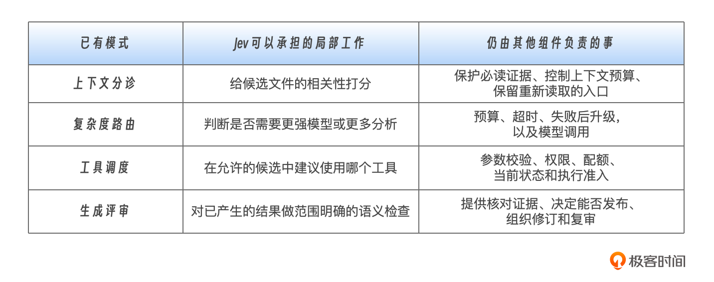
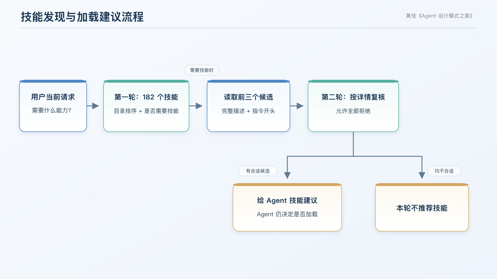
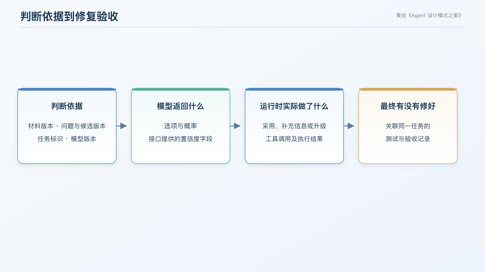

# Jev：不写答案的模型，怎样参与Agent设计？

你好，我是黄佳。

假设你让一个编程 Agent 排查接口超时。Agent 先读日志，再找相关文件，比较几种可能的原因后定位根因，最后才开始修改代码。现在，我们经常把这一系列的事情，都交给同一个生成模型。但仔细看，这些事情的难度差别很大。

1. “这段日志和当前故障有没有关系？”看懂内容，做个判断就够了。

2. “下一步先查配置，还是先查调用方？”从几个方向中选一个，可能就能继续往下走。

3. 到了“修改重试逻辑，同时避免重复扣款”，才真正需要把调用关系、异常情况和修改后果一起想明白。

第 1、2 步那些简单的判断，也必须动用负责复杂分析和写代码的模型吗？

Jev 就是针对这类问题出现的。根据 TypeSafe AI 的发布说明，团队在 2026 年 9 月 15 日发布了 Jev，把这类模型称为 System One。你把当前情况和问题交给它，它返回选项或数值，而不是长篇大论的输出解释。

接下来，我们就看看 Jev 在一次实际工作中，究竟能帮上什么忙。

## Jev 擅长答案范围比较明确的问题

Jev 提供三种接口：

接口

- 可以怎样问返回什么

Choice

- 下一步先查配置、依赖服务，还是业务代码？一个选项，以及各选项的概率

Score

- 这份文件对当前排障有多大帮助？根据预先定义的等级给出加权分数

Noul

- 这段记录描述的是一次连接超时吗？这个命题成立的概率值

这三个接口，都需要我们先把问题问清楚。

用 Choice 时，候选项由开发者提供。只给“配置”和“代码”两个选项，模型就没有办法回答“信息不够”。所以，实际接入时，通常还需要给它留一个“暂时无法判断”的出口。

用 Score 时，也要先说明评分依据。比如，把文件分成“无关背景”“可能相关”“直接包含失败路径”几个等级，再让它评分，而不是只问一句“你觉得有多相关”。

Noul 则适合边界明确的是非问题。例如，判断一段日志是否描述了连接超时，就比判断“这个系统有没有问题”清楚得多。

这些工作有一个共同点：模型需要理解内容做判断，但最后给出的结果不一定是一段话。

分类和排序早就是机器学习能够处理的任务。一个模型不生成文字，不代表它没有理解和判断能力。

不过，也别因此以为，复杂推理都能交给 Jev。看懂一段日志，与跨越十几个文件找出死锁原因，显然不是同一件事。官方列出的短板包括复杂的间接推断、计数和日期比较。

至于“共有多少条超时记录”“两个日期相差几天”“金额有没有超过上限”，程序本来就能准确计算，没有必要绕一圈再问模型。

所以，我们可以先做一个朴素的分工：复杂分析和代码生成，交给生成模型；需要理解语义的小判断，尝试交给 Jev；能够准确计算和检查的事情，继续交给程序。

## 一次排障业务中 Jev 怎么用

回到接口超时的例子。这次失败发生在测试环境。程序收集到了三条信息：订单接口调用支付服务时连接超时；请求还没有收到响应；最近有人调整过 HTTP 代理配置。

接下来要决定，先查哪里。过去，我们可能把这些材料交给生成模型，让它分析下一步。现在，可以先让 Jev 在几个方向中做选择。

假设它选了“检查配置”，程序就调用事先准备好的只读检查函数，读取允许访问的代理配置、服务地址和连接参数。拿到这些材料后，再交给生成模型深入分析，必要时提出代码修改。

这里，Jev 没有自己去翻整个仓库，也没有获得修改配置的权限。它只是建议了一个排查方向。能读什么、用哪个工具读，仍然由程序控制。

按照官方 Python SDK，这一步判断可以写成下面这样：

```python
from typesafe_sdk import Choice, TypeSafeClient
state = {
   "task": "排查测试环境中订单接口的超时",
   "failure": "请求支付服务时连接超时，尚未收到响应",
   "recent_change": "最近调整过 HTTP 代理配置",
   "scope": "只允许只读排查，不修改配置或重启服务",
}
with TypeSafeClient(model="jev-1.13") as client:
   response = client.system_one(
       state=state,
       questions={
           "next_check": Choice(
               instructions="根据现有材料，下一步优先查看哪里？",
               criteria={
                   "config": "检查代理、服务地址和连接配置",
                   "dependency": "检查依赖服务的可用性记录",
                   "code": "检查发起请求的业务代码",
                   "need_more": "材料不足，暂时不能确定方向",
               },
           ),
       },
   )
answer = response.answers["next_check"]
print(answer.choice)
print(answer.probabilities)
运行前需要安装 typesafe-sdk，并设置 TYPESAFE_API_KEY 环境变量，具体用法见
```

Python SDK 文档。

这段代码得到的是一个选择，还没有真正执行检查。

```
后面需要由业务代码把 config 对应到已登记的只读函数。如果返回 need_more，就补充材
```

料，或者交给更强的模型继续分析。采用结果的条件，也应根据本地测试来确定，不能看到一个较高的概率就直接放行。

还有一点要特别提醒：把“只允许只读”写进问题里，只是在告诉模型任务范围。真正的只读限制，要由工具权限和运行环境落实。

接入时，也要注意问题的先后顺序。

“先读哪份配置”，可以现在问；“这份配置哪里有问题”，要等配置读回来才能问。同一份材料上的几个独立判断，可以批量提交。有前后依赖的问题，还是得一步一步来。官方的问题拆分说明也讨论了这一点。

当然，拆得越细，也未必越好。每增加一个判断环节，都要准备输入、处理返回结果。前面选错了方向，后面还可能漏掉关键证据。

例如，让 Agent 修复一个接口错误时，可以先把失败日志交给 Jev，只问一个问题：“接下来优先检查依赖、配置，还是业务代码？”它只负责选择排查的起点。读取代码、查明原因、修改和测试，仍由原来的编码 Agent 完成。

可以先拿一批已经查明原因的故障记录试这一步，看看它选的方向是否合理，再放回完整修复流程，检查有没有减少耗时、增加误判。如果这一处替换值得，再考虑扩大 Jev 的使用范围。

## 接在不同位置 ，Jev 做的事也不同

现在把视线从这一次排障稍微拉远一点。

Jev 可以帮忙挑文件，也可以帮忙挑模型、挑工具，或者检查已经生成的内容。接口可能都是Choice 或 Score，但它们承担的工作并不一样。

沿着刚才的排障过程，放回 ADPS 的设计模式中，可以找到几处接入点。挑材料可以对应上下文分诊，挑模型可以对应复杂度路由，检查结果可以放进生成评审。



这些模式名可以帮助我们归类，但接入时，更重要的是把每一步写清楚。

比如，Jev 判断某份文件“很相关”，程序是否就一定加载它？未必。文件可能超出当前任务的数据权限，也可能已经有足够的重复材料。

再比如，Jev 建议重启服务，程序是否就可以执行？也不能。当前任务可能只允许查看，生产环境也可能处于禁止变更的时段。

“做这件事可能有帮助”，和“现在允许做这件事”，是两个问题。

检查生成结果时也是一样。

Jev 可以判断“这份修复说明是否解释了超时原因”，但接口究竟修好了没有，要看实际测试。说明写得再完整，测试没有通过，仍然不能发布。

至于这些工作怎么配合，要另看有没有依赖。同一批材料上的独立检查可以并行；必须先读取文件才能回答的问题，就顺序执行。这也是 ADPS 双轴框架要分别考虑的两件事：一边看各自做什么，一边看它们怎样配合。

对我来说，Jev 带来的一个实用提醒，就是：模型给出的判断和程序随后允许发生的动作要分别设计。以后即使换了模型，这份分工也不用推倒重来。

## 大海捞针：从 182 个 Skills 中找出适合技能

TypeSafe 的官方技能选择案例，很适合用来理解 Jev。这个示例使用了 Hermes 的 182 个技能。技能多了以后，问题不只是“有没有”，还有“会不会选错”。

比如，用户想修改一份已有的 PPT，目录里却同时有制作新 PPT、编辑 PPT 等相近能力。只看名字和一句简介，Agent 可能选到一个看起来有关、实际却不适合的技能。

这个案例分两轮处理。

第一轮，先判断这次请求是否需要技能。如果需要，就从简短目录中选出排名前三的候选。

第二轮，再读取这几个候选的完整描述和部分指令，检查它们是否真的适合当前任务。如果细看之后发现都不合适，可以一个也不推荐。



- 先看简短目录，再细读少量候选。第二轮可以推翻第一轮的选择，也可以决定一个都不用。

这个做法容易理解：不必一开始就细读全部 182 个技能，先缩小范围，再看详细信息。

但第二轮不能只是给第一轮盖个章。它必须有机会发现：“刚才看简介觉得适合，读完指令才发现，不是我要的。”

官方报告测试了 488 条请求，其中 315 条有合适的技能可用。在这 315 条请求中，错误加载

```
率从 16.8% 降到了 7.3%。测试使用 jev-1.12 和固定版本的 Claude Haiku。换到我们自己
```

的技能目录和任务上，还需要重新验证。

还有一个细节：推荐结果是交给后续 Agent 的，Agent 仍然保留自己的技能目录，并决定加载什么。

因此，评测时要分开看：推荐有没有选对，后面的 Agent 有没有真的加载对。前一步做对了，不保证后一步也对。

如果技能涉及生产数据库，还要继续检查技能版本、访问权限和执行范围。推荐器说“这个技能可能适合”，不代表它同时批准了数据库访问。

我尤其喜欢这个例子里保留的“一个都不选”。三个不合适的候选，也能排出第一名。第一名只表示“相比另外两个更好”，并不表示它已经能完成任务。实际系统里，允许拒选，常常比继续调整排名更重要。

## 支持 Jev，不等于所有判断都能交给它

2026 年 9 月 16 日，Vercel 宣布在 AI Gateway 中接入 Jev，通过 AI SDK 的实验性

```
evaluate 接口提供结构化判断。9 月 17 日，LangChain 也发布了接入示例，包括模型路由
```

和工具调用前的审查中间件。

这些集成让试用方便了不少，但看到“支持 Jev”，不代表各种用法都已经包含在里面。

```
例如，LangChain 当时的 ModelRouterMiddleware，是根据最新用户消息，为整次 Agent
```

运行选择模型。它还不是那种“每走一步，就根据最新情况重新换一个模型”的调度器。

工具调用前的审查，又是另一回事。让模型判断“这份文件是否值得读”，选错了，通常只是多读一点材料。让模型判断“一次写操作能不能放行”，选错后的影响可能大得多。后者必须和身份、权限、沙箱及审批机制一起考虑。

9 月 20 日，LangChain 还发布了使用 Jev 做 Agent 评测的实验：保存五条天气查询的运行记录，让不同评审模型对同样的记录各重复评判一百次。Jev 的五百次通过与否判断都与人工标注一致，连续评分的波动也较低。

就像拿五份试卷反复批改。结果一致，说明评分比较稳定；但还不能据此判断，换一批题型以后也都能正确评判。文章也没有记录 Jev 的具体服务版本，后续复现时还需要补齐这个信息。

对 Agent 评审来说，稳定又便宜的判断组件当然有吸引力。它可能让更多运行记录得到检查。不过，评审器得看到实际证据。比如，工具究竟返回了什么，测试究竟通过没有。

如果只把 Agent 自己写的“任务已完成”交给评审器，它每次都稳定地打高分，也不能证明事情真的做成了。

## 真要试用，我会这样看它有没有价值

试用 Jev，我会从“下一步优先查哪里”这种只读选择开始。

原因很简单：这类判断经常发生，历史材料可以拿来回放，选错之后通常也有机会补读。第一步没必要拿生产付款、删除数据这样的操作做试验。

比较时，我会保留三个版本：现有规则、要求简短结构化输出的生成模型，以及 Jev。

三者拿到同样的材料，面对同样的候选。原来的生成模型如果只需要返回一个标签，就让它直接返回标签。不要要求它写一大篇解释，再用这个结果证明 Jev 更省。

厂商发布的性能数据可以帮助我们选择试验方向，但其中的任务组织方式、输出要求，以及部分由其他模型提供的参考判断，都会影响比较结果。真正接入业务，还得看自己的任务。

### 先看它选错以后，发生了什么

假设这次明明是配置问题，Jev 却让我们先查代码。

结果可能只是多读了两个文件，随后还是找到了配置问题。也可能因为一直没有读到关键配置，最后生成了一个错误补丁。两种情况都叫“选错方向”，后果却差得很远。

所以，不能只看局部判断的准确率，还要看它有多少次选择了“信息不足”，这些任务后来交给谁处理。连同补读、升级模型和重试的费用一起算，才能判断整个任务做下来是否真的更便宜、更快。

### 再让完整任务跑下去

我会分两步做测试。先回放历史记录，检查 Jev 在同样的材料上会怎样选择。这一步比较容易定位问题，也不会影响真实操作。

然后让完整任务继续执行，检查最后有没有解决故障、通过测试。

局部选择更准，不一定能抵消新增一次网络调用的成本；局部选择与原来不同，也不一定影响最后的修复。只有把前后的结果连起来，才能知道这一步改动是否值得。



- 把“模型怎样选”“程序怎样执行”和“最后有没有做对”连起来记录，才知道问题出在哪一步

记录这些过程，不需要保存模型的隐藏思考。我们需要知道：当时给了什么材料，用了哪一版问题和候选项，调用了哪个模型，返回了什么；程序采用了哪个结果，执行了哪个工具；最后的测试有没有通过。

这些信息已经能帮助我们区分：是模型选错了，程序处理错了，还是下游工具执行失败了。代码和日志可能包含敏感信息，发送给外部服务前，也要先按企业的数据要求做裁剪和脱敏。

另外，别只盯着模型版本。我们给 Choice 增加一个选项、改写一句候选说明，或者调整“什么情况下可以直接采用”的条件，都可能改变系统行为。这些改动也要测试，不能当作无关紧要的文字修改。

## 总结

Jev 会不会成为 Agent 的常见组件，现在还需要更多实际结果才能判断。

但这个结论出来以前，我们已经可以检查自己的系统：哪些调用真的需要复杂分析，哪些只是做一次分类、选一个方向，哪些原本就应该交给程序。

回到开头的接口超时例子。我们可以先让 Jev 判断值得优先查看的材料，让生成模型结合调用关系分析原因、修改代码，再让测试确认超时问题是否解决、原有功能是否受到影响。

如果 Jev 选错了，系统应该允许补读；如果它拿不准，应该有明确的转交路径；如果它建议的操作超出了权限，程序就不能执行。

接入一个便宜的判断模型，不是把原有检查撤掉的理由。我会把 Jev 当作一个值得试验、也随时可以替换的组件。试验成功，就保留它；效果不如规则或生成模型，就换回去。

这个过程有个好的副产品，是我们现在会对整个开发流程进行更清晰的审视：流程这一步到底在判断什么，谁来做比较合适 —— Coding Agent? Jev? 还是固定程序代码？

期待你在留言区说说自己的 Jev 的看法，或者分享一下自己的试用心得。也欢迎把今天的内容分享给身边有需要的朋友。
