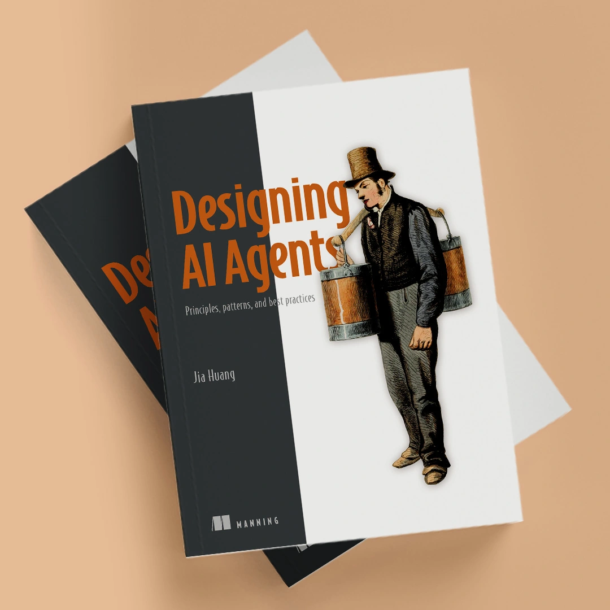
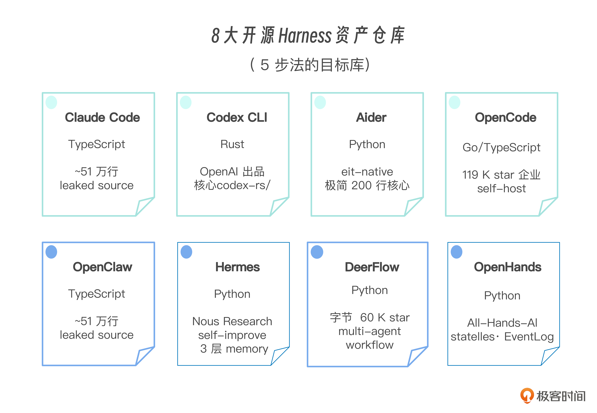
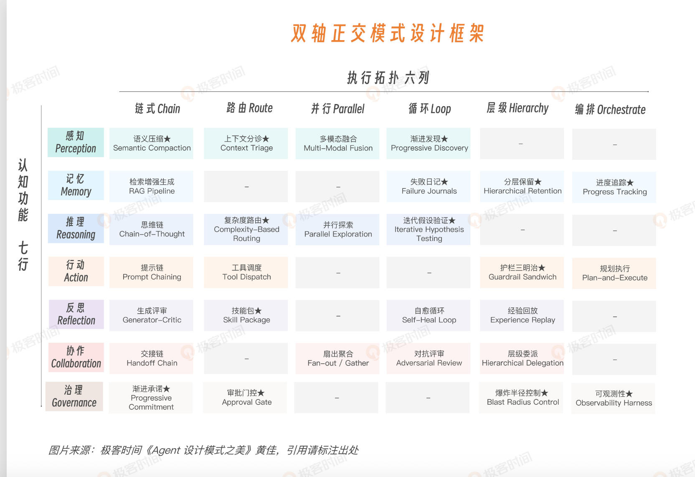
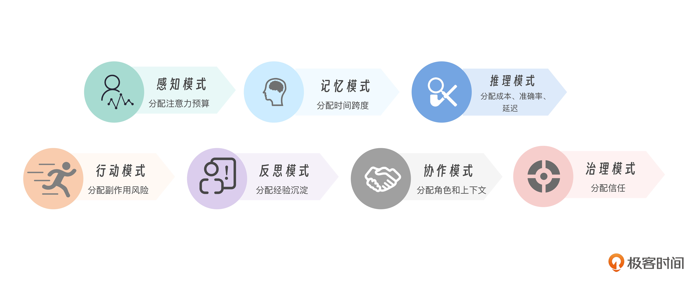
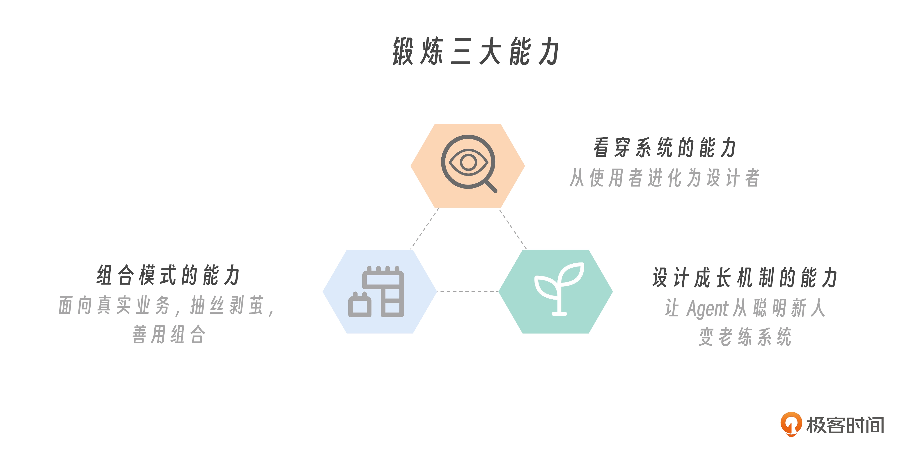

# 开篇词 | 把一千个真实工程问题凝结成28个设计模式

你好，我是黄佳。

2026 年上半年，我至少回复了一千多个真实工程问题。这个数字其实挺吓人的，这些问题来自哪里我们后面再聊，先说说感想。

我看到的不再是一两个 demo 案例的成功与失败，而是工程师日常工作里真正卡住的地方：

- Claude Code 已经能写代码了，为什么一进公司仓库就开始乱？

- SubAgent 开了 5 个，为什么答案更多了，决策反而更差了？

- CLAUDE.md 写了很多规则，为什么 Agent 还是会忘？

- MCP 工具都接上了，为什么工具越多越容易选错？

- 代码审计 Agent 明明发现了问题，为什么下一次还踩同一个坑？

- Agent 跑了两个小时的长任务，为什么跑着跑着就偏离了目标，甚至越权动了不该动的东西？

这些问题表面上很散。背后其实有同样的指向：当软件系统从确定性逻辑，走向由大模型参与运行时决策的智能系统以后，工程师到底应该怎样设计它？

这就是我们新专栏的起点。它不是工具起点，而是工程起点。

### 从一千个问题里长出来的判断

2025 年下半年写成的《Agent 设计模式》是我响应时代和个人内心的召唤，在 AI 工具的辅助之下，一气呵成的框架性作品。全书写就，酣畅淋漓。这本书，理论高度足够了，但是在工程实操方面的指导价值，我仍然不满意。

2026 年初，我开始给 Manning 写《Designing AI Agents》时，整理了许多我对 Agent 时代的新架构语言的思考，还对《Agent 设计模式》的整套体系做了大刀阔斧的改造。而支持我持续高强度输出的，既不是 OpenClaw 走红，也不是 Codex 新版本发布，仍然是这些真实问题的密度。这本书已经正式发布，大家可以在 Manning 网站阅读。

- Designing AI Agents 这本书可以在 Manning 网站阅读

《Claude Code 工程化实战》专栏完结后，我请编辑老师把专栏留言和回复导出来复盘一遍，光这个专栏就累计有 587 条留言，539 条回复。再加上行动营里的近百个问题，群聊里的讨论、私聊里的项目、知识星球（咖哥 AI）里的追问和复盘，2026 年上半年，我至少回复了一千多个真实工程问题。

一旦连续回答上千个工程问题，就会发现一个很残酷的事实：很多团队缺的不是工具。工具他们已经有了。Claude Code、Codex CLI、Cursor、Aider、OpenHands、LangGraph、CrewAI、MCP、RAG、SubAgent、Skill，大家都能接，demo 都能跑。

真正缺的是设计语言。

一个 Agent 不稳定，团队不知道该怎么讨论。最后往往只剩几句模糊判断：模型不够强、prompt 还要调、上下文没给够、工具可能有点多、加个 Workflow 约束……这些话都可能对，但粒度都太粗。

就像一个传统后端系统出问题，我们不会只评价“代码不够好”。我们会追问：是事务边界错了？缓存失效了？消息幂等没做？限流缺了？数据库索引不对？服务拆分过度？观测指标不够？成熟工程领域都有自己的问题语言，而 Agent 工程也必须有。

所以，这门课真正想做的事情，是把真实工程问题以及市面上能够看得到的 Harness 架构（Claude Code、CodeX、OpenCode、Aider、OpenClaw、Hermes、OpenHand、DeerFlow）背后的公共结构抽出来，沉淀成一套可以讨论、可以实现、可以组合、可以上线、可以复盘的 Agent 设计模式，让工程师重新拿回 Agentic 开发的设计权。

没有点野心和梦想，挑战不了这件事。许许多多在一线折腾探索的工程师与我深入探讨后，催我拿出这套方法论出来，接受市场验证的呼声也很高。对此，佳哥战战兢兢，如临深渊、如履薄冰。但是，我身后、向我提出了 1000 多个问题的、数以万计，甚至十万计的工程师团队，是你们给了我足够的信心和勇气做这件事。

于是现在我们有了《Agent 设计模式之美》。

### Agent 的价值是它所累积的经验

我想把上千个问题汇聚成一句重要判断：Agent 的价值，取决于它能不能沉淀经验，而不是它今天有多聪明。

很多团队今天都能做出一个看起来挺聪明的 Agent。它能读文件，能查知识库，能调用工具，能拆任务，能写总结，甚至能拉几个子 Agent 一起干活。

Demo 阶段很漂亮。但三个月以后呢？

它有没有记住自己踩过的坑？有没有知道这个团队过去怎么做审批？有没有学会这个仓库代码评审里最常见的三类问题？有没有把一次成功的处理流程沉淀成 Skill？有没有把一次失败的工具调用写进失败日记？有没有因为处理过 100 个 PR，就比第 1 个 PR 时更懂这个仓库……如果没有，那它只是一个每天重新入职的聪明新人。

聪明的新人当然有价值，但你不会把公司的关键流程交给一个每天都忘记过去的人。

我们也不会满足于做一个一时看起来很聪明的 Agent，我们想做一个会成长、会沉淀、会被治理、会被复用、会变老练的 Agent 系统。

### 这不是工具升级，是范式变化

在我的《Designing AI Agents》第一章里，我花了很大篇幅讲传统软件和 Agent 系统不是同一种东西。

传统软件里，工程师在设计时决定控制流。一个电商下单流程，先校验库存，再计算价格，再扣款，再发通知。每一步都写在代码里。输入一样，输出基本一样。出错了，有异常栈，有日志，有重试，有事务。

Agent 系统里，控制流的一部分被交给模型在运行时决定。它先看什么、查什么、调用哪个工具、要不要重试、要不要问人、要不要派子 Agent，这些动作都在运行时根据上下文、工具结果和模型判断动态生成，这些没法在编译期写死。

这就是范式变化。过去工程师写逻辑。现在工程师更重要的工作，是设计决策边界。

模型负责生成可能性，Harness 负责预算、约束、路由、验证。模型在花上下文、花 token、花工具调用机会、花用户信任；Harness 要决定这些东西怎么花、什么时候不能花、花错了怎么止损。

我在书里把它概括成一句英文：

- The model spends; the harness budgets. （模型负责花，Harness 负责控制预算）

我们让 Agent 看 200K token，它不一定变得更聪明，可能只是更乱。我们给它 40 个工具，它不一定更强，甚至反而会混乱迷失。我们开 8 个 SubAgent，它不一定更全面，可能只是让主Agent 拿到 8 份无法合并的噪声。我们给它完全自主权，它不一定更像专家，可能只是更快地把错误扩散到外部世界。

所以，Agent 时代的架构设计，是在不确定性里设计边界，在有限预算里分配注意力，在可积累的轨道上沉淀经验。我们这门课要好好讲一讲具体如何来实现这套设计。

### 为什么需要一套新的设计语言

我们这代工程师学软件工程，大多绕不开 GoF 的 23 个设计模式。Singleton、Factory、Observer、Strategy，这些词帮我们节约了大量沟通成本。你跟同事说“这里用 Strategy”，对方马上知道你想把算法选择从调用方里抽出来。你说“这里像 Observer”，大家就知道是状态变化后的通知关系。一个词背后是一整套结构。

但 Agent 系统来了以后，这套词汇不够用了。Claude Code 修一个线上 bug 的过程里，它先感知上下文，再形成假设，再调用 grep 和 read，再修改代码，再跑测试，再根据失败结果调整思路。这里面有感知、有推理、有行动、有反思、有工具调度、有失败学习、有权限边界。

用一个 GoF 模式很难描述它。

不是 GoF 过时了。GoF 仍然是好东西。问题是它解决的是确定性对象之间怎么协作；分布式系统模式解决的是不可靠服务之间怎么协作；而 Agent 设计模式要解决的是概率智能在工程系统里怎么可靠工作。

这是第三代模式语言。

- 第一代，GoF 解决对象复杂度。

- 第二代，分布式系统模式解决网络、状态和失败复杂度。

- 第三代，Agent 设计模式解决运行时决策、上下文注意力、工具副作用、经验累积、多Agent 协作和治理边界。

佳哥想做的，是给中文工程师一套可以在架构评审、需求拆解、代码实现、上线治理里真正使用的 Agent 设计语言。

### 这套设计漂亮在哪里

我知道自己这么说有点不谦虚，但整套设计逐渐成型时，我确实觉得这套设计是漂亮的。完成这样的独特创造，既要懂人类工程师，还得深挖和充分拆解大量优秀 Agents，尤其是Harness 系统设计部分。

当然，漂亮的地方不只是每一讲都有代码，也不只是它参考了 Claude Code、Codex CLI、OpenCode、Aider、OpenHands、Hermes、DeepAgents、DeerFlow 这些真实系统。代码的构建和 Harness 的拆解，2026 年都可以通过 AI 来辅助完成。而佳哥真正得意的地方，是通过设计把真实工程问题组织成了一个完整结构。这种结构之美，2026 年的 AI 做不出来，2036 年的 AI 也做不出来。

真正的设计语言，不能只是一串术语，它必须能帮助工程师定位问题、选择模式、组合方案，并最终落到代码和系统里。

这就是我提出“双轴正交框架”的原因。它把 Agent 设计拆成两个独立维度：一个维度回答Agent 要做什么，另一个维度回答这些能力如何被编排。两个维度交叉起来，就形成了一张可以定位、讨论、实现和复盘 Agent 模式的工程坐标系。

接下来的这张图会贯穿整门课程。我们会沿着它展开四层结构：7 个认知功能、6 种执行拓扑、28 个工程模式，以及每个模式对应的源码剖析和工程实现。

第一层，是 7 个认知功能。Agent 要能看见世界，所以有感知；要能跨时间保存状态，所以有记忆；要能做判断，所以有推理；要能改变外部世界，所以有行动；要能检查和改进自己，所以有反思；要能把任务分给多个角色，所以有协作；要能被信任地放进企业流程，所以有治理。

这 7 个功能不是随便排的。它们形成了一个完整的智能系统闭环。

- 感知是世界进来的入口，治理是动作出去前的闸门。

- 记忆解决跨时间状态，协作解决跨空间状态。

- 推理负责做决策，反思负责审计决策。

- 行动则是智能对现实世界所做的真实改变。

第二层，是 6 个执行拓扑。同一个认知功能，可以用不同方式执行。一个 Agent 不是只有“感知、记忆、推理、行动”这些能力就够了，它还必须知道这些能力该如何被编排：是一步一步做，还是多路并发做；是先判断再选择，还是失败后重新尝试；是由一个 Agent 负责到底，还是交给多个角色共同完成。

- 一步步走，是链式；

- 多路同时看，是并行；

- 从多条路里选，是路由；

- 试了再改，是循环；

- 主 Agent 拆给子 Agent，是层级。

- Agent 之间的统筹协调，是编排；

把这两层合在一起，我们就有了一个坐标系：认知功能 × 执行拓扑。

建立这套坐标系，是为了给 Agent 设计建立一套“思维参数”。当我们讨论一个 Agent 系统时，可以先问：它主要在解决哪类认知问题？是感知不准、记忆断裂、推理成本太高、工具调用失控，还是协作和治理出了问题？接着再问：这个能力应该怎样被编排？是链式推进、路由选择、并行探索、循环修正，层级委派，还是统筹协调？

有了这个坐标系，后面的 28 个模式就不再是一堆孤立技巧，而是可以被定位、比较、组合和复盘的工程零件。你不需要一开始就记住每个模式的名字，只要先理解这张图的作用：它帮我们把复杂的 Agent 问题放回一个可设计实现的结构里。

比如，有些模式专门解决“看什么”的问题，有些模式解决“怎么想”的问题，有些模式解决“什么时候让人审批”的问题。它们的位置不同，解决的问题也不同。这样就可以快而准地定位问题。

第三层，是 28 个工程模式。第一模块先打地基，包括范式危机、双轴框架、逆向五步法，后面八个模块我们探讨模式主体。这里面既有单点模式，也有模块总括，也有组合方法论。它们一起构成一套完整工程交付体系。

第四层，是各个模式的工程实现。我会给出大量的源码剖析和工程实现证明模式的有效性。深挖各种框架中上下文分诊是如何实现的；给出失败日记的具体业务场景和实现示例代码；通过技能包实操让成功流程变成可复用技能；通过扇出汇聚让多个子 Agent 分工评审；通过可观测让整个流程可以回放。

所以这门课真正漂亮的地方在于 28 个模式会沿着各种项目逐步装配，一一登台亮相。

### 28 个模式，不是 28 个技巧

我并不希望你把这门课当作 28 个技巧，因为“Agent 术语清单”只是它的表层。这 28 个模式，本质上都在回答同一个问题：不确定性下，有限的资源该怎么分配。

- 上下文分诊（Context Triage）管的是注意力分配。在有限上下文窗口里，谁应该进入。

- 语义压缩（Semantic Compaction）做的是有损压缩。哪些信息可以压，哪些信息永远不能压，比如错误堆栈。

- 工具调度（Tool Dispatch）解决的是行动路由中的工具分配、风险和状态刷新。

- 生成 - 批评（Generator-Critic）体现生成和评估的不对称性。找 bug 比写出没有 bug 的代码容易，所以我们要用 critic 去约束 generator。

- 经验回放（Experience Replay）把经验资产变成下一次任务的可用上下文。

- 审批门控（Approval Gate）承担的是信任分级。什么动作 Agent 自动做，什么动作必须让人看。

这些模式的共同点是，它们都在处理某种稀缺资源：感知分配注意力，治理分配信任，中间几层各自分配时间、成本、风险、经验和角色。

更明确的说，这门课提出双轴正交框架，把所有 Agent 模式沿两个独立维度组织。

- Y 轴 · 认知功能（Cognitive Function）—— Agent 要做什么。7 个模块：感知 / 记忆 / 推理 / 行动 / 反思 / 协作 / 治理。这一轴回答 WHAT 是花什么资源。

- X 轴 · 执行拓扑（Execution Topology）—— 数据怎么流动。6 种：链式 / 路由 / 并行 /循环 / 层级 / 编排。这一轴回答 HOW 是怎么花。

我的《Designing AI Agents》第一章中有一句底层判断：Agent architecture is boundedresource allocation under uncertainty。Agent 架构是在不确定性下分配有限资源。

讲得更直白一点：Agent 工程不是让模型自由发挥，而是让有限的注意力、记忆、工具、权限和信任资源，被花在最值得花的地方。这其实就是 Harness 的意义所在。

### 这门课结构如何设计

整门课包含 9 个模块，44 篇内容。

01 模块，范式觉醒。讲解为什么 GoF 23 个设计模式在 Agent 时代不够用，双轴正交框架是什么，怎么用逆向五步法拆真实 Harness。这个模块是我们的认知地图。

02 模块，感知。Agent 看到什么，决定它能想什么。其中的具体模式包括上下文分诊、语义压缩、渐进发现、多模态融合。上下文窗口是有限的，token 要花在刀刃上。

03 模块，记忆。大模型没有记忆，每次会话都是第一次认识这个世界。工程师要做的，是把短期上下文、长期记忆、失败经验、进度状态组织成一个能用的记忆系统。这是一次经验的积累。

04 模块，推理。Agent 每一步该用多少脑力，是要分级的。思维链、复杂度路由、并行探索、迭代假设验证这些模式，指导工程师把推理成本要花在真正需要不确定性搜索的地方。

05 模块，行动。Agent 调用工具的那一刻，就已经在改变外部世界。我们会讲工具调度、规划执行、提示链、护栏三明治模式，同时要注意每一个工具调用都带着风险、权限和副作用。

06 模块，反思。一个 Agent 有没有成长性，主要看反思能力。Generator-Critic 让生成和批评分工，Skill Package 让成功流程沉淀，Experience Replay 让历史经验回到当前任务，Self-Heal Loop 让系统从失败里自动修补。这又是一次经验的积累。

07 模块，协作。 单 Agent 的上下文、角色和注意力都有边界，所以复杂任务一定会走向多Agent。我们会讲解层级委派、扇出聚合、对抗评审、交接链等模式，你会发现多 Agent 的本质是上下文隔离、角色分工和结果聚合的设计问题。

08 模块，治理。Agent 越能干，越需要治理。审批门、爆炸半径、渐进承诺、可观测性Harness 等模式中会着重强调权限、审计、回放、回滚如何设计。

09 模块，组合。模式选型卡（Pattern Selection Card）帮你判断问题落在哪个坐标，六步选型法帮你从业务问题走到架构方案，把前面所有模式装成一个完整系统。这仍然是工程经验的总结和积累。

为了把我对 Agent 设计模式的理论，还有相关的工程化思考充分传递给大家，课程上线前三周每周更新 3 篇，第四周起每周更新 2 篇内容。这样的节奏和我上个专栏差不多，同学们的讨论、提问也激发了我很多新灵感。节奏放缓，交付的周期变长，会让内容更厚重。

课程的代码仓库如下：

https://github.com/huangjia2019/agent-design-patternshttps://github.com/huangjia2019/designing-ai-agents

第一个是用来讲模式的案例，第二个是从 0 到 1 逐渐构建一个 Coding Agent，觉得不错请给佳哥点个 Star。

### 你会得到什么

我希望你学完这门课以后，锻造出三种能力。

第一种能力，是看穿系统的能力。

你看到一个 Agent 不稳定，除了归因“模型不够强”，知道还有什么办法针对性优化。你会问：它是不是看错上下文？是不是没有记忆？是不是推理档位不对？是不是工具太多？是不是没有反思？是不是多个 Agent 的上下文污染了？是不是治理层缺失？这就是从使用者到设计者的变化。

第二种能力，是组合模式的能力。

真实业务通常是混合问题，不是一道“请选择 A/B/C 哪个模式”的单选题。比如一个金融研报Agent，需要多模态融合模式（Multi-Modal Fusion）处理 PDF 和图表，需要 RAG 查历史报告，需要复杂度路由模式（Complexity Routing）控成本，需要生成 - 批评模式（Generator-Critic）做事实核查，需要审批门控（Approval Gate）防止直接发给客户，需要可观测性（Observability）保留引用链。单个模式只是零件，适配组合才是架构。

第三种能力，是设计成长机制的能力。

一个不会积累经验的 Agent，永远只是随用随弃的工具。一个会积累经验的 Agent，才开始接近系统能力。它做错了，要能留下失败日记（Failure Journal）；做对了，要能沉淀技能包（Skill Package）；做过一批类似任务，要能经验回放（Experience Replay）；长任务要有进度追踪（Progress Tracking）；多人协作要有交接产物；治理层要能回放记录。

这些东西加在一起，Agent 才不是每天重新开始。它才会从第 1 天的聪明，长成第 365 天的老练。

### 把真实问题变成设计模式

我一直觉得，软件工程过去几十年有一个很稳定的主题：把偶然成功，变成可重复成功。设计模式是这样，分布式系统是这样，测试体系是这样，DevOps 是这样。

Agent 工程也一样。今天很多 Agent 成功，是偶然成功。模型刚好看到了对的信息，刚好选了对的工具，刚好没跑偏，刚好输出格式符合预期，刚好没有触发安全问题。

工程师不能满足于这种偶发的“刚好”。工程师要做的，是把刚好成功背后的结构找出来，命名它，约束它，复用它，组合它，让它下一次还成功，让另一个团队也能成功，让半年后的Agent 比今天更有经验。

来自真实工程现场的体感、两本书稿中的核心抽象、一系列优秀 Harness 系统架构的源码级拆解，三条线合在一起，才有了这门《Agent 设计模式之美》。它是我对过去半年上千个真实工程问题的一次系统回答，也是我对 Agent 工程这件事的一次重新设计。

我们不需要一直追今天最强的模型，不需要押宝某个框架会演进的多牛，也不需要把 28 个模式背下来。而是学会设计一种系统：它一开始也许只是 50 行 PRA 循环，但每一次执行都会留下痕迹，每一次失败都会变成材料，每一次成功都有机会变成技能，每一次协作都会形成工件，每一次上线都能被治理和回放，这样的 Agent，才值得托付。

课程第一讲，我们先从范式之变讲起：为什么 GoF 的 23 个设计模式到了 Agent 时代不够用了。只有先看清旧语言在哪里失效，我们才知道新语言为什么必须建立。

- 编辑小新老师在审批我的开篇词时，总结了两句话，我觉得非常好，刚好放在最后。记失败、存经验，价值始聚知进退、懂组合，系统方生

咱们第一讲见！
