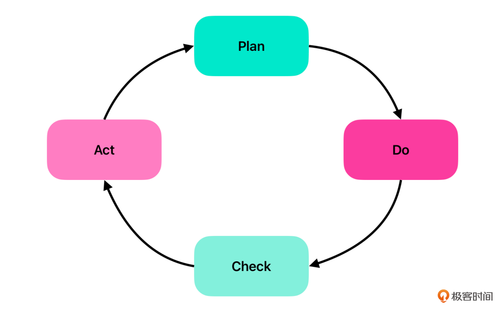
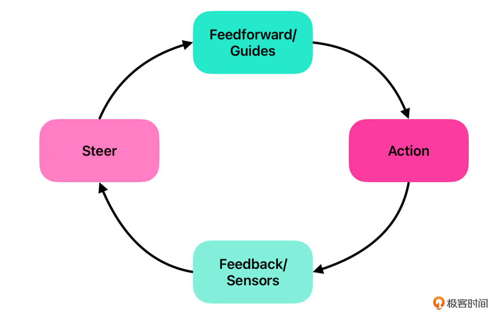
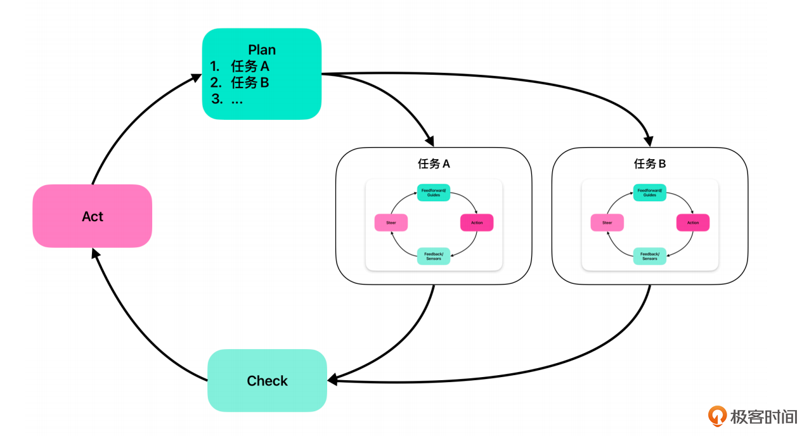
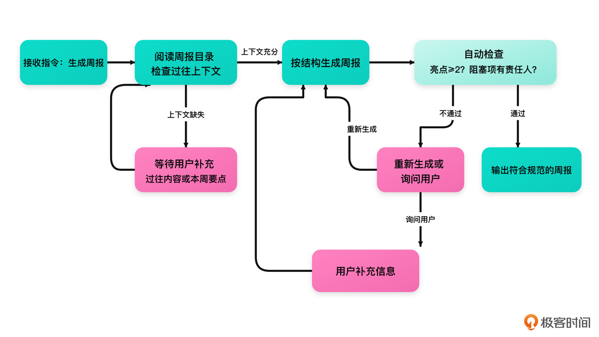

# 01 | 操控循环：驾驭工程的核心框架

你好，我是徐昊，欢迎继续学习驾驭工程。

开篇词里，我们看了一个完整的 Harness 样例，把写周报这件事从“每次随缘”变成了“可重复”。这个 Harness 到底是怎么工作的？今天我们就来讲一讲这个 Harness 里都包含了什么。

## 双层循环（Outer and Inner Loops）的驾驭模型

驾驭工程目的是提高 Agent 产出的质量。提到质量改进，最容易想到的就是戴明环，也就是著名的 PDCA：计划（Plan）- 执行（Do）- 检查（Check）- 改进（Act）。这个循环从上世纪就被用在质量管理领域，也是敏捷开发的核心思想之一：不可能一次就做对，但可以通过反复迭代，越来越接近目标。



事实上，我们的确可以按照 PDCA 的方式设计并实现 Harness。比如，前面说过的 Anthropic的例子，他们就是使用三个 Agent 分别负责计划、检查和执行。当然，因为执行的 Agent 包含自我纠正（self-correction）的能力， 也算是同时负担了执行和改进的任务。

对于有一定规模的任务，比如构建一个完整的软件系统，或者按照报税流程准备全部所需资料，我们仍然需要按照 PDCA 的方式构建 Harness。

处理这样的任务，关键在于要先构造一份计划，把大任务拆成可执行的步骤，然后逐项追踪执行情况，确保每一步都验收通过再进入下一步。

比如我们现在要按照报税流程准备资料，就会包含“登记所有收入”以及“准备抵扣项补充材料”两步，然后“准备抵扣项补充材料”又可以继续分解为“父母赡养抵扣”“子女教育抵扣”“租房抵扣”等等不同子项目。

这种分解对于大模型（LLM，Large Language Model）非常必要，因为大模型存在上下文限制（现在已经好了很多）、注意力漂移、复杂上下文中推理能力下降等问题。没有 PDCA 的循环，这样的任务一定会失控。

但是并不是所有任务，都可以通过拆分成更细小的任务来提高质量。具体到任务中的某一环，比如报税流程中的“准备租房抵扣材料”，如果上下文明确，对于大模型而言通常可以一次生成，不需要分而治之的拆分处理。PDCA 就不太适用了。

这样的子任务，重点是”如何把上下文交代清楚、如何约束大模型的行为”。比如“准备租房抵扣材料”，真正要解决的是：大模型知不知道最新的抵扣标准？知不知道需要哪些材料？能不能按照规范格式输出？这些都要靠明确的指导规则和边界约束来保证，而不是靠把它拆成更小的步骤来解决问题。

此时要驾驭 Agent，我们既要预判不想要的输出并尝试阻止它们，也要能够提供必要的信息，让 Agent 能够自我纠正。因而，我们使用操控循环（Steering Loop），它也是一个四步骤的循环：



- 前馈控制（Feedforward/Guides）：预判 Agent 的行为，在它行动之前就加以引导。前馈能够提高 Agent 在第一次尝试时就产生好结果的概率。常见的前馈控制有参考文献（Reference doc）、提示词（Prompt）、原则说明（Principles）等；

- 行动（Action）：Agent 在前馈控制下执行任务；

- 反馈控制（Feedback / Sensors）：在 Agent 行动之后观察结果。常见的反馈控制有测试（Tests）、静态分析（Static Analysis）、日志（Logs）等；

- 调整（Steer）：Agent 根据收集到的反馈，决定是否继续执行现在的任务。这是 Agent 系统中自我纠正系统（self-correction）在发挥作用。

操控循环将前馈控制和反馈控制链接在一起，从而保证了对于 Agent 的有效驾驭。前馈控制和反馈控制缺一不可。只有反馈控制，Agent 可能会重复犯同一个错误；而只有前馈控制，Agent 则会过于草率地结束任务。

这样一来，对于 Agent 的驾驭就形成了两层循环：围绕着任务分解与追踪的外层循环，以及围绕着具体任务执行的内层循环。



顺便说一句，如果有学过知识工程的同学，应该很容易把这个二层循环，通过“工序”带入到软件开发的场景中去。

## 操控循环（Steering Loop）

在双层循环模型中，内层的操控循环是更重要的能力，也是我更看好的驾驭模式。

外层循环的 PDCA，之前需要通过多 Agent 编排（Multi Agents Orchestration）来实现，这往往需要一定的编码能力。但是今年（2026 年）Agent 的发展出现了两个有意思的趋势。

一个是技能（Skill）成为了封装和分发 Harness 的统一格式，在 Skill 中启动调用其他 Agent也变成了常规操作。多 Agent 编排差不多就是 Skill 编排了。而 Skill 的编排可以通过前馈控制来实现；

二是随着 Hermes 这类以学习驱动为主的 Agent 出现，对于复杂的前馈控制和反馈控制，Hermes 自动将他们转化为 Skill。也就是通过自我学习（self-learning）和自我改进（self-improving）机制，将它们固化为代码。

最终的结果是，今日驾驭工程对于编码能力的要求大大下降了。而且我们可以通过纯自然语言的前馈控制和反馈控制，表达更为复杂的驾驭流程了。在后面的课程中，你将会看到我们如何通过前置控制和反馈控制，实现完整的 PDCA 流程。

## 一个例子

那么接下来让我们看一下开篇词中给的例子，我们是如何通过前馈控制和反馈控制，来实现对Agent 的驾驭。AGENTS.md 的内容如下：

```
## 周报编写
### 项目结构
reports/ ← 存放所有历史周报，按周归档
├── 2026-W01.md ← 第 1 周周报
├── 2026-W02.md ← 第 2 周周报
└── ...
### 工作流程
1. 用户提供本周的工作要点
2. **阅读 reports/ 目录下最近 8 周的周报**，了解进展和风格
3. 按规定的结构生成周报
4. **自动检查**：是否有至少 2 个亮点？亮点是否有数据？阻塞项是否有责任人？
5. 以 Markdown 表格输出并存入 reports/ 目录，按周命名
6. 如果没有之前的周报，则需要用户给出大致的项目背景和说明
### 结构
1.本周亮点（列出 2-3 个具体的成果，每个附带数据）
2.完成事项（列表，每行一个事项）
3.阻塞项（如有，注明责任人和原因）
4.下周计划（列表）
### 风格要求
- 使用客观陈述语气，避免"扎实推进""锐意进取"等套话
- 每个亮点必须有具体结果：什么、效果、数据
```

在这个 AGENTS.md 中，可以清楚地看到前馈控制和反馈控制的分布。

前馈控制（Guides）

- 项目结构：告诉 Agent 周报文件存在哪个目录、如何命名。

- 工作流程 2、3 步：告诉 Agent 先读历史周报，再按结构生成。

- 工作流程 5 步：告诉 Agent 存储的格式、命名规范。

- 工作流程 1、6 步：告诉 Agent 任务开始的条件，需要用户给出上下文，或是存在之前的周报。

- 结构定义：规定了周报的四个部分——亮点、完成项、阻塞项、计划。

- 风格要求：限定了语气和格式。

反馈控制（Sensors）

- 工作流程第 4 步的自动检查：Agent 生成后自我验证——亮点数量、数据完整性、责任人信息。

现在你应该明白了，这个 Harness 之所以能工作，不是因为 AGENTS.md 本身有什么魔法。它的工作原理就是操控循环在 Agent 内部的运转。

当你把 AGENTS.md 交给 Agent，并要求它为你生成周报的时候，它在内部做了这样几件事：

1. 首先阅读周报目录，理解是否存在之前的上下文（前馈控制）。

2. 如果上下文缺失（过往内容，本周工作要点），那么就不去生成周报，等待补充（前馈控制）。

3. 如果上下充分，按照规定的结构生成周报（前馈控制 + 行动）。

4. 根据生成的结果，检查是否存在两个亮点，阻塞项是否有责任人（反馈控制）。

5. 如果不符合要求，重新生成或是询问用户提供更多的信息（调整）。

6. 重复以上步骤直到结果满足要求。



整个流程大致如上图所示。这就是在有 Harness 的情况下，我们通过操控循环控制 Agent 的一个例子。也正是因为 Harness 的存在，我们才能把写周报这件事从“每次随缘”变成了“可重复”的任务。

## 小结

今天我们介绍了驾驭工程的基本模型，也就是双层循环模型：外层 PDCA 管控整个任务的流程分解与追踪，内层操控循环负责具体子任务的执行。操控循环通过前馈控制和反馈控制，把Agent 的自我纠正过程结构化。

然后我们拆解了开篇词的例子中，有哪些前馈控制和反馈控制，以及在 Agent 内部到底发生了什么。相信你对于 Harness 是如何工作的，以及如何将你的提示词改造成 Harness 都有了新的想法，可以着手试一试，在留言区多多分享。

但是在那之前，我们还需要了解 Agent 的基础架构，以及它的不同组成部分，这将是我们下一讲的内容。

## 思考题

结合你自己使用 AI 的经历，你觉得哪些情况需要多 Agent 协作（外层循环），哪些情况一个足够好的操控循环就能搞定？

期待你在留言区积极发言，踊跃分享。也欢迎把今天所学分享给身边朋友一起交流。
