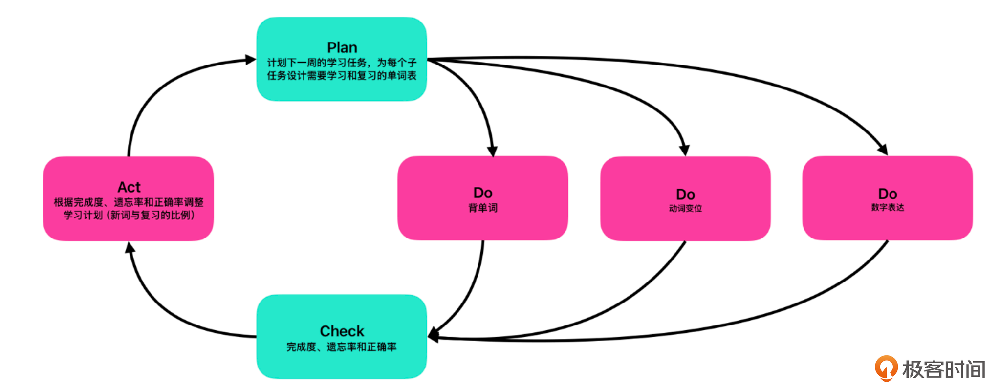
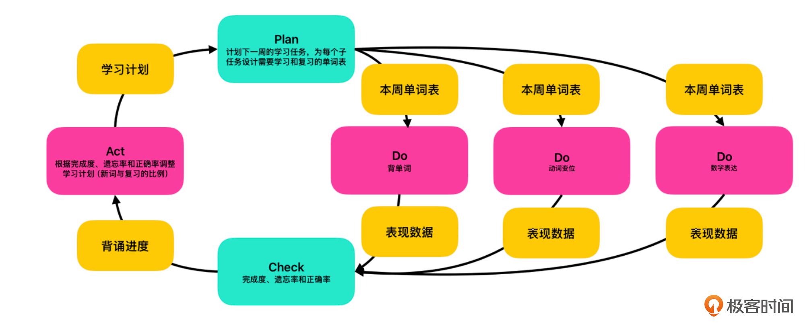

# 03 | 一个例子：从零搭建背单词Harness

你好，我是徐昊，欢迎继续学习驾驭工程。

上一讲我们介绍了构成 Harness 的四个子系统：指令、工具与技能、环境、状态。我们知道了每个子系统负责什么，也知道了它们如何分别服务于操控循环的不同环节。加上第 1 讲的双层循环模型，我们就有了一个完整的从设计到落地的 Harness 构建框架。

今天让我们通过一个完整的例子，看看如何设计并实现一个 Harness。

## 让我们来背单词吧

过去一年多我一直在学习西班牙语。西班牙语的动词变位比英语复杂很多，非常的磨人。而常用的西班牙语背单词软件又不太符合我的使用习惯。那么让我们来通过 Harness 构造一个能适用于不同使用习惯的背单词 Agent 系统吧！

## 构造 Harness 架构

在通过 Harness 构建 Agent 系统时，第一步是通过双层循环构建主要流程和关键任务。那么，对于背单词这件事，我们主流程就是在规定的时间内，把需要记忆的单词背完。比如，我们现在要背 200 个单词，预计 4 周背完。当然，我们还需要复习之前学过的单词，保证能记住。那么，我们外层的 PDCA 循环可以是这样的。

- Plan：200 个西班牙语单词，4 周完成，每周 50 个。每天 10 个新词；

- Do：每天执行一个学习会话，并作练习检查背诵结果；

- Check：每周结束时检查一周的学习效果：掌握了多少？哪些词性容易忘？节奏是不是太快了？

- Act：根据检查结果调整。如果错误率超过 60%，下周就重点复习动词。如果遗忘率超过20%，每天的新词配额从 10 降到 7。

外层循环主要在控制我们的学习进度，保证确实能够掌握所需背诵的单词，而不是仅仅过一遍就算了。内层的循环就是学习会话中的具体任务。根据我的需要，有这么几个任务：学习单词，动词变位以及数字表达。

那么我们的整体 Harness 架构就如下图所示：



除了流程控制之外，不同环节之间的数据交换也是同等重要的。比如，在我们这个例子中，内层学习的内容要由外层循环调控，那么课程周计划（也就是每周单词表），需要通过外层循环向内层下发；与此同时，周计划的调整又依赖于错误率遗忘率等，因此，无论是背单词、学习动词变位还是数字表达，都需要向外层循环反馈这些信息。

所以我们的 Harness 的数据架构是这样的：



那么最后我们这个 Harness 架构要如何实现呢？我们可以使用最简单的一个模式，把子任务封装为技能（Skill），而外层循环作为 Agent 的主体逻辑来实现。

## 搭建环境

确定了 Harness 的架构之后，接下来的问题是：单词表、学习计划、当前进度，这些信息放在哪里？

答案是工作目录（Working Directory）。当然，良好的工程实践通常要求对文本文件进行版本控制（Version Control），所以通常我们也会说，放在代码仓库中（Repository）。

实际上不只是这些状态数据，工具与技能、指令（AGENTS.md）都要放在仓库中。这也是驾驭工程的一个核心原则：仓库即规范（Repository is the Spec）。

仓库就是 Agent 系统的唯一事实来源。如果 Agent 需要的信息不在仓库里，对它来说就等于不存在。所以，Agent 需要的信息都必须以文件形式放在仓库中（当然也可以是 MCP 服务器传回的数据，但是 MCP 服务器的配置仍然需要保存在仓库内）。

那么我们来看看这个仓库的结构：

```
spanish-vocab/
|├── vocab/ ← 整体单词表
││ ├── verbs.md ← 需要特殊记忆的动词
││ └── modern_spanish_vol1.md ← 现代西语单词表
│├── plans/ ← 学习任务的具体计划
││ ├── conjugation/ ← 动词变位练习
││ │ ├── week-01.md
││ │ ├── week-02.md
││ │ ├── week-03.md
││ │ └── week-04.md
││ ├── numbers/ ← 数字表达练习
││ │ ├── week-01.md
││ │ ├── week-02.md
││ │ ├── week-03.md
││ │ └── week-04.md
││ └── vocab/ ← 每周词汇计划
││ ├── week-01.md
││ ├── week-02.md
││ ├── week-03.md
││ └── week-04.md
│├── skills/ ← 工具与技能
│├── state/ ← 状态（按学习内容分目录）
││ ├── vocab/ ← 词汇学习进度
││ │ ├── progress.json
││ │ └── plan.json
││ ├── conjugation/ ← 动词变位进度
││ │ ├── progress.json
││ │ └── plan.json
││ └── numbers/ ← 数字表达进度
││ ├── progress.json
││ └── plan.json
│├── AGENTS.md ← 编排与 PDCA 规则
│├── requirements.txt ← Python 依赖
│└── setup.sh ← 环境初始化脚本
```

当然这个目录结构并不唯一，我们也可以按照不同学习任务，把单词表、计划和进度放在一起。例如：

```
spanish-vocab/
├── vocabulary/ ← 词汇学习任务
│ ├── vocab.md ← 单词表
│ ├── week-01.md ← 单词表
│ ├── progress.json ← 进度
│ └── plan.json ← 计划
├── conjugation/ ← 动词变位学习任务
│ ├── vocab.md
│ ├── week-01.md
│ ├── progress.json
│ └── plan.json
├── numbers/ ← 数字表达学习任务
│ ├── vocab.md
│ ├── week-01.md
│ ├── progress.json
│ └── plan.json
```

毕竟我们最后都要在 AGENTS.md 中向 Agent 说明这些结构。

## 把学习环节封装为技能

目前我们有三个学习环节：背单词、动词变位以及数字表达。那么我们可以通过三个技能分别来封装它们。

把学习环节封装为技能需要引入计算型控制。毕竟我们的 PDCA 主循环和子任务之间需要传递学习表现数据，也就是准确率、遗忘率等等。通常的做法是使用记忆曲线，比如间隔重复算法（FSRS，Free Spaced Repetition Scheduler）来强化记忆。

记忆曲线的调度必须是确定性的。让大模型推算“难度 0.6、上次间隔 3 天、连续正确 2 次的单词，下次该几天后复习？”，不光每次答案可能都不太一样，而且也非常浪费词元（Token）。因此，我们需要引入计算型控制。

具体封装的过程，我们将在下一讲仔细讲解这部分的内容。大家只需要参考我们给出的示例仓库，就能看到其中已经封装好的技能。

这里多说一句，可能有的同学要问，引入计算型控制是不是就要编程了？答案是也不是。它的确需要编程，但是现在编程的工作也大部分是交给大模型完成的。在下一章，我们将看到如何指引大模型完成技能中计算型控制的编程。

## 将外层循环编排为指令

我们的指令系统如下所示，也就是 AGENTS.md：

```
# Spanish Vocabulary Coach
```

- 你是我的西班牙语学习教练。你手上有三个练习工具，每天带我完成词汇、动词变位和数字表达的训练。

```
## 项目结构
spanish-vocab/
├── plans/vocab/ ← 每周词汇表
├── plans/conjugation/ ← 每周变位表
├── plans/numbers/ ← 每周数字表
├── skills/vocab-drill/ ← 背单词工具
├── skills/conjugation-drill/ ← 动词变位工具
├── skills/number-drill/ ← 数字表达工具
├── state/vocab/ ← 词汇进度
├── state/conjugation/ ← 变位进度
├── state/numbers/ ← 数字进度
├── requirements.txt
└── setup.sh ← 首次使用先跑这个装环境
先跑 `bash setup.sh`，装好依赖。
## 三个工具
| 工具名 | 加载时的名字 | 做什么 | 读哪里的计划 | 进度写在哪里 |
|--------|------------|--------|-------------|-------------|
| 背单词 | vocab-drill | 教新词 + 定期复习 | plans/vocab/ | state/vocab/ |
| 动词变位 | conjugation-drill | 练六个人称变位 | plans/conjugation/ | state/conjugat
| 数字表达 | number-drill | 给数字用西语说出 | plans/numbers/ | state/numbers/ |
每个工具的详细用法写在自己的说明文件（SKILL.md）里。
## 学习计划
- **词汇**：200 个基础单词，计划 4 周
- **变位**：20 个常用不规则动词的四种时态，计划 4 周
- **数字**：基数词、序数词、日期时间，计划 4 周
- **每天**：三个工具各做一轮。复习节奏由记忆曲线自动安排
- **参数存在哪里**：各工具的 plan.json 里，例如 state/vocab/plan.json
## 进度怎么调
每周内容完成后检查一次掌握情况。结果记入各工具的 plan.json：
- 掌握率 > 80% → 进下一周
- 掌握率 < 50% → 同一周再来一遍，每天少学一点
- `phase: "learning"` 表示还在学新内容
- `phase: "review"` 表示进入纯复习模式
### 超过 4 周
计划只有前 4 周。第 4 周完成后标记 `phase: "review"`。
每周查一次遗忘率，超过 20% 把 `phase` 改回 `"learning"`，从第 2 或第 3 周重学薄弱部分。
### 进度怎么查
| 问什么 | 从哪里看 |
|--------|---------|
| 词汇背了多少了？ | state/vocab/progress.json |
| 变位练到哪一周了？ | state/conjugation/plan.json 的 current_week |
| 数字掌握得怎么样？ | state/numbers/progress.json |
| 今天是复习还是学新内容？ | 各任务的 plan.json 的 phase 字段 |
| 今天有哪些到期要复习的？ | 各任务的 progress.json |
## 什么时候算学完
三个工具的掌握率都超过 90%，就算全部完成。
```

可以看到在这个 AGENTS.md 中，我们描述了整体的学习计划，怎么算学习完成，如何调整计划，而具体的学习内容则通过技能描述来提供。虽然在大多数情况下，我们不需要明确指明技能。但是为了防止在不同的 Agent 系统中，安装了别的技能。我们也可以这么来强调哪些技能可以被 Agent 调用。

```
这里需要注意的是 setup.sh，这是使用前对于环境的配置。不过目前我们并没有用到它。
```

你先有个大致印象就好，等到我们实现三个具体技能的时候，就能看到它的作用了。

## 四个子系统如何协同

接下来你可以通过任意 Agent 系统，比如 OpenClaw、Hermes 或者 Claude 来使用这个背单词的 Agent 系统了。

告诉你的 Agent 把工作目录设置为这个 Harness 所在的目录，然后让他读取 AGENTS.md，就可以开始背单词了。

通过这个例子，我们对 Harness 的四个子系统有更详细的了解。

- 指令子系统：AGENTS.md 描述学习计划、进度调整规则和完成条件，以及能使用的工具和技能；

- 工具与技能子系统：三个技能（vocab-drill、conjugation-drill、number-drill）覆盖三个不同的学习场景；

- 环境子系统：requirements.txt 和 setup.sh 保证可复现，换人也能实现。

- 状态子系统：每个任务有独立的 progress.json 和 plan.json。phase 字段区分学习模式还是复习模式，

plan.json 中的 current_week 和 daily_new_words 控制学习节奏

这是我们第一次看到状态子系统，如果你有编程的经验，就会发现，状态子系统的设计非常类似系统建模。当然，如果你没有编程经验也无所谓，在后面的章节，我们会学习如何使用Agent 帮助我们设计状态子系统。

## 小结

今天，我们使用双层循环模型设计了 Harness 的架构。然后在 Harness 架构的基础上，设计了数据架构，这个数据架构最终转化为了 Harness 的状态子系统。然后，我们以架构为蓝本，通过“定制西班牙语背单词教练”的完整案例，演示了如何从双层循环模型出发，设计并实现一套可运行的 Harness，让其中四个子系统各司其职。

外层 PDCA 循环控制整体学习进度与调整策略，内层则封装了三个具体 skill。现在唯一缺失的是技能封装的部分，这部分虽然需要引入计算型控制，但这不代表具体编程都需要人来完成（做好约束和要求，大模型可以代劳），这就是我们下一讲的内容。

## 思考题

如果把这套背单词 Harness 从“西班牙语”换成“日语五十音”，你认为哪些文件需要重写、哪些文件可以原封不动？为什么？

期待在留言区看到你的思考，也欢迎把这一讲内容分享给有需要的人。
