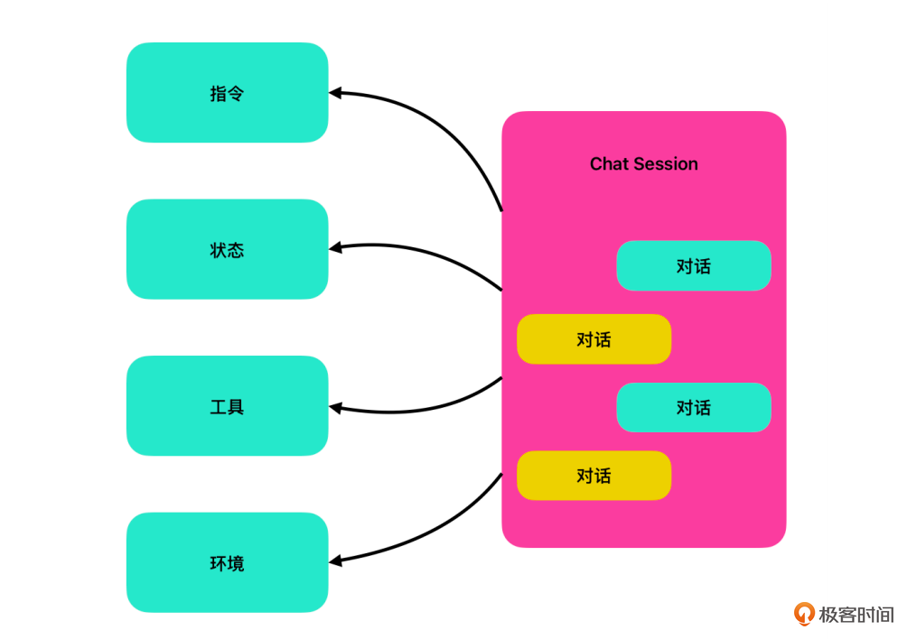
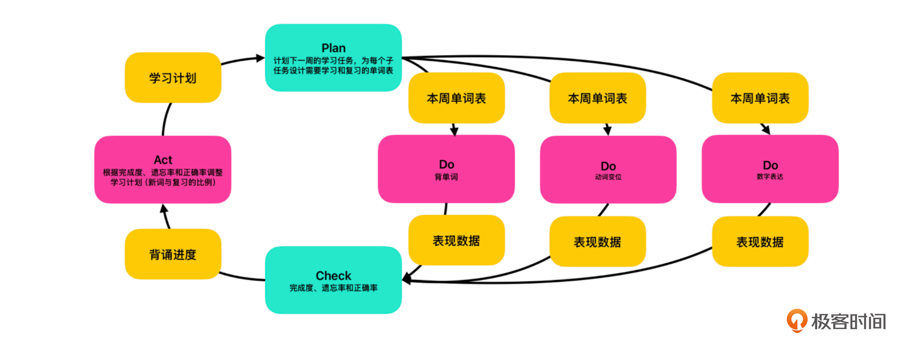

# 06 | 知识固化：从头构造一个Harness

你好，我是徐昊，欢迎继续学习驾驭工程。

前面几讲，从操控循环的概念到四个子系统，我们讲解了设计 Harness 的核心概念模型以及构成 Harness 架构的主要组成部件。也通过一个例子，看到了 Harness 具体的实现。

如果说到从头构造一个 Harness，你仍然会觉得千头万绪，无从下手。不要担心，实际上我们也不会真的纯手工打造 Harness，可以引导大模型帮助我们完成。我们所用的方法叫做知识固化（Knowledge Solidification）。

## 什么是知识固化

知识固化是指将存在于对话中的、临时性的知识逐步写入文件，变成持久的、可复用的规则和工具的过程。当我们开始构造 Harness 时，可以在 Agent 的对话中与大模型交互。大模型可以根据我们的问题，为我们提供设计方向和参考方案。我们在对话中纠正它、补充它、引导它，经过几轮试错和迭代，得到我们满意的结果。

这时候所有的知识都存在于对话的上下文之中，我们需要按照 Harness 架构，让大模型帮助我们把知识逐步写入指令、状态、工具和环境子系统即可。



- 知识固化

在 AI 时代之前，很多时候我们的障碍不是不知道怎么做，而是知道了也难以转化为行动。我们知道计算型控制更可靠，但编写工具函数需要编程能力。我们知道前馈、反馈控制更高效，但写入指令系统需要反复调试格式和措辞。知道和做到之间隔着技能门槛和执行成本。

AI 时代填平了这条鸿沟。我们只需要在概念上理解双层循环模型，了解构成 Harness 架构的组件，知晓构造 Harness 的最佳实践。就能通过知识固化，指导大模型，完成 Harness 的构造。

## 使用知识固化构造 Harness

接下来，让我们从头开始使用知识固化，来构造背单词的 Harness。因为我们之前在第三讲里，已经设计了这个 Harness 的整体架构，那么这里我们就跳过 Harness 设计的过程了。我们的 Harness 架构图如下：



- Harness 架构

### 构造仓库

现在，我们有了双层循环模型，按照我们的最佳实践，下一步就该设计我们的仓库结构了。

- 提示：因为 Agent 提示词不同，后面的操作不要用网页版的 AI 工具。比较方便的方法是你安装一个 Hermes，并选择 deepseek-v4-flash 这样的模型完成操作。

可以这样跟 Agent 对话：

```
我要做一个背西班牙语单词的Agent系统，比如200个单词分4周，每天学新词、复习旧词。请先帮我设计仓库
```

Agent 给了我这样的回答（在省略了一些无关信息之后）：

```sql
仓库结构设计
espanol-vocab/
├── README.md # 项目说明、用法、每日学习流程
├── schedule.yaml # 排程配置（每天新词数、复习间隔）
│
├── words/ # 词库（按周分，YAML 易编辑）
│ ├── week-01.yaml # 第1周 · 50词
│ ├── week-02.yaml # 第2周 · 50词
│ ├── week-03.yaml # 第3周 · 50词
│ └── week-04.yaml # 第4周 · 50词
│
├── progress.json # 学习状态（自动维护，JSON 方便 agent 读写）
│ # 记录：每个词的掌握等级、上次复习时间、下次复习时间
│
├── scripts/
│ ├── init.py # init → 从词库生成初始 progress.json
│ ├── today.py # today → 计算今天要学+要复习的词
│ ├── update.py # update <word_id> <grade> → 记录复习结果，更新间隔
│ └── status.py # status → 打印进度仪表盘
│
└── templates/
└── session-prompt.md # 学习会话模板（Hermes Agent 加载后执行）
核心数据流
┌──────────────┐
│ words/*.yaml │ ← 词库（你维护）
└──────┬───────┘
│ init.py
▼
┌──────────────┐
│progress.json │ ← 学习状态（agent 读写）
└──────┬───────┘
│ today.py + update.py
▼
┌──────────────────────────┐
│ 每日学习会话（CLI） │
│ 1. today.py → 获取今日 │
│ 新词 + 待复习词 │
│ 2. 展示单词 → 你回忆 │
│ 3. update.py → 记录结果 │
└──────────────────────────┘
进度 JSON 结构设计
json
{
"start_date": "2026-07-03",
"words": {
"pan": {
"en": "bread",
"zh": "面包",
"week": 1,
"day_introduced": 1,
"level": 2, // 0=刚学, 1-5=掌握等级
"next_review": "2026-07-05",
"history": [ // 复习记录
{"date": "2026-07-03", "grade": 3}
]
}
},
"scheduling": {
"new_per_day": 8,
"intervals": [1, 2, 4, 7, 14], // level 0→1 等1天，1→2 等2天...
"weekday_only": false
}
}
每周安排（200 词 / 4 周）
| 周 | 词数 | ~每天新词 | 每日总学习量（新学+复习） |
|-----|------|-----------|---------------------------|
| W1 | 50 | 7-8 | 7-8（全为新词） |
| W2 | 50 | 7-8 | 7-8 新 + ~8 复习 = ~16 |
| W3 | 50 | 7-8 | 7-8 新 + ~20 复习 = ~28 |
| W4 | 50 | 7-8 | 7-8 新 + ~30 复习 = ~38 |</grade></word_id>
```

可以看到，Agent 不仅仅设计了目录结构，同时还构造了状态子系统和工具子系统。当然，因为我们初始的提示词比较简略，也没有提及已经设计好的双层循环模型。那么我们可以稍微的提供更多的信息，让 Agent 帮助我们把这个设计做得更完善：

- 这个系统有三个学习环节，一个是背单词，一个背动词变位还有一个是练习使用数字表达。背单词和动词变位有

Agent 给了我这样的回答：

```sql
明白了，三个独立模块。重新设计结构如下：
espanol-vocab/
├── README.md
├── schedule.yaml # 全局排程配置
│
├── words/ # ── 模块一：背单词 ──
│ ├── week-01.yaml (~50词)
│ ├── week-02.yaml
│ ├── week-03.yaml
│ └── week-04.yaml
│
├── verbs/ # ── 模块二：动词变位 ──
│ ├── verbs.yaml # 动词主表 (词根 + 类型: ar/er/ir)
│ ├── irregulars.yaml # 不规则动词特殊变位
│ └── tenses.yaml # 时态定义表 (现/过/将来/虚拟...)
│
├── numbers/ # ── 模块三：数字表达 ──
│ └── config.yaml # 难度级别定义（无词表，随机生成）
│
├── progress/ # 进度持久化（各模块独立）
│ ├── words.json
│ ├── verbs.json
│ └── numbers.json
│
├── scripts/
│ ├── init.py # 初始化所有模块进度
│ │
│ ├── words/ # 单词子系统
│ │ ├── today.py # 今日学习清单（新词+复习）
│ │ ├── update.py # 记录复习结果
│ │ └── status.py # 进度仪表盘
│ │
│ ├── verbs/ # 变位子系统
│ │ ├── today.py # 今日变位学习清单
│ │ ├── exercise.py # 出题：动词+时态+人称 → 你填变位
│ │ ├── check.py # 校验变位答案
│ │ └── status.py
│ │
│ └── numbers/ # 数字子系统
│ ├── generate.py # <level> → 随机数字 + 西语写法
│ └── exercise.py # 交互练习（给数字说西语 / 给西语说数字）
│
└── templates/
├── session-words.md # Hermes Agent 背单词会话模板
├── session-verbs.md # Hermes Agent 动词变位会话模板
└── session-numbers.md # Hermes Agent 数字练习会话模板</level>
```

正如我们前面所讲的，目录结构本身并没太大的关系，可以有不同的设计方案。我们可以接受当前这个设计。

那么，就可以进行第一次知识固化了：

```
请按这个结构帮我构建目录，同时，将当前目录转化为 git 仓库。构造一个 AGENTS.md，将当前目录结构在
```

那么此刻，Agent 就会把目录结构放入 AGENTS.md 中，并在其中说明当前项的目的。注意，我们让 Agent 帮助我们将目录转化为 git 仓库，并要求它帮我们提交 git 保存。哪怕你不知道 git 是什么，但因为你知道使用 git 是最佳实践，我们也可以让 Agent 帮助我们完成操作。

### 外层循环与间隔重复算法

接下来，让我们先完成外层循环，并引入间隔重复算法（FSRS）作为整个学习计划的主要控制算法。那么，让我们来给出更具体的描述：

- 整个学习采用间隔重复算法作为记忆曲线的主要算法。无论哪个模块，以周为单位调整学习计划，如果当周掌握

由于之前我们已经让 Agent 将目录结构固化在 AGENTS.md 中，所以这一次有很大概率已经写入了 AGENTS.md，如果没有写入的话，我们可以再一次进行知识固化：

```
请把学习计划按照Plan, Do, Action, Check的结构，编写入AGENTS.md
```

Agent 给了我这样的回答作为修改后的总结，当然在 AGENTS.md 中有更为详细的记录：

```sql
Plan — 制定学习计划
- 每日：today.py 获取新词+复习清单
- 每周：weekly.py --adjust 四档策略（<80%继续 / >80%进下周 / 50-80%进下周+1.5x复习 / <
Do — 执行学习
- 展示→回忆→核对 三步，每个词独立交互
- 支持简化模式（不打分，由 Agent 按答对/答错自动确定 grade）
Action — 记录并更新进度
- update.py --id <word> --grade <0-4> 调用 fsrs 库更新 S/D 并计算下次复习时间
- fsrs 库自动管理间隔重复，无需手动计算
Check — 检查学习效果
- status.py 查看各周进度
- weekly.py --adjust 做周评估，结果反馈到下周 Plan</word>
```

顺便说一句，你可能会发现 Agent 在做完修改之后，会自动通过 git 保存。这也是因为在前面有所指示。当然，如果 Agent 没有进行这样的操作。我们也可以要求它使用 git 进行保存。这是一个好习惯，当做到一定程度，使用 git 存档，就好像我们编辑文档时，持续保存一样。

### 内层循环与技能提取

接下来就是内层循环了，在当前结构下，内层循环的三个模块都在 AGENTS.md 中，对于背单词这样的简单系统，这么做其实也可以。

但是最佳实践告诉我们，如果将三个模块都分离出去，成为独立的技能会更好，那么我们可以告诉 Agent：

```
将三大学习模块分解成独立的技能，放在当前目录的 skills 目录中，并同步更新目录结构。
```

Agent 回答我：

- 创建的三个技能

```
技能名: espanol-vocab-words
内容: FSRS 间隔重复、PDCA 六步流程、打分标准 (0-4)、周动态调整规则
────────────────────────────────────────
技能名: espanol-vocab-verbs
内容: 动词变位出题/校验、不规则动词查表、逐题交互流程
────────────────────────────────────────
技能名: espanol-vocab-numbers
内容: N1-N4 难度级别、双向翻译练习、西语数字快速参考表
AGENTS.md 的变化
- 从 268 行精简到 122 行
- 删除了三个模块的详细命令流程、交互规则、打分标准（内容已移入技能）
- 新增了"三大学习模块 → 三个技能"对照表，Agent 按意图匹配加载
- 目录结构新增 skills/ 条目，指向技能实际存放路径
- Agent 约束中新增"必须先 skill_view() 加载技能"规则
```

这个时候呢，我们可以检查一下 Harness 里的实现细节，毕竟从对话中持续的进行知识固化，可能会有一些不一致的地方。比如，这次我与 Agent 的协作中，我发现它把 PDCA 环节放入了每一个技能当中。也就是技能不仅仅提供具体的操作，还负责按照进度更新计划。这样每一个技能文件都非常冗长，在技能执行时，会失去注意力。

此时我们对于最佳实践的了解就能发挥作用了。我们都知道按照双层模型，外层应该负责整体计划，而内层只负责具体的执行就好。我们可以让 Agent 帮我们重写对应的部分，比如：

```
在AGENTS.md中，我们要根据三个模块的学习结果反馈，调整学习计划。而在具体的技能中，只需要按照下发
```

Agent 回答我：

```
明白。把职责边界划清：AGENTS.md 是"大脑"（接收反馈、调整计划），Skills 是"手脚"（执行计划、记录
...
核心变更：大脑 (AGENTS.md) vs 手脚 (Skills)
职责: FSRS 模型 (S/D/R)
之前: AGENTS.md + 三个 Skill 各写一份
之后: 仅 AGENTS.md
────────────────────────────────────────
职责: 打分标准 (0-4)
之前: AGENTS.md + 三个 Skill 各写一份
之后: 仅 AGENTS.md
────────────────────────────────────────
职责: 周调整规则 (80%/50%)
之前: AGENTS.md + 三个 Skill 各写一份
之后: 仅 AGENTS.md
────────────────────────────────────────
职责: "进入下一阶段"语义
之前: 分散在三处
之后: 仅 AGENTS.md（明确到具体模块）
────────────────────────────────────────
职责: 反馈→调整闭环
之前: 不存在
之后: AGENTS.md 新增：status.py 反馈 → 解读 → 周日 weekly.py --adjust
────────────────────────────────────────
职责: 命令清单
之前: Skills
之后: Skills（不变）
────────────────────────────────────────
职责: 交互规则
之前: Skills
之后: Skills（不变）
────────────────────────────────────────
职责: 排程参数
之前: Skills
之后: Skills（不变）
三个 Skill 的新 Overview 统一表述：
> 本技能仅负责执行，不负责任何计划调整决策。
> FSRS 模型 → 见 AGENTS.md / 打分标准 → 见 AGENTS.md / 周调整 → 见 AGENTS.md
回环路径：
Skill 执行会话 → status.py 汇报
↓
AGENTS.md 解读 (覆盖率/掌握率)
↓
周日 weekly.py --adjust
↓
AGENTS.md 决策 (80%/50% 四档)
↓
下次Skill 执行新计划
```

这样我们就成功地消除了坏味道，让 Harness 的结构重新回到了正轨。所谓坏味道，是指在Harness 中潜在的、影响 Agent 输出质量，造成 Agent 输出不稳定的特征。

这是从软件开发中借来的一个概念。而重构就是有针对性的消除坏味道的过程，也是从软件开发中借来的概念。在上面的例子里，我们知道如果不采用双层循环模型，Agent 和 Skill 的权责边界就不清楚，执行的结果也会有所偏移。因此，不符合双层模型就是坏味道，我们按照最佳实践提出改进，就是重构。

到此为止呢，我们就从零开始，搭建了一个可以使用的西班牙语背单词的 Agent 系统。

## 小结

今天，我们从头开始通过知识固化，重新构造了背单词的 Harness。知识固化不只发生在构造Harness 的阶段，在后续的持续改进中同样关键。

当我们发现 Agent 反复犯同一个错误，你在对话中纠正它，几轮试错后找到了有效的做法。把这条规则写进 AGENTS.md，就是一次改进中的固化。每一次改进的本质都是一轮新的固化：试错找到有效做法，写入文件让它持久生效。没有固化，改进就永远是临时补丁；有了固化，每一轮改进都在让 Harness 变得更完善。

最后我们还展示一个有效的人为介入的例子，也就是当我们发现坏味道，通过向 Agent 重申最佳实现对 Harness 进行重构。那么除了不符合双层模型，还有哪些坏味道呢？这些坏味道要如何消除呢？这将是我们后面章节的重点内容。

## 思考题

对于我们搭建的西班牙语背单词 Agent 系统，其中技能部分还可以进一步改进。比如现在是简单的单词背诵模式，我们可以进一步让 Agent 帮我们调整为句子翻译模式。这个就作为练习留给你们了。

期待你在留言区记录思考或疑问。也欢迎你把课程分享给有需要的朋友。
